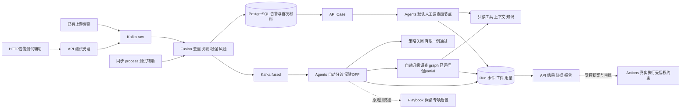

2026-10-22 v1.0.0运行更新：生产Kafka常驻自动分诊/调查已开启，API/Agents链图候选已发布，模型保持；生产tenant/新组、真实partial结果及读取样例见[生产接入](../integration/v1/production.md)。下文各历史批次的OFF/候选未发布不是本次最新运行状态；质量与缺源限制保留。

# 告警处理服务端架构与二开入口

**2026-10-22后端对接口径：** 正式已有告警由上游写Kafka raw，HTTP告警只作测试辅助；API保留查询、Case和人工调查入口。Kafka/存储配置、每步输入输出与结论读取见[v1发布交接](../integration/v1/README.md)。下文历史实测保留，不把原HTTP测试证据当作正式接入推荐。

**二开最新路线：** 先做可复用支撑能力UEBA、威胁情报/IOC、20上一版既有知识库，再进入Fusion、分诊、调查/攻击路径与Markdown交付。共享能力基础属性表、UEBA配置/基线问题及调查审计表见[逐模块说明](../operations/module-review-plan.md)。本轮只规划，IOC数据量及知识库历史经验后看，不预定合并不同调查状态模型。

**报告当前交付为Markdown：** 生成、持久保存及按Case/Run读取为本轮要求；PDF暂缓，HTML非前置，旧格式源码与历史结果保留，不追加格式/模型测试。

**2026-10-21 full配套：** 原版enrichment（IOC并发信誉查询/Redis缓存）、threatintel（Feed/IOC/actor存储检索）、UEBA（事件→基线/异常）补入服务端。历史事件经已有Fusion LakeWriter进入ClickHouse，再由API参数化调查工具/lake SQL和Agents读取；Attack Path使用已有Neo4j查询/PG回退。OpenSearch复用21既有实例，原TI索引/写入/搜索经项目索引配置接线；原码未提供的完整事件图自动投影/平台事件全文写入及取证数据类保持缺口，详见[数据流与运行回执](../operations/full-support-migration.md)。

2026-10-21，实施中的结构梳理。固定上游`34ca18c57dd4175539e5c6dd3d04a72dc057306b`。本图描述源码职责和调用关系，不代表每条路径已接通或启用；实际状态以[PROGRESS](../../PROGRESS.md)、批次回执和[官方功能对照](../operations/alert-function-alignment.md)为准。原全量模块地图仍见[参考分析](../reference/aisoc/01-system-map.md)，不重复覆盖采集、检测和前端。

当前第一步主链已有[B4 case02](../operations/integrity-autonomy-r01.md)的真实输入、自动调查/工具知识和结果报告读取证据；partial/质量失败保留。其他入口/分支、质量完善及常驻准入后续处理，不以本结构图要求当前全部开放或重验。

本轮同时交接三件事：沿固定源码理解原有设计；用[功能对照](../operations/alert-function-alignment.md)分清已实现、缺接缝和上游占位；用本文件给出后续二开的对象及落点。candidate03已部署B4/B5结果接线及报告修复，默认人工[R01](../operations/integrity-investigation-r01.md)四次真实调用/10167 tokens、MD/HTML/PDF200技术通过，但内容有三项失败。有限[B4两例](../operations/integrity-autonomy-r01.md)中关闭分支通过，自动调查分支真实调用但partial/内容失败，不能把结构箭头或已部署源码当作完整运行通过。

## 结构与主链

正式上游告警入口是Kafka raw；API是认证、Case操作、人工调查和结果查询入口，HTTP告警入口仅测试辅助。Fusion拥有告警处理及持久交付；Agents拥有分诊和调查编排、工具/模型调用与结果工件。Actions实现保留，不能从调查建议推断厂商执行已获授权。Redis承担原去重/关联/缓存/风险等状态，PG承担可查询持久事实；Kafka传递raw/fused，不以连接成功代替业务完成。

## 对象关系与不能混用的概念

| 对象 | 关系与源码入口 | 二开注意 |
| --- | --- | --- |
| RawAlert / FusedAlert | [Fusion模型](../../services/fusion/app/models/alert.py)，API保留镜像schema | raw指融合前告警；source-v1与legacy身份不可混算，新增字段须同步两份schema |
| Alert | PG独立告警行，来源ID、发生时间、正文及关联事实 | 用户已确认不同来源告警各存一行；不能因同事件合并而覆盖来源材料 |
| Fusion incident | 原聚合/关联摘要，见[consumer](../../services/fusion/app/workers/consumer.py) | 不自动等于`aisoc_cases`中的Case，不凭相似字段重建历史关系 |
| Case | [API cases](../../services/api/app/api/v1/endpoints/cases.py)，关联Alert ID集合 | 人工调查材料由服务端读取关联告警；原不同读取阶段的条数上限应按实际payload区分 |
| Run | [ledger](../../services/agents/app/investigator/ledger.py) | 原`case_id`文本字段因入口可能承载Case ID或告警目标ID；调用方不能默认所有Run都可按Case UUID解引用 |
| 事件/工件 | Investigation事件、报告、材料/读取回执、模型调用等 | 原始分诊与后续调查分开说明；来源引用、实际送入prompt、模型结论不互相替代 |
| 用量/费用 | [CostTracker](../../services/agents/app/core/cost_telemetry.py)与Run汇总 | tokens、实际测得费用、估算、未知分别表达，不能把未知填0；整Run总量不等于首次分诊用量 |

## 原调查入口

| 路径 | 实现与用途 | 当前说明 |
| --- | --- | --- |
| Case默认调查 | [API代理](../../services/api/app/api/v1/endpoints/cases.py)→[Agents入口](../../services/agents/app/api/investigate.py)→[默认编排](../../services/agents/app/investigator/orchestrator.py) | Recon→Forensic→Responder→Report；B2归属/材料、B3同Run知识接线已部署，R01实际技术通过、内容质量失败 |
| 自动分诊后升级 | [worker](../../services/agents/app/workers/fused_alert_consumer.py)→[graph runner](../../services/agents/app/graph/runner.py) | 原非自动关闭分支执行post-triage graph；B4独立结果/报告/可见调用材料及usage保护已部署、过直接测试，C1关闭通过、C2自动进入deep但partial/内容失败，首次分诊与后续图材料/用量分别保持；常驻worker及自动graph OFF |
| 原规则触发 | [worker](../../services/agents/app/workers/fused_alert_consumer.py)→[触发器](../../services/agents/app/playbook/alert_trigger.py)→[规则匹配](../../services/agents/app/playbook/store.py)→engine.run→investigate步骤 | 等级/标签规则是原设计；整体保留，额外改测后置，不新增规则引擎 |
| router / full graph / deep | [router](../../services/agents/app/orchestrator/router.py)、[workflow](../../services/agents/app/graph/workflow.py)、[deep](../../services/agents/app/investigator/deep_investigation.py) | 与默认四节点不同；B5 full graph目标归属/结果冷读及deep旧skill pin缺失时builtin回退已部署并直接验证，不代表这些分支都已真实运行；deep不是独立HTTP入口 |
| 状态与报告 | [Agents结果路由](../../services/agents/app/api/investigate.py)、[归属及持久读取](../../services/agents/app/api/investigation_access.py)、[API账本查询](../../services/api/app/api/v1/endpoints/investigations.py) | B5保留Case/Run/tenant绑定，failed/partial有报告时显式标注；默认仅持久MD，冷读可补转义HTML，graph另持久MD/HTML。R01三种格式200不代表内容质量或全部分支通过 |

## 数据、知识和结果的边界

源Alert的发生时间与工具查询的审计时间是不同材料；R01把查询失败写到源事件时间，已作为内容失败保留，不能按时间字段存在便认定事件已发生。图/日志不可用时只知提供告警中出现的账户，不能据此限定整个事件的影响范围。KB定义、取证观察和模型假设同样分开，避免把“技术通常如何实施”变成“本案已观察到”。

同Run知识读取、实际进入prompt的块/hash、模型可见标记、解析出的来源及语义支持分别记录。R01的Responder`(KB1)`与Report裸`KB1`被旧parser漏记；本地32项parser直接测试通过，离线测试时未部署；后续candidate04已部署、来源/配置及6HTTP身份独审限定accept（0模型/消息，不证明真实数据/质量），不回填旧Run。当前默认知识走PG全文，未使用的向量语义查询不成为此前置。

通用`/reports`与调查报告是不同出口：[按需handler](../../services/api/app/api/v1/endpoints/reports.py)只建pending，[scheduler](../../services/api/app/workers/report_scheduler.py)未消费该请求、定时renderer仍是标题/时窗占位；独立weekly digest有实质摘要。保留原实现及差距，不因调查PDF已返回200就宣称通用报告/定时投递完成。语义ATT&CK、swarm自动触发等上游未接通扩展也按功能对照单列，不自动扩为本批重构。

## 扩展位置与基本约束

- 新增告警字段：从受理schema、Fusion模型、消息、持久结果和API投影一路核对，保持首次材料和来源ID；不要只改模型prompt。
- 接入新的只读数据/工具：沿[ContextBundle](../../services/agents/app/context/bundle.py)及[工具](../../services/agents/app/tools)接线，核具体调用路径的tenant身份，成功、空结果、缺源和失败分开；有HTTP方法不等于有实际数据。
- 增加知识：优先已有读者、检索和来源封装，证明实际片段进入对应Run的prompt并能回查。PG全文与向量语义检索是不同路径，模型/维度/集合/身份须按实际使用路径对齐，不填充向量冒充同一空间。
- 改调查编排：先确定默认四节点、router还是graph分支，使用原状态与事件/工件；避免为统一接口先换架构。技能、知识、事实材料与模型建议分别保留。
- 接响应：调查提案、批准、执行请求及效果验证分开。普通功能迁移不自动赋予真实厂商工具权限，unknown副作用不自动重发。

入口/配置的准确迁移差异见[总计划](../operations/completion-plan.md)和来源清单；本文件是二开导航，不是替代运行回执的新完成标准。后续随实际修改补准确接口/字段，不先建设额外框架。

## 当前自动调查的二开注意点

C2真实调查说明，三个状态必须分别读取：首次自动分诊NR、后续`graph_completion=partial`、源告警triaged/未关闭。共享Run的completed首先表示已落首次分诊，不能单独解释成后续调查已完整完成；后续图状态、报告和graph_usage独立保存。整Run22568tokens包含首次2117和graph20451，预约observed只计首次分诊。

`confidence/scoring.py`的风险/关键词prior与实际证据不同，`tools/mitre.py`的技术映射与现场观察不同。扩展调查结论时应使用有来源的工具结果和明确未核范围；不可把risk分、候选技术、缺源或步数耗尽当确认依据。deep提示词还须对应source-v1真实字段`username/src_ip/raw_event`；仅支持旧字段会在源码材料尚在时遗漏上下文。以上接缝的已有本地修正保留，尚未最终独审、部署或真实模型验证，按[问题登记](../operations/upstream-issues.md)迁移后评估，不继续作为主链接通前置；旧C2不重调或改写。
