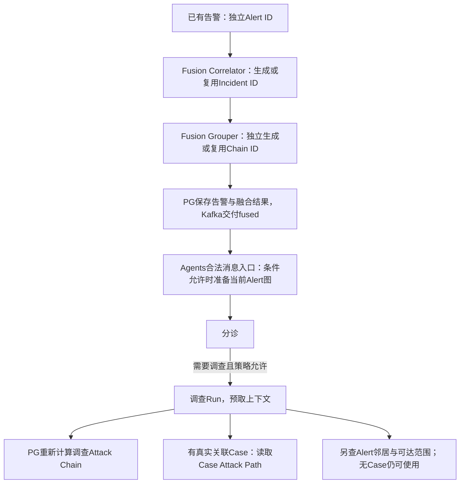
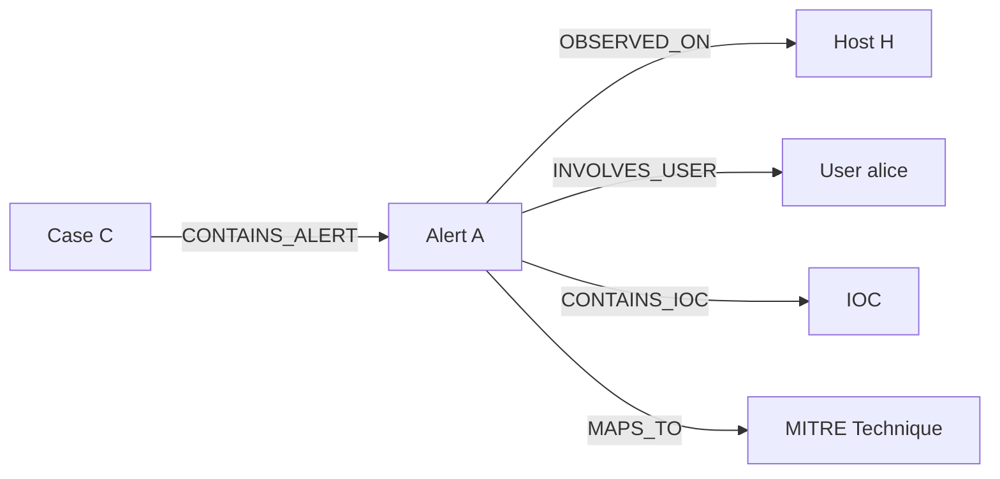

# 攻击链与图谱：概念、例子与调查使用说明

2026-10-22概念讨论已归档到本文：[对象与ID](#concepts)、[Incident与Fusion链四种归组组合](#membership-examples)、[调查Chain与Path的范围](#investigation-scope)、[Case与Playbook触发](#case-automation)、[讨论结论与未决取舍](#discussion-conclusions)、[当前模块评估与推进建议](#module-assessment)。这些章节区分源码事实、规则推演例子和未实施方向；不新增业务实现或验收结论。

2026-10-22增量：用户选择在Agents收到fused Kafka告警后统一准备图，Fusion保持不改；写入移到schema校验后、恢复/抑制/分诊前，后续上下文GET只读。源码与直接合同见[Kafka入口接线](../operations/kafka-graph-intake-20261022.md)，依赖补齐后另做[真实Kafka/PG/Neo4j联合观察](../operations/kafka-graph-joint-20261022.md)：在分诊入口前准备成功，直接邻域5节点4边；GET影响范围另有14个可达候选。下文2026-10-21真实Case证据保持原范围，当前联合不代替业务分诊/模型或21部署。

2026-10-21。本文说明当前工作区已经接入的接口与交接方式。**源码接通不代表21已发布或真实案例通过**；本地真实案例及模型、Run工件、报告实测见[本批回执](../operations/attack-chain-path-local-20261021.md)。此前调查测试见[上批回执](../operations/investigation-functional-20261021.md)，不能代验本次链图接线。

这项能力在调查开始时读取候选关联和图谱，把来源、范围及缺口一起交给原编排。它没有增加固定模型步骤，也不把候选链或图可达关系判为真实攻击因果。原四节点、Router、Graph/Deep仍各走各的流程。

## 1. 从什么输入开始

| 起点 | 必要输入 | 如何选种子与图 |
| --- | --- | --- |
| 已有Case | 认证身份中的tenant＋真实`case_id` | 从同租户Case关联告警取最早`event_time`的种子；优先`aisoc_cases.alert_ids`，其中没有可读告警才按`alerts.case_id`寻找。读取Case路径，同时可查种子Alert的邻居/范围 |
| Alert起点 | 认证身份中的tenant＋canonical `alert_id` | 始终以该告警作链种子。API可解析它实际唯一关联的同租户Case；无Case或关联多个Case时保留Alert分支，Case路径为`not_linked` |

不能把Fusion incident、候选链ID、历史Run的`case_id`占位或模型写出的字符串当作真实Case。指定Case和Alert两者时，API验证两者实际关联。不存在、跨租户或不属于该Case的目标返回404，不猜测归属、不自动创建Case。

API从PG现有行读取资料，而非接受调用方提交的节点或模型推断：

| PG字段 | 当前用途 |
| --- | --- |
| `aisoc_cases.alert_ids`、`alerts.case_id` | Case与告警的实际关联；tenant检查始终保留 |
| `alerts.event_time`、`affected_users/hosts/ips/assets`、`mitre_techniques`、severity | 原Attack Chain算法的时间、共享实体及关联评分输入 |
| `affected_hosts/users/ips`及`entities[]`的host/user/ip/domain/hash/url等类型 | 确定性图投影的主机、用户和指标；不从模型输出补入新实体 |
| `mitre_techniques` | 告警已有技术标签对应的图关系，不证明本案实际发生该攻击阶段 |

链与投影的输入字段并不完全相同：链沿用原`affected_*`字段消费，不能因为提示词或`entities`中有一个名字，就假定原链已经按它关联。

源码：[API交接服务](../../services/api/app/services/investigation_attack_context.py)、[原链算法](../../services/api/app/services/attack_chain.py)。

## 2. 配置怎样使用

| 配置 | 设置位置及含义 |
| --- | --- |
| `AISOC_ATTACK_CONTEXT_ENABLED=true` | API与Agents均显式配置。默认false：API新context入口拒绝使用，Case启动不准备图，Agents不新增链图预取 |
| `API_SERVICE_URL` | Agents访问API的地址；新链图适配读取这个变量，默认`http://api:8000`。本地测试使用已经建立的访问地址/隧道 |
| `AISOC_INVESTIGATION_CONTEXT_KEYS_FILE` | 首选租户reader映射；未配置这个文件名时才选择`AISOC_TRIAGE_IDENTITY_KEYS_FILE` |
| `AISOC_TRIAGE_IDENTITY_KEYS_FILE` | 兼容既有租户reader映射。显式选择的映射缺该租户、文件不可读或凭据无效时不回退到通用token |
| `AISOC_API_SERVICE_TOKEN`／`AISOC_SERVICE_TOKEN` | 两种reader映射均未配置时，新链图读取可用的既有服务只读身份。API要求同时传`X-AiSOC-Tenant-ID`；它没有投影写权限 |
| `AISOC_INVESTIGATION_PREPARE_KEYS_FILE` | Kafka消费入口Alert准备使用的独立租户writer映射。未配置时记录缺口；writer与reader/通用服务身份相同时拒绝借它写入。后续context GET不使用writer |
| API的PG、Neo4j配置 | 复用已有数据库及图驱动；开feature flag不会安装Neo4j、补数据或自动修复连接 |
| `AISOC_GRAPH_ENABLED=true` | 既有Agents图工具开关，适用于原邻居/影响范围及末端旧查询。它不替代API新context开关或读写身份 |

映射文件使用现有读取合同：普通JSON对象，key是准确的tenant UUID，value是该租户凭据；文件为普通文件、权限0600或更严。示意内容如下，尖括号必须替换，不是真实凭据：

```json
{"<tenant-uuid>": "<tenant-reader-or-independent-writer>"}
```

Case准备仍由正式`POST /cases/{case_id}/investigate`内部执行，该请求已经通过`cases:write`及Case归属校验。Kafka公共消费入口在schema通过后使用独立writer准备当前Alert，要求`alerts:write`，不等待形成Case或升级调查；review-only、shadow及非live writer的禁写范围保持。模型及永久七权限reader不增加写权限。后续Bundle/Graph/Deep只GET，不重复POST；直接/replay调用triage不经过这个Kafka写入口。仅写`settings:write`不是新prepare入口按锚点使用的权限。

新feature flag不改变`AISOC_INVESTIGATE_USE_ROUTER`或Kafka worker开关。前者仍只决定Case调查选择原四节点还是Router；后者决定自动分诊是否常驻消费，不能用“配置链图”代替启动自动业务。

源码：[Agents适配与身份](../../services/agents/app/context/attack_context.py)、[映射读取](../../services/agents/app/context/organisation_memory.py)、[API路由权限](../../services/api/app/api/v1/endpoints/graph.py)。

## 3. 一次调查逐步做了什么

| 步骤 | 目的、实际输入 | 输出与下一步采用 |
| --- | --- | --- |
| 1. 接收锚点 | Case来自已认证API请求；自动告警传显式真实Case或canonical Alert，tenant来自当前工作 | 交接`case_id/alert_id/tenant_id`，不拿incident UUID冒充Case |
| 2. 准备本次图 | Kafka入口在分诊前投影当前Alert；人工Case入口准备其关联告警，均由可信API读取同租户PG事实 | `projection.status/source_alert_ids/reason/error/truncated`；HTTP200还需校验身份、状态与当前Alert来源，不能代替投影成功 |
| 3. 固定预查询 | Agents对新GET传Case或Alert；默认窗口24h | 同一响应内的`attack_chain`、`attack_path`、`alert_graph`及各自来源/错误。GET不写Neo4j，也不写原Case链缓存 |
| 4. 进入Bundle | `ContextBundleBuilder`在原预处理fan-out中读取一次新context | `context_bundle.attack_context`，保留结构及缺源状态；不为每个Agent重新GET一遍 |
| 5. 生成模型材料 | 用确定性`model_summary`渲染已取到的来源结果 | 包含关联ID、时间、共享实体、原分数、来源和unknown边界；交给原模型输入，非新增一次模型分析 |
| 6. 原编排分析 | 默认四节点、Router或Deep在原有调用中使用摘要 | 输出仍沿原schema与编排采用；“拿到资料”与“模型准确引用/得到正确结论”需分开核实 |
| 7. 保存与交付 | 原Run/tenant及本次三块context | 三类工件、原步骤审计及Markdown；按Run读当时工件，不用当前图查询冒充当时输入 |

正式Case入口仍传原嵌套`raw_alert.alerts[]`，没有flatten。它原始告警正文投影是最新最多3条；**链种子另按Case关联取最早告警**，不取这3条的第一项代替。Case ID及准备回执附在该payload中。默认调查的具体启动、状态和报告接口见[调查说明](investigation.md)。

### 图准备表达什么

显式Case准备最多投影50条已核同租户告警；显式Alert准备只投当前已核告警，有真实Case时补其成员关系，不受Case前50条截断影响。每条主机、用户、IOC及技术分别有界，超范围通过`truncated`交接。Host/User新ID由tenant、实体类型、原字段值稳定生成，保留多实体，不只取首项。Alert/Case使用原PG UUID。

新IOC使用tenant所属的内部`id`，原指标保存在`properties.indicator_value`；不把tenant前缀冒充域名/IP，不改旧全局`IOC.value`约束或批量迁移旧图。读图兼容旧value和新indicator_value；主机/用户兼容内部id与hostname/username。

Alert节点及关系保留`source_alert_id`，其语义是**来源告警报告的关联**。数据已在PG或已写进Neo4j，不会自动升级为独立核实的入侵证据。MITRE关联也不证明攻击阶段已经发生。

准备只覆盖本次Case/Alert范围，不做全量历史回填、raw采集或持续全平台同步。原链可以搜索Case以外的同租户候选，但这不表示这些候选已全部投影进当前Case路径。

### 链、Case路径和Alert范围的区别

| 材料 | 算法与范围 | 输出含义 |
| --- | --- | --- |
| `attack_chain` | 原PG共享实体BFS，最多3轮告警扩展、返回最多50条候选；`24h`表示种子`event_time`前后各24小时 | 原关联得分排序，保`shared_entities`；并非纯时间排序或恶意概率 |
| `attack_path` | 真实Case→Alert→Host/User/IOC/Technique的Neo4j查询；无图可用PG关系回退 | Case成员/来源关联及图可达关系；`source=postgres_fallback`必须与Neo4j区别 |
| `alert_graph` | 指定Alert或Case链种子Alert的邻居与blast radius | 告警关联范围，不是没有Case时自动生成的完整Case攻击路径 |

原链评分保持`0.55 × 图距离因素 + 0.30 × 时间接近因素 + 0.15 × 风险重叠因素`；风险重叠沿原MITRE/严重度规则，不由大模型打分，本批没有调整权重。支持窗口为`1h/6h/24h/72h/7d/30d`。

`empty`是查询成功但没有相应结果；`unavailable`是没查成；无真实/唯一Case的`not_linked`是Case路径不适用。回退可以有节点/边并返回成功，同时保留主图错误；不能因为节点数大于0就称已查得Neo4j完整攻击路径。

## 4. 各编排怎样交给模型

| 编排 | 本次接入位置 | 模型输入与产物 |
| --- | --- | --- |
| 默认Recon→Forensic→Responder→Report | 调查前原Bundle预取，三类context工件关联本Run保存 | 原Bundle摘要进入各节点原prompt；四个角色的目的、输出schema和顺序不变，报告仍由ReportWriter生成 |
| Router | Case stream_kwargs预取Bundle；顺序/并行专业调用均显式传`bundle` | 原一次领域模型接收Bundle摘要，分支不增加工具循环；响应仍确定性dry-run汇总，Markdown renderer展示链图上下文 |
| Graph/Deep | 自动升级worker用显式Case/Alert取Bundle；Deep的原user消息追加有界Bundle材料 | Deep可据候选再选择原工具核查，不因此新增固定轮次；Graph结果事务保存三类工件。末端AttackPath优先复用本Run材料，避免把后查结果倒算成前面模型已看过 |

`model_summary`先写三块状态/来源/错误，再写候选细节；正文上限4200字符并包入untrusted数据块。候选摘要最多5条、每条共享实体最多4项，图边最多5条、IOC显示最多3项；更大结构保留在工件。默认Bundle总追加仍受原8000字符及后续模型输入/脱敏合同约束，不保证每个模型看到全部结构或未截断的全部摘要。

审计时核对该Run实际prompt，而不只检查state有`attack_context`。工具是否执行仍以实际请求/返回及下一轮ToolMessage为准；摘要中列出的候选本身不是新执行的查询工具。

源码：[Bundle](../../services/agents/app/context/bundle.py)、[默认编排](../../services/agents/app/investigator/orchestrator.py)、[Router](../../services/agents/app/orchestrator/router.py)、[Deep输入](../../services/agents/app/investigator/deep_investigation.py)、[末端AttackPath](../../services/agents/app/agents/attack_path_agent.py)。

## 5. 接口怎样调用与读取

下列为请求模板，`$CASE_ID/$ALERT_ID`必须是当前租户的真实PG标识。凭据通过当前进程配置提供，示例不包含实际token。

读取Case上下文，需`cases:read`；Alert对应`alerts:read`。服务身份必须同时声明tenant：

```bash
curl -sS "$API_BASE/api/v1/graph/investigation-context?case_id=$CASE_ID&window=24h" \
  -H "Authorization: Bearer $READ_TOKEN" \
  -H "X-AiSOC-Tenant-ID: $TENANT_ID"
```

显式准备Alert图，需独立`alerts:write`凭据；Case通常由正式调查入口内部准备：

```bash
curl -sS -X POST "$API_BASE/api/v1/graph/investigation-context" \
  -H "Authorization: Bearer $WRITE_TOKEN" \
  -H "X-AiSOC-Tenant-ID: $TENANT_ID" \
  -H "Content-Type: application/json" \
  --data "{\"alert_id\":\"$ALERT_ID\"}"
```

POST只接锚点和window，不接任意节点、Cypher或SQL；window用于参数合同校验，不控制图投影时间范围。必须检查返回的`projection.status`及`reason/error`，再GET读取实际结果。合法目标的GET/POST正常HTTP200，缺权限403、未知/越租户目标404、参数不合法422；新context开关关闭返回503。

| 需要读取的内容 | API |
| --- | --- |
| 三块本次查询结果 | `GET /api/v1/graph/investigation-context?case_id=…`或`?alert_id=…` |
| Case原链 | `GET /api/v1/cases/{case_id}/attack-chain?window=24h`；原端点仍保留PG缓存写，不能用它替代新只读context GET |
| Alert薄链入口 | `GET /api/v1/alerts/{alert_id}/attack-chain?window=24h`；原seed算法、无缓存写 |
| Case路径当前视图 | `GET /api/v1/graph/attack-path/{case_id}`；额外`source/fallback`区分Neo4j与PG回退 |
| Alert当前邻居/范围 | `GET /api/v1/graph/neighbors/alert/{alert_id}`、`GET /api/v1/graph/blast-radius/alert/{alert_id}` |
| Run步骤 | `GET /api/v1/investigations/{run_id}/events`，或`/explain?step=N` |
| Run当时工件 | `GET /api/v1/investigations/{run_id}/artifacts`，再`/artifacts/{artifact_id}` |
| 最终Markdown | `GET /api/v1/cases/{case_id}/investigations/{run_id}/report.md` |

context GET响应顶层包含`tenant_id/case_id/alert_id/scope/queried_at/query_scope`；三个子块均有`status/source/data/error`，链另含`query.window`及时间锚点，Case路径另含`fallback`。新GET只查询，不关闭告警、不创建Run。

Run新增工件kind为`attack_chain`、`attack_path`、`alert_graph`。每份包含该子块原有界结果，以及共同的tenant、Case/Alert、scope、queried_at、prepare和本Run的`model_summary`。即使Case路径是`not_linked`，也保留它的适用性说明。它们沿原工件存储，不新增表；本地组件未配置DB时不会因此凭空产生线上Run或工件。

本地真实案例见[完整回执](../operations/attack-chain-path-local-20261021.md)。四Agent实际消费与Neo4j/工件HTTP读取已限定实测；Router/Deep消费接缝为直接测试，本批未发布21，不外推所有分支或质量。

`attack_context`预取保留既有22秒总截止，但当前预取只执行GET，写入已经移到Kafka/Case入口；其余原来源仍3.5秒。Case payload内投影回执按tenant/Case对齐保真；Kafka回执仅从消费上下文按tenant/canonical Alert传入，不接受消息自行声明。准备回执与GET事实保持独立，未投影成功不会被HTTP200掩盖。

<a id="concepts"></a>

## 6. 对象、ID与四项能力的区别（2026-10-22讨论记录）

本节起保存本轮概念辨析、例子和结论。事实依据固定上游及当前工作区源码；下文A/B/C、H1/H2、S1/S2等是规则推演符号，不是真实Alert、主机或IP，也不是新执行的业务测试。已有真实Run、图和模型证据仍以页首回执为准。

### 6.1 告警、事件、Case、Run不能互换

| 名称/标识 | 标记的对象与产生方式 | 不应据此推断什么 |
| --- | --- | --- |
| Alert / canonical Alert ID | 一条独立来源告警在PG中的身份；不同来源告警分别存行 | 关联后不因此折成一条告警，也不因此属于已确认攻击 |
| Fusion Incident / `incident_id` | Correlator按规则形成的告警组；有可复用组则沿用ID，否则UUID4新建 | 不等于`aisoc_cases`中的Case；单条告警也能形成Incident |
| Fusion候选链 / `chain_id` | AttackChainGrouper为Redis实体链分组分配/复用的UUID | 不等于Incident ID、Case ID或调查链签名，不是已确认攻击活动ID |
| Case / `case_id` | `aisoc_cases`中的真实案件行，按实际成员关系组织告警、任务和后续处理 | Fusion Incident、链ID、旧Run字段里的兼容占位不证明真实Case存在 |
| 调查Run / `run_id` | 一次调查执行、步骤、工件和结果的身份；普通Kafka路径按告警与工作流版本生成稳定ID | 建Run或自动执行调查不代表同时创建Case；一个Case可以有多次Run |
| 调查链 / `chain_signature` | 种子Alert ID加排序候选Alert ID计算的摘要，用于辨识结果、减少重复写入 | 不是Fusion `chain_id`，不是一个长期攻击组织/活动身份，也不证明攻击因果 |

历史实现有些Run/接口字段命名为`case_id`，实际可能曾放Alert或incident相关UUID；必须查询同租户真实Case及成员关系，不能只看字段名判断对象类型。

### 6.2 四项能力分别解决什么问题

| 能力 | 业务问题 | 输入/成员 | 当前输出与后续采用 |
| --- | --- | --- | --- |
| Incident归组 | 这条新告警按Fusion规则属于哪个事件组？ | 当前RawAlert，组内成员为Alert | `incident_id`及Redis IncidentSummary；随fused交付、PG保留，并带入Agents状态/告警API |
| Fusion候选链 | 到达时能否把这条告警与已有共享实体的告警串在一起？ | 当前RawAlert，Redis链成员为Alert | `enrichments.attack_chain`；内部续组、随消息交付及快照留存，当前未接下游业务消费 |
| 调查Attack Chain | 围绕种子告警，历史上还有哪些相关告警值得一起调查？ | PG种子Alert及同租户历史Alert | 相关告警、距离、分数、关联图、`chain_signature`；进入调查上下文及Run工件 |
| Case Attack Path | 当前Case有哪些告警，这些告警涉及哪些对象和关系？ | 真实Case及已有图中的Case/Alert/Host/User/IOC/Technique | 关系子图、来源及缺口；进入调查上下文，末端节点可补图摘要/可达范围及提案 |

两种Chain的成员都是Alert，**调查Attack Chain不是对Incident对象做链关联，也不是继续扩展Fusion链**。Incident、Fusion链、Case不是三个必然嵌套的容器。

### 6.3 实际产生顺序



Fusion先调用Correlator取得Incident，再调用Grouper附链注记；不是先由Chain ID产生Incident ID。写图发生在Kafka schema通过后、分诊之前，不等于已经启动完整调查。后续调查上下文GET只读；自动调查和人工Case调查继续使用原编排。

源码：[Fusion调用顺序](../../services/fusion/app/services/fusion_engine.py)、[Incident模型/键](../../services/fusion/app/models/alert.py)、[Correlator](../../services/fusion/app/services/correlator.py)、[Kafka状态与入口](../../services/agents/app/workers/fused_alert_consumer.py)。

<a id="membership-examples"></a>

## 7. Incident与Fusion候选链：规则、用途及四种成员关系

### 7.1 两套归组规则

| 比较项 | Incident归组 | Fusion候选链 |
| --- | --- | --- |
| 实体如何选 | 只选一个主实体：`src_ip → hostname → username → domain → unknown` | 依次查`hostname → username → src_ip`对应的活跃链，首个命中即停止 |
| 同租户内的匹配规则 | `主实体值 + 第一条mitre_tactic`组成关联键 | 使用带实体类型的索引找到已有链；未命中时新建链，再把当前告警出现的实体指向它 |
| 战术作用 | 第一条战术参与决定属于哪个Incident | 战术不决定链成员，只计算阶段与位置；可以跨战术归同链 |
| 时间机制 | 默认关联索引TTL 3600秒，新建时设置；追加会续摘要TTL，但不续该索引TTL | 默认TTL 3600秒，刷新当前出现实体的索引及所选链成员列表；不是严格按event_time滑窗 |
| 容量与历史 | 默认每Incident最多500条，不能复用时可新建 | 当前链成员最多保留50条；不会把两条已存在链的成员历史合并 |
| 结果身份 | `incident_id` | `chain_id`，与Incident无派生关系 |

所以，Fusion链既不是“只看IP”，也不是要求“同一主机且同一用户”。同主机不同用户可以同链；跨主机同用户也可以，但前提是更先查询的主机没有命中另一条已有链。这里IP特指源IP，当前分组不使用目的IP、域名、进程、会话或文本语义。

阶段来自输入MITRE战术标签的固定顺序，位置按`阶段序 + time.time()处理时刻`计算。它不是原始告警event_time排序，也不是已观察到的真实攻击第几步。当前接受英文战术名，直接输入TA编号等未映射值会成为unknown。源码称AttackChainGrouper，这是上游原有功能，本轮没有新增一个名为CandidateChain的第三种对象；“候选”只是提醒不能把实体归组当成攻击确认。

源码：[Incident关联键](../../services/fusion/app/models/alert.py)、[组复用/上限/TTL](../../services/fusion/app/services/correlator.py)、[链索引/阶段/成员](../../services/fusion/app/services/attack_chain_grouper.py)、[开关及默认值](../../services/fusion/app/core/config.py)。

### 7.2 两个告警是否同组：四种组合都可能

这里比较的是成员归属，不是比较Incident UUID和Chain UUID的字符串是否相等。以下先假设同租户、两条独立告警、功能开启、Redis正常、状态未过期、未达容量上限；除明确说明外，没有预存链或其他桥接告警干扰。

| 两条告警的关系 | 同一条Fusion链 | 不同Fusion链 |
| --- | --- | --- |
| 同一个Incident | 主实体、首战术相同，链也命中同一已有组 | Incident键相同，但链优先采用各自主机等实体已经指向的不同链 |
| 不同Incident | 战术不同，或主实体不同，但链通过共享实体命中同组 | Incident键不同，链也没有命中同一活跃组 |

**例一：同Incident、同链。** A与B都报告主机H1、源IP S1、首战术Execution。Incident均按`S1 + Execution`归I1，B又通过H1进入A所在链X。

**例二：不同Incident、同链。** A报告H1/S1/Execution，B报告H1/S1/Credential Access。战术不同使其分别归I1、I2；共享H1使其同归链X。另一例：主机H1相同、源IP不同、首战术相同，Incident因优先采用不同源IP而拆组，链仍可通过H1相连。

**例三：同Incident、不同链，无需故障或过期。** 三条告警按下表顺序到达，首战术都为Execution：

| 顺序 | 告警 | 主机 | 源IP | Incident | Fusion链 |
| --- | --- | --- | --- | --- | --- |
| 1 | P | H2 | S2 | I0 | Y |
| 2 | A | H1 | S1 | I1 | X |
| 3 | B | H2 | S1 | I1 | Y |

B与A的Incident键都是`S1 + Execution`，因此同归I1。B的链分组先查主机H2，已命中Y，便停止查找，不采用源IP S1原来指向的X。随后B把S1索引改指Y，但不把A从X迁移过来，也不合并X/Y成员历史。因此到达顺序和当时的实体索引指向会影响归组；不能把规则简化为“共享任意实体就必定同链”。

**例四：不同Incident、不同链。** A报告H1/alice/S1/Execution，B报告H2/bob/S2/Execution，且没有其他历史桥接。主实体不同，Incident拆组；三个链实体均未连到同一活跃组，链也拆组。

上述例子证明两套分组可以交叉，不保证谁包含谁。未统计真实告警分布，不能据规则声称“它们基本一样”或给出重合率。状态过期、上限、配置不同还可能改变结果；没有host/user/src_ip、功能关闭或查询失败导致无链结果时，应该记“未分配/不可用”，不是强行算作另一条链。

### 7.3 Chain ID现在究竟有什么用

当前已核实的服务端事实：Chain ID在Fusion内部是实体索引与成员列表的关联标识，Grouper用它查旧成员、追加当前告警及计算注记。它的设计意图包括关联展示、提供分诊线索，但源码注释本身不是下游已展示或模型已采用的证据。

| 位置 | 当前真实采用 |
| --- | --- |
| Fusion Redis | `chain:idx:{tenant}:{type}:{value}`指向链，`chain:members:{chain_id}`保留当前成员；用于后续到达时续组 |
| fused Kafka消息 | 带`enrichments.attack_chain`：`chain_id/is_new_chain/position/stage/entity/prior_alert_ids/member_count` |
| PG首次交付快照 | 完整结果保留在`alerts.enrichment_data.socai2_fusion.delivery_snapshot.fused.enrichments.attack_chain`；不是专门的永久Fusion Chain表 |
| 普通Agents状态 | 当前`build_state`没有携带这份enrichment；没有核到它驱动分诊或自动调查的消费者 |
| 调查Chain / Path | 重新查PG或Neo4j，不读取Fusion `chain_id`、Redis成员或`prior_alert_ids` |
| Incident / Case | 不用这个Chain ID建组、建Case或合并已有对象 |

结论限定为：**已实现内部续组、消息交付和留存，尚未接通当前下游业务消费。**不能写成“任何地方都没用”，也不能列成“已为调查提供统一攻击链”。它目前额外表达的是跨战术/跨主实体的短期实体告警组和阶段注记，不能证明这些告警属于同一次攻击；同主机上的独立活动也可能被串到一起。

Incident ID则独立保存到`enrichment_data.socai2_fusion.incident_id`，带入Agents的`InvestigationState.incident_id`，告警API可返回`fusion_incident_id`。这不意味着调查以整个Incident为查询边界或自动拿该UUID当Case。

源码：[链结果附加](../../services/fusion/app/services/fusion_engine.py)、[完整快照](../../services/fusion/app/services/delivery_recovery.py)、[PG保存](../../services/fusion/app/services/alert_sink.py)、[Kafka交付](../../services/fusion/app/workers/consumer.py)、[Agents字段映射](../../services/agents/app/workers/fused_alert_consumer.py)、[告警API](../../services/api/app/api/v1/endpoints/alerts.py)。

<a id="investigation-scope"></a>

## 8. 调查Attack Chain与Attack Path：锚点、范围与能力边界

### 8.1 入口选择锚点，具体查询规则决定结果范围

| 比较项 | 调查Attack Chain | Case Attack Path | 单Alert图（alert_graph） |
| --- | --- | --- | --- |
| 起点 | 显式Alert，或Case最早有效关联Alert | 真实关联Case | 显式Alert或Case链种子Alert |
| 数据源 | PG `alerts` | Neo4j，必要时PG关系回退并标来源 | Neo4j |
| 展开方法 | 按`affected_users/hosts/ips/assets`共享实体扩展最多3轮 | 沿Case包含告警、告警观测主机/涉及用户/包含IOC/映射技术的出向关系，默认最多6层 | 邻居查询；blast radius默认3跳、无向可达查询 |
| 时间/成员边界 | 默认种子event_time前后各24小时，同tenant，最终最多50条非种子候选 | 从Case及已有边展开，当前没有按事件时间重建攻击顺序 | 当前可达查询没有相同的时间/关系类型约束；可通过共享Technique达到Case外对象 |
| 能否跨Incident/Case | 可以，不以Incident ID或Case成员作硬边界 | 不因Fusion同链或PG链候选而自动纳入其他Case告警 | 可以到达当前Case外的同租户关联对象；可达不等于确认影响 |
| 结果 | 相关告警、分数、距离、实体关联图、签名 | 节点、边、来源、回退/缺口 | 邻居及可达候选/分数 |

Alert入口即使唯一关联到一个Case，PG链也保持指定Alert为种子，不换成Case里更早的Alert。Case入口优先从`aisoc_cases.alert_ids`中取最早有效同租户告警，显式列表没有有效行才采用`alerts.case_id`关联；这不是把Case所有成员作为多种子一起搜索。Alert关联多个Case时不任意挑选一个，Case Path记`not_linked/ambiguous_case`。

### 8.2 PG调查链的扩展例子

假设A涉及H1/alice，B涉及H2/alice，C涉及H2/bob。在同租户、查询时间范围及容量内，A可通过alice找到B，再通过B的H2找到C；C不必与A直接共享实体。当前返回的`shared_entities`是种子与候选的直接交集，因此多轮候选的该字段可能为空，不能据此说它未通过中间告警关联，也不能说API已经返回完整的逐边因果证据。

候选按`0.55×距离 + 0.30×时间接近 + 0.15×MITRE/严重性重叠`评分；主要按分数降序，同分才按event_time排序。响应中的confidence只是最高关联分，不是恶意概率。每轮PG查询还有最多100条的限制，最后保留最多50条，不保证穷尽全部相关告警。`chain_signature`是种子及排序候选ID的SHA256摘要前32位；成员/排序变化可能改变签名，没有接续Fusion Chain ID。

### 8.3 图里的关系表达什么

当前投影从同租户可信PG告警建立以下已报告关联：



图投影可以复用实体节点，但没有自动补出主机横移、进程父子、登录会话或告警因果边。Case查询读取这些关系的子图，不是最短攻击路线搜索，也不是按时间还原攻击经过。无真实关联Case时，Case Path为`not_linked`，不凭空建Case；Alert邻居和可达范围仍可单独有结果。Neo4j失败/无图的PG回退必须保留`source/fallback/error`，不能把PG成员边当完整Neo4j行为路径。

因此本轮采用的表述是：**Chain搜索“还有哪些相关告警”；Path展开“这个Case涉及哪些对象，它们有哪些已记录关系”。**不能把二者简单叫作“重实体”和“重行为/交互”：当前两者都依赖实体和告警已有字段。真正的行为路径需要另有带时间和证据的登录、进程、连接、会话、横移等数据与边；这里只解释缺少这些关系会有什么限制，没有批准新增采集、图算法或行为推断。

### 8.4 从同一输入看两种调查结果

假设同租户、时间和状态满足上述规则，A/B/C都报告H1/S1；A、B的首战术为Execution，C为Credential Access；历史D也有H1且处于PG查询窗口内：

| 机制 | 可能结果 | 不能据此发生的动作 |
| --- | --- | --- |
| Incident | A/B归I1，C归I2 | 不因此把I1/I2合并 |
| Fusion链 | A/B/C归X；更早的D未必仍在同一活跃链 | 不因此确认是一场攻击或触发Case |
| 以A为种子的调查链 | 可能找到B/C/D，即使它们不在同Incident或Case | 不自动改变原告警/事件/Case成员 |
| 已建Case K仅关联A/C后的Case Path | 展开K、A/C及其主机、用户、IOC、技术关系 | 不因B同属X或出现在PG链中就自动把B纳入K；Alert blast是另一查询 |

三块调查材料经Bundle生成有界模型摘要，并分别作为`attack_chain/attack_path/alert_graph`工件保存到本Run；代码/数据库先完成基础归组和查询，模型再基于材料分析。它们不会单凭共享实体或图可达关系自动提升为确认事实、自动合并对象或执行真实响应。

源码：[锚点/投影/三块读取](../../services/api/app/services/investigation_attack_context.py)、[PG链算法](../../services/api/app/services/attack_chain.py)、[图构建与遍历](../../services/api/app/services/graph_service.py)、[模型摘要与工件](../../services/agents/app/context/attack_context.py)、[末端AttackPath节点](../../services/agents/app/agents/attack_path_agent.py)。

<a id="case-automation"></a>

## 9. 自动调查、Case创建与Playbook不是同一个动作

| 触发/操作 | 当前行为 | 是否自动创建本系统Case |
| --- | --- | --- |
| 一条正常新告警进入Fusion | 创建或复用Incident；可附候选链 | 不会 |
| Agents Kafka入口写图 | 从可信PG投影当前Alert，已核真实Case时可补其成员关系 | 不会 |
| 告警分诊后自动升级 | 未自动结束且策略/预算/保护允许时，沿Run执行Graph/Deep等原调查 | 不会；无Case仍可调查，自动升级不是只创建Run或给建议 |
| 人工调用Case `/investigate` | 先校验Case已存在，再准备材料、启动调查Run | 不会顺带建Case；不存在返回404 |
| Playbook原生`investigate`步骤 | 从步骤参数/上下文取已有Case ID，调用Case调查接口；缺ID跳过 | 不会先创建Case |
| Playbook `create_ticket` | Jira/ServiceNow/PagerDuty等外部工单能力 | 外部工单不等于`aisoc_cases`行 |
| 明确调用`POST /api/v1/cases` | 创建Case，接受关联告警等字段；程序也可以作为调用方 | 会；这是显式建Case操作，不限于人工按钮 |
| 定时Hunt命中、KEV暴露等专用分支 | 源码中有相应Case/任务创建逻辑，依赖各自条件/数据/开关 | 有专用自动建Case能力，不证明普通告警主链会自动建Case或这些分支已实测运行 |

当前原生Playbook步骤枚举/处理器没有`create_case`；自治策略里的同名阈值只是动作授权声明，不是触发规则或执行器。普通告警触发Playbook的上下文也没有自动补Case ID，因此模板中写了investigate不代表已经具备“先建Case再调查”的闭环。

“满足条件→创建或关联Case→关联告警→调查该Case”是可讨论的自动化方式。已有建Case API，通用HTTP也可作为另行接入手段，但要实际处理认证、Case ID传递、既有Case复用与重复触发等合同；当前没有据此实施或验证这条Playbook流程，也不能说开一个自动调查开关就具备它。告警触发Playbook总开关默认关闭、默认preview、live需明确配置；这些开关不等于Case创建规则。

源码：[自动升级](../../services/agents/app/workers/fused_alert_consumer.py)、[建Case/调查Case接口](../../services/api/app/api/v1/endpoints/cases.py)、[Playbook步骤](../../services/agents/app/playbook/models.py)、[调查处理器](../../services/agents/app/playbook/engine.py)、[告警触发上下文](../../services/agents/app/playbook/alert_trigger.py)、[外部工单执行](../../services/actions/app/executors/notification.py)、[Hunt建Case](../../services/api/app/workers/hunt_scheduler.py)、[KEV建Case](../../services/api/app/services/retro_hunt/kev_exposure.py)。

<a id="discussion-conclusions"></a>

## 10. 本轮结论与仍未决定的事项

1. **Incident、Fusion链、调查Chain、Case Path各有独立来源。** 两种Chain当前都围绕Alert，不是以Incident为成员建立事件链；不编造“Fusion事件链交给调查继续扩展”的统一架构。
2. **Incident与Fusion链有规则重叠，但不等价。** 四种成员组合都成立，索引状态与到达顺序也影响结果；未统计重合率，不使用“基本都一样”替代实际数据。
3. **Fusion Chain ID已有内部用途，但当前缺下游业务采用。** 它维护短期成员、交付并留存元数据；不能据此宣称分诊、调查或展示已经使用。也不能写成它毫无内部用途。
4. **当前Fusion链相当于共享实体的短期告警组，加固定阶段注记。** 不要求主机和用户同时相同，不比较战术来决定同链；同主机不同活动可能被串在一起，链名不代表已确认攻击。
5. **入口决定调查锚点，范围由具体查询共同决定。** PG链能跨Case/Incident；Case Path和单Alert可达图另有各自规则。没有Case不阻止Alert调查，也不会因此自动创建Case。
6. **调查Chain是相关告警搜索，Path是已有关系展开。** 当前Path还不足以独立说明“攻击如何发生、真实影响了什么”，图可达不等于确认影响；双方都需要来源证据、模型分析及必要核查。
7. **调查结果是材料和工件，不是自动合并/响应指令。** 保留当时Run的完整来源与有界摘要，不能用后来查询结果反推模型当时已看到、已正确采用或已执行工具。
8. **自动调查和自动建Case分开。** 普通告警自动升级无隐式建Case；Playbook现有investigate调查已有Case。专用Hunt/KEV建Case分支与普通主链分开记录。
9. **本轮只保存解释和结论。** 未决定删除Fusion链、并入Incident、让调查沿用该链、修改关联算法、自动合并Case或新增行为图。若以后选定这些改造，再按OpenSpec补相应行为合同和最低必要验证，不把讨论当实施授权或完成证明。

本次没有业务源码/配置、模型、消息、数据库写入或部署变更。原真实验证、旧质量失败、worker OFF、未发布边界和restore任务5/15保持；文档中的规则推演不计入新业务通过数量。

<a id="module-assessment"></a>

## 11. 当前模块评估与后续推进建议（2026-10-22）

用户要求评估本模块并判断后续路线。本节是对当前源码、已有回执及第6—10节概念讨论的阶段判断和建议，没有新增业务执行或修改算法。评估范围是Incident、Fusion候选链、调查PG Chain、Case Path与Alert图，不扩为全平台重构。

### 11.1 阶段判断

**当前已具备“相关告警检索＋已有关系展开＋调查上下文＋Run追溯”的实际价值，可以进入B5→B6阶段收口；还不是跨Incident攻击活动重建或行为路径分析引擎。** 第一阶段告警到自动调查和Markdown已有实证，没有核到本模块新增的直接接线阻塞；不能因此宣称旧质量失败已消失、全部功能已通过或常驻已获准运行。

| 能力 | 当前价值 | 主要限制 | 本阶段建议 |
| --- | --- | --- | --- |
| Incident归组 | 为告警保留可追踪的Fusion归组身份，随持久结果及Agents状态交接 | 单一主实体＋首战术较粗，不代表一场真实攻击 | 保留现有职责，不因链名混淆重构它 |
| Fusion候选链 | 内部续组、阶段/位置注记、交付和留存 | 下游未采用，规则与其他实体关联有重叠，到达顺序影响结果 | 低优先级，保留原有实现；不为消除闲置而强接，也不默认删除 |
| 调查PG Chain | 可发现当前Alert/Case之外的同租户候选告警，已进入实际模型输入及Run工件 | 无实体桥的关联会漏，多轮桥接解释不完整；分数非攻击概率 | 作为当前调查的相关告警检索入口保留，按候选使用 |
| Case Path | 能统一查看案件告警与主机/用户/IOC/MITRE来源关系 | 没有完整行为边或时间因果，不能独立重建入侵经过 | 作为Case关系上下文使用，保留来源和回退语义 |
| Alert图 | 无Case也可查看告警直接邻域，Kafka提前写图已有实际收益 | 可达范围可能经共享Technique扩到历史对象；持续同步和解绑旧边仍有限制 | 区分直接关联与可达候选，不把后者作为确认影响 |

证据复用：[阶段交接表](../operations/investigation-stage-handoff-20261022.md)覆盖已有自动/人工调查、上下文和Markdown；[链图本地实测](../operations/attack-chain-path-local-20261021.md)有真实四模型输入、Neo4j及Run工件；[Kafka真实联合](../operations/kafka-graph-joint-20261022.md)证明分诊前投影和直接邻域，未执行该条消息的分诊/调查模型。不同Run不能拼成一个新端到端实测，也不重跑它们来增加“通过”数量。

### 11.2 哪些事现在必须区分

当前模块的接线成立，与“事件级关联目标已经完成”是不同结论。若目标是把多个Incident识别为同一攻击活动，即使它们缺少直接共享实体也能关联，当前几套能力尚未实现完整目标：Fusion链未接下游、PG链成员是Alert且仍依赖实体桥，Case Path只是关系展开。继续增加Chain ID或扩大同主机分组，不能自行补出所缺行为证据。

没有Case时Path为not_linked属于适用范围，不是要求先自动建Case的故障。Fusion链未消费、关联效果、多轮解释、行为边、blast规则及旧边清理可作为二开取舍；现有问题继续放[原问题清单](../operations/upstream-issues.md)，不另造前置门禁。

实际交付仍有本地/发布差距。已有链图与两处接口合同修正是本地已验未发布；部分整文件还含旧C2 graph/deep及文案修改，旧C2没有最终独审。**局部链图ACCEPT、本地保版都不能当整包发布批准**；发布与常驻worker启用也分开判断。具体版本/证据见[已发布与本地差异](../operations/investigation-stage-handoff-20261022.md#已发布与本地差异)。

### 11.3 推荐的最近推进顺序

| 顺序 | 建议完成的具体产物 | 范围与退出依据 |
| --- | --- | --- |
| 1. 做阶段收口 | 沿restore现有2.1/2.2/2.3/3.1—3.4/4.1责任，对照已有回执标清已覆盖部分、未完成部分、未审差异 | 复用原任务和有效证据，不把5/15解释为本模块仅做了三分之一，不提前勾整项/归档 |
| 2. 整理候选发布差异 | 明确选入的API/Agents改动、依赖与配置，以及整文件混入的旧C2差异 | 对实际选入的未审差异补必要独审/直接验证，或先不选入；不直接把整个工作区打包当已审版本 |
| 3. 按阶段交付 | 选定差异审查完成后，再按阶段发布安排接入独立writer/reader、flag及原tenant/shadow保护 | 这是后续建议，本次不部署、不启worker；不用重复模型矩阵、全量冻结或复杂可用性专项充当前置 |
| 4. 选下一项业务二开 | 依据下表业务目标挑一项形成独立、可验证的最小需求 | 不同时展开聚类、图算法、自动建Case和Playbook全量改造 |

该顺序沿[现有总计划](../operations/completion-plan.md)B5→B6，保留[原任务](../../openspec/changes/restore-alert-investigation-integrity/tasks.md)的未完责任；不是重新接一遍已验证主链，也不要求为本模块追加新模型样例。

### 11.4 下一轮真正需要选择的业务方向

| 目标 | 应先确定什么 | 最小设计方向与限制 |
| --- | --- | --- |
| 不同Incident之间的活动关联 | 选少量明确业务模式，以及当前历史查询能返回的证据：例如凭据使用、横移连接、云会话 | 先输出可核对的关联候选及依据，再决定是否组织到同Case；实体不一致不能当不关联，但相似文本/技术也不能当因果证明 |
| 自动建/复用Case | 新建和复用的业务条件、如何保留成员及避免重复触发 | 作为独立的Case自动化动作设计，不把它隐含塞入调查或图查询，也不默认每条告警/每个Run建一个Case |
| 真正的行为Attack Path | 已有上游能提供哪些带时间、动作、起终点、来源证据的登录/进程/网络连接/会话数据 | 先核数据合同，再增加必要行为关系和查询；原始事件生产/检测仍在其他模块职责内，当前实体图无法凭算法补出缺失事实 |
| Fusion链的取舍 | 有无明确消费者，以及现有Incident、PG链、Case为什么不能满足该场景 | 没有明确业务需求时保持低优先级；保留、采用、替换或停用都要据选定目标另行决定，不因名称相近先合并 |

当前推荐是先完成阶段收口和可审差异整理，再进入选定二开方向；若下一轮仍以用户关注的“跨事件关联”为重点，应先从少量业务模式和已有证据合同设计，而不是把Fusion链直接改称事件攻击链。自动合并Incident/Case、扩大原始采集、发布或常驻启用均未由本次评估实施。
