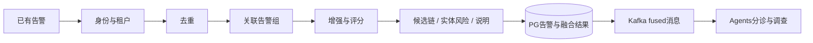

# Fusion到底做了什么

2026-10-25补充：[告警—事件概况—调查流程](incident-investigation-flow-20261025.md)明确事件层汇总展示、分诊/调查信息汇入及 AI 概况更新；[实现规划](../investigation/incident-investigation-implementation-plan-20261025.md)区分现有能力与待开发功能。本页原归组机制不变，新增事件 AI 概况尚未实现。

2026-10-22概念澄清：本页“候选链”是上游原有的Fusion实体链分组，和Incident归组、调查PG Attack Chain是独立机制。Chain ID当前用于Fusion内部续组、随消息交付及快照留存，尚未接下游业务消费；战术只计算链阶段/位置，不决定同链。两告警同/不同Incident与同/不同链的四种组合都可能，详见[对象与ID](attack-chain-path.md#concepts)、[四种归组例子与实际用途](attack-chain-path.md#membership-examples)、[讨论结论](attack-chain-path.md#discussion-conclusions)。本次只保存讨论，不决定删除/合并规则或变更运行。

2026-10-21。供功能理解和后续共同取舍使用，依据固定上游及当前迁入源码；**本轮不决定删除、改造或启用哪些功能，不修改业务代码/配置，不运行测试或部署。** 下面描述代码包含的功能，不代表21全部已启用或验证。已有迁移实证仍见[B1](../operations/integrity-b1.md)及[full配套](../operations/full-support-migration.md)。

Fusion同时接两类输入：已经形成的告警，以及尚未成为告警的规范化事件。两类输入最后都可能进入告警处理主链，但事件入湖等动作也可以独立存在。

**当前取舍已确认：** 用户明确raw规范化事件支路暂不开展，交其他模块处理；后续从已有告警开始分析Fusion。`RawAlert`/`socai2.alerts.raw`和告警`raw_event`正文继续保留在当前范围。调查仍可读取其他模块提供的历史事件及UEBA结果。下面事件支路仅说明原源码职责，既有实现、配置及实测保留，本次未关闭订阅或调整运行。

## 一、收到一条已有告警后做什么

重复输入可以复用已保存结果，并非每次都重走全部计算。新告警的核心处理如下：

| 功能 | 实际做什么 | 得到什么 |
| --- | --- | --- |
| 1. 受理、身份与来源 | 接收RawAlert；核租户，确定稳定告警ID，保留来源、connector、源事件和原正文 | canonical Alert ID和可追溯的原材料 |
| 2. 去重 | 查Redis告警指纹。source-v1主要按来源身份；legacy保留原内容指纹语义 | 识别重复、指向原告警/首次结果；不是文本语义相似归并 |
| 3. 告警关联 | 按租户、一个主实体和首个MITRE tactic，在窗口内寻找关联组 | Fusion incident_id及组内告警；不同来源告警仍分别存行 |
| 4. IOC/资料增强 | 用IP、域名、URL、hash查租户PG历史IOC；配置增强服务时还可取得外部信誉/漏洞材料 | enrichments及来源；无资料不能当作已证安全 |
| 5. 异常与优先级评分 | 从严重度、实体/IOC字段、技术标签等构造特征；有训练模型时使用模型，否则使用启发式 | anomaly_score、priority_score |
| 6. 置信度与因素说明 | 综合已有特征/分数/情报等因素，可采用处置历史形成的prior | confidence_score、标签及逐因素rationale |
| 7. 漏洞及UEBA信号加分 | 有相应漏洞材料或匹配的UEBA异常缓存时，对分数和解释作附加调整 | 调整后的confidence/anomaly及支持因素；本步不训练UEBA |
| 8. 基础攻击链分组 | 在实体窗口中归入候选链，按输入MITRE阶段序及处理时间排列；战术不决定链成员 | enrichments.attack_chain，含chain_id、阶段、位置、先前告警等；当前内部续组/交付/留存，未接下游调查业务消费 |
| 9. 实体累计风险RBA | 为告警涉及的账号、主机、IP等累积风险，考虑时间衰减和阈值 | 实体风险记录、队列及提升标记；不直接创建调查Case |
| 10. 解释、保存与交付 | 由已有结果生成确定性叙述，保存PG告警/完整融合快照，再发布fused消息 | API可查的告警及交给Agents的FusedAlert |

主要代码：[FusionEngine](../../services/fusion/app/services/fusion_engine.py)、[worker](../../services/fusion/app/workers/consumer.py)、[身份与模型](../../services/fusion/app/models/alert.py)、[PG写入](../../services/fusion/app/services/alert_sink.py)。

### 四类容易混淆的结果

| 结果 | 表达什么 |
| --- | --- |
| anomaly_score | 根据当前特征/算法得到的异常程度，后续也可能被UEBA支持信号提高 |
| priority_score | 优先处理程度 |
| confidence_score / rationale | Fusion对检测可信程度的评分及因素；与下游分诊模型的分类/置信度分开 |
| 实体RBA score | 多条告警在实体维度的累计风险，与单条告警评分分开 |

Fusion保留来源提供的risk_score，它与上述评分也不是同一个字段。Fusion生成的说明使用已有值和模板，不调用大模型生成调查结论。

**UEBA联动补充：** 用户已授权的8个原处理代码联动例子及原10项信号测试共18项通过；开启/关闭、medium/high/critical增量、无匹配与多实体结果见[UEBA第4节](ueba.md#4-ueba与fusion联动评分开关及实测例子)。本地内存基础设施验证不代表真实broker接缝或21常驻已开启，当前配置仍false。

**真实联合补充：** 后续已完成本地原UEBA→21真实Kafka→本地原Fusion→真实PG/消息的5个对照；UEBA实际生成medium/high/critical，置信度分别从0.656变为0.726/0.796/0.856，关闭控制回到0.656。原严重度/优先级/上游risk及new状态保持，见[UEBA第5节](ueba.md#5-本地真实联合验证异常带来了什么改变)。这是本地验证，通过后留存本地版本；21常驻开关仍false，按阶段发布，不因本次通过自动部署。

### 去重、关联、攻击链和Case的区别

- **去重**回答“是不是同一条告警又送来一次”。source-v1以tenant/source/connector/source_alert_id构造身份，不同上游告警各自保存。
- **关联**回答“不同告警能否归到同一组”。当前主实体按src_ip→hostname→username→domain择一，再加首个tactic，不能理解为任意字段或语义相似关联。
- **候选攻击链**是在共享实体的告警上附加阶段与顺序。输入MITRE标签的排序不能证明真实攻击时序、因果或成功传播。
- **Case**是下游真实调查对象。Fusion的incident_id、候选chain_id、Alert ID与Case/Run分别表达，关联组不会自动变成调查Case。

## 二、收到规范化事件后还做什么（本轮暂缓）

这部分是Fusion原有的事件处理能力，当前交其他模块负责，本轮不展开开发、修改或专项测试；原源码保留。它与下游调查读取既有事件是不同职责。

| 功能 | 输入和处理 | 输出 |
| --- | --- | --- |
| 事件入湖 | 接收normalized信封，保存历史事件 | ClickHouse raw_events，供后续检索/调查 |
| 事件提升promotion | 将已有厂商Finding或符合原策略的高危事件转成RawAlert | 新告警进入上面的融合主链 |
| 单事件规则检测 | 用规则判断当前一条事件，一条事件可命中多条规则 | 分别生成规则告警；之后可以关联到一组 |
| 窗口检测 | 在时间窗里累计登录失败、扫描等行为，达到规则条件时触发 | 窗口规则告警 |
| 首次出现与内置基线 | 记录实体/属性是否见过，提供稀有、时间/数量等行为上下文 | 供检测规则读取的字段/信号；与独立UEBA服务是两条实现路径 |
| 租户规则配置 | 读取规则开关及调优overlay，供上述检测器使用 | 影响规则执行条件；不是通用的分诊/关闭策略引擎 |
| 会话记录 | 从事件会话资料维护session并关联 | 会话记录及关联ID |
| AI资产观察 | 从AI运行/调用或已识别进程事件中记录观察结果 | AI资产记录 |

调用依据为[worker的raw_events分支](../../services/fusion/app/workers/consumer.py)和[服务装配](../../services/fusion/app/main.py)。规则检测器受相应配置控制；session/AI asset也已接入事件分支，不能仅因本轮不使用就称代码绝不运行。promotion执行边界等已知问题见[现有登记](../operations/upstream-issues.md)，此处先理解功能，不预定修复。

## 三、还提供哪些辅助功能

| 功能 | 原入口 / 作用 |
| --- | --- |
| 直接处理一条告警 | `POST /process`，返回完整FusedAlert，和Kafka使用共同处理链 |
| 单独预览置信度 | `POST /confidence/score`，查看评分/理由，不走完整融合交付 |
| 实体风险查询 | `GET /entity-risk/queue`、`/entity-risk/stats`、`/entity-risk/{entity_type}/{entity_value}` |
| ML管理 | `GET /ml/status`、`POST /ml/feedback`、`POST /ml/retrain`；接收反馈和按条件重训 |
| 运行诊断 | health、metrics、scale-hint；scale-hint只返回建议，不自动扩容 |
| 坏消息管理 | schema校验、DLQ记录及`POST /dlq/replay`，默认dry-run |
| 记忆prior支持 | 从已有处置历史形成评分prior；另有记忆包相关CLI/库，不是每条告警都执行 |

接口见[router](../../services/fusion/app/api/router.py)，记忆支持见[memory目录](../../services/fusion/app/memory)。这些管理/诊断能力不作为当前新增专项，原实现保留。

## 四、用一条告警串起来理解

假设同租户一条EDR告警：主机WIN-FIN-01、账号alice、src_ip=192.0.2.10、首个tactic=TA0002，来源身份为UUID-A。

1. 第一次到达：确定告警ID，去重未命中；用`tenant:192.0.2.10:TA0002`查关联组，没有则建组。
2. 用其中实际存在的IOC/实体查资料，完成各项评分；有UEBA信号等再附加支持因素，产生说明。
3. 保存该独立Alert及融合结果，发布fused消息；后续Agents负责分诊、关闭判断和需要时的调查。
4. 同一来源UUID-A再次投递：可以复用首次结果。另一来源身份UUID-B的新告警若主实体/tactic符合关联键，则保存另一行，并可归到同一组。

因此，一条已有告警经过Fusion，主要新增的是**身份/重复关系、告警组、增强资料、各项评分、候选链/实体风险信息和解释**，再形成可保存、可交付的标准输出。它不在这个阶段交付完整调查、已确认攻击路径或处置执行结果。

本页作为共同讨论的功能清单；raw规范化事件支路已明确本轮暂缓，其余告警功能继续逐项讨论取舍。职责划分不代表代码裁剪、运行启停或新增验收完成。

## 五、支持什么规则、默认用什么（2026-10-21讨论稿）

本节只梳理已有告警主链。用户要求先核支持项与默认规则，再共同讨论；没有决定新的算法、字段组合或运行启用。下述例子均为按源码推演，不是新增业务输入或测试。

现成配置主要控制功能开关、时间、容量、阈值和RBA权重；关联字段组合、候选链阶段表、基础置信度权重等写在代码里，Fusion自身没有这些关联规则的通用CRUD接口。修改环境配置与新增业务规则是两件不同的工作。

| 功能 | 已实现的规则 | 源码默认 / 可调范围 |
| --- | --- | --- |
| 身份/去重 | source-v1按tenant/source/connector/source_alert_id；legacy按选定内容字段生成精确指纹；PG首次结果可复用 | Redis指纹300秒可配；不是文本相似度聚类，source-v1是本项目正式接入配置，模型/API源码缺配置时仍默认legacy |
| 关联组 | `tenant:主实体:首tactic`；主实体固定按src_ip→hostname→username→domain择一；同key加入已有组，告警分别存行 | 3600秒、每组最多500条可配；实体优先级/组合和首tactic规则需要改代码 |
| 候选攻击链 | host→user→源IP查首条已有链；没有则建链；按固定阶段序和处理时间计算位置 | 默认开启、TTL3600秒可配；最多50成员、阶段表及实体选择写在代码；不合并两条已有链的历史 |
| 异常/优先级 | 未训练时使用启发式，训练后分别用IsolationForest/LightGBM | 启发式加分及训练门槛50条特征/30条反馈写在代码；score只积累特征，反馈或retrain入口才触发训练检查 |
| 基础置信度 | `clip(0.5+Σ权重×贡献,0,1)`，附逐因素说明 | 默认开启；HIGH≥0.70、LOW<0.40；七因素权重写在代码，非现成租户规则配置；memory prior另可调整 |
| IOC增强 | 租户PG IOC查询；配置外部enrichment时可再查信誉/漏洞资料 | 默认增强开、外部超时3秒、恶意risk门槛50可配；租户历史命中当前不增加TI权重，不把未命中/缺源当安全 |
| UEBA支持信号 | 用已有实体异常缓存增加confidence/anomaly，不在此训练基线 | 源码默认开、缓存86400秒；topic/TTL/开关可配，等级增量写在代码 |
| 漏洞支持信号 | 对已有exploited/KEV漏洞材料附加标记和置信度增量 | 默认开、开关可配；加分逻辑写在代码，不证明本资产已被利用 |
| 实体RBA | user/host/src_ip/domain分别累计；贡献=`严重度权重×(1+clamp(上游risk_score,0,1))` | 默认开；门槛80，半衰期4小时，记录TTL24小时；critical/high/medium/low/info权重40/20/8/3/1均可配 |

基础置信度七因素默认权重：severity 0.20、anomaly 0.18、priority 0.18、MITRE 0.14、TI 0.16、上游risk 0.08、已填IOC/实体字段密度0.06。来源risk、单条告警confidence、priority和实体累计风险分别表达，不能互换。

**21实际配置只读核对：** 本次通过运行Fusion的Settings只读取上述非敏感配置；去重300秒、关联3600秒/500条、候选链开启/3600秒、confidence与漏洞增强开启、RBA开启/80分/4小时/24小时及上述权重均与源码默认一致。不同点是UEBA融合关闭、外部enrichment URL为空（增强总开关仍开，本地PG查询保留）。这只是开关和参数核对，不等于真实来源命中、模型训练或结果质量验收；本次没有查询常驻进程的ML训练状态，没有发消息、模型或改变业务数据/配置。

**仅声明、未接入执行：** `DEDUP_SIMILARITY_THRESHOLD=0.85`与`INCIDENT_AUTO_CLOSE_HOURS=72`在Fusion app中只有配置声明，没有实际消费者；不能据此写成已支持85%相似度合并或72小时自动关闭。告警关闭、分诊分类和是否调查属于下游Agents策略。

### 连续例子：从第一条告警到重复、关联和跨阶段

共同假设：使用默认规则、相关状态初始为空、正式source-v1身份。A是high告警，包含主机H1、账号alice、源IP192.0.2.10、一个file_hash、一个technique T1059.001、首tactic execution及上游risk_score=0.5，无目标IP/domain/url。为可手算，另假设ML未训练、没有外部TI命中/漏洞/UEBA或历史prior。

1. **A首次进入。** 确定canonical ID，关联key为`tenant:192.0.2.10:execution`，创建组I和候选链X。异常分=`0.30(hash)+0.15(high)=0.45`；priority=`min(0.75+0.10+0.05+0.05+0.10+0.05,1)=1.00`。confidence=`0.5+0.12−0.018+0.18+0−0.048+0+0.03=0.764/HIGH`。每个共享实体RBA贡献`20×1.5=30`。保存PG并发布fused；HIGH不在Fusion内直接关闭/处置。
2. **A原样重投。** 同tenant/source/connector/source_alert_id，复用已有canonical身份和首次结果；不创建第二条告警、不重复评分或增加实体风险。不能解释成每次输出都会改为duplicate；正式入口可能返回原首次决策/快照。PG首次结果复用也不限于Redis的300秒。
3. **10分钟后新增B。** B有不同来源告警ID，但实体和首tactic与A相同，severity=critical、risk_score=0.5；它是独立告警行，加入组I和链X。每个共享实体新贡献60，累计为`30×0.5^(600/14400)+60≈89.15`，达到80后标记promoted。各实体单独计算，不把主机/账号/IP的分数相加，也不自动创建Case或执行响应。
4. **再来不同阶段C。** 仍是H1/alice/192.0.2.10，但首tactic改为lateral-movement且来源告警ID不同：关联key变化，因此可新建关联组；候选链通过共享H1仍加入X，并取得较后的阶段位置。这说明incident_id与chain_id有不同归组规则。

链阶段识别目前仅接受英文tactic名称；直接输入TA0002等编号会成为unknown。关联键则直接使用首个字符串，未做同义/编号归一。这是需要讨论的输入合同，当前不擅自修算法。候选链是TTL续期，关联索引不是同样的逐条滑动机制；不能统一说成“都严格按告警发生时间滑动一小时”。

源码依据：[身份/key](../../services/fusion/app/models/alert.py)、[关联](../../services/fusion/app/services/correlator.py)、[候选链](../../services/fusion/app/services/attack_chain_grouper.py)、[评分](../../services/fusion/app/services/ml_scorer.py)、[置信度](../../services/fusion/app/services/confidence.py)、[RBA](../../services/fusion/app/services/entity_risk.py)、[配置](../../services/fusion/app/core/config.py)。后续讨论先确定关联主体/阶段合同，再讨论各分数和候选链/RBA如何被下游采用；这不是已批准的改造方案。

## 六、当前阶段小结：可以转入下游分诊

2026-10-21。用户要求总结并判断能否继续其他模块。**结论：Fusion已有告警主链具备继续接入/分析下游分诊的功能基础，本阶段可以收口并转入下一模块。** 目前没有证据显示还存在阻断已有告警→FusedAlert交接的Fusion接线问题；不为下一模块重复基础设施、全分支或质量矩阵测试。本结论不是全功能改造完成、算法质量通过、上线准入或整个change完成。

| 能力 | 当前判断及直接依据 |
| --- | --- |
| 输入与身份 | RawAlert合同、source-v1独立来源身份、tenant边界及HTTP/Kafka共链已有[2A](../operations/2a-source-identity.md)/[B1](../operations/integrity-b1.md)实证；相同重投复用首次结果，不同上游告警分别保存 |
| 去重与关联 | 精确身份去重及固定主实体＋首tactic关联可交给下游使用；原字段组合不在本次擅自更改，incident不是调查Case |
| 持久与输出 | PG确认的告警/首次快照和fused消息已验；下游以canonical Alert ID和tenant接收，保留原正文/发生时间/来源及评分说明 |
| IOC及评分 | 本地历史IOC有[2C](../operations/2c-ioc-consumption.md)证据；原启发式/基础置信度在本地实际执行，分数可以解释，不等于恶意概率或TP/FP结论 |
| UEBA融合 | 原UEBA实际评分→真实Kafka→Fusion缓存→真实PG/消息的5例通过；medium/high/critical增量、无信号和OFF对照及配置说明齐全，见[真实联合回执](../handoff/ueba-fusion-joint-20261021.json) |
| 实体风险及候选链 | RBA复用[2B](../operations/2b-risk-idempotence.md)限定证据；候选链职责/默认值/排序限制已明确，保留原码，不将本次UEBA联合写成所有分支的新验收 |

后续保留四类边界，不作为理解/接入分诊的前置重构：

- 外部enrichment URL为空；UEBA服务已运行，但21常驻Fusion的UEBA融合开关仍false。本地测试通过不等于已经发布或开启，按阶段统一发布。
- 候选链基于实体及已有MITRE标签，不能证明攻击因果。英文标签/编号、时间顺序和已有链合并等属于后续业务取舍，不能由下游默认为确认事实。
- 0.85相似度阈值及72小时自动关闭参数仅声明；训练模型状态、评分标定、来源覆盖和自治质量不能据此写成已通过，旧质量失败保持。
- raw_events生产/规范化/入湖/检测交其他模块，当前不做；历史事件查询仍可由调查消费外部数据。HA、恢复、压力及冗余专项后置。

**下一模块：告警分诊（Agents triage）。** 先按一条fused告警看清①实际输入字段和上下文来源，②规则抑制与知识/UEBA/IOC读取，③哪些步骤调用模型及返回什么分类/理由，④自动关闭、needs_review和升级调查的条件，⑤Alert/Run/首次材料/usage/事件审计如何保存及交接。复用原证据、先理解再讨论取舍，只验证后续实际改动，不预定重构或新增模型调用。本次只更新总结及路线，不实施分诊变更或部署。
