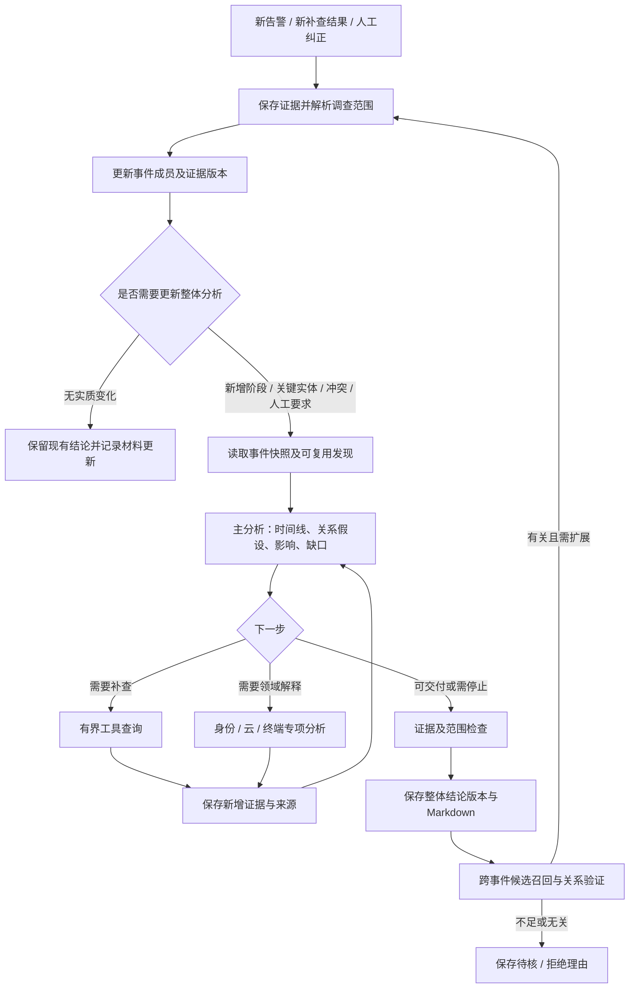

# 事件级调查与跨事件关联：必要性及主流产品对照

后续统一方案、模块实施与测试要求已汇入[调查模块规划设计文档](investigation-planning-design.md)；本文保留事件级及跨事件研究依据。统一设计未实施，不因研究结论自动开放持续调查或事件合并。

2026-10-23。依据本项目源码、已有v1回执及本日查阅的厂商官方文档。用户要求评估分析，沿前次“不是执行，是方案保存”的边界：**本文件是研究与设计建议，未实施，不自动修改原迁移任务或启动业务测试。** 线上状态沿用10月22日回执，本次未访问生产。

## 1. 判断与术语

**建议补齐事件级统一调查，并把跨事件候选关联纳入设计；自动合并事件和长期攻击活动归因后置。** 对当前“已有告警→调查→结果交付”的产品目标，事件级分析能解决单告警调查不能独立解决的问题。若仅交付告警分诊，它可以后置；若要交付攻击经过、影响范围和处置依据，则属于核心能力。

这里的“事件”指安全事件 **Incident**，不是一行原始日志 **Event**。跨告警、跨主机、跨产品不必然等于跨Incident；多个来源的告警也可以已经在同一Incident里。“相似”“与本案有关”“属于同一次攻击”“应合并管理”是不同判断。

| 层次 | 回答的问题 | 建议位置 |
| --- | --- | --- |
| 单告警分析 | 这条检测是否成立？已知事实、正常解释和缺口是什么？ | 保留现有分诊与定向调查 |
| 事件级分析 | 多条告警共同说明了什么？哪些相互支持或矛盾？从哪里开始、影响谁、还缺什么？ | 下一阶段核心分析对象 |
| 跨事件关联 | 被分成几个Incident的活动是否有关？值得扩大调查范围吗？ | 先提供候选关系、理由和验证任务 |
| 攻击活动／Campaign分析 | 多次攻击是否属于同一持续活动或操作者？ | 有足够历史、实体和情报后扩展 |

## 2. 当前并非完全没有多告警或跨事件能力

| 当前能力 | 实际完成的事情 | 尚不等于什么 |
| --- | --- | --- |
| Fusion Incident | 按tenant、主实体和首个战术分组；更新成员数、最高严重度及实体/战术集合，Redis存轻量摘要 | 事件根因、证据冲突、受影响范围与整体结论 |
| 自动调查 | fused一条告警进入state；Run按canonical Alert与workflow版本生成；升级以Alert或显式Case取上下文 | 自动加载整个Incident的全部告警及各自结果，维护一份持续更新的事件结论 |
| 人工Case调查 | 能读多告警材料；当前最终raw_alert投影另限最近3条，摘要读取上限25条 | 所有Case材料完整消费，更不等于Fusion Incident持续分析 |
| `/agent-runs` | 接受incident_id并核归属，使用调用方提交的summary/raw_alert | 根据Incident ID自动组装成员和历史结果 |
| 调查Attack Chain、图上下文 | 同tenant共享实体和时间窗检索；PG Chain不按Incident ID隔离，能跨Incident找候选；图摘要已接入调查上下文 | 关联已被证实、因果已确认，或已维护跨事件业务结论 |
| Fusion chain | 独立的实体续组与成员/阶段注释 | 与Incident一一对应；该注释也未直接成为worker的统一调查材料 |

源码依据：[Fusion关联](../../services/fusion/app/services/correlator.py)、[correlation_key与IncidentSummary](../../services/fusion/app/models/alert.py)、[自动入口](../../services/agents/app/workers/fused_alert_consumer.py)、[人工Case材料](../../services/api/app/api/v1/endpoints/cases.py)、[Run入口](../../services/agents/app/api/router.py)、[目标归属](../../services/agents/app/api/investigation_access.py)、[调查图上下文](../../services/api/app/services/investigation_attack_context.py)、[PG Chain检索](../../services/api/app/services/attack_chain.py)、[Fusion chain](../../services/fusion/app/services/attack_chain_grouper.py)。这是静态核查，不是新的端到端实测。

因此准确缺口是：**已经有分组和关联材料，但缺少以事件为中心的持续调查状态、整体研判及跨事件关系验证。** 不能只因state里有incident_id，就把一次单告警Run称为事件调查。

本项目Incident键取`src_ip → hostname → username → domain → unknown`中的首个值，再加首个战术。同一次攻击若换主机、换账号或进入不同战术，可能自然分到不同Incident；相同来源IP和战术也可能把不同活动放在一起。聚合边界需要可复核，不能直接视为真实攻击边界。[键定义](../../services/fusion/app/models/alert.py)

## 3. 微软如何做

微软部分以企业产品Defender XDR、Defender for Endpoint、Microsoft Sentinel和Security Copilot为对标。Microsoft Sentinel与SentinelOne是不同产品；后者另作补充。不同产品文档中的Case/Incident命名也不直接映射为本项目数据库对象。

### 3.1 Defender：Incident是调查对象，Alert保留为证据入口

Defender关联引擎将不同来源的相关告警组成Incident，并持续向开放事件加入证据。事件页组织告警和原始事件时间线、实体、关系图、调查记录及攻击摘要；分析员仍可深入单告警。**统一事件上下文和单告警钻取并存。** [官方事件概览](https://learn.microsoft.com/en-us/defender-xdr/incidents-overview)

这与本项目仅在每个Run写同一个incident_id不同：事件对象承载统一调查材料和工作状态。这里是根据官方功能作的工程对照，不表示已知微软内部表结构或提示词。

### 3.2 跨事件关系：先扩展上下文，必要时才合并

Defender既持续判断告警归属，也检测不同Incident间的关系。官方列出的关联线索包括实体、文件/进程等工件、时间和多阶段行为序列；精确算法属于内部逻辑。既有体验中的“All associated incidents”只扩展调查图，各事件仍可保有独立负责人、状态和生命周期；实际merge才改变归属。[关联与合并文档](https://learn.microsoft.com/en-us/defender-xdr/alerts-incidents-correlation)

2026年9月更新的Incident cases仍标注**Preview**：支持自动关联、人工合并及移走错误归属的告警；已解决case不能合并。这说明调查范围可以修正，但不能将预览体验的规则和旧Incident体验混为一套。[Incident cases合并与拆分](https://learn.microsoft.com/en-us/defender-xdr/manage-incident-case-merging)

**对本项目的启示：** 先建立可解释的“相关事件”关系；把“是否同一攻击”和“是否合并管理”分别判断。共享IP、同一规则或ATT&CK标签可用于召回，不能单独授予合并资格。

### 3.3 Sentinel：关联检测、调查工作区和相似事件是不同能力

Azure门户的Sentinel Fusion用机器学习关联异常行为及可疑活动，发现多阶段攻击并形成含多个信号的Incident。它不是本项目同名Fusion模块。接入Defender门户后，Sentinel Fusion被禁用，其关联功能由Defender XDR引擎接替，不能把两者说成总是并列执行。[Fusion官方说明](https://learn.microsoft.com/en-us/azure/sentinel/fusion)

Sentinel的调查工作区把时间线、实体洞察、证据书签和活动记录放在同一上下文中，并可钻取查询及结果。Similar incidents按共同实体、规则和告警细节推荐相似事件，帮助发现更大范围攻击或参考历史处理经验；相似推荐本身不证明同案。[事件调查官方说明](https://learn.microsoft.com/en-us/azure/sentinel/incident-investigation)

**对本项目的启示：** 同时保留“可能属于同一次攻击”的关联用途和“过去怎么处理”的经验检索用途；后者不能自动变成此次攻击的现场证据。

### 3.4 调查的持续性与模型摘要的更新不是同一机制

微软AIR概览描述：在调查运行期间加入新的相关告警；在其他位置发现受影响实体时扩大范围；对证据给出判定，并区分自动动作和待审批动作。这是可借鉴的持续调查模式。[AIR概览](https://learn.microsoft.com/en-us/defender-xdr/m365d-autoir)

**版本限制：** 最新结果文档注明，自2026-09-01起，Defender for Endpoint的AIR不再作为独立调查体验或提供手动触发，其检测响应能力并入默认防病毒保护；Office 365的AIR仍保留。因此上述概览不能直接当成当前Endpoint独立AIR产品状态。[AIR当前边界](https://learn.microsoft.com/en-us/defender-xdr/m365d-autoir-results)

Security Copilot另负责把Incident材料概括为时间线、涉及资产和IOC等，并支持后续问题。文档区分打开时生成、按需生成及重新生成；可缓存未显著变化的摘要。**持续收集证据不意味着每条新告警都立即重跑一次LLM总结。** [Copilot事件摘要](https://learn.microsoft.com/en-us/microsoft-365/security/defender/security-copilot-m365d-incident-summary?view=o365-worldwide)

## 4. CrowdStrike Falcon如何做

### 4.1 行为图和事件工作区提供跨告警、跨主机分析

Falcon Next-Gen SIEM的公开白皮书描述Incident Workbench：在同一图中组织资产、用户、进程和执行关系，探索多个来源及时间范围的告警，用跨来源时间线判断范围与影响；事件详情还能查看触发的关联规则。[官方白皮书，第16页](https://www.crowdstrike.com/wp-content/uploads/2024/10/Falcon-Next-Gen-SIEM-Unlocking-the-AI-Native-SOC.pdf)

更具体的官方横移案例将源主机上的凭据窃取、侦察和WMI活动，与目标主机进程创建关联；连线可查看命令行及源/目标主机，并继续查询相关事件。该文发表于2020年，用于说明行为关联方式，不用于声称当前界面或许可不变。[横移调查案例](https://www.crowdstrike.com/en-us/blog/how-crowdstrike-speeds-up-lateral-movement-investigations/)

**对本项目的启示：** 真正有分析价值的链需要行为级桥接依据。仅从共享实体画出的关系图，应继续标为候选；在有登录会话、进程关系、远程执行或网络连接等证据后，再判断活动如何相连。

### 4.2 Charlotte AI：分诊、追问调查和编排分别承担职责

2025年官方云调查示例将Detection Triage用于给出判定及依据，Agentic Response用于提出并回答有优先级的调查问题，Agentic Workflows把模型能力接入Falcon Fusion SOAR。后者的Fusion也不等于本项目的告警Fusion。[官方云调查示例](https://www.crowdstrike.com/en-us/blog/using-agentic-ai-to-power-cdr/)

2026年9月公告进一步提出协调者按需调用领域专家，在共享上下文中交换发现并形成统一判断；**“Agentic investigations with shared context”明确标为Pre-beta**，不是本次可认定的全面商用能力。它支持共享上下文这一设计方向，不能据此认定必须多Agent或已经证明收益。[官方公告及可用性标记](https://www.crowdstrike.com/en-us/blog/crowdstrike-delivers-next-evolution-of-agentic-soc/)

本次查阅的公开材料能支持Falcon具备跨域事件调查和关联分析；不足以还原其所有跨Incident自动合并阈值、持续重分析调度规则或内部模型合同。不给未公开部分补造实现。

## 5. SentinelOne补充：先把行为材料组织好

SentinelOne官方将Storyline描述为关联进程、文件、网络和身份事件、形成攻击叙事的引擎，并结合Purple AI做摘要及自然语言调查。这里有价值的参考是：分析模型建立在已经组织好的行为上下文之上，而不只接收一条告警标题。此材料本身不足以证明跨任意Incident自动合并策略。[官方产品说明](https://www.sentinelone.com/platform/endpoint-protection-platform/)

## 6. 对本项目的必要性评估

| 能力 | 直接价值 | 成本或风险 | 建议 |
| --- | --- | --- | --- |
| 事件材料统一收集 | 避免多个Run互不知情；保留同案告警、查询与人工判断 | 成员边界错误会引入无关材料 | 优先补，成员和取舍理由显式保存 |
| 事件整体分析 | 发现跨告警关系、冲突和遗漏；形成整体影响与下一步 | 重述错误摘要会放大错误；更多上下文也增加成本 | 作为核心能力，分析原始引用和覆盖缺口 |
| 事件增量更新 | 新证据能修正旧假设，不必等人重新拼接报告 | 每条告警触发全量调查会重复付费 | 有意义变化才调度；复用已有有效证据 |
| 跨事件候选关联 | 补回因实体、战术、窗口不同而被拆散的攻击 | NAT、公共代理、共享管理员及常见Technique可能误连 | 近期做有界候选与验证，关系可拒绝 |
| 自动合并/整体自动关闭 | 减少人工管理成本 | 误合并会扩大错误结论和动作范围 | 等准确率、人工纠正及对象规则成熟后评估 |
| 长期Campaign归因 | 发现长期重复模式与更大攻击活动 | 需要较长历史、情报与高质量实体归一 | 后置，当前不构成迁移前置 |

这不是要求所有告警都进行一次告警深查再额外进行一次事件深查。应保留低成本单告警分诊，满足事件调查条件时共享现有证据，只补事件级未决问题。事件调查可以在单告警Run尚未全部结束时开始，但必须标明待完成部分。

例如三条告警分别是账号异常登录、主机远程执行、数据库大量导出。单独看各有合法解释。整体调查需要验证是否同一账号/会话、源和目标如何连接、顺序是否成立、是否授权、导出是否成功。若只共享出口IP，结论应仍是候选关联；若有可核对的会话和进程证据，才能提高关系判断。这个例子是设计示例，不是本次真实测试。

## 7. 推荐的目标流程（仅方案）

图中补查与专项分析是可组合的能力，可以反复进入；不是调查开始时三选一。跨事件召回也可以在组装上下文时提前执行，图中末端表示一次整体分析后再次检查遗漏，不要求必须串行等到最后。

**LangGraph可以承载这个循环，但编排框架不是缺口本身。** 优先定义调查对象、成员快照、结论版本和更新条件，再复用现有执行器。不要另加一个与现有状态、账本和预算脱节的父图；普通Alert入口和事件入口可复用能力，各自保有清楚的输入范围与输出对象。本次不指定迁移拓扑，也不声称对标产品采用LangGraph。

### 7.1 统一分析材料：把chain/path作为不同来源的关系输入

**2026-10-23小模型设计约束：** “主分析”表示业务责任，具体执行应保留阶段分工，不意味着新增一个同时规划、查证、跨域推理及写报告的必跑模型。统一材料保存在共享引用/工件中，各阶段读取有界子集，必要时回查原始证据。事件层设计后续须给出任务拆分、单次输入/输出上限和交接规则；先以固定成员事件验证，不把长上下文和更强模型作为默认前提。实际实施顺序及当前首批见[工程方案](investigation-product-engineering-roadmap-20261022.md)第3.0节。

建议模型每次拿到一份事件调查材料包，至少包含：

1. **范围**：tenant、稳定调查目标、成员canonical Alert ID、原Fusion Incident/chain/Case引用、事件时间窗、成员版本、截断和缺源。
2. **事实**：告警、历史事件及工具结果引用；事件时间与采集/处理时间分开；相同底层材料去重。
3. **既有发现**：每条告警及专项分析的判断、依据、反证、未决项和原Run；保留partial/失败状态，不把旧结论当新事实。
4. **关系候选**：Fusion chain分组、调查Chain共享实体、Path图关系分别保留来源及语义；标注时间、连接依据和已验证程度。
5. **当前事件判断**：时间线、攻击/正常活动假设、受影响与待核实体、冲突、下一步问题，以及本轮新增材料。

这就是此前讨论“把多个chain/path合起来增强模型分析”的合适位置。统一的是证据访问、身份和关系表达；无需把几种算法结果改成一个含义模糊的“总攻击链”。同一告警经三个算法出现，不得被当作三份独立证据提高确信程度。

### 7.2 事件整体结果应新增什么

| 输出 | 最低有用内容 |
| --- | --- |
| 范围与覆盖 | 纳入/排除哪些告警，为何；哪些来源或时间段未覆盖 |
| 统一时间线 | 已观察行为及证据引用；推测步骤单独标注 |
| 关系判断 | 哪些活动相连、支持和反对依据；共享实体仅为候选时明确说明 |
| 整体结论 | 当前最有支持的解释、恶意程度、可能影响与不确定性 |
| 成员差异 | 各告警可分别为TP/BTP/FP/NR，不能把整体标签回填为全部成员结论 |
| 未决问题 | 是否影响整体判断、需要什么来源、下一步如何补证 |
| 版本变化 | 相比上版新增/撤回了什么，为什么；引用对应证据版本 |

事件“结论”“调查执行是否完成”“业务状态是否关闭”应分开。Run完成只表明一次执行结束；一个partial结果也能成为有价值的事件进展，但不能显示成完整调查已结束。

### 7.3 稳定对象与增量更新

Fusion的Redis分组适合提供初始候选，长期调查范围不能只依赖会过期的缓存。建议以持久成员记录和版本快照维护逻辑事件调查对象，保留原Fusion ID；具体复用/扩展现有对象还是新增表，留到选定实施时决定。Case承接人工处置管理，不要求每条告警自动建Case。

同一事件只安排有界的整体分析任务，短时间新增材料合并触发；运行中到达的材料记入下一版本。重复消息或无实质变化只更新记录。新实体、新阶段、关键证据/反证、人工纠正可以触发重分析；仅新增一条相同内容的告警不必触发LLM。任何复用都要核范围、时效、来源和权限。

跨事件先保留原ID和各自生命周期，新增“待核关联/支持关联/已排除”的关系及理由。关联评分用于候选排序，不等于攻击概率；同tenant和授权范围约束继续由程序执行。只有明确业务规则与充分证据后，才评估合并、拆分及状态回写。

## 8. 分期与有限验证建议

本节为未来方案，不调整原5/15，不启动新change，不取代[已保存方案](investigation-product-engineering-roadmap-20261022.md)中查询有效性、证据一致和停止交接的优先责任。

1. **先做一份可信的事件整体结果。** 固定一组成员，复用已有材料和引用，分析关系/冲突/影响；支持人工Case或明确告警集，不先依赖复杂跨事件引擎。
2. **再接持续更新。** 新相关告警与补查结果能进入同一事件的新版本，旧结论保留；减少重复查询及模型调用。
3. **随后接跨事件候选与验证。** 复用已有跨Incident PG Chain召回，增加关系依据、反例、人工接受/拒绝和有界扩展。
4. **最后评估自动合并及Campaign。** 根据实际错误和收益决定，不以“主流厂商都有”为唯一依据。

未来验证应包含：真正相关的三告警、多条共享IP但无关的告警、跨战术/跨主机被拆开的同一攻击，以及迟到反证推翻旧结论。对照“仅单告警分析”与“共享事件上下文”在同材料、相近预算下的结果，评价关系正确率/误关联、结论引用支持、关键缺口、人工接手时间、重复工具调用与增量成本；模型调用次数和图节点数不作为效果证明。

## 9. 官方参考资料与采用点索引

以下链接均于2026-10-23查阅。“借鉴”是本项目建议，不代表已实施或厂商采用相同内部架构。正文各处链接仍保留，便于就近核实。

| 官方资料 | 具体参考点 | 本项目借鉴位置 | 版本／适用边界 |
| --- | --- | --- | --- |
| [Microsoft：Incidents概览](https://learn.microsoft.com/en-us/defender-xdr/incidents-overview) | Incident承载相关告警、证据、时间线和调查上下文 | 第7.1—7.3节：事件材料与整体结果 | 产品能力说明，不披露内部模型合同 |
| [Microsoft：告警关联与事件合并](https://learn.microsoft.com/en-us/defender-xdr/alerts-incidents-correlation) | 关联视图与真正合并分开；考虑实体、工件、时间及行为序列 | 第7.3节：先保留候选关系和各事件生命周期 | 文章主要描述既有Incident体验；算法未公开 |
| [Microsoft：Incident cases合并与拆分](https://learn.microsoft.com/en-us/defender-xdr/manage-incident-case-merging) | 调查中纠正成员归属，合并相关调查 | 第7.2节：成员纳入/排除及理由 | Preview；不直接映射本项目Case对象 |
| [Microsoft Sentinel：事件调查](https://learn.microsoft.com/en-us/azure/sentinel/incident-investigation) | 统一时间线、实体洞察、原始查询和相似事件入口 | 第7.1节：统一上下文；第8节：候选关联验证 | Azure门户体验；相似性不是同案证明 |
| [Microsoft Sentinel：Fusion](https://learn.microsoft.com/en-us/azure/sentinel/fusion) | 跨信号、多阶段行为关联 | 第6节：保留事件与跨事件分析能力 | Defender门户由XDR引擎接替；与本项目Fusion不同 |
| [Microsoft：AIR概览](https://learn.microsoft.com/en-us/defender-xdr/m365d-autoir) | 调查期间吸收相关告警、扩大实体范围、保留证据判定 | 第7节：持续材料更新及补查循环 | 必须结合下一行的最新Endpoint限制阅读 |
| [Microsoft：AIR结果与当前边界](https://learn.microsoft.com/en-us/defender-xdr/m365d-autoir-results) | 证据、实体、状态及调查日志分别记录 | 第7.2节：结论、执行状态和业务关闭分开 | 2026-09-01起Endpoint独立AIR体验变化；Office 365仍保留 |
| [Microsoft：Copilot事件摘要](https://learn.microsoft.com/en-us/microsoft-365/security/defender/security-copilot-m365d-incident-summary?view=o365-worldwide) | 事件材料综合、按需/重新生成、缓存复用 | 第7.3节：实质变化才安排整体分析 | 摘要更新机制不等于所有后台关联机制；部分设置Preview |
| [CrowdStrike：Next-Gen SIEM白皮书](https://www.crowdstrike.com/wp-content/uploads/2024/10/Falcon-Next-Gen-SIEM-Unlocking-the-AI-Native-SOC.pdf) | 第16页事件工作区：多来源图关系及时间线 | 第7.1节：关系材料统一输入分析 | 2024年资料；不据此推断所有当前合并策略 |
| [CrowdStrike：横移调查技术案例](https://www.crowdstrike.com/en-us/blog/how-crowdstrike-speeds-up-lateral-movement-investigations/) | 用源/目标主机、远程执行、进程和命令行解释连线 | 第7.1—7.2节：关系依据和已验证程度 | 2020年案例，参考方法而非当前界面/许可 |
| [CrowdStrike：云调查与Charlotte AI](https://www.crowdstrike.com/en-us/blog/using-agentic-ai-to-power-cdr/) | 分诊、优先调查问题及工作流各司其职 | 第7节：主分析、补查与领域能力协作 | 2025年官方示例，未自行验证厂商效果数字 |
| [CrowdStrike：共享上下文调查公告](https://www.crowdstrike.com/en-us/blog/crowdstrike-delivers-next-evolution-of-agentic-soc/) | 协调者调专家，共享发现后汇合判断 | 第7节：能力可组合；第7.1节：统一材料 | 2026年9月更新；该调查能力为Pre-beta |
| [SentinelOne：Storyline产品说明](https://www.sentinelone.com/platform/endpoint-protection-platform/) | 行为上下文先组织，再供摘要和调查使用 | 第7.1节：关系材料与模型输入 | 产品声明；不据此声称跨任意Incident自动合并 |

其他本次查阅资料：[Microsoft Sentinel迁入Defender门户](https://learn.microsoft.com/en-us/azure/sentinel/move-to-defender)用于核门户差异；[Microsoft Copilot集成说明](https://learn.microsoft.com/en-us/defender-xdr/security-copilot-in-microsoft-365-defender)用于核摘要、建议、报告的职责区别。它们不是新增实施项。

## 10. 本次研究边界与留存

厂商部分仅使用官方文档、技术文章和产品材料；它们支持所述产品行为或厂商声明，不构成本项目效果实测。微软公开文档可支持事件持续更新、关联与合并的区别；CrowdStrike公开材料对内部阈值和调度合同披露有限。未推断任何厂商必须依赖大模型完成全部关联，也未把产品的攻击叙事当作每条边都已证明因果。

本项目事实依据本地静态源码和此前回执；本次0生产访问、0业务模型/消息/测试、0部署。研究只改变建议文档及交接记录。先前v1功能交付、质量未全过、原5/15及旧失败均保持。
