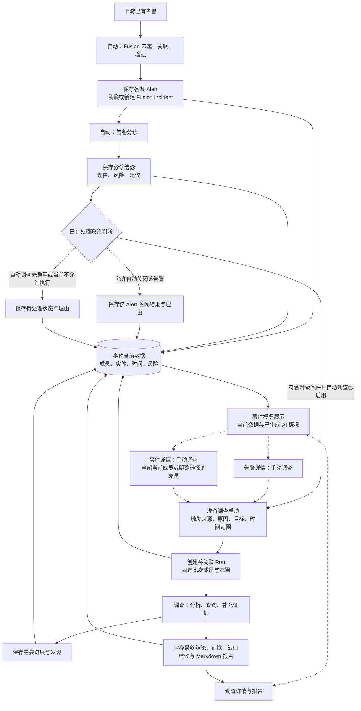
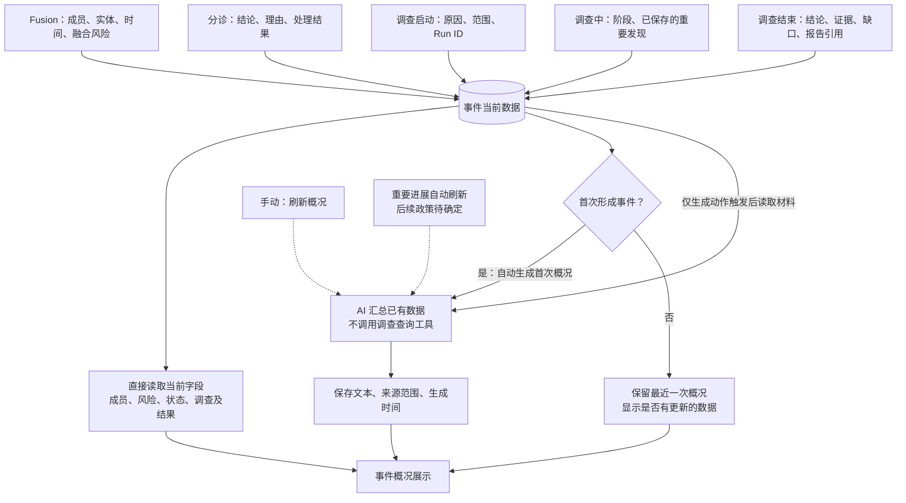
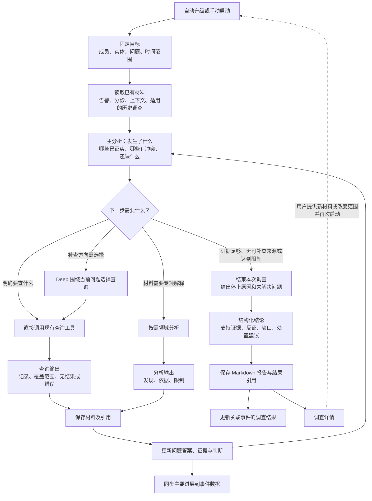

# 告警、事件概况与调查业务流程

2026-10-25。本文保存本轮讨论确认的业务分工、自动/手动触发、输入输出和跳转，补充[调查主设计](investigation-planning-design.md)。下图描述目标流程；已实现范围及开发顺序见[评审与实现规划](../investigation/incident-investigation-implementation-plan-20261025.md)，不能将流程图当作交付记录。

本轮只落文档、做一轮评审和实现规划。权限专项继续暂停，不开始功能编码，也不扩展可用性、恢复或冗余测试。交付仍以服务端 API、可查询结果和 Markdown 报告为主；“页面”用于说明使用流程，不增加前端建设范围。

## 1. 三层职责

| 层次 | 负责什么 | 给下一层什么 |
| --- | --- | --- |
| 告警 Alert | 保留每条来源告警、融合信息、分诊判断及处置状态 | 告警材料、分诊结论、理由、风险、处理建议 |
| 事件 Fusion Incident | 聚合同组告警，汇总当前情况、分诊结果、调查进展和结论；提供 AI 概况便于阅读 | 成员范围、当前事实与判断、关联调查入口 |
| 调查 Investigation Run | 针对明确范围分析、补查证据、核对关系与影响，给出有依据的结论 | 进展、证据、判断、反证、未解问题、建议和报告 |

事件层的“轻量分析”是对已有材料做归纳与解释。需要新增日志查询、验证攻击关系、进一步追查时，进入调查。AI 概况可以引用分诊判断与调查结论，但必须保留来源和不确定性。

Case 是独立的案件组织对象，与 Fusion Incident 不等同。事件详情可以发起调查，不要求先自动创建 Case。具体如何将事件成员送入现有 Alert/Case profile，属于实现规划中的明确接线工作，当前没有完成。

## 2. 总流程

实线为处理或数据更新，虚线为用户操作/详情跳转。标注“自动”的动作由既有启用政策或相应功能触发，不意味着当前运行环境已启用。

所有分诊结果都进入事件数据，不仅仅是“需要调查”的结果。分诊先保存判断，再决定是否启动调查；调查未启动或启动失败，也不丢掉分诊理由。

当前 ordinary worker 的已有入口是：**未被自动关闭的告警均进入升级判断**，其中也包括 `needs_review`；实际执行再受 review-only 模式、自动升级开关和 writer 许可控制。“待处理”并不天然排除自动调查。本流程沿用这一语义，不新增“只有建议升级标签才触发”的规则；运行配置是否启用须单独说明。

自动分诊关闭一条 Alert，不代表整个 Incident 已解决。调查结束也不自动关闭 Alert、Incident 或 Case，更不自动执行处置建议。需要关闭/处置时走已有独立业务操作。

## 3. 事件数据、概况展示和 AI 概况

这三者分别是：

- **事件数据**：持续更新的成员、分诊结果、风险信息、Run 关联、调查进展和结果。
- **事件概况展示**：读取当前事件数据，同时显示最近一次生成的 AI 概况。
- **AI 概况文本**：根据某一时刻已保存的数据生成的解释，带生成时间和所依据数据的时间/版本。

因此，新分诊和调查结果必须及时在事件概况中可见，但不要求每次数据变化都重新调用模型。没有新生成的 AI 文本，不能让当前风险、分诊状态或调查进展停留在旧值。

首次概况可以只说“当前收到什么、涉及谁、为什么值得关注、还有什么未知”。输入尚无分诊/调查结果，就明确“当前材料未包含分诊/调查结论”，不能提前写出攻击成立或安全的结论，也不能据缺少结果断言从未调查。

**本次实现规划采用的最小刷新策略：首次自动生成 + 手动刷新。** 普通数据变化只更新当前字段并标记概况是否较旧。调查完成等重要节点是否自动刷新，保留为后续政策选择，不作为首版前置条件。生成失败时保留已有文本并显示失败；首次失败则显示当前结构化数据和“概况未生成”。

F2实现通过独立v2任务读取PG新事件后生成第一份概况；需要显式启动任务，既有Fusion代码/运行配置保持原样。具体接口、迁移和首次任务见[F2说明](../investigation/incident-ai-overview.md)，当前未部署或启用。

事件风险至少区分融合严重度、分诊判断、调查判断及各自时间。首版不新增一套风险打分模型，不用一段 AI 文本覆盖这些不同来源。

## 4. 调查内部流程

用户发起一次调查后，不需要逐个点击查询或专家步骤。主分析根据问题选择下一步；直接查询能解决的问题不必经过 Deep，也不要求每次都调用所有角色。

“没有查到记录”“工具失败”“没有权限/来源”“已证实没有发生”是不同结果。报告要保留查询范围及限制，不能把空结果当作安全结论。重复查询是否必要由新问题和材料缺口决定；可用的既有材料直接复用。

事件后续新增告警会更新事件数据，但不会偷偷扩大已经启动的 Run 范围。调查详情显示实际覆盖成员和窗口；调查之外的新成员显示待进一步调查。新一轮调查显式启动，原结果保留。

## 5. 各步骤输入、输出与触发

| 步骤 | 触发 | 输入 | 输出/事件数据变化 |
| --- | --- | --- | --- |
| Fusion 聚合 | 自动：新告警进入 | 来源告警、租户、实体、时间和规则标签 | 独立 Alert、Incident 归属、成员及融合信息 |
| 首次 AI 概况 | 自动：事件首次形成且成员已保存 | 当时可读的事件成员及已有结果 | 首次概况、生成时间、材料范围；不启动 Run |
| 告警分诊 | 自动：符合原分诊消费条件 | Alert、融合材料、可用上下文 | 判断、理由、风险、建议及处理结果；全部可在所属事件读取 |
| 处理政策 | 自动：分诊结果已保存 | 原政策、分诊结论、当前启用情况 | 自动关闭该告警；其余进入原升级判断，允许时调查，否则保留待处理及原因 |
| 手动调查 | 手动：告警/事件详情 | 目标、成员选择、时间范围、补充问题 | 新调查请求及启动原因 |
| 调查启动 | 自动或手动请求 | 已解析的 canonical Alert 成员、范围及已有材料 | Run ID、本次覆盖范围、来源 Incident 关联和启动状态 |
| 主分析 | 自动：启动后及补查返回后 | 当前问题、材料、分诊和历史适用结果 | 当前判断、依据、缺口、下一步或停止原因 |
| 补查/专项分析 | 自动：主分析决定 | 查询参数或待解释材料 | 新来源记录、分析发现、覆盖与限制，回到主分析 |
| 进展回写 | 自动：主要阶段/发现已保存 | Run 状态及可展示发现 | 事件显示正在做什么、已经知道什么 |
| 结果保存 | 自动：调查结束 | 已采用证据、结论、反证、缺口、建议 | 报告、结果引用、停止原因；事件可读最新结果和历史 Run |
| 刷新 AI 概况 | 手动；首次生成自动 | 生成时的最新事件数据 | 新概况文本；不启动查询、不关闭事件 |
| 关闭/处置 | 已有单独操作或政策 | 处理理由、相应目标 | 目标对象的处理结果；调查建议本身不执行动作 |

上表的“事件更新”是业务可见数据更新，不要求将每段分诊或完整调查工件再复制进一张大表。实现可以汇读原有保存结果，事件保存关联及概况即可。

## 6. 页面之间怎么跳转

| 从哪里 | 操作 | 到哪里/看到什么 |
| --- | --- | --- |
| 告警详情 | 查看所属事件 | Incident 概况，当前告警仍有独立身份 |
| 事件概况 | 查看成员告警 | 该 Alert 原始材料、分诊理由和处理状态 |
| 告警详情 | 发起调查 | 固定该告警与窗口，返回 Run ID，再看调查详情 |
| 事件详情 | 发起调查 | 默认当前全部成员，可明确选择子集；显示实际范围，返回 Run ID |
| 事件概况 | 查看调查进展/历史 | 选择 Run，查看其实际覆盖范围、步骤、证据与报告 |
| 调查详情 | 返回来源 | 来源 Incident、对应成员 Alert；存在明确 Case 关联时再提供 Case 链接 |
| 事件概况 | 刷新 AI 概况 | 留在原事件，更新文本与生成时间 |

这些关系通过 API 的对象 ID 和引用交付。现阶段不要求新建页面或做浏览器可用性测试。

## 7. 一条完整的业务例子

以下是**用于实现验收的虚构场景，不是已运行结果**。设三条输入满足现有 Fusion 归组条件：同租户、相同主实体 `10.0.0.8`、首个 tactic 均为 `command-and-control`，并在同一关联窗口内。使用文档保留域名 `update.example`，不涉及真实外呼。

| 顺序 | 输入/动作 | 得到什么 | 事件上看到什么 |
| --- | --- | --- | --- |
| 1 | 09:00，A1：主机连接少见域名 `update.example:443` | 保存 A1，建立 I1 | 1 条告警、涉及主机和目标、尚未调查 |
| 2 | 首次概况生成 | “主机出现少见外联，当前依据为单条告警，性质待确认。” | 文本及生成时间；没有调查结论 |
| 3 | 09:02、09:04，A2 周期性连接、A3 同目标信誉提示 | A2、A3 也归入 I1 | 成员变为 3 条；旧 AI 文本仍可保留并提示数据已更新 |
| 4 | 分诊分别分析 A1/A2/A3 | A1 待处理，A2 建议升级，A3 因已核实测试标记按原政策关闭 | 三份判断和理由都可见；A3 关闭不关闭 I1 |
| 5 | 原自动升级已启用，A1/A2 均未自动关闭 | 两条按原条件分别进入调查：R0 针对 A1，R1 针对 A2，分别保存原因和窗口；下面仅展开 R1 | 两个 Run 的触发方式、实际成员范围和状态；A3 不因同属 I1 而启动调查 |
| 6 | R1 先读 A2 分诊及可用材料，分析周期性外联是否可疑 | 待核问题和明确查询参数 | R1 显示“正在核对外联记录”；A1 的 R0 进展另列，A1/A3 不算 R1 覆盖成员 |
| 7 | 查询窗口内连接记录，再按缺口查询进程/解析材料（若来源可用） | 连接记录、进程信息或明确的来源缺口 | 主要发现和进度更新；不要求立即重写 AI 文本 |
| 8 | 证据支持周期性连接，但缺少进程来源 | 结论：“观察到周期性外联，尚不能确认恶意控制”；保存依据、缺口、建议及报告 | R1 已结束、结果部分确认，仍没有“整个事件安全/已关闭”的结论 |
| 9 | 用户刷新 I1 概况 | 汇总 3 条告警分诊、A3 关闭理由、R0 当时已保存的进展及 R1 对 A2 的有限结论 | 新文本区分各 Run 状态、已知与未覆盖部分，带新生成时间；不编造未给出的 R0 结论 |
| 10 | 用户希望一起调查 3 条告警 | 从 I1 明确发起 R2，复用适用的 R0/R1 材料，补查跨告警关系 | 保留 R0/R1/R2，R2 明确覆盖全部启动时成员 |

如果自动调查未启用，第 5 步显示“待处理/尚未启动调查”及原因，直到用户主动发起。不存在“AI 概况提到可疑，所以自动新建 Run”的隐式动作。

## 8. 已定与暂未扩展的内容

已定：事件汇总与深入调查分工；所有分诊结果汇入事件；调查状态和结果可在事件读取；概况文本与动态数据分开；手动/自动来源可追溯；Incident 与 Case 分开；调查范围明确。

实施建议：用现有 PG 告警归属和结果构造事件读取视图，补一份最小事件概况记录；首次生成加手动刷新；事件成员解析后进入共享调查内核。具体文件安排见实现规划，尚未实施。

暂不增加：新聚合算法、重要进展自动刷新的复杂政策、新风险模型、Case 自动创建流程、持续自动增量调查、前端工程、权限专项、可靠性/恢复工程。它们不阻塞本轮确定的功能开发顺序。
