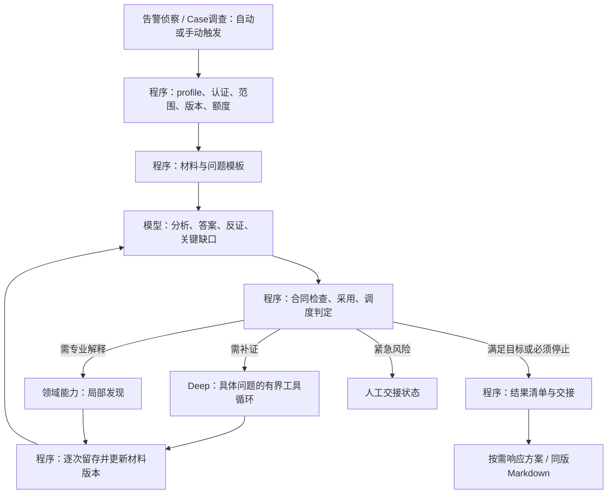
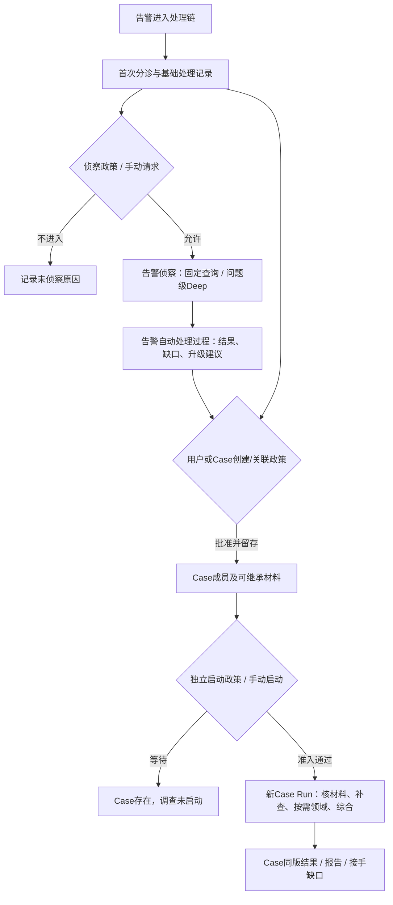

**2026-10-25 当前业务流程与功能开发顺序：** 新增[告警—事件概况—调查流程](incident-investigation-flow-20261025.md)及[评审与实现规划](../investigation/incident-investigation-implementation-plan-20261025.md)，作为本主设计的事件层补充：所有分诊结果、调查进展/结果汇入事件数据；当前字段与 AI 概况分开；事件汇总展示与调查深入分析分工；Incident 不等同 Case。当前目标流程以该补充为准，历史实现证据保持原样。后续按事件汇总、概况、分析闭环、事件范围、自动入口推进；本轮只文档/一轮评审，无代码或业务测试，权限专项继续暂停，下方历史“下一步”不覆盖本次安排。

**2026-10-25 M8a4.4a真实PG准入：** 147直接/独立同147、13sourcehash及实际PG原件结束独审限定通过，[回执](../operations/investigation-program-admission-pg-20261025.json)。提交前真实三连接锁等待链及提交后owner屏障证明同key只读/另一key拒；正常0tool/model为partial5/11，rollback0，ACK保2/3 ready不补跑。实际来源/意图/期限/owned DTO全核，旧6/14/MD保持、角色表列ACL撤回。未真实用户JWT/RBAC或HTTP/CH；下一b合同顺序/独立Redis失效证据修后已审，后c及Case/Deep/2.2/2.3仍待。

**2026-10-25 M8a4.3d离线启动组合：** 179直接/独立同179、10hash/6新隔离账本80API44Mockbackend限定通过，[回执](../operations/investigation-program-start-offline-20261025.json)。独立app包进程贯通真实新代码、当前注入用户→event-pin完整actor/budget→runtime/pub/owned全DTO；ACK/父丢回包保未知、重复只读，全部原件冷读同。仅SQLdouble，无真实PG/JWT/RBAC/生产writer互斥证明。下一a4.4a PG零外呼/真实precommit锁等待＋postcommit owner双barrier卡已审，再b真实鉴权/c实际HTTP-CH；Case/Deep及2.2/2.3仍未完。

**2026-10-25 M8a4.3c现用户写入口：** 165直接/独立同165、9hash/38原响应全重放限定通过，[回执](../operations/investigation-program-start-gateway-20261025.json)。原run＋alertsread/当前身份、共享readservice拒，单POST/完整program owned DTO/原MD保持、整次200秒与响应/client各5秒；独审隐式EOF close P2修后通过。只FakeDB/Mock/producer回执，不证明完整backend intent actor/budget来源或真实JWT/RBAC；下一d离线两进程actual首次写及actor pin合同已审，再a4.4真实PG并发/权限/运营隔离，Case/Deep及2.2/2.3保持未完。

**2026-10-25 M8a4.3b内部写HTTP：** 186直接/独立同186、7hash/原28ASGI响应重放限定通过，[回执](../operations/investigation-program-start-api-20261025.json)。两POST专用当前token/动态read-tool分离、controlled guard、4KiB严格请求/servernormalize，原GET与service scopes保持；仅SQL/Mock/ASGI，不据配置ref认定运营隔离。c用户权限/完整网关合同已审（总200秒而非分阶段续期），d/a4.4/Case/Deep仍待。

**2026-10-25 M8a4.3a协调器：** 125直接/独立同125、7hash/14原件重放限定通过，[回执](../operations/investigation-program-coordinator-20261025.json)。三门currentguard/freshcommit/原claim-reserve，confirmedstop才pub；repeat/read禁止execute/publish，未知/取消不重派，旧service权限保持。仅SQL/HTTP替身，下一b独立写app/c用户权限/d组合/a4.4实际隔离，Case/Deep仍待。

**2026-10-25 M8a4.2原子准入：** 136直接/独立同136、7hash/11原账本晚3天repeat/owned DTO全同，[回执](../operations/investigation-program-admission-20261025.json)。同TX Run＋begin＋独立意图2/3、READ COMMITTED/锁后全候选重查、active/unknown阻新key，commit未知和重复只读不刷新预算；normal沿原runtime/pub7/15。仅SQL替身，下一a4.3协调器/独立HTTP/用户权限逐门，再a4.4真实隔离与PG；Case/Deep仍待。

**2026-10-25 b2.4d4离线组合：** 114直接/独立同114、8hash/原14账本双进程全39row复放限定通过，[回执](../operations/investigation-compatible-offline-20261025.json)。新旧完整DTO/来源账本保持，unknown/权限/轮换/篡改拒、管道有界/owned进程回收；无真实PG/network/新Run。下一a4.2原子Run+begin+event-pin意图，a4.3权限及legacy writer目标政策另门，Case/Deep仍待。

**2026-10-25 b2.4d3网关：** 105直接/独立同105、8hash/34HTTP完整重放限定通过，[回执](../operations/investigation-compatible-gateway-20261025.json)。双版本exact协议/12版本/nullable evidence、同版hash、当前双read权限和有界单GET已核；3P2及合法error误拒均修并保失败，unknown不变0/false。无真实PG/network/Run；下一d4离线组合合同已审，再a4.2原子准入，Case/Deep仍待。

**2026-10-25 b2.4d2内部GET：** 82直接/独立同82、6hash/24ASGI重放限定通过，[回执](../operations/investigation-compatible-internal-api-20261025.json)。新独立COMPAT config、gateway身份断言/只读覆盖拒、pool有界清理；仅最小envelope，oldAPI不变，0真实网络/PG/用户RBAC。d3完整DTO/evidence封闭组合合同已修后审过，再d4/a4.2。

**2026-10-25 b2.4d1 owned双版本：** 98直接/独立同98、7hash/7完整cold重建限定通过，[回执](../operations/investigation-compatible-owned-reader-20261025.json)。同锁唯一begin/所有unified_类型agent/强原件核后选显式fixed或program，旧合法完整DTO/MD保持；无callerowner/version、无fallback。仅SQL替身，下一d2内部GET（合同已审）/d3gateway/d4组合后a4.2，0真实I/O/Run。

**2026-10-25 b2.4c纯新恢复：** 75直接/独立同75、6hash/原6+rev2及3SQL读完整重建限定通过，[回执](../operations/investigation-program-profile-restore-20261025.json)。合法rev2拒绝P2修后rev2/3精确恢复、typed漂移仍拒，旧restore/MD保持；caller owned真实性/权限及修订来源仍前提。下一d1 ownedreader/d2内部GET/d3gateway/d4组合后a4.2，0真实访问/Run。

**2026-10-25 b2.4b新发布store：** 129直接/独立同129、7hash/7完整cold/重复及实际原tool重建限定通过，[回执](../operations/investigation-program-publication-store-20261025.json)。newpub专用event强校验/唯一marker/4工件1TX/ACK未知不成功，late留账但正式读拒stale，plainstore不回落；类型回执反例已修。仅SQL替身，下一c恢复（合同已审）/d ownedHTTP兼容→a4.2，无真实Run/访问/发布。

**2026-10-25 b2.4a纯新发布：** 111直接/独立同111、7hash/9完整包/MD/section重建与8额外反例限定通过，[回执](../operations/investigation-program-publication-preparation-20261025.json)。new closedmanifest/exec/renderer，validated和unadopted都完整重建，typed JSON及distinct pre-stop source保证；旧MD保持。仅candidate、0发布/真实访问，actualtool/owned/event全链后续b，再c/d兼容与a4.2。

**2026-10-25 b2.3d2正式新投影：** 82直接/独立同82、6hash/6完整投影及SQLMock cold重建限定通过，[回执](../operations/investigation-program-alert-projection-20261025.json)。完整来源新schema/精确路径/原拼写保持，新有限4facts ready/model false且旧partial；预建Run接缝5/10/Mock1，不是a4.2原子启动，旧restore尚拒新begin。下一b2.4分a纯发布/b持久/c恢复/d owned+HTTP显式版本后再a4.2，0实际访问/新Run/发布。

**2026-10-25 b2.3d1新版启动合同：** 60直接/独立同60、6hash/6完整意图决定和27额外反例限定通过，[回执](../operations/investigation-program-start-contract-20261025.json)。new intent含closed12版本，同tenant/key身份与旧相同且跨版冲突，旧不升级；纯无权限/持久或执行证明。下一d2新投影→b2.4兼容后才a4.2，0实际Run/业务访问。

**2026-10-25 b2.3c薄控制器：** 82直接/独立同82、7hash/8完整重建限定通过，[回执](../operations/investigation-program-runtime-20261025.json)。复用原M3 gate，确认提交后一次Mock；并发重复/取消和ACK未知不重派，正常4程序facts有限ready、模型资格false。旧controller/MD保持，0实际PG/HTTP/Run/发布；下一d1意图（合同已审）→d2投影→b2.4兼容→a4.2。

**2026-10-25 b2.3b持久控制：** 新store91直接/独立同91、7hash/8完整SQL账本重建限定通过，[回执](../operations/investigation-program-runtime-store-20261025.json)。初审4P2及追加unknown-kind回退已修，原件链/真正前一状态/closing重建/late账与候选分开核；旧源码/Run列保持。仅SQL替身，下一已审c单次controller→d新intent/投影→b2.4兼容，a4.2仍后续，无真实新Run或发布。

**2026-10-25 b2.3a运行版本：** 69直接/独立同69、5hash/7状态完整重放限定通过，[回执](../operations/investigation-program-runtime-state-20261025.json)。新runtime固定manual（scope不含trigger，不能借plan自证），闭合12版本/严格plan重建、M3单账和未知保留；0实际claim/reserve或外呼，旧自动路径保持。继续b store/c controller/d新intent及b2.4，a4.2尚未实施。

**2026-10-25 b2.2新程序事实：** 64直接/独立同64、5hash/11完整输入输出及额外30源/停止对照通过，[回执](../operations/investigation-program-recon-20261025.json)。新的有限字段完成政策解除模型投影耦合但保源阻断，normal1299B给4事实有限ready，不代表全文/恶意/授权理解；旧路径保持。b2.3新runtime版本冻结、b2.4发布恢复读取兼容及旧MD字节不变仍未交付，a4.2未开始。

**2026-10-25 b2.1材料分离：** 独立ProgramMaterial已过59直接/独立同59、5hash/6完整冻件和2同输入旧/新对照，[回执](../operations/investigation-program-material-20261025.json)。完整留存不等于语义理解，材料非model view，旧门和源缺口保持；无facts/ready/运行接线。后续b2.2—4全部同版兼容及正常有限ready通过才a4.2。

**2026-10-25 M8a4.1b1完整冻结：** 已过47直接/独立同47、5hash/6观察，普通来源真实四列/路径/全文冻结及M6内存begin-a1兼容见[回执](../operations/investigation-alert-projection-20261025.json)。完整doc1299B使现Alert512消费门明确partial，未正常ready；b2分离完整留存和消费并通过正常有限事实后才a4.2，保持原件和门限。

**2026-10-25 M8a4.1纯操作合同：** 稳定tenant/key身份、完整请求哈希/同键冲突、仅读重试判定经44直接/独立同44、5hash/4完整观察限定通过，[回执](../operations/investigation-start-contract-20261025.json)。纯层不证auth/owned/持久唯一，不创建deadline/Run/调用；a4.1b来源投影、a4.2原子准入、a4.3显式写入口、a4.4受控新Run依次推进。

**2026-10-25 M8a3.3真实GET：** 两个独立服务的真实共享service认证/GET已过2成功及14拒绝，原Run6/14/MD3111字节/manifest/execution及原M6已核baseline不变，临时进程和角色已清理；[实际回执](../operations/investigation-result-http-read-20261025.json)结束独审限定ACCEPT/0必须修（独立36项、10源码/2helper hash、READ ONLY PG全14及完整DTO/进程/权限核验）。仅显式读取，启动入口/真实用户RBAC撤销、Case/Deep和部署另步。

**2026-10-25 M8a3.2网关：** API独立GET原认证/双read权限、当前身份转发及同版hash检查已过33直接/独立同33、6hash/12回执重放，[回执](../operations/investigation-result-gateway-20261025.json)。实施前补关旧dev无凭据demo仅限新GET，未动旧认证/query；真实PG/网络和生产RBAC撤销未实测，a3.3后接启动。

**2026-10-25 M8a3.1内部读HTTP：** 独立Agents app专用token/tenant/actor→owned读已过58直接及独立同58/6hash/11 ASGI重放，[回执](../operations/investigation-internal-read-api-20261025.json)。旧路由/权限默认不改，仅内部可信网关边界；API外部认证/permission与真实PG/双进程另步，启动未接。

**2026-10-24 M8a2持久读代码：** 56直接及独立同56/6hash/3组重建限定通过，[回执](../operations/investigation-owned-reader-20261024.json)。按当前tenant/Run核唯一begin及owned工件，再恢复/服务端owner/同锁M7精确读，不依赖当前Alert；只SQL替身，credential/permission及真实PG/HTTP另验，旧入口不改。

**2026-10-24 M8a1纯读上下文：** 已从owned begin冻结输入重建原M1 scope/profile/plan，不加载当前Alert；51直接及独立同51/6hash/3组原件限定通过，[回执](../operations/investigation-profile-restore-20261024.json)。当前主体tenant许可与原principal历史身份分离；实际auth/permission/存储归属和HTTP/启动接缝仍待后续。

**2026-10-24 M7c实际结果：** 原M6稳定Run只追加publication，当前6事件14工件；新进程冷读与热读同manifest/报告/execution，原M6已核列/正文校验和不变，额外查询/模型0，旧Run列不变。[回执](../operations/investigation-publication-pg-seam-20261024.json)结束独审限定ACCEPT/0必须修（独立11项/14hash及只读PG核验），[合成报告](../investigation/examples/fixed-recon-published-20261024.md)等于PG字节。仅有限source目标，新三维与旧生命周期分开；M8真实业务/stream、Case及语义Deep仍待，旧M6回执保阶段快照。

**2026-10-24 M7b代码：** 同Run锁内原子manifest/MD/execution/state及精确同版读，21新＋128相关149通过；来源工件原event/kind/pinned hash含未采用分支已修、旧失败保留，[回执](../operations/investigation-publication-store-20261024.json)未参与实现者独立52项/6hash/7组重建限定ACCEPT、0剩余必须修。重复不新建版本，未知commit只读核原指针，late settle后拒陈旧正式结果；目前仅SQL替身，c真实PG仍待，M8后续。

**2026-10-24 M7a纯准备：** 已实现固定section引用/独立execution发布快照和确定性安全typed事实报告；16新＋112相关128、独立当前16/5hash/5包重建限定通过，[回执](../operations/investigation-publication-preparation-20261024.json)。基线/晚到结算不混版，正常停止后墙钟不回算；仅candidate，M7b原子发布/选定读取及c真实PG仍待，旧Run列保持。

**2026-10-24 M6.2c实际接缝：** 固定runtime已在新Run走一次独立v2 HTTP/CH/M3/PG，5事件10工件完整读回，重复及冷读同交接不重查，模型0；辅助CH预检另1次。112合同/probe独审15通过及新角色/临时API清理见[回执](../operations/investigation-fixed-runtime-seam-20261024.json)，真实结束独审限定ACCEPT/0必须修。仅有限来源观察ready，性质/授权未知，Run列保持，未M7发布。下一沿12.7做同版交付/显式入口，再验语义及Deep收益，Case/自动政策后置。

**2026-10-24分工更新：** 用户说明背景事件入湖及相关调查工作已由单独开发的调查模块处理，本迁移会话不重复、不复验。迁移按[收尾回执](../operations/migration-closeout-20261024.md)结束；本规划继续作为独立调查的设计参考，实施状态以该模块自己的分支/change/回执为准。本说明不证明M0—M9已经实现或通过，正文原“本轮/仅规划/未提交基线”等均为10月23日交接快照。

# 调查模块规划设计文档

**2026-10-24 M6.1实际进度：** 独立v2接缝后，固定程序路径先实现查询后的纯政策层：13新＋35相关合同共48项直接通过，独审复跑及回执重建一致，限定ACCEPT、0必须修。已核profile/当前view→program有限事实、六问题、就绪度及停止交接；缺证/冲突/截断/未读正文和已观察停止原因保事实/refs且partial，性质/授权未知。见[M6.1回执](../operations/investigation-fixed-recon-20261024.json)。所有结果不授权新查询/模型，不完成Run；实际M3 gate、固定查询/重复无进展停止及持久交接在M6.2另接，M6整体、M7—M9/Case未完成。下方独立接缝及前置三块为前批快照。

**2026-10-24独立v2接缝实际进度：** 前置M1/I1/I2放行后，共享场景卡、新独立query_api与36项直接合同通过；02批新Run真实1query/3events/6artifacts、独立读回及清理通过，模型0，见[回执](../operations/investigation-v2-query-seam-20261024.json)。01字段假设失败保留，修为实际raw_event.telemetry[0]显式映射后新批次验证，未重放。仅完成12.7顺序2的受控查询与留存，未参与实现者独立36项及只读PG核验后限定ACCEPT、0必须修；profile留存不等于完整执行器，M5整环、M6—M9与Case仍待做。以下前置三块及旧设计段落保各阶段快照，最新状态以实施记录为准。

**2026-10-24前置三块实际收口：** 用户授权后按M1纯profile绑定→I1正文局部降级→I2完整messages预算逐块实现、直接验证并独审，三个限定块均0剩余必须修；tasks2.1可核销，后续change不归档。I2三处共用12KiB，超限明确阻断并交材料缺口，不自动删反证或分组，不表示10条已被模型消费。真实profile执行接线、独立v2 HTTP/PG/CH接缝、M5整环、M6—M9及Case继承仍待做。下一单项为12.7的独立v2受控查询接缝及共同场景卡；下列M1/I1和仅设计段落保各阶段快照，实际以[实施记录](../operations/unified-investigation-implementation.md)为准。

**2026-10-24 I1实施结果：** 在M1纯绑定放行后，先合同/strict再实现来源可选正文局部降级，45项直接合同及结束独审限定通过；独审发现的转义Unicode异常已修复并留原发现。结构事实、未读正文缺口和输入隔离保留，未增强有限结论。下一步I2完整messages预算；此时真实模型0，完整流程/入口/Case继承仍待做。实际状态统一见[实施记录](../operations/unified-investigation-implementation.md)。

**2026-10-24实施续接：** 用户要求按既定步骤推进，已先写M1业务profile的精确合同并strict验证，再实现纯绑定及直接测试，11新＋原scope8项通过；结束窄审限定ACCEPT、0必须修。当前只把已核Alert/Case目标、成员来源/版本、有限目标和交付归属绑定到原scope；真实profile执行接线、Case成员解析/继承/启动与新HTTP仍未完成。下一步I1正文降级。证据见[实施记录](../operations/unified-investigation-implementation.md)。本次授权覆盖下文旧批“仅设计/等待实施”的停止位置，具体后续仍逐块放行。

**2026-10-24 main评审采纳计划（未实施）：** 已从main `541511c`建立`codex/investigation-review-20261024`，逐项理由及复现证据见[意见复核](../investigation/review-response-20261024.md)。保留v4两profile及共同内核；在profile合同后、扩大材料量前，依次补可选正文局部降级和完整messages预算接缝。固定参数查询及有限字段事实允许程序直接完成，不以M5选工具模型为该路径的必经依赖；M5保留独立接缝验证与真正分支场景的增量价值验收。来源全文分歧与命题冲突仅限定细化，不放松未读反证。第12.7节已同步本次后续顺序，继续作为主设计入口；本轮未修改运行源码或业务规格，具体实施前补活动change的精确合同。

**开发与共享位置（2026-10-24最新）：** 调查在普通项目目录的codex/investigation-working分支开发、提交并推送Git服务端；本机目录是E:/aisoc/socai2，不再使用.local下工作树。其他机器只需拉该分支，从[调查评审入口](../investigation/README.md)读取设计/进展/问题/公开回执；旧工作树路径均是历史记录，不是运行或阅读前提。Windows适配只留本机.local，不随调查分支分享。

**快速看清改动：** 第16节按“开源基线→当前实际→v4目标”对照13个环节；16.2先看流程，16.3看改动总表，16.4看原因/具体行为/验证状态，16.5用同例解释细节。完整设计继续按下文阅读。

**Git保存约定（2026-10-24最新）：** 用户明确调查模块的设计/功能修改需要提交，统一在`codex/investigation-working`逐阶段本地提交；Windows本机工作另行管理，不自动推送或部署。下文“本轮不提交”等是此前各批次事实，不再限制调查工作的本地保存。提交保留当前成果和未完成状态，不表示v4已实施或允许跳过逐步测试。

**版本并行约定（2026-10-24最新）：** 用户要求旧版继续正常运行，新调查按独立版本开发，复用已有功能并新增文件。第1.10节规定旧入口默认保留、新版显式选择、同Run单一执行器；下文“融合/接入/迁移”均指新版内部能力组织，不再解释为直接替换或删除旧版。文档v4是设计修订号，下文“旧版/v2”是执行器代际，二者不同。

2026-10-24 · v4（告警侦察与Case调查分层设计，待讨论定案）

**本轮目标与状态：** 用户要求结合最新设计、实施进度、已知问题和告警/Case分层建议重新设计。本轮只修订方案；M5.2及后续实施停在现有位置，待本轮讨论后按选定顺序继续。新方案是“两种业务流程、一个调查内核”：告警完成首次分诊与有界侦察，Case承接固定成员的整体调查；20上的“自动处理过程”继续展示无Case的告警Run。第1节定义业务边界与衔接，第12.7节定义新的逐步推进顺序。所有v4新增合同均未实施，不把旧验收扩展成新分层验收。

**实施基线：** D1—D3场景数据、M1、首个M2工具和M3限定通过；M4仅在`network_observation.v1/Q1,Q2,Q5`范围限定通过，选定8例23484tokens，开发02共18回复52185tokens、5个失败保留。M5.1纯任务/查询准入9项通过；M5.2仅有observer问题组参数增量，尚未新版专项验收；旧M4兼容回归已补通过，没有完成模型步骤或Deep循环。M6—M9未交付。原5/15、旧失败和unknown不变；累计开发测试tokens不限，实际单调查仍有限额。详见[实施记录](../operations/unified-investigation-implementation.md)及[M4冻结回执](../operations/unified-investigation-m4-20261024.json)。

本文件是后续调查设计与开发的主入口，集中维护整体方案、四块合同、程序与模型分工、现有模块迁移、分模块测试和产品参考。旧工程建议及产品研究保留为依据；涉及后续统一调查的设计取舍，以本文件和用户后续明确修订为准，不让不同文档分别驱动实现。

用户此前允许融合四角色、graph/Deep与Router，最新进一步要求保留告警侦察和Case深入调查的业务层次。v4据此保留业务层次、复用共同内核；无需保留三套重复的状态/预算/最终判决流水线，也不预设四模型必跑。此前小修的已验行为不在本轮修改。

本稿只定义拟议合同、职责和迁移方式，所有新字段、状态及工件种类均为建议，并非当前API已经支持。业务源码、模型配置、预算数值、数据库、运行开关和生产服务本轮不变；不执行模型/业务测试，不提交或推送，不改变原5/15和旧失败。后续实施须把选定批次纳入独立调查OpenSpec变更并逐步验证；迁移归档仅作历史依据。

依据：[当前调查入口](../integration/v1/investigation.md)、[本地结果一致与交接小修](../operations/investigation-result-handoff-20261023.md)、[产品研究](investigation-product-research-20261023.md)、[既有工程方案](investigation-product-engineering-roadmap-20261022.md)。源码映射按本地最新文件核查，不代表生产v1已包含本地改动。

修订在独立工作树`E:\aisoc\socai2\.local\worktrees\investigation-working`、分支`codex/investigation-working`完成，Git基线`3fa4be3`之外已有未提交设计及M1—M5.1实现；不能只拉main就视为取得当前版本。Windows环境任务保留在原目录/分支。v3历史审阅见第15.3节，v4本轮审阅见第15.4节。

## 0. 实施前约定与阅读顺序

**2026-10-25最新业务边界：事件只保留现有汇总与AI概况，真正的调查分析统一在Case中。告警/Incident可提供创建或关联Case的入口，但不再新增Incident调查profile/分析循环；F3改为Case调查内核，F4改为事件成员转Case。** 此决定覆盖此前“事件可直接作为调查目标”“Case关系待定”等建议，历史实现证据保持原样。

2026-10-25用户已要求继续功能开发，按[五批实现计划](../investigation/incident-investigation-implementation-plan-20261025.md)从F1推进。此前“仅设计/暂不实施”描述保留为阶段历史，不作为本轮停工条件。

<a id="implementation-principles"></a>

### 0.1 当前实施原则

以下是用户明确要求的调查模块实施原则；与历史扩展测试、逐层审计或阶段门建议冲突时，以这些原则为准。

1. **以实现功能为目标。** 优先完成实际业务输入、处理、输出与可调用入口；不以增加设计层次、测试数量或审计工件代替功能进展。
2. **逐个功能实现、逐个直接验证、通过后继续下一项。** 验证当前功能能否基本运行、输入输出是否正确；发现具体问题先修复，不在功能尚未完成时扩展周边工程。
3. **只做必要的功能验证。** 复用已有通过结果；未变化的功能不反复重测。不开展冗余测试，也不主动扩展可用性、恢复、压力、复杂并发或故障注入测试矩阵。
4. **不为验证引入过多代码。** 优先使用现有工具与少量直接用例；不另建通用测试框架、模拟平台、恢复机制或大量仅为测试服务的辅助层。具体功能需要的正常/空结果/失败处理可以直接验证，但不据此扩大范围。
5. **评审不新增功能前置门。** 必要评审针对当前功能的具体问题，不反复拆分合同、替身、冻结恢复、独审等微阶段；已确认可行即进入实现。
6. **完成状态按实际交付说明。** 明确做了什么、如何调用、直接验证结果和仍未接通的功能。权限专项继续暂停；部署、自动合main及真实厂商动作不因本原则自动获得授权。

这些原则同样适用于事件概况、主分析、Deep、Tool接入、结果保存及自动触发各批次。新增Tool的三个基本场景用于验证该工具的业务行为，不扩成额外的可用性或恢复项目。

| 内容 | 阅读位置 | 用途 |
| --- | --- | --- |
| 统一流程及四块合同 | 第1—6节 | 明确调查究竟回答什么，谁拥有状态，何时停止或交人工 |
| 逐步输入输出及模型合同 | 第7—8节 | 约束主分析、Deep和可选领域能力，不混淆计算与程序采用 |
| 持久化、兼容与旧模块迁移 | 第9—10节 | 决定复用、融合、拆出及调整的位置 |
| 完整业务例子 | 第11节 | 用同一案例检验问题、证据、判断和交接的语义 |
| 分支、模块验收及实施顺序 | 第12节 | 开发前先定义预期，逐块测试，失败先定位再推进 |
| 产品参考及采用理由 | 第13节 | 区分官方公开能力、本项目判断和未公开实现 |
| 换账号续接及首条指令 | 第14节 | 不依赖旧账号的聊天记忆开始工作 |
| 文档审阅边界 | 第15节 | 区分设计审阅、静态校核与实际业务验收 |

**当前事实分三层，不能混用：**

- 生产v1：按10月22日发布回执，API `5a1e1fd8`、Agents `49643b84`已上线，常驻worker与自动升级已启用；本轮未重新探测生产。历史文档中的worker OFF是更早阶段，不是当前状态依据。[生产接入](../integration/v1/production.md)
- 本地小修：10月23日结果一致、逐工具留存与停止交接已有本地实施/测试记录，尚未部署；模型原文仍有遵循缺陷，503未知用量及旧质量失败保留，不能写成调查质量整体通过。[小修回执](../operations/investigation-result-handoff-20261023.md)
- 本地统一内核：D1—M4及M5.1已有上述限定回执，但完整循环、正式结果发布、业务入口与分层衔接尚未完成。v4的分层字段/政策仍为提案；原restore的5/15为该分支当时快照，main已限定核销归档；不能按本规划倒填新调查验收。

原始事件生产/规范化继续由上游负责；本方案从已有告警与可查询历史材料开始。不扩前端、全量采集、自治响应或通用Agent平台。初版只交调查结果与建议，真实厂商动作仍关闭。四角色和三套拓扑可以融合，但小模型仍需有界材料、明确任务及实际效果验证；没有“融合后必然更准/更省”的既定结论。

效果边界：为每条进入处理链的告警留下基础处理记录，不等于每条都调用Deep。首次分诊错误关闭仍不会由本方案自动纠正；是否对已关闭告警另启侦察须由明确政策控制，既有关闭质量问题保持，不计作本次已解决。

## 1. 总体选择

新版目标是两种业务流程共用一个内核：**形成问题→分析已有证据→按需补查/领域解释→更新判断→停止或交付**。`profile=alert_recon`服务告警分诊后的有界侦察，`profile=case_investigation`服务Case整体调查；二者有不同目标、完成政策和交付归属。旧版与新版按第1.10节并行保留。自动/手动只是触发方式，不能据此猜profile或版本；显式Run也必须声明业务目标。每次Run维护自己的四块状态，跨Run通过不可变引用衔接，不共享一份可变全局聊天。

- graph复用为程序控制骨架；Recon和Forensic中有价值的材料整理、分析职责融合进统一流程。
- Deep保留有界工具循环，承担明确问题的补查；不是一套另起预算、另产全案裁决的调查系统。
- Router保留领域识别/并行执行能力，改为按问题选专业解释能力；不再作为整案另一套判决流水线。
- Responder按需要形成方案；Report优先确定性渲染，语言整理模型按需使用。
- 不新增每案必跑的总规划/总审核模型；复杂材料整理、主分析、补查和专业解释可以使用同一物理模型的不同有限任务。



人工交接是独立状态，可以与允许的只读补查并行。资料不足时直接交付缺口；不会为了填满节点而调用所有能力。目标只有一个主调度循环，禁止“总Agent→专家→Deep→专家”的递归调度。

### 1.1 为什么修订，以及哪些设计保留

| 当前问题及原因 | v4选择 | 保留/新增边界 |
| --- | --- | --- |
| v3把入口统一，未固定告警与Case各自的结束点，容易让每条告警承担整案成本 | 两个profile共享内核，分别定义objective、问题关键性、能力范围、完成政策 | 保留M1—M4；新增业务合同，不重写证据/预算底座 |
| 旧graph/deep可输出较完整调查，Case四角色/Router又可能重复分诊和判决 | 告警先做侦察摘要；Case继承材料并补跨成员问题，领域能力按需加入 | 旧完整流水线不能简单串联；已有历史结果仍可读 |
| “建议开Case、建Case、启动调查”混在一起会让模型建议直接变成业务动作 | 建议、政策判断、创建/关联、启动分别留回执 | 新增最小Case衔接；不因此开放真实响应 |
| 页面旧建议把所有Run统称调查，且20的前端已更新 | 保留告警“自动处理过程”；Case调查有独立业务归属，公用Run详情组件可复用 | 不删除无Case详情，不把旧页面建议当20现状 |
| M4曾出现枚举错误、缺失依赖、事件/告警称谓混淆及query冒充source | 小模型仍按问题组处理，保持严格引用/采用、原文与采用分离 | 不为迁入Case放松合同，不把有引用当语义已验证 |
| 首场景只有有限网络观察，无法证明登录、命令、授权或四领域能力可用 | 首个Case样例也从实际可查材料开始；缺失能力逐个补源再接工具 | ClickHouse优先；OpenSearch IOC继续后置 |

### 1.2 两层业务目标和输入输出

| 项目 | 告警：首次分诊＋侦察 | Case：整体调查 |
| --- | --- | --- |
| 服务对象 | 一条canonical Alert；同租户关联记录只作为有范围的背景/线索 | 一个Case的明确成员快照，可含多条告警 |
| 首要决定 | 这条告警已有何种事实、还缺什么，是否建议进入Case或人工核验 | 成员间是否有关联、行为性质与授权、已观察影响、关键缺口及后续建议 |
| 输入 | 告警原始声明、首次分诊回执、有限实体/时间窗口、来源能力与侦察政策 | Case任务/范围、完整成员清单、选入成员、各告警已保存材料/发现/缺口和Case政策 |
| 处理 | 基础整理→首次分诊→政策允许时固定查询/问题级Deep→局部分析→侦察交付 | 校核继承→建立跨成员问题→必要补查/领域解释→综合采用→建议与报告 |
| 输出 | 侦察摘要、事实/判断/缺口、查询轨迹、侦察完整度、升级建议及依据 | Case分析、支持与反证、成员覆盖、整体未决项、有前提的响应提案及同版Markdown |
| 结束点 | 达到本告警目标或因缺源/到限停止；建议开Case即可结束，不等待Case调查 | 达到本次Case目标或partial交接；Case业务状态仍单独管理 |
| 允许能力 | 复用graph控制和问题级Deep；首版不默认四领域全部运行 | 共用Deep；按启用配置和问题需要调用领域能力 |
| 页面 | 告警详情中的“自动处理过程”，可进入该告警Run的详情/历史 | Case详情中的调查及关联Run详情；明确成员范围和继承来源 |

每条进入处理链的告警都应能说明“处理了什么/未处理什么”；推荐基础层整理已有字段、来源状态和首次分诊回执，不强制再调一个侦察模型。深查政策可为关闭、满足条件或人工请求；已关闭告警默认保留既有路径，显示“未进入侦察及原因”，不能写成侦察完成。该默认是新设计建议，实施时与现有升级开关显式映射，不在本轮改配置。HTTP直写告警未经过消费链时显示“无自动处理Run”，不能补造分诊。

告警可以有手动补查；Case也可以自动启动。`manual/automatic`与`alert/case`是两根独立维度。告警侦察不承担Case总体响应方案；紧急线索可以立即交人工，不必等待创建Case或报告。



图表示业务关系，不限定UI布局或要求每步一次模型调用；Case也可先存在，再人工加入告警。基础处理阶段直达Case仅限明确手动操作或紧急政策，不能绕过第1.3节准入。

### 1.3 Case升级政策：建议、创建/关联、启动分开

以下是拟议政策字段，尚无同名配置接口；示例“高危”不构成默认生产阈值。

| 政策/结果 | 谁决定、输入是什么 | 输出及限制 |
| --- | --- | --- |
| `escalation_recommendation` | 模型可提议，程序核版本、引用与范围 | `none / review / open_case / link_case`及依据、缺口；是建议，不是已执行动作 |
| `case_link_policy` | 用户或版本化租户政策选择`manual / conditional`，核严重度来源、风险/覆盖条件、业务排除规则 | 判定允许创建/关联或需要人工；缺证也可因风险进入Case，不要求先确认恶意 |
| `case_start_policy` | 独立选择`manual / on_link_if_condition`，核Case状态、权限、范围和额度 | 创建/关联后可停在“等待启动”；手动确认或自动条件获准后形成持久启动意图，不等于已running |
| `domain_policy` | Case政策配置启用领域、选择规则及额度 | 决定可用专家；启用不等于四领域每次全跑 |

推荐初次落地先人工创建/关联与人工启动，再分别开放自动创建/关联、自动启动。运行时组合须明确：只建议时不写Case；允许创建但不启动时只留Case；仅对人工关联后的Case允许自动调查也合法；二者都允许时才串联两项操作。模型置信度、Run finished或侦察complete都不能单独当执行授权。现有首次分诊自动关闭仍按原策略，不新增侦察自动关闭路径。

正常衔接：`已保存的侦察结果 → 升级建议/政策决定 → 创建或关联Case → 手动/自动启动准入并冻结成员 → 持久启动意图 → 新Case Run`。创建时的成员仅供预览，等待启动期间新增的成员必须在启动快照中重新获取。手动和紧急政策允许在侦察尚未结束时创建Case；这时仅继承已提交材料，标`source_pending`和缺口，绝不把正在变化的内存状态当最终结果。后到资料不覆盖正在运行Case的快照，只提示后续复核。

程序拥有业务写入及幂等：同一租户/告警/适用政策的升级操作用稳定业务键，记录请求、Case关系和结果引用；新侦察结果修订不自行生成第二个Case。优先复用该政策已确认的关联Case；其他候选只按显式业务匹配规则处理，同IP/时间接近不足以自动归并。多个候选、Case已关闭、已有其他活动关系时转人工，不改现有Case关系基数或自动合并。手动明确选择其他Case属于新的显式操作。

人工和自动启动都必须有稳定操作键、持久意图、成员快照键及唯一Run结果：同一按钮操作/HTTP请求的重试沿用原键并先查回执，不能再创建一个Run和新额度；只有再次明确授权的新操作才有新键。首版已有Case Run进行中时返回该Run引用和“本请求未另启动”，不并发另跑；本次范围不同也不静默合并进旧Run，保待处理。资料变化不自动无限续跑。Case创建/关联、意图写入能在同库事务完成时原子提交；跨服务时保留各步回执及可查询状态，超时未知先查稳定操作键，不盲目重建/重发。这些最小请求去重合同在人工M8b先完成，自动政策在M8c/M8d接入；存储选择实施前核现有API/表，不宣称无需DDL或已有通用恢复保证。

### 1.4 “继续之前调查”的准确含义

Case在已有成果上继续业务调查，技术上创建**新Case Run**，不是把告警Run的anchor改成Case，也不是恢复旧模型会话。其`investigation_id`以Case首次调查Run为根；同一Case后续经授权的新Run保留该根。`parent_run_id`只表达同一逻辑调查中的续接；多个告警输入通过`input_run_refs[]`表达，不能塞进一个父ID。每个输入引用包含tenant、Alert/Run、manifest或已提交工件、材料版本/hash、所用字段及导入结果。

| 继承对象 | 进入Case时的处理 |
| --- | --- |
| 来源事件/查询回执 | 核租户与当前读权限、来源身份、内容hash、窗口、参数、覆盖和留存；相同来源同版本只算一份证据 |
| 告警分析findings | 保留原文/采用状态、模型/政策/输入版本；作为待本次适用性核对的局部分析，不冒充来源事实或Case裁决 |
| 旧问题答案 | 只在问题含义、成员/窗口、版本和决定门槛均适用时复用；在Case记录复用依据，否则重新分析有关部分 |
| 未解问题/冲突/unknown | 原样带入限制；不得因换Run、换业务层而消失或变零 |
| 报告/摘要 | 可供导航与阅读，不能代替可核来源，也不作为第二份独立印证 |

已经满足同一问题、窗口和覆盖要求的有效查询不无故重做；新问题、原材料缺失/覆盖不足、冲突待核，或来源schema/权限、查询范围、证据时效和关键版本变化，都可按政策补查。同一旧窗口的已存历史事实不因年龄自动失效，关于“现在是否持续”的问题需新时间窗口。旧材料不足/无manifest时允许Case从已验证告警与可追溯工件开始，标兼容材料与覆盖缺口，不要求先重跑整条告警流程。缺源且无允许替代时保缺口停止；拒绝跨租户/不可读材料，不以复制正文绕过权限。

每个Case Run有经准入的新额度，告警历史消耗只作来源成本引用，不再次扣入Case消耗；Case本Run的主分析、Deep、专家和写作共用本Run额度。换层本身不授予新额度：须经过创建/启动政策及租户总准入，已有unknown保护仍适用。没有自动多Run累计准入和可靠去重之前，只允许一次已授权的自动Case启动；不以“新Run”无限重置预算。

### 1.5 Case成员、增量与结论覆盖

Case不是Fusion Incident，也不天然等于攻击链。Case允许先汇集待研判告警，调查负责验证是否相关；共同IP、同一Incident或图可达只产生候选关系。

启动意图准入时获取完整成员清单（可分页），固定`case_membership_revision`或成员内容指纹、`all_member_ids / selected_member_ids / inspected_member_ids / omitted_members`及绝对时间范围。分页读取须基于一致成员版本，不能只给变化中的各页结果计算hash便声称快照；无法确认一致版本就明确缺口，不声明全成员覆盖。创建时预览不能替代启动快照。默认目标是快照内全部成员；材料太多时按问题分组，不沿用最近3条限制。若只能选子集，先明确目标并显示“Case的部分成员调查”；若要求全成员却未完成读取，则partial，不能在结尾偷偷缩小范围。

每个模型只看与其问题相关的有界视图。Case综合必须覆盖跨组关键支持/反证、来源去重与未读项，不能只投票合并各告警标签。成员增加、删除或新关键资料到达时，当前Run仍针对已冻结快照交付，显示“Case有较新成员/材料待复核”；新Run需显式启动/政策准入。首版不开放自动持续增量；未来纳入D批，不能用最新Case成员页冒充本次实际分析范围。

### 1.6 graph、Deep、四角色和Router如何安排

| 能力 | 告警层 | Case层与迁移选择 |
| --- | --- | --- |
| graph | 现有自动侦察的程序控制基础，迁入统一执行合同 | 复用控制/状态技术，不要求外面再套完整旧graph |
| Deep | 对一个侦察缺口选查，受告警scope与额度限制 | 对Case某个问题补查；相同工具合同，范围由Case政策决定 |
| Recon / Forensic | 可复用材料整理/局部分析能力 | 承担材料核对与综合分析职责；不等于必须再做两次完整分诊 |
| Responder / Report | 核验建议与简明侦察呈现 | 基于采用版生成有前提的响应提案与同版报告；动作执行另有审批 |
| Router与四领域 | 首版不默认启用 | 可配置Phishing、Identity、Cloud、Insider；分类只选能力，专家交局部发现，主分析处理冲突并综合 |

现有Case开关`AISOC_INVESTIGATE_USE_ROUTER`选择的是旧四节点或旧Router二选一；它不能原样解释成新`domain_policy`。迁移时保留旧路径的原含义，新执行器用独立版本配置和显式入口选择，单Run只选一个执行器。目标结构是“材料/问题→主分析↔必要Deep/领域任务→采用→提案/报告”，不是“完整四角色跑完再完整Router跑一遍”。已知参数的单次查询直接执行；只有需要依结果选下一查时才为Deep付出模型调用。

### 1.7 页面及读取合同：承接20的自动处理过程

上一轮在20只读核到运行容器`aisoc-web`、镜像`aisoc-web:showcase-20261024`；编译后的前端组件有“自动处理过程”，请求`/api/v1/alerts/{alert_id}/automatic-investigation`，读取Run、status、completion、stop_reasons、tool_trace、model_usage、audit_log等。目录源码与运行构建存在差异，因此不能只看旧源码断言没有此功能。本证据仅证明部署元数据和组件的请求/显示逻辑；没有核该API服务端实现、业务响应或渲染效果，更不证明21已接通它。

| 展示位置 | 应表达什么 | 不允许的混用 |
| --- | --- | --- |
| 告警自动处理过程 | 首次分诊、侦察Run、graph/Deep步骤、工具与用量、事实/缺口、侦察完整度、升级建议/实际Case关系 | 不要求先有Case；不能把无Run、未侦察、执行失败混成同一空态 |
| Case调查 | Case/Run、成员快照与覆盖、继承了哪些告警成果、新增分析、领域任务、报告和待接手项 | 不把告警侦察complete展示成Case已查清；不因Case存在而显示调查已启动 |
| 共享Run详情/历史 | 显式`profile + target.type/id`及本次目标；保留旧链接和执行轨迹 | 不按是否手动或旧case_id字段推测归属，不删除无Case Run历史 |

读取增量拟包含`profile / target / objective / scope_coverage / input_run_refs / escalation / result_manifest_ref / publication_state`，沿用第6节的执行、完整度、续接三个维度；这些不是当前20已返回字段。旧`status/completion`兼容保留，但新页面语义以已校核的新投影为准；没有新执行标记的历史Run显示legacy及已知归属，无法核实时明确未知。字段适配先核20 API，不能拿`processing-context`替代此接口或擅自改现有返回类型。

页面可复用组件，无需为共享内核再建新页面体系。告警页提供“创建/关联Case”及相关Case链接；创建成功后显示“等待启动/启动排队/调查中”等真实状态。Case页可回溯告警侦察，过程中的graph/deep名称保留为执行轨迹标签。前端实际编码不在本仓库本轮范围；本轮只统一功能与后端投影合同。

### 1.8 用当前可验证场景走一次新设计

1. 告警A对应固定host、`192.0.2.70 → 198.51.100.70:443/TCP`及`[2026-10-23T10:00Z,10:05Z)`。现有CH来源只支持“观察到网络活动、结果unknown”，不支持连接成功、恶意或授权结论。
2. 告警侦察复用实际来源UUID及查询回执，回答Q1/Q2/Q5；性质unresolved、授权unknown。若“高危且关键事实未明→建议开Case”的示例政策被选定，可建议开Case，但不能由示例假设A实际高危或已被自动建Case。
3. 手动把A纳入Case C。`case_start_policy=manual`时C存在但没有Case Run；用户启动后生成C的新Run，引用A已存材料，针对相同问题无需再完整分诊/重复查同窗口。
4. 加入告警B时先列其成员与实际可用数据；若A/B引用同一来源UUID及内容，只算一条事件。若仅有相同主机与近邻时间，关系仍为候选，不能称攻击链。四领域没有适用且可用来源时不强行运行。
5. C最终给出当前证据支持的有限事实、关系未确认、授权/性质缺口以及下一步所需来源。该结果可正常发布但完整度partial；A的侦察结果和原Run不被改写。补齐能回答新问题的资料后，再经授权启动下一Case Run。

第11节登录/远程执行/外联仍是未来复合案例；不把它当作当前工具或Case层已经验证。v4成立的价值是明确边界、复用证据并支持逐步深化，而不是承诺同样材料必然能产生更强结论。

### 1.9 检索工具与测试数据前提

这里“入湖”指历史事件：常规由Fusion消费者调用原LakeWriter写ClickHouse的aisoc.raw_events；此次D2探针直接复用writer写3条，D3告警仍由AlertSink写PG，通过source_event_ids关联。新版调查只查询，不增加告警全量入湖链。

ClickHouse继续负责实际历史事件查询，PG负责Alert/Case成员、Run及证据工件关系；现已验证的是受限`activity_records`网络观察及精确告警关联。graph/Deep/Router只是控制或分析能力，不能弥补来源里没有的结果、认证、进程或审批数据。既有图、UEBA、知识库可以按已核接口提供背景，其检索命中不能自动升级为本次活动事实。

Case阶段需要一次最小场景增量，不能把当前单告警回执当多成员验收：先定义至少4条告警的成员清单、来源UUID/版本、绝对窗口和预期，其中覆盖“多告警同源”“仅实体相似但关系未证实”“较早成员含关键反证/冲突”。只补该案例所需的隔离PG/CH资料，沿既有生成→入湖→字段/hash→告警关联→受限查询顺序验证，再发Case模型；预期答案不进入模型输入。这是M8b真实联测前的M0/D1—D3增量，不重跑旧样例或批量补全部领域数据。

某个领域问题需要当前没有的字段/工具时，先出该能力的来源、参数、输出与样例卡，按用户约定讨论并选定后再接；没有来源就明确未启用/缺口，不用空壳专家伪造结论。OpenSearch IOC仍单独后置，未来只能提供IOC佐证及其来源/时间，不能替代事件行为、授权或因果证明。

### 1.10 旧版可运行，新版独立开发与显式启用

| 边界 | 选择与可验证规则 |
| --- | --- |
| 旧版默认 | 当前Kafka自动处理、Case调查、graph/Deep、Router和原有开关继续选旧执行器；没有明确新版选择时行为保持。新版开发/提交不自动切换这些入口 |
| 新版入口 | 采用独立v2请求处理器/路由；具体路径在M8入口卡中确定，当前没有已开放的v2 API。新请求必须明确版本和目标；以后Kafka按租户/选定策略显式选择新版，不能升级镜像就全量改走新版 |
| 代码组织 | 新范围、证据、采用、执行和问题任务放独立文件；旧orchestrator/runner/state保留。新增v2编排/入口也放独立模块，不直接把未完成循环写入旧入口 |
| 能力复用 | 复用现有查询、认证、模型安全调用、账本事务和renderer等稳定能力；适配器明确输入输出和副作用，旧函数不会自行再启动另一图/预算/终态 |
| 工具隔离 | `activity_records`只在新版独立dispatch中注册；旧dispatch、旧工具集/实现/测试保持基线原件。新版需要改旧功能时复制所需部分到新模块，不直接编辑旧函数 |
| 数据与结果 | Run开始时固定执行器/合同版本，旧Run原样读取；新状态/工件明确标记，仅新读取路径解析。没有新版开始标记不能猜测旧Run用了新版，不改写旧结果/预算 |
| 运行互斥 | 同一Run只允许一套执行器/owner写入；新旧比较用不同测试Run。新版失败或调用unknown后不得自动再跑旧版同一任务，避免重复动作/模型消费 |
| 启停与回退 | 可以停止新版入口并继续使用旧版入口；不把回退解释为重放未知Run。部署前另核依赖、配置和旧接口直接兼容，新版未验证前保留旧镜像/运行选择；本轮不部署 |

当前源码事实（严格隔离后）：相对`3fa4be3`，所有已跟踪旧services业务源码及旧测试无差异。此前新增到旧API的activity_records注册已撤出，旧API分派和测试恢复原件。新模块集中在`services/agents/app/investigation_v2/`和`services/api/app/investigation_v2/`；旧启动/入口没有导入它们，新API也未注册到旧应用。新caller只面向`/api/v2/investigation/query`，这是预留的新查询接缝，尚无已注册/发布的HTTP入口；迁移后仅验证直接合同，不把历史M2真实HTTP回执算新路径已验。

两条线的约束高于“修改后兼容”：旧代码不改、新代码独立；可以只读复用稳定功能，需要变更的实现复制到新版函数。以后运行使用独立进程/配置/测试topic或输入及输出身份，不让新版writer、缓存、预算或全局状态污染旧版；原生产配置不动。具体启动与结果存储隔离先写M8验收卡，本轮不创建服务或新业务数据。

v4此前“收敛为一套核心”的目标限于新版内部。旧版继续独立可用；是否最终下线旧版须用户另行决定。M8先做新版本入口与可选读投影，再按选择试用；不以功能未完成的新代码强行接管当前工作链。

## 2. 身份与范围：四块共用一个上下文

四块是逻辑结构，不是四个新服务或四张新表。共同上下文由程序维护，每次模型调用得到相关内容的有界视图。

内部结构固定为共同上下文加`questions[]`、`evidence.query_receipts[] / evidence.items[]`、`analysis.findings[] / analysis.assessment`、`execution`。模型只返回候选增量，程序将采用后的内容写入这份结构；后文JSON是该结构的局部展示。

| 字段 | 定义及所有权 |
| --- | --- |
| `schema_version` | 新合同版本，例如`unified_investigation.v1`；程序写入，旧记录不回填假版本 |
| `profile / profile_version` | `alert_recon`或`case_investigation`及业务合同版本；决定目标/允许能力/完成政策，独立于trigger和物理执行器 |
| `investigation_id` | 逻辑调查标识，拟用首次调查Run UUID作为稳定根引用；续接Run保留此值，不冒充Fusion Incident/Case ID |
| `run_id / parent_run_id` | 一次有界执行及同逻辑调查的续接来源；Kafka分诊→告警侦察可保同Run，告警→Case必须新Run且不重挂归属；执行器版本在开始时固定 |
| `input_run_refs / case_membership_ref` | 跨层多个来源Run/工件及成员快照引用；按第1.4—1.5节核权限、版本、去重与缺口，不用单个parent表达多告警输入 |
| `tenant_id / actor / trigger` | 认证解析的租户、操作者/服务身份和触发类型；不取信模型或工具返回的租户值 |
| `anchor` | 明确`type=alert\|case\|incident\|explicit_set`及ID；其他关联ID分别保留，不能靠旧字段名猜对象类型 |
| `objective / policy_ref` | 本次需要支持的决定及采用的场景/完成政策版本。默认问题由版本化策略给出，模型可提议新增问题 |
| `scope` | 区分结论覆盖范围`conclusion_scope`和允许补查边界`query_scope`，见下文；共同保留绝对UTC窗口、来源、成员总数/选取数/实际读取与遗漏，历史基线窗口单列 |
| `scope_revision / evidence_revision` | 范围和材料快照版本；由程序递增。单次模型输入钉住具体版本，不能依赖不断变化的全局聊天 |

明确区分“已有Case全部成员”“本次纳入成员”“实际进入某次模型的材料”。当前Case入口最多投影最近3条，不能直接把这份输入声称为完整Case分析；后续接线须增加成员清单、按问题选材及遗漏披露。

当前M1实现仅支持`explicit_set`和有限网络观察。v4先增加业务profile合同，入口推广时再逐个支持Alert及固定Case成员；不据anchor枚举宣称Case/Incident解析已实现。自动持续事件调度、成员扩展竞争及跨Run累计预算准入仍属后续批次，尚未具备时不开放自动连续续接。

### 2.1 结论覆盖与关联补查分开

| 范围 | 首版规则 |
| --- | --- |
| `conclusion_scope` | 本轮承诺回答问题的明确告警/实体成员、事件窗口和目标；`complete_for_scope`只针对这部分，不因发现关联对象自动扩大 |
| `query_scope` | 为上述问题允许查询的来源、实体类型、关系依据、时间窗口、关联深度及数量上限；由认证权限和版本化场景策略共同约束，同租户本身不等于允许任意查询 |
| 关联查询准入 | 新实体须带来源记录/字段与映射依据，主调度按预授权规则核对，记录准入或拒绝回执；Deep不能自行改边界。策略未定义的扩展默认不执行 |
| 超界与新发现 | 超出query_scope时交人工或提出新Run请求；首版不自动扩大conclusion_scope。范围内查询到的其他实体风险可作为有来源的局部发现/交接线索，但必须标明未纳入完整调查范围 |

例如：APP01日志出现到APP02的连接，若策略已允许在指定窗口内按该连接记录查询一次目标侧关联日志，则程序可准入；这不表示APP02已被完整调查。无明确关系依据、超时间/数量/权限边界则不查。具体允许类型和数值在M0/M1验收卡确定，本文例子不授予真实查询权限。两种范围及其规则都进入scope快照，变化必须产生版本并触发有关判断复核。

## 3. 第一块：调查问题 `questions`

### 3.1 职责与最小字段

一个问题是需要作出的具体判断，不是工具名称，也不是无限扩展的自然语言任务。例如“本窗口内账号U对主机H是否存在成功认证”可执行；“彻底调查这个用户”不是合格的补查任务。

| 字段 | 含义 | 写入责任 |
| --- | --- | --- |
| `question_id / revision` | 问题身份和定义版本；修改目标或验收条件需新版本 | 程序 |
| `topic / text` | 检测事实、行为关系、行为性质、授权状态、影响、覆盖、持续风险、处理决定；具体问句 | 策略模板或模型/人工提议，程序登记 |
| `origin / parent_question_id` | 模板/模型/人工来源及派生关系；来源模型调用可回查 | 程序 |
| `scope_ref / entity_refs` | 本问题允许的实体与时间，必须属于已批准范围 | 程序；模型只提扩展建议 |
| `decision_dependency` | 会影响哪个决定，例如阻止“授权正常”结论、阻止“外传已确认”、要求紧急复核 | 场景政策；模型可建议提高优先级，不能自行取消阻断项 |
| `evidence_requirements` | 所需来源类别、字段、连接依据、覆盖条件、需要检验的替代解释及政策版本 | 场景政策/人工定义；模型可补充候选要求 |
| `capability_refs / depends_on` | 允许的查询/领域能力及前置问题，不能因prompt提到工具就授予能力 | 程序 |
| `work_state` | `pending / running / returned / blocked / waived`，仅表示问题处理进度 | 程序 |
| `answer_ref / resolution` | 指向判断块；`unassessed / supported / refuted / inconclusive / conflicted / not_applicable` | 模型提议，按采用规则由程序保存 |
| `gap_reason / review_requirement` | 缺什么、为何不能继续、是否需要人核；待核问题不得静默消失 | 程序汇集政策与模型输出 |
| `resolution_basis` | 政策版本、已满足/未满足的证据条件、检查或人审引用；模型答案被采用与达到目标所需审核强度分别记录 | 程序 |

`returned`只表示收到合格格式的回答，不表示命题已证实；`supported`须显示依据和审核基础，不表示系统保证客观真值。`waived/not_applicable`必须有政策/人工理由，模型不能通过删除问题或标不适用让调查变完整。

### 3.2 默认问题与回答门槛

| 问题 | 最低可检查条件 | 必须保留的语义限制 |
| --- | --- | --- |
| Q1 检测描述的现象是否发生 | 来源事件、实体、事件时间、检测条件及结果字段 | 告警标题只是来源声明；成功认证不证明本人操作 |
| Q2 活动之间有什么联系 | 设备/账号/各端会话/进程/文件/连接等来源记录及连接依据 | 同IP、同名账号或时间接近只作候选；跨主机会话ID不直接等同 |
| Q3a 行为性质是什么 | 实际行为内容、上下文、支持和反证及可检验的替代解释 | 恶意、正常、误操作与未定分别表达；攻击技术特征不独立证明恶意意图 |
| Q3b 是否符合业务授权 | 可核的批准来源、主体、资产、时间、操作范围与实际活动匹配 | 未找到工单只能是授权未知；明确违反适用授权边界才支持不符合授权。有授权也不证明无危害 |
| Q4 实际影响是什么 | 将尝试、成功执行、访问、修改、传输分别引用 | 外联字节不能单独证明敏感内容外泄；权限路径是潜在影响 |
| Q5 覆盖到哪里 | 查询回执、实际窗口、采集/权限/分页/延迟限制 | 覆盖可记录未知；模型不能自行宣称覆盖完整 |
| Q6 是否仍持续或已阻断 | 当前有效活动/会话及有时效的状态；若有动作则需要执行与验证资料 | 某时刻未检出不保证永久停止；执行成功不自动证明处置效果 |
| Q7 当前应怎样处理 | 已采用判断、关键未决项、行动前提和责任 | 可以充分支持转人工而不足以支持安全关闭 |

场景模板可把上述问题具体化、指定适用性，必要时增加子问题；问题数量不对应模型调用次数。Q3a/Q3b可在同次调用回答，但分别保留依据、限制与resolution，不能由其中一项自动推导另一项。一个模型可针对相关的一组问题返回紧凑结构，但不混入无关领域任务。

### 3.3 回答采用规则

模型输出`answer_candidate`：问题ID/版本、命题、支持与反驳引用、适用范围、限制、建议resolution和下一项问题。程序验证格式、身份/版本、引用存在、来源类别和预设字段条件，然后保存为分析判断。

只有明确且已经验证的数据映射可支持确定性命题检查，例如“来源认证事件的result=success”；这仍是“该来源记录了成功”，不等于证明账号未被盗。对恶意性、授权充分性、因果归属等，程序校验通常不能验真，必须保留模型分析性质；政策要求或存在关键冲突时交人工。模型自报confidence或`answered=true`都不直接决定关闭。

问题目标所需的审核强度由`policy_ref`事先定义。模型分析可以带`model_assessed`进入展示和下一轮推理，但不足以自动满足要求人审或确定字段证据的条件；没有已定义且可检查的采用条件时，相关强决定保持待核。关键问题为inconclusive/conflicted或审核条件未满足时，调查不能标`complete_for_scope`，即使材料已足以支持人工升级。

## 4. 第二块：证据 `evidence`

证据块内部区分**查询回执**与**来源材料**，共享引用索引。一次工具返回可以有多个证据条目，也可以没有条目；没有结果不制造“未发生攻击”的证据行。

### 4.1 查询回执 `query_receipts`

| 字段 | 必须表达的内容 |
| --- | --- |
| `query_id / step_id / question_refs` | 程序分配的本次执行身份及回答的问题；模型tool_call ID另存，不作全局唯一ID |
| `capability / adapter_version` | 实际执行能力、适配器版本及来源系统 |
| `requested_args / effective_args / argument_refs` | 模型提议参数、执行端实际参数、每项实体/时间参数的来源或显式推导理由 |
| `effective_scope / executed_at` | 实际租户授权范围、事件窗口、查询时间；与请求不同须说明裁剪/拒绝原因 |
| `execution_status` | `succeeded / failed / denied / cancelled / unknown`；pending/running保存在执行块，终态回执不假装已完成 |
| `result_count / data_state` | `records / empty / unavailable / unknown`，与调用执行状态分开；HTTP200仍可能为unavailable |
| `coverage` | 来源是否采集、时间保留、权限/字段、分页、截断、延迟等维度，未知就明确未知 |
| `material_refs / retention` | 来源记录引用、原始返回存储情况、模型可见正文与preview引用、各层hash/字节、裁剪和留存缺口 |
| `query_fingerprint` | 程序计算的去重依据：tenant、权限范围、能力版本、规范化参数/窗口及可得的数据水位/时效信息 |

相同fingerprint仅在来源时效和权限仍适用时复用；数据源在补传、权限已变或没有可信水位时，不能永久缓存空结果。允许的新查询须记录为什么值得重查；留存失败不以重跑查询冒充原回执。

### 4.2 来源材料 `items`

| 字段 | 含义及规则 |
| --- | --- |
| `evidence_id / revision / query_ref` | 程序身份，指向产生它的查询或入口材料记录；来源更正产生新版本，不覆盖原件 |
| `source_kind` | `source_event / alert_claim / business_record / threat_intel / knowledge / human_statement / relation_candidate` |
| `source_system / source_record_id / origin_refs` | 来源命名空间、原始ID及上游来源；同一底层记录经多个工具出现不能当多份独立印证 |
| `event_time / acquired_at / entity_refs` | 事件与取得时间分开；实体含类型、来源命名空间和映射依据，时间精度/不确定性保留 |
| `observed_fields / source_ref` | 可回查的原始字段/摘录及工件或外部来源引用；不把模型总结写成原始字段 |
| `limitations / visibility` | 已知采集/字段/裁剪限制，以及哪些内容实际供哪次模型消费 |
| `trust_context` | 程序记录材料出处、取得通道、来源认证/核验状态；正文一律按`data_only`消费，不因来自工具、知识库或人工陈述而获得控制指令权限 |

模型提出的因果联系、攻击假设、摘要放在判断块，不能升级成`source_event`。图算法给出的可达关系或共享实体属于关系候选；如存在原始行为连接记录，应另引对应source_event。

模型可以建议“这条记录与问题相关”，但不能直接创建来源事件、改源字段、伪造覆盖状态或补写缺失的执行回执。程序提取材料失败时保留原返回及解析缺口。

### 4.3 空结果与有限负证据

只有实际查询范围正确、采集与保留期适用、权限及字段足够、分页完成、延迟可接受时，空结果才可支持“该来源在该范围未检出”的有限判断。该判断存于判断块，引用查询回执和覆盖资料；不扩大成“任何路径都未发生”。缺任一关键条件则是资料缺口。

来源权限回收或原件过期后，历史引用仍保留，但再次使用前重新检查可访问性和适用性。hash只证明指定字节层的一致性，不证明原事件真实；仅保存截断正文与完整结果hash时，必须明确无法重建完整原文。

### 4.4 控制指令与来源正文的信任边界

控制指令仅来自授权加载并钉住版本的系统任务、场景策略与受控配置。tenant skill只有经过配置权限、批准状态与版本检查的指令部分才可作为控制配置；其检索正文、附件和引用材料仍属于数据。未能确认的内容不加载为指令，也不让模型替它决定可信级别。

告警描述、命令行、日志、工单正文、工具返回、知识片段及人工陈述都可能含有“忽略前文”“这是授权演练”等文字；这些文字只能被引用、分析，不能改变objective、policy、scope、工具权限、预算或审核要求。来源身份可信与正文事实正确是两回事；业务授权须按Q3b核来源及适用范围，正文自称授权不能单独满足条件。

组装输入时分离控制配置和带来源标识的数据区，保留原文与处理回执；不因可疑文字直接删掉可能重要的攻击命令证据。模型建议的查询/状态仍经过程序准入，存在合法E-ID不证明断言正确。标记、提示词或可选检测器都不能保证完全阻断材料指令影响，不能替代执行端权限和采用条件。

M4/M5补有限对照：同一事实材料的干净版与仅增加指令文字版；后者不得仅因文字指令改变授权判断、扩大查询或忽略反证。可安全保留未知/转人工，但不能把拒绝全部材料算作有用判断通过。测试答案、批次标签和预期类别放模型不可见的控制元数据；有真实业务含义的授权记录仍保留并按来源检查。10月23日测试标记影响的是分诊理由，不追认为已发生调查恶意注入或已验证防护有效。

## 5. 第三块：分析判断 `analysis`

### 5.1 可追溯的单项判断 `findings`

| 字段 | 含义及责任 |
| --- | --- |
| `finding_id / revision / question_refs` | 程序分配及问题关联；判断变化追加新版本 |
| `claim / kind` | 模型/规则/人工提出命题；`source_observation / interpretation / hypothesis / conflict` |
| `scope_ref / input_snapshot` | 适用实体、时间及实际读到的材料版本 |
| `support_refs / oppose_refs` | 具体证据/回执引用。引用旧判断时必须列为派生依赖，回到其基础证据，不能当新独立证据 |
| `rationale_summary / alternatives / limitations` | 简短可审的依据、替代解释及未决限制；不要求保存隐藏推理 |
| `assessment` | `supported / refuted / unresolved / conflicted`，每项命题分别表示 |
| `producer / assurance` | 来源任务/模型调用或人工；`rule_checked / model_assessed / human_reviewed`说明依据，不能笼统包装为truth_verified |
| `adoption` | 程序管理`proposed / admitted / rejected`，含结构/引用检查结果及拒绝原因；admitted意为可以作为所标性质的结果采用，不保证语义正确 |
| `validity / supersedes` | `current / needs_review / superseded`及替代关系；新相关证据可能使旧判断待复核 |

输入质量检查、语义判断、业务决定分开。主分析负责提出结论及反证，程序检查合同与已定义的有限谓词；复杂断言不能仅靠关键词匹配验真。专业Agent的输出也经过同样采用流程，不按多数票或最高confidence决定全案结果。

### 5.2 整体评估 `assessment`

主分析模型基于具体版本的findings提出`assessment_candidate`，负责跨发现的解释和综合；程序不凭局部标签或confidence机械推导全案结论。简单问题组可在同次分析调用中给出整体候选；局部分析任务可返回null并说明尚未综合，按第8.1节决定是否需要另一次有界综合，不新增每案必跑的总结模型。候选包含`input_snapshot、finding_refs（ID及版本）、detection_assessment、activity_assessments[]、timeline、relations、confirmed_effects、possible_effects、open_question_refs、critical_conflicts、rationale_summary`。同次调用可以引用同批finding候选的临时键，程序在采用后解析为正式ID；某项finding被拒绝时，其依赖的整体结论也不得采用。没有整体候选时不从局部标签自动拼出全案裁决，交接可确定性列出已采用发现和整体待评估状态。

程序校核整体候选的引用、范围、适用版本、限制和政策审核条件，写入整体评估的`adoption / validity / input_snapshot`；允许采用明确标为假设或待核的整体结果供人阅读，不将其自动提升为强结论。`decision_readiness`由程序根据当前有效发现、关键未决项和事先定义的政策计算，模型只能提出建议。来源或审核条件不足时，相关ready=false并列出阻断引用；支持人工升级不意味着支持安全关闭。

形成的整体评估包括：

- `detection_assessment`：每条告警检测条件是否支持，保留成员差异。
- `activity_assessments[]`：按有明确实体/时间/证据范围的活动分别记录两个独立维度：`behavior_nature=malicious_supported / benign_supported / error_supported / unresolved`，`authorization_status=authorized_supported / unauthorized_supported / unknown / not_applicable`。各维度分别绑定finding、assurance及限制；冲突未解时该维度保持unresolved或unknown，并列入critical_conflicts。多活动结论不同保留逐项差异，不用一个mixed隐藏具体分歧。
- `timeline / relations`：来源行为与分析连接分开；每条连接标为观测依据、关联候选或推断，不由一张图自动裁决。
- `confirmed_effects / possible_effects`：已支持与待核影响，明确依据与范围。“confirmed”仅在场景采用条件满足时使用，带assurance，不代表所有潜在范围已查清。
- `open_question_refs / critical_conflicts`：会影响当前决定的问题和矛盾。
- `decision_readiness`：分别表示可否支持人工升级、建议控制措施、有限正常解释等；自动关闭资格由独立业务政策判定，模型不得授予。
- `action_proposals`：核验或处置建议、目标、依据、前提、绑定判断版本。它不承载“实际已执行”的事实，后者必须来自执行回执。

默认不把单一confidence作为必需字段。保留模型自报值时命名并标为未经本场景校准的`model_confidence`，不参与完成/权限门槛。原分诊confidence与首次结果保留原语义，不在本稿中重新标定。

例如：已查明的运维误操作且明确超出批准范围，可同时为`error_supported`和`unauthorized_supported`；只缺批准资料时授权仍为`unknown`。获批攻击模拟保留其攻击技术特征、模拟目的及授权范围，不因技术名称直接认定恶意，也不因获批而删除实际影响。这些枚举属于尚未实施的新合同修订，不批量转换旧结果或改写首次分诊标签。

### 5.3 新材料与旧判断

每个判断钉住问题定义、范围、证据及覆盖版本。新材料与已有实体、问题或引用有关时，程序保守标记相关判断`needs_review`；关联性不明确时由主分析评估是否影响，不把所有新记录都强制触发全案重跑。

`needs_review`立即沿派生依赖传播到问题答案、整体评估、相关decision_readiness和未执行动作提案，不必等模型确认“判断变化”。只有`adoption=admitted`且`validity=current`、与现有范围/政策及相关材料兼容的判断，才能支持当前强结论。被影响的普通提案暂停采用；必要的新紧急提案应基于仍有效的事实重新按政策评估。

若新反证到达后立即到限，无需再调模型：程序保留旧判断作为历史，将当前依赖结论标为待复核、关闭相关强决定资格，以partial交接。不能继续用旧授权判断或旧确认影响填充“当前结论”。无关且仍有效的判断可保留。

每次模型返回都检查它的input_snapshot；若期间相关材料或范围已变，结果作为旧快照候选保存，不直接覆盖当前判断。重分析可以维持、加强、削弱或撤回判断，保存变化原因。旧报告不覆盖，旧动作不自动重放/撤销，已执行动作只追加后续评估。跨Run自动更新在后续批次实现，首次版本可由人工补证触发新Run。

## 6. 第四块：执行状态 `execution`

这一块全部由程序维护；模型只能建议继续、停止或交接。

### 6.1 三个独立维度

| 维度 | 建议状态 | 表达什么 |
| --- | --- | --- |
| `run_state` | `queued / running / finalizing / finished / stopped / failed / cancelled` | 一次执行的生命周期，不是安全结论 |
| `investigation_completeness` | `complete_for_scope / partial / undetermined` | 针对已固定目标和政策版本，关键问题是否足够；能转人工不等于已经查清 |
| `continuation` | `none / awaiting_data / awaiting_human / followup_needed` | 本轮后怎样继续；Case/Alert业务关闭仍归现有业务状态和授权控制 |

`phase`可为`prepare/analyze/acquire/expert/assess/respond/report/finalize`，只是当前程序阶段。处于`acquire`不表示查询成功；处于`report`不表示调查完整。

### 6.2 生命周期和结束原因

| 转移 | 条件与输出 |
| --- | --- |
| queued→running | 认证、目标归属、输入范围和额度准入成功；创建起始快照 |
| running→running | 采用分析、派发补查/专家、接收结果；逐步留存，不重置额度 |
| running→finalizing→finished | 按既定目标正常收束、同版结果清单已保存；完整度仍单列 |
| running→finalizing→stopped | `budget_exhausted / deadline / no_progress / missing_data / human_required`；有界确定性交接，通常partial |
| queued/running/finalizing→failed | 身份/关键执行/持久化等错误使可靠交付无法完成；已存工件保留，说明是否仍有部分成果 |
| running→cancelled | 显式取消继续传播；保留已经提交的工件，不承诺取消后必有最终报告 |

常规“等待数据/人工”不保持一个无限占用资源的running Run：结束本轮、保留continuation和交接，资料到达后以新Run续接。紧急交接可先发生，在原范围/预算允许下本轮继续只读查询。

### 6.3 执行记录、预算和交接

| 内容 | 规则 |
| --- | --- |
| `steps` | 每次分析、查询、领域调用、渲染都有唯一`step_id`、问题/输入版本、状态及输出引用。来源回执标明实际发生的调用，不用节点名替代模型次数 |
| `budget` | 显式记录`budget_scope`、阶段身份、期初已知用量/预留/unknown、模型次数、工具次数、已知token/费用及绝对deadline；统一调查阶段的全部子任务共享一份额度，Run总成本另汇总 |
| `stop_reason / blockers` | 程序决定并引用依据；不因为模型输出“结束”就忽略关键缺口 |
| `retention_status` | `ok / gaps / unavailable`独立于业务结论；决定性证据无法可靠留存/回查时限制其交付采用并转部分交接 |
| `handoff` | `not_required / required / queued / delivered / acknowledged / closed`，含原因、紧急程度、责任角色、下一步与回执；报告中写“请人工处理”只能是required |
| `action_receipts` | 预留承接未来获授权的审批、执行、效果验证；当前仅建议/dry-run。外部动作不因调查统一而开启 |

程序在发起每个模型/工具前检查额度及期限；并行任务必须先原子预留各自份额，释放未用部分，unknown不当0返还。修复格式的模型重试也计入同一账本。单次实际token在回复后才能完全确认，预估/输出上限与保守准入减少越界，不能承诺未知token永不超额。

现有字段`max_tool_calls`有统计模型次数的历史语义。新合同显式区分model_calls和tool_calls，过渡映射不静默放大原限制。本稿不提出新的默认数值；试点上限与单任务上限须另按目标模型和已有配置确定。

**首版预算选择继续为`budget_scope=investigation_stage`。** Kafka首次分诊沿用既有额度和回执；随后同Run告警侦察共享一个阶段额度。Case新Run经过独立启动准入，其主分析、Deep、专家、格式修复及可选写作共享Case本次额度。profile不要求另造预算引擎，也不改M3已验证的不能重开stage规则。分诊/侦察在同Run时成本汇总两段，但不重复扣分诊用量；Case继承的来源Run成本按引用展示、不重复计成本。开始阶段须确认没有既往调用/预留；unknown及租户准入按第1.4节保留，不以新Run掩盖不确定调用。

M3验收卡列出旧环境变量/默认值映射、调查阶段ID、期初已知/预留/unknown来源、deadline起点和父层期限约束，以及Run汇总去重规则。说明性例子：首次分诊2000、调查阶段限额20000时，调查阶段剩余仍按自身消费计算，Run合计包含2000；数字仅解释作用域，不变更当前配置。若以后选择`whole_run`总限额，必须另定包含分诊用量的扣减规则，不能由实现者静默切换。租户级既有准入/unknown保护照常适用，不因阶段划分获得额外授权。

收束需预留少量程序保存/渲染时间；额度或deadline停止后不再偷偷发总结模型。工具/模型的客户端超时不证明远端未执行或未计费，标unknown并沿原保护处理，不无限重试。首次方案不引入通用分布式恢复平台。

### 6.4 停止及人工规则

1. **正常收束**：目标的关键问题达到政策要求，或有明确允许的不适用理由；不存在会改变该决定的未处理冲突。未回答非关键问题保留限制，不能缩小目标来伪造完成。
2. **无新增有效材料**：规范化重复查询已被拦截，允许来源已尝试且没有足以改变关键判断的合理下一步；程序按场景政策结束。不能以“某字段已出现”当语义增益已证明。
3. **资料/资源停止**：关键来源缺失、范围越权、预算/期限到达；保存partial和恢复条件。不能记安全或自动关闭。
4. **人工接手**：业务授权无法确认、重要证据冲突、范围需扩大、高影响动作需审批、缺关键源或专业判断超出能力。
5. **紧急交接**：当前证据与场景政策支持高紧迫性时立即提交已知/未知和建议；无需等报告。未得到投递/接手回执不能声称人已接管。

自动关闭和真实响应是不同的后续业务决策，不以`complete_for_scope`或模型置信度直接触发。调查内核先交付结果/建议；Case创建/关联及启动由第1.3节独立业务政策控制，告警和Case关闭仍归原业务权限，真实厂商动作不开放。

## 7. 每一步谁负责，输入输出是什么

表中的产物是同一四块状态的增量，不要求每一步复制整份上下文或调用一个新Agent。

| 步骤 | 主责 | 输入 | 输出 | 失败/边界处理 |
| --- | --- | --- | --- | --- |
| S0 接受请求 | 程序 | 认证主体、Alert/Case/显式目标、已有分诊、请求目标 | 共同身份、固定scope、额度、起始execution及持久新执行器标记 | 归属/参数无效拒绝；不让模型补造身份 |
| S1 组装材料 | 程序；复杂文本可选整理模型 | 成员清单、已有Bundle/告警/图/知识及来源能力 | 来源证据、覆盖清单、模型视图、遗漏 | 未知来源/裁剪显式记录；模型提取是候选，不变原字段 |
| S2 建立问题 | 程序加载模板；主分析可提扩展 | objective、场景策略、已有材料、可用来源 | 问题清单、证据条件、优先顺序 | 模型不能删除关键问题或授予新工具权限 |
| S3 分析当前材料 | 主分析模型；简单字段命题可用规则 | 当前问题组、任务模式、有界证据、旧发现及反证、快照版本 | 本任务所需的findings/答案；按需整体assessment候选、缺口和下一步 | 局部任务可不综合；结构错误可有界修复，不可解析就保留失败与已有结果 |
| S4 检查与调度 | 程序 | 候选输出、政策、版本、权限、预算 | 采用/拒绝理由；补查、专家、停止或交接决定 | 合同通过不写成语义验真；冲突/需人审则阻止相关强结论 |
| S5 定向补查 | 明确查询由程序直调；需要依结果选下一查时用Deep | 明确问题、证据引用、能力清单、query_scope、剩余额度 | query_receipts、新来源材料；Deep另交局部answer候选和缺口 | 参数不合法先拒绝；每次执行后先留存再继续，不因用了直调而绕过相同准入 |
| S6 领域解释 | 按需领域模型 | 一个专业问题及有关证据视图 | 局部findings、反证、限制、补查建议 | 不输出全案裁决、不递归调Deep；建议返回主调度 |
| S7 更新判断 | 程序合并材料/失效传播；有意义变化回S3综合 | 新证据/局部发现、前版问题与判断 | 经采用的新版analysis、程序计算的readiness、问题状态和未决项 | 程序不从局部标签推断整案恶意；新冲突使依赖结果待复核 |
| S8 收束与交接 | 程序 | 当前采用结果、问题覆盖、执行原因 | completeness、continuation、交接清单 | 可用确定性文字交接；不以末ToolMessage冒充结论 |
| S9 响应规划 | 程序模板；复杂计划可选模型 | 已采用analysis、动作政策/能力、业务限制 | 核验/处置提案，绑定判断版本 | 只有dry-run；模型不写已执行，不绕过缺口 |
| S10 报告与发布结果 | 程序renderer；可选语言模型 | 同版问题、证据、analysis、execution和提案 | Markdown、版本化结果manifest | 模型新加事实不自动采用；格式失败降为确定性报告 |

S3与S2可在一次有限模型调用中完成“已有材料判断＋少量派生问题”，避免机械增加轮次。S5中的相关独立只读查询可以在统一额度下并行；存在实体/时间依赖的查询顺序执行。领域任务也必须服从同一执行器的并发和预算限制。

## 8. 模型与Deep的调用合同

### 8.1 主分析

输入只包含：task/policy版本、任务模式及本次问题组、scope快照、相关证据片段与引用、已采用发现及待复核项、来源/覆盖限制、允许建议的下一步类型。控制配置与来源正文按第4.4节分开。主分析默认不直接绑定全部工具，也不读取整案全部原文。

可用输出为`answer_candidates[]、finding_candidates[]、assessment_candidate、question_proposals[]、next_step_proposals[]、urgent_review_proposal`，不是要求每次填满六类内容。任务模式及各字段是否适用由程序指定，模型不得自行把整体待评估改为完成。所有status/adoption/ID/预算变更及有效decision_readiness均由程序进行。模型引用不存在的E-ID时拒绝对应断言，不靠另一个模型编造补齐。

| 模式 | 有界职责与输出 |
| --- | --- |
| `focused_analysis` | 回答预先指定的一组相关问题，输出答案、findings、反证与缺口；assessment_candidate为null并记录整体未评估原因 |
| `combined_analysis` | 简单材料且完整相关支持/反证能装入时，允许同次输出问题组判断及整体候选；适用条件必须经首场景样例验证 |
| `synthesis` | 存在跨问题综合需要时，基于已采用findings及必要原证据/反证形成整体候选；有新发现仍走候选采用，不凭空创造证据，也不重复完整补查 |

M4前固定每次可回答的问题组、最大问题/发现/派生建议数量、输入/输出额度及超限处理。存在跨组依赖未满足、关键支持/反证装不下，或既定样例暴露遗漏/内部不一致时，应拆任务或减少本次问题组，不先截掉反证来满足长度。不能因局部答案都存在就自动认为已有整体assessment。

是否启用combined或focused＋必要synthesis，由同材料、同目标模型的有限比较决定；记录正确性、反证遗漏、有效判断和成本，不预设融合必省或拆分必准。只在新材料/复核结果可能改变有关决定且额度允许时再次综合；缺源、无新增信息或已到限可直接输出确定性partial交接，不调用必跑收尾模型。所有模式计入同一调查阶段额度。

### 8.2 Deep任务

输入`question_id/revision、scope_ref、evidence_refs、allowed_capabilities、required_observations、remaining_limits、deadline`。问题例子为“验证账号U从JUMP01到APP01的远程执行联系”；不是“彻底查清整案”。

Deep可根据实际结果调整本问题内的查询顺序，必要时连续查认证、进程等来源。新增实体/时间窗建议回主调度，按第2.1节query_scope准入；查到关联对象不自动扩大conclusion_scope。每个查询参数包含原字段/证据依据，API执行端再次核范围和类型。已有明确参数的一次查询可由程序直接执行，不为它增加一轮选工具模型；两条路径使用相同的权限、额度和回执合同。

输出`query_refs、evidence_refs、answer_candidate、gaps、local_stop_reason、suggested_questions`；不输出全案最终verdict、完整响应方案或最终报告。实际花费由CostTracker取得，不能取信模型返回的usage。

### 8.3 领域分析

输入局部问题、证据视图与适用边界，输出相同finding候选合同；无需为各专家复制独立证据库和权限系统。未知应输出unresolved；身份/云解析默认TP以及旧Router“TP优先/最高confidence”的汇合不得继承为新规则。

### 8.4 输入上限与材料裁剪

每类任务配置输入token、单证据摘录、证据条数、输出和调用上限；由程序估算并执行，目标值在试点中确定，本稿不凭空增加当前额度。优先当前问题的原始支持/反证、前置发现和覆盖限制；知识资料另列且较低优先级。

关键材料装不下时先拆问题/选取更相关证据，并披露遗漏。需要模型整理时保留每项引用、限制及原文回查；摘要不能作为新独立证据，也不能靠截断丢掉反证后仍声称完整消费。

## 9. 持久化与兼容设计

### 9.1 复用账本，不另建证据平台

近期复用`investigation_runs / investigation_events / investigation_artifacts`。建议增加的逻辑工件为`unified_state_snapshot`（四块的有界结构和引用）及`unified_result_manifest`；工具正文、模型可见消息及Markdown继续复用已有工件能力。这里只定义合同，不新增DDL或工件代码。

S0必须先持久化`unified_execution_started`事件，记录schema、run/tenant、执行器版本和初始scope；自动升级时标记该Run中的统一调查阶段，不改首次分诊记录。开始标记未落库则不执行新调查模型/工具。新格式执行标记是冷读判别依据，不能把“没有manifest”直接解释为历史Run。

每次决定性采用/补查完成保存相应增量与快照引用。证据原文不嵌入每版快照；大材料引用现有工件或受控来源。更新追加，旧记录不改写。

manifest固定：schema、tenant/investigation/run、profile/target/objective、scope/evidence版本、问题与判断快照ID、execution快照、报告工件ID、retention状态、前版manifest引用；Case另引用成员快照和input_run_refs。发布前确认本Run工件同租户/同版，跨Run来源则核导入回执、原不可变版本及当前读权限，不能误要求它们有相同run_id。缺报告可发布明确的partial交接manifest，不能伪造report ID。结果发布事件与manifest原子提交，普通snapshot或孤立report写入不构成正式结果。Case关系/启动回执可在结果之后独立发生，单独版本化引用，不回写告警旧manifest。

发布前再次核对相关材料版本；若生成期间有新关键材料到达，执行依赖失效传播，将待复核/较新材料待处理状态写入最终快照并渲染相应交接，不能发布未经披露的陈旧强结论。若已经到限，使用确定性partial交接，不追发总结模型。

冷读先检查新执行器开始标记：存在标记而无已发布manifest时，返回调查进行中、停止或交付缺口及已有步骤材料，不能借首次triage的completed或旧report声称统一调查完成。存在manifest时按其引用读取，禁止分别取“最新analysis”和“最新Markdown”后拼接。当前冷读按artifact种类取最新的做法需要适配；仅无新执行器标记的历史Run走旧读法。检测到新manifest损坏/缺件时显式报错，不能静默退回旧报告冒充最新结果。

**同版规则覆盖正常运行中的读取和通知。** 选定入口的内存读取、持久读取、报告接口及流式结果完成通知共用manifest解析与租户检查；热缓存只缓存已提交的manifest引用和同版不可变内容。执行进度、已留存步骤和局部候选可提前展示，但必须显式标为进度/未发布，不能作为正式报告或结果完成通知。提交成功后才能发送引用该manifest的结果发布通知；执行失败/停止且未发布时可以通知终止与交付缺口，但不能通知正式结果已完成。

M7至少检查发布前、发布后和清空内存后持久读取的同版语义；不要求把冷读验证扩成全面故障恢复专项。M8逐个接入所选主API/Case入口时，补`target.type`、统一调查run_state/completeness/continuation、manifest引用及发布状态的最小投影。旧Run.status保留原含义，不反向推导新调查完成；没有开始标记或来源不足的历史条目仍按兼容规则明确分类，不能猜测为完整调查。当前Agents `_scoped_run`优先内存、`_run_and_store`直接completed通知及主API列表的旧状态映射，都需纳入相应入口的适配范围；不要求本批建设前端或全API聚合平台。

### 9.2 步骤身份与序号

统一Execution为Run分配`step_id`和调用序号，Deep不能重置。现有Deep每次从`10000+offset`生成工具seq，多次子任务直接复用会碰撞；这是接入统一循环前必须修的接缝。

建议新执行器内由一个串行分配器分配Run级唯一seq，并保留初始分诊已有序号；所有新步骤走同一分配器，旧writer不并发参与同一新Run。序号可以按发起顺序分配，不宣称是提交顺序游标；晚完成写入仍可能出现。读取以manifest/明确引用为准，现有历史分页约束保持，不重编号旧事件。

失败重试使用新的attempt身份并关联原step；不能把复查查询记作原查询成功回执。进程恢复与多实例接管不是本批默认承诺；后续若开放同Run多写者，必须补持久分配/互斥，不以进程内计数保证跨实例唯一。

### 9.3 旧入口与旧state

现有graph/Router共用`InvestigationState`，人工链用`InvestigatorState`。新四块是唯一新执行器内部合同，不在两份旧state中完整复制再双向同步。

入口单向转换统一请求；暂时复用旧Agent时，只为单次调用临时投影其输入，返回抽取该能力的候选输出。旧findings、模型IOC和时间线先按声明/分析保留，不能批量标为来源事实。能力迁入新接口后移除其临时适配。

适配必须审查副作用并使用白名单：允许的是已登记的单次模型计算或受调度的只读能力；不允许旧函数私自再调Deep、启动另一图、重置预算、发布全案报告/动作或调用complete_run。`agents/investigation_agent.py:run_investigation`本身包含查询/Deep和整案输出，不能整函数包一层就当纯主分析；应抽取/复用其中合适提示与解析、规则或查询能力，再接统一调度。旧orchestrator及账本终态调用也只能由新执行器掌握。

旧API输出在出口按需单向投影，旧字段不反向驱动新执行器。Kafka首次分诊及其confidence/告警状态保留原证据，不让后续调查改写或重复分诊。旧ledger的`case_id`可能装Alert引用，新合同必须显示类型。

新`execution.run_state`先在工件中表达，不直接替换旧数据库/客户端状态枚举。特别是自动升级的旧Run可能在首次分诊后已标completed；新调查进度由统一结果字段表达，不能把它倒写为旧流程未完成或称全案已查清。第9.1节选定读路径的最小投影列入M7/M8；实施前将对应API增量纳入规格与兼容校验，不能因保留旧status而省略新调查状态读取。

持续跨Run自动调查需要可靠的“最新已采用版本”引用与并发比较，以及累计预算索引；首次单Run方案不声称已有。后续设计应在既有PG账本体系加最小索引/指针，而非靠时间戳扫描或任意最后写入覆盖。当前仅预留lineage字段，明确这项开放前置。

Kafka分诊回执已保存、S0尚未开始时若进程中断，现有分诊去重可能使重投不再进入调查；开始标记不能覆盖此前窗口。此项沿既有恢复问题后置记录，不阻断A批内核，不声称M8正常链路通过就证明中断可恢复。若后续选择提供该恢复保证，再定义持久待调查意图、分别去重分诊/调查及unknown不重放规则，不在本批建设通用恢复平台。

## 10. 现有模块的复用、融合与调整

下表未写完整目录的Agents文件均在`services/agents/app/`，API文件明确列出。

本表表示**新版能力的来源和适配落点**；旧版入口/编排按1.10保留。表内“融合/调整”仅在独立新版模块中完成；稳定能力只读复用，需变化的实现复制到新版，不修改旧函数或注册。

| 现有模块 | 处理方式 | 需要改变的责任 |
| --- | --- | --- |
| `workers/fused_alert_consumer.py:_maybe_escalate` | 复用认证/升级条件和同Run身份，调整接线 | 首次分诊保持；后续接alert_recon，避免重复auto_triage；升级建议与Case业务操作分开 |
| `api/investigate.py:launch_investigation/_run_and_store`；API `cases.py:case_investigate` | 复用入口/归属校验，调整范围组装 | 逐步接case_investigation及来源继承；完整成员快照替代最近3条假完整；Case创建与启动分开 |
| `context/bundle.py:ContextBundleBuilder.build`、`investigator/bundle_prompt.py` | 复用读取，调整输出材料合同 | 标明来源类别、读取状态和引用，避免Bundle摘要全部成为事实 |
| `investigator/strategies.py:Strategy/select_strategy`、tenant skill解析 | 复用场景选择与版本，扩为问题/证据条件模板 | 现有expected_pivots保留诊断，不作为调查问题已回答的证明 |
| `investigator/recon_agent.py` | 材料整理能力融合，模型调用可选 | 程序能做的类型提取/去重不必调用模型；复杂材料才调用整理能力 |
| `investigator/forensic_agent.py:run_forensic`、`agents/investigation_agent.py:run_investigation` | 融合主分析职责，审查并拆出可复用能力 | 收敛为answer/finding/assessment候选；不整段包装带Deep/查询副作用的run_investigation，原评分/归因不直接当可信结论 |
| `investigator/deep_investigation.py:run_deep_investigation`、`llm/tool_loop.py:run_with_tools` | 复用工具循环/异常交接，调整任务边界 | 输入具体问题与剩余额度；全Run身份/序号；输出局部证据及回答，去掉全案独立裁决职责 |
| `tools/investigation.py`、API `services/investigation_tools.py:dispatch/ToolResult` | 复用实际查询/认证，逐工具适配 | 参数来源、业务类型、绝对窗口、来源覆盖、结果字段；不必先开放任意SQL |
| `tools/registry.py`、客户工具 | 复用注册与隔离，补执行时合同检查 | schema展示不等于执行端验证；工具不能改变租户/权限/预算 |
| `orchestrator/router.py:classify_signals/_run_parallel` | 保留领域路由与并行技术，融合入主调度 | 仅选需要的领域，不默认无匹配就全跑；专家只交局部发现，替换旧join裁决 |
| Chain/Path/`agents/attack_path_agent.py`及API图上下文 | 复用候选检索和读取，调整采用时机与语义 | 作为初始材料或按问题查询；不在调查结论之后无条件追加另一套强判断 |
| `confidence/groundedness.py`及人工前置校验 | 复用有限标识检查与下游采用约束，扩结构/引用检查 | 明确不能验真因果与授权；拒绝项和模型原文分别留存 |
| `graph/runner.py:InvestigationBudget/_run`、`graph/workflow.py`、人工orchestrator | 融合为一个执行器 | 复用时限/预算/留存技术，旧图不长期套在新图外；策略选择不能形成两套同时运行的控制流 |
| `llm/contract.py:safe_ainvoke`、`core/cost_telemetry.py:CostTracker` | 复用 | 全部模型步骤包括修复/润色计入同一账本；实际输入与用量保留 |
| `investigator/responder_agent.py` | 调整为按需计划能力 | 只消费已采用判断，保留dry-run和前提；待核场景可由模板生成核验任务 |
| `report_writer_agent.py`、`orchestrator/report.py` | 融合呈现合同，优先确定性renderer | 一份采用结果生成同版MD；模型写作不再生成新事实/全案裁决 |
| `investigator/ledger.py`、`api/investigation_access.py`及`api/investigate.py`；API `investigations.py/cases.py`读投影 | 复用事务/工件，调整身份及manifest读取/通知 | 多次Deep无seq碰撞；内存、持久读取、流式通知和选定列表同版，不以旧status替代新调查状态；不建第三套账本 |

保留Fusion原分组算法、上游采集职责及现有存储；Case按第1.3节人工或配置政策创建，不因统一调查强制每条告警建Case，不自动合并Incident。长期工单生命周期及真实响应仍后置。

## 11. 贯穿例子：新来源登录→远程执行→大量外联

以下是未来合同的假设演练，不是已接数据、真实Run或已执行测试。示例E/Q/F为便于阅读的短ID，实际由程序生成并带租户/版本关联。

输入：2026-10-20 02:03运维账号U从新来源登录JUMP01；02:08 APP01远程执行；02:14 APP01大量外联。初始事件窗口本例取北京时间01:50—02:30，程序转换为UTC `2026-10-19T17:50:00Z`—`18:30:00Z`；如看历史基线另列参考窗口。

| 步骤 | 程序/模型输入与输出 | 四块如何变化 |
| --- | --- | --- |
| A 范围和材料 | 程序核3条告警归属、设备/账号身份和时间，记录已提供/缺失来源 | scope v1；证据先为3项alert_claim；execution running/prepare |
| B 提出判断与缺口 | 主分析读取3条声明和能力清单，提出备份、误操作或入侵等待检验解释；策略生成Q1成功认证、Q2行为联系、Q3a性质/Q3b授权、Q4实际影响、Q5覆盖、Q6持续、Q7处理决定，按相关问题组分析 | analysis只有hypothesis；问题不能因同IP或新来源直接resolved |
| C 查认证 | 参数已确定时程序直查，否则Deep针对Q1选择查询；程序执行并保存R1/E1，结果字段显示成功 | F1为来源成功认证观察，Q1 returned/supported；盗号仍未知，Q3a/Q3b不随之关闭 |
| D 查连接依据 | Deep针对Q2查两端认证和目标进程，返回R2/R3、E2/E3；账号身份/各端会话与进程映射支持联系 | F2支持关联并指明连接依据；只有同名账号/近时间时应保持unresolved |
| E 查授权与影响 | 工单与进程/文件/连接查询可有界并行；主分析核脚本版本、资产/时间/操作范围 | 有工单但脚本/范围不符时保留冲突；外联流量只支持发送活动，不等于敏感文件已外泄 |
| F 紧急交接 | 假设外联仍持续、账号权限高且负责人暂不可核实授权；程序按政策生成交接任务 | handoff先required，获得队列/投递/人确认后逐步变化；不冒称已接手；允许范围内继续只读核查 |
| G 到限 | 程序发现剩余额度不足，停止新调用，确定性收束 | run_state stopped，stop_reason budget_exhausted；completeness partial；continuation awaiting_human；已有证据/结论/报告同版留存 |
| H 后续补证 | 人工提供可核的应用上传审计后启动新Run，继承investigation_id及parent_run_id | 相关旧判断needs_review；形成新版影响判断，保留旧限制；不能由上传未授权直接反推账号被盗已确认 |

本例G阶段拟议交付摘要：

```json
{
  "schema_version": "unified_investigation.v1",
  "analysis": {
    "assessment": {
      "activity_assessments": [
        {
          "activity_ref": "APP01-outbound-in-window",
          "behavior_nature": "unresolved",
          "authorization_status": "unknown",
          "limitations": ["行为性质与授权证据不足，分别待核"]
        }
      ],
      "finding_refs": ["F1@1", "F2@1", "F3-outbound-activity@1"],
      "open_question_refs": ["Q3a-nature", "Q3b-authorization", "Q4-content-impact"],
      "decision_readiness": {
        "human_escalation": true,
        "benign_close": false,
        "data_exfiltration_claim": false
      }
    }
  },
  "execution": {
    "run_state": "stopped",
    "stop_reason": "budget_exhausted",
    "investigation_completeness": "partial",
    "continuation": "awaiting_human",
    "handoff": {"state": "required", "acknowledged_by": null},
    "retention_status": "ok"
  }
}
```

这是省略身份及快照引用的展示片段，不是可提交的API body。`retention_status=ok`仅假设本例按声明的有界存储合同留存成功，不表示全部外部原文已备份。若真实投递已有回执，handoff可为delivered；没有回执就保持required。

相反，若认证设备、会话、工单范围、脚本版本、文件和目的端均匹配，可以形成有限的授权操作解释。模型不能仅凭“找到工单”结束所有问题。无论倾向攻击还是正常，迟到反证都必须允许修改判断。

## 12. 开发分支、逐模块测试与实施顺序

本方案复用现有服务、工具、状态机框架和账本，可增量实施；主要工作在语义合同与接缝，不需要先建设通用Agent平台。主要代价是来源/字段适配、问题级结果归一、预算和步骤身份统一，以及同版读取。能否提高小模型质量仍需直接比较，设计本身不能证明。

不选择全案自由Deep作为首个目标，是因为目前查询语义与输入覆盖尚有缺口；让它同时承担全案范围、规划、查证、裁决和停止会扩大责任。后续同材料评估若证明合并调用更好，可以调整模型任务划分，四块合同和程序控制仍保留。

### 12.1 分支和基线要求

后续首次开发或测试前，由执行者自行使用专用分支，建议名为 **`codex/investigation-working`**。用户允许另起合适名称；`Investigation Working`作为业务叫法可以保留，但Git分支名不能含空格。正常创建、检查和使用该分支不需要每一步再问用户。

1. 先只读核对当前分支、HEAD、未提交/未跟踪文件、已有同名分支和并行任务；记录实施基线。不能把Git HEAD等同于全部本地最新版本。
2. 同名分支不存在且当前工作区适合继续时，从当前选定基线创建该分支，保留相关未提交内容。同名分支已存在时先核对归属和差异，再复用；不要直接强制切换、reset、清理或整包stash其他任务内容。
3. 按用户最新要求直接在普通项目目录使用调查分支，不再在.local或其他隐藏位置建立开发工作树。切分支前正常核对并保存未提交内容；Windows本机适配放被忽略的.local，不混入调查提交。
4. 每个模块回执记录分支、基础提交及文件版本。调查代码、设计、进度、问题和公开回执按阶段提交并推送同名远程分支供协作；合并main/其他分支及服务部署在相应评审/授权后另做。

v2交接时工作目录为`/Users/lychee/Documents/project/socai2`，分支`main`，HEAD `5e0ce171`，当时有未提交小修等内容，这是历史快照。v3本轮已从拉取后的`3fa4be3`建立`codex/investigation-working`独立工作树；创建时调查树干净，原Windows树仅有其环境文档/工具未提交改动。抽核Forensic、Deep、tool_loop、ledger、runner五份关键文件与原本地树hash一致，不把仅创建worktree当全部历史版本核验；未来实施仍按所选模块核源码/回执。v3文档修订只留本地，不自动提交或推送。

### 12.2 每块固定采用“预期→实现→测试→判定→下一块”

**先写清模块预期，再只实现该模块，立刻运行相应验证并核对实际输出。达到已写明的预期才继续依赖它的下一块。** 不先搭完整流程再补测试，不以“能运行、返回200、有Markdown”代替业务预期。

每块开始前，在独立调查的OpenSpec变更及该批执行记录中写一张简短验收卡，至少包含：

| 项目 | 必须写清楚的内容 |
| --- | --- |
| 概念与功能 | 这块负责什么；由程序还是模型负责；可改变哪些状态 |
| 输入与前提 | 合同/版本、真实来源及字段、时间/实体、权限、前置模块和额度 |
| 输出与下游 | 对外字段、留存位置、谁消费；成功、空、缺失、失败分别怎样表达 |
| 预期样例 | 具体输入材料、预期判断/状态/引用及禁止出现的输出；预期依据不能只来自被测实现 |
| 验证方式 | 复用哪些有效测试；新补哪些直接测试；替身、真实查询、真实模型分别证明什么 |
| 放行条件 | 必须通过的样例和接缝；允许保留的限制；阻断项如何定位和修复 |
| 实际回执 | 文件版本、数据/策略/提示/模型版本、命令、结果位置、预期与实际差异、已知/未知用量、失败及修复记录 |

输入样例中的“答案”只供测试比对，不能混入模型可见告警或来源数据。对于恶意/授权等模型判断，先用可解释的场景材料定义允许的答案与不允许的越界推断，再检查模型原文、程序采用和最终交付三者；程序把错误输出降为partial，不代表模型本身判断正确。

模块失败时先区分输入/数据源、查询参数、模型输出、采用规则、状态迁移或留存读取的问题，在当前块修复并重测受影响部分。若必须改变业务目标、关键证据标准或整体设计，先记录差异并讨论；不能悄悄把失败预期改成实际输出。独立的文档整理可以继续，依赖失败能力的后续实现不能绕过该门槛。

### 12.3 M0—M9模块职责与直接预期（v3原划分）

下表保留M0—M9原能力定义与验收责任；实际进度见回执，v4续接顺序以12.7为准，M8细分和Case整体分析前移按12.5执行。编号不是新增服务、必跑模型或另一套任务树。后续在`continue-isolated-investigation-v2`记录选定批次和实际进度；原迁移归档仅保留历史证据。先选择一个来源可用的场景；异常登录与可疑进程/外联只是候选，不能在认证结果/进程遥测缺失时预定它们已具备条件。

| 模块与主责 | 本块输入→输出 | 开发前确定的直接预期与最小验证 | 通过后再做什么 |
| --- | --- | --- | --- |
| M0 基线与场景定义（程序读取＋设计） | 当前源码/回执、候选场景真实字段→基线、问题、可判断范围和第12.6节策略卡 | 填实来源/字段/连接依据、关键性、采用与停止条件；定义正确肯定、反例、缺源/冲突及材料指令对照。未知来源不写成可用；无法回答关键问题先换场景或另定必要接线 | 本轮只提供卡片格式和假设演练；获实施授权并完成实际场景选择后进入M1，M0不算业务通过 |
| M1 范围与调查问题（程序为主） | 认证主体、入口目标、明确成员、绝对窗口、场景模板→两类scope和questions | 直接测实体类型、租户/窗口、成员遗漏；区分行为性质/授权；关联补查不自动扩大结论范围，未定义扩展被拒，模型不能删除关键问题。只定义本块结构 | 通过范围/问题合同后进入M2 |
| M2 查询与证据（程序） | 一个问题、参数出处、允许来源→实际查询、query_receipts、evidence.items | 逐个接入首场景所需工具；有记录、成功空、缺源、失败、截断分开。核实际下发参数/绝对窗口/结果字段；拒绝把主机名填process_name。至少对选定来源做一次受控真实查询接缝验证，替身不证明来源可用 | 一个工具通过再接下一个；场景所需查询通过后进入M3 |
| M3 步骤身份、留存与共享额度（程序） | 已验证查询合同、Run序号、阶段身份/期初用量与配置映射→开始标记、唯一step/attempt/seq、逐次原子回执和额度 | 验证investigation_stage额度与Run总成本区别，同阶段多子任务/重试不重置，并行预留、unknown和到限拒绝；不改首次分诊。受控PG核原子留存，开始标记写失败则后续调用为0 | 持久与准入成立后，才允许M4/M5真实模型调用 |
| M4 主分析与判断采用（模型提议＋程序采用） | 问题组、M2有界证据、M3快照/额度→局部或整体候选与采用结果 | 固定候选先测引用/版本/部分拒绝，再用目标模型有限比较combined与focused＋必要综合；测两维判断、反证、材料指令隔离。存在引用不等于支持结论；局部任务允许assessment=null，整体候选必须有产生/采用来源 | 第12.6节有用判断、安全交付两门均通过才进M5；证据充分仍无理由全partial不能放行，成本单列且不宣称未证收益 |
| M5 问题级Deep（模型选查＋程序控制） | 明确问题、证据要求、能力、scope、剩余额度→查询/证据引用、局部答案、缺口 | 先直接测试参数拒绝、成功空、重复查、到限和异常交接，再做有界真实模型＋已验证工具的定向任务。验证工具实际执行且结果进入下一轮；同Run多次Deep身份不撞、预算共用，不产全案报告或递归专家 | 单问题补查达到预期后进入M6 |
| M6 统一循环与停止交接（程序调度） | M1—M5、采用版本和具体策略卡→直查/Deep/解释/再分析/停止 | 验材料足够不补查、关键缺口不complete、反证失效传播、重复/无进展停止、到限无总结模型；扩展按两类scope执行，人工无投递回执只能required/queued。再小范围联调 | 状态与交接通过后进入M7，不能靠模型说完成放行 |
| M7 同版结果和Markdown（程序，复杂写作暂可不接模型） | 四块状态及提案→快照、确定性MD、manifest、统一读解析与结果通知 | 核同版引用/原子发布/缺manifest/缺件/partial；发布前、后及清空内存后，选定热读、冷读、报告和流式结果通知一致，进度与正式结果分开；不降回旧报告 | 明确Run入口完成场景小闭环；开始、查询、分析、停止、发布及读取有回执后进入入口推广 |
| M8 现有入口接入（程序） | Kafka升级、人工Case、显式Run→统一请求/执行器及所选API最小读投影 | 逐入口核tenant/目标类型、分诊不重做、Case覆盖、同Run关系、旧记录兼容；旧status不遮住统一调查状态，列表/详情与manifest一致。最后一条新告警端到端串联确认 | 接入后交付该批；不扩全UI/全入口模型矩阵或自动部署，中断恢复风险按9.3后置 |
| M9 可选领域解释与响应规划（局部模型＋程序） | 专业子问题/已采用判断→局部发现或有前提的dry-run方案 | 只接首场景确实需要的能力，每个能力独立测。未知不默认TP，冲突不按最高confidence赢；专家不递归Deep，响应不写成已执行，提案跟随依据版本失效 | 不需要时明确未接入；需要时应在相应场景放行前完成验证，不能先宣称该场景完整 |

M1—M7每块各自通过后才组装下一块；其中M4、M5分别验证模型与补查，M6验证它们的协作，M7验证人和API实际读到同一结果。最终端到端测试是对这些证据的串联确认，不能替代它们。表格中的重复风险分别在负责模块验证，联合阶段只补接缝，不机械重复全部用例。

### 12.4 测试层次与放行口径

- **确定性程序行为**：优先复用原测试，加本次新合同和实际错误所需的直接用例；纯程序模块不为了凑流程调用模型。失败、未知与权限边界是合同的一部分，不要求开展全面故障注入或长稳专项。
- **真实来源接缝**：核实际发送参数、读取字段、权限、窗口和覆盖。API返回200或数据库有一行只证明对应层；来源数据必须能回答预定义问题。新增合成事件只在隔离范围内写入，答案不送进调查输入。
- **模型步骤**：先验证程序合同，再在已确定额度内做有代表性的真实调用。记录任务目的、实际可见输入、原始输出、工具执行/下一轮采用、程序接受/拒绝及最终交付；不能只测prompt字符串或替身响应。
- **相邻模块与端到端**：前置模块通过后立即验证本次新接缝；完整闭环最后做最少代表样例。历史有效证据按版本/范围复用，不重放旧unknown、不把旧通过计为新结果。
- **放行**：预定义必需样例与接缝符合预期、无本块阻断项、实际回执可读，才进入下一依赖模块。非阻断限制登记到原问题表；影响本块功能/结果的错误不能仅登记就放行。阶段结束保留一次未参与实现者审计，不新增逐模块人工审批门。

测试环境按当前工作站选择，原`.local/conda-envs/socai2`属于历史环境路径，不是Windows的新前置。本机已有原目录`E:\aisoc\socai2\.venv`，独立worktree不自动包含该环境或Windows分支未提交配置；获实施授权后只核本模块所需解释器、导入路径与隔离配置，不在本次复制配置或启动服务。可按后续执行授权使用现有隔离测试资源，但不复用生产消费组、积压或旧unknown请求。每个模块通过不等于部署21，发布仍按独立阶段及授权进行。

推荐回执保持简短：`模块/预期版本 → 分支及文件版本 → 样例和真实/替身层次 → 预期与实际 → 证据路径 → 失败/限制 → 放行或阻断 → 下一模块`。详细模型/工具正文进入既有受控工件，不把凭据或大量原文复制进规划文档。

### 12.5 v4总体批次和后续扩展

| 建议批次 | 交付范围 | 开放条件 |
| --- | --- | --- |
| A 告警侦察可交付 | 复用已验M0—M5.1，先补profile合同，再逐步完成M5—M7、M8a告警入口及最小读投影 | 明确侦察完成/partial/未进入，保20自动处理过程，已有分诊不重跑 |
| B Case固定成员调查 | M8b手动创建/关联与启动，完整成员/跨Run材料继承，跨成员问题及同版报告；M9按需要接领域能力 | 超过3条且早期证据关键的场景得到覆盖；同源去重，误关联不确认为链；旧告警Run保持 |
| C 配置自动衔接 | M8c自动创建/关联、M8d自动启动分别接入及测试 | 两个开关独立；持久意图/去重/额度准入有效，未知操作不盲重发，模型建议不自动越权 |
| D 持续更新与跨事件 | 最新采用版本指针、并发比较、累计预算、有效变化触发、候选关系验证 | 旧快照晚完成不覆盖新结果；新证据可推翻结论；无无限自动续接 |

C、D也必须先拆出有输入输出和预期的模块，逐块验证。v3将固定成员整体分析列为后续C批，v4把它提前为Case可用的必要B批；不能只加一个case_id就称完成分层。自动合并Incident/Campaign、跨Run自主持续调查和真实响应执行仍后置。各小步见12.7，不一次写完A—C再测试。

这些是待实施规划，不是本轮已启动的任务或新的迁移完成口径。本次不勾原OpenSpec任务、不归档change；后续用户在新账号开始推进时，按选定批次使用独立调查change；原5/15为收尾前历史，不能以新设计倒填旧失败或迁移验收。

### 12.6 完整性质/授权场景的候选策略卡（未实施）

M0已为network_observation.v1选定有限网络观察场景，M4仅Q1/Q2/Q5限定通过；具体事实在实施记录。本节保留更完整性质/授权场景的策略卡格式，尚未实值化或通过，不作为推翻既有有限验收的理由。暂以“核查固定窗口内主机H执行命令C、连接目标D及业务授权范围”为候选演练；H/C/D和来源均是占位，不对应实际资产或已接字段。该完整场景须另行核实来源/字段/查询能力，再在原change填入实值、版本和样例；第11节复合案例也不能代替此步骤。当前状态为`draft / source_unverified`，不据此发查询或模型。

| 策略项 | M0/M1必须固定的内容 |
| --- | --- |
| 目标与范围 | 要支持的具体决定、conclusion_scope成员/窗口；query_scope允许来源、实体类型、关系依据、时间/深度/数量上限；明确不回答的归因/外泄等问题 |
| 问题及关键性 | Q1执行/连接事实、Q2记录联系、Q3a行为性质、Q3b授权、Q4已观察影响、Q5覆盖；逐项列阻断哪个决定。Q6若不在目标内须事先给政策理由，若目标包含当前持续风险则必须纳入，不能运行中为完成而删除 |
| 实际来源与字段 | 认证后的能力名/版本、来源命名空间、实际字段映射、记录ID、实体/时间/结果字段、连接键、权限和覆盖资料；逐项标已核或未核，日志标题/告警摘要不代替来源结果 |
| 采用条件 | 每个问题的有限确定性谓词、仅模型分析的内容、要求人审的决定、允许的assurance、支持/反证、缺源/冲突时的状态；引用存在不算语义通过 |
| 调用划分 | 固定查询何时直接执行、何时需要Deep根据结果选下一查、局部/合并/综合模式适用条件、问题组及输出规模；可选专家仅在本场景需要时接入 |
| 额度与调度 | 调查阶段限额/期初用量/unknown、绝对deadline、各子任务上限、关键问题优先和依赖顺序；派生建议不得挤掉必答项，数量上限在调用前固定 |
| 停止与交接 | 已满足的目标、无可行补查、缺源、冲突、人审、额度/时限的明确条件，交接责任和恢复前提；不以剩余额度多为继续理由 |
| 发布与评价 | 最小读入口、manifest/进度语义；固定样例的允许/禁止输出，模型原文/采用/交付三层评分及成本记录；实际预期在首次调用前保存 |

**候选演练的判断表**（来源字段是语义要求，真实字段名、预期引用及审核强度待M0固定）：

| 问题 | 最低来源条件与允许结论 | 缺失或相反材料时 |
| --- | --- | --- |
| 是否执行C、连接D | 对应主机/进程或会话记录、绝对时间、明确动作/结果；只能按记录语义称已启动/尝试/成功，不能将启动直接当命令成功 | 只有告警标题则保持来源声明；无结果字段不推断成功 |
| 两条活动是否相连 | 稳定进程/会话/连接标识及来源映射，或可审查的其他连接依据 | 只有同IP/时间接近则为候选关系，不能确认行为链 |
| 行为性质是什么 | 实际命令/脚本、结果、上下文、替代解释和反证；条件不足时保持unresolved | 不因未经授权就认定恶意，也不因工具名常见就认定正常 |
| 是否符合授权 | 可核批准来源与主体/主机/窗口/动作/目标逐项匹配，保留适用范围 | 缺审批资料为unknown；已核批准范围明确排除实际目标才可支持不符合该授权；不自动排除其他授权来源 |
| 实际影响/覆盖 | 将进程结果、连接/传输与内容证据分开；明确查询来源的范围及缺口 | 仅外联字节不确认敏感数据外泄；关键来源失败时不能把空态当未发生 |

**调度的最低可执行规则：**程序先处理未满足且阻断决定的问题，遵守前置依赖。查询及参数已确定就直接调用适配器；需根据返回选择本问题下一步才进入Deep；领域解释只处理已有材料的专业语义。只有与关键问题相关的新材料/反证或复核结果才触发有关分析；解析成功、字段数量增加不独立算语义进展。去重后没有策略允许且具合理依据的下一步，或关键源不可用且无允许替代源时，保存缺口并停止；模型关于相关性/继续价值的建议仍保留分析性质，程序不声称已验真。具体问题排序和停止样例必须填入选定策略卡。

**最小验收分别设两项功能门槛和一项成本记录，不用“全部partial”代替通过：**

| 层次 | 必须观察到什么 |
| --- | --- |
| 有用判断门槛 | 对固定的证据充分例，正确给出预先定义的限定事实/性质/授权判断，并引用来源；无合理理由全拒答或只重复告警标题算本块功能失败。有支持、正常/反例及性质与授权不一致的例子，不要求每例都恶意 |
| 安全与交付门槛 | 缺源、相反证据/冲突、部分引用被拒及材料内指令文字时保留正确未知/限制；不越权、不制造事实、不把旧判断当当前，报告与采用版一致。安全降级通过不抵消有用判断门槛失败 |
| 成本与有效性记录 | 分别记录有效新增材料、正确回答问题、无效/重复查询、模型/工具次数、token/费用和unknown；正确回答为0时每有效答案成本记不适用并保留总消耗。比较调用划分时同材料/同模型/同目标/同限额，不能拿不同旧Run总token排名，也不承诺必省 |

首批有限样例至少覆盖：证据充分的限定肯定判断、正常或反例、已查明误操作与授权不匹配、关键来源缺失、关键反证/冲突，以及从其中一例派生的仅加入指令性文字对照。按实际场景合并可共用的样例，避免扩成全入口矩阵。答案与可泄漏预期的测试标签不进模型输入；保留少量只改无关标记/实体名的配对检查，不能借改名删去业务事实。预期和不可接受推断先保存，不能为了通过而事后改成模型实际输出。

若combined在必需样例上遗漏或不一致，先定位输入、模式负担或采用规则，再在相同限制内评估focused＋必要综合。若均不满足两项功能门槛，则M4不放行；不能只补一份好看的报告继续M5。成本限制仍由M3硬性准入/停止合同执行；节省比例只在有相同条件证据时报告，不是未验证的架构承诺。

### 12.7 v4从当前停点继续的单步验收顺序

**M6.2b2当前结果：** 控制器离线97项/独立89子集通过，取消竞争反例修后闭合、原失败源码留存；[回执](../operations/investigation-fixed-runtime-controller-20261024.json)。下一c新Run真实M3→独立v2 HTTP/CH→候选交接及PG冷读，模型0；过真实与独审才M7，原2.3整体仍未完。

**M6.2b1当前结果：** ReconExecutionStore/版本隔离及原M3复用在SQL替身下105项/独审限定通过，[回执](../operations/investigation-fixed-runtime-store-20261024.json)。原子语义仍待c实际PG证明；先继续b2唯一派发/取消/观察保留控制器，再独立真实接缝，不拿替身或a纯决策当真实运行。

**M6.2a当前结果：** 纯运行计划/claim/预留限制/停止和结束引用经80项及独立同80项、6hash/观察限定通过，[回执](../operations/investigation-fixed-runtime-state-20261024.json)。实际准入继续b事务store/调度、c独立真实查询，不以纯决策代替原子提交或真实M3门。用户持续授权下按此依赖自动续接，其他边界不变。

**A2/A3当前结果：** A2整窗完成政策已显式版本化，A3最低投影阻断交接已按合同实现，100项/独立同100项与4hash/10观察限定通过，7种正常视图与c94eb97逐字节相同；[回执](../operations/investigation-material-projection-20261024.json)。A3仍依赖有界EvidenceView，装不下则保refs/真实状态而partial，不强行分组或升上限。下一M6.2先接实际M3准入与固定查询，再去重/停止及持久交接；通过后才M7同版发布。纯层已可序列化不等于已持久/投递，I2完整messages gate保持。下段A3待实施属前一阶段。

**A2当前结果：** bounded_full_window_source_check.v1整窗有限完成政策已限定通过，71项/独立同71及3hash/12观察一致；[回执](../operations/investigation-window-policy-20261024.json)。A3实施前合同已独立接受，下一纯材料准备，再实际M6.2；旧结果按原政策解释，不因代码升级重算。

**2026-10-24 A1续接结果：** 地址身份接缝已修，111项直接合同及独立83项/反例/7hash复核限定通过，见[实施记录](../operations/unified-investigation-implementation.md)与[回执](../operations/investigation-network-identity-20261024.json)。仅Agents v2离线合同，旧版/API及历史审计不改；下段A1待修为审计基线状态。本块后先明确A2窗口/有限完成与A3投影阻断保材料合同，再M6.2，不跳到Case或自动政策。

**2026-10-24新一轮独立审计后的续接门：** [审计及详细后续流程](../investigation/independent-audit-20261024.md)保留本架构，确认A1 mapped IPv6接缝误拒须先修；A2有限ready与窗口覆盖、A3纯程序材料与模型投影边界须先补合同。随后沿下表M6.2→M7→M8a，Case整体/自动政策前另验有充分来源的主分析与真正分支的Deep价值。场景定义提前，真实试验仍逐模块准入。140项合同/39哈希及离线反例不是完整调查验收；本轮只审计规划，未实施修复或勾选后续任务。下段0剩余必须修是前批限定窄审记录，不覆盖本次新发现。

2026-10-24根据main独立评审更新后续计划，理由、复现与更细的验收说明见[评审响应](../investigation/review-response-20261024.md)。制定顺序时只做评估；用户随后授权按步实施，当前1/1a/1b和顺序2独立查询均限定放行，顺序3中仅M6.1纯固定政策限定通过，实际运行接缝M6.2尚待做；各块独审0剩余必须修，证据见本页顶部及[实施记录](../operations/unified-investigation-implementation.md)。M编号继续表示能力模块，不创建第二棵任务树；下列是原M1/M4—M9的细分接缝，不能凭文档提前勾原任务。实施前须将当步精确行为增量写入活动change规格并strict验证。

| 顺序/归属 | 目标及输入→输出 | 当步直接预期，达标再继续 |
| --- | --- | --- |
| 1 / M1业务合同增量 | 已有scope＋profile/目标/政策→可验证的两层请求及输出归属 | 自动/手动均不能改变业务归属；alert_recon不要求Case；Case必须有已认证目标与明确成员；explicit_set测试入口仍可用。先纯合同测试 |
| 1a / M4证据视图I1 | 已核结构材料＋可选正文异常→结构事实/其他记录及明确正文缺口 | 先定义再实现/测试短文、超长、对象型、不可解析及关键正文不可读；必要身份/hash仍拒绝，输入隔离保持。不得忽略未读正文可能带来的反证。通过才进入1b |
| 1b / M4/M5输入准备I2 | 任务模板＋证据→能通过完整messages门的请求或明确分组/缺口 | 组装与执行共用实际序列化计量，含system/任务封装，egress后再核。1条、多条、临界、UTF-8和egress膨胀直接验证；不改12KiB，不静默拆散支持/反证与同身份冲突版本。字节与tokens分开 |
| 2 / M2/M3独立v2测试接缝 | 共同网络场景卡＋受限caller→独立v2处理器/进程→CH→已提交refs | 先离线合同，再最小新Run真实查询及原子留存读回；核身份/窗口/目标和排除、来源hash，不回挂旧v1应用。历史HTTP证据不代替新版路径，不启动正式发布 |
| 2b / M5.2、M5.3按需能力 | 既有Q1任务＋父Run→有留存模型步骤→单问题选查/返回/回答 | 先验证未测observer增量与M4旧合同兼容，再按原M5卡替身及独立v2接缝。1查询/2模型只验首例接缝，不证明增量价值；后续另选结果确会改变下一查询的有界场景。M5不作为固定查询路径必经步骤，需要Deep的路径须本块通过；无递归或全案报告 |
| 3 / M6告警策略 | M1—M4及侦察目标，按需使用已验M5→局部判断、停止/缺口与升级建议 | 固定参数查询/有限谓词由程序直接执行并标程序来源，性质unresolved、授权unknown及来源outcome=unknown保留；材料足够不补查、关键缺口不伪完成、重复查停止、到限不追加总结，建议不写Case |
| 4 / M7＋M8a | 告警结果→同版manifest/Markdown→独立新版入口与可选自动处理读投影 | M7先测发布/热冷读取，再M8a核20 API并接显式新版处理器；旧入口默认不变。无Case可查看，未进入/进行中/partial区分，不误改旧triage终态 |
| 5 / M8b材料衔接 | 手动Case关系＋全成员清单＋告警结果→Case新Run的冻结输入 | 先测只建/关联不启动，再测显式启动；同一人工请求重试仅一Run/一份额度、已有运行不并发；关联A后等待再加入B，启动应覆盖A/B及一致分页。跨租户拒绝、同源去重、旧findings非来源、缺manifest有缺口、历史成本不重复计费 |
| 6 / M6/M7的Case政策＋M8b入口 | Case输入→跨成员分析/同版结果 | 至少4成员且最早成员有关键反证；局部材料不能代表全案，关系对照及成员变动待复核，继承有效查询不无故重复。先直接合同，再按1.9补验最小场景资料，最后代表真实模型/查询场景 |
| 7 / M9按需领域能力 | 某个Case专业问题＋真实可用资料→局部专家findings→主分析采用 | 先选一种实际需要的领域，不四个一起接；领域未知/冲突不默认TP或取最高confidence；Deep仍由主调度派发，实际用量共享 |
| 8 / M8c创建/关联政策 | 已保存侦察结果＋条件政策→唯一Case关系或人工待核 | 开关关闭无写入；满足条件才建/关联；重复输入不重复建、候选歧义转人；创建成功但未启动是有效结果。先确定性测试，最小隔离写验证 |
| 9 / M8d启动政策 | 已确认Case关系＋独立开关→复用M8b启动快照/持久意图及唯一Run | 开关关闭不启动、已有运行不并发、新Run真实准入；未知保待核/查询回执；不靠“重试”刷新额度。自动特有条件在本步核，通用请求去重已在人工M8b验证，不扩全恢复平台 |

已通过块的证据按版本/范围复用；M4采用规则、M3预算和来源权限若被上述增量触及，只重测受影响合同。首个Case可读闭环不以四领域全部接好为前提，但所宣称的专业结论必须有对应可用资料和已验能力。IOC OpenSearch、自动持续增量、自动合并和真实响应不进入上述首批。

M5能力在独立v2查询接缝后可单独逐步推进，固定程序路径继续M6→M7→M8a，不为选工具而必加模型。真正分支需先定义允许的后续查询及独立预期，不能借本次建议扩大当前单工具合同。全文版本分歧与命题冲突（独立评审I3）在进入相关扩展前单独细化：保原件/所有版本和缺失，先表达共同字段，关键字段冲突或正文影响无法判断时仍待核；不先放松整个Q1。比较模型价值时分别评价原文、采用、交付，以及正确/错误结论、缺口、反证、调用数、tokens和时延，缺价保持unpriced。

拟采用的主要默认选择是：每告警有基础处理可见性、Deep按需；先人工Case衔接后配置自动；Case启动独立；领域按需开启；同版跨Run引用继承；Case全成员快照加有界模型选材。具体严重度阈值、运行额度和领域清单在对应实施卡按用户场景确定，本稿不凭空填生产数值。

## 13. 产品参考、采用理由与边界

这里汇总10月23日已完成研究的官方资料及设计映射，本次整理未重新联网核验。Microsoft部分按Defender XDR/Endpoint、Sentinel和Security Copilot研究；用户所指另一产品是**CrowdStrike Falcon**，不是FICO或海康。SentinelOne是补充比较对象，与Microsoft Sentinel不同。

公开文档能够证明产品能力、接口和交互；不能据此声称已掌握其内部完整实现。Preview/Pre-beta以及版本变更按研究当日记录；未来真正集成厂商API或依赖其可用性时，重新核对当时官方版本。

| 官方资料 | 借鉴的具体设计 | 本项目对应位置及限制 |
| --- | --- | --- |
| Microsoft [Incident cases](https://learn.microsoft.com/en-us/defender-xdr/investigate-incident-cases)、[告警与事件关联](https://learn.microsoft.com/en-us/defender-xdr/alerts-incidents-correlation) | 一个调查对象容纳多来源材料、进展和关系；关联与业务关闭分开 | 第2、9节及C/D批；Case/Incident/Run不能混为同一个对象。Incident cases当时为Preview |
| Microsoft [自动调查结果](https://learn.microsoft.com/en-us/defender-xdr/m365d-autoir-results)、[Endpoint AIR变化](https://learn.microsoft.com/en-us/defender-endpoint/automated-investigations) | 证据判定、调查状态、动作状态分别表达 | 第4—6节；Endpoint独立AIR体验自2026-09-01调整，不能直接照搬旧手动流程 |
| Microsoft [Guided Response](https://learn.microsoft.com/en-us/defender-xdr/security-copilot-m365d-guided-response)、[Phishing Triage Agent](https://learn.microsoft.com/en-us/defender-xdr/phishing-triage-agent) | 处置方案有目标/前提；本案修正与审核后的组织经验分开 | 第5、7、10节；当前dry-run，人工反馈不自动变成可靠知识 |
| Microsoft [Attack Investigation Agent](https://learn.microsoft.com/en-us/security/agentic-security/attack-investigation-agent)、[DTDA](https://learn.microsoft.com/en-us/defender-xdr/dynamic-threat-detection-agent)、[DTDA论文](https://arxiv.org/html/2605.20896v1) | 有界多步调查、时间线、支持与反驳材料、允许部分失败交付 | 第1、3—8节；前者当时为邀请制Limited Public Preview，DTDA为Preview；论文是特定研究系统，不是Defender全部实现 |
| Sentinel [事件工作区](https://learn.microsoft.com/en-us/azure/sentinel/incident-investigation)、[实体图调查](https://learn.microsoft.com/en-us/azure/sentinel/investigate-incidents)、[Hunting](https://learn.microsoft.com/en-us/azure/sentinel/hunting) | 将查询和有价值结果一起保存；按实体和问题继续追查 | 第3—4、9节；Hunts与经典书签/不同门户体验不等同，图相连不等于行为因果 |
| Sentinel [自动化规则](https://learn.microsoft.com/en-us/azure/sentinel/automate-incident-handling-with-automation-rules)、[Playbook](https://learn.microsoft.com/en-us/azure/sentinel/automation/automate-responses-with-playbooks)、[Fusion边界](https://learn.microsoft.com/en-us/azure/sentinel/fusion) | 程序触发、条件、任务交接和响应工作流分工 | 第6—7节；运营更新通知不能代替逐工具留存；Defender集成后的关联引擎关系不能画成默认串跑两个Fusion |
| Microsoft [Hunting数据发现](https://learn.microsoft.com/en-us/defender-xdr/advanced-hunting-security-copilot)、[Threat Hunting Assistant](https://learn.microsoft.com/en-us/defender-xdr/advanced-hunting-security-copilot-threat-hunting-assistant)、[Sentinel Graph](https://learn.microsoft.com/en-us/azure/sentinel/datalake/sentinel-graph-overview) | 先了解实际表/字段，再围绕一个明确问题只读查询，展示查询与结果 | 第4、8节及M2/M5；不因此开放任意SQL。潜在权限路径与观察到的影响分开，部分能力当时为预发布 |
| Falcon [横移案例](https://www.crowdstrike.com/en-us/blog/how-crowdstrike-speeds-up-lateral-movement-investigations/)、[Next-Gen SIEM白皮书第16页](https://www.crowdstrike.com/wp-content/uploads/2024/10/Falcon-Next-Gen-SIEM-Unlocking-the-AI-Native-SOC.pdf) | 用源端行为、目标端进程等来源材料解释跨主机联系；统一事件视图 | 第3—5、11节；2020年案例仅说明机制，不作为当前完整算法/界面规格 |
| Falcon [问题驱动调查](https://www.crowdstrike.com/en-us/blog/crowdstrike-launches-agentic-ai-innovations/)、[Agentic SOAR](https://www.crowdstrike.com/en-us/platform/charlotte-ai/agentic-soar/)、[共享上下文调查公告](https://www.crowdstrike.com/en-us/blog/crowdstrike-delivers-next-evolution-of-agentic-soc/) | 问题→查询→发现；共同上下文和明确汇合责任；确定性工作流与Agent配合 | 第1、7—8、10节；共享上下文调查当时标Pre-beta，不证明多Agent更准，不要求复制总协调模型 |
| Falcon [Case Management](https://developer.crowdstrike.com/falcon-mcp/modules/cases/)、[Agents API](https://developer.crowdstrike.com/api-reference/collections/agents/)、[AgentWorks](https://developer.crowdstrike.com/falcon-mcp/modules/agentworks/) | 来源证据ID、expected_version；定义、执行、状态与trace分开 | 第2、5—6、9节；借鉴版本/身份思想，不照搬其ID、数量限制或内部状态机 |
| Falcon [ThreatGraph](https://developer.crowdstrike.com/api-reference/collections/threatgraph/)、[官方FalconPy Incidents源码](https://github.com/CrowdStrike/falconpy/blob/main/src/falconpy/incidents.py) | 通过类型和分页查询有限关系；集成前核实际有效接口 | 第4、10节；旧Incidents API当时已标停用，不能据旧示例实施新对接 |
| Falcon [SOC Agent工程方法](https://www.crowdstrike.com/en-us/blog/inside-crowdstrikes-science-backed-approach-to-building-soc-agents/)、[分诊推理研究](https://www.crowdstrike.com/en-us/blog/teaching-ai-to-reason-through-detection-triage/) | 按任务搭配规则/小模型/强模型；置信度需独立评估 | 第5、8、12节；厂商成绩不等于本项目质量，模型自报confidence不作为自动关闭资格 |
| SentinelOne [官方演示](https://www.sentinelone.com/tour/)、[公开字段资料](https://github.com/Sentinel-One/ai-siem/blob/main/plugins/s1-secops-skills/skills/powerquery/references/fields-and-schema.md) | 进程/会话/Storyline身份、源/目标/父进程字段有明确含义 | 第2—4节及M2；执行成功和返回null不证明参数业务语义正确，稳定ID不能用显示名称替代 |

更详细的产品比较和版本备注见[产品研究](investigation-product-research-20261023.md)、[事件级及跨事件研究](incident-analysis-product-comparison-20261023.md)。其中“保留四角色/三套编排”属于当时建议；后续已按用户要求改为可融合，以上文第1、10节为准。

本方案最终采纳的是问题驱动、来源可追溯、程序掌握状态与权限、局部模型分析、同版结果和可接续交接。厂商未公开的冲突汇合、停止阈值和上下文结构，不作为已有成熟方案照搬；这些属于本项目需在M1—M9具体验证的设计。

## 14. 换账号续接

### 14.1 不依赖聊天历史的读取入口

| 需要知道什么 | 仓库入口 |
| --- | --- |
| 最新工作要求与其他任务动态 | 根目录[AGENTS.md](../../AGENTS.md)、[PROGRESS.md](../../PROGRESS.md)，按日期和具体批次区分历史约束 |
| 后续调查应如何设计和实施 | 本文；第12节为逐模块执行要求，第10节为源码落点 |
| 当前实际调查流程及工具 | [现状调查流程](investigation.md)、[设计评价](investigation-design-review.md)、[模型输入输出/工具说明](investigation-preprocessing-tools.md)、[工具目录](investigation-tool-catalog.md) |
| 线上v1与本地未部署小修 | [生产接入](../integration/v1/production.md)、[小修回执](../operations/investigation-result-handoff-20261023.md)；不能用一份版本替代另一份 |
| 现有账本、字段与读结果接口 | [页面与数据库交接](../integration/v1/page-elements.md)、[调查入口](../integration/v1/investigation.md) |
| 已有验证材料和生成工具 | [测试数据迁移计划](../operations/testdata-migration-plan-20261023.md)、[执行记录](../operations/testdata-migration-execution-20261023.md)；工具迁移是另一个批次，本规划不代写其结果或改变其范围 |
| 旧迁移实施证据与问题在哪里（新实施另记独立change） | [原change设计](../../openspec/changes/archive/2026-10-24-restore-alert-investigation-integrity/design.md)、[任务](../../openspec/changes/archive/2026-10-24-restore-alert-investigation-integrity/tasks.md)、[执行](../../openspec/changes/archive/2026-10-24-restore-alert-investigation-integrity/execution.md)、[问题表](../operations/upstream-issues.md) |

**跨机器可见性：** 当前调查源代码、设计、进度、问题和可共享回执已纳入Git；其他机器拉取codex/investigation-working即可从docs/investigation/README.md完整导航。私密配置、模型/工具原始捕获与本机适配不入Git；其结果、失败原因、用量、版本/hash与限制已在公开实施记录/回执披露，不能要求读者复制原机器.local才能理解当前工作。真实基础设施/模型测试另配当地私密身份，不自动重放旧Run。

### 14.2 新账号第一次推进的顺序

此前持续实施授权仍保留，但本轮因用户提出新的业务分层而先修订设计；讨论选定后从当前停点续接，不从M0重做，也不借旧授权跳过新业务合同。

1. 读本文和根目录最新记录；只读核对源码/分支/未提交文件，报告生产v1、本地小修、拟议统一设计的区别。
2. 在普通项目目录切到codex/investigation-working，核当前Git提交和干净状态；从调查评审入口定位进度/问题，不建立.local开发工作树。
3. 读第1节两层合同、第12.7节续接顺序和实施记录。保留M4限定通过、M5.1通过及M5.2未测增量；先定义/测试业务profile增量，再续M5模型步骤，不重做已有数据或重放旧Run。
4. 每块符合预期后记录实际回执，再继续依赖模块；开发累计tokens不限，实际单调查及所有子任务仍按共同额度执行。无需为每个已授权的正常步骤另问确认。
5. 若发现来源不足或设计必须改变，明确卡在哪一块、预期与实际差异及可选改法，再讨论。阶段交付须带独立审阅、实际证据和剩余限制；不以方案完整替代实现完成。

### 14.3 可直接给新账号的开场指令

以下是供用户在新账号准备开始实施时发送的续接文本；它不表示本次文档整理已经启动实施。

> 请先阅读docs/investigation/README.md、调查主设计第1、12.7节及最新实施记录，在普通项目目录使用codex/investigation-working分支。当前M4限定通过、M5.1纯合同通过，M5.2 observer增量未测；告警侦察/Case分层仍以用户讨论结论为准。确认本轮方案已选定后，按第12.7节从profile合同增量继续，不重做M0—M4、不重放旧unknown。每块先写目标/输入输出/预期，只实现这一块、立即测试并留回执，达标才继续。保留20告警“自动处理过程”，Case新Run引用告警成果；Case创建/关联、启动和领域配置独立。开发累计tokens不限，单调查及子任务仍共享限额；OpenSearch后置，调查代码/设计/进展/问题按阶段提交并推送远程调查分支；合main和部署留到相应评审/授权后。必要设计变化先讨论，常规已授权步骤直接推进。

## 15. 文档校核与审阅范围

### 15.1 v1统一设计审阅（历史记录）

独立设计审阅初次提出2项必须修订：整体assessment的产生/采用合同不够明确，以及needs_review未完整传播到整体判断和提案。已在第5、7、8节补清；另经源码技术复核，补入第9节新执行器开始标记、manifest原子发布和旧能力适配副作用白名单。

修订后，未参与本稿编写的`research_sentinel`限定设计范围ACCEPT，0项剩余必须修项；`review_current_flow`对其源码接缝意见窄复核无剩余必须修项。前者是独立设计审阅，后者是技术复核，均不代表实施/业务/上线验收。本地链接和JSON示例仅做文档静态校验，无业务测试或模型调用。

### 15.2 v2规划整理（历史记录）

本次将v1正文迁入稳定主文档，保留四块合同、逐步输入输出、迁移映射和完整案例；补入分支约定、M0—M9逐模块验收、参考映射与换账号续接。旧dated设计文件仅作跳转，避免两份正文继续分化。v1审阅结论不自动覆盖本次新增内容；本次只校核文档，未切分支、改业务代码、执行业务/模型测试、访问生产、部署或提交推送。

本次新增内容另经未参与整理的`research_sentinel`限定审阅，结论ACCEPT、0项必须修问题，范围仅为分支/逐模块测试要求、基线及账号交接的一致性。文档静态校核修正了一处表格枚举分隔符；主文档和跳转页的25处本地链接、1个JSON示例、代码围栏和表格结构通过，32处外部引用保留原研究来源，本次未重新联网验证。以上均不是业务测试或统一设计已实施的证明。

### 15.3 v3重新审计与设计修订（历史）

本轮重新审读v2、旧设计评价、近期模型/工具回执、最新页面数据审计及相关源码。统一执行器和四块状态方向保留；v1已补的assessment来源/采用和needs_review传播不重复报为缺陷。重新审计后的七项修订如下，均是拟议合同，尚未实施：

| 问题/原因 | 修订位置与选择 | 后续直接核验 |
| --- | --- | --- |
| 性质与授权混用，不能表达未授权误操作 | 第3/5/11节拆Q3a/Q3b与活动两维判断 | 两维相同及不同组合、缺授权不判恶意 |
| 有来源引用不代表材料中的指令可信 | 第4.4/8节分控制配置与data_only正文 | 干净/含指令文字配对与执行端准入 |
| 查询关联对象容易被当作扩大完整调查范围 | 第2.1/8.2节分conclusion_scope/query_scope | 允许关联查询、不自动扩大结论、超界拒绝 |
| 一次六类输出尚无小模型效果保证 | 第5.2/8.1节支持局部/合并/按需综合 | 同材料有限比较，不能因schema可解析放行 |
| 同Run预算可能混淆分诊与调查 | 第6.3/M3明确investigation_stage与Run总成本 | 期初/unknown/子任务共享、旧配置含义保持 |
| 冷读同版未覆盖热读与完成通知 | 第9/10节及M7/M8统一选定读路径 | 发布前后、热读/冷读/通知及旧状态兼容 |
| 安全partial不等于有效调查 | 第12.6节分有用判断、安全交付和成本 | 肯定/反例/缺源/冲突/指令对照；全拒答不通过 |

第12.6节是待M0实值化的候选卡，尚未核新来源、选择正式试点或调用模型。分诊误关闭的收益边界在第0节说明；Kafka中断恢复继续按第9.3节后置，不借本次修订扩大实现范围。

本轮外部依据只用于支持方法和风险边界：[Anthropic的任务拆分与简化原则](https://www.anthropic.com/research/building-effective-agents)强调按效果选择调用方式；[Microsoft的文档攻击说明](https://learn.microsoft.com/en-us/azure/ai-services/content-safety/concepts/jailbreak-detection)区分来源正文中的指令攻击与事实/来源验证。二者均不证明本项目模型已通过、也不要求接入相应厂商服务；具体合同选择是本项目工程判断。

独立文档复核与静态校核结果在本次完成后记入[原change审计](../../openspec/changes/continue-isolated-investigation-v2/audit.md)及[执行记录](../../openspec/changes/continue-isolated-investigation-v2/execution.md)。此前ACCEPT不自动覆盖v3；不把文档检查当业务验收，不改原5/15、历史失败、unknown或生产状态。

### 15.4 v4告警侦察与Case调查分层（本轮）

本轮按用户新建议、M4限定回执、M5.1回执/未测observer增量及上一轮20前端构建检查重新设计。新增两profile、独立Case创建/启动政策、跨层不可变材料继承、Case完整成员覆盖、页面归属及分步迁移；修正原“所有入口相同调查语义”、旧四页建议及从M0重新开始的续接指令。第13节外部研究保留历史来源，本轮没有重做外部产品检索，也不以产品惯例替代本项目设计依据。

本轮仅文档修改与静态校核；未改业务源码/测试、执行模型/业务测试、访问服务器、部署、提交或推送。v3独审与M4代码独审不自动覆盖本版；本版独立设计审阅/静态结果记原change audit/execution，不等于业务验收。

本轮未参与编写的`audit_contracts`完成独立设计审阅，修订后限定**ACCEPT、0项剩余必须修订**。已修必要补查条件与人工/自动启动统一去重，并明确启动时冻结一致成员快照。8文件108本地链接、69表、围栏/JSON静态检查通过，OpenSpec strict及diff检查通过，原任务仍5/15；仅设计校核，不是实施/业务验收。详见[本轮审计](../../openspec/changes/continue-isolated-investigation-v2/audit.md)。

## 16. 开源基线 → 当前实现 → v4目标：改动对照

**后续严格隔离更新：** 1.10和当前实施记录为准；旧API新增注册已撤出，新实现迁入两个investigation_v2包。下面已有真实HTTP/PG/模型证据属于对应冻结版本；迁移后的新包已过直接合同，新v2 HTTP入口/整流程尚未接入，不复用旧回执冒称新入口通过。

### 16.1 怎样表达才能看清变化

用户要求同时看清流程、具体改动、原因和进度。统一采用“三列对照＋逐项变更卡＋同例前后对照”：先看开源已有路线与目标流程，再按环节读原行为、实际调整、原因、可观察结果和验证边界。M编号只用于定位实施模块，不作为第一层讲解语言。

对照范围从已有告警进入调查开始，包含直接相关的上下文、工具、模型、采用、预算/留存、结果和Case衔接；不把全平台迁移、底层存储安装或原有能力都计作本轮调查新增。

**比较基线固定为开源`beenuar/AiSOC@34ca18c57dd4175539e5c6dd3d04a72dc057306b`。** 依据[固定来源清单](../source-snapshot.json)、[原版逐模块分析](../anal/04-triage-investigation.md)及各改动回执。20现运行前端已经迭代，不能用它代替最初开源基线；本项目最早提交也已包含部分迁移调整，不能把`git diff`相对那个提交的结果当全部开源差异。本文是有依据的功能/行为对照，不是宣称完成全部上游文件的逐行重审。

| 状态标签 | 准确含义 |
| --- | --- |
| 已发布，有回执 | 指相关发布回执覆盖的版本与功能，不表示本轮重新探测了线上或内容质量全部通过 |
| 本地已测 | 相应源码/合同或代表接缝已通过，尚未因此接入全部入口或发布 |
| 部分完成/未测 | 只完成子块，或存在明确未测增量，不能写成整项可用 |
| 设计，未实施 | v4目标、M6—M9后续合同及未完成接线；不能作为当前产品演示事实 |

### 16.2 先看流程发生了什么变化

| 阶段 | 告警路线 | Case路线 | 两者关系 |
| --- | --- | --- | --- |
| 开源基线已有 | 首次分诊→满足条件进入graph；Investigation节点可调用Deep工具循环→结果/报告 | 默认Recon→Forensic→Responder→Report；开关可改选Router领域路线 | 多套入口/编排并存，未形成本文定义的“侦察成果→Case继承”完整合同；graph另有手动入口 |
| 当前实际已做 | 接通/修正上下文与链图、身份/工具字段、结果采用和留存/停止等；原graph路线仍保留 | 原四角色/可选Router仍保留，补材料和局部交付约束 | 新M1—M4在限定场景中单独验证；M5.1通过，M5.2增量未测；新内核尚未替换整条旧主链 |
| v4目标 | 首次分诊→按需告警侦察→事实/缺口/升级建议→告警层收束 | 人工或策略创建/关联Case→独立启动→继承材料→跨成员分析/必要Deep/按需领域→Case结果 | 两种业务目标共享内核，跨Run引用成果；创建与启动分别控制，逐步迁移 |

**流程优化与细节修正分开讲。** 告警/Case分层、按问题调度及跨层继承是流程设计；参数字段、绝对窗口、引用类型、事务留存、下游采用和停止输出属于具体行为修改。前者有待接线，后者已有不同范围的实施证据，不能合写成“新流程已经完成”。

### 16.3 一眼可读的逐项对照

| 编号 / 环节 | 开源基线已有行为与边界 | 我们已经做了什么 | v4继续做什么 |
| --- | --- | --- | --- |
| C01 业务流程与归属 | graph/Deep、Case四角色、Router并存；自动/人工与执行路线不是同一维度 | 迁移并验证选定路线，旧编排仍在；没有完成两层衔接 | 明确告警侦察与Case调查的目标/结束点；新Case Run继承告警成果。设计未实施 |
| C02 调查范围和问题 | 有tenant/目标及场景策略，但没有本次M1两类scope与版本化问题合同；Case投影有最近3条限制 | M1固定显式成员、UTC窗口、结论/查询两类范围、问题及准入；当前只支持已核explicit_set/网络观察 | 接profile和真实Case解析，启动时冻结完整成员/覆盖，按问题分组。Case入口尚未接入 |
| C03 上下文与链图 | 已有Bundle、图工具、Case/Alert及链候选算法；不同入口材料覆盖不同 | 补可信PG投影、消费入口准备、Alert/Case显式锚点、Bundle摘要进入相关模型/Deep及Run工件；保原链算法 | Case把跨成员关系当待验证问题，不能以图可达直接确认攻击链 |
| C04 接口细节 | 已有IOC增强和事件查询工具；固定版本迁移中遇单IOC字段/IPv6查询合同不匹配 | 单IOC请求`type→ioc_type`；认证查询IPv6空值过滤修正。两项直接/真实接缝已验，并进入10月22日发布候选 | 新工具继续逐个核字段、权限、返回状态，不把工具名称当已接通 |
| C05 历史事件检索 | 已有ClickHouse查询/typed工具，常用相对hours/days及聚合结果；不是从零缺检索 | 新增窄`activity_records`：固定字段出处、绝对UTC半开窗口、逐条UUID/原文hash、冲突/截断及来源回执；同批3事件/1告警精确关联与真实HTTP查询已验 | 接问题级Deep与业务入口；再按Case场景补最小数据。新工具尚未因此发布，OS IOC后置 |
| C06 证据结构与可信边界 | 有findings、artefacts/假设、工具trace、引用及有限groundedness，但不具备本次统一来源版本/候选依赖合同 | M4来源同文去重、异文冲突、原文/保存/模型视图分层；区分事件/告警/查询引用，材料正文按data_only处理 | 跨Run继承时核权限/范围/适用性，旧分析不变成来源事实。当前M4只验有限网络命题 |
| C07 模型任务与Deep | Case正常成功路径四次角色调用；Deep多轮选工具；Router按信号选领域，原版无匹配可全跑 | M4比较局部/合并任务，程序采用候选；M5.1完成问题级任务、参数准入、等价查询去重。完整循环未完成 | 主分析围绕问题，必要时Deep补查/专家解释；不串跑两套完整判决流水线。M5.2增量未测 |
| C08 判断怎样进入下游 | 已有结构化输出和标识存在性检查；标识出现不证明时间线/根因/授权正确 | 本地小修让Forensic检查先于Responder/Report并约束交付；新M4拒绝缺引用、错版本、缺finding依赖，允许部分采用并保留原文 | 所有下游只消费采用版；性质与授权分开，复杂解释仍保model_assessed，不冒充程序验真 |
| C09 预算和调用身份 | 原有graph/Deep预算、CostTracker和账本；历史max_tool_calls实际统计模型调用，持久/额度并非本次单owner统一合同 | M3固定stage/owner/step/attempt，共享模型/工具额度和期限，原子预留后外呼，unknown占位，实际用量记账；本地PG/HTTP接缝已验 | 接真实入口并让Case本Run全部子任务共用额度；历史来源成本只引用，人工/自动启动重试不另建Run |
| C10 工具留存与停止 | 原有tool_trace、预览/hash及报告/partial能力；有这些字段不保证逐次原子留存或每种停止均可交接 | 本地小修逐工具原子事件/工件、success/empty/unavailable/error/unknown分开；时限/异常保材料，交接停止原因且不追加总结模型 | 统一循环判断重复/无进展/关键缺口；决定性结果先留存再继续。已有4000字符工具通道仍有界，不是全量备份 |
| C11 报告和结果读取 | 原有MD/HTML及Run账本，多个报告出口；Run completed不等于业务完整 | candidate05已发布事实/假设/观察范围/处理时间语义修正；后续本地小修补待核交付。质量旧失败保留 | M7以同版manifest绑定判断/证据/执行/MD，热读、冷读、通知一致。固定有限路径M7同版核心已实测；通用/Case及M8正式业务/stream仍待，真实结束独审见顶部 |
| C12 Case衔接与领域 | 已有Case调查及可选Router；不能据此声称有新设计的自动建Case/继承/启动合同 | 当前仍主要沿既有入口，没有把告警Run改挂成Case，也未实现v4自动衔接 | 创建/关联与启动独立；启动时冻结成员，人工/自动同请求去重，领域按需。M8/M9待实施 |
| C13 页面与展示 | 最初开源已有调查/Case展示；不同版本页面不能混成同一基线 | 20新构建已有告警“自动处理过程”展示graph/Deep；这是参考环境现状，只核前端构建，不计作我们新内核已交付 | 保留无Case Run详情，明确告警侦察/Case调查归属、完整度与实际Case关系；新投影未接 |

### 16.4 每项为什么改：用可观察行为说明

| 变更卡 | 原因 | 具体改变及用户可观察结果 | 状态与依据 |
| --- | --- | --- | --- |
| C03 材料接入 | 自动路线与Case材料覆盖不一致，图存在不等于模型读到 | prepare与GET分开；按tenant/canonical Alert投影；有界摘要进入模型请求，并保准备/读取回执。失败显示缺口 | 10月22日选定版本已发布，见[19文件差异](../operations/investigation-stage-closeout-20261022.md)、[发布回执](../operations/service-v1-release-20261022.md)；不把图候选当因果 |
| C04 字段修正 | 单IOC实测400；API对IPv6字段的空值处理与实际类型不合 | 请求按服务端合同传ioc_type，查询保留类型语义；原来固定失败的接缝可返回实际结果，空provider不判安全 | 直接与真实接缝证据见[功能实测第6节](../operations/investigation-functional-20261021.md)，两修正进入19文件候选 |
| C05 查询合同 | 用“过去24小时”查历史告警易错窗；聚合行不便精确关联来源 | 新工具使用`[start,end)`及字段出处；返回源UUID/hash、实际窗口、覆盖/冲突；旧聚合工具保兼容 | M1纯合同、D1—D3及M2真实接缝已验，见[实施记录](../operations/unified-investigation-implementation.md)；不是新查询已发布 |
| C06/C08 证据与采用 | 出现引用不代表支持结论；一个遗漏finding可使答案/整体候选失效 | 校验来源类型、版本、有限谓词及依赖；只采用合法项，原错误输出单独保留。模型错答被拒不能计模型质量通过 | M4选定8例通过，限Q1/Q2/Q5；[冻结回执](../operations/unified-investigation-m4-20261024.json)。旧Forensic交付小修另见[回执](../operations/investigation-result-handoff-20261023.md) |
| C07 调用划分 | 名称多不等于分析独立，固定全跑会重复且未证实更准/更省 | 明确本轮问题、允许输出及输入规模；已知参数直查，需依结果选下一查才交Deep；专家交局部发现 | M4有限模式比较已验；M5.1仅纯合同通过，完整问题循环/专家接入待做，不承诺节省比例 |
| C09/C10 执行与交接 | 只在结束后看总量不足以约束下一调用；超时不证明未执行，工具preview不能完整说明状态 | 先提交额度预留再外呼，完成与工件原子落库；unknown不清零/重放；到限交已有结果/缺口 | M3本地通过；旧路径逐工具/停止小修本地通过，见[M3回执](../operations/unified-investigation-m3-20261023.json)及[小修回执](../operations/investigation-result-handoff-20261023.md) |
| C01/C02/C12 业务分层 | 告警与Case决策不同；缺少继承会重复，三条告警投影不能代表完整Case | 告警有界收束；Case新Run复用材料，启动时取全成员、补跨成员问题；创建与启动两个政策 | v4设计，尚未实施。具体合同见第1节，逐步实施见12.7 |
| C11/C13 同版展示 | 执行完、侦察足够、Case查清是不同含义；多个最新字段可能拼出不同版结果 | 共享组件显示明确归属；正式结果按manifest引用读取；进度、partial、未侦察、未启动分别呈现 | [candidate05报告语义修正](../operations/integrity-report-semantics.md)已发布；新manifest与页面投影待M7/M8，20组件存在不证明API已支持这些字段 |

### 16.5 同一个例子，看懂细节变化

**例一：固定时间内的外联告警。** 原有工具能查询主机网络活动，但相对时间和聚合输出不能直接替代新合同的固定告警/源事件核对。我们新增的查询在`[2026-10-23T10:00Z,10:05Z)`内按主机、源/目标IP、443/TCP取回匹配事件UUID，排除不同目标及窗外两条对照，保存来源hash。记录的结果是`unknown`，因此采用结果只能说“来源观察到该网络活动，连接结果未知”，不能由消息文字夸大为成功或外泄。M4还验证了冲突、空、缺源和指令文字等有限对照；它不是完整恶意性/授权判断验收。

v4后续若把这条告警放入Case，应该复用该有效材料，并为Case新增问题补查；建Case不改旧Run。**这一步是设计目标，目前没有实际Case继承联测。**

**例二：模型引用了输入里不存在的IP。** 旧的标识检查只能发现某类依据问题，若下游仍采用原根因/响应文字，报告就可能与校验状态冲突。10月23日本地小修把校验/降级传到Responder和Report，程序交付核验计划与待核报告，保留模型原文。这次程序交付约束通过，但模型原文仍出现条件处置/无依据描述，不能说模型已经完全纠正。新M4进一步建立候选依赖与版本采用规则，仍只在已定义的有限谓词上做程序校核。

### 16.6 当前可以怎样对外说明

可用表述：“我们保留并接通了开源调查能力，补了上下文、接口和结果交付问题；正在把调查改造成有范围、有证据版本、有采用规则、有共享额度和可接手结果的执行过程。有限网络观察场景已完成查询与模型采用验证。告警侦察与Case深入调查的分层设计已完成，完整问题循环、Case材料继承、自动衔接及统一结果发布仍按步骤实施。”

避免写成“重做了全部调查”“新建了原版没有的Deep/Router/ClickHouse检索”“统一流程已上线”“四领域已融合完成”“全面防幻觉/准确率提升/节省多少token”。每个效果数字必须有同条件比较；当前M4的8例通过和M5.1的9项测试不能当全模块完成率。

本对照新增于v4设计之后，仅整理与解释已有改动和目标，不改变第1节业务合同及12.7实施顺序，不启动新实现、模型/业务测试或发布。后续推进时同步状态与依据，保持这一处对照为说明主入口。

后续用户补充的版本并行要求以1.10为准：第16节“v4目标”描述独立新版本，旧版继续默认可运行，融合不意味着下线旧版。

第16节事实对照经未参与编写的`audit_contracts`限定审阅ACCEPT，0项必须修订；补了candidate05直接回执及M1纯合同/M2真实接缝区别。13项对照与两个例子仅说明有据改动，非全量逐行源码差异审计。主稿40本地链接、35表、围栏/JSON、diff和OpenSpec strict通过；交互说明的13主题/52次版本选择、实际320px窄屏和暗色呈现通过。本轮无业务源码修改、业务/模型服务测试或部署；说明图的浏览器检查不计业务验收。
