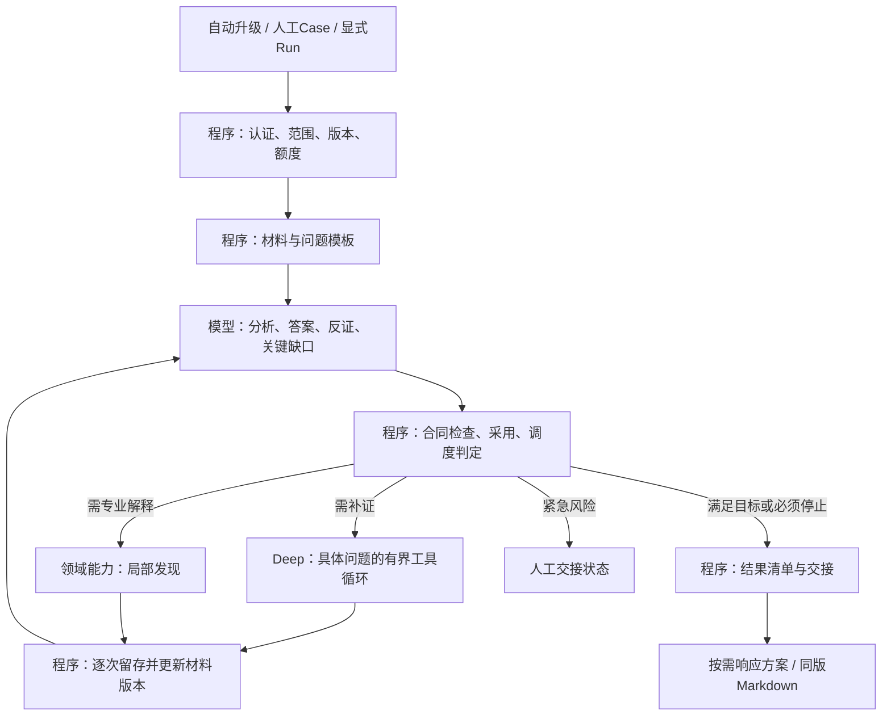

# 调查模块规划设计文档

2026-10-23 · v2（统一设计及换账号续接）· 方案已保存，统一调查尚未实施

本文件是后续调查设计与开发的主入口，集中维护整体方案、四块合同、程序与模型分工、现有模块迁移、分模块测试和产品参考。旧工程建议及产品研究保留为依据；涉及后续统一调查的设计取舍，以本文件和用户后续明确修订为准，不让不同文档分别驱动实现。

用户本轮明确：现有四角色、graph/Deep、Router不必固定保留，可从Agent工程和安全调查角度融合；先形成设计，不改代码。本稿因此不再以“三套拓扑和四个必跑模型不变”为目标约束。此前小修批次保拓扑的承诺仍适用于其已完成范围，不被本稿改写。

本稿只定义拟议合同、职责和迁移方式，所有新字段、状态及工件种类均为建议，并非当前API已经支持。业务源码、模型配置、预算数值、数据库、运行开关和生产服务本轮不变；不执行模型/业务测试，不提交或推送，不改变原5/15和旧失败。后续实施须把选定批次纳入原OpenSpec变更并逐步验证。

依据：[当前调查入口](../integration/v1/investigation.md)、[本地结果一致与交接小修](../operations/investigation-result-handoff-20261023.md)、[产品研究](investigation-product-research-20261023.md)、[既有工程方案](investigation-product-engineering-roadmap-20261022.md)。源码映射按本地最新文件核查，不代表生产v1已包含本地改动。

## 0. 实施前约定与阅读顺序

用户最新要求是：开发、测试在专用分支进行；设计明确后，一个模块一个模块实现和测试，达到预期再继续，不能等整条流程写完才验证。每块必须先有清楚的概念、功能和输入输出预期。本轮将这些要求写入方案，留待新账号开始推进，不在本轮启动实施。

| 内容 | 阅读位置 | 用途 |
| --- | --- | --- |
| 统一流程及四块合同 | 第1—6节 | 明确调查究竟回答什么，谁拥有状态，何时停止或交人工 |
| 逐步输入输出及模型合同 | 第7—8节 | 约束主分析、Deep和可选领域能力，不混淆计算与程序采用 |
| 持久化、兼容与旧模块迁移 | 第9—10节 | 决定复用、融合、拆出及调整的位置 |
| 完整业务例子 | 第11节 | 用同一案例检验问题、证据、判断和交接的语义 |
| 分支、模块验收及实施顺序 | 第12节 | 开发前先定义预期，逐块测试，失败先定位再推进 |
| 产品参考及采用理由 | 第13节 | 区分官方公开能力、本项目判断和未公开实现 |
| 换账号续接及首条指令 | 第14节 | 不依赖旧账号的聊天记忆开始工作 |
| 文档审阅边界 | 第15节 | 区分设计审阅、静态校核与实际业务验收 |

**当前事实分三层，不能混用：**

- 生产v1：按10月22日发布回执，API `5a1e1fd8`、Agents `49643b84`已上线，常驻worker与自动升级已启用；本轮未重新探测生产。历史文档中的worker OFF是更早阶段，不是当前状态依据。[生产接入](../integration/v1/production.md)
- 本地小修：10月23日结果一致、逐工具留存与停止交接已有本地实施/测试记录，尚未部署；模型原文仍有遵循缺陷，503未知用量及旧质量失败保留，不能写成调查质量整体通过。[小修回执](../operations/investigation-result-handoff-20261023.md)
- 本规划：统一执行器、问题级Deep、四块完整合同及版本化发布等仍是拟议设计。第12节模块均未因写入文档而完成；原restore任务仍5/15，不能按本规划倒填验收。

原始事件生产/规范化继续由上游负责；本方案从已有告警与可查询历史材料开始。不扩前端、全量采集、自治响应或通用Agent平台。初版只交调查结果与建议，真实厂商动作仍关闭。四角色和三套拓扑可以融合，但小模型仍需有界材料、明确任务及实际效果验证；没有“融合后必然更准/更省”的既定结论。

## 1. 总体选择

目标是一个调查执行器维护一份共同状态：**形成问题→分析已有证据→按需补查/领域解释→更新判断→停止或交付**。入口可以是Kafka自动升级、人工Case或显式Run；触发方式决定授权与交接要求，不再决定完全不同的调查语义。

- graph复用为程序控制骨架；Recon和Forensic中有价值的材料整理、分析职责融合进统一流程。
- Deep保留有界工具循环，承担明确问题的补查；不是一套另起预算、另产全案裁决的调查系统。
- Router保留领域识别/并行执行能力，改为按问题选专业解释能力；不再作为整案另一套判决流水线。
- Responder按需要形成方案；Report优先确定性渲染，语言整理模型按需使用。
- 不新增每案必跑的总规划/总审核模型；复杂材料整理、主分析、补查和专业解释可以使用同一物理模型的不同有限任务。



人工交接是独立状态，可以与允许的只读补查并行。资料不足时直接交付缺口；不会为了填满节点而调用所有能力。目标只有一个主调度循环，禁止“总Agent→专家→Deep→专家”的递归调度。

## 2. 身份与范围：四块共用一个上下文

四块是逻辑结构，不是四个新服务或四张新表。共同上下文由程序维护，每次模型调用得到相关内容的有界视图。

内部结构固定为共同上下文加`questions[]`、`evidence.query_receipts[] / evidence.items[]`、`analysis.findings[] / analysis.assessment`、`execution`。模型只返回候选增量，程序将采用后的内容写入这份结构；后文JSON是该结构的局部展示。

| 字段 | 定义及所有权 |
| --- | --- |
| `schema_version` | 新合同版本，例如`unified_investigation.v1`；程序写入，旧记录不回填假版本 |
| `investigation_id` | 逻辑调查标识，拟用首次调查Run UUID作为稳定根引用；续接Run保留此值，不冒充Fusion Incident/Case ID |
| `run_id / parent_run_id` | 一次有界执行的ID及续接来源；程序分配。Kafka升级继续尊重现有同Run关系 |
| `tenant_id / actor / trigger` | 认证解析的租户、操作者/服务身份和触发类型；不取信模型或工具返回的租户值 |
| `anchor` | 明确`type=alert\|case\|incident\|explicit_set`及ID；其他关联ID分别保留，不能靠旧字段名猜对象类型 |
| `objective / policy_ref` | 本次需要支持的决定及采用的场景/完成政策版本。默认问题由版本化策略给出，模型可提议新增问题 |
| `scope` | 成员告警/实体、绝对UTC事件窗口、可用来源、允许扩展规则；历史基线窗口单列。记录成员总数、选取数、实际读取/采用与遗漏 |
| `scope_revision / evidence_revision` | 范围和材料快照版本；由程序递增。单次模型输入钉住具体版本，不能依赖不断变化的全局聊天 |

明确区分“已有Case全部成员”“本次纳入成员”“实际进入某次模型的材料”。当前Case入口最多投影最近3条，不能直接把这份输入声称为完整Case分析；后续接线须增加成员清单、按问题选材及遗漏披露。

首次版本只支持单次Run/明确成员集的统一分析。`investigation_id`及父Run引用先为手动补证续接准备；自动持续事件调度、成员扩展竞争及跨Run累计预算准入属于后续批次，尚未具备时不开放自动连续续接。

## 3. 第一块：调查问题 `questions`

### 3.1 职责与最小字段

一个问题是需要作出的具体判断，不是工具名称，也不是无限扩展的自然语言任务。例如“本窗口内账号U对主机H是否存在成功认证”可执行；“彻底调查这个用户”不是合格的补查任务。

| 字段 | 含义 | 写入责任 |
| --- | --- | --- |
| `question_id / revision` | 问题身份和定义版本；修改目标或验收条件需新版本 | 程序 |
| `topic / text` | 检测事实、行为关系、授权/恶意、影响、覆盖、持续风险、处理决定；具体问句 | 策略模板或模型/人工提议，程序登记 |
| `origin / parent_question_id` | 模板/模型/人工来源及派生关系；来源模型调用可回查 | 程序 |
| `scope_ref / entity_refs` | 本问题允许的实体与时间，必须属于已批准范围 | 程序；模型只提扩展建议 |
| `decision_dependency` | 会影响哪个决定，例如阻止“授权正常”结论、阻止“外传已确认”、要求紧急复核 | 场景政策；模型可建议提高优先级，不能自行取消阻断项 |
| `evidence_requirements` | 所需来源类别、字段、连接依据、覆盖条件、需要检验的替代解释及政策版本 | 场景政策/人工定义；模型可补充候选要求 |
| `capability_refs / depends_on` | 允许的查询/领域能力及前置问题，不能因prompt提到工具就授予能力 | 程序 |
| `work_state` | `pending / running / returned / blocked / waived`，仅表示问题处理进度 | 程序 |
| `answer_ref / resolution` | 指向判断块；`unassessed / supported / refuted / inconclusive / conflicted / not_applicable` | 模型提议，按采用规则由程序保存 |
| `gap_reason / review_requirement` | 缺什么、为何不能继续、是否需要人核；待核问题不得静默消失 | 程序汇集政策与模型输出 |
| `resolution_basis` | 政策版本、已满足/未满足的证据条件、检查或人审引用；模型答案被采用与达到目标所需审核强度分别记录 | 程序 |

`returned`只表示收到合格格式的回答，不表示命题已证实；`supported`须显示依据和审核基础，不表示系统保证客观真值。`waived/not_applicable`必须有政策/人工理由，模型不能通过删除问题或标不适用让调查变完整。

### 3.2 默认问题与回答门槛

| 问题 | 最低可检查条件 | 必须保留的语义限制 |
| --- | --- | --- |
| Q1 检测描述的现象是否发生 | 来源事件、实体、事件时间、检测条件及结果字段 | 告警标题只是来源声明；成功认证不证明本人操作 |
| Q2 活动之间有什么联系 | 设备/账号/各端会话/进程/文件/连接等来源记录及连接依据 | 同IP、同名账号或时间接近只作候选；跨主机会话ID不直接等同 |
| Q3 恶意还是授权行为 | 行为内容、来源、批准任务及范围、支持和反证 | 缺工单不独立证明恶意，有工单也不授权所有后续行为 |
| Q4 实际影响是什么 | 将尝试、成功执行、访问、修改、传输分别引用 | 外联字节不能单独证明敏感内容外泄；权限路径是潜在影响 |
| Q5 覆盖到哪里 | 查询回执、实际窗口、采集/权限/分页/延迟限制 | 覆盖可记录未知；模型不能自行宣称覆盖完整 |
| Q6 是否仍持续或已阻断 | 当前有效活动/会话及有时效的状态；若有动作则需要执行与验证资料 | 某时刻未检出不保证永久停止；执行成功不自动证明处置效果 |
| Q7 当前应怎样处理 | 已采用判断、关键未决项、行动前提和责任 | 可以充分支持转人工而不足以支持安全关闭 |

场景模板可把上述问题具体化、指定适用性，必要时增加子问题；不要求每次七个模型调用。一个模型可针对相关的一组问题返回紧凑结构，但不混入无关领域任务。

### 3.3 回答采用规则

模型输出`answer_candidate`：问题ID/版本、命题、支持与反驳引用、适用范围、限制、建议resolution和下一项问题。程序验证格式、身份/版本、引用存在、来源类别和预设字段条件，然后保存为分析判断。

只有明确且已经验证的数据映射可支持确定性命题检查，例如“来源认证事件的result=success”；这仍是“该来源记录了成功”，不等于证明账号未被盗。对恶意性、授权充分性、因果归属等，程序校验通常不能验真，必须保留模型分析性质；政策要求或存在关键冲突时交人工。模型自报confidence或`answered=true`都不直接决定关闭。

问题目标所需的审核强度由`policy_ref`事先定义。模型分析可以带`model_assessed`进入展示和下一轮推理，但不足以自动满足要求人审或确定字段证据的条件；没有已定义且可检查的采用条件时，相关强决定保持待核。关键问题为inconclusive/conflicted或审核条件未满足时，调查不能标`complete_for_scope`，即使材料已足以支持人工升级。

## 4. 第二块：证据 `evidence`

证据块内部区分**查询回执**与**来源材料**，共享引用索引。一次工具返回可以有多个证据条目，也可以没有条目；没有结果不制造“未发生攻击”的证据行。

### 4.1 查询回执 `query_receipts`

| 字段 | 必须表达的内容 |
| --- | --- |
| `query_id / step_id / question_refs` | 程序分配的本次执行身份及回答的问题；模型tool_call ID另存，不作全局唯一ID |
| `capability / adapter_version` | 实际执行能力、适配器版本及来源系统 |
| `requested_args / effective_args / argument_refs` | 模型提议参数、执行端实际参数、每项实体/时间参数的来源或显式推导理由 |
| `effective_scope / executed_at` | 实际租户授权范围、事件窗口、查询时间；与请求不同须说明裁剪/拒绝原因 |
| `execution_status` | `succeeded / failed / denied / cancelled / unknown`；pending/running保存在执行块，终态回执不假装已完成 |
| `result_count / data_state` | `records / empty / unavailable / unknown`，与调用执行状态分开；HTTP200仍可能为unavailable |
| `coverage` | 来源是否采集、时间保留、权限/字段、分页、截断、延迟等维度，未知就明确未知 |
| `material_refs / retention` | 来源记录引用、原始返回存储情况、模型可见正文与preview引用、各层hash/字节、裁剪和留存缺口 |
| `query_fingerprint` | 程序计算的去重依据：tenant、权限范围、能力版本、规范化参数/窗口及可得的数据水位/时效信息 |

相同fingerprint仅在来源时效和权限仍适用时复用；数据源在补传、权限已变或没有可信水位时，不能永久缓存空结果。允许的新查询须记录为什么值得重查；留存失败不以重跑查询冒充原回执。

### 4.2 来源材料 `items`

| 字段 | 含义及规则 |
| --- | --- |
| `evidence_id / revision / query_ref` | 程序身份，指向产生它的查询或入口材料记录；来源更正产生新版本，不覆盖原件 |
| `source_kind` | `source_event / alert_claim / business_record / threat_intel / knowledge / human_statement / relation_candidate` |
| `source_system / source_record_id / origin_refs` | 来源命名空间、原始ID及上游来源；同一底层记录经多个工具出现不能当多份独立印证 |
| `event_time / acquired_at / entity_refs` | 事件与取得时间分开；实体含类型、来源命名空间和映射依据，时间精度/不确定性保留 |
| `observed_fields / source_ref` | 可回查的原始字段/摘录及工件或外部来源引用；不把模型总结写成原始字段 |
| `limitations / visibility` | 已知采集/字段/裁剪限制，以及哪些内容实际供哪次模型消费 |

模型提出的因果联系、攻击假设、摘要放在判断块，不能升级成`source_event`。图算法给出的可达关系或共享实体属于关系候选；如存在原始行为连接记录，应另引对应source_event。

模型可以建议“这条记录与问题相关”，但不能直接创建来源事件、改源字段、伪造覆盖状态或补写缺失的执行回执。程序提取材料失败时保留原返回及解析缺口。

### 4.3 空结果与有限负证据

只有实际查询范围正确、采集与保留期适用、权限及字段足够、分页完成、延迟可接受时，空结果才可支持“该来源在该范围未检出”的有限判断。该判断存于判断块，引用查询回执和覆盖资料；不扩大成“任何路径都未发生”。缺任一关键条件则是资料缺口。

来源权限回收或原件过期后，历史引用仍保留，但再次使用前重新检查可访问性和适用性。hash只证明指定字节层的一致性，不证明原事件真实；仅保存截断正文与完整结果hash时，必须明确无法重建完整原文。

## 5. 第三块：分析判断 `analysis`

### 5.1 可追溯的单项判断 `findings`

| 字段 | 含义及责任 |
| --- | --- |
| `finding_id / revision / question_refs` | 程序分配及问题关联；判断变化追加新版本 |
| `claim / kind` | 模型/规则/人工提出命题；`source_observation / interpretation / hypothesis / conflict` |
| `scope_ref / input_snapshot` | 适用实体、时间及实际读到的材料版本 |
| `support_refs / oppose_refs` | 具体证据/回执引用。引用旧判断时必须列为派生依赖，回到其基础证据，不能当新独立证据 |
| `rationale_summary / alternatives / limitations` | 简短可审的依据、替代解释及未决限制；不要求保存隐藏推理 |
| `assessment` | `supported / refuted / unresolved / conflicted`，每项命题分别表示 |
| `producer / assurance` | 来源任务/模型调用或人工；`rule_checked / model_assessed / human_reviewed`说明依据，不能笼统包装为truth_verified |
| `adoption` | 程序管理`proposed / admitted / rejected`，含结构/引用检查结果及拒绝原因；admitted意为可以作为所标性质的结果采用，不保证语义正确 |
| `validity / supersedes` | `current / needs_review / superseded`及替代关系；新相关证据可能使旧判断待复核 |

输入质量检查、语义判断、业务决定分开。主分析负责提出结论及反证，程序检查合同与已定义的有限谓词；复杂断言不能仅靠关键词匹配验真。专业Agent的输出也经过同样采用流程，不按多数票或最高confidence决定全案结果。

### 5.2 整体评估 `assessment`

主分析模型在同一次分析调用中，基于具体版本的findings提出`assessment_candidate`，负责跨发现的解释和综合；程序不凭局部标签或confidence机械推导全案结论。候选包含`input_snapshot、finding_refs（ID及版本）、activity_assessment、timeline、relations、confirmed_effects、possible_effects、open_question_refs、critical_conflicts、rationale_summary`。首次调用中可以引用同批finding候选的临时键，程序在采用后解析为正式ID；某项finding被拒绝时，其依赖的整体结论也不得采用。

程序校核整体候选的引用、范围、适用版本、限制和政策审核条件，写入整体评估的`adoption / validity / input_snapshot`；允许采用明确标为假设或待核的整体结果供人阅读，不将其自动提升为强结论。`decision_readiness`由程序根据当前有效发现、关键未决项和事先定义的政策计算，模型只能提出建议。来源或审核条件不足时，相关ready=false并列出阻断引用；支持人工升级不意味着支持安全关闭。

形成的整体评估包括：

- `detection_assessment`：每条告警检测条件是否支持，保留成员差异。
- `activity_assessment`：`malicious_supported / authorized_supported / mixed / unresolved`，以及支持/反证finding引用；不同活动可以不同结论。
- `timeline / relations`：来源行为与分析连接分开；每条连接标为观测依据、关联候选或推断，不由一张图自动裁决。
- `confirmed_effects / possible_effects`：已支持与待核影响，明确依据与范围。“confirmed”仅在场景采用条件满足时使用，带assurance，不代表所有潜在范围已查清。
- `open_question_refs / critical_conflicts`：会影响当前决定的问题和矛盾。
- `decision_readiness`：分别表示可否支持人工升级、建议控制措施、有限正常解释等；自动关闭资格由独立业务政策判定，模型不得授予。
- `action_proposals`：核验或处置建议、目标、依据、前提、绑定判断版本。它不承载“实际已执行”的事实，后者必须来自执行回执。

默认不把单一confidence作为必需字段。保留模型自报值时命名并标为未经本场景校准的`model_confidence`，不参与完成/权限门槛。原分诊confidence与首次结果保留原语义，不在本稿中重新标定。

### 5.3 新材料与旧判断

每个判断钉住问题定义、范围、证据及覆盖版本。新材料与已有实体、问题或引用有关时，程序保守标记相关判断`needs_review`；关联性不明确时由主分析评估是否影响，不把所有新记录都强制触发全案重跑。

`needs_review`立即沿派生依赖传播到问题答案、整体评估、相关decision_readiness和未执行动作提案，不必等模型确认“判断变化”。只有`adoption=admitted`且`validity=current`、与现有范围/政策及相关材料兼容的判断，才能支持当前强结论。被影响的普通提案暂停采用；必要的新紧急提案应基于仍有效的事实重新按政策评估。

若新反证到达后立即到限，无需再调模型：程序保留旧判断作为历史，将当前依赖结论标为待复核、关闭相关强决定资格，以partial交接。不能继续用旧authorized_supported或旧确认影响填充“当前结论”。无关且仍有效的判断可保留。

每次模型返回都检查它的input_snapshot；若期间相关材料或范围已变，结果作为旧快照候选保存，不直接覆盖当前判断。重分析可以维持、加强、削弱或撤回判断，保存变化原因。旧报告不覆盖，旧动作不自动重放/撤销，已执行动作只追加后续评估。跨Run自动更新在后续批次实现，首次版本可由人工补证触发新Run。

## 6. 第四块：执行状态 `execution`

这一块全部由程序维护；模型只能建议继续、停止或交接。

### 6.1 三个独立维度

| 维度 | 建议状态 | 表达什么 |
| --- | --- | --- |
| `run_state` | `queued / running / finalizing / finished / stopped / failed / cancelled` | 一次执行的生命周期，不是安全结论 |
| `investigation_completeness` | `complete_for_scope / partial / undetermined` | 针对已固定目标和政策版本，关键问题是否足够；能转人工不等于已经查清 |
| `continuation` | `none / awaiting_data / awaiting_human / followup_needed` | 本轮后怎样继续；Case/Alert业务关闭仍归现有业务状态和授权控制 |

`phase`可为`prepare/analyze/acquire/expert/assess/respond/report/finalize`，只是当前程序阶段。处于`acquire`不表示查询成功；处于`report`不表示调查完整。

### 6.2 生命周期和结束原因

| 转移 | 条件与输出 |
| --- | --- |
| queued→running | 认证、目标归属、输入范围和额度准入成功；创建起始快照 |
| running→running | 采用分析、派发补查/专家、接收结果；逐步留存，不重置额度 |
| running→finalizing→finished | 按既定目标正常收束、同版结果清单已保存；完整度仍单列 |
| running→finalizing→stopped | `budget_exhausted / deadline / no_progress / missing_data / human_required`；有界确定性交接，通常partial |
| queued/running/finalizing→failed | 身份/关键执行/持久化等错误使可靠交付无法完成；已存工件保留，说明是否仍有部分成果 |
| running→cancelled | 显式取消继续传播；保留已经提交的工件，不承诺取消后必有最终报告 |

常规“等待数据/人工”不保持一个无限占用资源的running Run：结束本轮、保留continuation和交接，资料到达后以新Run续接。紧急交接可先发生，在原范围/预算允许下本轮继续只读查询。

### 6.3 执行记录、预算和交接

| 内容 | 规则 |
| --- | --- |
| `steps` | 每次分析、查询、领域调用、渲染都有唯一`step_id`、问题/输入版本、状态及输出引用。来源回执标明实际发生的调用，不用节点名替代模型次数 |
| `budget` | 分别记录模型次数、工具次数、已知token/费用、unknown、已预留额度和绝对deadline；额度由执行器持有，所有子任务共享 |
| `stop_reason / blockers` | 程序决定并引用依据；不因为模型输出“结束”就忽略关键缺口 |
| `retention_status` | `ok / gaps / unavailable`独立于业务结论；决定性证据无法可靠留存/回查时限制其交付采用并转部分交接 |
| `handoff` | `not_required / required / queued / delivered / acknowledged / closed`，含原因、紧急程度、责任角色、下一步与回执；报告中写“请人工处理”只能是required |
| `action_receipts` | 预留承接未来获授权的审批、执行、效果验证；当前仅建议/dry-run。外部动作不因调查统一而开启 |

程序在发起每个模型/工具前检查额度及期限；并行任务必须先原子预留各自份额，释放未用部分，unknown不当0返还。修复格式的模型重试也计入同一账本。单次实际token在回复后才能完全确认，预估/输出上限与保守准入减少越界，不能承诺未知token永不超额。

现有字段`max_tool_calls`有统计模型次数的历史语义。新合同显式区分model_calls和tool_calls，过渡映射不静默放大原限制。本稿不提出新的默认数值；试点上限与单任务上限须另按目标模型和已有配置确定。

收束需预留少量程序保存/渲染时间；额度或deadline停止后不再偷偷发总结模型。工具/模型的客户端超时不证明远端未执行或未计费，标unknown并沿原保护处理，不无限重试。首次方案不引入通用分布式恢复平台。

### 6.4 停止及人工规则

1. **正常收束**：目标的关键问题达到政策要求，或有明确允许的不适用理由；不存在会改变该决定的未处理冲突。未回答非关键问题保留限制，不能缩小目标来伪造完成。
2. **无新增有效材料**：规范化重复查询已被拦截，允许来源已尝试且没有足以改变关键判断的合理下一步；程序按场景政策结束。不能以“某字段已出现”当语义增益已证明。
3. **资料/资源停止**：关键来源缺失、范围越权、预算/期限到达；保存partial和恢复条件。不能记安全或自动关闭。
4. **人工接手**：业务授权无法确认、重要证据冲突、范围需扩大、高影响动作需审批、缺关键源或专业判断超出能力。
5. **紧急交接**：当前证据与场景政策支持高紧迫性时立即提交已知/未知和建议；无需等报告。未得到投递/接手回执不能声称人已接管。

自动关闭和真实响应是不同的后续业务决策，不以`complete_for_scope`或模型置信度直接触发。初版统一调查只交付结果/建议，保持现有首次分诊及真实动作权限边界。

## 7. 每一步谁负责，输入输出是什么

表中的产物是同一四块状态的增量，不要求每一步复制整份上下文或调用一个新Agent。

| 步骤 | 主责 | 输入 | 输出 | 失败/边界处理 |
| --- | --- | --- | --- | --- |
| S0 接受请求 | 程序 | 认证主体、Alert/Case/显式目标、已有分诊、请求目标 | 共同身份、固定scope、额度、起始execution及持久新执行器标记 | 归属/参数无效拒绝；不让模型补造身份 |
| S1 组装材料 | 程序；复杂文本可选整理模型 | 成员清单、已有Bundle/告警/图/知识及来源能力 | 来源证据、覆盖清单、模型视图、遗漏 | 未知来源/裁剪显式记录；模型提取是候选，不变原字段 |
| S2 建立问题 | 程序加载模板；主分析可提扩展 | objective、场景策略、已有材料、可用来源 | 问题清单、证据条件、优先顺序 | 模型不能删除关键问题或授予新工具权限 |
| S3 分析当前材料 | 主分析模型；简单字段命题可用规则 | 当前问题、有界证据、旧发现及反证、快照版本 | 候选findings、问题答案、整体assessment候选、关键缺口、建议下一步 | 结构错误可有界修复；不可解析就保留失败与已有结果 |
| S4 检查与调度 | 程序 | 候选输出、政策、版本、权限、预算 | 采用/拒绝理由；补查、专家、停止或交接决定 | 合同通过不写成语义验真；冲突/需人审则阻止相关强结论 |
| S5 定向补查 | Deep选查询；程序执行与留存 | 明确问题、证据引用、能力清单、有效scope、剩余额度 | query_receipts、新来源材料、局部answer候选和缺口 | 参数不合法先拒绝；每次执行后先留存再继续 |
| S6 领域解释 | 按需领域模型 | 一个专业问题及有关证据视图 | 局部findings、反证、限制、补查建议 | 不输出全案裁决、不递归调Deep；建议返回主调度 |
| S7 更新判断 | 程序合并材料/失效传播；有意义变化回S3综合 | 新证据/局部发现、前版问题与判断 | 经采用的新版analysis、程序计算的readiness、问题状态和未决项 | 程序不从局部标签推断整案恶意；新冲突使依赖结果待复核 |
| S8 收束与交接 | 程序 | 当前采用结果、问题覆盖、执行原因 | completeness、continuation、交接清单 | 可用确定性文字交接；不以末ToolMessage冒充结论 |
| S9 响应规划 | 程序模板；复杂计划可选模型 | 已采用analysis、动作政策/能力、业务限制 | 核验/处置提案，绑定判断版本 | 只有dry-run；模型不写已执行，不绕过缺口 |
| S10 报告与发布结果 | 程序renderer；可选语言模型 | 同版问题、证据、analysis、execution和提案 | Markdown、版本化结果manifest | 模型新加事实不自动采用；格式失败降为确定性报告 |

S3与S2可在一次有限模型调用中完成“已有材料判断＋少量派生问题”，避免机械增加轮次。S5中的相关独立只读查询可以在统一额度下并行；存在实体/时间依赖的查询顺序执行。领域任务也必须服从同一执行器的并发和预算限制。

## 8. 模型与Deep的调用合同

### 8.1 主分析

输入只包含：task/policy版本、问题及关键性、scope快照、相关证据片段与引用、已采用发现及待复核项、来源/覆盖限制、允许建议的下一步类型。主分析默认不直接绑定全部工具，也不读取整案全部原文。

输出只包含：`answer_candidates[]、finding_candidates[]、assessment_candidate、question_proposals[]、next_step_proposals[]、urgent_review_proposal`。assessment_candidate的字段及采用见第5.2节，复用该次主分析，不增加另一次必跑总结模型。所有status/adoption/ID/预算变更及有效decision_readiness均由程序进行。模型引用不存在的E-ID时拒绝对应断言，不靠另一个模型编造补齐。

### 8.2 Deep任务

输入`question_id/revision、scope_ref、evidence_refs、allowed_capabilities、required_observations、remaining_limits、deadline`。问题例子为“验证账号U从JUMP01到APP01的远程执行联系”；不是“彻底查清整案”。

Deep可根据实际结果调整本问题内的查询顺序，必要时连续查认证、进程等来源。新增实体/时间窗请求回主调度，超过政策不直接执行。每个查询参数包含原字段/证据依据，API执行端再次核范围和类型。

输出`query_refs、evidence_refs、answer_candidate、gaps、local_stop_reason、suggested_questions`；不输出全案最终verdict、完整响应方案或最终报告。实际花费由CostTracker取得，不能取信模型返回的usage。

### 8.3 领域分析

输入局部问题、证据视图与适用边界，输出相同finding候选合同；无需为各专家复制独立证据库和权限系统。未知应输出unresolved；身份/云解析默认TP以及旧Router“TP优先/最高confidence”的汇合不得继承为新规则。

### 8.4 输入上限与材料裁剪

每类任务配置输入token、单证据摘录、证据条数、输出和调用上限；由程序估算并执行，目标值在试点中确定，本稿不凭空增加当前额度。优先当前问题的原始支持/反证、前置发现和覆盖限制；知识资料另列且较低优先级。

关键材料装不下时先拆问题/选取更相关证据，并披露遗漏。需要模型整理时保留每项引用、限制及原文回查；摘要不能作为新独立证据，也不能靠截断丢掉反证后仍声称完整消费。

## 9. 持久化与兼容设计

### 9.1 复用账本，不另建证据平台

近期复用`investigation_runs / investigation_events / investigation_artifacts`。建议增加的逻辑工件为`unified_state_snapshot`（四块的有界结构和引用）及`unified_result_manifest`；工具正文、模型可见消息及Markdown继续复用已有工件能力。这里只定义合同，不新增DDL或工件代码。

S0必须先持久化`unified_execution_started`事件，记录schema、run/tenant、执行器版本和初始scope；自动升级时标记该Run中的统一调查阶段，不改首次分诊记录。开始标记未落库则不执行新调查模型/工具。新格式执行标记是冷读判别依据，不能把“没有manifest”直接解释为历史Run。

每次决定性采用/补查完成保存相应增量与快照引用。证据原文不嵌入每版快照；大材料引用现有工件或受控来源。更新追加，旧记录不改写。

manifest固定：schema、tenant/investigation/run、scope/evidence版本、问题与判断快照ID、execution快照、报告工件ID、retention状态、前版manifest引用。发布manifest之前必须确认所引用工件已保存且同租户/同版；缺报告可发布明确的partial交接manifest，但不能伪造report ID。结果发布事件与manifest写入作为一个原子提交，是新格式对外发布的唯一点；普通snapshot或孤立report写入不构成新版正式结果。

发布前再次核对相关材料版本；若生成期间有新关键材料到达，执行依赖失效传播，将待复核/较新材料待处理状态写入最终快照并渲染相应交接，不能发布未经披露的陈旧强结论。若已经到限，使用确定性partial交接，不追发总结模型。

冷读先检查新执行器开始标记：存在标记而无已发布manifest时，返回调查进行中、停止或交付缺口及已有步骤材料，不能借首次triage的completed或旧report声称统一调查完成。存在manifest时按其引用读取，禁止分别取“最新analysis”和“最新Markdown”后拼接。当前冷读按artifact种类取最新的做法需要适配；仅无新执行器标记的历史Run走旧读法。检测到新manifest损坏/缺件时显式报错，不能静默退回旧报告冒充最新结果。

### 9.2 步骤身份与序号

统一Execution为Run分配`step_id`和调用序号，Deep不能重置。现有Deep每次从`10000+offset`生成工具seq，多次子任务直接复用会碰撞；这是接入统一循环前必须修的接缝。

建议新执行器内由一个串行分配器分配Run级唯一seq，并保留初始分诊已有序号；所有新步骤走同一分配器，旧writer不并发参与同一新Run。序号可以按发起顺序分配，不宣称是提交顺序游标；晚完成写入仍可能出现。读取以manifest/明确引用为准，现有历史分页约束保持，不重编号旧事件。

失败重试使用新的attempt身份并关联原step；不能把复查查询记作原查询成功回执。进程恢复与多实例接管不是本批默认承诺；后续若开放同Run多写者，必须补持久分配/互斥，不以进程内计数保证跨实例唯一。

### 9.3 旧入口与旧state

现有graph/Router共用`InvestigationState`，人工链用`InvestigatorState`。新四块是唯一新执行器内部合同，不在两份旧state中完整复制再双向同步。

入口单向转换统一请求；暂时复用旧Agent时，只为单次调用临时投影其输入，返回抽取该能力的候选输出。旧findings、模型IOC和时间线先按声明/分析保留，不能批量标为来源事实。能力迁入新接口后移除其临时适配。

适配必须审查副作用并使用白名单：允许的是已登记的单次模型计算或受调度的只读能力；不允许旧函数私自再调Deep、启动另一图、重置预算、发布全案报告/动作或调用complete_run。`agents/investigation_agent.py:run_investigation`本身包含查询/Deep和整案输出，不能整函数包一层就当纯主分析；应抽取/复用其中合适提示与解析、规则或查询能力，再接统一调度。旧orchestrator及账本终态调用也只能由新执行器掌握。

旧API输出在出口按需单向投影，旧字段不反向驱动新执行器。Kafka首次分诊及其confidence/告警状态保留原证据，不让后续调查改写或重复分诊。旧ledger的`case_id`可能装Alert引用，新合同必须显示类型。

新`execution.run_state`先在工件中表达，不直接替换旧数据库/客户端状态枚举。特别是自动升级的旧Run可能在首次分诊后已标completed；新调查进度由统一结果字段表达，不能把它倒写为旧流程未完成或称全案已查清。未来API变更另纳规格与兼容校验。

持续跨Run自动调查需要可靠的“最新已采用版本”引用与并发比较，以及累计预算索引；首次单Run方案不声称已有。后续设计应在既有PG账本体系加最小索引/指针，而非靠时间戳扫描或任意最后写入覆盖。当前仅预留lineage字段，明确这项开放前置。

## 10. 现有模块的复用、融合与调整

下表未写完整目录的Agents文件均在`services/agents/app/`，API文件明确列出。

| 现有模块 | 处理方式 | 需要改变的责任 |
| --- | --- | --- |
| `workers/fused_alert_consumer.py:_maybe_escalate` | 复用认证/升级条件和同Run身份，调整接线 | 首次分诊保持；后续接统一执行器，避免重复auto_triage |
| `api/investigate.py:launch_investigation/_run_and_store`；API `cases.py:case_investigate` | 复用入口/归属校验，调整范围组装 | 三条执行路线逐步变成同一核心的不同入口；Case成员不再仅凭最近3条投影宣称完整 |
| `context/bundle.py:ContextBundleBuilder.build`、`investigator/bundle_prompt.py` | 复用读取，调整输出材料合同 | 标明来源类别、读取状态和引用，避免Bundle摘要全部成为事实 |
| `investigator/strategies.py:Strategy/select_strategy`、tenant skill解析 | 复用场景选择与版本，扩为问题/证据条件模板 | 现有expected_pivots保留诊断，不作为调查问题已回答的证明 |
| `investigator/recon_agent.py` | 材料整理能力融合，模型调用可选 | 程序能做的类型提取/去重不必调用模型；复杂材料才调用整理能力 |
| `investigator/forensic_agent.py:run_forensic`、`agents/investigation_agent.py:run_investigation` | 融合主分析职责，审查并拆出可复用能力 | 收敛为answer/finding/assessment候选；不整段包装带Deep/查询副作用的run_investigation，原评分/归因不直接当可信结论 |
| `investigator/deep_investigation.py:run_deep_investigation`、`llm/tool_loop.py:run_with_tools` | 复用工具循环/异常交接，调整任务边界 | 输入具体问题与剩余额度；全Run身份/序号；输出局部证据及回答，去掉全案独立裁决职责 |
| `tools/investigation.py`、API `services/investigation_tools.py:dispatch/ToolResult` | 复用实际查询/认证，逐工具适配 | 参数来源、业务类型、绝对窗口、来源覆盖、结果字段；不必先开放任意SQL |
| `tools/registry.py`、客户工具 | 复用注册与隔离，补执行时合同检查 | schema展示不等于执行端验证；工具不能改变租户/权限/预算 |
| `orchestrator/router.py:classify_signals/_run_parallel` | 保留领域路由与并行技术，融合入主调度 | 仅选需要的领域，不默认无匹配就全跑；专家只交局部发现，替换旧join裁决 |
| Chain/Path/`agents/attack_path_agent.py`及API图上下文 | 复用候选检索和读取，调整采用时机与语义 | 作为初始材料或按问题查询；不在调查结论之后无条件追加另一套强判断 |
| `confidence/groundedness.py`及人工前置校验 | 复用有限标识检查与下游采用约束，扩结构/引用检查 | 明确不能验真因果与授权；拒绝项和模型原文分别留存 |
| `graph/runner.py:InvestigationBudget/_run`、`graph/workflow.py`、人工orchestrator | 融合为一个执行器 | 复用时限/预算/留存技术，旧图不长期套在新图外；策略选择不能形成两套同时运行的控制流 |
| `llm/contract.py:safe_ainvoke`、`core/cost_telemetry.py:CostTracker` | 复用 | 全部模型步骤包括修复/润色计入同一账本；实际输入与用量保留 |
| `investigator/responder_agent.py` | 调整为按需计划能力 | 只消费已采用判断，保留dry-run和前提；待核场景可由模板生成核验任务 |
| `report_writer_agent.py`、`orchestrator/report.py` | 融合呈现合同，优先确定性renderer | 一份采用结果生成同版MD；模型写作不再生成新事实/全案裁决 |
| `investigator/ledger.py`、`api/investigation_access.py` | 复用事务/工件，调整身份及manifest读取 | 多次Deep无seq碰撞、同版读取、留存gap不掩盖；不建第三套账本 |

保留Fusion原分组算法、上游采集职责及现有存储；不因统一调查而强行自动建Case或合并Incident。业务对象的长期生命周期与人工工单接入按后续范围设计。

## 11. 贯穿例子：新来源登录→远程执行→大量外联

以下是未来合同的假设演练，不是已接数据、真实Run或已执行测试。示例E/Q/F为便于阅读的短ID，实际由程序生成并带租户/版本关联。

输入：2026-10-20 02:03运维账号U从新来源登录JUMP01；02:08 APP01远程执行；02:14 APP01大量外联。初始事件窗口本例取北京时间01:50—02:30，程序转换为UTC `2026-10-19T17:50:00Z`—`18:30:00Z`；如看历史基线另列参考窗口。

| 步骤 | 程序/模型输入与输出 | 四块如何变化 |
| --- | --- | --- |
| A 范围和材料 | 程序核3条告警归属、设备/账号身份和时间，记录已提供/缺失来源 | scope v1；证据先为3项alert_claim；execution running/prepare |
| B 提出判断与缺口 | 主分析读取3条声明和能力清单，提出授权备份/未经授权操作两种解释；策略生成Q1成功认证、Q2行为联系、Q3授权、Q4实际影响、Q5覆盖、Q6持续、Q7处理决定 | analysis只有hypothesis；问题不能因同IP或新来源直接resolved |
| C 查认证 | Deep针对Q1选认证查询，程序执行并保存R1/E1；结果字段显示成功 | F1为来源成功认证观察，Q1 returned/supported；盗号仍未知，Q3不随之关闭 |
| D 查连接依据 | Deep针对Q2查两端认证和目标进程，返回R2/R3、E2/E3；账号身份/各端会话与进程映射支持联系 | F2支持关联并指明连接依据；只有同名账号/近时间时应保持unresolved |
| E 查授权与影响 | 工单与进程/文件/连接查询可有界并行；主分析核脚本版本、资产/时间/操作范围 | 有工单但脚本/范围不符时保留冲突；外联流量只支持发送活动，不等于敏感文件已外泄 |
| F 紧急交接 | 假设外联仍持续、账号权限高且负责人暂不可核实授权；程序按政策生成交接任务 | handoff先required，获得队列/投递/人确认后逐步变化；不冒称已接手；允许范围内继续只读核查 |
| G 到限 | 程序发现剩余额度不足，停止新调用，确定性收束 | run_state stopped，stop_reason budget_exhausted；completeness partial；continuation awaiting_human；已有证据/结论/报告同版留存 |
| H 后续补证 | 人工提供可核的应用上传审计后启动新Run，继承investigation_id及parent_run_id | 相关旧判断needs_review；形成新版影响判断，保留旧限制；不能由上传未授权直接反推账号被盗已确认 |

本例G阶段拟议交付摘要：

```json
{
  "schema_version": "unified_investigation.v1",
  "analysis": {
    "assessment": {
      "activity_assessment": "unresolved",
      "finding_refs": ["F1@1", "F2@1", "F3-outbound-activity@1"],
      "open_question_refs": ["Q3-authorization", "Q4-content-impact"],
      "decision_readiness": {
        "human_escalation": true,
        "benign_close": false,
        "data_exfiltration_claim": false
      }
    }
  },
  "execution": {
    "run_state": "stopped",
    "stop_reason": "budget_exhausted",
    "investigation_completeness": "partial",
    "continuation": "awaiting_human",
    "handoff": {"state": "required", "acknowledged_by": null},
    "retention_status": "ok"
  }
}
```

这是省略身份及快照引用的展示片段，不是可提交的API body。`retention_status=ok`仅假设本例按声明的有界存储合同留存成功，不表示全部外部原文已备份。若真实投递已有回执，handoff可为delivered；没有回执就保持required。

相反，若认证设备、会话、工单范围、脚本版本、文件和目的端均匹配，可以形成有限的授权操作解释。模型不能仅凭“找到工单”结束所有问题。无论倾向攻击还是正常，迟到反证都必须允许修改判断。

## 12. 开发分支、逐模块测试与实施顺序

本方案复用现有服务、工具、状态机框架和账本，可增量实施；主要工作在语义合同与接缝，不需要先建设通用Agent平台。主要代价是来源/字段适配、问题级结果归一、预算和步骤身份统一，以及同版读取。能否提高小模型质量仍需直接比较，设计本身不能证明。

不选择全案自由Deep作为首个目标，是因为目前查询语义与输入覆盖尚有缺口；让它同时承担全案范围、规划、查证、裁决和停止会扩大责任。后续同材料评估若证明合并调用更好，可以调整模型任务划分，四块合同和程序控制仍保留。

### 12.1 分支和基线要求

后续首次开发或测试前，由执行者自行使用专用分支，建议名为 **`codex/investigation-working`**。用户允许另起合适名称；`Investigation Working`作为业务叫法可以保留，但Git分支名不能含空格。正常创建、检查和使用该分支不需要每一步再问用户。

1. 先只读核对当前分支、HEAD、未提交/未跟踪文件、已有同名分支和并行任务；记录实施基线。不能把Git HEAD等同于全部本地最新版本。
2. 同名分支不存在且当前工作区适合继续时，从当前选定基线创建该分支，保留相关未提交内容。同名分支已存在时先核对归属和差异，再复用；不要直接强制切换、reset、清理或整包stash其他任务内容。
3. 若同一目录仍有其他开发任务，切分支会影响它们。优先使用适合本任务的隔离worktree；新worktree不会自动带入当前未提交文件，须明确挑选并核对需要承接的本地小修，不能从远端默认分支开工后悄悄漏掉它们。
4. 每个模块回执记录分支、基础提交及本模块涉及文件版本。创建分支不等于保存了未提交文件；保留文件及验收回执，Git提交、推送和发布分别遵循对应授权，不用旧批次的提交授权推定本批自动推送。

本轮交接时工作目录为`/Users/lychee/Documents/project/socai2`，分支`main`，HEAD `5e0ce171`；本轮不切分支。这个值是交接快照，续接时必须重新读取。已知工作区还有本地调查小修、后端交接文档和测试数据工具等未提交/未跟踪内容；不能整体覆盖或据此认定本规划已实施。

### 12.2 每块固定采用“预期→实现→测试→判定→下一块”

**先写清模块预期，再只实现该模块，立刻运行相应验证并核对实际输出。达到已写明的预期才继续依赖它的下一块。** 不先搭完整流程再补测试，不以“能运行、返回200、有Markdown”代替业务预期。

每块开始前，在原OpenSpec变更及该批执行记录中写一张简短验收卡，至少包含：

| 项目 | 必须写清楚的内容 |
| --- | --- |
| 概念与功能 | 这块负责什么；由程序还是模型负责；可改变哪些状态 |
| 输入与前提 | 合同/版本、真实来源及字段、时间/实体、权限、前置模块和额度 |
| 输出与下游 | 对外字段、留存位置、谁消费；成功、空、缺失、失败分别怎样表达 |
| 预期样例 | 具体输入材料、预期判断/状态/引用及禁止出现的输出；预期依据不能只来自被测实现 |
| 验证方式 | 复用哪些有效测试；新补哪些直接测试；替身、真实查询、真实模型分别证明什么 |
| 放行条件 | 必须通过的样例和接缝；允许保留的限制；阻断项如何定位和修复 |
| 实际回执 | 文件版本、数据/策略/提示/模型版本、命令、结果位置、预期与实际差异、已知/未知用量、失败及修复记录 |

输入样例中的“答案”只供测试比对，不能混入模型可见告警或来源数据。对于恶意/授权等模型判断，先用可解释的场景材料定义允许的答案与不允许的越界推断，再检查模型原文、程序采用和最终交付三者；程序把错误输出降为partial，不代表模型本身判断正确。

模块失败时先区分输入/数据源、查询参数、模型输出、采用规则、状态迁移或留存读取的问题，在当前块修复并重测受影响部分。若必须改变业务目标、关键证据标准或整体设计，先记录差异并讨论；不能悄悄把失败预期改成实际输出。独立的文档整理可以继续，依赖失败能力的后续实现不能绕过该门槛。

### 12.3 第一次实施的模块顺序与直接预期

以下M编号是本设计的实现顺序，不是新增服务、必跑模型或另一套任务树。沿用`restore-alert-investigation-integrity`记录选定批次和实际进度。先选择一个来源可用的场景；异常登录与可疑进程/外联只是候选，不能在认证结果/进程遥测缺失时预定它们已具备条件。

| 模块与主责 | 本块输入→输出 | 开发前确定的直接预期与最小验证 | 通过后再做什么 |
| --- | --- | --- | --- |
| M0 基线与场景定义（程序读取＋设计） | 当前源码/回执、一个候选场景的真实可用字段→基线清单、问题及可判断/不可判断范围、验收卡 | 找得到关键字段及其来源；至少定义支持例、正常/反例和缺源例。若无法回答关键问题，先换场景或补明确来源接线，不伪造数据能力 | 选定首场景和专用分支后进入M1；M0本身不算业务通过 |
| M1 范围与调查问题（程序为主） | 认证主体、入口目标、明确成员、绝对窗口、场景模板→scope和questions最小合同 | 直接测试同实体不同类型、错误租户/窗口、成员遗漏、关键问题；越界被拒，覆盖被披露，模型建议不能删除关键问题。只定义本块所需结构，不先实现全执行器 | 通过范围/问题合同后进入M2 |
| M2 查询与证据（程序） | 一个问题、参数出处、允许来源→实际查询、query_receipts、evidence.items | 逐个接入首场景所需工具；有记录、成功空、缺源、失败、截断分开。核实际下发参数/绝对窗口/结果字段；拒绝把主机名填process_name。至少对选定来源做一次受控真实查询接缝验证，替身不证明来源可用 | 一个工具通过再接下一个；场景所需查询通过后进入M3 |
| M3 步骤身份、留存与共享额度（程序） | 已验证的请求/查询合同、Run已有序号及限制→起始标记、唯一step/attempt/seq、逐次原子回执、额度记录 | 直接验证同Run两次子任务、并行预留、失败/unknown和已到限拒绝；不覆盖原分诊或重置额度。用受控PG验证关键原子留存。起始标记写失败时后续调用数为0 | 持久与准入成立后，才允许M4/M5真实模型调用 |
| M4 主分析与判断采用（模型提议＋程序采用） | M1问题、M2有界证据、M3快照/额度→findings、answers、assessment候选及采用结果 | 先用固定候选直接测试非法引用、版本落后、支持/反证和部分拒绝；再以选定目标模型验证首场景的有限样例。存在引用不等于支持结论；无认证/内容证据不能确认本人/外泄；整体assessment必须有产生与采用来源 | 该批预定义样例的交付符合预期，且原文缺陷被分别记录后，进入M5；替身解析通过不算模型效果通过 |
| M5 问题级Deep（模型选查＋程序控制） | 明确问题、证据要求、能力、scope、剩余额度→查询/证据引用、局部答案、缺口 | 先直接测试参数拒绝、成功空、重复查、到限和异常交接，再做有界真实模型＋已验证工具的定向任务。验证工具实际执行且结果进入下一轮；同Run多次Deep身份不撞、预算共用，不产全案报告或递归专家 | 单问题补查达到预期后进入M6 |
| M6 统一循环与停止交接（程序调度） | M1—M5可用能力、采用版本、策略→按需再分析/补查/停止/交接 | 用可控结果先验证材料已足够时不补查、关键缺口不complete、新反证使依赖判断/提案needs_review、无进展/预算/时限结束无额外总结模型；人工投递无回执只能required/queued。再小范围联调已通过的主分析与Deep | 状态与交接通过后进入M7，不能靠“模型说完成”放行 |
| M7 同版结果和Markdown（程序，复杂写作暂可不接模型） | 已采用的四块状态及提案→快照、确定性MD、manifest与发布事件 | 直接测试同版引用、原子发布、开始标记有但manifest无、缺件/损坏、partial仍可交接；用实际持久层冷读，禁止拼接不同版结果或降回旧报告冒充完成 | 明确Run入口完成本场景小闭环；开始、查询、分析、停止和冷读均有回执后，才进入入口推广 |
| M8 现有入口接入（程序） | Kafka升级、人工Case、显式Run→同一统一请求/执行器及兼容输出 | 一个入口改好测好再接下一个。核tenant/目标类型、原分诊不重复不改写、Case成员覆盖、同Run关系、旧记录读取；最后按选定范围做一条新的真实告警端到端验证，逐步对照已有模块回执 | 入口联合通过后交付该批，不继续全入口模型矩阵或自动部署 |
| M9 可选领域解释与响应规划（局部模型＋程序） | 专业子问题/已采用判断→局部发现或有前提的dry-run方案 | 只接首场景确实需要的能力，每个能力独立测。未知不默认TP，冲突不按最高confidence赢；专家不递归Deep，响应不写成已执行，提案跟随依据版本失效 | 不需要时明确未接入；需要时应在相应场景放行前完成验证，不能先宣称该场景完整 |

M1—M7每块各自通过后才组装下一块；其中M4、M5分别验证模型与补查，M6验证它们的协作，M7验证人和API实际读到同一结果。最终端到端测试是对这些证据的串联确认，不能替代它们。表格中的重复风险分别在负责模块验证，联合阶段只补接缝，不机械重复全部用例。

### 12.4 测试层次与放行口径

- **确定性程序行为**：优先复用原测试，加本次新合同和实际错误所需的直接用例；纯程序模块不为了凑流程调用模型。失败、未知与权限边界是合同的一部分，不要求开展全面故障注入或长稳专项。
- **真实来源接缝**：核实际发送参数、读取字段、权限、窗口和覆盖。API返回200或数据库有一行只证明对应层；来源数据必须能回答预定义问题。新增合成事件只在隔离范围内写入，答案不送进调查输入。
- **模型步骤**：先验证程序合同，再在已确定额度内做有代表性的真实调用。记录任务目的、实际可见输入、原始输出、工具执行/下一轮采用、程序接受/拒绝及最终交付；不能只测prompt字符串或替身响应。
- **相邻模块与端到端**：前置模块通过后立即验证本次新接缝；完整闭环最后做最少代表样例。历史有效证据按版本/范围复用，不重放旧unknown、不把旧通过计为新结果。
- **放行**：预定义必需样例与接缝符合预期、无本块阻断项、实际回执可读，才进入下一依赖模块。非阻断限制登记到原问题表；影响本块功能/结果的错误不能仅登记就放行。阶段结束保留一次未参与实现者审计，不新增逐模块人工审批门。

测试环境优先项目`.local/conda-envs/socai2`，使用前只核本次所需依赖；不依赖已消失的旧`/tmp`环境。可按后续执行授权使用现有隔离测试资源，但不复用生产消费组、积压或旧unknown请求。每个模块通过不等于要部署21，发布仍按独立阶段及授权进行。

推荐回执保持简短：`模块/预期版本 → 分支及文件版本 → 样例和真实/替身层次 → 预期与实际 → 证据路径 → 失败/限制 → 放行或阻断 → 下一模块`。详细模型/工具正文进入既有受控工件，不把凭据或大量原文复制进规划文档。

### 12.5 总体批次和后续扩展

| 建议批次 | 交付范围 | 开放条件 |
| --- | --- | --- |
| A 一个场景的统一内核 | 按M0—M7逐块实现和测试，四块最小合同、正确查询、问题级补查、停止交接及同版冷读 | 每块达到自己的预期；字段/时间/来源真实可用；支持例、正常/反例和缺源例直接验证 |
| B 入口及能力收敛 | 按M8逐入口接入；M9按实际场景需要接入，不强制全跑 | 同Run多次Deep不碰撞、不重置预算；首次分诊不改写；旧接口可读，必要能力已验证 |
| C 固定成员事件整体分析 | 明确成员/覆盖、跨告警联系、冲突与整体结果 | 超过3条且早期证据关键的场景可正确消费，误关联反例保持候选 |
| D 持续更新与跨事件 | 最新采用版本指针、并发比较、累计预算、有效变化触发、候选关系验证 | 旧快照晚完成不覆盖新结果；新证据可推翻结论；无无限自动续接 |

C、D也必须先拆出有输入输出和预期的模块，逐块验证，不能用上表一句话直接开工整个扩展。自动合并Incident/Campaign、跨Run自主持续调查和真实响应执行后置；不作为首批统一内核的前置。此次新设计允许融合职责，不因此变更既有Fusion分组算法或强制自动建Case。

这些是待实施规划，不是本轮已启动的任务或新的迁移完成口径。本次不勾原OpenSpec任务、不归档change；后续用户在新账号开始推进时，按选定批次纳入原change，保留原5/15和历史失败的真实状态。

## 13. 产品参考、采用理由与边界

这里汇总10月23日已完成研究的官方资料及设计映射，本次整理未重新联网核验。Microsoft部分按Defender XDR/Endpoint、Sentinel和Security Copilot研究；用户所指另一产品是**CrowdStrike Falcon**，不是FICO或海康。SentinelOne是补充比较对象，与Microsoft Sentinel不同。

公开文档能够证明产品能力、接口和交互；不能据此声称已掌握其内部完整实现。Preview/Pre-beta以及版本变更按研究当日记录；未来真正集成厂商API或依赖其可用性时，重新核对当时官方版本。

| 官方资料 | 借鉴的具体设计 | 本项目对应位置及限制 |
| --- | --- | --- |
| Microsoft [Incident cases](https://learn.microsoft.com/en-us/defender-xdr/investigate-incident-cases)、[告警与事件关联](https://learn.microsoft.com/en-us/defender-xdr/alerts-incidents-correlation) | 一个调查对象容纳多来源材料、进展和关系；关联与业务关闭分开 | 第2、9节及C/D批；Case/Incident/Run不能混为同一个对象。Incident cases当时为Preview |
| Microsoft [自动调查结果](https://learn.microsoft.com/en-us/defender-xdr/m365d-autoir-results)、[Endpoint AIR变化](https://learn.microsoft.com/en-us/defender-endpoint/automated-investigations) | 证据判定、调查状态、动作状态分别表达 | 第4—6节；Endpoint独立AIR体验自2026-09-01调整，不能直接照搬旧手动流程 |
| Microsoft [Guided Response](https://learn.microsoft.com/en-us/defender-xdr/security-copilot-m365d-guided-response)、[Phishing Triage Agent](https://learn.microsoft.com/en-us/defender-xdr/phishing-triage-agent) | 处置方案有目标/前提；本案修正与审核后的组织经验分开 | 第5、7、10节；当前dry-run，人工反馈不自动变成可靠知识 |
| Microsoft [Attack Investigation Agent](https://learn.microsoft.com/en-us/security/agentic-security/attack-investigation-agent)、[DTDA](https://learn.microsoft.com/en-us/defender-xdr/dynamic-threat-detection-agent)、[DTDA论文](https://arxiv.org/html/2605.20896v1) | 有界多步调查、时间线、支持与反驳材料、允许部分失败交付 | 第1、3—8节；前者当时为邀请制Limited Public Preview，DTDA为Preview；论文是特定研究系统，不是Defender全部实现 |
| Sentinel [事件工作区](https://learn.microsoft.com/en-us/azure/sentinel/incident-investigation)、[实体图调查](https://learn.microsoft.com/en-us/azure/sentinel/investigate-incidents)、[Hunting](https://learn.microsoft.com/en-us/azure/sentinel/hunting) | 将查询和有价值结果一起保存；按实体和问题继续追查 | 第3—4、9节；Hunts与经典书签/不同门户体验不等同，图相连不等于行为因果 |
| Sentinel [自动化规则](https://learn.microsoft.com/en-us/azure/sentinel/automate-incident-handling-with-automation-rules)、[Playbook](https://learn.microsoft.com/en-us/azure/sentinel/automation/automate-responses-with-playbooks)、[Fusion边界](https://learn.microsoft.com/en-us/azure/sentinel/fusion) | 程序触发、条件、任务交接和响应工作流分工 | 第6—7节；运营更新通知不能代替逐工具留存；Defender集成后的关联引擎关系不能画成默认串跑两个Fusion |
| Microsoft [Hunting数据发现](https://learn.microsoft.com/en-us/defender-xdr/advanced-hunting-security-copilot)、[Threat Hunting Assistant](https://learn.microsoft.com/en-us/defender-xdr/advanced-hunting-security-copilot-threat-hunting-assistant)、[Sentinel Graph](https://learn.microsoft.com/en-us/azure/sentinel/datalake/sentinel-graph-overview) | 先了解实际表/字段，再围绕一个明确问题只读查询，展示查询与结果 | 第4、8节及M2/M5；不因此开放任意SQL。潜在权限路径与观察到的影响分开，部分能力当时为预发布 |
| Falcon [横移案例](https://www.crowdstrike.com/en-us/blog/how-crowdstrike-speeds-up-lateral-movement-investigations/)、[Next-Gen SIEM白皮书第16页](https://www.crowdstrike.com/wp-content/uploads/2024/10/Falcon-Next-Gen-SIEM-Unlocking-the-AI-Native-SOC.pdf) | 用源端行为、目标端进程等来源材料解释跨主机联系；统一事件视图 | 第3—5、11节；2020年案例仅说明机制，不作为当前完整算法/界面规格 |
| Falcon [问题驱动调查](https://www.crowdstrike.com/en-us/blog/crowdstrike-launches-agentic-ai-innovations/)、[Agentic SOAR](https://www.crowdstrike.com/en-us/platform/charlotte-ai/agentic-soar/)、[共享上下文调查公告](https://www.crowdstrike.com/en-us/blog/crowdstrike-delivers-next-evolution-of-agentic-soc/) | 问题→查询→发现；共同上下文和明确汇合责任；确定性工作流与Agent配合 | 第1、7—8、10节；共享上下文调查当时标Pre-beta，不证明多Agent更准，不要求复制总协调模型 |
| Falcon [Case Management](https://developer.crowdstrike.com/falcon-mcp/modules/cases/)、[Agents API](https://developer.crowdstrike.com/api-reference/collections/agents/)、[AgentWorks](https://developer.crowdstrike.com/falcon-mcp/modules/agentworks/) | 来源证据ID、expected_version；定义、执行、状态与trace分开 | 第2、5—6、9节；借鉴版本/身份思想，不照搬其ID、数量限制或内部状态机 |
| Falcon [ThreatGraph](https://developer.crowdstrike.com/api-reference/collections/threatgraph/)、[官方FalconPy Incidents源码](https://github.com/CrowdStrike/falconpy/blob/main/src/falconpy/incidents.py) | 通过类型和分页查询有限关系；集成前核实际有效接口 | 第4、10节；旧Incidents API当时已标停用，不能据旧示例实施新对接 |
| Falcon [SOC Agent工程方法](https://www.crowdstrike.com/en-us/blog/inside-crowdstrikes-science-backed-approach-to-building-soc-agents/)、[分诊推理研究](https://www.crowdstrike.com/en-us/blog/teaching-ai-to-reason-through-detection-triage/) | 按任务搭配规则/小模型/强模型；置信度需独立评估 | 第5、8、12节；厂商成绩不等于本项目质量，模型自报confidence不作为自动关闭资格 |
| SentinelOne [官方演示](https://www.sentinelone.com/tour/)、[公开字段资料](https://github.com/Sentinel-One/ai-siem/blob/main/plugins/s1-secops-skills/skills/powerquery/references/fields-and-schema.md) | 进程/会话/Storyline身份、源/目标/父进程字段有明确含义 | 第2—4节及M2；执行成功和返回null不证明参数业务语义正确，稳定ID不能用显示名称替代 |

更详细的产品比较和版本备注见[产品研究](investigation-product-research-20261023.md)、[事件级及跨事件研究](incident-analysis-product-comparison-20261023.md)。其中“保留四角色/三套编排”属于当时建议；后续已按用户要求改为可融合，以上文第1、10节为准。

本方案最终采纳的是问题驱动、来源可追溯、程序掌握状态与权限、局部模型分析、同版结果和可接续交接。厂商未公开的冲突汇合、停止阈值和上下文结构，不作为已有成熟方案照搬；这些属于本项目需在M1—M9具体验证的设计。

## 14. 换账号续接

### 14.1 不依赖聊天历史的读取入口

| 需要知道什么 | 仓库入口 |
| --- | --- |
| 最新工作要求与其他任务动态 | 根目录[AGENTS.md](../../AGENTS.md)、[PROGRESS.md](../../PROGRESS.md)，按日期和具体批次区分历史约束 |
| 后续调查应如何设计和实施 | 本文；第12节为逐模块执行要求，第10节为源码落点 |
| 当前实际调查流程及工具 | [现状调查流程](investigation.md)、[设计评价](investigation-design-review.md)、[模型输入输出/工具说明](investigation-preprocessing-tools.md)、[工具目录](investigation-tool-catalog.md) |
| 线上v1与本地未部署小修 | [生产接入](../integration/v1/production.md)、[小修回执](../operations/investigation-result-handoff-20261023.md)；不能用一份版本替代另一份 |
| 现有账本、字段与读结果接口 | [页面与数据库交接](../integration/v1/alert-investigation-ui.md)、[调查入口](../integration/v1/investigation.md) |
| 已有验证材料和生成工具 | [测试数据迁移计划](../operations/testdata-migration-plan-20261023.md)、[执行记录](../operations/testdata-migration-execution-20261023.md)；工具迁移是另一个批次，本规划不代写其结果或改变其范围 |
| 实施与旧问题记在哪里 | [原change设计](../../openspec/changes/restore-alert-investigation-integrity/design.md)、[任务](../../openspec/changes/restore-alert-investigation-integrity/tasks.md)、[执行](../../openspec/changes/restore-alert-investigation-integrity/execution.md)、[问题表](../operations/upstream-issues.md) |

**文件可见性是续接前提。** 同一台机器换账号时，打开本项目目录读取这些文件，不需要找回原账号聊天。若换新目录/机器或重新clone，当前HEAD并不包含所有最新文档和本地小修；先迁移并核对所需的未提交/未跟踪文件及其回执。只创建分支、只复制本文或只拉远端都不能保证实施基线完整。秘密配置留在原受控位置，不打进方案或普通文档包。

### 14.2 新账号第一次推进的顺序

1. 读本文和根目录最新记录；只读核对源码/分支/未提交文件，报告生产v1、本地小修、拟议统一设计的区别。
2. 按第12.1节自行准备`codex/investigation-working`或合适的隔离分支，保存本次基线；保留其他任务内容。
3. 从M0开始选一个有真实字段的场景，写清M1概念、输入输出、样例和放行条件，再实现并测试M1。不要先实现M2—M9，也不要先运行整个调查流程。
4. M1符合预期后，把回执写入该批记录，再按依赖逐块推进；后续有真实模型/基础设施验证时按该步既定隔离和预算执行。无需为每个已经授权的正常步骤另问确认。
5. 若发现来源不足或设计必须改变，明确卡在哪一块、预期与实际差异及可选改法，再讨论。阶段交付须带独立审阅、实际证据和剩余限制；不以方案完整替代实现完成。

### 14.3 可直接给新账号的开场指令

以下是供用户在新账号准备开始实施时发送的续接文本；它不表示本次文档整理已经启动实施。

> 请以`docs/architecture/investigation-planning-design.md`为调查模块的最新设计主文档，结合根目录AGENTS.md、PROGRESS.md和原restore change开始推进选定的A批。先只读核对当前版本、未提交改动和已有小修，再自行准备`codex/investigation-working`或适合的隔离分支。四角色及graph/Deep/Router允许按方案融合，但程序负责范围、权限、状态、预算和留存，模型每次只做有界任务。先完成M0场景与数据前提，再为M1写清概念、功能、输入输出、预期样例和放行条件；只实现这一块，立即测试并保留实际回执，通过后才推进下一依赖模块。后续也照此逐块改测，不要先写完整流程再测。区分程序测试、真实来源查询和真实模型效果，保留旧失败与unknown，不改生产或真实厂商动作、不自动提交推送。若必须改变本设计的业务目标或关键判断标准，先说明具体差异再讨论；常规已授权步骤直接推进。

## 15. 文档校核与审阅范围

### 15.1 v1统一设计审阅（历史记录）

独立设计审阅初次提出2项必须修订：整体assessment的产生/采用合同不够明确，以及needs_review未完整传播到整体判断和提案。已在第5、7、8节补清；另经源码技术复核，补入第9节新执行器开始标记、manifest原子发布和旧能力适配副作用白名单。

修订后，未参与本稿编写的`research_sentinel`限定设计范围ACCEPT，0项剩余必须修项；`review_current_flow`对其源码接缝意见窄复核无剩余必须修项。前者是独立设计审阅，后者是技术复核，均不代表实施/业务/上线验收。本地链接和JSON示例仅做文档静态校验，无业务测试或模型调用。

### 15.2 v2规划整理（本次）

本次将v1正文迁入稳定主文档，保留四块合同、逐步输入输出、迁移映射和完整案例；补入分支约定、M0—M9逐模块验收、参考映射与换账号续接。旧dated设计文件仅作跳转，避免两份正文继续分化。v1审阅结论不自动覆盖本次新增内容；本次只校核文档，未切分支、改业务代码、执行业务/模型测试、访问生产、部署或提交推送。

本次新增内容另经未参与整理的`research_sentinel`限定审阅，结论ACCEPT、0项必须修问题，范围仅为分支/逐模块测试要求、基线及账号交接的一致性。文档静态校核修正了一处表格枚举分隔符；主文档和跳转页的25处本地链接、1个JSON示例、代码围栏和表格结构通过，32处外部引用保留原研究来源，本次未重新联网验证。以上均不是业务测试或统一设计已实施的证明。
