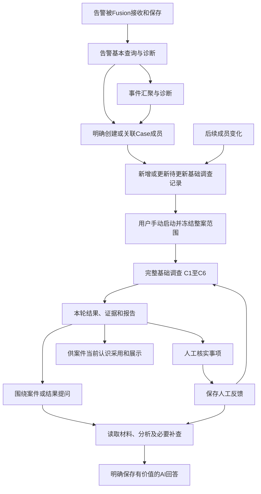
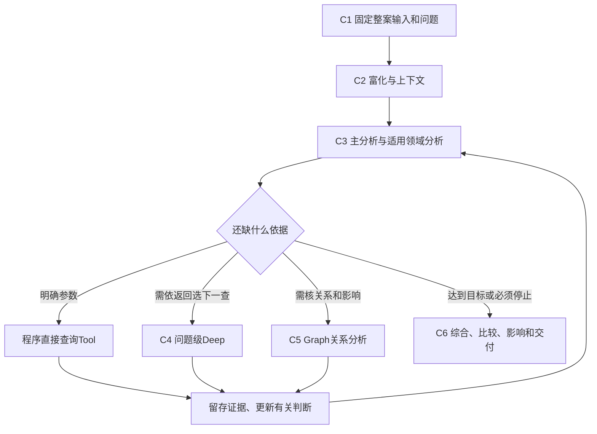

# 调查模块最新设计

当前调整已进入实施：[OpenSpec设计](../../openspec/changes/complete-socai2-investigation-chain/design.md)中的完整请求容量/C6预留、query直接查询、Case集合读取及既有页面服务接线已有代码。用户批准新完整C使用48000保守单位，仍为4模型／4工具／120秒；旧Run及A/I不回写。用户侧以“本轮调查依据未变化／调查依据已更新／暂无法核对调查依据”表达受跟踪输入状态，与成员覆盖分开。代码、隔离PG与真实模型质量分别验收，实际进度以[任务](../../openspec/changes/complete-socai2-investigation-chain/tasks.md)为准，未完成整链不作完成承诺。

当前验证拓扑见[本机优先与VPN模型窗口](../../openspec/changes/complete-socai2-investigation-chain/local-first-validation-plan-20261105.md)。2026-11-05当前进度：19/26项完成；本机累计48/50次模型尝试。C6已不依赖C3成功，并将案件业务判断与执行原因分字段保存；g首轮及新增三组案例均形成模型Case判断，原页面可回查。三组新增15次DeepSeek，最终均accepted/partial/uncertain；03有事实扩大，模型质量不通过。H后容量、知识实际消费、语义约束、完整页面闭环、远端模型对照及结束审计仍待。用户已授权提交推送到origin/codex/case-baseline-history-20261103；不部署、不归档、不核销旧失败。 原页面以真实导出回查；[修改与后续评审](../investigation/design-audit-and-scenario-evaluation-20261105.md#9-实施变更与后续评审记录2026-11-05提交快照)保留事实扩大、H容量和未实际消费知识等问题。

2026-11-04范围更新：设计和后台现统一在主目录`E:/aisoc/socai2`、分支`codex/case-baseline-history-20261103`。[当前OpenSpec任务](../../openspec/changes/complete-socai2-investigation-chain/tasks.md)区分已有实现、待完成和暂缓项。Q（AI问答）业务暂缓，仅预留接口，本文Q的流程仍是产品目标，不表示已执行或已交付；A/I/C/H职责和既定数据语义保持。

当前落地边界：新版单开服务，不替换原版。C以领取时的完整冻结快照分析；当前判断的成员覆盖不等于已读取后来更新的材料或H反馈，相同成员的新反馈由用户显式prepare/start形成下一轮。H保存本身不触发调查。完整C2在原4次工具总额度内最多使用2次，为C4保留2次；未查询来源明确显示预算跳过，不宣称所有来源每轮都已查询。详见[人工反馈](../investigation/socai2-human-tasks-20261104.md)、[来源限制](../investigation/socai2-external-sources-20261104.md)和[独立服务方案](../operations/socai2-next-service-plan-20261104.md)。

后续建议的对象须属于声明成员，跨成员关系核验显式列出所有相关成员。C6按原计划工件与建议序号关联执行状态，最新再分析提议不接管旧状态；原计划必要内容不能因压缩消失后仍猜测执行含义。C6使用独立最终交付规则和单一输出目标，共享来源/活动语义不重复堆叠；预算不足明确停止，不扩大额度。具体实现与验证见[当前差距](../design/investigation-design-current-gap-review-20261103.md)。

当前实现核对：采用前与读取时比较冻结输入新鲜度，材料/判断指针或已完成人工反馈变化时不把历史输入冒充当前输入，任务纯元数据编辑除外。明确Schema拒绝记录为failed并释放Run；执行不确定仍unknown。C2按冻结对象选择来源，C6优先原始事实、人工反馈、实际计划和对比结论，A/I参考按同次整组保留或省略。新C冻结完整wire预留并留30秒给最终综合，可选补查不得占用；C3只看到实际容纳的绑定，其余明确留账。三份双成员冻结样本已在新48000上限下离线容纳，真实质量须另验；旧失败保持，见[容量证据](../operations/evidence/investigation-repair-20261105/capacity-20261105.json)。

更新：2026-11-05。本文是我们调查模块唯一的现行设计正文，统一告警基本查询、事件诊断、Case完整基础调查、AI对话和人工跟进。正文描述目标行为；每步实际输入、输出和写表在[当前执行账本](../investigation/current-execution-ledger.md)维护。

阅读顺序：[开源版本实现](opensource-investigation-implementation.md) → 本文的完整流程与案例 → [当前实现与差距](../design/investigation-design-current-gap-review-20261103.md)。本文不并列保留历代设计、M阶段进度或历史部署状态。

## 1. 五条流程各自做什么

一条告警先得到基本解释；一组相关告警由事件层汇聚和诊断；进入Case后，完成针对整案的深入调查，形成后续人工核实和AI问答可以引用的材料。新材料到来后，应能解释这一轮多知道了什么、哪些判断改变了、哪些问题仍未解决。

**基础调查是每个Case必经的完整AI调查。** “基础”指其他案件工作建立在它的结果上，包含必要富化、领域/阶段分析、Deep补查、Tool调用、图关系分析和整案综合。每案都要处理这些职责并判断适用性；不可用或不适用的能力记录原因，不假装已完成。

| 流程 | 核心问题 | 输入 | 产出 |
| --- | --- | --- | --- |
| A 告警基本查询与诊断 | 这条告警描述什么，已有信息支持什么 | Fusion已收到的来源材料、规则、对象和常规查询 | 来源事实、查询观察、当次判断/理由/评分、限制 |
| I 事件汇聚与诊断 | 成员为什么放在一起，共同背景和疑点是什么 | 当前成员、真实归并依据、对象和已存诊断 | 事件诊断、成员覆盖、依据/未决、材料指纹 |
| C Case完整基础调查 | 整案发生了什么，关联、性质、授权和影响是什么 | 启动时完整成员、窗口、已有材料和可用人工反馈 | 阶段结果、证据、整案结论、变化/影响、报告 |
| Q AI对话 | 用户提出的具体问题能否回答，需要查什么 | 本案相关材料、结果、反馈和用户问题 | 回答及实际查询；明确保存后形成正式AI结果 |
| H 人工跟进 | 系统数据之外的哪项事实需人确认 | 核实事项、负责人、适用范围 | 结果、反馈人、完成时间、范围及来源参考 |

Case关联/移动的数据与事务实现见[25字段、流程及例子](../investigation/socai2-case-relations-20261104.md)。显式事件链接与成员新增分别计数；仅链接变化不产生新调查。双Case按ID顺序加锁、两端范围/pending/活动整体提交；旧Run/结果冻结不变。Case的固定source_namespace在成员清空后仍保留，124已补该列，当前29表459列。该值是身份命名空间，不冒充未提供的原始来源环境。

Incident、Case、Run是不同身份。事件可以提供Case成员和背景，实际纳入范围仍以成员关系为准。同一主机、同一事件归属和图可达均不能直接证明攻击链。

## 2. 从告警到后续分析的完整流程

人工反馈到基础调查的箭头表示下一轮启动时可以读取，不表示完成任务自动启动调查。有效基础结果自动更新案件当前判断，AI结果需明确采用；发布时保留依据与覆盖，过期范围和较新判断的保护见新数据模型。

已确认的执行规则：成员变化维护待更新记录；未启动时合并到同一条；用户启动时原子核范围/版本并提交running，然后执行；同Case最多一个活跃基础Run；启动后范围冻结，后续变化形成下一条待更新；当前Run结束后仍需用户启动下一条，没有定时领取、自动接续或自动重试。新增成员后的下一轮按更新后的完整Case重新执行C1–C6。

## 3. 告警与事件阶段

### 3.1 告警基本查询与诊断

当前实现（2026-11-04）：[A执行器的28字段与4例](../investigation/socai2-alert-basic-executor-20261104.md)已接服务器内部入口，实际执行三类已有SQL、一次模型分诊和同次解释，记录请求回复/步骤用量；9新+5回归最新通过。模型为替身、旧消费者未接、生产未切换。下述是阶段职责，未声称所有外部来源可用。

从Fusion实际收到的数据开始，保留来源身份、发生时间、规则/标签、对象、原文和证据字段。未知原厂留空；规则和ATT&CK标签保留检测源声明的含义；评分带来源并与当次判定配对。

常规查询用于解释本告警，例如对象身份、资产背景、检测命中的原始事件和已有富化资料。具体查询由告警类别和实际可用来源决定；已知参数的单次读取由程序直接执行。诊断保存判断、依据、待核实项及查询失败/缺源，不能用默认分数补未知。

交给下一层时，原始声明、查询观察、已有分析判断分开。Case可以重新评估已有诊断，不能把它自动提升为独立事实。

### 3.2 事件汇聚与诊断

当前实现（2026-11-04）：[I执行器的32字段与4例](../investigation/socai2-incident-diagnosis-executor-20261104.md)已接完整成员及有效分诊冻结、一次事件模型、逐成员覆盖/来源、诊断/未决和原子发布；9新+5回归首次通过。沿用[A/I存储](../investigation/socai2-stage-results-20261104.md)和[四条读取接口/C1新鲜度](../investigation/socai2-stage-reader-20261104.md)；旧I输入按旧合同验证，过期/无法验证分诊不进模型，新诊断输入带同快照分诊核验信息。A/I内部执行均已接；[73项页面字段与执行留痕读取](../investigation/socai2-page-reader-20261104.md)也已接默认关闭入口，8新+2PG回归及3个Q接口回归最新通过。页面交互、H写入、外部来源和生产消费者仍待；显式事件Case关联与成员移动已接；模型替身验证不代表真实诊断质量通过。

读取当前成员、实际归并依据、时间、对象关系和成员诊断，解释共性、差异及疑点。“同一主机短时间内出现脚本和外联”是共同背景；“脚本导致外传”还需要证据。

保存本次成员覆盖、来源引用、事件诊断、未知项、生成时间和材料指纹。成员或其业务材料变化后能识别概况过期。事件诊断不覆盖成员判定，也不运行另一套完整Case调查。

## 4. Case完整基础调查：C1至C6

一个Run由一个主执行器管理。领域分析、Deep和图查询使用本Run的范围、证据编号、步骤和预算，交回局部结果；主分析负责整案解释和冲突处理。

这些是必经职责，不要求每格新调用一次模型。C5可以使用C2已取得的图；材料足够时不重复查；来源不可用时明确交付缺口。

| 阶段 | 输入 | 实际工作 | 保存的产物与完成条件 |
| --- | --- | --- | --- |
| C1 整案输入 | 完整成员、窗口、案件说明、告警/事件诊断、人工反馈和选用的历史结果 | 固定成员与材料版本；区分来源、观察、历史判断；建立问题及证据要求 | scope、input_refs、材料和问题、已读/遗漏。缺成员时不能偷偷缩小范围后宣称完整 |
| C2 富化与上下文 | 对象、问题、可用来源 | 获取必要资产/对象背景、历史相似材料、行为基线、TI、知识和图邻域 | 逐来源请求、结果、时间、状态和限制；明确完成、无数据、不可用或不适用 |
| C3 主分析与领域分析 | 问题、相关证据、反证、旧判断及限制 | 判断检测事实、性质、授权、关联和影响；按适用性使用身份、云、钓鱼、内部风险能力；提出具体补查 | 逐成员/局部发现、支持/反证、替代解释、未决和领域产物。专家交局部结果，主分析综合；不按多数票/最高分裁决 |
| C4 Deep与Tool | 明确问题、引用、工具、查询范围、剩余额度 | 单次确定查询直接执行；动态问题按实际返回继续查认证、进程、网络等；扩范围建议交主执行器 | 真实参数/返回/错误、证据行、复用来源、答案与限制。足够、无下一查、缺源或到限时停止本问题 |
| C5 Graph与关系 | 成员、对象、行为连接、图数据和假设 | 核对节点身份、边依据、时间与路径；区分直接观察、候选关系和推断；解释已观察/待核影响 | 图快照、节点/边证据、范围及限制；图可达不等于攻击成立或实际受影响 |
| C6 综合与交付 | 已采用发现、反证、未决、覆盖和明确比较基线 | 整案解释；形成核验/响应建议；比较新增认识和变化，说明对Case的影响；判断完整性 | 同版结构结果与报告、比较引用、变化/影响、缺口、过程导航和用量。无有效模型结论时明确保存系统交接 |

### 4.1 本轮必须回答的问题

| 问题 | 核对内容 | 不能替代它的东西 |
| --- | --- | --- |
| 检测事实 | 原始记录支持哪些行为/对象 | 告警标题、规则名称或检测分数 |
| 成员关系 | 共同背景与有证据的行为联系分别是什么 | 同IP、同主机、时间接近或同一事件 |
| 行为性质 | 恶意、正常、误操作等解释的依据和反证 | 单个ATT&CK标签或高置信度 |
| 授权 | 谁确认了哪些行为、对象和时间，哪些仍未知 | 未提供审批、任务已完成、账号常有管理员权限 |
| 影响 | 已观察影响与潜在影响及其依据 | 图可达或工具返回过某主机 |
| 覆盖与后续 | 未处理成员/来源、关键矛盾、下一步 | 有报告或Run为completed |

每项有答案、冲突、证据不足或不适用原因。“完整流程已执行”与“事实全部查清”分开：缺源时完成可执行部分并部分交付；内部能力未接入则如实标明，不能显示完整交付。

C6是每轮必需的收尾。C3被拒收不取消C6；在原预算内依据实际冻结事实独立综合，不把失败的前序分析当成有效依据。没有有效模型回复时，conclusion保存明确的业务待核判断；技术失败原因单独保存在Run.stop_reason、RunSteps.error及执行工件，供调查执行详情回查，不拼入案件摘要或当前结论。来源为system、有效性为system_only，不能冒充模型判断或成员分析覆盖。Case无有效旧判断且范围/输入仍新鲜时显示该说明；已有人工或模型判断保持。执行状态不明时仍保存可追溯说明，但Run保持unknown、不重试、不释放槽；该路径以报告工件关联Case，不伪造要求终态Run的Result。

### 4.2 查询、证据和预算

工具只暴露当前来源真实可用且范围允许的能力。执行成功但0行、失败、来源不可用、执行结果未知分别保存。没有采集/保留期/权限/分页等覆盖依据时，空结果不能否定告警。

Deep负责具体问题内的下一步补查，不独立拥有整案预算或结案权。领域能力需要查询时将建议交回主调度。业务关系图与执行编排框架LangGraph是不同能力。

复用历史材料需核来源、范围、版本和时效；同一来源经不同入口出现只算一份底层证据。预算覆盖主分析、Deep、专家、纠错和写作；实际用量未知保持未知，不因进入子阶段重置。材料过大先按问题分组，保留关键支持和反证及遗漏说明，不以裁剪冒充整案覆盖。

来源正文作为数据使用，不能改变系统指令、租户或查询范围。模型输出先作为候选，程序检查结构、来源引用、范围和输入版本后记录采用；这些检查不等于证明因果、授权或业务解释正确。来源事实、历史判断和人工陈述保留各自身份；存在矛盾时明确未决，不靠关键词校验或来源数量生成强结论。

### 4.3 模型输入与输出精简

2026-11-04在DeepSeek七份原答归因后，用户要求优先参考开源版本精简输入。无损分组、必需组优先、A/I可见性与分类校验、C3/Deep/C6提示精简已本地实施，真实新批验收另报，不能把本地通过当模型质量通过。实施范围与剩余项见[本批修复明细](../investigation/socai2-compact-input-fix-20261104.md)。开源具体做法及最初排布实验见[开源版本第7节](opensource-investigation-implementation.md#7-输入怎样精简对小模型到底有什么帮助)；问题原件见[根因审计](../investigation/socai2-deepseek-root-cause-audit-20261104.md)。

核心是：完整原件留库，模型每次接收服务端按任务生成的紧凑材料；模型生成认识、疑问和下一步，服务端负责身份、引用映射、覆盖计算、执行状态及报告排版。精简不意味着把C改成简单摘要，也不以小模型为由取消Deep、领域检查、工具取证和最终整案分析。

**第一步先无损去重复。** 相同成员ID、来源角色、材料版本在组头只写一次，每条事实保留短来源编号、含义明确的字段名和完整值。数据库UUID、完整source_path、hash、版本和原始引用映射留在本次model_request工件，不让模型在每个字段里反复读写。短编号由服务器分配并映射回同一冻结来源；新请求使用原材料和历史文本中未出现的前缀，例如N1_S1，已含N1_时选择N2_。历史正文中的S14或旧N1_S2保持原文，不解析成当前来源；稳定身份始终是完整来源引用，短编号只在本次请求有效。

数据值仍用可解析、有类型的编码，字符串/数字/空值/列表不能因改成文本而混淆。来源角色、成员范围、窗口、查询状态和限制要在模型视图中可见；不能把审计元数据都移出后连证据含义也丢掉。输入guard仍检查原值及最终投影，不借改编码规避。只合并重复表示，不把多个相同来源当多份独立证据。

**第二步固定各阶段必须看到什么。** 以语义组预留空间后再放可选背景，不能由遍历顺序决定哪个成员的分诊被挤掉。

| 阶段 | 必需材料及任务 | 不重复携带/生成的内容 |
| --- | --- | --- |
| A | 本告警已收到的时间、行为/对象事实、检测语义；实际查询结果/状态、适用人工反馈；一次给出判定、理由、依据和待核事项 | 入库审计字段、整份API对象、同一原值在raw/对象表中的重复副本；不生成完整Case报告 |
| I | 完整成员目录；每成员已收到的必要行为事实；可用的同次分诊及适用反馈；真实归并背景；说明共性/差异/待核关系 | 不再逐字重写每个告警的全部Explain；不把前序判断当事实，不做C完整调查 |
| C3 | 整案核心事实、前序适用判断、H、必要C2结果及状态；明确初步解释、六类问题、四领域适用性、支持/反证与后续证据需求 | 暂不写最终报告、最终Case影响或重复响应长文；四领域用状态/发现引用表达，避免四次复制同一段认识 |
| C4/Deep | 当前问题、涉及成员/对象、相关证据、可用工具及范围/剩余额度；根据新返回决定必要下一步 | 不反复携带完整Case报告、无关领域材料与所有旧Tool正文；成功空、失败、不可用仍分别可见 |
| C6 | 当前发现与真实补证、未决/反证、成员覆盖、比较基线和H；重新综合并给出正式变化及影响 | 不重复生成来源台账、执行统计、状态和Markdown；这些由服务端从同版产物形成 |

同次分诊的判定、理由、分数/分数状态、评估时间和来源版本是一个语义组；不只传分数或判定，也不另加一次LLM摘要后冒充原理由。已有明确支持/反证和人工限定不作为低优先级装饰。检测源/规则/ATT&CK已有值继续保留其标签含义，可紧凑组织，不能为了让样例通过整体删除。

输入缺失沿用未知；收到后的guard拒绝、单项超限、整体预算不足分开记录。若有效必需组在去重后仍无法容纳，不发明短理由或只留标签，而在发模型前明确容量不足/交接；不自动增加调用或静默少分析成员。200成员是Case存储范围上限，不保证所有200成员能在固定8KiB视图和3000输出内完成。大范围的分批分析或另定容量配置需作为明确后续设计；本批先解决两成员已丢数据的问题，不谎报大案覆盖。

**第三步同时缩短输出合同。** C3仍回答六类问题、检查四领域，但复用发现编号表达支持/反证、问题/领域关系，已知目录和状态不让模型长篇重复。不能把四领域静默省略后标“不适用”；缺数据用未确定。阶段任务、简短证据规则、结构Schema各表达一次，删除提示中的逐字段格式复述和正文编号禁令。复杂关联规则继续本地校验，不在供应商Schema中堆大段正则。JSON Schema与本地形状校验同源，跨字段规则有明确对应测试。

首轮保留A/I一次模型、C现有主分析/Deep/最终综合的编排和预算，不为每个领域新增Agent/调用。外层完整流程保持，内部每次只承担该阶段任务。先按原额度核对实际请求（system、材料、Schema、工具定义和输出预留），不能把节省字节直接当已节省tokens或判断质量已改善。

模型后端能力用显式配置表达。默认standard保留完整Schema；已确认不支持uniqueItems的后端可选vllm_grammar_v1，只在发送前移除此关键字，本地重复/范围检查保持。转换后的实际请求再计量、持久化并发送，不失败重试或回退自由JSON。配置选择和真实请求均留工件；原共享LiteLLM及服务配置保持。当前修复尚未部署，见[m1后合同修正](../investigation/socai2-m1-contract-fix-20261104.md)。

### 4.4 可见性、引用和结果采纳

当前实证差距见[m2真实验证](../investigation/socai2-model-evaluation-m2-20261104.md)。[随后本地修复](../investigation/socai2-m2-followup-fix-20261104.md)已调整I检测组优先级并增加安全有界错误回执；[m3定位与修复](../investigation/socai2-deepseek-union-fix-20261104.md)确认DeepSeek拒绝anyOf裸引用及object类型数组，本地改为有type的完整分支、不弱化约束，新表达真实接收尚待验证。线上仍n9、n11未部署；role不能证明授权、成功含义与后续项文字范围偏差仍需复核。按用户最新口径，仅良恶相反计误判，needs_review可接受且单列待复核，无独立真值不算准确率；事实/范围错误仍单独验收。以下目标合同不等于程序接受或必需视图完整即可证明真实质量。

精简配套下面的合同。当前A/I与C准备视图将覆盖信息保存在版本化工件；A/I模型回执增加分类诊断，已有工件读取接口可取。C输出校验仍返回首个错误；Deep按问题进一步筛选背景、专用覆盖/告警DTO及大Case分批不在本批实现。下表同时说明目标语义，不能据此声称这些剩余项已经完成。无新增数据库列或旧快照回填。

| 信息 | 服务端事实 | 读取规则 |
| --- | --- | --- |
| `stored_material_state` | 原材料是否完整保存在库 | 不表示全量送给模型；底层既有material_state不改义 |
| `triage_eligible` / `triage_freshness` | 原分诊已完成、同材料且仍适用 | “可选用”不表示已发送，也不证明判断正确 |
| `triage_visibility` | included / omitted / unavailable，附明确原因 | 根据实际序列化请求计算；included须同次分诊语义组完整 |
| `view_coverage` | complete_required / partial / unavailable，另列可选字段省略 | complete_required只说明必需投影完整，不命名为完整原文已读 |
| `analysis_state` | 模型报告的成员分析状态，连同引用核查结果 | 已发送不等于模型确实读懂；不能由字段数量自动设为analyzed |
| 当前成功结果与最新尝试 | 既有成功指针、最近Run及其成功/失败 | 新尝试失败时保历史成功，但返回其原Run和时间，不称其为新尝试结果 |

完整覆盖限定必须进入模型消息和结果读取合同，不能只留在未发送的prepared对象。输出中“本轮完整交付”等业务属性由服务端根据真实执行/交付算，不让模型的自述覆盖。出现泛称“完整读取”的原文仍保原答，不能作为页面完成属性。

来源scope与role分别表达：成员来源可用于对应成员的发现；事件背景保持事件级，不伪造成员归属。最小实现复用I已有顶层`evidence_ids`容纳事件背景，成员/发现/问题的`source_ids`只允许有成员范围的来源；请求Schema分开这两类候选集合，本地再核精确成员归属及覆盖。待核问题可以无事实来源，但须明确是问题，不把背景补成证据。对应r4的S19只能用于事件背景，不能塞到某成员证据数组；若模型仍这样做，拒收并准确报范围错误。

校验分为三层：

1. JSON形状、身份、可见来源、成员范围、角色升级和可核对的字段一致性错误，阻止正式采纳。能检查的多个错误一次记录；JSON损坏导致后项无法检查时标not_checked，不伪造全检查完成。
2. 新A/I请求以结构化引用数组为唯一正式依据。正文中已知且范围合法的本次编号记展示warning，即使未在对应数组出现，也不因此使整份结果失败；这类编号不会被程序补入正式依据。未知或跨成员编号仍阻止采纳。字面名字豁免只认对应范围内原始name/hostname/username等字段的精确值，不再从历史分析文字猜名字。原答保持，不删句、改事实或补默认判定；旧视图仍按原合同解释。这不是授权/因果质量豁免。
3. 授权、因果、恶意/良性等解释质量另做固定案例验收。程序能核引用和已知结构约束，不能证明所有自然语言推理正确；有合法引用的“TCP443就是HTTPS”仍是质量失败，不能靠修格式核销。事实明细由原字段生成，推断保留inferred/unresolved与依据/替代解释；当前代码没有完整语义验真能力。

A的确定性判定另返回decision_basis（种类、主张、来源）：true_positive对应malicious_behavior，benign对应authorized_or_expected_behavior，false_positive对应refuted_detection；needs_review为null。依据必须全部属于observation或human_statement，且已在正式evidence_ids中，不能以来源标签或旧分析替代。这仍是结构和来源门槛，不证明一次进程活动或成功状态意味着授权；人工陈述也须保留其范围和未验证身份。原decision_basis保存在模型原答工件，未增分诊表列。

C3/C6的observed发现可附本成员确切alert.event_time作为时间上下文，但不能单凭时间成立，仍需每成员的真实observation；其他标签/旧判断不获此例外。四领域的applicability与相关finding_ids分别表达：undetermined可以引用已知事实，但必须写限制，不能因存在相关发现就声称领域已确认。新领域工件保存applicability；旧工件缺失表示未记录，不推算为applicable。

先复用现有29表459列，不做DDL：`artifacts.content_json`/`schema_version`保存版本化模型视图、真实请求/原响应和`validation_diagnostics`（code、path、category、severity、check_state）；`run_steps.error`及`runs.stop_reason`保兼容首个阻断原因；正式A/I产物及C的`results.validation_state`/`delivery_state`、`result_members`保持既有业务语义。输入覆盖、展示告警和最近尝试通过读取DTO提供，页面交给专门负责人；“契约接受”不能显示成“事实已证明”。warnings不占用失败error，附在模型回执中。

新输入视图使用新schema_version；工件合同的可选扩展保持旧记录读兼容，缺失属性不推算。旧请求、回复、结果及失败不回算、不采用离线重解析结果。新输入变化必须重新推理，旧答只用来检查解析兼容/反例，不能当作新输入下的模型效果。

#### 两条告警的具体流程

原始A0记载某主机执行PowerShell，PID4242、父cmd.exe/PID2100、inventory.ps1及synthetic-operator；A1在同主机15秒后出现TCP外联到443，未提供进程/用户归属。两个成员分别保存，主机/时间关联只是背景。

I收到A0/A1核心事实、两份适用分诊的完整判定/理由，以及实际未知/缺源说明。服务端一次写成员/来源角色，不再在每个字段反复写UUID。假如A1最近尝试失败而保留旧分诊，就同时标明旧成功来源与新失败尝试；I可以质疑旧良性判定，不能把版本仍适用当正确。

I应形成“存在同主机时间关联，尚不能证明PowerShell产生该连接或已有维护授权”的事件认识。C3据此提出进程归属和授权问题；C4/Deep读取真实进程/网络来源，查不到仍保未决；C5只建立有来源的关联；C6综合补查及限定。人工确认只覆盖明确对象和时段，下一轮由用户prepare/start，整案重新分析，不能扩成所有成员都获授权。

#### 实施及验收顺序

先落实无损分组/必需组及可见性；再对齐背景引用、Schema和分类校验；最后缩短重复输出/提示并核C3→Deep→C6交接。对应改动集中在`alert_basic_contract`、`incident_diagnosis_contract`、`baseline_model_view`、`structured_output`及阶段执行/读取适配，不另建记忆库或任务调度器。

离线验收须证明字段逐值可逆、两份分诊不再遗漏、相反判断/长理由不被裁掉、不同成员不串来源、背景不作成员事实、单finding不成冲突、首错不遮蔽可检查后错；再验证真实PG发布/失败保持和冻结不变。新增格式warning不能把已有HTTPS错误算质量通过。

随后固定新候选和新操作批次，完成A/I→首次C（含必要Deep/真实查询/最终交付）→H→手动第二C的完整验收；保留每次失败，不重派r4/r5旧操作。小模型适配须在同一修订合同和固定正反例下另报结构通过、引用通过、语义质量及实际用量/时延，不能仅报completed。若仍有推理失败，再控制变量评估模型/思考配置，不归因参数量。

当前DeepSeek `reasoning.effort=none`是自己的运行选择；官方说明none关闭思考，输出上限包含思考及可见tokens，见[Responses合同](https://api-docs.deepseek.com/zh-cn/api/create-response/)。本次未更改该配置/预算；n9/r6新增3次真实模型调用，未通过，详见本批实施记录。后续C v3仅本地，当前真实链及结束审计仍未通过，OpenSpec不提前归档。

## 5. 待更新与并发的具体行为

| 情况 | 记录如何变化 | 展示/执行 |
| --- | --- | --- |
| 首次非空Case | 创建待更新R1及完整成员 | 尚未开始，可手动启动 |
| 先后加入A1、A2，尚未启动 | 更新同一R1和范围版本 | 一条待更新记录覆盖A1/A2 |
| 用户启动R1 | Case→Run锁，核版本及活跃记录；冻结范围、提交running，再调用执行器 | R1范围固定 |
| R1已领取、第一步还未执行，加入A3 | R1已是running，另建待更新R2 | R1保持A1/A2；R2覆盖A1/A2/A3 |
| R1执行时继续变更成员 | 更新未启动的R2 | 不改变R1输入 |
| R1活跃时启动R2 | 返回冲突，R2仍待更新 | 不调用模型/工具，不标failed |
| R1结束 | 保存R1结果，R2仍待更新 | 用户手动启动，无自动接续 |
| R2启动 | 冻结最新整案范围，重新执行C1–C6 | 可比较R1，不覆盖R1 |

同一次启动请求重试读取同一Run，不另起执行。AI实际模型/工具执行可并行，不与基础Run共用活跃槽。

## 6. 保存什么，页面从哪里读

问题、证据、分析、执行是四块逻辑数据，配合共同身份/范围。用户已允许按自己的页面需求新建表：物理存储采用同一PostgreSQL中的独立socai2 schema，保留已有执行留痕和冻结思路，不再要求沿用开源版本原表。建表前先完成字段、类型、枚举和关系审计，不因此新增四个服务。

| 数据块 | 最小内容 | 用途 |
| --- | --- | --- |
| 共同身份/范围 | Case/Run、类型、执行器版本、触发原因、范围版本、完整/选中/已读成员、绝对窗口、输入引用 | 明确本轮承诺和实际输入，启动后冻结 |
| questions | 问题身份/内容、对象/窗口、证据要求、状态、答案/缺口引用 | 说明为什么查、还缺什么 |
| evidence | 来源身份/记录ID/类型、原文或返回引用、事件/取得时间、覆盖限制、查询回执和实际模型视图 | 回查依据、区分观察与判断、同源去重 |
| analysis | 发现、支持/反证、逐成员结果、关系/时间线、已观察/待核影响、未决与建议、版本 | 形成整案结果和多轮比较 |
| execution | 阶段/步骤、实际调用、状态/停止原因、交付完整性、用量与未知、正式结果引用 | 展示执行与交付，不代替Case业务状态 |

字段名是目标合同；最新物理方案见[页面驱动的新数据模型](../design/investigation-data-schema-plan-20261103.md)、[建表前第一轮审计](../design/frontend-data-model-audit-20261103.md)及[逐列字典](../design/socai2-field-dictionary-20261103.md)。已有实现事实见[36项结果字段核对](../design/investigation-result-field-audit-20261103.md)，不能将新表设计当成已实现。

### 6.1 每轮结果的统一表达

| 页面内容 | 应保存的数据 | 谁产生 |
| --- | --- | --- |
| 目的/类型 | 首次、成员变化或明确问题，为什么执行 | 程序记录入口/范围变化，保存问题 |
| 本轮结论 | 总结、结论来源、有效性 | 模型提出、程序核引用并记录采用；失败交接另标 |
| 发现/依据 | 具体发现、支持/反证、来源与范围 | 分析提出，程序检查并保存 |
| 相比此前变化 | 比较Run/结果版本、新事实、维持/改变/撤回及理由 | 程序固定比较基线，分析解释；首次无基线不造变化 |
| 对Case影响 | 哪些认识可调整、哪些不能推广、下一步受何影响 | 分析给出有据影响；不自动改业务状态，有效基础结果经范围/版本检查后自动采用，AI结果需明确采用 |
| 完整性/限制 | 阶段和成员覆盖、未决、缺源、失败/截断 | 根据实际执行和结果缺口判断，不能只看JSON有效 |
| 图、步骤、原始查询 | 本轮保存的图/过程/返回和引用 | 从本Run读取，不用最新图或任务替换历史 |

JSON与Markdown来自同版正式结果。报告整理不能新增无源事实。未得到有效模型结论时仍保存已成功的查询、部分产物和明确失败说明，不以非空summary充当结论。

### 6.2 数据表与工件分工

| 新存储（均在socai2 schema） | 保存责任 | 关键边界 |
| --- | --- | --- |
| alerts/materials/source_refs/objects/assessments | 来源、材料版本、对象、同次分诊/反馈和当前业务值 | 原厂与接入平台分开；Explain另有明确工件合同 |
| incidents/incident_alerts/incident_diagnoses | 独立事件事实、成员依据和诊断尝试 | 管理值与成员汇总分开，发生/业务/材料时钟分开 |
| cases/case_alerts/case_incidents | 当前业务状态、成员、显式关联事件 | 一份成员真值，变更维护pending |
| case_assessments/sources/members | 明确采用的判断版本、来源、覆盖 | 有效基础结果自动采用，AI明确采用；历史不随新成员或任务编辑变化 |
| runs/run_members/run_steps | 四类机器流程、冻结输入范围、实际阶段/调用 | baseline手动启动单活跃；人工任务无伪造Run |
| artifacts/results/result_members | 实际交换/图/报告、正式结果、逐成员分析和结论覆盖 | alert/incident/Case归属明确；AI明确保存进入results |
| tasks/task_revisions | 事项当前版本与不可变人工反馈 | 负责人和实际完成人分开；旧引用指具体版本 |
| conversations/messages | 同案问题、真实执行、答复与当时输入 | 保存不重跑；用户编辑正文与原答复分开 |
| graph_explorations/activities/targets/comments/response_links | 探索、业务活动每个目标、评论和真实响应关联 | 探索不改成员，审批不代表执行 |

以上为分组简称，完整29张表名以字段字典为准。新表已在21独立验证库创建并验证；迁移/ORM/枚举已生成。Case存储及C1–C6组件已由统一手动 `start_full` 编排到同一Run，字段和例子见[最新交接](../design/socai2-schema-implementation-20261103.md)。当前C3的query/deep需求没有可直接执行的绑定，按问题去重交给受限Deep选择工具；人工项留待确认，图需求使用已有来源。C6最后一次综合同时承担再分析与正式交付，程序生成同版报告，结果/报告/当前判断原子发布；无有效模型结论时保系统交接。非C6模型领取时保留最后一次调用，Token/时间仍共享原总额。C5图不证明攻击链或实际影响，C3/C6四领域为共享模型视角。模型和ClickHouse返回的验证使用替身，不是实际推理/湖验收。新Case创建/成员变更/手动HTTP及Run、Result、详细快照/报告、冻结材料、当前判断读取已接独立路径，默认关闭，见[36字段与接口合同](../investigation/socai2-case-api-20261104.md)。Fusion告警/材料/来源/对象及事件成员writer已可选接入，默认仍public，见[53字段与Case桥接](../investigation/socai2-fusion-ingestion-20261104.md)；A/I执行及产物、页面数据读取和显式事件Case关系/移动已接；外部拓扑/产品主机/认证及余下背景来源仍待。归并摘要不当诊断，没有线上切换。

## 7. 人工跟进与AI对话

人工事项由人核实，完成时填写结果；不强制工单号或附件。结果明确谁、何时、确认什么、适用对象/行为/窗口，有来源参考则记录。完成后供下一轮C/Q使用，不自动调查或解决Case。任务仍可编辑，新内容形成新版本，历史Run/AI结果保留旧引用并能提示来源已更新。

| AI动作 | 处理与保存 |
| --- | --- |
| 打开助手/选择建议问题 | 准备范围和文字，不调用模型或Tool |
| 发送 | 服务端确定Case及相关对象；读取基础结果、人工反馈与原始依据，冻结输入，分析并按问题补查；保留实际材料/工具交换 |
| 材料不足 | 说明已知与缺什么，必要时建议人工核实，不把待核写成确认 |
| 明确保存 | 保存问题、答案、标题、输入/引用版本和执行来源；不重跑模型，不改成员/状态/基础Run |
| 再次提问 | 读取相关材料的适用版本，保留前次答案的范围和版本，不默认重跑完整基础调查 |

上下文由结构化记录、稳定引用和冻结工件组织。本期不新增不断覆盖的Case长文档、向量记忆库或隐式聊天状态作为事实主表。

## 8. 完整例子：维护脚本、外联与新增跨主机登录

以下全部为**设计示例**，不是实际测试结果，不证明当前后台已提供例子中的所有字段。A/E/H是可读简称，实际引用带Run及来源身份；只使用下表明确给出的字段。

### 8.1 输入与首次基础调查

| 时间 | 材料/动作 | 保存和处理 |
| --- | --- | --- |
| 10:00 | A1：APP01上svc_patch运行PowerShell；原文引用P01，PID4200，脚本patch.ps1 | 保存原文/时间；告警常规查询读取对象背景，诊断为脚本用途待核 |
| 10:02 | A2：APP01连接203.0.113.20:443；N01含process_id=4200、dst_hostname=updates.example | 保存来源与当次诊断；443本身不证明TLS或传输内容 |
| 10:05 | Fusion已将A1/A2归入I1，依据同主机及窗口 | 事件解释两个信号及归并依据，不据此认定攻击链 |
| 10:12 | 用户纳入Case C100 | 新建待更新R1，范围版本1，A1/A2 |
| 10:15 | 用户启动，窗口09:50–10:10 | 冻结两成员与材料，置running后执行C1–C6 |

| 阶段 | 本例具体处理 | 结果与边界 |
| --- | --- | --- |
| C1 | 固定A1/A2、I1诊断和案件说明；问题为脚本用途、外联归属、授权及影响 | 来源P01/N01；尚无人工授权材料 |
| C2 | 查APP01资产、脚本历史、目标情报和图背景 | APP01为应用服务器；历史查询覆盖不足；情报无命中不等于安全；逐来源留存限制 |
| C3 | 检查P01/N01及维护/异常执行两种解释；身份方向分析svc_patch | 主机/PID支持该进程有外联，不证明授权、恶意或外传；云/钓鱼不适用并记录理由 |
| C4 | 直接查P01、N01；Deep围绕启动来源补查认证 | E1读到P01、E2读到N01、E3显示svc_patch从OPS-JUMP01成功登录APP01；E1与A1同源，不算独立印证 |
| C5 | 按E3形成登录边，按P01/N01展示进程/外联关联 | 每边有来源；缺会话/父链时，不由时间接近推定完整远程执行因果链 |
| C6 | 综合并提出核实脚本及批准范围的人工事项 | 执行/外联有据，用途与授权未确认，无证据证明外传；首次无比较基线，部分交付 |

R1留下原始依据、关系边界、具体疑点和下一步，不以一个风险标签代替这些产物。

### 8.2 执行期间加入第三条告警

10:16，用户加入A3：10:08 svc_patch从APP01成功登录DB01，来源L03。系统创建待更新R2，范围版本2，覆盖A1/A2/A3。R1仍针对两条；R2未执行、没有结论。此时启动R2返回活跃冲突。

10:18 R1结束并保存部分交付，R2继续等用户启动。不能用当前Case三成员页面把R1改写为已经覆盖A3。

### 8.3 人工确认与AI回答

10:20运维人员完成H1：

> 本人核对维护安排：允许svc_patch在09:50–10:10于APP01执行patch.ps1，并访问updates.example获取更新。该安排不包含DB01登录。

保存反馈人、完成时间、适用对象/窗口和版本1。“该安排不包含DB01”只描述这份安排的范围，不证明没有其他授权。

10:21用户问：“H1是否足以说明本案都是正常维护？”此时R1已结束，R2仍待更新。AI固定A1/A2/A3、R1、H1版本1及必要依据后回答：H1支持范围内脚本和更新访问的维护解释；A3超出H1确认范围，仍需核实用途/授权；不能推广为全案正常，也不能因H1未覆盖就判定未授权攻击。

这个问题材料已足够，可以不新查工具。10:22用户明确保存为Q1，保存问题、答案、成员范围、R1/H1版本和依据；不再执行一次模型，不自动改Case当前判断。

### 8.4 第二轮完整基础调查

10:25用户启动R2。C1重新冻结三成员及H1版本1；C2核背景时效；C3按整案分析；C4核L03并补查有关认证/后续行为；C5加入有来源的APP01→DB01登录边；C6综合全案。

P01/N01在历史窗口、来源版本和覆盖仍适用时可以明确复用，但仍须重新分析三成员关系、性质和影响。假设补查确认L03，却没有可用DB01后续操作/其他批准材料，则R2保存：

| 结果字段 | 本例内容 |
| --- | --- |
| 目的与范围 | 加入A3后，对A1/A2/A3做完整基础调查 |
| 比较基线 | R1结果版本及两成员范围；明确R2增加A3 |
| 新增事实/材料 | L03支持APP01→DB01登录；新增H1版本1 |
| 维持判断 | P01/N01支持脚本和连接；外传内容仍无证据 |
| 改变判断 | A1/A2的维护解释新增人工确认；原维护授权缺口在H1范围内得到补充 |
| 新增未决 | A3用途、独立授权和后续操作仍待核 |
| 对Case影响 | 可以分别解释A1/A2，不能推广到A3；继续核实DB01活动 |
| 交付 | 执行结束，部分交付；不自动解决Case |
| 证据/过程 | C1–C6状态、复用理由、新查L03原件、图边及引用 |

H1后来编辑为版本2时，R2和Q1仍保留各自采用的版本1；R1当时没有H1，不能补写为引用过。下一次提问读取适用新版本并看到变更，任务编辑不自动启动R3。

### 8.5 页面如何展示这个案例

告警页展示各自来源/诊断；事件页展示成员和实际归并依据。调查历史区分R1、R2和明确保存的Q1。R1详情保持A1/A2；R2展示三成员、对R1的比较、H1版本1和A3未决。任务页显示H1当前版本，历史结果能回查引用时版本。案件当前认识显示明确采用结果的范围和来源，不直接用最后一条消息覆盖。

## 9. 异常和边界例子

| 情况 | 正确结果 | 后续 |
| --- | --- | --- |
| 网络查询成功0行、覆盖未知 | 保存成功空结果和实际窗口；告警仍待核 | 查其他可用来源，不写“没有外联” |
| 认证来源未接入 | 阶段显示不可用，相关判断未知 | 交人工；Fusion前置缺输入不列本轮修复任务 |
| 模型截断且无有效结论 | 真实查询/部分产物保留，明确系统交接和停止原因 | 不拼残稿冒充结论，不自动重试结束批次 |
| 关系缺会话/父链依据 | 候选关系，明确缺项 | 不用同主机补造因果 |
| 未记审批被写成“没有审批” | 拒绝/修正无据断言，保原答与校验原因 | 取得事实之前保持未知 |
| 新问题问“当前是否持续” | 历史查询保留原窗口 | 查询相应新窗口，不用旧结果证明当前状态 |

## 10. 相对开源版本实现的目标

保留开源版本实现中有效的材料整理、专业分析、Deep、工具、图关系和响应建议。提升应落在完整成员覆盖、原始证据与推断分开、阶段可回查、多轮变化可解释、人工/AI材料有版本，以及报告与结果一致。

不需要把完整四阶段、完整Router和完整graph依次串跑；一个Case执行器组织必要能力，避免重复分诊、独立预算和多份整案结论。是否更好由实际覆盖与结果质量评估，不能用Agent数量判断。

## 11. 尚需明确的产品选择与实施边界

事件保留自动汇总等级并允许人工覆盖；有效基础结果自动更新当前判断，AI结果明确采用；AI执行可并行，单活跃约束仅用于基础调查。空/已解决Case的特殊成员与启动策略、人工采用权限及生产响应权限仍需在相应入口开放前明确。

当前统一C1–C6执行器、独立新Case HTTP/读取合同及可选Fusion新writer已实现，明细在[当前实现与差距](../design/investigation-design-current-gap-review-20261103.md)维护。新表迁移已在独立验证库实际执行并验证，新Case接口默认关闭、Fusion默认public、生产业务服务尚未切换，见[建表交接](../design/socai2-schema-implementation-20261103.md)。本文贯穿案例仍含待实现的H业务、暂缓的Q业务和未接外部来源，不能将整个案例视作已完成；页面与旧线上执行器未改。新链路包括Fusion原始材料/关系入库和C1冻结、C2三类SQL、C3共享领域/再分析、C4两个查询/问题级Deep、C5来源图、C6正式交付及按需求编排。现有执行器保留最后一次模型调用，Token与时间没有另外储备，不足时形成系统交接，不能据此证明任意案件在该额度内充分完成。逐项状态/停止原因与并发验证见[执行器流程与例子](../investigation/socai2-baseline-executor-20261103.md)。模型/湖响应为替身，不作真实模型质量或业务端到端验收。
