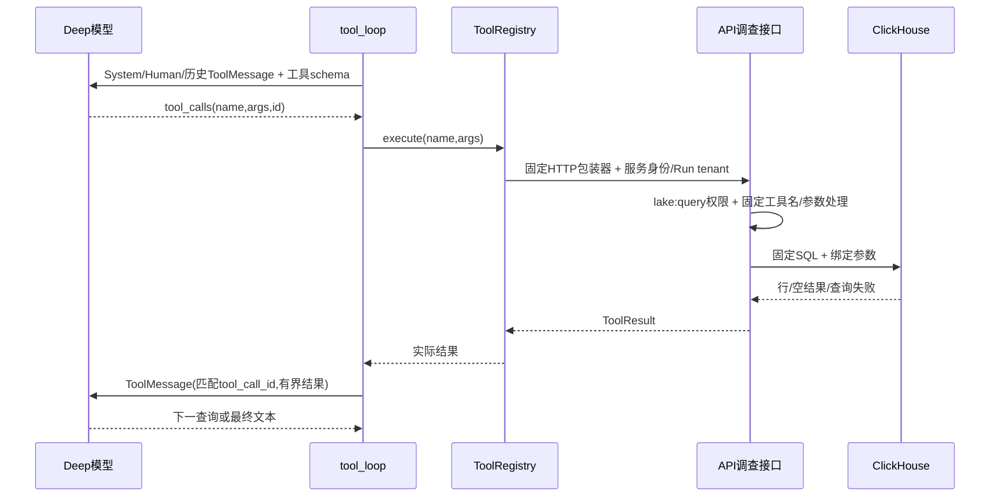

# 调查预处理与工具调用：每次模型的目的、输入和输出

当前工具目录、配置及最少测试方法另见[Tool使用指南](../operations/investigation-tools.md)与[SIEM接入示例](../operations/siem-tool-integration.md)。本地链/图上下文已接入，见[本批实测](../operations/attack-chain-path-local-20261021.md)；历史模型结果和未部署状态保持。

本批已补[真实本地模型/工具逐步案例](../operations/investigation-functional-20261021.md)：Router Identity/Cloud、默认四节点含Forensic兜底、Deep六轮/7工具；下文静态示例及旧Run保持，不由新实测追认其质量。两处接口合同已本地最小修正，尚未发布。

2026-10-21。按用户要求，把预处理、模型输入输出及工具选择/执行拆开说明。本文核当前工作区源码，复用原回执；没有新增模型、查询或业务测试。示例均为静态合同示意，不代表已运行。当前工作区与已部署/历史Run的区别沿[调查说明](investigation.md)保留，特别是deep投影、cap及预算修正未全部部署。

这里的“预处理”指调查材料和模型上下文构建，不是上游原始事件采集、规范化、入湖或检测。总体入口和三种编排的区别见[设计评价](investigation-design-review.md)。

## 1. 先回答谁决定调用什么

| 路径 / 步骤 | 谁作选择 | 调用什么 / 产物 |
| --- | --- | --- |
| Case材料整理、共享ContextBundle预取 | 代码按入口、实体和配置决定 | 查询关联告警、图/历史/UEBA/IOC/背景，形成有限材料，不是一次模型推理 |
| Router选领域 | `classify_signals`代码规则 | 按关键词/顶层字段选择phishing/identity/cloud/insider；模型不直接输出分支调用命令 |
| Router专业分析 | 所选分支各调用一次模型 | 结构分类、分数、领域指标/类别、理由；当前没有工具调用通道 |
| 默认人工Recon逐IOC增强、graph增强/Splunk等 | 代码按IOC/来源等条件发起 | 固定函数/服务查询；不是模型在deep里选择这些调用 |
| Deep动态调查 | 模型根据策略、已知材料和工具说明作出请求 | 返回结构化`tool_calls`；应用再按注册工具执行，结果回下一轮 |
| Router join/响应摘要/报告渲染 | 代码 | 合并与格式化已有结果，没有额外模型或现场查询 |

“模型建议进一步查询”“模型声称已查询”和“工具已执行”是不同事实。Router模型即使在理由里写需要查询日志，也不会因此自动执行工具；Deep也只处理结构化调用字段，不从普通文字猜调用。

## 2. Router前的预处理究竟是什么

### 2.1 Case入口先整理资料，再形成state

| 顺序 | 目的 | 输入 | 实际输出 / 采用 |
| --- | --- | --- | --- |
| P1 归属与Case读取 | 确定这次调查对象和tenant | 已认证调用者、Case ID | 验证所属tenant，读取Case及关联Alert，不能由模型指定其他tenant |
| P2 生成摘要 | 给模型入口一份Case范围说明 | Case标题/描述，按创建时间取最多25条关联告警 | `_investigation_evidence`形成summary；用户补充摘要与该摘要组合 |
| P3 生成发往Agents的结构材料 | 控制入口材料量 | API再次按event_time取最多3条关联告警 | 实际发送`raw_alert={"case_id":"...","alerts":[...]}`；description≤1000字符、full_log≤4000，affected_ips/hosts/users各≤20。开启攻击上下文时先定向准备可信图并带preparation回执；不是把P2那25条完整材料全部转发 |
| P4 选编排/适配state | 把API参数变成调查状态 | case_id、tenant_id、summary、raw_alert、新Run ID | 开关选旧四节点或Router；Router `stream_kwargs`放入raw_alert，Case/tenant转UUID，**不flatten alerts**；`AISOC_ATTACK_CONTEXT_ENABLED=true`时预取Bundle，专业分支在存在attack_context时接收Bundle |

代码：[Case资料与转发](../../services/api/app/api/v1/endpoints/cases.py)、[Agents入口选择](../../services/agents/app/api/investigate.py)、[Router适配](../../services/agents/app/orchestrator/router.py)。

**重要的实际边界：Case资料是嵌套的，而专业字段读取主要在顶层。** 下面两种数据不能当作已经等价映射：

```json
{"username":"demo.user","mfa_status":"failed","failed_count":12}
```

这是专业函数可直接读取的顶层形态；Identity字段规则可直接匹配并生成Username/MFA/Failed count等提示内容。

```json
{"alerts":[{"affected_users":["demo.user"],"full_log":"MFA failed ..."}]}
```

这是当前Case封装的形态示意；Router不会把它自动转换为上面的username/mfa_status。nested alerts可能经summary及Additional fields有界摘要间接进入模型，但不保证全部字段/正文完整可见。这里是现有接缝事实，本轮仅记录，不擅自改入口或展开映射。

### 2.2 首次分诊和领域路由各做什么

1. **首次分诊：** 将state里已有告警材料有界序列化，检查注入信号、建立数据边界，再发一次`triage`角色模型。要求输出`verdict/confidence/rationale`；按原policy可能提前结束，否则继续。Router新state没有自动执行Kafka worker的五类reader读取，不能借那条路径的证据声称这里已经加载了相同上下文。
2. **领域路由：** 代码拼接summary、首次confidence_basis及findings做小写关键词匹配，同时检查raw_alert顶层字段名。支持多选，无匹配则全选四分支。它不是另一轮LLM，也不遍历`raw_alert.alerts`提升其字段。
3. **分支材料投影：** 每个专业Agent挑选自己的字段，再把剩余字段转为Additional fields摘要；每个被选分支拿基础state的副本，各自分析后再join，不是依次消费上一专业分支结论。

路由例子：summary出现邮件/钓鱼线索，可选Phishing；出现认证/MFA线索或顶层username等，可选Identity；两者同时存在可同时选择。这里选择的是专业分析函数，**不是选择日志查询工具**。[路由实现](../../services/agents/app/orchestrator/router.py)、[Identity投影示例](../../services/agents/app/agents/identity_agent.py)。

### 2.3 模型看到的不是整份数据库记录

字段构建、模型发送和输入授权是不同层次：

- `sanitize_text`处理控制字符/已知注入标记、空白及长度，裁剪有标记；结构serializer把嵌套对象转成有限的key/value摘要，禁止键作redacted，告警数据包在untrusted边界内。
- Identity额外字段最多8个key；嵌套Additional fields通常最多10行/深度2，primitive文本还有长度边界。因此API保留4000字符full_log，不等于专业模型最终看到4000字符。
- `safe_ainvoke`再检查模型输入合同，按provider/privacy配置作出站替名、请求及可见值恢复，并记usage。它不是工具路由器，也不保证摘要保留了全部业务信息。

代码：[结构摘要](../../services/agents/app/prompt_serialization.py)、[净化](../../services/agents/app/investigator/prompt_sanitizer.py)、[发送合同](../../services/agents/app/llm/contract.py)。这里讲的是实际发送材料；数据库中存在、state中存在、模型可见、模型采用，须分别核实。

## 3. Router每次模型调用：目的、输入、输出和去向

下表是模型调用合同，不是说每条告警都执行所有分支。各专业分支模型角色相同，差别在专项字段和system prompt；它们不绑定工具，也不自行查询HTTP/PG/厂商服务。当前Router开启攻击上下文且Bundle存在attack_context时，向专业分支传入该共享材料；首次auto_triage没有因此自动读取Bundle。

| 调用 | 这一步的目的 | 模型实际输入 | 模型可见输出 / 代码怎样采用 |
| --- | --- | --- | --- |
| R0 首次分诊 | 判断类别及是否需要继续处理 | `triage.system`＋有界summary/raw_alert及state里已有上下文；不是自动获得所有外部资料 | JSON `verdict/confidence/rationale`；解析后结合关闭policy/保护形成状态，允许提前结束或继续专业分析 |
| R1 Phishing | 判断已有邮件线索中的钓鱼特征 | `phishing.system`＋summary、severity、发送人/域/Reply-To、URL、附件hash、SPF/DKIM/DMARC、正文摘要 | JSON共同三项＋`phishing_indicators`；写分类/分数/指标及findings，**不是生成四节点调查报告** |
| R2 Identity | 判断已有身份/认证线索 | `identity.system`＋summary及可见账号/IP/位置/MFA、失败次数、权限变化/时间等 | 共同三项＋`identity_indicators/attack_type`；写state分类/分数和basis/findings，不等于已经查过IdP/UEBA |
| R3 Cloud | 判断已有云资源与权限线索 | `cloud.system`＋云商/账号/资源/API动作/principal及已有ACL/IAM/公网字段等 | 共同三项＋`cloud_indicators/risk_category/cloud_provider`；分类/分数及风险摘要进入findings，不重新获取云配置 |
| R4 Insider | 判断已有账号活动/数据使用线索 | `insider_threat.system`＋用户/部门、资源/动作、文件量、目的地、工作时段、USB/已有baseline_deviation等 | 共同三项＋`threat_indicators/threat_category/user_risk_level`；写分类/分数/风险摘要，不重新计算UEBA或读取HR |

“共同三项”为`verdict/confidence/rationale`；各专业分类只接TP/FP/benign，分数限制到0～1，其他领域枚举并非全部有严格校验。缺字段、模型失败及默认值不能包装成实际观测。

以R2为例，下面是**示意返回结构，不是新模型结果**：

```json
{
  "verdict":"true_positive",
  "confidence":0.78,
  "identity_indicators":["supplied alert reports repeated MFA failures"],
  "attack_type":"unknown",
  "rationale":"Provided failures warrant review; authorization and subsequent activity remain unverified."
}
```

代码会采用这些字段，合并结果后生成摘要/Markdown；它不会因为`rationale`建议查认证记录，就自动调用认证工具。JSON成功解析或模型自报0.78也不证明结论正确。源码：[auto-triage](../../services/agents/app/agents/auto_triage_agent.py)、[四专业Agent目录](../../services/agents/app/agents/)、[Router join/summary/report](../../services/agents/app/orchestrator/router.py)。

## 4. 默认四节点每次模型调用的输入输出

这条路径正常成功时四次模型；共享Bundle/KB和Recon增强属于下面各次调用前后明确位置的资料，不是每个Agent自己重新发现工具。

| 调用 / 目的 | 模型输入 | 模型输出合同 | 代码接收后做什么 |
| --- | --- | --- | --- |
| M1 Recon：整理调查线索 | `recon.system`＋原告警有界结构/summary、共享Bundle、已预取KB | JSON `iocs/threat_actors/attack_surface/mitre_techniques/summary` | 合并本地IOC/技术提取；**模型回复之后**逐IOC增强，存recon及enrichment_cache，交Forensic |
| M2 Forensic：组织事件解释 | `forensic.system`＋原告警、Recon summary/MITRE、增强摘要、Bundle/KB | JSON `timeline/artefacts/root_cause_hypothesis/blast_radius/confidence/summary` | 形成forensic结构并记录证据/假设。无新查询循环，缺证保守处理；这些字段不是全部已经验证的事实 |
| M3 Responder：组织响应计划 | `responder.system`＋根因/范围/分数、末5条时间线、Recon技术/主体候选、Bundle/KB | JSON `recommended_actions/containment_steps/eradication_steps/recovery_steps/estimated_effort_hours/risk_level/summary` | 形成ResponderPlan并强制dry_run=true，不执行厂商动作；供报告/人工讨论 |
| M4 ReportWriter：组织阅读交付 | `report_writer.system`＋前三节点材料、源告警事实/时间、时间线和建议内容、覆盖诊断/Bundle/KB | **Markdown文本，不是同样的分类JSON** | 存report_md工件；已发生失败/截断按原机制保留并标记，不因文件可读宣称质量通过 |

JSON里的每个字段由不同节点解析/默认/归一，并非同一套严格JSON-schema。完整调用与fallback边界见[四节点说明](investigation.md#4-默认人工调查四个agent的每次调用)，字段定义见[InvestigatorState](../../services/agents/app/investigator/state.py)。

## 5. Deep之前的预处理和第n轮模型输入输出

### 5.1 先准备调查材料和可用能力

| 准备步骤 | 目的 | 输入 → 输出 |
| --- | --- | --- |
| 自动升级state交接 | 保留首次分诊，准备单独调查 | 已持久的Alert/Run及原告警 → 复制调查state、ContextBundle、独立调查CostTracker |
| 代码固定查询 | 取得常规背景/增强 | Bundle并行取图/历史/UEBA/IOC/背景；graph增强查IOC，调查节点按来源条件补Splunk/本地MITRE/TI归因 → 对应state材料/findings |
| 选择调查策略 | 给模型一个调查方向 | 优先匹配tenant skill，否则MITRE/关键词选内置策略 → system guidance；这是代码选择，不是模型先决定策略ID |
| 生成Human材料 | 提供本轮原始调查依据 | 原title优先、severity/source/connector、实体/进程/hash、MITRE候选、description/event_time/created_at/raw_event等有界投影 → `_summarise_alert`文本；当前本地源码另拼接有界Bundle/攻击上下文摘要 |
| 组装工具集与覆盖说明 | 告诉模型能查什么/看不到什么 | 基础5工具＋11 typed工具，tenant已配置customer/MCP工具 → registry、工具schema、coverage/refusals |

有些字段在state/Bundle中并不表示已完整送入Deep。当前`_summarise_alert`增加`format_bundle_prompt_append`有界摘要，没有自动序列化整个state、全部IOC增强或完整Bundle；不能把摘要理解为全部原始查询行。当前源投影保留null及时间语义，旧C2漏字段的实际失败另保留。本地源码接线与Deep真实模型链/图采用仍须分别判定，不能用四节点实测代证。代码：[预取](../../services/agents/app/investigator/bundle_prompt.py)、[deep组装/投影](../../services/agents/app/investigator/deep_investigation.py)。

### 5.2 每一轮模型到底负责什么

| 时点 | 调用目的 | 实际输入 | 模型输出 / 程序下一步 |
| --- | --- | --- | --- |
| 第1轮 | 决定现有材料下先查什么，或能否给出结论 | System：deep preamble＋技能/策略＋coverage/数据边界；Human：原告警有界投影；另通过bind_tools提供工具schema | 可见文本，及零/一个/多个结构化tool_calls；程序只按后者发工具 |
| 第n轮，n>1 | 利用前面真实查询返回继续调查 | 前述System/Human＋历史AI回复＋匹配ID的ToolMessage；工具schema仍可用 | 再发查询，或返回无tool_calls的综合文本。不会自动拿到整个后端数据库 |
| 无tool_calls | 交付该轮可见综合结论 | 相同会话材料 | loop把文本作为narrative结束；结束不等于覆盖完整/结论正确 |
| 到cap/预算/超时 | 停止继续花费并保留已得材料 | 当前tracker/轮次/时间与现有trace | 这是代码的partial结果，不是模型自主给出了完整答案；当前cap/预算修正未全部部署，旧C2事实不改写 |

Deep的模型角色是`investigation`。输出不是固定`verdict/confidence/rationale`三字段合同：工具循环先得到可见narrative及调用请求，代码另包装`strategy_id/tool_trace/iterations/truncated/stop_reason/pivots/unavailable_data/tokens`等DeepInvestigationResult；外层investigation节点再汇总/评分，不能把模型文本、工具返回和外层最终分类当一个对象。

## 6. 模型如何知道有哪些工具、何时调用

`Tool`由代码注册，包含`name/description/parameters/fn`。模型收到前三项组成的function schema，`fn`留在应用中。它看不到服务凭据，也不能提供任意Python或SQL让本程序执行。

以认证查询为例，下面是从真实schema摘取并简化说明的**静态示意**：

```json
{
  "type":"function",
  "function":{
    "name":"authentication_events",
    "description":"Query where and from which addresses an account authenticated.",
    "parameters":{
      "type":"object",
      "properties":{"user_name":{"type":"string"},"hours":{"type":"integer"}},
      "required":["user_name"]
    }
  }
}
```

`run_with_tools`调用`llm.bind_tools(registry.openai_schemas())`，再经`safe_ainvoke`发送会话。模型根据问题、策略、描述、参数、先前结果选择；系统没有一条通用规则“confidence<某值便查某工具”。例如策略建议身份问题关注账号认证，但是否请求、传哪个账号/时间，仍须看实际模型返回。

**唯一的执行触发是SDK规范化回复中的`response.tool_calls`。** 普通正文写“我要查询认证日志”不触发执行；结构如下才进入registry：

```json
{
  "tool_calls":[{
    "name":"authentication_events",
    "args":{"user_name":"demo.user","hours":24},
    "id":"call_demo_01"
  }]
}
```

这是SDK规范化形态，不是完整provider wire；部分provider原始arguments是字符串，由适配器转为args对象。模型一轮可请求多个工具；当前loop按回复中的顺序逐个执行，不因Router支持并行就认为Deep工具也自动并行。代码：[工具定义/注册](../../services/agents/app/tools/registry.py)、[循环](../../services/agents/app/llm/tool_loop.py)。

## 7. 收到tool_calls后，实际怎样调用后端



这是typed事件湖工具的实际分层；本地ATT&CK/IOC提取直接调用本地函数，customer/MCP工具调用各自适配后端，并非所有工具都经过ClickHouse。

认证查询的逐步合同：

1. `registry.execute("authentication_events", args)`只从已注册名字找函数。
2. `investigation_tools(runTenant)`建立的闭包把Run tenant交给`call_investigation_tool`；tenant不是模型schema参数。
3. 包装器发送下面的HTTP请求，服务token由运行配置提供，文档不记录其值：

```http
POST /api/v1/graph/investigate/query
Authorization: Bearer <service-token>
X-AiSOC-Tenant-ID: <run-tenant>
Content-Type: application/json

{"tool":"authentication_events","args":{"user_name":"demo.user","hours":24}}
```

4. API核`lake:query`，tenant由认证后的current_user取得；dispatch去掉args里的tenant_id，按固定工具名调用函数。
5. `authentication_events`以固定参数化SQL查询该tenant的账号、时间及非空来源IP记录；当前没有严格认证事件类别过滤，不能把每行都当作已认证登录。模型不提供SQL、列名或运算符。
6. 返回ToolResult，经registry回loop，包装为`ToolMessage(tool_call_id="call_demo_01", content=...)`；下一轮才能基于这个结果继续。

**参数校验的现状要说准确：** 通用registry没有执行完整JSON-schema验证；它实际做注册名查找、`fn(**args)`及异常转换。API外层是`tool:str/args:dict`，再由固定函数签名、参数处理和范围限制约束；不能声称“模型所有参数已被通用schema严格验证”。未知工具/缺参/TypeError/后端失败按已有机制返回错误或available=false，本轮不因此新增校验框架。

源码：[Agents HTTP包装器](../../services/agents/app/tools/investigation.py)、[API权限及入口](../../services/api/app/api/v1/endpoints/graph.py)、[dispatch及SQL](../../services/api/app/services/investigation_tools.py)。包装器前面遗留的旧header局部变量不等于实际请求，真实httpx调用使用上面的服务身份及tenant头。

## 8. 工具输出是什么，模型如何使用

下面为**查询成功的静态示意**，行内容不来自新查询：

```json
{
  "tool":"authentication_events",
  "available":true,
  "row_count":1,
  "rows":[{
    "event_time":"2026-10-21T01:00:00Z",
    "source_ip":"203.0.113.17",
    "src_hostname":"DEMO-HOST",
    "connector_type":"demo",
    "severity_id":3
  }]
}
```

| 工具实际返回 | 含义 | 下一轮模型可以怎样用 / 不能推断什么 |
| --- | --- | --- |
| available=true，有rows | 此来源/时间/条件下取得记录 | 可据实际IP/主机/账号选择下一工具；记录本身还需业务解释 |
| available=true，rows=[] | 本查询范围成功无匹配 | 不能扩为全网无活动、安全或授权已确认 |
| available=false，not_ingested说明 | 数据类别未接入 | 记录覆盖缺口，不能当成功查到0条 |
| available=false，HTTP/SQL失败原因 | 查询未成功 | 可以换来源或结束partial，不能据失败确认无攻击 |
| registry返回error | 未知工具、调用参数/函数异常等 | 把实际错误交模型，是否再次请求另看下一轮，不凭正文补造成功 |

`render_tool_message`把结果转为最多4000字符的JSON文本，带匹配tool_call_id；trace仅保留约200字符preview。返回越大不代表模型看到越多，审计preview也不是外部查询完整副本。模型读到结果后，可以再请求例如`fleet_ioc_hunt(indicator,days)`，或给出无tool_calls的结论；这是可能的选择，不是每次固定续查。[结果序列化](../../services/agents/app/prompting/tool_results.py)。

时间参数也必须看实际函数：

| 工具 | 未显式给时间时的当前API默认 |
| --- | --- |
| process_activity / network_connections / entity_timeline | hours=24 |
| authentication_events | **hours=168** |
| historical_execution / fleet_ioc_hunt | days=30 |
| technique_activity | days=7 |

共享hours schema的描述写默认24，但认证函数实际168，两者不一致；本文示例显式传24，不把11个工具统一解释成24小时。这些查询通常相对`now()`回看，不等于按历史告警event_time前后窗查询，范围问题沿现有登记后续讨论。

## 9. 看哪些记录才能确认模型/工具真的执行了

每步按下面的关系读已有账本，不能只看模型一段话：

1. **模型输入/输出：** 可见prompt、response、角色/轮号及hash，核收到的字段、工具请求和最终文本；Router专业分支当前没有与Deep相同的逐轮工件保证。
2. **调用请求与实际工具：** Deep模型返回的tool_call名称/参数/ID，配合trace和`tool_call`事件，核哪条请求被执行。事件并非完整后端结果备份。
3. **返回是否供模型使用：** 后续prompt中匹配ID的ToolMessage证明返回进入了下一轮；不自动证明模型正确采用或结论可靠。
4. **状态/用量：** narrative、iterations、truncated/stop_reason、graph completion及tokens分别看。轮数、工具数、有效证据数不同；Run completed不覆盖调查partial。

原C2逐轮真实例子可复用：[六轮实际调用](investigation.md#7-原c2实际run每次调用究竟做了什么)。本次不重调旧Run、不发新模型或查询，也不将本文静态JSON当业务通过。

## 10. 二开时先定位哪一层

| 希望改变的功能 | 应先看的位置 |
| --- | --- |
| 哪些告警/字段进入模型 | Case API、build_state/stream_kwargs、具体Agent的context构建；先区分顶层/嵌套及裁剪 |
| 哪个领域分支被选中 | Router classify_signals关键词/字段规则；它是代码规则，不是Deep工具策略 |
| 模型知道哪些工具/如何描述参数 | Tool注册name/description/parameters、deep registry及tenant customer/MCP发现 |
| 调查优先查什么 | tenant skill/内置Strategy及deep preamble；这是指导，与实际tool_calls留证分开 |
| 实际怎样查询、身份/时间范围 | 具体工具包装器、API权限、dispatch/固定查询函数；不是只改模型提示词 |
| 输出如何形成结论/报告 | Agent解析/state汇总、Router join/renderer或默认ReportWriter；模型结论与代码派生字段分开 |

这些是使用和定位说明，尚未决定字段展开、工具补接、策略修改或编排合并。确需改行为时沿本项目OpenSpec先明确差异，保留原源码/测试及旧证据；复杂可用性/冗余专项继续后置。
