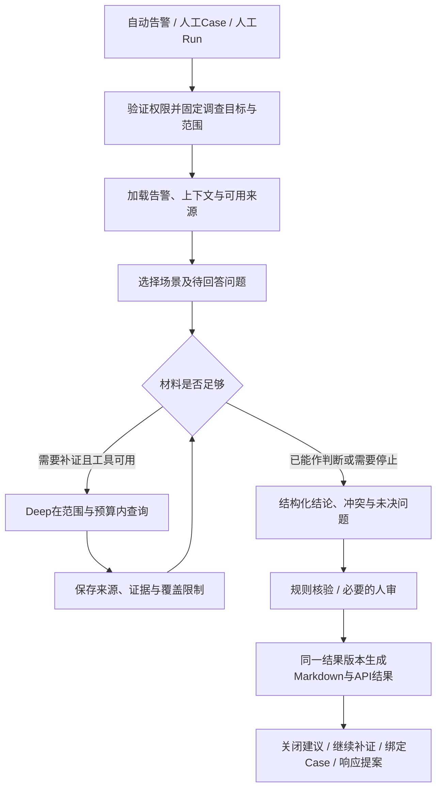

# 智能调查产品与工程设计建议

2026-10-23后续设计主入口：[调查模块规划设计文档](investigation-planning-design.md)。已按用户最新要求允许融合四角色及三套编排，统一问题/证据/判断/执行合同，并规定专用分支、每块先明确预期再开发测试、通过后继续。本文保留原问题及小修批次依据，后续统一设计以主文档为准，不将下文旧保拓扑承诺扩大到新设计。

2026-10-23最新范围：用户要求只先完成几个小改动，后续调查设计再讨论。本地已实现人工校验/采用、逐工具留存/结构状态、停止交接，逐步测试见[回执](../operations/investigation-result-handoff-20261023.md)，未部署。下文缺口表对应实施前/线上v1，不能作为本地仍未修正的判断；其余方案不自动启动。

2026-10-22。本文从安全产品经理、安全开发工程师两个角度，回答当前最需要解决什么、智能体怎样优化、能力怎样扩展。依据为[标书符合性评估](../operations/tender-requirements-assessment-20261022.md)、[164条需求矩阵](../requirements/socai2-requirements-matrix-20261022.md)、当前源码与已有运行回执。**以下是优先级和设计建议，尚未实施，也不代表用户已经选择全部方案。**

续接更新（2026-10-22晚间）：原建议237行版本已获`tender_document_final_audit`限定ACCEPT，原审查及SHA256保存在[收尾记录](../handoff/session-closeout-20261022.md)。用户要求恢复两个额度中断项目后，本次补充后来发生的v1发布与数据盘点事实，交付这份建议；未选择或实施全部优化方案。[逐步执行记录](../operations/two-projects-resume-20261022.md)

**2026-10-23审核修订：仅优化并保存方案，未实施。** 用户明确“不是执行，是方案保存”。本次将源码审核意见融入正文：优先结果一致与停止交接，再校正查询语义并选择真实场景，最后推广共享结构与扩展能力。原四个合同保留为目标设计，首批不一次完整实现。线上事实沿用10月22日回执，本次未重新访问生产；静态发现、已有未发布修正及未来验收分别标明。原文档独审只覆盖当时版本，不自动覆盖本次修订。

## 1. 产品判断：第一版要交付什么

**2026-10-23事件分析补充研究：** [事件级调查与跨事件关联对照](incident-analysis-product-comparison-20261023.md)进一步核对Microsoft Defender/Sentinel、CrowdStrike Falcon及SentinelOne官方材料。当前已有Case多告警及跨Incident候选检索，缺口是持续的事件整体研判；建议依次形成事件结果、增量更新、跨事件候选验证，再评估自动合并/Campaign。此前讨论的补查与领域分析是可组合能力，chain/path在统一证据上下文中汇入主分析。仅保存研究，不修改下文既有修正责任、原任务完成数或授权实施。

建议将第一版定位为：**围绕已有告警，主动补查证据，给出可追溯判断和下一步建议，并能把未完成调查清楚交给分析员的调查助理。** 分析员应能回答：为什么查这条告警、查过什么、发生了什么、哪些还不确定、需要谁做什么。自动关闭、自动处置分别需要更强的依据和运行准入，不能由报告生成成功推定成立。

当前最有价值的基础已经存在：告警持久化与关联、受控分诊、无需再次点击的自动调查、人工调查、只读工具、知识/上下文接入、Run审计与Markdown读取。优先沿这些基础补齐业务判断，不另起平台。详细现状见[调查设计评价](investigation-design-review.md)。

产品成功应按三个层次分别描述：

| 层次 | 要证明什么 | 当前判断 |
| --- | --- | --- |
| 功能迁移 | 正式告警能触发处理，调查实际执行，结果持久化并可读 | v1选定版本已发布并有新两例实证；原完整任务仍5/15，未整体收口 |
| 辅助调查可用 | 范围正确、引用可靠、缺口明确，分析员能据此判断或继续查 | 当前核心补齐方向；已有内容质量失败，不能判整体通过 |
| 自治与运营效果 | 能稳定降低人工投入，并在授权下正确关闭/响应 | 尚未验收；需要真实场景、反馈和业务效果口径 |

后来实际状态：API `5a1e1fd8`、Agents `49643b84`已发布21，独立生产租户和新消费组已启用，常驻worker及自动调查已开启，模型沿用原配置。发布版本**不包含旧C2停止/预算等全部修正**；原完整任务5/15、旧unknown/预算/积压及质量失败保持。[发布回执](../operations/service-v1-release-20261022.md)

发布后两条新合成告警分别自动BTP0.95关闭、NR0.85升级调查，第二例外层Run completed但调查partial；两例共21事件、21工件，正文的字节/hash及event关联已核，8回复31788tokens、费用仍unpriced。后端已盘点25表428字段并实跑9条只读查询。新增证据支持功能交付，仍不能证明调查质量或所有步骤原文完整：graph_step仅node、工具返回只留200字符预览、部分prompt副本截断，seq也不是严格的写入游标。这些缺口应纳入下面证据/结果合同的后续取舍，当前不据此增加实施范围。[两例回执](../operations/service-v1-functional-20261022.md)、[数据落地指引](../integration/v1/page-data-mapping.md)

## 2. 当前最急需解决的问题

这里的P0表示“进入可信调查产品和扩大自治前优先解决”，不把全部二开建议新增为当前迁移收尾前置。执行仍沿原B1—B6与OpenSpec安排。

| 优先级与问题 | 当前依据与业务后果 | 最小产品/工程改进 | 有限验收口径 |
| --- | --- | --- | --- |
| **P0：结论超过证据，报告与最终状态可能不一致** | 自动C2、人工R01曾把知识/风险背景写成观察或确认攻击。人工stream在报告后降Forensic分数，run路径没有相同校验调用；响应建议与Markdown可能沿用降级前材料 | Forensic校验先于Responder和Report，两入口一致；关键结论附引用与判断状态，结构结果、建议和报告采用同一版本 | 缺证降级须同时反映在结构结果、响应建议、MD；知识不变现场观察，处理时间不变攻击时间；引用存在不等于语义正确 |
| **P0：查询实体、时间或返回字段不能回答调查问题** | v1例2把主机名/用户名传给process_name；typed查询多用now()-hours；认证查询未筛认证类别，也未返回登录结果；部分工具缺源 | 参数可追溯到具体材料及类型；固定窗口由API实际执行；按问题核必需字段和真实来源，再选择首场景 | 错类型参数不当有效补证；历史窗口、时区、缺时间、成功空结果、缺源、失败及截断可区分；返回字段确能回答业务问题 |
| **P0：停止后的结果难以交接，预算不等于硬边界** | v1例2六轮十工具、graph27697/20000、末工具JSON作narrative；本地C2已修部分但未全发布。当前Deep异常/超时提前返回，已完成工具轨迹可能未持久化 | 先审已有C2；逐次保留已完成查询及留存缺口；确定性partial交接始终可生成，模型总结仅在余额允许时使用；分计模型/工具调用 | 超时后已完成材料仍可读；达到可观测上限不继续新调用；无总结也有停止原因与未决问题；usage未知不记0；单次回复仍可能跨token余额 |
| **P1：关系图容易被读成行为攻击链** | 本地11节点15边证明关联材料可用；Kafka入口14个可达候选含同租户历史资料，不能当本案受影响资产 | 展示/输出时分“关联候选、事件支持的行为、待核实路径”；关键边附时间和来源；影响确认单独判定 | 共享Technique/同IP/先后发生不能单独确认横移；无证据的边留作候选；人工修正可留版本 |
| **P1：人工接手缺少一致的业务对象与反馈结果** | Incident、Fusion链、调查Chain和Case并非同一对象；普通自动调查不自动建Case，Playbook调查需已有Case | 先在Run/Alert上形成待处理摘要、责任和复核记录合同；按业务策略绑定已有Case或创建Case，不要求每告警一Case | 分析员能按Alert/Run获取原因、缺口、建议；复核不覆盖原模型记录；新补证调查关联父Run |
| **P1：扩展容易停在“工具名称增加”，业务效果不可量化** | 已有工具/策略/tenant skill插槽，但真实来源未齐；调用次数/工具种类不能证明问题得到回答 | 以调查场景定义问题、数据前提、工具、退出条件和样例；新能力先闭合一个场景 | 评价实际查得证据、结论支持度、人工接手成本；同条件下比较，不能拿不同历史Run的token数排名 |

上述事实对应[自动C2](../operations/integrity-autonomy-r01.md)、[人工R01](../operations/integrity-investigation-r01.md)、[本地调查实测](../operations/investigation-functional-20261021.md)、[Kafka写图联合](../operations/kafka-graph-joint-20261022.md)、[人工编排源码](../../services/agents/app/investigator/orchestrator.py)和[工具查询源码](../../services/api/app/services/investigation_tools.py)。

**资源有限时先投入前三项。** 更强模型、更多专业Agent、更大知识库都不能替代正确范围、可用事件数据与诚实的结果状态。根因不明时可以交付有价值的调查进展；未经证实的完整故事会增加分析员返工。

### 2.1 本次审核依据与适用范围

| 发现 | 证据层级与位置 | 方案处理 |
| --- | --- | --- |
| 主机/账号被当作进程名补查 | 已有v1真实调用记录，两次historical_execution参数与零行结果见[两例回执](../operations/service-v1-functional-20261022.md) | 第二批补参数来源与业务类型约束；零行不作为正常或无攻击证明 |
| 认证工具不能充分证明认证行为或成功结果 | 本地[查询源码](../../services/api/app/services/investigation_tools.py)：authentication_events查同tenant/user及非空source_ip，未筛事件类别，SELECT无成功/失败字段 | 异常登录改为候选场景；先核真实字段与投影，不把接口接缝通过当场景可用 |
| 人工校验晚于报告，入口不一致 | 本地[orchestrator](../../services/agents/app/investigator/orchestrator.py)：stream末尾_apply_groundedness修改forensic，未重建report_md；run无同样调用 | 第一批把校验放到响应建议及报告之前，不能仅补报告文案 |
| 超时/异常可能丢掉已完成工具轨迹 | 本地[Deep](../../services/agents/app/investigator/deep_investigation.py)：异常分支先return，正常路径才从loop取trace并_record_tool_calls | 第一批补逐次留存和停止交接；这是静态发现，本次未做超时复现 |
| 未知结论转TP，汇合遗漏待核语义 | 本地Identity/Cloud解析与[Router汇合](../../services/agents/app/orchestrator/router.py)：默认TP，rank未包含needs_review | Router扩大使用前配套处理解析和汇合；未声称本轮线上复现 |
| 200字符预览参与执行状态判断 | 本地tool_loop只截取preview，Deep在字符串中搜available/error | 以结构化调用状态判断；分开保存模型可见内容与展示预览，明确裁剪和缺失 |

现有C2已有末工具内容、partial、用量及后续节点停止等修正和历史直接测试，但最新source05当时未完成终审，且未全纳入v1。后续应先核采用范围和与发布基线的差异，不重复实现或把历史测试算成本次验收。[C2回执](../operations/integrity-graph-correctness.md)、[候选排除边界](../operations/investigation-stage-closeout-20261022.md)

## 3. 推荐的调查流程与智能体分工

### 3.0 2026-10-23确认：小模型稳定输出与实施边界

用户明确现有模型分工旨在让小模型也能稳定输出，并要求“先提交，然后按照规划推进，做好设计和校验”。从本次授权起可按批实施；此前“仅方案保存”描述其对应历史阶段，不再限制本次选定批次。首批沿原restore change落实结果一致与停止交接，本地验证、留存版本及独审后再按阶段安排发布。

- 保留Recon→Forensic→Responder→Report的职责拆分，以及现有graph/deep和Router拓扑、角色模型映射与参数。每步只承担有限任务，节点合并须由目标小模型的直接对照证据支持，不能仅为减少调用次数而合并。
- 共享证据引用与状态结构，各角色按职责读取有界材料子集；不把事件全部材料发给每个模型。租户、时间窗口、版本、工具状态、预算和引用合法性由程序管理，模型仅输出本阶段所需的判断、依据和未决问题。
- 校验顺序、查询参数、留存和partial交接属于局部增强；事件整体分析及反复调工具/领域能力属于影响更大的后续设计，须先明确单次任务、输入上限、交接和停止条件。
- 现有groundedness是标识匹配检查，不是对“登录成功、已授权、已横移”等业务断言验真。首批保证检查结果在响应与报告之前一致采用；场景级语义判断随第二批真实字段/证据设计，不把已有分数包装成整体可信度。
- 后续按“可信单次结果→一个真实场景→固定成员事件分析→增量更新→跨事件候选验证”衔接。共享字段逐步形成；事件分析需披露成员/已读/采用/遗漏覆盖，包含超过3条且早期材料关键的样例。持续更新另定义旧结论待复核、旧快照晚完成及事件累计预算。

本次首批不增加必跑规划/审核模型，不扩大模型调用或预算上限。验收分开记录直接程序合同与真实模型质量；仅替身通过不能证明小模型质量提升。当前线上状态仍以发布回执为准，本地修正不自动成为线上事实。

### 3.1 统一业务流程，先保留现有执行拓扑

这是目标业务流程，不是新建一套总编排框架，也不表示当前三条路径已经这样接通。模型适合提出假设、选择下一项有价值的查询、解释证据；权限、实体范围、时间窗、工具执行、预算、状态与持久化由程序约束。

| 当前编排 | 建议保留的价值 | 优化方向 | 使用条件 |
| --- | --- | --- | --- |
| 默认Case四节点 | Recon线索、Forensic解释、Responder计划、Report交付分工 | Recon减少重复信息；Forensic输出证据支持的判断/假设；Responder按结论状态组织dry-run计划；Report服从最终结构结果 | 需要综合已有材料或完整响应计划时使用；不是四次独立事实复核 |
| graph/deep | 根据返回继续查询，具备主动调查能力 | 作为补查能力的优先演进位置，完善范围、有效停止、问题覆盖和结果收束 | 已有可用数据源、问题明确且需要新证据；可自动或人工触发 |
| Router领域分支 | 专业字段/提示、按领域分析及可选并行 | 接受同一证据合同；允许不确定结果；仅在领域分析有实际价值时调用 | 已有身份/云/终端等资料需要专项解释；不默认等价替代现场取证和完整响应计划 |

建议未来让“人工/自动”决定触发与复核要求，让“材料整理/主动补查/领域分析”决定执行策略。人工也可以主动查证，自动也应有完整交接。先用薄适配共享合同；完成场景验证后，才决定是否收敛重复节点，不能先假设三套必须合并或串行全跑。

身份/云分支当前解析未知verdict会落成`true_positive`；Router汇合rank仅包含benign/false_positive/true_positive，未定义needs_review。应配套处理解析和汇合，不能只改两个默认值。汇合需保留各分支的证据支持、冲突与关键缺口，并说明缺口是否影响最终判断；不能仅凭最高confidence获胜，也不要求一条不相关缺口覆盖已有充分支持的判断。此项作为Router扩大使用前的必要修正，可独立验收，不因等待数据源而无限后置。这是当前源码事实，不是已复现线上错误。[Identity解析](../../services/agents/app/agents/identity_agent.py)、[Cloud解析](../../services/agents/app/agents/cloud_agent.py)、[汇合源码](../../services/agents/app/orchestrator/router.py)

### 3.2 不先增加一个必跑的“总规划模型”

已有[Strategy](../../services/agents/app/investigator/strategies.py)能根据线索提供调查方向，tenant skill能提供组织流程。先把它们从“期望用了哪些工具”扩展到“需要回答哪些问题”，让Deep在允许的分支里选择查询。

例如异常登录，问题是“登录是否成功、是否有授权依据、随后做了什么、是否涉及其他账号/资产”。查ATT&CK不等于回答其中任何一个现场问题。复杂跨域事件确需动态拆解时再增加规划模型，并用实际收益判断是否保留；避免每条简单告警都先多付一次规划调用。

分诊仍应分别表达风险优先级、研判结果与自动化资格：高风险决定先处理，不自动证明攻击；模型高confidence也不单独授予关闭资格。后续扩大自动关闭时，建议先限定有充分正常依据的场景，缺授权/缺覆盖/证据冲突转待核。现有`route_to/tags/category`未完整投影到下游、worker也不据此切Router，若要用业务规则控制调查场景，应显式补这条合同并验证，不能只增加规则配置。[当前分诊评价](../operations/tender-requirements-assessment-20261022.md)

## 4. 四个共享合同，沿现有state和Run工件落地

以下字段是目标设计，不是当前已存在的完整API，也不是首批必须一次做完的四套新对象。第一批复用现有state/ledger补结果与交接所需的最小字段；第二批在一个场景验证scope、参数来源和关键finding；第三批再推广经过验证的共享结构。无需先新建证据服务或统一插件平台。

### 4.1 InvestigationScope：明确这次允许查什么

| 字段组 | 建议内容与规则 |
| --- | --- |
| 身份和锚点 | 服务端认证确定tenant；`anchor_type/id`指Alert或Case；保留关联的Alert/Incident/Case ID，不混为一个ID |
| 目标与实体 | 待回答问题；种子资产/账号/IP；允许查询的实体范围及扩展政策；新发现实体先列候选与来源 |
| 绝对时间 | `start_at/end_at`使用明确UTC区间；记录event_time及来源字段、采用的时区、锚点依据；默认窗口由场景政策给出 |
| 运行约束 | 可用来源、单工具行数/分页上限、模型和工具调用额度、token/时限、只读能力；使用已有预算体系 |
| 版本 | scope版本、场景/工作流版本、创建者/触发方式；Run开始保存快照 |

查询必须满足“请求范围∩操作者授权∩系统政策”。调查时间可以由模型建议缩小；扩大到新实体/更长时间按政策判定，超出授权则交人处理。历史基线比较可以使用另一明确标记的参考窗口，不能把参考窗口中的旧事件混成本次事件。

保留旧`hours`参数兼容，但在Run入口将其解析为一次固定绝对窗口，不让多轮查询持续漂移。若告警没有可信发生时间，标记未知；允许按处理时间查询时必须披露该依据，不能补造攻击发生时间。旧Run不回填假设出来的范围。

固定窗口必须传到实际API/adapter/查询执行层，保存请求窗口与实际采用窗口及裁剪原因；只在prompt写时间范围不能算完成。事件窗与历史参考窗分别标识、分别引用。具体默认窗口由选定场景确定，本方案不预设所有告警统一前后若干小时。

实体参数要保留来源字段或证据引用、实体类型及必要的转换依据。主机名和账号不能因同为字符串就当进程名；派生查询允许使用有说明的映射/分析候选，但应标记其依据与不确定性。JSON Schema类型合法仅是基本条件，业务类型与租户/范围约束仍由执行端核验。

落点：[Case请求](../../services/api/app/api/v1/endpoints/cases.py)、[人工state](../../services/agents/app/investigator/state.py)、[graph state](../../services/agents/app/models/state.py)、[typed查询](../../services/api/app/services/investigation_tools.py)、[customer tools](../../services/agents/app/tools/customer_tools.py)。

### 4.2 Evidence：能追到原始材料，也知道它的限制

建议每项证据保留：`evidence_id`、来源类型/系统/记录ID、原件或工件引用、事件时间、查询ID、实际实体/窗口、结果摘录、裁剪/分页/覆盖限制。先引用现有Alert和工具工件，不为每次调用复制整份日志库。

入口材料也要说明覆盖范围。当前Case材料嵌套在`raw_alert.alerts`，不同消费者不自动展开，API还存在最多三条告警的投影；不能假设所有关联告警都进了每个模型。建议统一形成有界的告警事实摘要和原件引用，带实际条数/遗漏提示，供各编排采用；按待回答问题补取相关材料，不直接把全部原始正文塞进prompt。[输入与采用说明](investigation-preprocessing-tools.md)、[Case投影源码](../../services/api/app/api/v1/endpoints/cases.py)

工具输出应分开表达：

| 维度 | 例子 | 解释 |
| --- | --- | --- |
| 调用状态 | `ok / unavailable / error / denied` | HTTP200或工具执行成功，只说明这次查询过程，不说明恶意/安全 |
| 数据结果 | 有记录 / 成功空结果 | 空结果只说明该条件下没有返回记录 |
| 覆盖程度 | 完整 / 截断 / 部分源 / 未知 | 只有能证明窗口、数据接入与分页覆盖时，才可用“未观察到”作有限反证 |
| 证据性质 | 原告警陈述 / 现场事件 / TI / 知识 / 历史案例 / 人工意见 | 原告警可能误报；TI命中、知识技术映射和历史案例不能直接证明本案动作发生 |

保留原文与模型摘要的区别。两个产品转发同一条上游告警属于重复来源，不能按“两家都发现”计算独立印证。外部返回的“已成功执行”也是待验证内容，实际动作状态必须来自可信执行回执。

留存分三层：原始返回或来源记录引用、实际进入ToolMessage的模型可见内容、展示预览。逐层说明大小限制、脱敏/裁剪和未保存部分；若只保存模型可见片段，不能称完整原始返回归档。hash对应明确的保存层，只证明相应字节一致，不证明事件真实或结论正确。首批优先保存查询参数、结构化调用状态、结果引用与模型可见内容，不要求复制全部日志或每个节点完整state。

工具执行状态从结构化返回取得，不能从200字符preview搜error/available推断；数据行内的error字段不等于工具执行失败。已完成调用应及时记录，后续超时不应抹去先前成果；留存失败需显式列出缺口，不能通过重跑业务查询补造原回执。当前seq不是严格写入游标，读取仍按[既有分页说明](../integration/v1/page-data-mapping.md)补齐/去重，本批不顺带新造恢复或游标框架。

### 4.3 Finding：结论及其支持/反对证据

建议字段：`finding_id、statement、kind、supporting_refs、contradicting_refs、entity/time_scope、limitations、review_status`。

`kind`可区分“材料中观察到的记录、证据支持的分析判断、待验证假设、证据冲突、仍需调查”。这里“观察到记录”只确认该来源确有相应记录，不把告警标题等同于客观攻击事实。关键判断还需说明如何从记录推出结论，允许分析可能的入口、持久化、横移和外传，不强制所有分析都达到确认级别。

程序先检查引用存在、租户/实体/时间是否匹配、背景资料是否被冒充现场证据、冲突是否遗漏、动作是否越过dry-run状态。对复杂语义，程序校验不能宣称验真；必要时让分析员或有界专项模型检查反证，不新增每条告警必跑的“审核Agent”。

### 4.4 InvestigationResult：完成与可信度分别表达

保留既有Run执行状态，另加业务维度，避免一次改动破坏旧API：

| 维度 | 建议字段/含义 |
| --- | --- |
| 执行 | 原pending/running/completed/failed继续有效；描述程序是否跑完 |
| 调查完成度 | `complete / partial / blocked`及明确`stop_reason`；描述问题是否得到足够处理 |
| 研判 | TP/FP/benign/needs_review等与各关键finding引用；高confidence不能绕过缺证 |
| 人工复核 | 待复核/接受/修正/补证及理由；保留作者、时间和所据证据 |
| 交接 | 已回答问题、未决问题、缺失来源、建议下一动作和所需责任角色 |
| 版本 | scope/证据/结果版本、parent_run_id；后续调查不覆盖原Run |

Markdown的范围、事实/假设、时间线、完成度、停止原因、缺口和动作状态由同一结构结果生成。模型可组织解释文字，但不得新增未登记事实或把未执行动作写成成功。人工路径应在Forensic之后、Responder与Report之前校验，run和stream采用相同规则；不能仅在结束时降分或单独补Markdown而让响应建议沿用旧结论。

业务完成度须有明确判据：complete表示本次目标中的必答问题已按约定证据要求处理，仍披露结论边界；partial表示已获得进展但关键问题、证据或步骤未完成；blocked表示必需来源/权限等阻止继续，保留已完成材料和解除条件。无异常退出、生成报告或模型自报高confidence均不能单独判complete。上述是建议的新增业务语义，现有Run/graph字段须兼容映射，不直接重命名历史completed。

兼容旧字符串和旧报告，标为“未按新合同结构化核验”，不重写历史失败记录。落点：[ReportWriter](../../services/agents/app/investigator/report_writer_agent.py)、[人工orchestrator](../../services/agents/app/investigator/orchestrator.py)、[Router report](../../services/agents/app/orchestrator/report.py)及原ledger。交付仍以Markdown为主，不重开PDF/HTML专项。

## 5. Deep怎样更有效地调查与结束

1. **先审已有C2修正，再补缺口。** 工作区已有停止、partial、末工具消息与用量等修正；它们未因19文件候选构建而获发布结论。应先明确采用差异和终审结果，避免重复实现。[候选排除边界](../operations/investigation-stage-closeout-20261022.md)
2. **分开算模型调用与实际工具调用。** 一轮模型可能要求多个工具；不能用模型轮数代替工具额度。工具批次执行前判断剩余次数、时间和范围。
3. **调用前约束，调用后记实。** 预检剩余token额度，按允许余额限制输出；区分估计/预留与provider实际usage。未知usage保留unknown，不自动恢复成可用余额。估算不能承诺绝对不会超出，应保守留量并明确超限处理。
4. **先保证随时可交接，再考虑模型总结。** 用已保存的查询、证据和未决问题确定性生成partial报告；有余额时可在现有六轮总上限内安排关闭工具的总结，不增加第七轮或扩大预算。预留总结轮需评估减少一次查询的代价，不作所有场景必跑规则；总结失败不影响基本交付。
5. **按问题收敛。** 每次记录本次要验证什么、返回是否增加支持/反对证据、哪个问题已回答。关键问题解决即可停；无工具可查或同条件重复无进展则停并列缺口。新增证据多少只作辅助，不能要求为了凑工具数继续查。
6. **减少重复上下文。** 原始工具结果留工件；后续prompt带相关证据摘要和可回查引用。Run内相同范围/版本查询可复用，源更新或补证后应失效；不随意扩成跨告警结果缓存，更不能改动现有unknown和首次结果保护。
7. **停止与留存分开验收。** 保留已完成调用、实际已知usage及持久化缺口，区分模型超时、工具失败、轮数/工具数/token限制和无有效补查方向。当前异常分支丢轨迹的问题应直接核验；不为此扩展进程重启、跨机恢复或旧Run自动重试专项。

候选落点：[tool loop](../../services/agents/app/llm/tool_loop.py)、[Deep](../../services/agents/app/investigator/deep_investigation.py)、[graph runner](../../services/agents/app/graph/runner.py)。先复用历史失败和已有替身进行直接合同核验，真实模型仅在后续实施范围明确后有界验证，不重新跑全入口矩阵。

## 6. 攻击链应怎样逐步增强

保留现有关系图作为检索与调查上下文。它回答“哪些对象相关”，行为链还需回答“谁在什么时间通过什么活动影响了谁，依据是什么”。[当前对象与边界](attack-chain-path.md#concepts)

第一步给候选关系附来源事件、实际时间和支持状态。例如同一账号在A、B出现，只能建立关联候选；要分析A到B的远程访问，应找对应连接/认证记录、账号和地址映射，校对时间与主机身份。跨源时钟偏差、NAT、共享账号或传感器重复上报都可能削弱判断，不能仅按ATT&CK阶段排序补齐缺失行为。

第二步将边分为“事件记录支持的行为”“分析推断关系”“待核实关联”，关联缺口允许断开。将已确认受影响资产、出现相关活动的资产、待查候选分别返回；共享Technique的可达节点不直接计入受影响数量。

第三步支持分析员接受/驳回/补充特定边及理由，保存版本。路径报告引用同一组finding与证据，避免图和文字各生成一套故事。是否引入专门的行为事件节点、独立活动聚类或消费Fusion链，留到真实跨告警场景证明需要时再定，当前不先改Incident键或合并所有Chain概念。

## 7. 怎样扩展：先数据源与场景，再专业Agent

### 7.1 工具扩展

复用[ToolRegistry](../../services/agents/app/tools/registry.py)、[scoped_customer_tools](../../services/agents/app/tools/customer_tools.py)及原API/MCP路径。客户工具已有按tenant配置选择、受限参数、不可信数据标记和失败区分，应该保留；湖工具还应将实际接入/覆盖情况纳入能力描述，减少已知不可用的无效尝试。

每个新工具最少声明：业务目的、输入类型与范围、来源能力、只读/写入属性、权限、超时、输出/分页上限、来源引用、空/失败/截断语义。`ToolRegistry.execute`目前直接`fn(**args)`，发给模型的JSON Schema不等于执行端自动验证；可在现有执行处增加轻量参数校验，API仍独立验证授权与范围。

工具说明还应与真实查询粒度相符：主机级网络连接只能说明该主机的活动，缺进程关联字段时不能写成某进程发起连接；同账号且带源IP的事件不能自动称为成功认证。选定场景需明确源事件类别、结果字段、关联键及时间含义，保证工具返回能回答描述中的问题。

相同能力的厂商差异放adapter；模型调用`query_authentication`一类业务能力，不必理解厂商URL、签名、字段和分页。先有真实厂商合同，再接一个源，复用[外部HTTP工具设计](third-party-search-contract.md)，不照假设示例实施。HTTP/MCP只是接入方式，不能自动提供正确字段语义或租户隔离。

日志命令行、邮件正文、知识文本和外部工具返回都可能携带指令。沿用已有围栏和检测，并在服务端限制能力：这些内容不能改变tenant、凭据、URL、允许实体、预算或审批状态。模型只选已注册工具及受限参数，不能因为工具文本说“请隔离”就进入真实响应。这里要求保留并沿扩展路径验证现有边界，不意味着当前完全没有防护。

### 7.2 场景扩展

在现有Strategy/tenant skill上增量描述：触发条件、业务问题、必须/可选数据、允许工具、证据要求、停止与人工接手条件、输出字段、版本和代表样例。它是可审查的场景合同，仍允许模型选择合适查询顺序，不是一段自由prompt就能授予新权限。

| 首批建议场景 | 分析员要回答的问题 | 数据前提与当前限制 | 合适的交付 |
| --- | --- | --- | --- |
| **异常登录/疑似账号失陷，条件满足时优先候选** | 是否成功？是否有可核的正常使用/授权依据？成功后做了什么？还有哪些会话需查？ | 需真实认证类别、成功/失败、事件时间、账号/资产映射及适用授权资料；当前查询未筛认证类别、未返回登录结果，有接缝证据仍不足以回答“成功登录”。仅IP地域异常不能确认失陷 | 登录时间线、支持/反对证据、未知授权状态、下一步会话/活动查询 |
| **可疑进程与外联** | 谁启动进程？执行了什么？是否外联？相同文件出现在哪里？ | EDR进程、父子关系、网络/文件来源；目前process_activity有有限实证，process_tree后端缺口需真实来源补齐 | 行为片段与关联证据、IOC性质、影响候选、dry-run处置建议；PowerShell名称本身不判恶意 |
| **多告警疑似横向移动，作为后续综合场景** | 哪个账号从哪台主机访问了哪台？关联是否只是共享实体？哪些资产需进一步验证？ | 两端认证、网络/远程执行或等价记录、时间/身份映射；现有关系图不够直接支持确认 | 带证据的行为边、时间约束、替代解释、未确认路径和分析员复核 |

每个场景都应有可成立、正常或反例、缺源/冲突三类材料；先利用已有有效记录及选定试点数据。暂不优先选依赖尚未接通邮箱/OAuth等工具的“全能邮件调查”，也不把扩展场景等同于接管上游采集开发。

首场景按实际可获得的数据选择，不在本轮确定。先列“业务问题→必需字段→真实来源→查询入口→可支持的判断”，区分已提供、待映射、缺失；优先选择关键字段能以最小适配接通、且有可核正反样例的场景。缺少后续活动或授权资料时可缩小目标、明确partial交接，不能把整个账号失陷调查宣称完成。

### 7.3 专业智能体、知识与模型扩展

专业Agent应解决可识别的领域问题：身份Agent解释会话/授权，终端Agent解释进程/持久化，网络Agent解释连接/传播。共用证据存储、范围和状态，输出finding，不各自复制一套工具、报告和权限。独立子问题可以并行；共享结论汇合时保留冲突，不能按多数票把猜测升级成事实。

知识用于“怎么查、如何解释”，事件证据用于“本案发生什么”。先为首场景整理有版本、权限和有效期的SOP/案例，核中文查询召回；按问题选全文、向量、IOC精确匹配及必要重排序，而非所有查询全跑一遍。人审修正先保存成案例候选，经审阅再进入知识，避免把误报结论自动写回组织记忆形成自我强化。

模型优化顺序建议是：正确输入和工具→结构结果/提示→场景评估→有证据的模型路由或SFT。标书明确要求安全SFT，应另行形成训练/验证样本、数据权限、基线与独立评估计划；不能用prompt优化代替承诺，也不先用微调弥补无数据或错误权限的问题。参考[标书技术要求](../requirements/socai2-requirements-matrix-20261022.md)。

## 8. 用一个具体例子验证设计

以下为设计例子，未执行；前提是未来已接通带认证事件类别及成功/失败字段的真实来源，当前工具返回尚不满足。假设10月20日02:00的账号异常登录，10月22日才发起调查。

1. API保留告警发生时间及来源，按场景规则固定查询区间，显式展示时区。查询不会自动改成“10月22日最近24小时”。若需看长期登录基线，另列参考窗口。
2. 认证工具返回一次成功登录E1；资产/账号资料说明该账号归属，但没有当时有效的授权记录。系统可写“来源记录显示成功登录”，不能据归属推定“本次已授权”。
3. 历史TI命中E2注明日期和来源；MITRE K1介绍相关技术。它们提供调查方向，不能单独证明账号被盗。
4. 后续活动工具不可用。结果保留“需要进一步核实账号是否失陷”，列出缺失的会话活动/授权证据；调用完成但调查为partial。
5. Markdown显示E1支持的事实、E2/K1的参考性质、未决问题和接手动作。建议核会话及联系授权责任人；隔离/封禁如有提案，仍标未执行并走原授权流程。
6. 分析员补充当时VPN/变更记录后产生复核或关联的新Run，原结论与用量保留。若后续证据支持正常使用，给出有边界的正常解释；若出现恶意活动，按新证据升级。

这个例子检验的是范围、证据采用、缺源与交接的完整性，不要求一次模型回答所有问题。

## 9. 后续推进建议与验收口径

以下是建议批次，供后续选择并落实到现有OpenSpec；没有新建执行任务树，没有勾选原任务，也没有给未估算工作承诺日期。

| 批次 | 主要责任角色 | 交付物 | 退出条件 |
| --- | --- | --- | --- |
| **迁移收口** | 后端/发布负责人 | v1选定版本已发布、后端盘点已交付；继续明确原责任表的实际剩余项 | 复用已完成的发布和两例证据，不重复构建/发布；保留旧C2/质量边界，不把发布当自治质量验收 |
| **第一批：结果一致与停止交接** | 产品/安全分析员＋Agents工程师 | 审核已有C2取舍；人工校验顺序；graph业务完成度/报告一致；逐次查询留存、结构状态及确定性partial交接 | 缺证降级同步到结构结果、响应建议和MD；超时/异常保留已完成材料；上限停止、unknown及留存缺口表达真实。仅必要直接验证与结束独审，不要求新数据源或四合同全部完成 |
| **第二批：查询有效性与一个真实场景** | 数据接口负责人＋API/Agents工程师＋分析员 | 问题/字段/来源映射；固定绝对窗口及API执行约束；参数来源；选定真实只读源与关键finding引用 | 输入→正确实体/时间/事件类别→实际返回→模型采用→结果可追；正例、反例、缺源/冲突均符合依据。未回答关键问题时交付partial，不用成功空结果代替安全判断 |
| **第三批：推广共享结构与扩展能力** | API/Agents/图工程师＋分析员 | 将前两批验证有效的最小字段推广到三编排；按数据条件增加第二场景、带来源时间的行为边及人审/补证关联 | 范围、证据、结论与结果语义可复用；新增能力主要增加adapter/策略，候选不升级为确认路径；不要求合并三种编排 |
| **随后：运营与受控响应** | 产品＋安全运营＋Actions工程师 | 分析员处置反馈、有限动作方案/审批/执行/回读、真实效果统计 | 先明确真实目标与授权；建议、审批、执行、验证分别有证据；不由调查confidence直接开自治 |

复杂恢复、长稳、压力、全量冗余验证继续按原约定后置，不因本建议新增为功能迁移前置。真实运行扩大前保留现有准入、权限、预算和unknown保护。v1已具备阶段交付及后端读取材料，后续产品化按业务价值逐批选择；这份建议不自动触发新改码、模型测试或再次发布。

### 9.1 有限验收材料（尚未执行）

| 批次 | 最小代表材料 | 必须核到的结果 |
| --- | --- | --- |
| 第一批 | 一份缺证降级材料分别走run/stream；工具已成功一次、随后超时/异常；一轮多工具与达到轮数/已知token限制；留存失败 | 校验先于建议/报告；先前证据可读或准确声明未留存；停止后无新调用、无末工具JSON冒充结论；无总结也有交接；用量未知不记0 |
| 第二批 | 历史告警与明确时区；主机/用户误填process_name；非认证事件混入同账号资料；认证成功/失败；成功空结果、缺源、失败、截断 | 实际执行窗口与参数来源可核；查询按事件类别和字段含义工作；不同结果不会被统一解释为正常；关键finding有支持/反对依据 |
| 第三批 | 复用同一组已验证字段的不同编排结果；领域未知verdict、分支冲突及关键缺口；第二场景的来源/行为边 | 共享语义保持且领域差异不被抹平；Router解析与汇合配套通过；图中的候选、观察和推断有来源及边界 |

Router未知结论及汇合修正是扩大该路径使用前的独立必要项，可提前安排，不必等第三批其他扩展。上述均是未来验收要求，不是本次已跑测试；先复用适用历史材料和直接替身，真实数据/模型验证仅覆盖选定场景的实际采用，避免全入口矩阵与重复全量冻结。

### 建议衡量的业务指标

| 指标 | 可操作定义与边界 |
| --- | --- |
| 关键结论支持率 | 经人工逐项核验、证据真正支持的关键事实判断 / 已评审关键事实判断；不是“带引用”比例，假设单独统计 |
| 无依据确认与误关闭 | 单列严重错误数量和案例；总体准确率不能抵消高后果错误 |
| 场景覆盖与缺口识别 | 必答问题中得到有效回答的比例，同时记录未接源/错误/截断；工具调用成功率另列 |
| 首份可接手结果耗时 | 从触发到有范围、初步判断、证据/缺口与下一步的持久结果；同时区分自动耗时与人工等待 |
| 分析员修正成本 | 人工阅读、查证、纠错、补报告的时间与修正项；不能只算模型生成节省的写作时间 |
| 单案资源成本 | 已知token/工具调用/耗时、unknown量及人工时间；不同范围和版本不混合排名 |
| 扩展成本 | 新增一个同类数据源或场景需要改动哪些位置、多少重复逻辑；先记录，不预定未经验证的数值目标 |

标书的90%准确率、5倍效率、MTTR等目标仍需明确样本、分母、基准工作流和统计周期。先用少量经分析员确认的场景材料建立基线并保存失败；扩大试点后再判断指标，不将合成例子或模型自报confidence当作标书成效。[原需求与指标](../requirements/socai2-requirements-matrix-20261022.md)

## 10. 设计原则的外部参考与本轮边界

外部材料仅提供通用工程参考；本项目优先级和字段设计来自上述实际缺口，不是上游AiSOC或其他厂商承诺。Anthropic的[Building effective agents](https://www.anthropic.com/research/building-effective-agents)讨论固定工作流与动态代理的取舍、以实际需要控制复杂度；其[Writing effective tools for agents](https://www.anthropic.com/research/writing-tools-for-agents)建议围绕高价值任务设计少量清晰工具，并用调用轨迹和任务结果评价。本文据此采用“保留现有编排、共享小合同、按场景扩展”的工程判断，不建议切换框架或模型供应商。

原建议编写阶段仅只读分析、编写文档与文档核验，未改业务代码、运行测试/模型、发业务消息、部署21或启用worker。此次续接只补后来已经发生的发布/盘点事实；并行恢复的测试工具联测见独立记录，不能算作本建议方案的实施验收。后续实施仍沿原change明确本批需求/设计/直接验证与一次结束独审。建议优先投入范围与真实证据、结构结果/报告一致性、停止后的交接，再扩展场景与行为链。

2026-10-23修订只保存审核后的方案：已完成建议/源码/旧回执对照，将五类重点意见融入对应章节，拆细批次及有限验收材料。未修改业务源码、API/数据库合同或运行配置，未运行新业务测试/模型、发消息、访问生产或部署，未改变原5/15及旧质量结论，未提交/推送Git。修订前文档副本保留在`.local/versions/investigation-plan-review-20261023/before/`；后续实施须另依据用户选择的范围推进，本次保存不构成执行指令。

本次修订结束文档独审：`resumed_projects_end_audit`限定ACCEPT、0项本轮必须修项；仅覆盖本次建议与事实边界，未执行方案验收。记录见[原change审计](../../openspec/changes/restore-alert-investigation-integrity/audit.md)。
