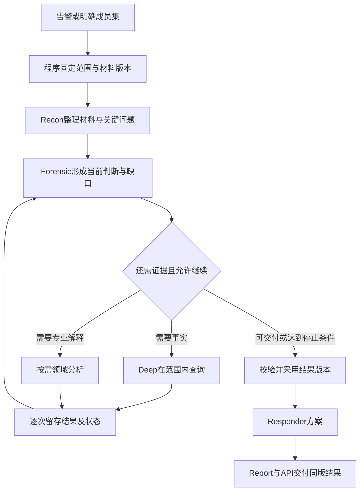

# 调查模块产品调研与设计映射：Defender、Sentinel、CrowdStrike Falcon

后续讨论更新（2026-10-23）：用户明确现有四角色和三套编排可以融合，已汇入唯一设计主入口[调查模块规划设计文档](investigation-planning-design.md)，含四块合同、逐模块测试、专用分支、产品参考和换账号续接。本文保留为研究依据；“保留四角色”是前一阶段建议，不再作为后续设计的固定约束。统一设计仍未实施。

2026-10-23。本轮先回顾现有流程与此前讨论，再查阅厂商官方文档、开发者接口和研究材料，供继续讨论设计。用户已明确所说产品为 **CrowdStrike Falcon**，不包括 FICO 或海康。Microsoft Sentinel 与 SentinelOne 分开，后者仅作行为关联补充。

本文件是研究与建议，**不代表已选定实施**。本轮只新增此文档；没有修改业务代码、模型/运行配置或原任务完成数，没有访问生产、调用业务模型、测试业务链、提交、推送或部署。生产状态引用已有回执，不是本轮重新探测。

## 1. 设计判断与证据边界

建议保留当前四角色拆分，沿“可信单次结果→有效查询与一个真实场景→固定成员事件研判→增量更新→跨事件候选验证”完善。最值得吸收的是厂商对调查对象、证据、问题、执行状态、人工协作和响应的组织方式。

Falcon 确实把多项 SOC 能力放入统一平台；公开产品同时区分 Agent、确定性工作流和应用。微软也把跨源调查体验统一到 Defender 门户。**据此作出的工程判断是：我们应统一证据和业务语义，让各模块围绕同一调查协作；无需因此合并所有模型职责或复制整个平台。**[Falcon Agentic SOAR](https://www.crowdstrike.com/en-us/platform/charlotte-ai/agentic-soar/)、[Sentinel 迁入 Defender 门户](https://learn.microsoft.com/en-us/azure/sentinel/move-to-defender)

资料按三种强度理解：

| 证据 | 能说明什么 | 不能据此断言什么 |
| --- | --- | --- |
| 官方操作/API 文档 | 对象、输入输出、权限、状态、公开功能与限制 | 全部内部算法、提示词、模型拓扑及实际效果 |
| 官方技术文章/研究论文 | 某机制、特定系统或实验的实现方法 | 所有产品版本均采用同一方案；实验收益可直接迁移 |
| 产品页/发布公告 | 厂商声明的能力和可用性 | 已独立验证质量；Preview/Pre-beta 已全面商用 |

本轮没有操作厂商租户或做产品横向实测。下述流程是公开行为归纳，不冒充厂商内部源码。

## 2. 我们目前实际有哪些调查能力

| 路径 | 当前处理流程 | 主要能力与限制 |
| --- | --- | --- |
| Kafka 自动链 | raw→Fusion→fused→分诊前图准备→首次分诊；未关闭且允许升级时，同 Run 进入 post-triage graph | 外层固定阶段；investigation 节点内的 Deep 可多轮选工具；自动升级跳过重复的首次 auto_triage |
| 默认 Case 四角色 | 预取 Case 材料→Recon→Forensic→Responder→Report | 成功路径通常四次模型调用；没有自主补查循环；Responder 当前 dry-run |
| 可选 Case Router | 分诊/信号分类→选中领域分支→汇合→确定性响应摘要与模板报告 | 每个领域分支通常一轮模型；不内置四角色链或 Deep 循环 |
| 人工 Run | `/agent-runs` 可启动 full graph | 说明人工/自动是触发方式，与是否主动查询不是同一个维度 |

post-triage graph 的主要阶段是 `triage→enrichment→investigation(Deep)→attack_path`。三种编排目前并存，并未串成一次必跑全链。四角色是职责流水线，不是四次独立复核；graph 的 Markdown 由 renderer 交付，不自动追加四角色中的 Report 模型。[调查入口](../integration/v1/investigation.md)、[流程说明](investigation.md)、[设计评价](investigation-design-review.md)

四角色的职责仍有价值：Recon 整理线索，Forensic 形成解释，Responder 形成方案，Report 表达结果。`recon/investigation/report` 是逻辑角色；Forensic 与 Responder 共用 investigation 角色映射。现有材料指向 `openai/aisoc-test-investigation`，不能仅由别名断定底层模型家族，也不能把四角色说成四个不同物理模型。

版本必须分开：

- **生产 v1**：10月22日 API `5a1e1fd8`、Agents `49643b84` 已发布，worker 与自动升级开启，已有自动调查和 Markdown 实证；调查可能 partial，内容质量未整体通过。[生产说明](../integration/v1/production.md)
- **10月23日本地小修**：Forensic 原标识校验前移；响应/报告采用校验后状态；工具逐次原子留存及结构状态；异常/时限交接。未部署。保留四角色、模型参数、六轮和预算。[小修回执](../operations/investigation-result-handoff-20261023.md)
- **待讨论设计**：事件整体结果、持续更新、跨事件验证及更广共享结构尚未实施。原迁移5/15与旧质量/用量失败保持。

小修不是业务语义验真：标识存在不证明“登录成功”“横移成立”。工具工件正文是既有4000字符 ToolMessage 通道的有界表示，另存完整序列化结果的字节/hash和截断标记，并非完整外部原文备份。两次真实模型回复仍有缺陷，程序交付约束有效，不应写成模型质量已通过。

## 3. Microsoft Defender：以事件为中心组织证据、判定与行动

Windows Security 是本机安全管理入口；Protection History 主要展示杀毒检测与处置。本轮企业调查对标使用 Defender XDR/Endpoint、Security Copilot，而不是将本机应用当完整 SOC。[Windows Security 官方说明](https://support.microsoft.com/en-us/windows/security/windows-security/protection-history-in-the-windows-security-app)

公开流程可归纳为：相关告警进入 Incident→查看实体、证据与时间线→查询或自动调查补充信息→记录判定与缺口→按权限形成或执行行动→保留活动历史。各能力并非每案必跑，也不是一套固定 LLM 流水线。

| 环节 | 官方公开设计 | 本项目采纳建议（工程判断） |
| --- | --- | --- |
| 事件工作对象 | Incident case 汇集告警、资产、证据、调查和活动；证据判定及处置状态可分别查看。新 Incident cases 为 Preview | 让一个事件容纳多次 Run、证据及人工进展，执行结束与事件关闭分开 |
| 关联与范围 | 持续关联告警，考虑实体、工件、时间和行为序列；查看相关事件不等于合并 | 保留候选理由、原始ID和各自生命周期，验证后再考虑扩大调查范围 |
| 调查结果 | AIR 区分证据判定、调查状态和动作结果；调查失败与此前动作成功可同时存在 | 将“工具失败、资料缺失、调查未完、动作未执行”分别表达 |
| 响应建议 | Guided Response 区分分诊、遏制、进一步调查、修复，附目标与理由，并区分已完成动作 | Responder 输出结构化方案；建议、批准、执行、回读分别留证 |

来源：[Incident cases](https://learn.microsoft.com/en-us/defender-xdr/investigate-incident-cases)、[关联与合并](https://learn.microsoft.com/en-us/defender-xdr/alerts-incidents-correlation)、[AIR 结果](https://learn.microsoft.com/en-us/defender-xdr/m365d-autoir-results)、[Guided Response](https://learn.microsoft.com/en-us/defender-xdr/security-copilot-m365d-guided-response)。

两个新增观察值得用于后续设计：

1. Phishing Triage Agent 将本案分类修改与可复用教学分开；显式教学、审阅 lesson 后才影响以后案件。我们可以先保存人工修正，审核后才进入知识/SOP，避免错误报告自动形成组织记忆。[官方流程](https://learn.microsoft.com/en-us/defender-xdr/phishing-triage-agent)
2. Attack Investigation Agent 从 Alert/Incident 发起多步调查，输出时间线、范围、分类和 Markdown，允许 `Completed with failures`。当前属 Project Perception 邀请制 Limited Public Preview；可参考执行与交付形态，不应写成已全面成熟的自治调查。[官方说明](https://learn.microsoft.com/en-us/security/agentic-security/attack-investigation-agent)

更接近实现方法的 DTDA 研究将时间线构建与有界调查分开，再围绕假设找支持/反驳证据；用固定输入输出合同及确定性检查约束模型。这是特定研究系统的公开设计，不是 Defender 全部实现。对我们更有用的是“先准备可核材料、每步做有限判断”，不必因此新增一个总规划模型。[DTDA 论文](https://arxiv.org/html/2605.20896v1)、[产品 Preview 边界](https://learn.microsoft.com/en-us/defender-xdr/dynamic-threat-detection-agent)

**版本注意**：官方注明自2026-09-01起，Defender for Endpoint AIR 不再提供独立调查体验及手动触发，能力并入默认杀毒保护；Office 365 AIR 仍保留。旧概述中的手动调查段落不能直接当现行 Endpoint 规格。[变更说明](https://learn.microsoft.com/en-us/defender-endpoint/automated-investigations)

## 4. Microsoft Sentinel：让查询、证据和运营过程可接续

Sentinel 的参考价值在于跨来源调查和运营协作：Incident 中查看告警/实体→按问题查询→保存有价值结果→持续研判→任务与 Playbook 交接。接入 Defender 门户后，Sentinel Fusion 关联由 XDR 关联引擎接替，不能画成默认串行的两个 Fusion。[官方 Fusion 边界](https://learn.microsoft.com/en-us/azure/sentinel/fusion)

| 环节 | 可核实的功能 | 对本项目的具体映射 |
| --- | --- | --- |
| 调查工作区 | 时间线、实体洞察、书签和活动记录；相似事件给出相似依据 | 整体结果含支持、反证、缺口；“同次攻击候选”与“历史经验参考”分别保存 |
| 图中追查 | 实体映射后可按探索问题继续查询，查看产生关系/洞察的查询与结果 | 图边回到来源事件与时间窗；图可达不自动确认为影响范围 |
| Hunting 书签 | 保存选中结果行及生成它们的查询，可加备注、实体映射和战术标记 | 工具结果绑定调查问题，后续角色能回查原证据，避免只消费模型摘要 |
| 自动化规则 | 创建/更新触发器＋条件＋动作，控制分派、标签、任务及 Playbook | 用程序决定何时更新调查、选择可用能力、维护预算与状态 |
| Playbook | Logic Apps 工作流，人工/自动执行和编辑有不同权限 | 调查建议与实际响应执行分层；当前 dry-run 继续保持 |

对应来源：[事件工作区](https://learn.microsoft.com/en-us/azure/sentinel/incident-investigation)、[图中调查](https://learn.microsoft.com/en-us/azure/sentinel/investigate-incidents)、[Hunting](https://learn.microsoft.com/en-us/azure/sentinel/hunting)、[自动化规则](https://learn.microsoft.com/en-us/azure/sentinel/automate-incident-handling-with-automation-rules)、[Playbook](https://learn.microsoft.com/en-us/azure/sentinel/automation/automate-responses-with-playbooks)。Hunts 标 Preview，经典 Hunting 书签与统一 Advanced hunting 的体验有差别，不假定全门户通用。

本轮最直接对应“查询有效性”的新材料是 Threat Hunting Assistant：它先发现用户可访问的表、检查相关 schema、选表并按需 join，只执行只读查询；文档建议一次聚焦一个明确问题。我们不需要直接开放任意 SQL，可以先由现有 API 提供准确的来源能力、字段、实体类型与绝对窗口。[数据发现机制](https://learn.microsoft.com/en-us/defender-xdr/advanced-hunting-security-copilot)

其 Rich insights 能执行并调整查询，展示查询、结果及解释；Query only 侧重生成查询。响应有独立 Take actions 入口。这启发我们将“找到结果”与“结果是否回答问题”分开记录；可持续证据必须进入账本，而不是只留在聊天上下文。文档含预发布提示，具体能力以租户/门户为准。[调查交互](https://learn.microsoft.com/en-us/defender-xdr/advanced-hunting-security-copilot-threat-hunting-assistant)

另有两个边界不能照搬：自动化文档说明 Defender 门户可能合并5—10分钟内事件更新，中间状态可能不传出；这类运营通知不能代替我们逐工具留存。Sentinel Graph 也包含资产权限及潜在路径，Custom graphs 为 Preview；可能到达的资产与已观察到受影响资产须分开。[更新通知限制](https://learn.microsoft.com/en-us/azure/sentinel/automate-incident-handling-with-automation-rules)、[Graph](https://learn.microsoft.com/en-us/azure/sentinel/datalake/sentinel-graph-overview)

## 5. CrowdStrike Falcon：统一平台内的专用任务、行为证据与编排

Falcon 的公开能力可分为四层：原生/第三方遥测与行为关联、事件工作区、Charlotte 的分诊和调查、SOAR/应用执行。产品整合与职责拆分同时存在。

| 环节 | 官方公开做法 | 借鉴重点 |
| --- | --- | --- |
| 行为关联 | 技术案例用源主机 WMI 活动及目标主机进程创建等材料解释横移；可回查命令行和原始事件 | 先明确行为桥接字段，再把关系候选提升为有证据的活动联系 |
| Incident Workbench | 组织多来源告警、资产、账号、进程与跨来源时间线，可查看关联规则和工作流 | 一份事件整体解释，允许沿关系继续查询；图与报告共享来源 |
| Charlotte 调查 | 分诊后提出有优先次序的问题，依据回答进一步追问 | Deep 由“工具轮次”进一步明确为“待核问题→查询→证据→回答/缺口” |
| Agentic SOAR | AgentWorks、确定性工作流与 Foundry 应用处于统一空间，配置触发、数据、交接、自主程度及审计 | 程序负责控制，模型承担局部判断；不必将所有步骤改为自由 Agent |

来源：[横移案例，2020年机制说明](https://www.crowdstrike.com/en-us/blog/how-crowdstrike-speeds-up-lateral-movement-investigations/)、[Next-Gen SIEM 白皮书，第16页](https://www.crowdstrike.com/wp-content/uploads/2024/10/Falcon-Next-Gen-SIEM-Unlocking-the-AI-Native-SOC.pdf)、[问题驱动调查，2025年发布说明](https://www.crowdstrike.com/en-us/blog/crowdstrike-launches-agentic-ai-innovations/)、[Agentic SOAR](https://www.crowdstrike.com/en-us/platform/charlotte-ai/agentic-soar/)。旧案例用于解释关联方法，不代表当前完整界面或算法。

2026年9月公布的共享上下文调查，由协调者调领域专家并交换发现后汇合；该项明确为 **Pre-beta**。可以吸收共同证据与汇合责任，不据此认定多Agent并行一定更准确，或必须照搬总协调模型。内部冲突处理、重查抑制、停止阈值和上下文结构未充分公开。[公告及可用性](https://www.crowdstrike.com/en-us/blog/crowdstrike-delivers-next-evolution-of-agentic-soc/)

开发者文档提供了更具体的工程参考：

- **Case证据与版本**：可引用 Alerts v2 composite_id、LogScale event ID；更新可带 expected_version 防止并发覆盖。我们可借鉴输入成员/证据版本与结果版本，避免旧任务晚完成覆盖新结论；不照搬其数量限制或ID格式。[Case Management](https://developer.crowdstrike.com/falcon-mcp/modules/cases/)
- **定义与执行分开**：Agent 定义包含输入/输出 schema、模型、工具、知识和版本；执行有 invocation、status 和 trace。客户端等待超时不必然意味着远端执行停止。这与我们区分执行、业务完成度及停止交接直接相关。[Agents API](https://developer.crowdstrike.com/api-reference/collections/agents/)、[AgentWorks](https://developer.crowdstrike.com/falcon-mcp/modules/agentworks/)
- **有界图查询**：ThreatGraph 暴露顶点、边类型和分页等查询合同。可用来思考按问题查某类关系，而非将全部可达图交给模型。[ThreatGraph](https://developer.crowdstrike.com/api-reference/collections/threatgraph/)

小模型方面，CrowdStrike 明确讨论按任务混用规则、ML、小语言模型和更强模型；高频明确任务可使用小模型。因此保留四角色与厂商方向并不冲突，但不能由此证明本项目具体拆分已达到质量目标。[官方架构文章](https://www.crowdstrike.com/en-us/blog/inside-crowdstrikes-science-backed-approach-to-building-soc-agents/)

其2026年 Windows endpoint 分诊研究还采用独立置信校准器。对我们的启示是：模型自报 confidence、证据支持度、风险优先级和自动化资格应分别评价；不能认定当前0.85阈值已经校准，也不将该研究的成绩作为本项目收益。[研究说明](https://www.crowdstrike.com/en-us/blog/teaching-ai-to-reason-through-detection-triage/)

若未来真实集成，须核当前 API：官方 FalconPy 已将旧 Incidents API 标记停用，并注明2026年3月移除；旧 GetIncidents/GetBehaviors 不适合作为新合同直接实施。[官方源码](https://github.com/CrowdStrike/falconpy/blob/main/src/falconpy/incidents.py)

## 6. SentinelOne 补充：关联材料先有具体语义

Storyline/Purple AI 的官方演示给出“进程与后续行为→关联视图→摘要/查询→结果保存”的使用方式；自然语言查询可继续追问，并查看原始遥测。演示说明使用过程，不构成独立质量验证。[官方演示](https://www.sentinelone.com/tour/)

其公开字段资料区分 process name、稳定 process UID、session ID、source/target/parent 和 Storyline ID，并提示错字段可能得到 null 而非报错。这给本项目一个具体提醒：查询执行成功与查询语义有效不同；主机名不能填进 process_name，进程名也不能唯一标识某次执行。[官方字段资料](https://github.com/Sentinel-One/ai-siem/blob/main/plugins/s1-secops-skills/skills/powerquery/references/fields-and-schema.md)

## 7. 建议形成我们自己的调查设计

以下均为待讨论方案，沿现有 state、ledger、API、Strategy 和编排逐步实现。共享材料不等于每个模型都接收全部事件；主分析是业务责任，不代表新增万能模型。

### 7.1 保留角色，把阶段间交付具体化

| 角色/能力 | 建议输入 | 应负责的输出 | 需要程序约束的部分 |
| --- | --- | --- | --- |
| Recon | 范围快照、成员告警、可用来源、最小实体与知识材料 | 已知线索、来源覆盖、待核问题；材料不足时明确缺口 | 成员选择、裁剪披露、事实与知识分开 |
| Forensic | 有界证据、已有发现、关系候选、未决问题 | 判断、支持/反对证据、替代解释、下一项需验证的问题 | 引用存在性、字段/范围合法性；业务支持仍需场景评价 |
| Deep | 一个明确问题、允许查询能力、范围及剩余额度 | 逐次查询回执、相关结果、问题回答或无法回答原因 | 参数来源、类型、绝对窗口、权限、留存、预算、停止 |
| 领域分支 | 本领域相关证据子集与明确子问题 | 专项发现、依据、冲突与缺口 | 未知verdict及汇合语义，防止默认TP或按最高confidence胜出 |
| Responder | 已采用的最终判断、影响边界与未决项 | 有目标、理由、前置条件的核验/处置方案 | dry-run/批准/执行状态分别保存，方案绑定结果版本 |
| Report | 同一已采用结果版本及证据引用 | 便于人读的Markdown | 不新增事实、不把建议写成执行、不抹掉partial |

这张表是职责目标，不表示下一批就要把四节点、Deep和Router全部连起来。最近一批可先修工具合同和一个场景；其后用薄适配让 Forensic 的待核问题进入已有 Deep，补证后回到相同研判责任。具体接线与调用增加必须另行设计及比较。

### 7.2 共享的最小材料是什么

| 内容 | 最低需要记录 | 避免的问题 |
| --- | --- | --- |
| 调查范围 | tenant、目标、成员ID/版本、绝对窗口、来源与限制 | 混租户、时间漂移、漏早期关键告警 |
| 证据引用 | 来源记录ID、查询/参数、事件时间、获取时间、状态、裁剪、工件引用 | 成功空结果被当安全；重复资料被当多份证据 |
| 待核问题 | 具体问题、所需字段/来源、已有材料、下一步、是否关键 | 工具很多但关键问题始终没有回答 |
| 发现与结论 | 支持/反证ID、判断状态、替代解释、适用范围、结果版本 | 上一模型假设变成下一模型事实 |
| 交接 | 已查/未查、停止原因、资料缺口、后续责任与建议 | 有Markdown却无法接着调查 |

引用存在检查只能验证引用合法，不能单独验证引用是否支持结论。需要用选定场景建立业务判断标准，再评价模型采用；不包装一个通用 groundedness 分数为事实真值。

### 7.3 调查进程围绕问题推进

这是目标业务关系，不是待立即替换的 LangGraph 拓扑。材料充分可不补查；需要专门解释才使用领域能力；查询失败或预算耗尽也交付已有进展。循环内不提前反复生成完整响应方案/报告。

停止由程序执行：范围越界、无可用来源、剩余额度不足或达到时限时停止新增调用；连续无新增有效证据可作为场景策略停止条件。模型可以建议继续，不能自行扩大权限或预算。单次请求前的余额控制也不等于已知最终token消耗，不宣称现有阈值是绝不超出的硬保证。

### 7.4 事件持续更新及图关系

建议把逻辑事件调查对象与一次Run分开：事件维护成员、证据和当前结果版本；Run针对某个快照执行。具体扩展哪个现有对象/表，待详细设计决定，不预定另建服务。

有意义的新实体、新阶段、关键证据、反证或人工纠正可触发新版本；重复告警先更新材料。并发执行的旧快照结果应保留，但不能覆盖较新结果。必须有事件累计预算，不能仅靠每次Run上限控制持续调查费用。

当前Case可以多告警，但投影上限和裁剪限制并未解决；Fusion Incident也是分组，不是已验证的攻击边界。固定成员分析先显式记录纳入、读取、采用和遗漏，不简单拼接每条告警报告。

图中至少区分三类含义：共享实体等关联候选；日志支持的具体行为联系；资产/权限推导的潜在路径。跨事件先保留候选、支持或拒绝理由，再评估联合调查；自动合并及Campaign后置。

## 8. 建议顺序与有限验证

| 阶段 | 最小交付 | 有意义的验证 | 当前状态 |
| --- | --- | --- | --- |
| 结果一致与停止交接 | 同版采用、逐工具留存、partial交接 | 复用10/23已做直接验证与模型采用证据 | 本地已做，未部署；不重跑当新成果 |
| 查询有效性＋一个场景 | 问题/字段/来源映射、参数来源、绝对窗口、状态语义 | 正例、正常/反例、缺源/冲突；核实际查询与模型采用 | 建议下一设计重点 |
| 固定成员事件研判 | 整体时间线、关系/冲突、覆盖和未决问题 | 超过3条且早期证据关键；共享IP无关反例 | 尚未实施 |
| 持续更新 | 新证据/结论版本、变化原因、复用与累计预算 | 迟到反证修正旧结论；旧Run晚完成不覆盖新版 | 尚未实施 |
| 跨事件及专项能力 | 候选验证、领域发现汇合、人工纠正 | 同攻击被拆开和共享基础设施误关联的对照 | 后续选定 |

首场景按真实字段决定，不能直接定“异常登录已可做”：现有认证查询缺认证类别/结果表达，进程树也有来源缺口。可疑进程与外联、异常登录都只是候选；先选关键问题最容易取得可核正反材料的一项。

用同一批材料、同一目标模型及相近预算比较：关键问题回答情况、无依据确认、反证采用、关系误判、停止交接、人工修正时间、重复查询及已知/未知成本。调用次数、工具种类和图节点数不能代替效果；不启动全入口模型矩阵、长稳或复杂可用性专项。

## 9. 继续讨论时需要先决定的事项

建议先讨论以下三个产品决定，然后才确定类/表/新节点：

1. **近期交付对象**：先把单告警可信补查做扎实，并准备固定成员事件结果；是否认可该顺序？事件级结果不必等待每条告警都单独完成深查。
2. **首场景与数据前提**：选择真实能取得关键字段的场景，明确哪些问题必须回答、哪些缺失时允许partial。
3. **四角色的补查接缝**：让 Forensic 提出有界待核问题、复用Deep执行与留存，证据变化后回到研判；是否以此为后续详细设计候选？它需要明确输入上限和额外调用成本，尚未授权实施。

既有讨论入口：[调查产品工程方案](investigation-product-engineering-roadmap-20261022.md)、[事件级及跨事件研究](incident-analysis-product-comparison-20261023.md)、[逐调用及工具说明](investigation-preprocessing-tools.md)。本研究补充产品机制与工程合同，不覆盖原方案、不改变生产事实或原任务进度。
