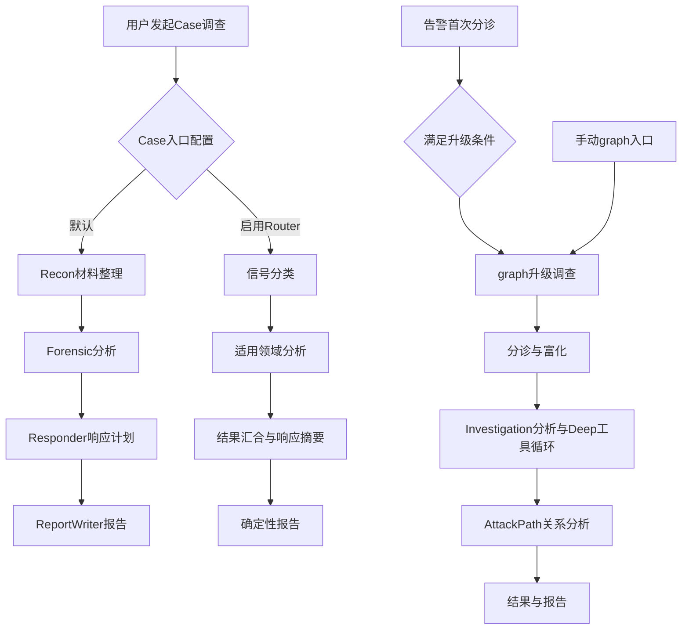
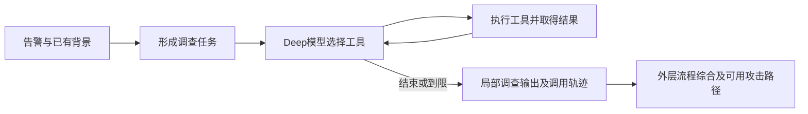

# 开源版本实现

本页说明参考的AiSOC开源版本怎样执行调查。参照基线为固定提交 `34ca18c57dd4175539e5c6dd3d04a72dc057306b` 的已有源码审阅，见[源码与产品说明核对记录](investigation-design-review.md)。不是本轮重新核验的最新上游版本，也不是本项目当前部署状态。

我们的方案只在[调查模块最新设计](investigation-planning-design.md)维护；已经接通和仍缺的能力见[当前实现与差距](../design/investigation-design-current-gap-review-20261103.md)。

## 1. 三条实际路径

开源版本包含默认Case四阶段、可选领域Router、graph/Deep三条路径。默认Case入口在前两条中选择；graph另有告警自动升级和手动入口。不能将三条路径画成每次都会依次执行的一条流程。

图省略内部错误和早停支路。自动升级路径复用已完成的首次分诊，不表示每次再次执行同一分类。

## 2. 默认Case四阶段

| 阶段 | 接收什么 | 做什么 | 产出与限制 |
| --- | --- | --- | --- |
| Recon | Case/告警资料、可用共享背景和知识材料 | 整理线索、对象和有限增强 | 侦察材料；不是动态全案工具调查 |
| Forensic | 原始告警及前序资料 | 形成时间线、原因假设、范围等解释 | 分析产物；源码中的该阶段没有独立现场日志/图查询循环 |
| Responder | 前序分析 | 形成控制、清除、恢复建议及前提/风险 | dry-run响应计划，不是实际执行回执 |
| ReportWriter | 前序结构结果 | 生成可读报告 | 正常成功路径是另一轮模型生成；报告生成不保证每项判断有据 |

通常成功路径是四个串行应用层模型调用。这里的“手动调查”表示人发起自动分析，不表示四阶段分别由人复核。

## 3. 可选领域Router

Case入口的 `AISOC_INVESTIGATE_USE_ROUTER` 在默认四阶段和Router之间选择。Router识别信号，调用Phishing、Identity、Cloud、Insider等领域分支，然后汇合、生成响应摘要和报告；内部并行另有开关。

各领域分支主要进行专业材料分析，并不各自包含Recon→Forensic→Responder→Report的完整链，也没有各自的现场工具循环。领域提示词和字段投影有价值，但不能据此认为它自动具备Deep的主动补查能力。固定版本无匹配时可选择全部领域，不保证调用更少或质量更好。

## 4. graph与Deep

外层graph组织分诊、富化、调查和攻击路径等节点；Investigation阶段可调用Deep。Deep通过工具定义发起请求，接收实际返回后决定继续查什么或结束，受范围、迭代、时限和预算约束。

可用查询原语包括进程活动、历史执行、网络连接、认证事件、IOC搜索、实体时间线和技术活动。工具名称不等于能力可用：process_tree、mailbox_activity、oauth_grants、persistence_mechanisms在所核实现中为不可用占位。客户数据源和MCP能力是否可用取决于实际接入，不能只凭注册名算作已查。

## 5. 共享上下文与三个不同的“四”

| 名称 | 内容 | 作用 |
| --- | --- | --- |
| 四类上下文 | 图邻域、相似历史案件、UEBA基线、威胁情报 | 提供背景和来源材料 |
| 四领域 | Phishing、Identity、Cloud、Insider | 专业分析方向 |
| 四阶段职责 | Recon、Forensic、Responder、ReportWriter | 默认Case流程分工 |

共享ContextBundle还可包含事件/攻击背景及来源健康信息。材料被预取不表示每个后续模型收到所有字段，也不表示覆盖了全部Case成员；范围与实际投影需要单独核查。图可达、历史相似和情报命中也不自动成为攻击因果证明。

## 6. 用同一个问题理解三条路径

**示例，非实测结果：** 一条告警显示APP01执行脚本并外联，分析员想知道是不是正常维护。

| 路径 | 能做的工作 | 仍然需要注意什么 |
| --- | --- | --- |
| 默认Case四阶段 | 整理脚本/对象资料，分析维护或攻击假设，给出核验/响应计划，形成报告 | 没有新的认证/进程/批准材料时，四轮模型仍不能证明授权或外传 |
| Router | 按信号选择身份等领域，解释账号与行为背景，汇合专项发现 | 领域分析本身不等于主动取得现场证据；不要与完整四阶段产物混同 |
| graph/Deep | 根据问题查询实际进程、网络、认证等来源，按返回继续补证，再由外层流程综合 | 查询能力、返回字段和范围决定可回答程度；空结果不等于安全，工具轨迹不等于结论正确 |

本项目参考这些能力，但后续如何分配给告警、事件、Case、AI问答和人工跟进，以[我们的最新设计](investigation-planning-design.md)为准。对照重点是能力与数据，不推定开源版本已经完成我们定义的跨层交接、整案版本和多轮比较。

## 7. 输入怎样精简，对小模型到底有什么帮助

2026-11-04重新核对固定版本。以下7份使用的源码均按LF规范化后的Git blob与原1G导入清单匹配，详见[本次核对与体积实验](../operations/socai2-compact-input-measurement-20261104.json)。参考目录是`E:/aisoc/.reference-audits/AiSOC/34ca18c57dd4175539e5c6dd3d04a72dc057306b`；Identity原件不在该目录，使用仓库中与原导入blob一致的文件。当前Router报告文件与原blob不同，本次不以它补充新的上游源码结论；第3节确定性报告描述仍沿已有固定版本审阅。

| 已核固定源码 | 实际做法 | 对本项目的取舍 |
| --- | --- | --- |
| `prompt_serialization.py` | 用浅层key/value文本代替整份嵌套对象；默认40行/2层，标量400字符，列表限前几项 | 借鉴浅层且按语义组织；不照搬按字母/位置截取或直接切命令行。短输入也可能漏掉唯一关键字段 |
| `context/bundle.py::prompt_context_lines` | 从白名单摘要生成背景行：实体、图邻域、历史相似、UEBA、TI；历史判定只展示至多3条；保留背景失败/未知说明 | 库内完整材料与本次模型视图分离；已有判断和背景有独立角色，不能当独立观察 |
| `agents/identity_agent.py::_build_identity_context` | 优先用户名、IP、位置、设备、认证方式、MFA、登录、权限变化；额外字段至多8个 | 按当前问题选字段，比把全部告警/库表字段一次展开更适合专项任务 |
| 同文件`_parse_response`及`run_identity` | 一次调用主要返回verdict/confidence/identity_indicators/attack_type/rationale五项，输出上限768 tokens | 小任务、短输出值得借鉴。其解析可去代码围栏、截取JSON，非法判定默认true_positive、缺分默认0.5；这些是容错或替代值，不能证明模型正确，不照搬默认判断 |
| `investigator/forensic_agent.py` | 告警与Recon摘要分别限2000字符；原始资料80行/3层；增强只取前10项、40行/2层；一次只做取证解释 | 任务内只携带需要的前序产物。完整原始材料仍须保留；不要把经过截取的输入称为全量读取 |
| `investigator/report_writer_agent.py` | 拼接前序短摘要；时间线用数量、artefacts前10项、响应步骤每类前5项，增强仅样本 | 展示整理和调查推理应分开。不能将样本数量当全部覆盖，也不能把最后一轮写作当独立核实 |
| `investigator/limits.py` | 默认2048输出上限；注释记录qwen2.5:0.5b曾输出40960 tokens并耗时约20分钟，因而加输出边界 | 上限解决失控耗时，不保证分析质量。注释所述语料中Recon/Forensic/Responder约200–400、报告最大876 tokens，是上游记录，非本次复测 |
| `orchestrator/router.py` | 分类后选择领域，领域分别分析再汇合；拓扑测试明确使用mock子节点，生产并行需另看eval | 借鉴职责拆分，不将mock测试、流程完成或多Agent数当真实小模型质量证据 |

**没有找到“保证小模型正确输出”的机制或本次可核验的全面质量结果。** 上游既靠输入选择与任务拆分降低负担，也靠宽松解析/默认值让部分失败继续返回；两者必须区分。Forensic原件还明确记录无原始材料时曾编造文件，并添加无证据交接。我们应学习精简合同和阶段职责，保留来源/范围校验，不能通过弱化判定或吞掉失败制造通过率。

### 本项目可先做的无损精简

离线读取r4/r5实际I请求，按成员和角色分组：一组只写一次成员UUID及来源角色，每个字段仍保留原id、字段名、完整原值。展开后与全部原items逐项一致，未删检测标签、未裁剪事实，也未摘要已有分诊。

| 固定输入 | 原模型数据视图 | 仅合并重复元数据 | 减少 | 再补回漏传的764字节同次分诊 |
| --- | ---: | ---: | ---: | ---: |
| r4 I，29项 | 7860 B | 6232 B | 20.71% | 7136 B |
| r5 I，28项 | 7960 B | 6406 B | 19.52% | 7310 B |

两份恢复后的视图均低于原7936 B预留线。原完整请求分别13340/13684 B，其中Schema为2590/2762 B、system文字1650/1742 B；**精简也要覆盖Schema和重复指令，不能只盯原始材料。** 这些是UTF-8字节数，不是token降幅；新增可见性元数据、正式提示、guard和实际质量仍待验证。本次0模型/DB调用，原件hash保持，实验没有发布为生产输入。

具体采用方案统一放在[主设计4.3节](investigation-planning-design.md#43-模型输入与输出精简)，不另起一套调查架构。
