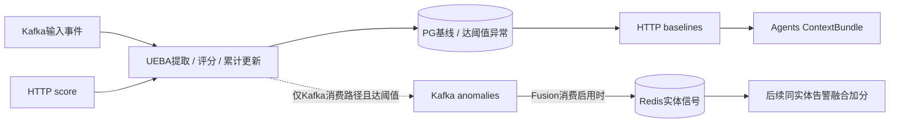

# UEBA：输入什么、如何纳入计算、怎样交接结果

**真实联合验证已补齐（2026-10-21）：** 本地运行原UEBA/Fusion源码，借用21真实PG/Redis/Kafka，3条真实异常及5个告警对照均通过，详见[第5节](#5-本地真实联合验证异常带来了什么改变)。本地进程已停止，只保留本地验证版本和回执；常驻开关仍关闭，按用户要求阶段统一发布，本批未部署21。下面18项是此前内存边界验证，保留原证明范围。

**2026-10-21联动验证更新：** 按用户要求已运行8个UEBA→Fusion评分例子，连同原10项信号测试共18项通过；开启/关闭、加分规则及实际结果见[第4节](#4-ueba与fusion联动评分开关及实测例子)。验证运行原处理模块，基础设施为内存替身；未改21常驻开关，未发正式消息或模型，不代替真实UEBA异常生成及broker接缝验收。

2026-10-21。本说明按固定上游 `34ca18c57dd4175539e5c6dd3d04a72dc057306b` 及当前迁入源码整理，属于[逐模块路线](../operations/module-review-plan.md)的首个共享支撑模块。用户已确认沿原码，由上游决定向UEBA提供哪些实体的数据；本批不新增实体启停策略或真正滑动窗口，默认参数和累计算法保留。本次写明合同，并用原提取器核对下面两种Kafka JSON；没有发送样例、修改业务源码、新建或运行测试套件、启动服务或调用模型。

复用[09 UEBA源码分析](../anal/09-ueba.md)和[full配套回执](../operations/full-support-migration.md)；09中的早期范围说明不是当前运行状态，实际迁入及基本运行以full回执为准。UEBA提供行为偏离参考，不直接判定恶意、关闭告警或创建Case。

## 1. 针对谁计算，怎样触发和配置

原版没有“先登记某账号/主机/IP才能参加”的配置表，也没有按tenant或实体名单启停的接口。服务启动后消费配置的输入topic；收到可提取实体和数值特征的消息，就按 `tenant_id + entity_type + entity_id` 查找或建立基线并计算。不同事件类型仍使用该实体的同一基线，`event_type`不是基线分区键。上游可以选择投喂范围，但这是生产者的选择，不是UEBA内已有的名单策略。

| 入口 | 谁决定实体 | 原代码规则 |
| --- | --- | --- |
| Kafka规范化事件 | UEBA自动提取 | 固定优先 **user → device → ip**，每条只选一个；同一事件出现账号、主机和IP时不会自动给三者各建基线 |
| Kafka预提取事件 | 上游生产者 | 提供`entity_type/entity_id/features`；`entity_type`缺失时默认user，类型按字符串接收 |
| HTTP `/score` | 调用方 | 显式提供实体；类型限`user/device/ip/service_account/ai_agent/mcp_server` |

代码：[实体字段与优先级](../../services/ueba/app/services/feature_extraction.py)第55–58、161–178行，[预提取入口](../../services/ueba/app/services/feature_extraction.py)第217–251行，[HTTP类型](../../services/ueba/app/api/routes.py)第73–84行，[基线键](../../services/ueba/app/services/baseline.py)第132–158行。normalized路径不会自动把服务账号识别成`service_account`；需要显式实体类型时使用原预提取或HTTP合同。

参数来自进程级[Settings](../../services/ueba/app/core/config.py)，支持下表名称及对应`UEBA_`前缀别名，当前没有逐租户/逐实体覆盖：

| 参数 | 源码默认 | 实际含义 |
| --- | --- | --- |
| `MIN_BASELINE_SAMPLES` | 30 | 每项特征至少已有30次观测才能计算个人z-score；不是所有特征共用一个总样本数 |
| `ANOMALY_THRESHOLD` | 3.0 | 综合偏离达到该值才保存异常；high≥4、critical≥6为代码固定分界 |
| `BASELINE_WINDOW_DAYS` | 30 | 仅新建基线时填写`window_start=处理时间−30天`；后续累计统计并推进`window_end`，**不淘汰过期样本**，不是实际只保留最近30天的滚动计算 |
| `PEER_GROUP_MIN_SIZE` | 3 | 可选peer分支的观测数门槛；不等于三个不同实体，后续特征z-score仍使用原样本门槛。本批不展开peer专项 |

事件中的时间用于提取小时、星期等特征，不负责控制基线样本过期。ISO时间按其解析出的时区取小时，epoch时间转UTC；原代码没有额外业务时区配置。[时间提取](../../services/ueba/app/services/feature_extraction.py)第141–158行、[累计更新](../../services/ueba/app/services/baseline.py)第146–178行。`SCORING_BATCH_SIZE=100`虽有声明，当前逐消息评分路径没有读取它，不能当作已生效的批处理或触发频率设置。

现部署沿[compose.ueba.yml](../../deploy/aisoc21/compose.ueba.yml)：容器内8004，21仅loopback `18006`，原入口`uvicorn app.main:app`启动Kafka消费者。必需依赖是PG和Kafka/TLS，不需要LLM、embedding或Redis。PG原4份迁移已到`0004`，版本表为`alembic_version_ueba`；不因阅读本说明重做迁移或启动。

| 配置 | 上游默认 | full回执中的项目接线 |
| --- | --- | --- |
| `DATABASE_URL` | 原服务PG DSN | 项目PG，TLS verify-full；只记录受控位置，不复制凭据 |
| `KAFKA_INPUT_TOPIC` | `aisoc.raw_events` | `socai2.raw_events.v1` |
| `KAFKA_OUTPUT_TOPIC` | `ueba.anomalies` | `socai2.ueba.anomalies.v1` |
| `KAFKA_CONSUMER_GROUP` | `ueba-service` | `socai2.ueba.v1` |
| HTTP身份 | 原服务认证及tenant scope | Bearer服务token和`X-AiSOC-Tenant-ID`；Agents使用`AISOC_UEBA_URL`与`AISOC_UEBA_SERVICE_TOKEN` |

受控配置位于21的`/opt/sting-aisoc-socai2/private/ueba.env`、`ueba-migrate.env`、`agents-ueba.env`。此处接线来自[已有JSON回执](../operations/full-support-migration.json)，不是本次重新读取运行环境后的确认。

## 2. 什么格式发入，就会纳入计算

以下是三种原码支持的输入方式，互为替代示例，**不是要求将同一观测发送三遍**。示例tenant UUID需替换成已授权的实际租户；事件ID也应来自上游真实事件。这些JSON仅作合同说明，本文未发送。

### Kafka方式A：已有规范化事件

将JSON写到当前输入topic `socai2.raw_events.v1`。这里故意用原提取器支持的`raw_data`对象保存厂商字段：

```json
{
  "schema_version": "v1",
  "event_id": "11111111-1111-4111-8111-111111111111",
  "tenant_id": "00000000-0000-4000-8000-000000000001",
  "ocsf_event": {
    "class_uid": 3002,
    "class_name": "Authentication",
    "time": "2026-10-21T08:00:00Z",
    "raw_data": {
      "username": "alice",
      "timestamp": "2026-10-21T08:00:00Z",
      "event_type": "authentication",
      "outcome": "success",
      "bytes_sent": 1024
    }
  }
}
```

按当前函数，该输入选中`user:alice`，可提取`hour_of_day=8`、`day_of_week=2`、`is_failure=0`、`bytes_sent=1024`，并进入评分和基线更新。`raw_data`也可以是含同样对象的JSON字符串。缺实体或没有可提取数值特征时跳过；没有“必须高危/发生异常才学习”的条件。

允许提取的原字段见[feature_extraction.py](../../services/ueba/app/services/feature_extraction.py)第37–58、76–111、192–214行：包括小时/星期、结果、severity，以及bytes、duration、file/request/response size、packets等单事件数值。它不会从一条登录事件自行得出“十分钟失败23次”；该频次若由上游计算，应通过预提取特征传入。

### Kafka方式B：原兼容合同，上游已提取实体与特征

UEBA本身也接受下面的原预提取合同，但**不要把它作为纯消息直接投到当前共享的`socai2.raw_events.v1`**。Fusion也订阅该topic，其[信封校验](../../services/fusion/app/services/event_schema.py)第74–105行要求`ocsf_event`对象；只有顶层`features`的消息会被Fusion判为坏schema并进入DLQ。当前共享topic使用方式A；若未来独立上游需要预提取合同，再按输入topic规划，本批不改topic。

```json
{
  "event_id": "22222222-2222-4222-8222-222222222222",
  "tenant_id": "00000000-0000-4000-8000-000000000001",
  "entity_type": "user",
  "entity_id": "alice",
  "event_type": "authentication",
  "features": {
    "login_count": 3,
    "bytes_sent": 1024
  }
}
```

顶层`features`是对象时优先选择该分支，不再按normalized事件自动提取实体。`features`的数值由上游负责定义和计算，不能把这里的`login_count=3`当成UEBA自动统计的登录次数。有效数字或可转数字的字符串被保留，bool不作数值；没有有效特征则跳过。可选`peer_group_id`由上游指定，原版不自动识别HR同岗群体。

**来源字段不能混写：** 预提取Kafka只读取原消息的`event_id`，映射成内部`source_event_id`；仅发送顶层`source_event_id`不会被该分支采用。normalized分支依次取顶层`event_id`、`ocsf_event.uid`或恢复字段中的`event_id`。两者都不是把内部`ExtractedEvent`字段原样当作消息schema。[实际转换](../../services/ueba/app/services/feature_extraction.py)第241–250、289–296行。

### HTTP方式：显式评分一条观测

`POST /api/v1/ueba/score`，携服务Bearer及`X-AiSOC-Tenant-ID`，正文tenant必须在该身份作用域内：

```json
{
  "tenant_id": "00000000-0000-4000-8000-000000000001",
  "entity_type": "user",
  "entity_id": "alice",
  "event_type": "authentication",
  "features": {
    "login_count": 3,
    "bytes_sent": 1024
  },
  "source_event_id": "33333333-3333-4333-8333-333333333333"
}
```

HTTP才直接使用`source_event_id`，可选`peer_group_id`。该入口调用同一评分服务并更新PG；返回异常对象或`null`，**不发布Kafka异常消息**。[请求及执行](../../services/ueba/app/api/routes.py)第77–84、121–136行。

### 输出、存储及“没有数据”的区别

| 落点/接口 | 实际字段与意义 |
| --- | --- |
| PG `ueba_entity_baselines` | tenant、entity_type、entity_id、每项特征`mean/M2/std/count`、window_start/window_end等；收到可评分输入即建立或更新 |
| PG `ueba_anomalies` | 达阈值时保存实体、event_type、source_event_id、anomaly_score、risk_level、逐特征`value/mean/std/z_score`、可选peer和detected_at |
| PG `ueba_peer_groups` | 原可选群体统计；本批保留，不新增群体配置或专项 |
| `GET /api/v1/ueba/baselines` | 认证后按tenant、可选entity_type读取；返回id、tenant、实体、feature_stats、window_start/window_end，无实时deviation_score。当前没有entity_id查询参数 |
| `POST /score`及`GET /anomalies` | 异常对象使用`id`；含实体、事件类型、score/risk、逐特征资料、peer、detected_at、acknowledged。当前响应schema没有暴露PG的source_event_id |
| Kafka异常输出 | Kafka消费路径达阈值才发布：`anomaly_id/tenant_id/entity_type/entity_id/event_type/anomaly_score/risk_level/features/peer_group_id/peer_deviation_score/detected_at`；当前payload未带PG的source_event_id |

模型及输出分别见[models/ueba.py](../../services/ueba/app/models/ueba.py)、[HTTP响应](../../services/ueba/app/api/routes.py)第87–113行、[消息发布](../../services/ueba/app/services/kafka_consumer.py)第137–172行。

查询成功返回`[]`表示过滤范围没有匹配记录。`/score`返回`null`只表示本次没有产生异常，可能是样本不足、零方差或有效综合分未达阈值，不能单凭null认定正常。无可用历史/样本不足/零方差时，特征z-score为`null`；全不可评分时内部RSS为0且不生成异常，这个内部数值不代表已验证安全。认证失败、请求失败与成功未匹配分别处理，不能互换。

### 下游两条交接



1. **给Fusion的异常消息。** 原Fusion按tenant与user/device/ip缓存最新信号，后续告警按username、hostname及src/dst IP匹配并增加confidence/anomaly与解释因子；异常本身不自动创建Alert，也不自动回算旧告警。需要`AISOC_UEBA_FUSION_ENABLED`和异常topic接线。仓内早期值为false，full overlay只改topic，现无“异常输出→实际Fusion加分”的运行证据，不从UEBA服务健康推导该交接已验。[缓存/加分](../../services/fusion/app/services/ueba_signal.py)、[原配置](../../deploy/aisoc21/kafka-resources.json)、[新overlay](../../deploy/aisoc21/compose.full-support.yml)。
2. **给Agents的HTTP基线。** `ContextBundleBuilder._fetch_baselines`携服务身份与tenant读取baselines，将host映射device、email映射user，再按entity_id选中记录，保留feature_stats与window跨度；缺deviation保持`null`。这是当前已验接缝，不是实时偏离计算，也不能把返回的窗口跨度当作真实滚动保留周期。[实际调用](../../services/agents/app/context/bundle.py)第747–820行。

## 3. 基线与偏离怎样计算

每个实体的每个特征保存观测次数`n`、均值`mean`、平方偏差累计`M2`及样本标准差`std`。Welford只需更新这些统计量，不保存全量历史观测来重算；这也解释了当前实现为何没有按30天移除老样本。

```text
收到新值 x，先用旧基线评分：z = abs(x - mean) / std
再更新：
  n' = n + 1
  mean' = mean + (x - mean) / n'
  M2' = M2 + (x - mean) * (x - mean')
  std' = sqrt(M2' / (n' - 1))
多个有效特征：RSS = min(sqrt(z1² + z2² + ...), 10)
```

只作算术说明、不是新增测试：假设某实体的两项特征均已达到原30样本门槛，第一项均值100、标准差10，新值130，得到`z1=3`；第二项均值50、标准差5，新值60，得到`z2=2`。无peer输入时综合分`√(3²+2²)≈3.61`，达到默认3但低于4，生成medium异常。第一项随后更新为count31、mean约100.97、std约11.21；异常解释仍记录本次评分所用的旧均值100/std10。[Welford/z-score](../../services/ueba/app/services/baseline.py)第25–120行、[评分先于更新](../../services/ueba/app/services/scoring.py)第75–113行。

若只来第一条观测，count会变为1；没有足够旧样本，z仍未知，不套用上述3.61示例。peer存在且可评分时原代码将个人RSS与peer分取平均；本批不改该算法，peer时序和样本等既有边界复用[原分析](../anal/09-ueba.md)与[问题登记](../operations/upstream-issues.md)，不新增专项。

## 证据复用与当前收口

| 已有材料 | 可复用结论 | 不能外推 |
| --- | --- | --- |
| full回执：原UEBA122项、接缝7项测试 | 原模块及Agents必要认证/字段接线的既有结果 | 不是本次重跑或新增通过数 |
| 原HTTP `/score`→PG→baselines | 一条观测实际建立count1基线，HTTP可取回；返回null | 不证明成熟基线或异常质量 |
| 唯一规范化事件经原Kafka消费者 | 四项统计count1，其中bytes_sent.mean=1024；无异常 | 不证明30样本后的异常输出或长期行为效果 |
| 常驻Agents实际认证读取该实体 | feature_stats透传，deviation=null，0模型调用 | 不证明模型已使用偏离形成正确结论 |

证据入口为[full Markdown回执](../operations/full-support-migration.md)及其[JSON](../operations/full-support-migration.json)。现有测试不删除、不改写、不重复运行。新增说明的3个JSON语法有效，2个Kafka样例经原extract接受：规范化样例得到user:alice及上述4项特征，预提取样例得到login_count/bytes_sent，来源均来自event_id。这只是零服务的代表解析核对，不是新PG写入、消息发布、HTTP或整链验收。

触发合同交接阶段沿原码保留实体选择、30样本/阈值3及累计统计，当时尚缺“真实达阈值异常→原输出topic→Fusion同实体新告警采用”的直接证据。现已按第5节补齐本地进程＋21专用真实基础设施接缝；这不等于21正式常驻已开启或成熟画像质量通过。来源引用缺口、HA、退出、恢复及peer专项均沿[既有登记](../operations/upstream-issues.md)后置，不新建任务或验收框架。

## 4. UEBA与Fusion联动评分：开关及实测例子

本次补的是上节未覆盖的模块联动验证：原FusionWorker接收异常消息→UebaSignalCache按tenant/实体缓存→已有告警走原去重/关联/ML启发式/置信度→UEBA加分→保存/发布结果。Redis、PG及Kafka交付使用B1原内存替身；不启动服务，不向项目topic发消息，不训练模型，不重做UEBA基线。这证明原模块接线和评分结果，不等于真实broker传输或成熟基线异常质量通过。

### 怎样匹配和加分

Fusion将告警username→UEBA user、hostname→device、源/目标IP→ip，按tenant查对应缓存；实体类型和值均转小写。多个实体命中时只取最高risk_level的一项，不累加；同等级取先查到的一项。**原始anomaly_score（如4.7）只用于说明；加分和异常分下限由risk_level决定。**

| UEBA risk_level | confidence直接增量 | Fusion anomaly_score下限 |
| --- | ---: | ---: |
| medium | +0.07 | 0.45 |
| high | +0.14 | 0.75 |
| critical | +0.20 | 1.00 |
| low（兼容消息边界） | +0 | 0.20 |

公式是`confidence=min(1,原confidence+增量)`、`anomaly=max(原anomaly,等级下限)`。有正增量时重新计算confidence标签（HIGH≥0.70，LOW<0.40）；priority、severity、原上游risk_score不变。不重算前面的整个基础置信度公式，也不将展示factor的contribution×weight误当作实际增量。原UEBA默认只有达到异常阈值才发布，实际至少medium；low不是本次新增的真实异常生成样例。

### 如何开启和关闭

Fusion读以下环境变量，UEBA输出topic必须与Fusion输入一致：

```yaml
services:
  fusion:
    environment:
      AISOC_UEBA_FUSION_ENABLED: "true"
      KAFKA_TOPIC_UEBA_ANOMALIES: socai2.ueba.anomalies.v1
      AISOC_UEBA_SIGNAL_TTL_SECONDS: "86400"
  ueba:
    environment:
      KAFKA_OUTPUT_TOPIC: socai2.ueba.anomalies.v1
```

- **开启：** Fusion的`AISOC_UEBA_FUSION_ENABLED=true`。启动装配同时给consumer和engine接cache，因此消费异常topic并在后续告警评分时查询。
- **关闭：** 将上述Fusion值改为`"false"`。Fusion不订阅该异常topic，也不查询/应用该缓存；不会停止UEBA本身的基线/评分，也不影响Agents读取UEBA HTTP结果。已有缓存不被主动删除。
- **有效期：** `AISOC_UEBA_SIGNAL_TTL_SECONDS`默认86400秒，即从缓存写入起24小时；它不是UEBA基线窗口。该配置不改变+.07/+.14/+.20，这些增量是源码常量。
- **应用配置：** 变量在进程启动时读取。21沿用[操作说明](../../deploy/aisoc21/README.md)的全部现有Compose层，将本节示例作为最后的override追加，再对fusion执行`up -d --no-deps --pull never fusion`以重建并加载环境；若也改UEBA输出topic，再同法重建ueba。仅重启旧容器不会更新其创建时的环境。凭据、Kafka TLS和原连接参数沿原配置保留。

21在本次验证前只读确认开关为`false`、TTL=86400；现有[full overlay](../../deploy/aisoc21/compose.full-support.yml)指定topic=`socai2.ueba.anomalies.v1`。本次保持原配置。源码缺配置时默认true，因此部署时应显式声明所需值。本节给出操作方法，没有执行常驻开启或重建。

**先后顺序：** 先收到异常并缓存，后处理匹配的新告警才会加分。HTTP `POST /api/v1/ueba/score`只返回/保存评分，不发布Kafka异常；原Kafka consumer才发布。晚到的异常、开关改变或重复提交已有告警不会自动重算其首次结果。同实体后收到的异常覆盖缓存，正常事件没有清除旧异常的消息；重新开启时仍可能使用TTL内旧缓存。缓存未保留anomaly_id/source_event_id/detected_at，精确源异常追溯仍是既有登记项，本次不改。

### 8个实际运行例子

共同告警：high、username=`ueba-link-alice`、hostname=`UEBA-LINK-H1`、src_ip=`192.0.2.10`、一个technique、首tactic execution、上游risk=0.5，没有file_hash/目标IP/domain/url。各例独立内存状态；原ML未训练、无外部增强/漏洞/历史prior，基础confidence=0.656/MEDIUM、anomaly=0.15、priority=1.00。

| 实际例子 | 最终confidence | 标签 | 最终anomaly | UEBA说明项 |
| --- | ---: | --- | ---: | --- |
| 关闭，缓存中已有同用户critical | 0.656 | MEDIUM | 0.15 | 无 |
| 开启但无信号 | 0.656 | MEDIUM | 0.15 | 无 |
| 开启，同用户medium（原分3.5） | 0.726 | HIGH | 0.45 | user，1项 |
| 开启，同用户high（原分4.7） | 0.796 | HIGH | 0.75 | user，1项 |
| 开启，同用户critical（原分6.2） | 0.856 | HIGH | 1.00 | user，1项 |
| 开启，用户medium＋主机critical | 0.856 | HIGH | 1.00 | 只取device，1项 |
| 开启，critical属于另一tenant同名用户 | 0.656 | MEDIUM | 0.15 | 无 |
| 开启，critical属于同tenant另一用户 | 0.656 | MEDIUM | 0.15 | 无 |

每例同时断言priority=1.00、原risk=0.5、severity/来源身份保持，内存保存快照和发布信封的分数一致。8个新例加原10项信号测试共**18 passed，0.34秒**；原代码23个utcnow弃用警告保留，未为此改业务代码。原10例没有改删，现有UEBA122项未重复执行。

测试：[联动例子](../../services/fusion/tests/test_ueba_fusion_link.py)、[原信号测试](../../services/fusion/tests/test_ueba_signal.py)；实际行结果、依赖版本与边界见[JSON回执](../handoff/ueba-fusion-examples-20261021.json)。首次本地测试因新增用例导入辅助夹具的路径错误而收集失败，改为包内相对导入后18项通过；原失败日志保留在.local。向21上传源码的原计划被自动审批拒绝，未执行；最终全部在本地临时venv完成，没有源码上传或运行改动。本批未做TTL过期、重启恢复、broker或长期基线测试，也未勾整体迁移完成。

## 5. 本地真实联合验证：异常带来了什么改变

按用户要求在**本地**运行两个原服务进程，连接**21真实PostgreSQL、Redis、Kafka**；无需把每次更新发布到21。运行ID=`1c84658ebb88`，使用既有测试tenant A、3个全新user实体、5个专用topic及3个新消费组；不使用常驻topic/group，不启动Agents或模型。

原BaselineService.update为每个实体录入30次bytes_sent（80/120交替），实际PG统计均为count30、mean100、M2=12000、std≈20.3419。这是直接调用原服务类准备的真实数据库基线，不称为90条Kafka学习事件。随后各只向专用输入topic发送一条偏离观测：

| UEBA实际输入bytes_sent | 旧基线上的真实z/RSS | 原UEBA实际生成等级 |
| ---: | ---: | --- |
| 171 | 3.4903 | medium |
| 192 | 4.5227 | high |
| 232 | 6.4891 | critical |

三个原Kafka消费结果均实际保存为PG异常，并由原UEBA生产者发送到本批异常topic；核对PG的source_event_id/anomaly_id与消息一致。Fusion原consumer实际消费并写入真实Redis缓存，之后再输入同实体的新告警。评分后原consumer实际写PG首次快照并发布fused，独立读取快照与消息核对一致。最终各基线count31，未降低30样本门槛或阈值3，也未手写假异常。

### 有无异常的实测对照

评分字段与第4节一致，实体和source ID使用本批唯一值。各对照使用新的来源告警ID，避免复用同一canonical告警的首次快照；不是反复修改同一条历史告警。为隔离UEBA影响，本地测试关闭RBA、候选链、历史prior和外部增强，其余基础评分相同。

| 条件 | Fusion置信度 | 相对基准变化 | Fusion异常分 | 置信度标签 | PG告警confidence（0—100） |
| --- | ---: | ---: | ---: | --- | ---: |
| 开启，但没有异常信号 | 0.656 | 0 | 0.15 | MEDIUM | 66 |
| 同用户medium异常 | 0.726 | +0.07 | 0.45 | HIGH | 73 |
| 同用户high异常 | 0.796 | +0.14 | 0.75 | HIGH | 80 |
| 同用户critical异常 | 0.856 | +0.20 | 1.00 | HIGH | 86 |
| 关闭联动，先前已缓存critical | 0.656 | 0 | 0.15 | MEDIUM | 66 |

5个实际告警的priority均保持1.00，上游risk_score保持0.5、severity仍high、PG状态仍new。新增的`ueba_anomaly`理由记录实体、等级及原UEBA分。**因此改变的是检测置信度、异常程度及对应解释；没有将原严重度改成critical，没有自动关闭、创建调查或响应。** HIGH是Fusion置信度标签，不能当作确认入侵概率或下游处置决定。

数据与坐标见[真实联合JSON回执](../handoff/ueba-fusion-joint-20261021.json)，一次性可审查操作见[本地验证脚本](../../deploy/aisoc21/probe_ueba_fusion_joint.py)。本次源码一直留在本地，两个进程均已正常停止，21仅保留本次独立合成数据；topic按本批24小时保留期配置。没有修改21常驻容器/开关、正式group、旧unknown或积压，没有调用模型。真实联合结果补充第4节隔离测试，未重跑或改写旧结果；服务可用性专项继续后置。
