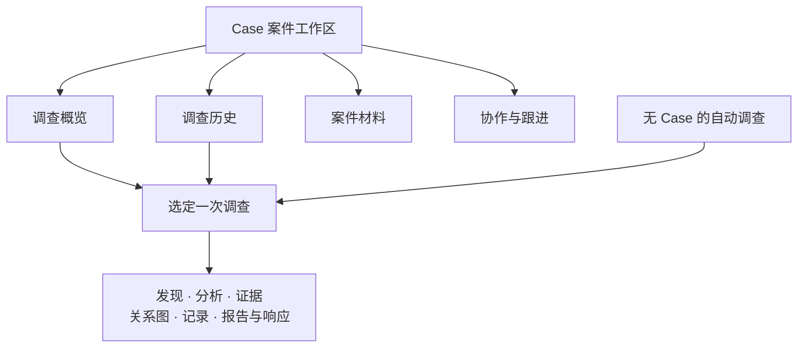

> 历史讨论与技术变更记录。当前产品定义请读[告警 事件与调查产品需求说明](alert-incident-case-product-requirements.md)；下列日期记录仅用于追溯，不并列作为当前页面规范。

> **当前入口（2026-11-02）：** [最新页面与完整样例、AiSOC案例清单](../../prototypes/security-pages-v2/README.md)。历史设计及页面已保存；最新数据对照与完整样例见第26节，已落实的统一Case概览和调查阅读联动见第34节，Case材料、成员添加、调查准备、人工跟进及响应审阅见第35节，默认案件资料入口及右侧ATT&CK卡片见第36节。第31节为整体结构建议，第32节生命周期、结案和多轮规则仍是讨论稿；第33节保留实施前局部示意，第27—30节保留依据。10月28/29日的来源横幅和分类页签已撤下，旧说明不再约束当前展示。

# 事件页与 AI 调查工作区：功能划分、展示内容和数据依据

**最新续接（2026-10-29）：** 用户要求将无后台Case但已有的调查材料补齐到Case工作区，已追加3个明确的本地集合及案件汇总/证据/来源活动，见[第19节](#19-2026-10-29将已有材料补入本地-case-工作区)。事件及单Run的同步见第18节，修改前字段盘点见第17节。使用10月25日保存结果，保留源归属、原样例和V1，未新建后台Case或执行新调查。

更新：2026-10-25。本文按用户已确认的划分分析：**事件页汇聚告警及调查输入，调查工作区展示 AI 实际开展的分析、进展和交付结果。** 调查工作区指整个 Case 工作区及其中的调查详情，不仅是事件里的“调查”页签。本轮只形成文档，前端、交接包、后端和运行配置均不改。

socai2 是能力基线，20 原版 AiSOC 作只读参考。用户后续“20应该可以访”已恢复20参考范围；之前微软复刻阶段“先不管20”仍作为那一批的历史边界。Attack Chain、Attack Path、Alert Graph 和 Blast Radius 均单独核对，不因页面尚未接入就判定服务或数据不存在。

## 1. 两页最核心的差别

| 对比 | 事件页 | 调查工作区 |
| --- | --- | --- |
| 回答的问题 | 有哪些告警，它们涉及谁、何时发生、为什么关联？ | 这次调查查了什么、得到什么判断、依据是什么、还有什么没查到？ |
| 主对象 | 事件及其成员告警、已有实体和来源材料 | Case 工作上下文，以及选定的一次调查 Run |
| 主要材料 | 原始告警、检测/融合资料、已有增强、关联图、来源证据 | 当次输入、工具查询、模型输出、采用材料、结论、停止原因和报告 |
| 图的主要含义 | 当前已知关联，供人理解和选择调查范围 | 本次运行保存的关系材料，以及实际做出的路径/影响分析 |
| 时间视角 | 事件当前材料与业务发生时间 | 运行开始/结束、步骤时间、材料查询时间及版本 |
| 主要操作 | 查看来源、筛选聚焦、管理事件、创建/关联调查、进入已有调查 | 切换 Run、核查步骤/工具/证据、审阅结果、接手未完成工作 |
| 调查开始之后 | 继续保留告警和上下文，增加调查摘要及入口 | 承载完整分析过程，避免在事件页再复制一套过程与报告 |

这里的“调查前”是页面职责，**不是调查开始后把事件页冻结或清空**。后续新到告警仍属事件资料；是否纳入某次调查，必须查该 Run 的输入。当前也不能保证能还原任意“启动前一秒”的完整事件快照。

事件材料可以包含成员告警已有的自动分诊、Explain 或厂商调查结果。它们是带来源的既有输入，不自动成为“AI 已对整个事件完成调查”的结论。无需为了分两页而隐藏这些信息。

### 1.1 什么才算进入调查

创建 Case、关联告警、分配负责人、收到启动按钮点击，均不证明调查已执行。普通 Kafka Run 也先承载分诊，随后才可能在同一 Run 升级 Graph 调查。

人工入口应核对成功启动回执及后续运行记录；自动入口核对实际升级/Graph 执行记录。只有分诊记录时，显示分诊结果和“未见后续调查记录”，不能仅凭 Run 存在显示“调查完成”。当前样例用 `graph_step` 等记录证明曾进入调查；这不是要求未来所有入口必须使用同一种事件名称。

Case 可以先建后启动；无 Case 的自动调查也可以查看。业务 Case ID、Fusion Incident ID、Run ID 和历史命名为 `investigation_runs.case_id` 的运行目标字符串必须分开，不能为打开自动调查强制补造 Case。

### 1.2 三种状态和几种评分必须并列解释

| 信息 | 实际来源及含义 | 展示要求 |
| --- | --- | --- |
| 业务状态 | Alert/Case 的处理状态；事件管理语义另需承接 | 谁在处理、是否关闭，不由 Run 结束自动改写 |
| Run 状态 | `investigation_runs.status/error/started_at/completed_at` | 本次运行记录的状态；自动路径还可能主要反映首次分诊落账 |
| 调查交付完整性 | `graph_result` **事件**的 `payload.completion` | `partial` 明示部分结果；缺字段显示未提供，不从报告存在推定完整 |
| 调查判定 | 同次 `graph_result` 工件的 `verdict/findings/confidence` | 与首次分诊判定分开；待复核不能改成确认恶意 |
| 首次分诊评分 | `triage_verdict.payload.confidence`，其告警投影 `alerts.ai_score` | 例如0.85按已确认规则显示85；不替换为Graph置信度 |
| 检测、关联和范围评分 | Fusion `alerts.confidence`、Chain `confidence/score`、`blast_radius_score` | 分别解释检测、候选关联、图可达范围，不能统一为恶意概率 |

## 2. 微软产品逻辑与本项目划分的关系

微软传统 Incident 和新版 Incident Case 都承载告警、实体、证据及调查上下文；新版增加更完整的工作管理。因此两页看起来很像有其产品原因，不能把微软直接解释为固定的“先事件、再 AI Case”两阶段。这个两页分工是本项目按用户目标作出的组织方式。[微软事件调查](https://learn.microsoft.com/en-us/defender-xdr/investigate-incidents)、[微软 Case 调查](https://learn.microsoft.com/en-us/defender-xdr/investigate-incident-cases)

微软图谱的筛选、布局和聚焦用于阅读已有材料；潜在传播分析另有数据与权限条件。socai2 可以借鉴“对象→关系→来源→动作”的交互，但不能因同叫 Attack Path 就宣称实现了微软的关键目标传播分析。Windows Security 日志可作为检测来源；本文参考的运营工作区是 Defender/Sentinel 门户体验，不是 Windows 桌面安全设置。

本轮重新在线读取上述两个官方页面成功；页面仍将 Incident Case 标为 Preview，并保留 legacy 体验。详细产品拆解见[微软产品与图谱交互分析](microsoft-incident-case-analysis.md)，该文大部分内容仍基于2026-10-24留存的官方PDF，本轮不追认其他章节全部经过最新在线复核。

## 3. 当前能力按什么证据认定

| 层次 | 已有内容 | 本文如何使用 |
| --- | --- | --- |
| 当前原型 | 事件/Case 列表、图谱、告警、资产、调查摘要、证据与响应、活动；Case任务/评论等 | 页面与交互基线。多数是本地样例/本地保存，不等于后端已接通 |
| socai2 v1 发布及回执 | Kafka分诊/自动升级、Case调查入口、Run事件/工件/报告、链图上下文和用量 | 当前可承接的调查能力；具体实值优先使用10月25日六条回执 |
| 本地后续小修 | 更完整的工具留存、校验和停止交接等 | 标明未随本批上线，不把本地源码全部当作21运行事实 |
| 独立调查 v2 / v4设计 | 问题、证据、分析判断、执行状态；告警侦察与Case调查profile | 后续页面方向。D1—M4限定成果、M5.1合同与M5.2未完成增量，不等于正式入口/完整流程已交付 |
| 20原版参考 | 自动处理详情、Case的investigation/attack-path/attack-chain/ledger/report组织 | 复用展示思想；其API、工件名及部署补丁不能直接套给21 |

**事件层有一个实质缺口：** 当前已核PG流程没有独立的 `incidents` 主表；Fusion分组保存在 `alerts.enrichment_data.socai2_fusion.incident_id` 等关联材料中。原型 `store.incidents` 及 `incidentId` 不能直接当生产字段。事件列表聚合、事件级名称/负责人/状态持久化及成员管理合同尚待对应后端承接；不能用 `aisoc_cases` 偷换事件，也不能把所有告警按时间接近自行分组。[表与关系说明](../integration/v1/table-fields.md)

## 4. 事件页逐项保留什么

下面“保留/调整”为分析建议，不表示已改页面。来源编号对应第9节；其中“已有源值、需事件聚合”与“整项待实现”分开表述。

| 编号 / 区域 | 保留的功能及具体展示 | 点击/操作意味着什么 | 来源与当前边界 |
| --- | --- | --- | --- |
| E01 事件列表 | 事件名称/标识、等级、处理状态、负责人、发生时间范围、告警数量；搜索筛选和预览 | 行预览看摘要，名称进入事件详情；筛选不改变成员 | S1；原型已有，事件聚合及管理字段尚无已验完整后端合同 |
| E02 详情头部 | 名称/ID、描述、等级、负责人、标签、时间、成员数量和处理状态 | 管理事件属性、进入成员及已有调查 | S1；描述为空留空，不自动生成整事件AI结论；事件等级如何汇总需明确规则 |
| E03 所含告警 | 每条名称、等级、发生时间、状态、检测源、战术、受影响对象和负责人；保留来源跳转 | 查看告警完整详情；仅筛选不增删成员 | S1/S2；同租户按明确成员关系取数，不能按Case关系替代 |
| E04 发生时间线 / 攻击故事 | 告警和有来源的观察按发生时间排列；选中项显示来源告警、时间、实体与原文 | 聚焦某条材料，联动图中相关节点 | S2；发生时间 `event_time`，不拿Run处理时间补成攻击行为；MITRE标签不是已验证阶段顺序 |
| E05 实体 / 资产 | 主机、账户、IP、文件等已有对象；类型、标识、关联告警数、已有风险/标签及来源 | 有真实资产ID才进资产详情；原始实体可打开其关联告警 | S2；本批六例原始实体存在但库存关联为0，不能伪造库存标签或把全部对象称为已攻陷 |
| E06 已有上下文 | 告警携带的IOC增强、身份/资产背景、检测/融合理由；每项显示值和来源/查询时间（若有） | 回看来源与已有查询结果 | S2/S6；没有资料、未查、查询失败分开；成员告警的上下文不自动覆盖全事件 |
| E07 已有分诊 / Explain | 成员告警首次判定、评分、解释正文和既有建议，清楚归属到具体告警 | 打开对应告警及解释；请求新Explain时沿已有调用语义 | S2/S3；正文保留，不强拆“待核实”等必填新字段；不将单告警解释命名为事件调查报告 |
| E08 当前关联图 | 告警与实体的节点/边、选中对象信息、关联来源、范围筛选 | 点击告警看详情；点击实体聚焦；点击边看关系类型及来源；布局只改变视觉 | S6；原型图与服务图不是同一数据集；事件级聚合尚未接入，不能直接把Case路径当整个事件图 |
| E09 Attack Chain | 种子告警、查询窗口、候选关联告警、时间、共享实体、距离及关联分数 | 点告警回原告警；点共享实体解释为什么关联；改窗口重新读取当前关联 | S6；已有Alert/Case服务。展示候选链，不代表已证实攻击过程；无事件ID直接接口，不能静默任选一个种子代表全事件 |
| E10 Attack Path / 范围入口 | 有合法Case关系时可引用其关联路径，显示路径归属、来源、节点/边；无Case仍可看Alert Graph | 进入关联Case路径或实体邻接/范围视图，不自动创建Case | S6；Case路径有范围条件，不作为每个事件必有内容；Blast Radius是可达候选，见第6节 |
| E11 概览统计 | 所含告警数量、等级/战术分布、涉及设备/账户、首末发生时间及来源分布 | 点统计回到构成该数值的材料 | S1/S2；需明确去重对象和统计范围。图上临时扩展的外部告警不得悄悄计入事件成员总数 |
| E12 相似 / 关联事件 | 候选事件、时间、等级、共享实体或其他实际关联依据 | 查看另一事件；切换关联视角只是扩展上下文 | S1/S6；当前原型按样例共享实体计算。全库事件检索/合并未接，候选不等于已并案 |
| E13 原始证据与响应摘要 | 原始日志/文件/IOC引用、来源告警、已有厂商处置结果；保留查验入口 | 回原文或已有执行记录；真实审批/执行须对应动作记录 | S2/S5；原型证据审批是演示。AI新增建议和执行细节以调查工作区为主，事件仅关联摘要 |
| E14 活动 | 分配、成员变更、管理状态、创建/关联调查、启动及关闭的实际记录 | 查看谁在何时做了什么，跳到相关Run/对象 | S1/S3/S7；业务活动与攻击发生时间线分开；没有日志不能用当前字段反推历史时间 |
| E15 调查入口与摘要 | 未启动/启动请求中/已有关联Run；Run的范围、时间、状态、完整性及简短结果 | 创建/关联Case与启动调查分别表达；进入选定Run查看过程 | S3；无Case自动Run可直接查看；事件成员的多个Run分别展示，不能拼成整事件单一结论 |
| E16 建议动作页签 | 保留查看既有建议的能力，并标清来源告警/厂商/Run | 进入建议来源或相应调查/响应记录 | S2/S5；建议将AI调查产生的详细建议主位置放调查页，事件只留摘要入口；不复制两套审批状态 |

事件的管理和关闭仍保留为业务能力，但当前原型“事件管理同步关联告警”和“Case关闭不关闭告警”只是已存在的本地交互。未来接后端前应确认级联规则，不能由本分析自动改变或追认该规则。

## 5. 调查工作区逐项增加、调整什么

原型已有基础材料与少量调查卡片，新增重点是让分析过程可核查。以下字段只在真实记录存在时展示；某种编排没有的阶段无需补卡片。

| 编号 / 区域 | 具体展示内容 | 用户要完成的判断或操作 | 来源 / 能力状态 |
| --- | --- | --- | --- |
| I01 调查列表 / Case入口 | Case名称/标识、负责人、状态、成员数、最新相关Run时间与结果摘要；可进入历史Run | 找到要接手的工作，区分无Run与已有运行 | S3/S7；Case管理可参考已有接口，无Case自动Run需要独立可达入口，不混入Case计数 |
| I02 Run选择 | Run ID、已知入口/编排、目标类型、起止时间、执行状态、完整性 | 切换某次尝试，所有过程/报告/工件随同切换 | S3；不是默认拿各表“最新一行”拼接；未存编排名时不根据标题猜测 |
| I03 本次调查输入 | 目标告警/Case、输入摘要、实际纳入的告警ID/原文、时间/实体范围、原始材料引用 | 核对AI究竟拿到了什么，比较Case成员与本次输入 | S3；读 `raw_alert` 等保存材料。当前Case启动路径有界取最多3条，不能声称查遍全部成员；完整冻结范围属于v2方向 |
| I04 执行与交付状态 | Run状态、Graph完整性、结论判定、开始/结束时间、最后记录时间 | 区分正在执行、已停但部分交付、完整交付和业务关闭 | S3/S4；不把 `completed`、`partial`、`needs_review`压成同一个状态 |
| I05 进度 / 最近步骤 | 已记录的阶段、时间、耗时（有值时）、最后完成节点、当前失败点 | 看实际做到哪里，决定等待还是接手 | S3；`graph_step`通常在节点完成时记录，不能据此显示“该节点正在执行”；动态流程不编造百分比 |
| I06 分诊与升级依据 | 初次判定、评分、理由、自动关闭标志、升级/后续执行记录 | 知道为什么进入调查，区分首次判断和后续复核 | S3/S4；同Run可能同时含两者，Graph结果不得静默覆盖首次分诊 |
| I07 阶段分析 | 自动Graph按实际triage/enrichment/investigation/attack_path展示；人工默认Recon/Forensic/Responder/Report按实际材料展示 | 展开该阶段输入、输出、错误和关联工件 | S3/S4；Router是替代路径，不硬套四节点；冷读不保证每阶段完整JSON都存在 |
| I08 Deep调查深度 | 策略、实际轮数、查询方向/转向、覆盖说明、截断、缺失数据、实际叙述 | 看调查是否深入、哪些问题仍缺证 | S4 `investigation_depth`；轮数/`reached_depth`不是完成百分比，也不证明所有查询成功 |
| I09 工具调用 | 工具名、实际参数、窗口/实体、返回摘要或原文、成功/空结果/失败/不可用、耗时与来源引用（存在时） | 看AI是否真正查到资料，而非只在报告里说查过 | S3/S4；v1样例 `tool_call`只有args和最多200字符preview，不能伪装成全量结果；本地完整留存小修未发布 |
| I10 来源与知识使用 | 组织记忆、技能、知识库、历史处置、身份资料、IOC增强的读取结果和实际采用引用 | 区分配置了、读到了、提供给模型、被结果引用 | S3/S4；出现来源工件只证明留存，不能自动声称推理采用或证据支持充分 |
| I11 发现 / 判断 | 原文findings、verdict、confidence及已有依据说明；区分观察、假设、建议 | 核查判断与输入是否一致，进入支持材料 | S4；目前未统一结构化“证据→发现→结论”合同。有文本展示文本，有引用展示引用，不补造引用链 |
| I12 Attack Chain快照 | 同Run保存的种子、窗口、候选链/共享实体、状态、查询时间和来源 | 还原当时提供给调查的关联线索，跳回告警 | S5/S6；与事件当前查询可不同；改变查看窗口不能覆盖Run原件 |
| I13 Attack Path快照与分析 | 同Run路径nodes/edges/source/fallback；实际attack_path步骤、findings和范围摘要（若执行） | 分清服务返回的关系图与程序/模型后来做的分析 | S4/S5/S6；有路径工件不代表该阶段必然运行；无Case可 `not_linked`，不能画假路径 |
| I14 Alert Graph / Blast Radius | 告警邻居、关系类型、可达实体、hop数、类型分布、范围分数、来源与查询状态 | 知道图提供了多大关联范围，打开节点和依据 | S5/S6；不把 `total_affected`显示成已确认受害数量；不是微软传播模型的同等实现 |
| I15 停止原因与未完成事项 | 预算耗尽、超时、工具失败、无数据来源、截断、现有coverage_notes/unavailable_data/error | 说明结果为何不完整，人工接手需要补什么 | S4；错误为空也可partial。建议/缺口若仅在正文中，保留正文，不要求模型新增必填字段 |
| I16 建议响应 | 实际动作类型、目标、理由、风险、是否需审批、参数、来源Run | 审阅建议是否有依据，进入已有审批流程 | S4；`proposed_actions`是建议，图评分触发的规则建议也不是模型确认攻击 |
| I17 执行结果 | 实际执行动作、目标、执行者/时间、审批和结果记录、dry-run标记（有记录时） | 核实做过什么、成功还是失败 | S4及已有响应记录；空 `executed_actions` 不补“隔离成功”；本批未启真实厂商响应 |
| I18 调查报告 | 当次Markdown报告、生成时间/工件版本、partial说明和关联Run | 阅读、复制/下载已存报告，回到证据与过程 | S5；无Case从 `report_md`工件取；不额外调用模型美化或把不同Run拼成一份报告 |
| I19 审计材料 | 按步骤列prompt/response、Graph交换记录、工件kind/ID/hash/字节数及关联event | 审阅实际传入/返回的可见材料、下载原件 | S3/S5；注明截断/缺失，不声称展示模型内部思维或完整重放；正文按权限展示 |
| I20 模型与成本 | 模型、调用数、输入/输出tokens、Run总tokens、实测/估算/未定价分类 | 理解运行消耗和额度停止 | S3/S8；Graph用量可能已计入Run，不能重复加；未定价不显示为免费 |
| I21 协作 / 任务 / 评论 | 人工跟进事项、负责人、期限、完成时间、评论与已有附件 | 分工接手和保存人工意见 | S7；这些是辅助工作管理，不是事件和调查的核心AI差异；原型附件是演示下载，不等于已接上传系统 |
| I22 历史Run对照 / 后续调查 | 查看不同Run的范围、判断、停止原因及材料时间，保留旧结果 | 判断新材料是否值得再调查 | 当前可先并列查看，自动差异分析/继承/增量调查属后续设计；本轮不新增运行或重放 |

### 5.1 打开页面后建议的阅读顺序

先选择 Case 或自动调查，再明确当前 Run。首屏优先放**调查对象与范围、执行/交付状态、当前结果、停止原因**。随后进入分析过程、工具和证据、链图、报告、人工协作。

不必把以上22项都变成独立页签：过程容纳阶段、Deep和工具；证据容纳来源与工件；链图容纳Chain/Path/邻接范围；报告保持完整阅读。成员告警/资产仍可查看，但不再占据调查页的大部分首屏。

### 5.2 当前默认编排不宜画成一个固定流程

自动Kafka主要是“首次分诊→按条件升级同Run Graph→保存结果/报告”；Graph中Deep按实际调用工具多轮展开，达到终止条件可提前结束。人工Case默认四角色与可选Router有不同输出。图上某节点名称存在于代码，不表示该Run执行过；某图工件已准备，也不表示attack_path步骤已执行。

因此进度轨迹按真实事件生成，未执行步骤不显示为失败，缺记录步骤不补完成。`graph_step`没有每步完整输入输出hash时，不能做出每条边都有完整证据的视觉暗示。

## 6. Attack Chain、Attack Path与图谱不能再合并略写

### 6.1 各自真正代表什么

| 能力 | socai2背后逻辑 | 输入与结果 | 页面归属 |
| --- | --- | --- | --- |
| Attack Chain | 从种子告警出发，按PG已有共享实体、时间接近与风险/技术重合，寻找候选相关告警 | seed + window → ranked chain、entity_graph、signature、关联confidence | 事件看当前线索；调查看当次工件 |
| Case Attack Path | 读Case→Alert→Host/User→IOC/Technique等已有关系；Neo4j不可用或无节点时可回退PG有限关系 | Case ID/max_depth → nodes、edges、source、fallback | 合法Case范围的关系路径，可被事件引用；不能把事件ID当CaseID |
| Alert Graph | 以某条告警为对象读取邻接与关联范围 | Alert → neighbors及blast_radius | 无Case也有用；事件展示关联，调查保留本次结果 |
| Blast Radius | 从选定实体按图关系遍历可达节点并评分 | entity_type/id/hops → affected_nodes、类型分布、总数、score | 当前范围探索或Run中的实际范围分析；候选可达≠真实传播 |
| attack_path调查步骤 | 读取/复用上述关系材料，添加范围findings及可能的建议；本地实现包含确定性程序逻辑 | state/context → findings、threat_intel、proposed_actions等 | 调查过程。不是每执行一个步骤就一定调用模型，也不是链图服务本身 |
| Fusion内部链/分组 | Fusion的检测关联及状态结构 | fused元信息、incident_id、内部Redis等 | 事件成员/来源上下文；不能冒充Case Attack Chain API结果 |

Attack Chain算法当前最大3层关联、最多50条候选，分数组成为距离0.55、时间0.30、风险重合0.15。它使用 `affected_users/hosts/ips/assets` 构造实体触达关系，不能只看到 `entities`有值就假定链服务必有结果。没有候选可能来自本次窗口/字段投影/关系条件；必须据实核查，不能直接判定数据丢失或已证无攻击。

Case Attack Path的PG回退可能只有Case、Alert和Technique层关系；source/fallback应保留。知识图谱中节点排列、MITRE标签首次出现顺序都不能证明攻击实际发生顺序。有关联的实体不等于每一个都被攻击，也不等于路径里的每条边都已经被模型验证。[链算法](../../services/api/app/services/attack_chain.py)、[图读取与回退](../../services/api/app/api/v1/endpoints/graph.py)

### 6.2 每块具体展示哪些字段

| 对象 | 已有字段 / JSON路径 | 可读展示与空态 |
| --- | --- | --- |
| Chain整体 | `seed_alert_id/window/generated_at/chain_signature/confidence` | 哪个告警为种子、围绕其发生时间的查询窗口、生成时间、关联程度；signature放详情，不是攻击ID |
| Chain条目 | `chain[].alert_id/title/severity/event_time/score/distance/dt_seconds/shared_entities/mitre_techniques/connector_type/source_event_ids` | 候选告警、时间和等级、为什么关联、相隔多久、来源引用；关联排序与时间排序明确区分 |
| Chain关系图 | `entity_graph.nodes/edges` | 告警—共享实体关系；点击边看可核对的实体依据，不补“入侵/横移成功”动词 |
| Path整体 | `case_id/node_count/edge_count/source/fallback` | 归属Case、节点/关系数、Neo4j或关系库回退来源 |
| Path节点与边 | `nodes[].id/label/properties`；`edges[].source/target/type` | 节点类型、业务显示名、实际属性、关系类型；内部IOC节点ID不直接当IOC值 |
| Neighbor | `neighbors.source/neighbors/neighbor_count` | 当前对象及直接邻居、每条关联；source为空与查询失败不同 |
| Blast Radius | `entity_type/entity_id/hops/affected_nodes/total_affected/type_breakdown/blast_radius_score` | 起点、遍历深度、可达对象/类型和范围评分；文案用“可达/关联范围”而不是“已攻陷” |
| 统一上下文 | `scope/alert_id/case_id/queried_at/query_scope`；每块 `status/source/data/error` | 说明查询对象、时间、截断、Case歧义以及各块结果；不以一个总绿色状态覆盖某块失败 |
| Run快照 | 工件content顶层 `scope/alert_id/case_id/queried_at/prepare/model_summary`，内层对应 `attack_chain/attack_path/alert_graph` | 保留同Run材料及当时准备状态；`prepare`是历史写图回执，不代表当前查看触发写图 |

统一上下文GET中的 `query_scope` 包括 `projection_alert_limit/truncated/case_ambiguous/seed_alert_id/semantics`。当前工件拆分器只复制选定顶层字段，不保证原样保留 `query_scope`；当工件没有该字段时不能事后补画完整范围。保留服务结果和 `model_summary` 也不等于整幅图都进入模型：摘要当前只选有限条目，实际模型可见内容需核对交换记录。[上下文读取](../../services/api/app/services/investigation_attack_context.py)、[模型摘要与工件拆分](../../services/agents/app/context/attack_context.py)

### 6.3 点击不同节点、按钮到底改变了什么

| 交互 | 预期作用 | 不能暗示的行为 |
| --- | --- | --- |
| 点击告警 | 选中告警，显示其时间/实体/来源材料，突出直接关联 | 没有自动加入Case、启动模型或确认攻击 |
| 点击实体 | 看实体属性和与当前告警的关系，可进入已有详情 | 不因被点击成为受害资产 |
| 点击边 | 展示关系类型、来源告警/工件、共享实体或其他实际依据 | 不把无来源的连线称作证据链 |
| 切换事件/关联上下文 | 扩展可见范围，标明哪些是外部线索 | 不改变成员关系、事件数量或Case调查范围 |
| 筛选、布局、分组、缩放 | 改变当前图的可见内容与排布 | 不重新执行调查，不代表后台建立新关系 |
| 改Chain窗口 / 刷新当前图 | 发起相应服务读取，结果和查询时间可变化 | 不覆盖旧Run工件，不声称还原旧时刻全局图 |
| 查看当次Chain/Path | 从选定Run工件读取当时保存的返回 | 不使用今天的查询代替当时输入 |
| 查看影响范围 | 读取选定实体的实际图可达结果 | 不等于扫描网络、验证横移或证实所有节点失陷 |
| 新查日志 / 开始调查 | 明确工具/运行操作，有范围、回执及后续记录 | 不与纯点击展开/布局混在一起；本轮不执行 |

### 6.4 空图需要区分六种情况

| 实际情况 | 合理说明 | 不能写成 |
| --- | --- | --- |
| `empty`且查询成功 | 当前种子和窗口没有返回候选关系 | “链数据丢失”或“已证实无攻击” |
| `not_linked / no_linked_case` | 当前告警未关联Case，因此没有Case路径；已有Alert Graph仍可查看 | “图服务不可用”或“没有任何图数据” |
| Case关系歧义 | 无法唯一确定路径归属，保留实际歧义说明 | 静默选任意Case |
| `unavailable/error` | 查询不可用或失败，范围未知；有fallback时说明回退来源 | 空结果、查询成功 |
| 没有对应工件 | 本次运行未保存该类材料，无法从当前记录回查 | 断言服务不存在或该步骤已执行且无结果 |
| 页面未读取已有工件 | 展示尚未接入，可按Run/工件定位 | 数据库被删、模型没有看到任何上下文 |

## 7. 用现有真实处理样例走一遍

本例是合成告警经真实服务处理的保存回执，不是真实攻击。来自21的2026-10-25 **11:59:33北京时间**观察文件；本轮读取本地留存，没有重新查询21库存或发起调查。[六条重放回执](../operations/alert-reset-replay-20261025.md)

- 告警：`4c71eec2-77da-5b81-b68a-72801d55ea24`，Office启动隐藏PowerShell，主机 `DEMO-FIN-11`、账户 `demo.finance`。
- Run：`d141b0e3-16cc-5a0b-8d7f-35159342efe6`；`run.case_id`保存的是该Alert ID，业务 `alerts.case_id=NULL`。
- 已存告警：`status=triaged`、`disposition=true_positive`、`ai_score=0.85`；后续Graph：`verdict=needs_review`、`confidence=0.75`、`completion=partial`。

| 页面区域 | 该例可以展示的实值 | 应怎样理解 |
| --- | --- | --- |
| 事件成员材料 | 发生时间11:30:16.539577、上述主机/账户、首次分诊TP/85及原文来源 | 仍是该告警材料，不据此给整个事件判TP |
| 运行资料 | Run记录11:40:57开始、11:41:16结束，`status=completed`，总tokens 29025 | 这是Run字段；不能单用这两个时间表示Graph全流程耗时或宣称调查已完整 |
| 最终调查交付 | `graph_result.payload.completion=partial`；同payload的 `status=running`、`verdict=needs_review` | 不将内部state的running当当前仍在执行；展示已存部分交付及状态来源差异 |
| 停止原因 | state中 `budget_exhausted_reason="token budget exhausted (26922 of 20000)"` | 26922是当时停止原因的计量口径，不覆盖Run总tokens 29025；原软额度超出事实保留 |
| Deep过程 | iterations=6、distinct_pivots=3、truncated=true；process_tree/network_connections列为不可用 | 有6轮不等于6轮成功取证；查询失败不等于没有网络活动 |
| Chain工件 | `0809f207-3be5-41d1-a6f3-a8c7801ca2d8`，3795字节；`attack_chain.status=empty`、source=postgres、chain=0、window=24h | 材料已存，返回候选为空；不是工件不见 |
| Path工件 | `3ffb8c17-f946-4896-8db9-a96ce286c64d`，2458字节；`attack_path.status=not_linked`、error=no_linked_case | 没有关联Case路径，不该伪造Case来补图 |
| Alert Graph工件 | `4529f945-e840-47a9-bf2d-d1c7f732422b`，6411字节；`alert_graph.status=success`、source=neo4j，含neighbors/blast_radius | 图材料仍存在；三种结果必须分别显示 |
| 报告 | 同Run `report_md` 6563字节 | 可读已有报告，保留partial；报告存在不代表结论质量通过 |

三个图工件的 `queried_at`均为 `2026-10-25T03:41:00.984949+00:00`。该例Graph state顶层没有 `attack_path`字段；不能因此判定Path工件不存在。应列工件并按各自kind读取，必要时再查state的 `context_bundle.attack_context` 或实际 `threat_intel`，不凭想象拼JSON路径。

首次分诊与后续Graph判定不同，应并列注明阶段及依据。本例 `error=NULL`也不能把partial显示为成功完整。现存工具记录的 `result_preview`和Deep说明已表明资料查询受限，页面应把这种限制呈现给接手人，而不是用一段肯定的“攻击故事”盖掉。

## 8. 20参考核到了什么、值得借鉴什么

本轮只读访问20成功，检查容器名称/镜像/挂载和选定六条测试样例的聚合计数。API与Agents为原版latest镜像，Web为 `aisoc-web:showcase-20261024`；读取容器中展示适配文件SHA256与本地补丁一致。没有启动新Run、发模型、改库或部署。

选定六条样例仍有 **6 Alert / 6 Run**，工件计数为 `graph_state=5`、`report_markdown=5`、`report_html=5`、`llm_prompt=6`、`llm_response=6`。这是限定样例的读取结果，不是20全库盘点，也没有据此证明20当前每个Case的Chain/Path都有数据。

| 20已有展示/源码组织 | 可借鉴的内容 | 接到socai2时的差别 |
| --- | --- | --- |
| 告警“自动处理过程” | 无Case也能展示已做步骤、部分完成原因、工具、发现、建议、用量和报告 | 不强迫用户创建Case才能看自动调查；告警入口保持，完整调查工作区可提供同Run详情 |
| Case Attack Chain / Attack Path独立区域 | 链和图有自己的范围、窗口、节点和依据，不被普通概览吞掉 | 对应本分析I12—I14；事件也保留当前关联入口 |
| Investigation Ledger | Run选择、步骤/agent筛选、相邻步骤说明、工件查看 | 按21实际持久粒度实现，不把源码标题中的“完整回放/每次完整prompt”当验收事实 |
| 自动处理汇总API | `available/run_id/workflow/status/completion/stop_reasons/audit_log/investigation_depth/report_md/model_usage` | 20专用 `/alerts/{id}/automatic-investigation` 是展示补丁，不是21现成合同 |
| 图结果与报告工件 | `graph_state/report_markdown` | 21实际使用 `graph_result/report_md`；按服务与版本适配，不因kind不匹配返回空页就判丢数据 |

20 CaseWorkspace原始源码中有overview、investigation、attack-path、attack-chain、ledger、report入口；本轮读取的是源码及部署适配，不是逐个浏览器功能验收。20旧Case Chain接口与21新Alert Chain/统一上下文也不能混同。参考[20展示回执](../operations/aisoc20-showcase-20261024.md)、[本地展示适配](../../deploy/aisoc20/showcase_api_delivery.py)、[自动处理组件](../../deploy/aisoc20/AutomaticInvestigation.tsx)。

## 9. 取数对照与操作边界

下表的PG基线为21、数据库 `aisoc`、schema `public`。既有表/JSON不保证已在每个API响应中同名暴露。Case/Alert/Run/工件关联保持同tenant；API沿已有身份权限处理。当前原型不直接连接数据库。

| 编号 | 实际来源 | 用于哪些展示 / 关联方式 |
| --- | --- | --- |
| S1 事件与成员 | `alerts.enrichment_data.socai2_fusion.incident_id`；原型 `store.incidents/alerts[].incidentId`另属样例 | E01/E02/E03/E11/E12/E14；真实事件聚合和管理合同待承接，不以Case ID替代 |
| S2 告警事实 | `alerts.id/tenant_id/title/description/severity/status/event_time/first_seen/last_seen/entities/affected_*/source_event_ids/raw_event/enrichment_data/mitre_*/ai_score/ai_summary/ai_recommendations/disposition/assigned_to_id` | E03—E07/E13/E16；同tenant+canonical ID。资产、用户名称按真实关联另查；检测源结合Fusion `socai2_fusion.identity`，不把中转标识必然当厂商 |
| S3 Run与事件 | `investigation_runs.id/tenant_id/case_id/raw_alert/alert_summary/status/error/started_at/completed_at/model_used/iterations`；`investigation_events.run_id/seq/ts/kind/agent/summary/payload/duration_ms/input_hash/output_hash` | E15、I01—I10/I19；先核入口目标，再按同Run读取。`case_id`是字符串且无Case外键，自动Kafka通常为Alert ID |
| S4 实际结果 | `kind=triage_verdict`事件payload；`kind=graph_result`事件payload及同名工件JSON `verdict/confidence/findings/proposed_actions/executed_actions/investigation_depth/budget_exhausted_reason/error/context_bundle/threat_intel` | I04/I06—I17；有结构读结构，字段缺失留缺失；人工四节点的热读结构与持久冷读能力分开 |
| S5 工件目录与正文 | `investigation_artifacts.id/tenant_id/run_id/event_id/kind/content/blob_ref/sha256/size_bytes/created_at` | I12—I14/I18/I19；kind包括attack_chain/attack_path/alert_graph/graph_result/graph_llm_exchanges/report_md等。按event_id/hash核版本，不只凭时间接近拼接 |
| S6 链图服务 | Alert/Case Attack Chain、graph investigation-context、attack-path、neighbors、blast-radius；准确结构见第6节 | E08—E10/E12、I12—I14；事件当前读取与Run历史工件分开；关联图可用不等于因果/完整覆盖 |
| S7 Case管理 | `aisoc_cases.id/title/description/status/severity/assignee/alert_ids/sla_due_at/summary`；任务 `aisoc_case_tasks.title/status/assignee/due_at`及已有Case任务/时间线接口 | I01/I21；主要Case API负责人/期限读写 `assignee/sla_due_at`，不保证与旧 `assigned_to_id/sla_deadline`同步；summary无自动调查总结写回保证。Case成员与实际Run输入分别列出；E14事件活动不能直接套Case记录 |
| S8 用量 | `investigation_runs.total_tokens/total_cost_usd/measured_call_count/estimated_cost_usd/estimated_call_count/unpriced_call_count`；`aisoc_run_costs`按run_id/tenant_id/model的prompt/completion、call_count及各费用字段 | I20；Run总量与Graph增量不重复累加，未计价单列 |

### 9.1 可复用读取入口

以下相对API `/api/v1`。本轮核代码/既有回执，不代表重新逐个调用通过。

| 入口 | 用途与注意 |
| --- | --- |
| `GET /alerts/{id}` | 原告警事实；原文和JSON具体暴露程度核响应 |
| `GET /investigations?case_id={anchor}&limit=20` | 按已知入口目标找Run；并非只接受业务Case；不能凭此自动覆盖所有独立Graph目标 |
| `GET /investigations/{run_id}` | Run摘要、用量/数量等，不是完整Graph state |
| `GET /investigations/{run_id}/events?limit=200` | 首次不带since，以包含负seq；之后可增量，但seq不是严格写入时间游标 |
| `GET /investigations/{run_id}/explain?step={seq}` | 读取focus/前后步骤及工件，不是重新调用告警Explain模型；当前step要求非负，负seq直接读events payload及关联工件 |
| `GET /investigations/{run_id}/artifacts`及 `/{artifact_id}` | 列目录/读正文；自动无Case报告读 `kind=report_md` |
| `GET /cases/{id}/investigations/{run_id}`及 `/report.md` | 有合法Case时的状态代理/报告；与ledger摘要格式不同 |
| `GET /alerts/{id}/attack-chain?window=24h` | 只读按Alert取候选链；返回数据主体，不是统一上下文的外层status封装 |
| `GET /graph/investigation-context?alert_id={id}&window=24h`或 `case_id={id}` | 只读取得各块状态/来源/数据；受功能开关约束，可能503 |
| `GET /graph/attack-path/{case_id}?max_depth=6` | Case路径及source/fallback；无Case不能拼URL |
| `GET /graph/neighbors/{entity_type}/{entity_id}` | 直接邻居，不是整事件图 |
| `GET /graph/blast-radius/{entity_type}/{entity_id}` | 选定实体的图可达范围 |

后写的低seq `graph_result`可能落在10000+工具事件之后；运行中只追最高seq会漏记录。取得交付后从不带since的首页重新分页补齐，按 `(run_id,seq)`去重，再核工件关联。不根据一次暂时空页清空已读材料。[读取合同](../integration/v1/investigation.md)、[实际落库与分页边界](../integration/v1/page-data-mapping.md)

**并非所有GET都只读。** 当前 `GET /cases/{case_id}/attack-chain` 会写 `aisoc_attack_chains`缓存并commit，本轮没有调用；只读分析使用既有工件或新Alert链/统一上下文GET。`POST /graph/investigation-context`会投影PG资料到Neo4j；创建/关联Case、`POST /cases/{id}/investigate`、反馈与响应都是另有写入/运行效果的操作。查看图或打开历史Run不应暗中触发它们。[Case Chain实现](../../services/api/app/api/v1/endpoints/attack_chain.py)

Case启动当前路由的 `raw_alert_payload.alerts`最多取3条，旁边 `_investigation_evidence` helper另有25条上限，二者不能混写。应根据该Run实际 `raw_alert`及入口解释覆盖范围；不能见Case有20个成员就显示“已分析20个告警”。人工启动路径还可能先修改告警状态再代理Agents，状态改变本身不是成功启动证明。[Case入口源码](../../services/api/app/api/v1/endpoints/cases.py)

### 9.2 空值、缺关系、未实现分开交接

没有负责人是值为空；有主机名却无库存ID是缺资产关联；有工件却页面没读是展示未接；缺事件管理合同是后端待承接；某轮只有工具preview是留存粒度不足；v2问题/证据结构未上线是版本能力边界。这些都不应统一解释为“数据没了”。

## 10. 当前划分后的落点与待定事项

事件页保留告警、实体、发生时间线、已有上下文、当前链图和关联线索，承接管理及调查入口。调查工作区在原Case材料与协作能力上，突出**Run范围、实际步骤、工具证据、判断、链图快照、停止原因、建议/执行、报告和用量**。同一资料可以从两页进入，但以来源对象/Run作为同一个依据，不维护相互矛盾的副本。

后续如果转为实现，适合先接已有Run/事件/工件和链图读取，体现现有能力；v2问题组、完整成员冻结、证据采用关系、增量调查沿独立调查方案继续，不在页面中先编造一套已落地流程。本段只是分析建议，不启动实现。

尚需在对应开发前确定的事项：

1. 事件级管理如何持久化，Fusion分组怎样映射用户看到的事件；事件关闭是否级联告警。
2. 事件的多告警Chain展示采用哪个明确种子/选择方式，如何呈现超出成员范围的候选；不默认选择最早一条就代表整个事件。
3. 新调查的范围选择与Case成员关系：展示实际选材、是否继承已有结果、后续新成员是否触发新Run，沿v4设计而非本页自行确定。
4. 实际审批/执行由哪一处承接，保证建议、批准、执行和验证各有真实记录；原型批准按钮不充当生产执行证明。

## 11. 依据与本轮核验范围

| 依据 | 支持内容 |
| --- | --- |
| [页面讨论原则](ui-discussion-principles.md) | 已确认语义、逐项对照、保留原型、空值与缺口规则 |
| [现有原型](../../prototypes/security-pages/README.md)、[工作区视图](../../prototypes/security-pages/workspace-view.js) | 当前可见功能与演示边界 |
| [调查读取合同](../integration/v1/investigation.md)、[逐元素表](../integration/v1/page-elements.md)、[真实表字段](../integration/v1/table-fields.md) | v1来源、表/JSON/API；告警具体展示以最新页面原则为准 |
| [v1发布](../operations/service-v1-release-20261022.md)、[10月25日六条结果](../operations/alert-reset-replay-20261025.md) | 已发布与真实处理证据；不重写旧质量/额度问题 |
| [本地小修回执](../operations/investigation-result-handoff-20261023.md) | 工具完整留存等未发布边界 |
| [调查规划v4](../architecture/investigation-planning-design.md)、[实施记录](../operations/unified-investigation-implementation.md) | 新版目标与实际阶段，非现成页面数据合同 |
| [图上下文](../../services/api/app/services/investigation_attack_context.py)、[Graph API](../../services/api/app/api/v1/endpoints/graph.py)、[attack_path步骤](../../services/agents/app/agents/attack_path_agent.py) | 链图来源、缺关系、回退、程序分析和建议逻辑 |
| [账本持久化](../../services/agents/app/investigator/ledger.py)、[账本API](../../services/api/app/api/v1/endpoints/investigations.py) | 同Run事件/工件/报告、字段粒度与读取方式 |

本轮核验仅覆盖上述源码/文档、21既有回执、20限定只读参考、两个微软官方页面与文档一致性。未重新跑业务测试、模型、调查或浏览器逐项验收。详细静态核验和独审见[本批回执](../../openspec/changes/archive/2026-10-25-analyze-incident-ai-investigation-pages/verification.md)；不以分析文档宣称页面已修改或后台能力已上线。

## 12. 2026-10-27 V2 页面核对与功能分析续接

### 12.1 用户重申的页面职责

事件以告警信息及各告警已有基础调查信息的汇总为中心；整个 Case 工作区以 AI 调查的过程、发现和交付为中心。这里的基础调查可以已经包含 AI 分诊、Explain 或自动调查结果，仍须保留告警及运行来源；不能将各条结果直接拼成整个事件的统一判定。

| 内容 | 事件页面 | Case 工作区 |
| --- | --- | --- |
| 核心问题 | 发生了什么，涉及哪些告警，目前已知什么？ | AI 调查了什么，发现了什么，依据是什么？ |
| 告警与实体 | 汇总成员告警、发生时间、资产、账户及关联关系 | 说明本次调查使用的材料和覆盖对象，区分当前成员与当次输入 |
| 基础调查 | 汇总各告警已有的分诊、解释、增强信息和处理结果，支持回查来源 | 继承已有材料，呈现进一步查询、关联分析和判断 |
| 调查结果 | 展示简短摘要与详情入口 | 展示发现、证据、实际分析过程、未解决问题、报告和响应情况 |

上述是页面职责，不新增 Case 创建、自动启动或事件关闭规则。无 Case 的自动调查保持可独立查看；同一 Case 可以查看多次调查，Run 结束与案件关闭分别表达。

### 12.2 当前 V2 实际看到的页面

核对入口为[事件上下文](http://127.0.0.1:4174/#/incidents/262144/attack)、[事件概览](http://127.0.0.1:4174/#/incidents/262144/summary)、[事件关联调查](http://127.0.0.1:4174/#/incidents/262144/investigations)、[Case AI调查](http://127.0.0.1:4174/#/cases/17420/overview)及其分析过程。以下数量是本次本地页面观察，不是生产统计。

| 区域 | 当前表现 | 本轮评价 |
| --- | --- | --- |
| 事件首屏 | 成员告警15、实体8、发生范围、已有调查2；告警列表与关系图为主要内容 | 已突出告警和上下文，但基础调查结果尚未形成清晰的汇总阅读层次 |
| 事件概览 | 告警/战术统计、对象范围、告警时间线、证据和事件资料 | 有基础材料概况，仍不便直接看清各告警已有何种初步判断、哪些需继续调查 |
| 事件调查页签 | 两次关联调查的范围、摘要、运行状态和交付完整性，提供打开调查入口 | 适合保留摘要跳转；不据两次运行推定已完成整个事件的调查 |
| Case 首屏 | 已以“AI调查”为入口，选择 Run 后查看结果与范围、分析过程、工具与证据、Chain / Path、报告与响应 | AI调查框架已有，整体仍较偏运行材料的组织与核对 |
| Case 当前样例 | 当前成员11、本次输入3；过程显示收集材料、分析证据、形成结果三条概要 | 成员与当次范围区分正确；概要不能代替完整可核查的 AI 分析或工具证据 |
| 重复区域 | Case 同时保留攻击关系图与 Chain / Path、证据与工具/证据；事件另有调查、证据与响应、建议动作 | 需要明确对象范围、内容来源和主阅读位置；本轮未决定删除或合并 |

本次查看了上述代表视图并核对前端源码；没有逐一验收所有页签、管理操作或全部数据。V2 仍为本地原型，既有设计样例与保存的实际运行结果共存；未新查生产、重跑调查或模型。既有工具摘要和运行完整性限制沿用[版本说明](../../prototypes/security-pages-v2/README.md)。

### 12.3 待讨论的调整方向

1. **事件的基础调查汇总。** 让用户能快速辨认哪些告警已有初步判断、具体判断及依据来自哪里、哪些仍需进一步调查。这里只讨论已有信息怎样组织，不新增模型必填字段或自动生成整个事件结论。
2. **Case 首屏的信息次序。** 建议按“关键发现 → 支撑证据 → AI实际做过的工作 → 尚未查清的内容 → 下一步处理”组织。Run ID、Tokens、工具参数等保留核查入口，具体层级待逐区域讨论。该顺序是本轮建议，尚未作为最终页面设计实施。
3. **相近区域的含义。** 案件关系图可表达案件当前关联，某次调查中的 Chain / Path 表达当次保存的关系与分析材料；案件证据可表达材料集合，工具与证据表达当次查询取得的内容。需要核对现有功能后再定名称、位置及是否合并，不能因页面重名就直接删除已有能力。

### 12.4 保存位置与下一步

本轮按用户要求在 `codex/functional-analysis` 保存当前前端相关成果与中文分析进度；英文仅用于分支名。本地保存不代表已发布、已接后台或上述建议已确认实施。

后续先逐项讨论**事件首页如何汇总告警和基础调查信息**，再讨论 **Case 首页如何突出 AI 调查发现、过程和交付**。沿现有视觉与已确认样例推进，不将数据核对当作重设计授权。本次保存回执位于 OpenSpec `save-frontend-functional-analysis-progress`。

## 13. 2026-10-27 V2 融合修改

用户明确：Case更多参考迁移来源AiSOC Case页面，同时保留原微软式事件/调查页面的基础能力，融合组织而不是移除任一方功能。只改本地4174的V2，事件仍承担告警及基础调查汇总，Case突出当次AI分析与后续处理。

### 13.1 融合结果

| 区域 | 本轮页面组织 | 保留和来源 |
| --- | --- | --- |
| 事件概览 | 成员告警、已有判定、关联调查覆盖、涉及实体；按告警列出判定/已有解释/调查来源，另列各次调查摘要 | 不将多告警Run的综合结论变成每条告警判定；无材料保留空态 |
| 基础调查 | 全部、已有判定、有关联调查、待继续核查、未记录判定五种筛选 | 覆盖按告警去重；当前判定和单告警Run的首次分诊分别展示，保留各自来源 |
| 原事件功能 | 顶部“告警阶段与时间线”进入事件资料概况，保留战术聚合、时间线、证据类型统计、事件信息；关系图、链、资产、活动、管理和建议继续可用 | 结束审阅发现原summary失去入口后已接回；没有用新概览覆盖这些基础功能 |
| Case 导航 | AI调查/调查历史，案件材料，协作与跟进三组 | 原案件资料、成员、对象、关系图、证据、相似Case、任务、活动、评论附件及管理保留；相似Case仍是原目录占位 |
| AI调查首页 | 关键发现、可核查材料、实际工作、已保存的停止/缺失资料、后续处理；范围与案件跟进在侧栏 | Run ID/时间/用量折叠；本次输入与Case当前成员分开，输入证据不自动称为AI已采用 |
| 阶段分析 | 按实际节点/已有阶段记录展示；有Deep资料时显示策略、轮次、查询方向、截断及停止原因 | 参考AiSOC InvestigationPanel的阶段组织；实际graph样例没有Recon/Forensic/Responder输出时不伪造三卡 |
| 查询与证据 | 查询返回为主，参数展开，输入关联证据与工件目录分区 | 保留最多200字符工具摘要限制与工件ID/hash；不补完整prompt或证据引用关系 |
| 攻击链与路径 | 全部/攻击链/攻击路径/关联范围分别定位 | 参考AiSOC独立AttackChain/AttackPath功能；读取同Run保存状态/范围，与案件当前关系图并存 |
| 调查记录 | 类型、执行者/节点双筛选，展开已有记录载荷 | 参考InvestigationLedger；不是完整prompt回放或实时尾随 |
| 报告与响应 | 原Markdown报告及下载、建议动作/目标/审批要求/依据、实际执行分别展示 | 使用保存原文，不把建议隔离标为执行；未接真实启动或响应写回 |

### 13.2 样例与界面边界

事件262144仍为原15告警样例：当前无已记录判定，5条有关联调查、2次Run、8个实体；显示0判定不等于未调查。Case17420当前11个成员，第一/第二次Run分别只用3/2条输入。以上与6条实际保存Run分别保留，未新造实际Incident/Case父对象。

实际Run `d141b0e3-16cc-5a0b-8d7f-35159342efe6`保持completed/partial/needs_review、调查置信度75%、首次分诊85、7调用29025tokens；Deep6轮、6工具，停止原因及查询失败原文保留，建议隔离1项、实际执行0。没有通过UI组织调整追认调查质量通过。

本轮25项直接测试包含291告警HTML比较、8Run×6视图、覆盖来源/筛选/固定输入/调查记录及原事件入口。浏览器检查事件筛选、Case切换保留页签、实际Deep/记录筛选/无Case路径/报告响应和700px布局；详见回执。后端启动调查、审批执行、完整模型轨迹与正式事件/Case取数仍由后续模块承接。

## 14. 2026-10-28 AiSOC20 历史结果填充

用户要求使用之前AiSOC上的告警数据。沿上一轮融合设计，在V2追加三个原场景的六条告警与已有运行结果。输入来自2026-10-24合成演示，运行结果实际持久，源后端没有Case；因此新入口使用local-aisoc20-1/2/3，并明确标注本地整理。原Case17420、52条设计告警、6条21重放及全部原有功能保留。

| 展示内容 | 实际来源与转换 | 空值/限制 |
| --- | --- | --- |
| 告警基本信息 | `.local/verification/alert-reset-replay-20261025/source20.json` 的 rows；ID/租户/时间/严重度/状态/判定/置信度/分诊分数 | captured_at为10月25日读回，event_time是10月24日；未提供末次活动不填 |
| 原始主机/账户/IP/战术/检测源 | `.local/aisoc20/showcase-20261024/evidence/final-N.json` 中按alert_ids对应的inputs | 校核租户/title，原输入另存；实体加环境+租户命名空间，无库存ID/风险/组织/标签不造值 |
| 事件关联 | `final-read-verification.json.rows[].incident_id`，按alert_id精确匹配 | 5条有已知incident_id、1条为空；未导出Incident父对象，本轮不补造事件标题/状态/评分 |
| 本地Case | 原final-N场景名、两条成员告警、本地整理时间；sourceCaseId=null | 本地工作状态新建、未分配；优先级无评分；源alerts.caseId维持null；不是后端Case或综合AI结论 |
| Run输入及结果 | `final-N-<alert_id>-delivery.json` 的run_id/raw_alert/status/completion/verdict/findings/report_md/stop_reasons | 每Run输入1告警。完成态、完整性、判定分开；triage-only缺raw_alert及开始时间，不用当前告警补成Run输入 |
| 过程/Deep/工具 | delivery.audit_log白名单与investigation_depth；工具args/result_preview | 71记录/34工具，摘要可能截断。payload.step_status=skipped优先于completed模板摘要；未执行attack_path不显示完成 |
| 工件目录 | final-read-verification.artifacts按run_id关联 | 27目录含kind/event_id/size_bytes/actual_bytes/hash_match；原件未提供工件ID/hash/时间，显示未记录，event_id另列 |
| 用量/报告/建议 | verification.costs按run_id累计；5份report_md与独立MD逐字节核对；proposed_actions/executed_actions分别展示 | 36调用117286tokens；无执行记录不把隔离建议视为已执行；报告原文保留旧判断和质量限制 |
| 案件关系 | final-graph-overview.json仅保留与这六告警直接相连的21节点24边，再按当前Case成员过滤 | 不含诊断Case/其他场景；不映射为Run.graphs，不当作模型采用证据或因果 |
| Explain/附件/协作 | 本批没有保存这些资料 | 正常空态，不调用懒生成逻辑、不复用设计样例附件 |

告警相关/相似候选新增同环境同租户约束，避免20与21同名主机混用。历史Run材料独立于本地成员编辑；重复导入不覆盖用户编辑，重置恢复初始设计及这两批已有记录。原告警样式保留，同输入291次HTML比较保持。

离线脚本为`tools/testdata/export_aisoc20_ui.py`，来源hash在V2的`aisoc20-data.manifest.json`；完整模型提示词/回复不进入投影，只保留工件目录与已有报告。此轮不发模型、重放、改后端或部署；真实运行不等于真实攻击、查询完备或结论质量通过。

用户预览反馈“攻击链与路径”没有数据后，已将同批已保存关系直接接到该页签：全部/攻击链/攻击路径/关联范围均可查看源关系图，攻击链页另列告警时序。Office组7节点8边，输入告警蓝色标识；已跳过路径分析的状态保留，不将可视化关系线索说成Run生成的攻击路径。独立Run按同批共享主机/账户/IOC展示关联告警；Case内按当前成员和本次输入确定展示范围。

## 15. 2026-10-28 已持久化 Case 的联合调查样例

新增2026-10-21的历史实际Case：`82b1246f-9f34-463c-8c2d-27d2b075c741`，持久Run `e998308a-a353-4647-99f6-10f94ced0ecf`。这是本地API/Agents连接21基础设施时，三条合成测试告警的实际处理回执，不是当前线上库存或真实攻击。本次只读取本机原件，不重发调查。

| 页面信息 | 原始来源 | 显示与边界 |
| --- | --- | --- |
| Case及成员 | case-created.json的201返回、active-case.json、run-detail.json的200返回、启动返回 | 保留Case UUID、new状态及三告警ID；不同于第14节的本地整理Case |
| 输入告警 | 04-report_writer-output.json.raw_alert.alerts | 3条原始输入；无canonical处理状态/分诊评分则Unknown/未记录，不借draft补值。告警响应链接同一次Case联合调查 |
| 调查身份 | API Run与Agent内部Run12522217-c0ef-4222-8522-ee0fb680c0e6不同 | 29条audit和持久events逐序/载荷全等、报告一致来核对归属，两ID分开保留。成员移走不删除明确归属的历史Run |
| 攻击链 | 该Run的attack_chain工件正文 | 5候选，2个属于本次输入、3个为历史外部候选；保存分数、距离及共享实体，不扩为Case成员 |
| 攻击路径 | 该Run的attack_path工件正文 | 原11节点15边，保留原关系、提供可点击告警与原始边；不重建为攻击因果 |
| 关联范围 | alert_graph工件的neighbors/blast_radius | 邻居5、可达16、深度3、范围评分9；不是确认受害16个对象 |
| 阶段与报告 | 四节点输出、29条事件、4份Run工件、独立report.md | Recon/Forensic/Responder采用结果及Report留存记录；4工件字节/hash和报告全文一致 |
| 结论与执行 | forensic.confidence=0.1、responder.dry_run=true、Run.status=completed | 取证置信度10%；完整性与判定未单独记录；3建议、无执行记录。Case仍new，不随Run结束关闭 |
| 工具与用量 | 7tool_call及Run用量 | 1次知识库不可用，其余保存结果原样；4调用18388tokens。与旧v1的200字符摘要分型 |
| 时间 | events.ts及Run.started_at/completed_at | 来源存在8小时差异，原值保留并在详情说明，不推测纠正 |

离线投影工具`tools/testdata/export_persisted_case_ui.py`；V2新增`persisted-case-data.js`及16份来源SHA的manifest。只导出白名单与业务结果，不输出prompt/messages/完整模型回复。合计67告警、16Case、15Run；原样例和两批六告警保留。验证见[交付回执](frontend-v2-verification.md)。

## 16. 2026-10-28 调查关系图统一设计（待接入页面）

用户偏好事件页“左告警、右实体图”的风格，希望评估融合attack chain与attack path，并丰富战术、技术和跨告警关联。随后澄清点击高亮只是举例，由设计判断更合适的表现。本节为方案和独立可点击设计稿，尚未替换4174的V2图谱，也没有新增业务查询或调整算法。

### 16.1 统一入口与布局

调查内用一个“调查关系图”承接原“攻击链与路径”。同一画布可叠加实体关系、候选关联、技术映射；原始Chain/Path/Alert Graph按来源保留在依据详情中，不把三种返回拼成一种统一结论。事件页继续面向当前成员与基础信息，调查页锁定所选Run当时的输入与材料；复用布局和交互，而不是混用数据时间点。

- 顶部：当前Run及输入范围沿用原选择器；图内只显示本次输入数、候选查询的种子/窗口。布局切换、类型筛选、分组和缩放沿用已有图谱操作，后续接入时保留。
- 左侧约24%：输入告警列表，时间、严重程度、名称、已有处理状态；缺状态保持未记录。切到“链候选”看原PG排序、候选分数、距离和成员身份。五条候选中两条同时是输入，只保留同一个告警身份，不复制成新成员。
- 右侧：实体沿用圆形图标，告警使用小型矩形锚点，技术为标签节点。Case作为范围上下文，默认不占中心节点；原Case成员边仍可在关系详情回查。相同实体连接多条告警，跨告警关联通过共享节点可见。
- 顶部ATT&CK分类条用于聚焦，不画固定“初始访问→执行→外联”的箭头。单个技术可能映射多个战术，保留多映射，不从告警名字猜一个战术。
- 下方：随选择显示告警、实体或关系的依据。默认不设第三个常驻详情栏，避免挤占图谱；更多资料按需展开。

### 16.2 选择反馈与联动

推荐“聚焦但保留上下文”，不将点击直接做成过滤或重新布局：

| 操作 | 图谱表现 | 列表/依据与范围 |
| --- | --- | --- |
| 点击左侧告警 | 告警锚点加选中框；直接关联实体加蓝色细外圈；直接关系加深；无关对象轻微淡化但仍可辨认 | 左侧保留选中条目；共享实体涉及的其他告警给次级标记；下方显示该告警关联对象与来源。查询种子、Run输入、Case成员均不变 |
| 再点已选项或取消聚焦 | 恢复全图强度，节点坐标不变 | 恢复全部关系摘要 |
| 点击实体 | 聚焦该实体及直接关系，标记连接到它的告警 | 下方显示精确实体值、相关告警与关系依据，不默认发新的多跳查询 |
| 点击技术/战术 | 标记有该技术或已核战术映射的告警和技术关系 | 同一技术不构成攻击先后；多战术时显示目录映射与来源版本 |
| 点击关系或关系依据 | 强调选定关系与两端 | 显示关系类型、来源记录、支持告警、查询范围；有原方向才显示方向，方向不解释为攻击传播 |
| 开关图层/类型 | 当前选项不可见时清除聚焦并说明；不移动其他节点 | 候选层打开只扩展查看范围，不自动加入Case。明确当前显示数量和隐藏数量 |

颜色之外必须有形状、外圈、线型、选中标记及文字。严重程度颜色继续表示告警等级，不再同时编码选中。同类型分组在聚焦时标“组内命中数/总数”，不要给整个分组附上某一个告警的关系；可展开命中成员。大图先看本次输入的一跳关系，外部候选和多跳可达按需展开，保留布局位置。

### 16.3 数据与图层语义

| 图层 | 来源及可用字段 | 视觉与语义 |
| --- | --- | --- |
| 已记录实体关系 | 同Run的attack_path/alert_graph保存正文；Neo4j nodes/edges，原关系类型与方向 | 中性实线；选中时蓝色加强。“已记录”不等于已确认恶意或已证实攻击路径 |
| 候选关联 | PG attack_chain.chain、seed_alert_id、window、score、distance、dt_seconds、shared_entities、entity_graph | 暖色虚线连接候选与有记录的共享实体；候选排序/分数置左侧或依据详情。分数和顶层confidence是关联排序信息，不叫恶意概率/AI置信度 |
| 技术与战术 | 精确告警技术字段或MAPS_TO；战术由带版本ATT&CK目录映射 | 技术标签和点线；战术作为分类条或分组背景。多战术分类不可强排成单一路径；目录映射与本次告警已确认战术分别表达 |
| 扩展可达范围 | Alert Graph/Blast Radius的原节点与实际保存路径 | 作为按需扩展的上下文，不默认把16个可达对象列为受害资产。只有计数但没有连线时展示计数，不补画路径 |
| AI分析关联（后续条件项） | 只有具备明确端点、证据引用与本Run采用记录时才可叠加 | 独立“AI判断”标识，不从报告叙述自行抽线，不作为本轮必须新增的结构字段 |

数据库是来源维度，事实/候选/分类是业务语义维度。用户默认看到业务图例，PG/Neo4j及工件ID放在可回查的来源详情。不能把“来自Neo4j”当成事实已证实，也不能把“来自PG”都归为候选；同一关系可能有多个来源。

### 16.4 适配规则与当前限制

1. 告警按环境+tenant+alert_id合并；实体优先使用规范实体ID。只有同租户、类型兼容且映射明确的自然键才合并。本样例IP/主机/用户别名由原件精确核对，不泛化为任意同名合并。同端点线段可合并绘制，但逐来源保留原关系类型，例如Neo4j OBSERVED_ON与PG TOUCHES；不得因此称为同谓词，关系类型不同不强行去重。
2. PG当前`_entity_graph_payload`只为候选输出与原种子直接共享的实体。实际E3距离2但shared_entities为空、图中无连接；保留独立候选及“中间连线未保存”，不画“种子→E3”或猜造中间实体。若后端后续返回已核的完整walk，再显示实际两跳路径。
3. 当前graph API的`postgres_fallback`把Case级技术逐一连到每条告警。统一图需要将这类关系降为“Case级技术资料，逐告警归属未核”；不能作为点击某告警时的精确技术高亮依据。本次真实样例source=neo4j，使用其逐告警MAPS_TO。
4. 原Chain排序是候选分数降序，非时间顺序。左侧若切到时间排序必须明确；时间播放仅改变可见时间片，不制造因果边。选择其他告警不重算原种子结果；另行查询须明确新的种子、窗口和结果范围，不覆盖已保存Run材料。
5. 单个数据源失败时保留其他图层，分别表达失败/空返回/未保存/未关联Case；不能一处成功即显示整图完整。原20单告警没有Run路径时仍只能标其上下文资料，不能借本次真实Case的图替代。
6. 统一适配是前端展示建议，不要求合并PG/Neo4j、改算法或把技术/战术拆成新必填字段；缺少精确映射的增量先按条件显示。

依据：本地`services/api/app/services/attack_chain.py`（score_candidate、_entity_graph_payload）、`services/api/app/services/graph_service.py:get_attack_path`、`services/api/app/api/v1/endpoints/graph.py:_attack_path_from_relational`及第15节同Run原件；技术目录于2026-10-28核对[PowerShell](https://attack.mitre.org/techniques/T1059/001/)、[Web Protocols](https://attack.mitre.org/techniques/T1071/001/)、[Valid Accounts](https://attack.mitre.org/techniques/T1078/)。这是本地源码能力核对，不宣称当前部署接口均返回这些数据。

### 16.5 本轮可点击设计稿

使用第15节同Run三输入/五候选：默认聚焦A2 PowerShell，可点击告警、共享主机/账户/IP、技术分类和下方关系依据；可开关实体、候选、技术图层。圆形实体和原事件图保持一致，告警锚点使跨告警关系更清楚。中文短标题是展示别名，原英文标题及告警ID保留在来源详情。可调“淡化不相关对象”和左栏宽度，用于评估交互强度；不要求按此具体颜色实现。

设计稿是会话内交互预览，4174页面及原源数据保持不变；未做后端取数、业务测试或部署。正式接入时继续保留原布局/筛选/分组/缩放、未知状态和Run冻结范围。验收重点是点击能解释关联，状态不变、关联不造、换Run不串材料。

## 17. 2026-10-28 V2 与告警流程数据的字段对照

本节回答：**已有告警流程产生的哪些内容能供当前页面使用，哪些是真的缺，哪些只是没有接到页面。** 复用以前的核对，不重新定义一套必填字段，也不以页面缺值为由修改原设计。

### 17.1 复用依据、数据日期与核对口径

- 告警九列及语义沿用[已确认字段稿](alert-ui-data-contract.md)；旧90项清单沿用[页面取数交接](../integration/v1/page-elements.md)，真实SQL/JSON及留存限制沿用[落库映射](../integration/v1/page-data-mapping.md)、[表字典](../integration/v1/table-fields.md)。旧清单的A/I编号和本文E/I编号各有范围，不直接等同。
- 主样本是21上socai2在 **2026-10-25 11:59:33北京时间** 保存的六条重放最终结果，PG `aisoc.public`，租户 `f6a5c700-69b8-44fc-8238-609362fb1a9f`。本轮读本机保存的原件，不新查远端数据库；因此下述“6/6”“5/5”只描述这一批，不能称为10月28日线上全量库存。[原执行回执](../operations/alert-reset-replay-20261025.md)
- 20的10月24日六条处理结果只作格式参考；21的10月21日历史Case作多告警调查参考，分别见第14、15节。清理前Case不能与10月25日批次合并成当前数据库统计。
- 页面侧核本地V2源码及初始数据，不含用户浏览器localStorage的个人改动：67告警、12事件、16 Case、15 Run。其中只有原52条告警的 `incidentId` 匹配这12个设计事件；追加的15条实际处理记录未生成对应的事件列表行。**六条socai2告警本身已有3个Fusion事件ID，每组2条；缺的是事件聚合展示接入，不能说没有事件归组数据。**

取数缩写：`A=alerts`；`F=A.enrichment_data.socai2_fusion`；`S=F.delivery_snapshot.fused.alert`；`R=investigation_runs`；`E=investigation_events`；`K=investigation_artifacts`；`G=kind=graph_result的工件content解析后的JSON`；`GE=kind=graph_result的事件payload`；`T=kind=triage_verdict的事件payload`。所有关系同时核环境、租户和ID；`K.content`是TEXT，按kind决定是否解析JSON，报告正文不强转JSON。

| 核对标签 | 本节含义 | 处理方式 |
| --- | --- | --- |
| 已有可对应 | 表列或保存JSON已有同义信息 | 复用现有读取，保留来源与转换 |
| 可汇总／未接展示 | 基础数据存在，页面尚未按该关系读取或聚合 | 补读取与汇总，不先增数据库字段 |
| 本例为空 | 列存在，值为NULL、空数组或本次查询零结果 | 正常空态，不能填成“没有能力” |
| 缺关系 | 对象分别存在，但未完成资产/人员/Case等关联 | 补关系；未关联前展示原始对象或未分配 |
| 留存不足 | 只保存摘要、缺步骤输入输出或精确证据引用 | 如实显示粒度，不从报告补造原件 |
| 待承接合同 | 现有流程没有证实该业务字段/动作的完整来源 | 由相应模块明确读写与规则，本轮不实施 |

### 17.2 告警九列：保留原结论，补本批实际值

| 页面字段 | 既有来源与显示含义 | 六条样本与当前缺口 |
| --- | --- | --- |
| 名称、严重程度、告警时间 | `A.title/severity/event_time`；严重程度沿已确认分组，时间按北京时间显示 | 三列6/6有值；时间不静默换成 `created_at` |
| 资产标签 | 同租户告警→`alert_asset_correlations`→`assets.tags` | 本批关联结果0条、`affected_assets=[]`，所以缺库存关联；不是资产表不存在，更不能改用告警tags |
| 处理状态 | `A.status`，结合已证实启动调查事实按原约定显示 | 6/6有值；分配、Run结束、调查完整性和告警关闭仍分开 |
| 类别 | `A.mitre_tactics`的战术含义 | 6/6有值；不换成 `A.category` |
| 检测源 | `F.identity.source`；详情API投影为 `fusion_identity` | 6/6为 `showcase-security-sensor`；`connector_id/connector_type`均NULL，不能宣称已识别原厂商。没有connector值不等于没有source |
| 受影响资产／账户 | `A.affected_hosts/affected_ips/affected_users/entities`；库存名称需真实资产关联 | 主机/IP/账户数组6/6非空；库存ID、库存标签/所属业务等仍缺关系，不把图中Host节点当已匹配资产库存 |
| 负责人 | `A.assigned_to_id`关联用户目录 | 6/6为NULL，是未分配；不是缺负责人列。样本owners查询0行不代表用户目录为空 |

当前本地 `AlertResponse` 列表响应已有名称、严重程度、状态、战术、时间、分诊评分等；没有完整暴露Fusion来源/事件ID、负责人及库存标签关联。`AlertDetailResponse`已有 `fusion_identity/fusion_incident_id/fusion_ioc_lookup/raw_event/source_event_ids`。**列表缺响应与数据库缺字段分开处理**；本轮未调用线上接口确认其部署版本。[告警API源码](../../services/api/app/api/v1/endpoints/alerts.py)

### 17.3 事件列表、预览与详情：逐区域对照

| 页面区域／具体内容 | 已有可用字段或汇总依据 | 当前差距与承接 |
| --- | --- | --- |
| 事件ID、成员告警数、成员跳转 | 同租户按 `F.incident_id`归组，成员用 `A.id` | **可汇总／未接展示**。本批6告警→3组；V2 `store.incidents`仍12个设计事件，追加真实告警没有对应事件行。真实ID不能换成Case ID |
| 事件标题、说明 | 成员 `A.title/description/narrative`可逐条展示 | 尚未证实独立事件标题/说明的持久合同。选择代表告警或生成摘要都需要明确规则；不能把某条告警叙述当整体调查结论 |
| 严重程度、优先级及评估因素 | 告警有 `A.severity/priority`；另有 `priority_score/priority_rationale` | 本批score全NULL、rationale全空。事件级评分/聚合规则待承接；当前预览90/45、85/60/30等因素是前端样例计算，不能当后端已计算值，也不能拿 `ai_score`代替 |
| 事件状态、分类、负责人、标签、解决说明 | 成员各有 `A.status/disposition/assigned_to_id/tags` | 告警信息可汇总，但不能直接代替事件管理状态、统一分类和事件负责人。已核范围未提供完整事件主对象读写合同；原型 `inc.status/owner/classification/tags/resolutionNote`仍属本地管理 |
| 首次／最近活动、更新时间 | 成员 `A.event_time/first_seen/last_seen/updated_at`可按不同含义聚合 | **可汇总，但需区分业务时间**：最早发生、最近发生、最近更新不是同一列；`first_seen_at`是人工认领/确认时间，不作首次告警发生时间 |
| 活跃／全部告警 | 成员ID去重计数，状态按已确认语义归一 | 可汇总；当前原型按 `status !== Resolved`计数，不能原样处理后台closed/resolved等枚举 |
| 检测源、涉及实体数量 | 成员 `F.identity.source`去重；主机、用户、IP等按类型和值去重 | 可汇总；要保留来源标识的粒度。当前列表 `assetCount`实际统计 `entityIds`，含账户/IP，不能宣称全部是库存资产 |
| 攻击中断、队列压缩 | 真正中断需实际响应执行凭据；压缩需同租户/同时间范围的输入告警与归组结果 | **当前统计仍为样例**：中断按 `Attack Disruption`标签计数；压缩用全部67告警和12个设计事件计算，但仅52条匹配，不能作为真实Fusion压缩率或自动阻断成果 |
| 事件概览：成员、已有判定、有关联调查、待核查 | `A.disposition`、单告警 `T.verdict/confidence/rationale`、关联Run实际阶段及完整性 | 基础值已有；统计需按同一成员集合。不能把多输入Run的整体结论写到每条告警，也不能把“有Run”直接当已开展完整调查 |
| 基础调查：当前判定、分诊依据、Explain、Run入口 | `A.disposition/ai_score/ai_summary`、`T`、已有Explain响应、已核输入→Run关系 | **已有可对应**。Explain按已有接口/保存正文使用，不拆出固定“待核实事项”等新字段；本批6份Explain为已记录的模板兜底，不等于模型给出完整调查 |
| 成员告警表 | 沿17.2逐条读取；事件筛选条件用 `F.incident_id` | 字段大多已有，列表API投影及归组读取待接。保留原样例与用户已确认列语义 |
| 检测规则、IOC及原始资料 | `A.rule_id/rule_name/iocs/entities/raw_event/source_event_ids/external_id`；S中的原来源字段 | 本批rule_id 6/6有值、rule_name全NULL；可展示ID，不能编规则名。raw_event有原文不等于全Kafka信封或每类日志都有独立进程/命令行列；source_event_ids只是引用，不是日志正文；源/目的角色读实际命名字段，不按IP数组顺序猜测 |
| 告警阶段与时间线 | `A.event_time/created_at/resolved_at`和同输入Run的 `E.ts/kind/summary` | 能展示已记录发生、接收、分诊、调查等时间；原始日志全量、人工分配/修改全历史并不自动存在，不能补造步骤 |
| 关联关系、关联告警链 | 成员实体、当前Alert链/图上下文GET；Run图工件只代表该Run当时读取 | 事件当前关系与Run历史图分开。原型事件链是已加载成员的共享实体/时间窗筛选，不等于已经消费后端候选链算法；点击筛选不改变成员归属 |
| 涉及对象：名称、类型、域、风险、库存ID | 原始对象来自 `affected_* / entities`；库存属性来自真实资产关联；图属性保留自身来源 | 名称/类型可展示。六条样本库存关联为空，不能用默认域、合成资产ID、图中默认风险分充当库存事实 |
| 关联AI调查 | `R`及真实输入ID关联；自动Kafka样本 `R.case_id`是告警锚点 | **可对应**，以告警或明确Case入口核归属。当前6条 `A.case_id=NULL`，但6条都有Run；关联调查入口不应强制先建Case |
| 证据与处置：对象、判定、检测来源、威胁、处置状态 | `A.iocs/entities/raw_event`提供源对象；G可提供IOC分析及建议/执行数组；案件证据另有Case结构 | 源对象不是已定性的证据。统一证据ID、对象级威胁判定、审批/处置状态不能从一条IOC或建议推定；当前 `store.evidence`样例与Run工件是不同集合 |
| 处理活动：人/自动、目标、动作、结果 | 已保存调查事件支持机器过程；Case时间线与相关审计可供对应Case使用 | 事件级人工管理和真实响应活动链未由本批证明；不能把Case时间线直接当事件历史，或把建议隔离记为已隔离 |
| 相似事件、关联到Case、管理弹窗 | 已有成员实体/战术/时间支持候选检索；Case API可创建/关联成员 | 原型在已加载数据中筛选/本地修改。全库跨事件查询、关系验证及事件管理写回待承接；不自动合并，不因关联成功宣称已启动调查 |

事件页的主要缺口是 **真实成员归组读取、事件级管理/统计合同，以及资产和人员关联**。告警原文、分诊结果、实体、时间、关联Run本身不是空白。事件保持“材料汇聚”职责，不需要复制Case里的完整工具、过程、报告和响应工作区。

### 17.4 AI 调查详情：按当前六个页签核对

| 页面区域／具体内容 | 真实来源和展示转换 | 样本覆盖及缺口 |
| --- | --- | --- |
| Run选择、标题、所属对象 | `R.id/alert_summary/raw_alert/case_id`；标题可用保存的alert_summary或输入标题 | 6/6有Run。无统一 `R.title/target_type/trigger_type`列，不能只看case_id字段名推断业务Case；优先沿已核入口身份解释 |
| 输入与范围、当前Case成员 | `R.raw_alert`；Case入口用其实际 `raw_alert.alerts[]`；当前成员另读Case | 已有保存输入；Case当前成员与Run输入必须并列区分。现Case启动源码最多选3条；原始描述/full_log也有截断，不能宣称冻结了全部成员全文或分析全部Case成员 |
| 运行状态、完整性、开始/结束、停止原因 | `R.status/started_at/completed_at/error`；`GE.completion`；`G.budget_exhausted_reason/error`等实际字段 | 6个Run均completed，其中5个Graph为partial、1个分诊关闭未升级。历史Case完整性未记录。状态字段不能互相补值；G/report内部的running保留为历史原文，不覆盖外层运行状态 |
| **调查发现**：最终判定、置信度、发现、范围限制 | `G.verdict/confidence/confidence_basis/findings/investigation_depth` | 5份G可读，全部needs_review；分诊 `T.confidence`、检测 `A.confidence`、G置信度分列。findings混有观察、过程和失败，不全是已证实攻击事实；没有统一根因/最终结论摘要字段就不强拆报告补列 |
| **阶段分析**：实际阶段、摘要、输入输出、采用结果 | `E.kind/agent/summary/payload`；graph入口的graph_step；历史Case另有recon/forensic/responder/report记录 | 本批15个graph_step通常只说明node完成，不保完整阶段输入输出；不能为所有Run补齐四Agent卡片。历史Case有实际四阶段，按其原件展示，不能移植到自动Run |
| Deep深挖：轮数、不同查询方向、未覆盖数据、停止 | `G.investigation_depth.iterations/distinct_pivots/pivots/strategy_id/truncated/unavailable_data/coverage_notes/narrative` | 5份调查可对应；轮数不是模型调用数，空查询不是安全结论。预算停止与覆盖不足保留；不从模型正文反造精确任务进度/完成率 |
| **查询与证据**：工具名、参数、返回、时间、耗时 | `E.kind=tool_call`；`payload.tool/args/result_preview`，`E.ts/duration_ms` | **49条工具记录已进V2数据**。48条有preview，1条空，最长200字符；49条 `E.duration_ms=0`为留存默认值，payload无duration_ms，不能显示成实测耗时0ms。未证明完整返回普遍留存 |
| 工具成功／失败、查询范围、命中数量 | 实际返回中的 `available/status/success/row_count/reason`等；参数及source/window | 各工具结构不同，preview还可能截断；不能把事件已记录当调用成功，不能把 `available=false,row_count=0`当成功零命中。当前独立调查v2合同不倒填旧数据 |
| 工件目录与正文 | `K.id/run_id/event_id/kind/created_at/sha256/size_bytes/content/blob_ref` | **77份工件目录已进V2**，其中5份MD/5份HTML报告、15份链图工件。已有目录不代表正文都在当前视图展开；精确追溯用artifact/event/hash，不靠相近时间 |
| 输入证据、查询证据、分析采用证据 | 源告警材料、实际工具返回/工件、模型输出/程序采用分别保留 | 当前 `inputEvidence`只取 `store.evidence`中与输入告警ID相连的记录，数量0不等于工具/工件0。统一证据项ID、结论到证据的精确引用、逐条采用关系没有由旧自动流程普遍提供；不从Explain正文制造必填新证据字段 |
| 组织知识、近期处置、技能、记忆、身份上下文 | 五类 `*_read`工件，各6份，共30份 | 读取回执和内容已有；读取成功、材料提供给模型、模型引用、程序采用是不同层。不能因有30份工件就称全部语义采用有效 |
| **调查关系图**：Chain/Path/Alert Graph及选择来源 | 同Run `K.kind=attack_chain/attack_path/alert_graph`的content；状态外层与data分层 | 15份均已保存并投影到V2；具体为空原因见17.5。统一图的布局、颜色、选中态、图层开关是前端派生，不要求新增数据库列；关系缺失不能靠绘图补造 |
| **调查记录**：时间、角色、种类、摘要、载荷、筛选 | `E.id/seq/ts/kind/agent/summary/payload` | 原件92条，V2步骤投影81条，省略6条llm_call和5条graph_usage；这是展示投影差额，不是数据库丢失。seq不保证写入顺序；运行中增量和交付后补齐按9.1处理 |
| 模型调用及输出 | 本批6份llm_prompt、6份llm_response、5份graph_llm_exchanges，另有E及成本表 | 原件有留存，但V2未把全部模型正文作为可读步骤展示。现有留存仍有截断/粒度边界，不能宣称每一步完整提示与输出都齐全；也不要求公开隐藏推理 |
| **报告与响应**：报告、建议、审批要求、实际执行 | `K.kind=report_md/report_html`原文；`G.proposed_actions/executed_actions` | 5份报告；2份G各有1条隔离建议，3份无建议，5份executed_actions均空。建议中的requires_approval只是要求，不证明已有审批单或执行成功 |
| 用量、调用次数、费用 | R总量与 `aisoc_run_costs`按Run/model聚合；graph_usage只作对应增量 | 本批36调用157310tokens，36调用未计价；不能把0成本显示成免费，不能将Run总量与Graph增量再次相加 |

当前已经有足够材料展示“AI做了什么、查了什么、交付了什么、为何停止”。主要不足在 **完整工具/阶段原件、精确证据采用关系及部分读取展示**，不宜一概称为调查页缺字段。[调查工作区源码](../../prototypes/security-pages-v2/investigation-workspace.js)、[调查读取API](../../services/api/app/api/v1/endpoints/investigations.py)

### 17.5 Chain、Path、工具和证据空态的同源核查

工件内容存在外层封装，不能直接读取 `content.chain`：例如 `attack_chain`工件应先解析content，再读 `attack_chain.status/source/error/data`；候选是 `attack_chain.data.chain`，实体图是 `attack_chain.data.entity_graph`。Path、Alert Graph同理。外层还保存 `scope/alert_id/case_id/queried_at/prepare`等信息；查询范围亦可从G的 `context_bundle.attack_context.query_scope`核对。

| 对照对象 | Chain | Path | 工具／工件 | 正确解释 |
| --- | --- | --- | --- | --- |
| 原设计Case17420、Run `INV-20261024-001` | 无同Run服务链原件 | 无同Run服务路径原件 | 原型阶段说明，工具/工件数组空 | 设计样例没有实际运行材料；不能借其他Run的数据填上 |
| 10月25日六条socai2自动流程 | 5份链：2次success各1候选、3次empty零候选；链的entity_graph仍有节点 | 5份均 `not_linked/no_linked_case`；告警Case为空 | 6Run共49工具、77工件；1条分诊关闭没有Graph图工件 | 查无候选、未关联Case、未升级是三种不同情况，均非工件消失 |
| 同批Run `d141b0e3-16cc-5a0b-8d7f-35159342efe6` | empty，候选0；entity_graph仍5节点4边 | not_linked | 6条工具记录；Alert Graph success，邻居5、图可达6 | 候选链空仍可显示源告警与实体，图可达不代表已受攻击；工具摘要有查询失败，不能记安全 |
| 10月21日历史Case联合Run `e998308a-a353-4647-99f6-10f94ced0ecf` | 5候选，其中3条不是本Run输入 | 11节点15边 | 7工具、4工件、29过程、报告；完整性未知 | 已有历史样例证明Case关联路径材料存在；不是10月25日新批次，也不能借外部候选扩大实际Run输入 |
| 20的10月24日六条单告警处理 | 没有这6个Run专属链工件 | 无Case专属路径 | 34工具、27工件目录、5报告 | `graph_state/report_markdown`不同于21kind；全局图只能作上下文，不能当本Run当时的读取证据 |

以第一条实际告警 `4c71eec2-77da-5b81-b68a-72801d55ea24`为贯穿例：`F.incident_id=7bde0c0b-0d18-4abc-9382-9752f2ae5e98`；`A.case_id=NULL`；对应Run的 `R.case_id`等于该Alert ID；分诊TP/0.85，调查needs_review/0.75，Run completed而Graph partial。**事件、Case、Run锚点、分诊判定与调查交付不能用同一个字段替换。** 同事件另一个成员是 `f7af404b-26a6-5d15-bd6c-3a872bdaf451`；在当前V2中，这两个真实成员尚未形成可进入的事件行。

### 17.6 整个 Case 工作区：哪些属于案件管理，不由自动告警流程填齐

| Case区域 | 已有结构／接口 | 当前差距 |
| --- | --- | --- |
| 名称、说明、状态、严重程度、负责人、期限 | `aisoc_cases`及Case API的 `title/description/status/severity/assignee/sla_due_at` | 表/接口能力已有；六条自动告警均无Case，所以本批没有这些案件值。API主要字段与旧ORM的 `assigned_to_id/sla_deadline`不保证同步，不能混接 |
| 成员告警、当前对象、关联调查／历史 | Case `alert_ids`、告警 `case_id`、已确认的Run归属和输入快照 | 关系需同租户核对。历史Case Run应按持久归属保留，不能因当前成员移除就丢记录；本地整理Case不是后端创建Case |
| 案件摘要、判定、优先级评分 | 已有 `summary`等Case结构；具体可读响应按Case接口 | 不证明自动调查写回完整案件摘要/判定；当前页面0—100优先级评分不能直接对应旧Case字符串priority或告警分诊分数 |
| 案件任务、截止时间、责任人 | `aisoc_case_tasks.title/status/assignee/due_at`及任务接口 | 已有能力但自动流程未必产生任务；原型新增/完成任务仍是本地交互，不能当后端任务记录 |
| 评论、活动、附件、案件证据 | Case评论/时间线/证据等已有接口和结构 | 需逐项核真实Case返回及权限。自动调查工件不是人工上传附件；当前样例附件名称不证明实际文件存在；当前Case状态不能复原全部人工操作历史 |
| 启动／重跑调查、关联成员、管理、响应 | 对应创建/关联/启动及响应写入入口，见9.1 | **这是操作闭环差距，不是补几个读取字段就能完成**。本轮不接写入，不触发模型、审批或真实厂商动作 |

[Case接口源码](../../services/api/app/api/v1/endpoints/cases.py)是本地可用能力依据，不作为本轮线上读写验收。案件协作资料应归Case模块承接；不要求告警处理器为每条告警自动建立Case并生成负责人、任务、附件和评论。

### 17.7 本轮明确的差距与建议承接顺序

| 顺序 | 具体差距 | 谁承接／已有基础 | 本轮结论 |
| --- | --- | --- | --- |
| 1 | 六条真实告警已有3个事件组，但事件列表/详情没有按它们取数；成员级来源等列表字段也未完整暴露 | 事件读取/后端呈现模块复用 `F.incident_id`及告警事实，前端沿现设计映射 | 优先补读取和同范围聚合，保留原设计样例；不先造事件调查结论 |
| 2 | 事件标题/说明、状态、负责人、分类、优先级、标签与人工活动缺完整事件级合同 | 事件管理模块；告警字段只能提供成员事实，Case表不能替代事件对象 | 记录待承接字段及业务含义；本轮不决定新表或自动聚合算法 |
| 3 | 原始主机/账户存在，库存资产、资产标签和处理负责人缺关系/本例未分配 | 资产匹配、用户与分配模块；复用既有表和键 | 保留原始对象和未分配，不填默认库存身份或标签 |
| 4 | 92条过程仅81条进入步骤视图，工件正文、模型输出未全部提供可读入口 | 调查读取/前端适配；复用现有events、artifacts及正文接口 | 已保存但未展示；按Run和kind读取，避免错把整段报告拆成必填字段 |
| 5 | 工具preview最多200字符、阶段输入输出有限、精确证据采用关系不完整 | 对应调查模块；沿其已规划的独立版本和交付范围推进 | 留存粒度差距，前端无法恢复旧原件；不把本地新版源码当旧服务已发布 |
| 6 | 事件/Case编辑、任务、反馈、审批和响应在当前页面仍主要是本地交互 | 对应业务读写模块，复用既有API并补真实权限/结果回显 | 功能接入差距，不在本轮改页面或启动后端实现 |

另有五处**展示统计口径待后续接入时修正**：①队列压缩混用67条混合来源告警与12个设计事件；②攻击中断用样例标签充当执行成果；③优先级因素是前端样例数值；④资产数实际含账户/IP等实体；⑤“有关联调查”的告警计数仅接受completion=partial/completed，会漏掉历史Case这种有真实调查但完整性未知的记录，而另一处Run列表仍可展示它。第五项应以真实调查启动/阶段及输入关系判断“有关联调查”，不能为了计数给未知完整性补completed。以上只登记，不在本轮修改页面。

**本轮核验范围：** 本地原件重数为6Alert/6Run/92事件/77工件/11成本行；工具49、前端步骤81及差额11按kind核对；Fusion归组3×2；链图封装与空态逐份核查。原件SHA-256为 `e751eb2e57790dbc696c931d5179b4e780bcdb8bab089286c880ec497eae1ec9`，本机增量统计保存在 `.local/verification/v2-field-mapping-20261028/`。没有新远端读取、清理/重放/模型调用、业务源码/页面修改、部署或Git提交推送；这次是字段可对应性核对，不追认调查内容质量或未发布能力。

## 18. 2026-10-28：告警流程数据同步到 V2

用户在第17节字段核对后明确要求“更改同步前端上述业务的数据”。本节记录实际完成内容，覆盖第17节中“未展示”的对应问题；第17节仍保留为修改前盘点。只读取本机10月25日保存结果，没有重新查询21/20、运行模型、重放告警、修改后端或部署。

### 18.1 事件页逐区域落地

| 页面区域 | 本批同步内容 | 仍保留的语义边界 |
| --- | --- | --- |
| 列表 | 按同租户Fusion incident_id追加3个事件，每组2条真实成员；原12个事件保留，共15个 | 名称用源主机和成员数，说明列出成员标题，严重程度取成员最高等级；这些是展示聚合，不是已持久化的事件管理记录 |
| 统计、侧栏 | 本批6条告警→3组，队列压缩50%；缺优先级显示“尚未评分”，无自动中断执行记录保持空态 | 不把混合历史/原型的67条告警除以12个样例事件，也不以标签证明自动中断 |
| 详情抬头、管理 | 时间来自成员event_time及updated_at；缺状态/负责人显示未记录，分类未设置、优先级空、标签空 | 不拿告警状态、分诊分数或受影响账户替代事件管理值；仅改标题不会默认改状态/分配成员告警。管理仍只保存浏览器本地状态 |
| 概览、成员告警、基础调查 | 展示成员等级、时间、来源、首次分诊评分、已有解释、关联Run与partial摘要 | 分诊和Graph结果分别展示；Run已结束不证明调查完整，BTP分诊关闭不计入已调查 |
| 关联关系、涉及对象 | 源告警中的主机、账户、IP及直接归属连线；可点击回查告警/原始对象 | 每个组4个涉及对象；没有库存关系时显示“未关联库存”，不补Contoso组织、库存ID、资产标签或因果链 |
| 关联告警链 | 选择当前成员作为种子，读取该Run当时保存的Chain与实际窗口，可进入对应调查 | 不用当前时间重算旧样例窗口；候选不自动加入事件，空候选不是数据消失 |
| 关联AI调查 | 每个组2个Run入口；是否进入后续调查看实际执行记录 | 六个Run为5次部分调查、1次分诊后关闭；没有给六条源告警补Case |
| 证据与处置 | 成员来源材料、原始告警入口、各Run的工具/工件/报告入口及已执行动作数 | 没有已分类证据/实际执行时不制造“恶意证据”或处置成功；工具/工件在调查中按Run查看 |
| 处理活动 | 成员发生记录和同范围Run过程按时间倒序展示，可回查来源Run | 记录已保存不等于查询成功或执行成功；不制造人工处理记录，不挂到无关Case |
| 重置 | 恢复原样例时同步追加这3组，刷新与重置行为一致 | 不改V1，不清理用户原浏览器状态；验证重置用离线状态替身，不对用户浏览器执行重置 |

直接入口：[本批三个事件](http://127.0.0.1:4174/#/incidents?q=DEMO)、[DEMO-FIN-11事件](http://127.0.0.1:4174/#/incidents/7bde0c0b-0d18-4abc-9382-9752f2ae5e98/summary)。三个ID及源成员保留在 `alert-flow-data.js`，`alert-flow-workspace.js` 按ID追加，不覆盖已有本地修改。

### 18.2 调查页新增可读材料

| 区域 | 完成本批同步 | 尚未填造的内容 |
| --- | --- | --- |
| 调查记录 | 六Run全部92条事件，补回原遗漏6条llm_call及5条graph_usage；保留记录ID、seq、时间、角色、类型及可读payload | seq不作为严格写入游标；隐藏推理与提示词不进入公开页面 |
| 查询与证据 | 原49条工具记录保持；77份工件可展开来源ID、关联event_id、hash、时间及可用内容 | 工具200字符preview仍受原留存限制；不能在前端补出未保存的全量查询结果 |
| 工件正文 | 31份完整内容、40份节选、6份提示词仅目录。可按artifact ID定位且只能读取同Run工件 | “完整”是可读业务内容完整，不保证JSON原字节排版；原件hash始终标识源完整材料，节选不冒充原件全文 |
| 调用材料 | 六份首次分诊回复可读；graph_llm_exchanges仅输出角色、模型、时间、耗时、hash等元数据 | 不把Graph隐藏推理或整段模型提示投到页面；模型结论仍需人工核查 |
| Chain / Path | 五份Chain中2次有候选、3次查无候选；五份Path均因无关联Case而跳过 | 不借10月21日历史Case的路径填当前自动Run；“未关联Case”不改成无风险 |
| 调查覆盖 | 根据实际执行阶段判断是否调查；历史联合Case的完整性未知也能计入已调查 | 已调查、已完成、完整性、判定、费用分别保留；无价格不补0成本 |
| 案件工作区 | 原Case及历史样例保持，关联告警后沿既有读取方式进入对应Run | 本批没有后台创建Case，没有把单告警Run扩成事件联合Run，没有接后端操作按钮 |

[第一条自动调查的查询与证据](http://127.0.0.1:4174/#/investigations/d141b0e3-16cc-5a0b-8d7f-35159342efe6/tools)。数据采集时间为2026-10-25 11:59:33（上海），本次是**保存结果的离线页面同步**，不是10月28日实时服务连接。源文件SHA-256为 `e751eb2e57790dbc696c931d5179b4e780bcdb8bab089286c880ec497eae1ec9`；导出器核同租户、Run锚点、工件字节/hash及event关联，输出清单见 `alert-flow-data.manifest.json`。

### 18.3 验证和未处理范围

52项前端测试通过，其中9项针对本批、原告警291种HTML呈现比较保持。浏览器核三个真实事件、成员/对象、种子Chain、材料入口、工件展开及事件管理未知选项；原V1与冻结包52份文件hash保持，原告警模块/源数据及其他任务的统一图文件保持。独审首次提出“未知管理值被默认改写”“重置漏事件”两项，修复后9项定向复核通过，最终限定ACCEPT、0剩余必须修。

第17节仍未解决的事件管理后端合同、库存关系、实时读取/写入、工具全量留存、响应执行闭环、模型内容质量，不因本批页面可读而宣称通过。另一个统一调查图change独立保留，本批不接管其任务或验收。详见[V2回执](frontend-v2-verification.md)及本批OpenSpec审计。

## 19. 2026-10-29：将已有材料补入本地 Case 工作区

用户明确指出：没有自动创建Case不代表没有可供Case使用的数据，要求有数据则补齐。已按10月25日六告警的同租户Fusion组追加3个**本地整理Case**，原16个Case与原告警保持，总计19个Case、67条告警、15个Run、15个事件。使用既有保存结果，不查询或创建后台Case，不启动新调查。

### 19.1 三个集合的实际材料

| 本地Case | 当前初始成员 | 既有Run | 过程记录 | 工具记录 | 工件 | 报告 | 调查完整性 |
| --- | --- | --- | --- | --- | --- | --- | --- |
| DEMO-FIN-11 | 2 | 2 | 28 | 12 | 28 | 2 | 2次partial |
| DEMO-APP-12 | 2 | 2 | 44 | 28 | 28 | 2 | 2次partial |
| DEMO-DATA-13 | 2 | 2 | 20 | 9 | 21 | 1 | 1次partial、1次仅分诊关闭 |
| 合计 | 6 | 6 | 92 | 49 | 77 | 5 | 5次partial、1次未升级 |

[打开本批Case列表](http://127.0.0.1:4174/#/cases?q=local-socai2)，[打开DEMO-FIN-11案件概览](http://127.0.0.1:4174/#/cases/local-socai2-7bde0c0b-0d18-4abc-9382-9752f2ae5e98/overview)。

### 19.2 逐区域补齐范围

| 区域 | 已补内容 | 不由已有材料推定的内容 |
| --- | --- | --- |
| 列表与侧栏 | 3个明确本地整理的Case、成员/对象、来源、初始最高等级、本地创建时间；调查状态单列部分交付 | 初始“新建”是本地案件状态，不是源服务Case状态；优先级和案件判定不自动评分 |
| AI调查首页 | 汇总两次既有Run；逐次显示首次分诊与评分、后续调查判定、原始输入、停止原因、完整性和工具/工件计数 | 不把两次单告警调查写成一次联合调查或统一案件结论 |
| 案件资料 | 当前成员、涉及对象、已有调查/材料/报告统计、来源事件链接；本地整理时间与源采集时间分开 | 源Case为空；初始负责人未分配、分类未设置、期限未设置 |
| 案件证据 | 当前成员原始告警入口；按Run展开77份工件目录和可用内容，可转工具/报告 | 原工件不是人工上传附件，也不自动成为已判恶意的证据；仍按31完整/40节选/6提示词仅目录提供 |
| 案件关系图 | 当前成员与主机/账户/IP直接来源关联，初始每组6节点8边 | 不补攻击因果或Case路径；5份Path仍为当时未关联Case的跳过记录 |
| 调查历史与详情 | 精确引用六个既有Run，各自六个视图沿原读取可访问 | 当前Case集合不改写原Run输入与源Case归属，不重新执行查询 |
| 处理活动 | 当前成员发生记录＋已引用Run过程，按时间倒序；点击可进入当前Case中的对应调查 | 这些自动记录发生于整理之前，不伪装成后台Case操作历史 |
| 任务、评论、附件、响应 | 保持已有交互和空态，报告/建议/执行从原Run查看 | 不从报告正文强拆任务，不补附件或执行成功；写入仍仅浏览器本地 |
| 日期筛选 | 预置区间截至已保存案件最新创建日期，本批截至10月29日；自定义区间保持输入 | 修复旧固定10月24日导致新Case筛选后消失的问题，不改变告警日期规则 |

### 19.3 关系、留存与验证

本地ID为 `local-socai2-<Fusion incident_id>`，`localCollection/alertFlowCollection=true`，`sourceCaseId=null`；`alertIds`是当前集合成员，`sourceAlertIds/sourceRunIds`记录初始来源与材料引用。引用Run按ID、环境、租户核对，成员移除仍能回查原Run，关系图和当前成员资料则随当前成员变化。六个源Alert.caseId和Run.sourceCaseId仍为空，各Run仍只有1条输入。

组织时间为2026-10-29 07:51:56（上海）；采集时间仍为10月25日11:59:33。导出器新增显式 `--organized-at`，重建命令见[V2说明](../../prototypes/security-pages-v2/README.md)。只追加不覆盖浏览器编辑，原重置路径可恢复3个集合。

直接验证59项通过（原52＋本批7），包含3集合×11区域、6Run×6视图、同来源隔离、成员移除后回查、编辑/重置、日期范围与291种原告警HTML比较。浏览器核列表、汇总、工件展开和Case内Run跳转。具体独审及最终收口见[V2回执](frontend-v2-verification.md)。本批不更改原20、10月21日历史Case或另一统一图change的结论；无新远端请求、模型、重放、后端改动、部署、提交或push。

## 20. 2026-10-29 Case 数据整合

用户明确主要整合数据，原设计数据可保留，同时包含AiSOC。最终入口为 [全部Case](http://127.0.0.1:4174/#/cases?data=all)，不再把旧17420案例作为默认交付入口。

保留19 Case/67 Alert/15 Run；按20保存告警incidentId追加3个事件视图后共18事件。7个AiSOC Case引用13个原Run，共192过程/90工具/108工件目录/11报告。6个本地集合不等于源后端创建Case；实际历史联合Case独立保留。默认排序AiSOC优先、原12案例继续可达，来源筛选及指标一致。所有已保存Case材料页统一展示逐Run工具/工件/报告，活动使用已有记录；缺正文、未生成Path、失败、partial和未知完整性保留。

20事件仅投影原告警关系（2/2/1），无事件第6条不补造关系；历史联合3告警也不新造事件。Case/事件按成员和环境租户互链；replay告警顶层缺来源时使用已有alertFlowData精确成员投影，不按标题/时间/同名主机猜配。无效详情不回落原样例。原始文件不改，改动仅本地适配和展示。

验证、限定独审与保存检查见[本批交付回执](frontend-v2-verification.md)和 `consolidate-v2-case-data` 归档记录。未实时访问20/21，无新的业务/模型执行、后台Case写入或部署。

## 21. 2026-10-31 当前页面与历史保存

用户澄清：只使用最新页面，历史保存，例子不精简。保留全部原设计及真实处理结果；完整演示用于覆盖页面，AiSOC 缺口不补造。

当前仍为4174、原V2状态键。Case列表取消来源分类页签、来源行副标、详情导入横幅和标题“本地整理”后缀；原数据标题、sourceCaseId、环境、租户与Run输入不改。来源区别由当前README列明，原始材料中的来源、真实状态和留存限制照常可查。旧data=aisoc/design URL兼容为全部Case，其他业务筛选保持。

Case17420/事件262144保留原成员、证据与协作，原两个设计Run补齐5查询、9工件、2报告和四阶段；分别呈现完整交付与部分交付。所有新增内容属于设计样例，recorded=false，不生成实际模型用量或响应执行。只对这两个固定设计Run按ID取演示材料，实际13Run继续使用原投影。已有Case编辑和空任务列表不覆盖。

67告警、18事件、19Case、15Run全部保留。实际13Run仍为192过程/90工具/108工件目录/11报告；原数据文件与身份、缺口保持。前六个保存Case仍为前端集合，第七个为历史持久Case，不因去标注宣称新建了后台Case。

[改前V2及原设计文档](../../deliverables/history/security-pages-v2-before-20261031.zip)保存39文件并逐一核hash；V1及原交接不改。细节和7个真实处理案例链接统一见[当前README](../../prototypes/security-pages-v2/README.md)。没有新真实数据读取、模型、部署或Git提交；旧功能审计的其他问题仍待逐项处理。

## 22. 2026-10-31 事件列表七项核对与呈现调整

范围为4174事件列表、事件头部及预览侧栏。用户选择将无记录的攻击中断卡片换成**有关联调查的事件**，保留完整样例、已有实际结果与历史；本批不实施事件后台管理或优先级算法。

| 用户关注 | 已采用语义与展示 | 现有来源与缺口 |
| --- | --- | --- |
| 攻击中断卡片 | 改为有关联调查的事件；成员至少关联一次已启动调查才计入，partial计入、仅分诊未升级排除，每事件一次 | 以当前成员ID关联已保存Run，复用既有started判定；不是自动中断、联合调查完成或后台新功能 |
| 活跃事件 | 事件自身状态为New或In progress；Resolved与状态未提供排除；悬停有说明 | 原型store.incidents.status；不把成员告警状态或Run completed当事件状态。初始18事件中9活跃、3已解决、6未提供，9活跃来自原设计样例 |
| 优先级 | 保留原设计分值；实际事件仍尚未评分；侧栏补成员AiSOC告警评分与对应分诊判定 | 已保存alerts.ai_score按0–1转0–100，前端detailMaterial.risk；配对detailMaterial.raw.disposition，不与人工修改后的disposition错配。没有事件级评估结果 |
| 标签 | 列名明确资产标签，列表/筛选/导出/事件头部/预览取同一成员资产标签集合并去重 | 和告警列表一致：entityIds→assets.tags；后台对应alert_asset_correlations→assets.tags。缺资产关联的记录保持空，不从主机名补Windows等标签；原inc.tags保留，管理弹窗称事件标记 |
| 名称前的 > | 换为侧栏预览图标；辅助名称仍为预览事件 | 点击图标或行开原侧栏，点击名称进事件详情，不表示展开成员告警 |
| 涉及对象列 | 改为相关主机，前两个名称加余数，悬停全量 | 已保存hostNames与关联device.name去重；IP和用户不冒充主机，不补库存关联或链接；其他涉及对象页保持 |
| 侧栏灰点未记录 | 明确为状态未提供并移除状态圆点；筛选及单事件管理选择项同步 | recorded-examples/alert-flow数据投影使用Not set表示未取得事件级管理状态，不是AiSOC真实状态枚举，也不是没有告警或没有调查。负责人一栏未记录则单独表示负责人未提供 |

顶部关联调查与活跃等数量按全部已加载事件统计，表格筛选只影响行；初始7个有关联调查事件＝1个原设计事件（两个Run）＋6个保存结果事件。历史联合Case的三告警没有事件关系，不新造事件。原队列压缩卡继续明确“6条流程告警归为3个事件 / 50%”，不是67条告警的全局压缩率。

### 22.1 AiSOC可用评分与其他依据

| 现有信息 | 实例 / 含义 | 事件层如何使用 |
| --- | --- | --- |
| AiSOC分诊评分 | ai_score=0.85→85，是对应分诊判定的置信度 | 按成员列示判定和分值，不用最大/均值代填事件优先级 |
| Fusion检测置信度 | alerts.confidence，当前20/21十二条样例均80 | 表示检测/融合可信度，与分诊、Graph评分分开 |
| 原始厂商风险分 | 已保存来源材料有risk_score=0.92 | 来源信号，不能跨来源假定同量纲，也未作为事件分数 |
| Graph结果置信度 | 历史调查结果如0.75，与其结论及partial并列 | 属于当次调查，不覆盖首次分诊或整个事件 |
| Alert.priority | 当前模型有0–100列、默认50 | 是告警字段，默认值不证明实际评分；本批保存记录未提供可核验的事件级优先级 |
| 其他可用上下文 | 告警等级/数量、首末时间、主机/用户/IP、战术技术、已保存分诊及Run/工具/报告 | 可供人工排查和后续事件评分设计，但本批不新增评分公式 |

以21的DEMO-DATA-13为例，归档告警85/真实威胁，上传告警95/误报；20对应两条95/真实威胁、95/正常行为，后者没有事件关联。可见95不等于高风险，更不能取95作为事件优先级。20的Office95/真实威胁、HTTPS65/待复核，21对应85/真实威胁、65/待复核。

源码核对：`services/api/app/models/alert.py` 的priority/ai_score/confidence；`services/api/app/schemas/fusion_alert.py` 的IncidentSummary有severity、成员、主机/用户、战术技术和时间，没有管理状态、负责人或优先级。真实字段/JSON来源沿用[告警字段合同](alert-ui-data-contract.md)及本文件第17节。本轮只读本机已有源码与保存结果，没有重新访问20/21。

### 22.2 产品参考及验证

2026-10-31核对Microsoft官方说明：[自动攻击中断](https://learn.microsoft.com/en-us/defender-xdr/automatic-attack-disruption)要求实际自动遏制动作；调查已运行或告警已关闭都不足以声称攻击中断。[事件队列](https://learn.microsoft.com/en-us/defender-xdr/incident-queue)以事件汇聚告警、行预览和名称进入详情支持排查；[管理事件](https://learn.microsoft.com/en-us/defender-xdr/manage-incidents)区分处理状态，最高成员严重程度可形成事件严重程度。产品的优先级综合上下文，与单告警模型置信度不同；本批参考语义与交互，不复制未接通的产品能力。

改前app.js/icons.js/index.html及hash保留于`.local/versions/incident-queue-before-20261031/`。新增直接合同覆盖去重/partial/仅分诊、主机简写与转义、资产标签筛选、原管理字段不变和95/误报配对；原样例及全部13个实际Run保持。最终检查和独审见[验证回执](frontend-v2-verification.md)。

### 22.3 后续选择：四项事件统计

用户随后选定“近24小时有新告警的事件＋高严重程度事件，四个指标”。右侧摘要最终为：活跃事件、待分配、近24小时有新告警的事件、高严重程度事件；删除状态未提供统计。左侧有关联调查与队列压缩两卡保持；列表/侧栏的缺失状态提示仍保留。

四项按全部已加载事件统计，可相互重叠，不相加为事件总数。活跃与待分配沿原口径；高严重程度取事件severity=高，不附加状态条件。近24小时以浏览器当前时间为截止，成员告警发生时间在[当前减24小时,当前]内则事件计一次；未来、无效时间不计。真实告警只取event_time，旧演示数据缺event_time时沿用原first发生时间，不回落管理更新时间或入库时间；打开页面及刷新重新计算。样例时间不平移至今天，2026-10-31当前初始数据为9/4/0/13。

四项在常规宽度一排、窄屏两列可见。71项直接检查及浏览器刷新/700px布局通过；改前四文件与hash在`.local/versions/incident-four-metrics-before-20261031/`，回执见update-incident-summary-metrics的归档audit。

后续呈现纠正：四项统计恢复原位置，按内容宽度紧凑排列并整体右对齐、与左卡垂直居中；不再等宽占满右侧。窄屏两列仍靠右，数值/规则不改。

后续文案精简：常驻名为“活跃事件、待分配、24h有新告警、高严重程度”，右上角单个ⓘ集中说明四项定义、按全部已加载事件统计且可重叠。鼠标悬停或键盘聚焦显示，鼠标和焦点离开收起，Escape可立即收起并保留焦点。统计规则与右对齐位置保持；“24h有新告警”避免误解为新建事件。

### 22.4 侧栏纠正：事件概述与处理状态

用户指出侧栏应是事件整体描述，不应罗列单告警AiSOC分诊评分。本次覆盖22.1中侧栏逐告警分数的呈现决定；各分数来源和语义仍保持，告警详情/基础调查继续保留原结果。

保存结果事件侧栏“事件概述”按当前成员只读整理：成员数、主机、标题所表达的线索、已启动关联调查（按Run ID去重）及其中部分交付次数。仅分诊未升级不计入调查；线索句不推断因果、成功攻击或综合恶意性。原通用技术description不再在此重复；源字段不改。事件整体研判和优先级未记录仍明确，不取告警最大分、均分或单Run结论代填。

截图对应的Office事件：2条告警，主机DEMO-FIN-11；Office隐藏PowerShell和脚本HTTPS外联线索；2次已关联调查，均部分交付。不是新的模型整体分析。原完整演示事件262144的优先级因素和描述保持。

当前事件管理状态为New（新建）、In progress（进行中）、Resolved（已解决），分别表示已建待处理、跟进处理、处理结束。Not set/缺值不是第四个业务状态；侧栏显示“处理状态：未记录”，悬停说明“来源记录未包含事件处理状态；不代表未调查或未处置”。列表/筛选及原计数不改。状态不从负责人、单告警分诊、Run结束或partial自动推导，当前管理仍仅本地保存，无后端生命周期接入。

### 22.5 最新事件生命周期：默认新建、分配后处理中、人工解决

用户明确的新规则覆盖22.4的缺状态常驻展示及仅人工改变处理中规则：页面中事件默认New/新建；新建事件分配具体负责人后自动In progress/处理中；Resolved/已解决仅人工设置，沿用解决说明必填及关联告警同步关闭。

缺状态或Not set载入时初始化本地New；若已有具体负责人则In progress。原缺值保留于sourceHandlingStatus，静态源文件和真实调查记录不改。既有处理中/已解决不因刷新重置；重置样例也沿用相同默认。已解决仅改负责人不会自动重开；撤销分配不自动把处理中倒退为新建，仍保留显式重开入口。

单事件表单分配时即时显示处理中，保存后保留；批量分配逐事件计算，状态保持不变时不重开已解决项。未记录/未分配/空负责人不触发开始处理。AI结果或关联告警关闭均不自动解决事件。既有告警、Case的状态语义和“进行中”标签保持。

6个保存事件由缺状态显示为本地新建，当前初始活跃统计为15；待分配仍按明确owner=未分配的原口径为4，未知负责人不在本轮补造或改值。其他两项仍0/13。全量67告警/18事件/19Case/15Run保留，本批只接本地状态交互，没有服务端生命周期接入。

### 22.6 事件详情聚焦多告警信息、关联依据和关系

用户最新明确：事件主要汇总多个告警，讲清是什么、为什么被关联、有哪些关系；判断进入Case，没有Case可创建/关联，类似告警。此决定覆盖旧的事件首页堆叠判定、单Run结果和多个调查页签的组织方式，不删除原材料。

当前概览顺序：四项范围数字（成员告警、主机、对象、共享对象）→事件信息/描述→关联依据→直接展开攻击故事图→告警阶段和时间线→Case入口。事件切换移除，标题仅名称、ID留信息区；五个主导航为概览/成员告警/关联分析/涉及对象/处理活动。旧context映射概览，chain映射关联分析；旧基础调查/Run/证据/相似事件等链接保持可访问。

关联依据只读当前成员entityIds：至少两个不同告警共同涉及才列出，每条重复ID去重，同名不同ID不合并。每个对象可查看关联的源告警。Office实际事件2告警共有DEMO-FIN-11、demo.finance及两项IP；这是可核对的共同点，不等于已提供后台归并规则。未记录规则明确缺失，不按时间接近/告警标题推断。实际记录缺发生时间不补造，时间线最新在前，最多显示最近6条并可转全成员。

关系图展示当前成员与对象的结构，告警链围绕种子和窗口查看候选关系；实际样例读取当次保存结果。统一为关联分析的两个视图，原图控制器、来源、seed/window、失败/空态保持；关系不等于因果。

Case仅凭业务成员匹配，不能按Run拥有者假定已有Case。一个Case直接打开、多个选择；没有则默认关联已有，也可新建（事件名作为默认名称）。最近7条可搜索，显式确认将全部当前成员以并集加入Case，不移除其他Case关系、不发起新Run、不改变告警判定或事件状态。保存来源Case限制同源匹配。已有Case不能另行新建；已有关联只部分覆盖成员时明确显示覆盖数，打开不会静默补成员。

新建以incidentCreated标识本地身份，实际来源元数据保留但不冒称真实源Case；实际Run同源读取，原演示无源身份时按精确成员保完整设计Run。新Case复用既有材料视图，任务/附件为空，分类未设置、优先级为空，partial保持partial。后台创建/关联/启动均未接入，此轮仅本地交互与呈现。

81项测试通过；真实与完整演示概览、依据→告警侧栏、事件→Case、关联分析种子切换、展开图谱筛选和700px检查通过。改前8文件/hash保留，未改变初始67告警/18事件/19Case/15Run（13真实）；历史页面与样例保持。回执见consolidate-incident-detail-workspace归档audit。

### 22.7 阶段覆盖上移、时间线与关联依据合并

用户要求ATT&CK覆盖放到更靠上的合适位置，告警时间线结合“为什么关联在一起”设计。本次覆盖22.6中“阶段/时间线在图后”的布局：覆盖条直接放在事件说明后、信息字段之前；阶段名及告警数紧凑排列，说明按钮明确按成员战术分类统计，不是检测覆盖率或确认攻击成功。保category原值/原计数，不补技术ID、归并算法。

“为什么关联在一起”卡内左为时间线，右为共同线索。时间线最新在前、真实缺值置后，最近6条及全部告警入口保持；每条保时间、等级、类别，并展示其实际共享对象，可点开对象详情。右侧按同一sharedObjects投影列共同对象及对应告警展开，只有至少两条不同成员共同涉及才列出，同名不同ID不合并。窄屏改为上下堆叠。

攻击故事图仍默认展开在该合并卡之后；Case衔接、图控制器、真实来源和初始样例数据不变。既有81项测试/语法通过，宽屏/700px、真实两告警与完整多阶段样例检查通过；改前5文件/hash在.local/versions/incident-coverage-before-20261031，截图在.local/verification/incident-coverage-20261031。此轮仅本地呈现，无新业务规则、后台/模型/部署/提交推送。

### 22.8 保存事件与完整样例使用统一图谱呈现

此前保存事件调用独立的矩形简图，因此界面不一致不只是数据缺失。按用户继续要求，概览及关联分析的关系图统一复用微软参考圆形三栏组件、筛选、对象类型、分组、布局、缩放、播放与详情；不再按来源切换简化UI。原完整演示及Case/Run图、告警链保持。

数据适配与呈现分离：sourceGraph仅读当前成员及其entityIds指向的已保存对象，保留独立告警节点和逐条告警—对象边。分组不合并告警、不同ID对象不因同名融合；边仍记录原始端点及源告警，展开详情可回查。实际对象缺风险/库存资料仍为空，未保存潜在路径显示“未记录潜在路径”，共同出现不生成对象间攻击关系。

所有关联事件仅扩展已加载、相同已知环境/租户、共享精确对象ID的保存记录。旧21告警无逐条环境字段时，须在事件sourceAlertIds中精确匹配；缺身份或冲突不扩展。图谱播放按告警发生时间从早到晚，缺event_time放最后且仍未记录，不用first/入库时间补齐；不以播放顺序推导因果。

86项本地检查通过，新增5项覆盖源边/分组、身份隔离、筛选/回放/缺时间、详情来源及特殊字符ID；Office2告警4对象8边、原337075演示、宽屏及700px验证通过，窄屏无页面横溢出。初始67/18/19/15及真实13Run保持；浏览器既有55/15/16本地状态未重置。改前5文件/hash在.local/versions/incident-unified-graph-before-20261031；截图在.local/verification/incident-unified-graph-20261031。仅本地页面/文档，无后台/真实查询/模型/部署/提交推送。结束独审与归档结果见本批audit。

### 22.9 事件单一关系图与Case入口

2026-10-31用户确认：“有哪些关系”与“关联分析”是同一内容，因此概览不重复图谱，只在关联分析展示一个仅此事件的关系图。取消事件告警链子切换、跨事件范围和潜在路径控件；旧chain/view=chain链接兼容打开当前事件图。残留UI状态也不能扩大范围，Case/Run的Attack Chain、Attack Path及来源材料保持。

无Case默认“新建Case”，预填事件名称，确认后包含全部当前成员，可另选关联已有Case；有Case直接进入或选择。创建只写浏览器本地、不启动Run，不改变原告警、事件状态或历史调查。初始18事件均已关联Case，无Case流程由隔离VM构造并验证，未删除浏览器Case以测试。

88项本地检查及宽窄屏通过；结束独审限定ACCEPT/0必须修。独审另核162次残留控件事件始终仅此事件、114个Case页及75个Run图输出保持（随后22.10仅同步Case资产文案）、15Run含13实际记录不变。历史6文件在.local/versions/incident-scope-before-20261031，截图在.local/verification/incident-scope-20261031。仅本地页面/文档，不代后台或旧整体图谱change验收。

### 22.10 统一资产名称与处理中的事件统计

2026-10-31用户追加：告警“受影响资产”与事件“相关主机”统一为**涉及资产**，避免把关联等同已确认影响；列表、事件概览/侧栏及同名Case摘要同步。只改名称，原主机/对象值、计数、库存关联及跳转保持；“涉及对象”仍用于主机、账号等全部对象。

首卡由“有关联调查的事件”改为**处理中的事件**，说明**已开始处理，尚未解决**。使用事件本地处理状态的既有归一规则，只计In progress，每事件一次；不读取Run、不以partial/completed判断事件处理状态。当前初始5；旧7属于此前关联调查口径，不能沿用。右侧四项15/4/0/13及右对齐保持，不随表格筛选变化。

追加前4文件在.local/versions/incident-labels-before-20261031。更新已有计数合同，V1/V2的291呈现保护只允许已授权列头文字变化；首轮87/88（旧列头逐字断言），更新预期后88/88。不新增数据、不重置浏览器历史编辑。

追加独审纠正：负责人取消分配并不自动撤销既有处理中状态，因此卡片说明最终使用“已开始处理，尚未解决”。对应状态边界定向复核通过；追加独审8项定向/4备份SHA/76处呈现及数据对照限定ACCEPT、0剩余必须修。追加窄屏队列685px无页面横溢出，截图queue-final/queue-narrow保留。

## 23. 2026-10-31 最新事件页面设计复审

**范围：只看信息层级、布局和功能定位。** 用户明确“细节不用，后续后端会做好的”，并以“最近7天没有实际应用范围”为排除例；因此本轮不展开筛选实现、状态写回、操作日志等细节，也不将它们列为本轮修复要求。当前页面/样例完全保持，本节为优化建议，尚未实施。

结论：现有五页签与“事件呈现多告警联系、深入判断进入Case”的结构合理，可继续沿用。概览的说明→阶段→关联依据顺序、时间线与共同线索同卡、仅此事件关系图、原微软圆形三栏呈现均保留。建议只做以下三项收紧。

| 优先顺序 | 设计观察 | 建议 |
| --- | --- | --- |
| 1. 概览去重，提前展示关联依据 | 顶部已显示处理状态/负责人/更新时间，信息卡再次显示；顶部又并排“涉及资产”“涉及对象”“共享对象”。完整事件262144在1600×1000视口中，“为什么关联在一起”到首屏底部才开始出现。 | 顶部保留已有管理元信息；概览保事件说明、发生范围、ATT&CK阶段和紧凑成员/资产计数。涉及对象留其页签，共享对象数量留共同线索区，减少重复指标卡，让关联依据更早可见。保持“涉及资产”统一名称，不借改名暗改统计口径。 |
| 2. 图谱画布上移 | 已选“关联分析”页签，内容区再有同名大标题、说明、独立范围行、筛选行；1600×1000时三栏图从y≈443开始，高662，底部仍需滚动。 | 缩小重复标题区，将“仅此事件”、数量和筛选收成紧凑工具区，让画布尽量在首屏完整展示。保留左告警/中图/右详情、圆形节点和既有控件，不恢复事件Chain/Path或跨事件扩展。 |
| 3. 事件列表突出常用信息 | 全长事件ID在左侧占据较多空间，默认还有分类/优先级等列；1600宽视图中涉及资产及更新时间需横向滚动。成员告警也沿用较多列。 | 默认突出事件名、严重程度、处理状态、负责人、涉及资产、告警数、更新时间。ID缩短并提供完整值/复制，分类等低频列放自定义列或详情。成员告警沿用相似的核心字段顺序，减少页面之间的阅读切换。保持已确认统计卡位置和数量。 |

这三项属于局部呈现优化，不需要新增事件判断功能、不需要补造缺失数据，也不调整Case的调查职责。Case入口和关联数量说明保留，不为本轮另增成员自动补齐或调查自动启动规则。

依据：最新4174浏览器只读代表页面，包括事件列表、完整事件262144概览/成员/关系图及前批保存事件截图；当前源码结构对照。截图overview.png、graph.png及geometry.json位于.local/verification/incident-audit-20261031。30份前端源码/测试hash保持，原88项检查通过；这不是后端或全部交互验收。独立报告复核与归档见audit-current-incident-experience的audit。

## 24. 2026-10-31 落实三项事件布局优化

用户回复“OK继续”，已落实第23节局部设计建议。此节覆盖第23节当时“仅建议、尚未实施”的状态，不改写历史审计结论。

- 概览去掉四张大型计数卡；事件说明下紧凑展示成员告警、涉及资产（仍为主机数）和发生范围，ATT&CK阶段保持。处理状态/负责人/更新时间只保留页头；对象总数保在页签，共享数量保在共同线索，事件标记/ID及来源链接仍可查看。
- 关联分析撤重复大标题，固定范围、计数和筛选合成一行可换行工具区。原圆形节点、左告警/中图/右详情、分组/过滤/播放/关系来源及Case/Run呈现保持。
- 事件默认7核心列：名称、严重程度、状态、负责人、涉及资产、活跃/全部告警、最近更新时间。成员告警默认名称、等级、处理状态、资产、首次活动、检测源、负责人；原完整列可自定义。已选择列不覆盖。事件ID选配列缩略、完整值悬停/复制，导出原值。原统计卡位置与数值保持。

语法与88项既有检查通过，无新业务测试/模型/后台写入。1600×1000完整事件262144：关联依据卡顶部约580（原约825），图谱工作区顶部309（原443）/底部971，默认事件表可用宽和scrollWidth均1318。Office保存事件保2成员/1主机/4共同对象；ID缩略显示与完整title/data-id正确。700px概览/图谱/列表文档宽及scrollWidth均685，详情下移、表格内部滚动。查看自定义列仅改验证tab的内存选择，未保存业务或重置历史编辑。

历史8文件和SHA在.local/versions/incident-layout-before-20261031；截图在.local/verification/incident-layout-20261031。仅本地页面及文档，不处理用户排除的日期/日志等实现细节，不改数据、事件生命周期、Case或调查业务。结束独审与归档见tighten-incident-page-layout的audit。

## 25. 2026-10-31 事件页签与覆盖位置调整

按用户补充，页签为事件概览、关联分析、成员告警、涉及对象、处理活动。关联分析默认固定当前事件，去掉“仅此事件”提示，筛选“服务来源”改为“数据来源”；Case原文案保持。ATT&CK阶段覆盖独立为概览顶部紧凑区域，位于“事件是什么”之前；计数、阶段说明及原始数据不变。

## 26. 2026-10-31 真实数据对齐与完整事件/告警样例

当前统一见[数据对照与覆盖清单](incident-alert-data-showcase.md)：核原版20保存原件及21回执，缺值、未采集和本地聚合分别列明；另增3事件/11告警/2Case/3Run用于全页签走查。原样例/13实际Run保持。总数78告警/21事件/21Case/18Run，样例具备完整/部分/仅分诊以及有/无Case分支。仅本地页面与数据，无后端查询、模型或真实写回。

## 27. 2026-11-02 调查整体功能分析（讨论稿）

用户要求分析调查整体功能并连续推进讨论。本节保存对话中的建议，并补齐列表、导航和状态关系；**继续分析不等于同意实施全部建议**。当前页面仍为48f54abd，原94测试是该提交的既有验证，本轮未改页面、样例、后端或浏览器状态，未执行新调查、查询生产、模型、响应、部署、Git提交推送。

### 27.1 目标与既有边界

事件继续解释“是什么、为什么关联、有哪些关系”，只保当前事件的关系图；深入研判进入Case，无Case可创建或关联。Case汇集待共同研判的材料和协作，一次Run保存固定范围内的输入、过程与结果。告警自动处理可以没有Case；关联Case、启动、Run结束、交付完整和Case结案分别表达。原微软参考的圆形三栏图与现有功能保持。

调查的业务问题：行为是否构成威胁或属于正常/授权活动、支持与反对依据是什么、已观察到何种影响、还缺什么、下一步谁来做什么。已保存的实际结果仍按原语义展示；不因本节目标补造全案结论、证据引用或执行回执。

### 27.2 当前页面观察

| 区域 | 本地源码所见 | 本轮建议的意义 |
| --- | --- | --- |
| Case首页 | localCollection/incidentCreated走多Run汇总；其他Case直接进入所选Run，均在“AI调查”入口 | 首页含义需要统一，不能因数据来源不同改变主层级 |
| 调查详情 | 六视图已存在，发现、输入范围、停止原因、工具、图谱、报告可分别读取 | 沿用内容，重点串起发现→依据→对象的查看路径 |
| 发起调查 | 告警入口追加自己的本地Pending记录，Case/全局Run集合不因此新增；列表“创建”为占位 | 功能提案需单独明确创建、启动及等待状态；不把按钮可点视为调度已接通 |
| 列表指标 | 当前四卡分别是案件数、Run数、任务数和多告警占比，下标均为“当前案件” | 统一单位或明确标注，不能把不同数量混读为案件数量 |
| 列表调查状态 | 部分已有集合先判断任一历史Run的partial，再判断running | 历史部分交付不应长期遮蔽正在执行的新一轮；保留历史，不用单一合成状态代替所有维度 |
| 审批演示 | 证据对象上批准后直接标Remediated，活动明确写模拟响应 | 正式功能应针对动作分别表示审批、执行、效果，不将演示变成真实执行事实 |
| 案件管理 | 有管理、任务、评论和结案说明；相似Cases、部分附件/设置仍为占位或演示 | 保留既有入口和材料，不把规划能力写成当前已实现 |

以上为48f54abd源码静态观察，非新浏览器审计或生产问题复验。10月29日审计保留其日期与范围，事件后来修订不被旧表覆盖。

### 27.3 Case概览与启动入口建议

Case默认进入统一“调查概览”：案件摘要、已有结果、待核查/跟进、调查进展。顶部继续承担名称、负责人和处理状态；原案件资料可展开或进入详情，不重复铺一组相同信息。只有单告警结果时逐条保留，不能把它们合成为联合调查；最近结果需同时显示它覆盖的成员和时间范围。

| 情况 | 首页表达 | 建议主要操作 |
| --- | --- | --- |
| 尚无成员 | 尚未确定调查材料 | 添加告警 |
| 有成员、无调查 | 材料已汇集，等待开展调查 | 开始调查 |
| 只有成员告警各自结果 | 有单告警分析，尚无联合调查 | 发起联合调查 |
| 当前正在调查 | 本轮范围、进展、已有结果 | 查看当前调查 |
| 上轮部分交付 | 已取得结果、未完成事项及续接条件 | 继续调查 |
| 后来新增告警或关键材料 | 提示哪些尚未纳入原调查 | 继续调查 |
| 已有结果，暂无新材料 | 保留结果和待跟进事项 | 查看结果；新建调查为次级入口 |

按钮以适用状态决定；正在运行优先于历史partial，已结案/权限不足等情况另遵循案件管理政策，不能从此表推导允许随时重新启动。Case状态转移及重开规则仍待明确，不自动照搬事件“分配即处理中”。

启动表单建议只确认目标、范围、已有材料。默认当前全部成员，可明确选择局部告警和时间；材料过多如何处理由后端承接，但展示不能把局部范围称为全案。继续调查复用入口，带出旧缺口和新材料，形成新一轮记录；历史输入/报告不变。可继承材料需能核查来源及适用性，不能保证现有数据已支持全自动继承。自动/人工触发与告警/Case目标是不同维度。

示例为功能说明：Case有6条成员、上一轮覆盖4条时，显示其余2条未纳入这轮；这不表示这2条从未接受过单告警分诊或其他调查。原材料没有覆盖信息时保持未知。

### 27.4 调查发现与图谱建议

调查发现优先表达总体判断（若有）、关键发现、支持依据、矛盾与限制、后续建议。以简短结论和可展开发现组织，避免要求用户先理解内部角色或工具。文字发现仍可用；只有实际保存引用时才能提供精确证据跳转，不能为设计要求把Explain或报告正文强拆成新的必填字段。

| 能力 | 业务作用 | 解释边界 |
| --- | --- | --- |
| Attack Chain | 从种子告警寻找值得共同调查的候选 | 候选关联和排序不证明真实攻击顺序 |
| Attack Path | 查看Case告警、实体、IOC、技术的已保存关系与路径 | 图关系不自动等于攻击因果；保留来源/回退及范围 |
| Alert Graph | 查看某条告警的邻接上下文 | 不要求先创建Case；关联对象不自动是受害对象 |
| Blast Radius | 查看从某对象可达的关联范围 | 可达不等于已失陷或已传播 |

保留左告警/中画布/右详情，共用画布和不同分析视角。告警/对象/连线可查看来源与范围，范围外候选保持区分；点击或筛选不改变成员、输入或启动模型。发现可在有实际引用时定位图中对象。来源关系、候选关联、分析判断分别表达，缺边不凭叙述补画。

### 27.5 证据、报告、响应和人工接手建议

查询页先讲查询目的、对象、时间范围、返回摘要，参数和原文展开查看。成功有结果、成功无匹配、来源不可用、查询失败、仅有摘要/节选分别表达；空结果不扩为“无攻击”。案件证据汇集当前材料，Run材料保留当次取得内容；材料存在或上传不等于已被模型读取、采用。

报告与当轮发现、范围和限制一致，能回查证据，保留历史版本。当前只有已存Markdown时继续展示原文，不为美化而修改实际结果或自动调用模型。

响应以具体动作作为审批对象，展示目标、依据、影响/前提及当前状态：建议→审批→执行→效果核验。不是每项建议都要执行，也不意味着本批增加响应服务；已有模块可承接。批准不等于执行成功，执行回执不等于风险消除；拒绝/失败/未执行/未知保留实际含义。

可以从发现、缺口或建议选择创建跟进任务，带入来源，再指定负责人和期限；不自动把所有建议变任务。任务记录做什么及结果，评论/附件补讨论和材料，处理活动记录发生过的操作，人工复核意见与AI原结果分别保留。完成“核实授权”任务不自动改变AI判断。

Case人工结案时记录最终判断、处理说明、已采取措施和遗留问题交接。partial并非一律禁止结案（人工可能已有其他核实），完整交付也不自动结案。Case结案是否联动告警/事件、对运行中Run及未完成任务的处理、重开条件，**尚未在本轮确定**，不从建议推导自动同步或强制阻断。

### 27.6 列表、导航和状态展示建议

Case列表作为案件接手入口；“全部调查运行”保留为辅助入口，用于查看无Case自动处理和跨Case运行记录。前者按案件，后者按Run，不混用数量。现有顶部导航不在本轮改名或删除。

列表建议默认突出：案件名称、严重程度、案件处理状态、调查进展、负责人、成员告警数、涉及资产、最近更新时间；ID、优先级、类别、判定、期限等继续可在详情/自定义列读取。优先级缺值不代填分诊分数。保留搜索、筛选、预览、创建、管理和导出；时间筛选等实现细节继续按用户要求后置。

若保留四指标，可讨论“活跃案件、待分配、有进行中调查的案件、待跟进案件”，均按Case去重：前两项按案件状态/负责人；第三项需要有关联的实际进行中Run；第四项取未完成任务或明确人工交接事项，不把任意历史partial都算成当前待办。具体四项、何种关联Run纳入及已结案案件如何过滤尚待选择，不能凭本文编造当前值。若保留现有Run数、任务数、占比，则各自标明单位即可。

| 层级 | 导航/职责建议 |
| --- | --- |
| Case调查 | 调查概览、调查历史；从具体记录进入Run详情 |
| Case材料 | 案件资料、成员告警、涉及对象、案件关系图、案件证据；相似Cases保留已有入口，检索能力另议 |
| Case协作 | 跟进任务、处理活动、评论与附件 |
| Run内部 | 调查发现、阶段分析、查询与证据、调查关系图、调查记录、报告与响应 |

这保留已有目录功能，先统一入口含义，不以减少导航数量删除已确认功能。阶段分析讲做过哪些分析，调查记录供逐条回查；案件关系图看当前成员，Run图谱看当轮范围。

| 状态维度 | 描述对象 | 不应由它自动推出 |
| --- | --- | --- |
| Case处理状态 | 人员对案件的管理进度 | 调查是否完整或响应是否成功 |
| Run执行状态 | 一轮是否等待、执行、结束或失败 | 安全判断或Case结案 |
| 交付完整性 | 对本轮范围能交付多少结果 | 行为必然安全/恶意 |
| 分析判断 | 有哪些依据支持的观察、解释、假设 | 执行授权 |
| 响应状态 | 建议、审批、执行、效果的实际情况 | 其他动作或整个Case已完成 |

列表只突出当前需要行动的信息，详细维度在首页及对应Run展开。多个Run的状态分别保留，不能取最高分、任一历史partial或最后一条记录机械代表全案。

### 27.7 推进建议与核对依据

建议讨论优先顺序：统一Case概览与范围→确定开始/联合/继续调查入口→串起发现/证据/图谱→明确响应与人工跟进→最后调整列表及导航文字。每项需确定功能后再实施；本次不启动页面改版，不修改独立调查后端设计或宣称能力已接通。

依据：[当前页面入口](../../prototypes/security-pages-v2/README.md)、[数据对照与完整样例](incident-alert-data-showcase.md)、[逐元素讨论原则](ui-discussion-principles.md)、[新版调查设计1.2—1.5/4—6节](../architecture/investigation-planning-design.md)、[独立调查开发入口](../investigation/README.md)。新版合同为设计参考，实施/发布状态以其自身回执为准，本轮不查询其他机器或推断其最新进度。

当前源码落点：[Case列表/首页/管理](../../prototypes/security-pages-v2/app.js)、[Run结果与材料](../../prototypes/security-pages-v2/investigation-workspace.js)、[图谱](../../prototypes/security-pages-v2/investigation-graph.js)、[告警发起入口](../../prototypes/security-pages-v2/alert-detail.js)。本节无数据库逐字段新盘点、线上查询、浏览器交互或新业务测试；文档核对与独审见analyze-investigation-functional-workspace归档audit。

## 28. 2026-11-02 Case概览与调查入口细化（讨论稿）

用户继续分析，本节细化27.3，**不表示已批准改版或启动调查**。核对范围仍为48f54abd本地页面、现行前端规格和保存样例；没有查询线上状态。Case生命周期、关闭后重开、并行调查政策和权限仍待对应设计决定。

### 28.1 概览的信息顺序

概览应让接手者先看懂“目前知道什么、结论适用于哪些材料、接下来做什么”。建议采用以下内容顺序，沿用现有视觉，不新增首页大图或重复完整告警表：

| 位置 | 建议内容 | 交互与范围 |
| --- | --- | --- |
| 顶部 | 案件名、严重程度、负责人、处理状态；右侧一个随情境变化的主要操作 | 管理Case作为次级操作；不再复制一排相同管理信息 |
| 顶部下方紧凑一行 | 当前成员数量、涉及资产、当前调查进展；有结果时显示其输入范围与时间 | “当前案件11条 · 本轮输入3条”可跳成员/当轮输入；不显示为调查完成百分比 |
| 主区上部：目前发现 | 可引用的调查结果，建议先展3条关键发现，再查看全部 | 每条能看到来自哪次调查及适用对象；有实际证据引用才提供精确跳转，原文本仍可展开 |
| 右侧：下一步 | 已明确的待核查事项、未完成任务、待审批动作 | 各自标明来源和实际状态，进入相应任务/动作；同一事项有实际关联时合并入口，不能仅按相似文字去重 |
| 下方：调查进展 | 当前运行及最近记录的简短摘要，进入完整历史 | 当轮已结束仍保留部分交付/停止原因；首页不铺开每轮完整工具、阶段和报告 |

没有运行中调查或下一步记录时，采用简短空态或收紧区域，不填入泛化AI建议。没有总体结论但已有发现时，展示已有发现即可；只有成员告警的独立结果时，用“成员告警已有分析”承载，说明尚无联合结论，不拼成一份全案判定。正文与关键信息随数据变化，页面主结构不随来源切换。

### 28.2 哪份结果显示在概览

建议把“当前进展”和“已有结果”同时保留：新一轮运行时可继续读取此前已交付结果，明确其原范围与时间；新一轮已有保存发现则标为该轮阶段结果。当前有多个运行时显示运行列表入口，不凭排序选择一个代表全部，也不在本轮决定是否允许并行启动。

“最新”不能仅按数组第一条或任一历史partial决定。有明确Case调查归属和时间时，优先呈现相关的最近调查结果及其范围；只有成员关联、无全案调查身份或无可核时间时，按原记录分别展示，不强行选出“最新全案结论”。有彼此矛盾的已记录结果时并列来源，交由复核；不通过取最高分、取最后一条或自动总结消除差异。

当前成员与当轮输入的差集只说明“未纳入这轮”，不说明从未调查过。只有成员变更或材料时间记录支持时才称“后来新增”；没有输入快照时范围保持未知。范围变化也不自动令旧判断失效，只提示适用边界，旧结果继续可回查。

### 28.3 一个入口、三种调查情境

开始、联合、继续沿同一表单，主按钮由当前情境提供合适名称；不要求用户同时理解三套流程。以下为未结案且具有相应权限时的建议，沿用27.3的“正在运行优先查看”原则：

| 情境 | 建议入口 | 打开后的内容 |
| --- | --- | --- |
| 有成员，尚无可引用的分析结果 | 开始调查 | 当前成员、目标和可用材料 |
| 只有成员各自的分析，希望判断其整体关系 | 发起联合调查 | 共同目标、当前成员及可继承的单告警材料；一条成员时沿用开始调查，无需“联合”字样 |
| 已有调查，需核实缺口或纳入新材料 | 继续调查 | 选择要接续的记录，带出原范围、已有缺口及本次变更；多份结果时显式选来源，不能猜 |
| 当前已有运行中的调查 | 查看当前调查 | 查看实际进展与已保存发现；新告警/附件提示本轮是否包含，不静默加入历史输入 |
| 已有结果，暂无新目标或材料 | 查看结果 | 新一轮调查保留为次级操作，不把反复运行设为默认动作 |

无成员时先添加告警；只保存/关联Case不自动启动。来源不可用等缺口需要先核实是否已有可用材料或条件变化，“继续调查”不应被解释为重发旧未知请求、恢复原Run或保证补齐结果。

### 28.4 启动前让用户确认什么

表单建议只保留三类业务输入，不要求用户选择内部Agent、模型或额度参数：

1. **调查目标**：要解决的问题，例如确认账号异常是否属于授权操作、核实可疑外联。可带入既有描述或未解决问题并编辑，不自动把假设改成确定结论。
2. **调查范围**：默认当前全部成员，明确可改为局部；展示涉及对象及有依据的时间范围，必要时调整查询时间。告警发生区间与计划查询区间分别表达，没有时间不造值，不从局部输入推出全案覆盖。
3. **已有材料**：选择可引用的前次结果、证据和附件，保留来源；无需重新提交所有旧材料。是否实际读取、采用要看新一轮记录，勾选或上传不表示模型已使用。

确认区用一句话复述目标、所选成员与时间，并标明将创建新一轮调查。取消不创建Run；提交后的等待、运行、失败等按实际回执展示，不能点击按钮即宣称已开始。当前本地原型未接通统一启动，这些是后续功能建议，不构成API、调度或材料继承已实现的声明。

### 28.5 用现有样例核对表达

| 保存样例 | 已有事实 | 建议概览怎样说 |
| --- | --- | --- |
| 完整演示Case17420 | 初始11条成员；INV-20261024-001为3条输入、完整交付；另一轮002为2条输入、部分交付 | 同时显示案件成员与所选轮输入；001的完整交付只适用于它的范围，002保留自己的缺口；不把3+2当去重覆盖数 |
| AiSOC20 Office材料集合local-aisoc20-1 | 两条告警、各自保存的单告警Run；本地集合不改变原Run的源Case归属 | “已有2次单告警分析，尚无联合调查结果”，分别查看已有发现；联合入口作为提案，不伪装已运行 |

以上来自[当前页面说明](../../prototypes/security-pages-v2/README.md)及本地数据/实现：`data.js`、`design-investigation-data.js`、`aisoc20-data.js`、`investigation-workspace.js`。这是初始保存样例，用户的浏览器编辑可能改变当前成员，本轮未读取浏览器状态。

新增材料的示意流程：先有两条成员和各自分析→用户确认联合调查→保存这一轮输入→运行期间又关联第三条告警→首页同时呈现“当前3条／本轮2条”及运行进展→本轮结束后按原两条交付→用户按需再发起包含第三条的新调查。此例用于说明交互，不创建新样例或要求自动接续；新一轮范围仍由用户确认。

本批只保存功能建议与核对记录，原页面、三栏图谱、历史材料和实际结果保持。下一项可沿“发现→证据→图中对象”的具体阅读路径讨论；不将本节转为待办代码或改动已交付规格。

## 29. 2026-11-02 微软与AiSOC参考下的调查分析体验（讨论稿）

用户要求多参考“Windows”相关设计及AiSOC AI分析，并明确**只作参考，不照搬或直接合并**。沿前文语境，微软参考对象为Defender/Sentinel安全运营工作区；本轮在线读取官方资料并核本地AiSOC原版源码，不访问用户的微软租户或20/21业务服务。以下产品取舍是建议，27—28节也未因本轮继续而转为已确认实施。

### 29.1 本轮参考与取舍

| 参考 | 本轮核到的设计/能力 | 对本项目的启发 |
| --- | --- | --- |
| 微软Incident Case | 概览、图谱、材料与活动分层；告警和对象可继续查看详情，官方当前仍标Preview | 借鉴逐层深入、保留上下文；本项目事件/Case/Run关系仍按自身约定 |
| Copilot事件摘要 | 依已有数据汇总事件，并提供证据入口和后续问题 | 简短结论旁直接连接依据；不据此新增打开页面即调用模型的行为 |
| Guided response | 建议卡包含动作、目标、理由和状态，涵盖继续调查及响应 | “下一步”应具体且能到达对应功能，不只是笼统建议文字 |
| 自动调查结果 | 图、证据、日志与待处理动作可分别查看 | 分析结果与执行记录分层；微软状态枚举和执行流程不直接采用 |
| AiSOC原版Case | InvestigationPanel展示Recon、Forensic、Response结果，另有完整报告入口；Forensic保留根因假设/置信度，Response展示建议及理由 | 保留AI分析内容的深度，面向分析员翻译为事实、解释、建议，不能只剩一句摘要 |
| AiSOC调查账本及Deep材料 | 原版Ledger可选Run、按执行者/类型筛选；当前V2保留阶段、查询、工件、Deep方向/停止原因和记录 | 用户可逐步核查实际做过什么；详细记录不必占据概览首屏 |

微软官方当前将旧Incident说明标为Legacy，Incident Case仍为Preview；AIR说明还注明Endpoint自2026-09-01调整独立调查/手动触发体验，Office365不受同一调整。因此这里只参考阅读与交互方式，不把旧截图中的启动按钮、状态或许可条件当作本项目需求。

AiSOC参考为本地只读源码HEAD `34ca18c5`，本次核查的CaseWorkspace.tsx和InvestigationLedger.tsx相对其HEAD无差异。原版默认Case四阶段、自动graph、Router/Deep是不同路径；不能把名字全部拼成每轮必须执行的流程。新版调查v4仍是单独设计/实施线，本节不重定其后端合同。

### 29.2 六个视图各自回答一个问题

沿用已保留的六视图，先澄清内容主位置；“阶段分析”是否改叫“AI分析”只是命名建议，本轮不改导航。

| 当前视图 | 用户要得到的答案 | 建议呈现重点 |
| --- | --- | --- |
| 调查发现 | 目前发现什么，结论适用于谁？ | 简短结果、关键发现、输入范围、限制和下一步入口；只保摘要，不重复整份报告 |
| 阶段分析 | 为什么这样判断？ | 实际观察、分析解释、支持或矛盾材料、未解决问题；保留Recon/Forensic等来源，阶段原结果可展开 |
| 查询与证据 | 实际查到了什么？ | 问题/查询目的、对象与时间、返回摘要，再展开参数、原文和工件 |
| 调查关系图 | 告警、对象和线索如何联系？ | 现有三栏圆形图、选中详情与来源；Chain/Path等分析视角继续可用 |
| 调查记录 | 这一轮具体做过哪些操作？ | 原顺序的步骤、时间、执行者、查询/返回状态和可读记录 |
| 报告与响应 | 如何交接结果、如何处理？ | 本轮报告、具体建议及真实执行记录；审批/任务分别进入对应工作流 |

“阶段分析”不应只展示几张阶段名称卡或一大段JSON。优先把已经保存的分析文字和采用结果变得可读；源数据只有文本时继续展示文本，没有支持/反驳引用或根因信息时不从报告反推补齐，也不把这些阅读维度新增为模型必填字段。这里展示的是可解释结果和依据摘要，不展示隐藏推理。

### 29.3 让一条发现能查到依据

建议以一条“发现”为阅读起点：先读观察和判断，再展开依据；有真实引用时定位查询返回、原告警或工件，也可定位图中相关对象。从图返回时保留所选Run、发现与筛选上下文，避免用户在几个页面反复寻找同一条材料。

对某项分析，内容可按已有材料表达为“观察到什么→如何解释→依据/限制→下一步”。这是一种展示顺序，不要求每项都凑齐四块；已有结论与尚待核实的假设用文字分清，不用一个绿色完成标记表示判断正确。

**交互示意，非某次真实模型结果：** 对“Office启动脚本”的发现，可先展示已记录的进程关系；展开核查命令行和来源记录；如果授权上下文未记录，明确该限制；选择“核实授权”进入人工任务，选择“补查相关活动”带着当前问题进入新一轮调查表单。现有原件中没有某项材料或引用时，不为实现此示意补造。

Forensic置信度、告警分诊评分、关联候选分数各归自己的对象和出处。可以在对应详情查看，不汇成Case总分，也不使用一个置信度进度条替代完整性、正确性或授权判断。

### 29.4 图谱与时间线的用途

保留用户已选的白色工作区、圆形节点、细线、蓝色聚焦及左告警/中图/右详情。参考微软的是“选对象即可在当前上下文查看资料”，不是再增加一张首页大图。

建议把所选对象的相关发现、来源告警和可核查关系放在右侧详情；只有实际存在映射时联动。当前Case关系图看当前成员，Run图保留当轮范围和实际来源；范围外候选保持独立，不因点击自动纳入Case。事件页仍只保当前事件的关系图，不恢复Chain/Path。

| 时间信息 | 主位置与作用 |
| --- | --- |
| 告警/行为发生顺序 | 关系图或已有业务时间线：理解发生了什么，时序不等于因果 |
| AI查询/分析执行顺序 | 调查记录：查看实际何时获取和分析材料 |
| 分配、评论、审批、结案等 | Case处理活动：追踪协作和管理变化 |

不把三条时间线混成“攻击故事”。微软潜在路径所需数据与AiSOC图可达关系也不同；保留本项目原始关系语义，不将可达对象写成已失陷资产。

### 29.5 下一步操作要具体

从Guided response借鉴“做什么、针对谁、为什么”的表达，按本项目已有职责落到三类入口：

| 下一步类型 | 合适入口 | 发生的事情 |
| --- | --- | --- |
| 补充机器可查材料 | 继续调查 | 带入当前问题和选定材料，确认新一轮范围；不是直接执行任意自然语言命令 |
| 核实授权或补业务背景 | 创建/查看跟进任务 | 人工补充事实和来源，任务完成不自动改写原AI判断 |
| 隔离、阻断等措施 | 查看响应建议/审批 | 核对目标、理由与影响，再进入已有权限和执行流程；建议、批准、执行、效果分别展示 |

若已经有对应任务或动作，优先进入原记录，是否对应以保存关联为据。功能未接入时正常说明可查看内容，不做能假装执行成功的按钮。当前不新增常驻聊天框；“围绕这个发现继续核查”比无范围输入更适合作为下一步入口。若以后做问答，应再区分解释已有材料与发起新查询，不在本轮顺带开发。

### 29.6 来源与本轮边界

2026-11-02在线核对的微软官方资料：

- [Incident Case调查](https://learn.microsoft.com/en-us/defender-xdr/investigate-incident-cases)：概览、关系图、材料和活动；本次获取正文及官方截图链接，未做像素级视觉复刻。
- [旧版Incident调查](https://learn.microsoft.com/en-us/defender-xdr/investigate-incidents)：上下文详情、图谱与潜在范围说明，按Legacy范围引用。
- [Copilot事件摘要](https://learn.microsoft.com/en-us/defender-xdr/security-copilot-m365d-incident-summary)：摘要、证据导航与后续问题。
- [Guided response](https://learn.microsoft.com/en-us/defender-xdr/security-copilot-m365d-guided-response)：具体目标、推荐理由与动作状态。
- [自动调查详情与结果](https://learn.microsoft.com/en-us/defender-xdr/m365d-autoir-results)：证据、日志、动作及Endpoint体验调整声明。

AiSOC依据：[既有固定上游分析](../reference/aisoc/04-triage-investigation.md)、本地只读`SOCAI/opensource/AiSOC/apps/web/src/components/cases/CaseWorkspace.tsx`的InvestigationPanel（1171行起）与`InvestigationLedger.tsx`；当前落点为[调查工作区](../../prototypes/security-pages-v2/investigation-workspace.js)。源码显示能力不等于当前服务已接通，本轮未检验20/21运行情况。

本轮只研究并保存提案，无页面、图谱、样例或后端改动，无新调查、模型、响应、部署、Git提交推送；未运行浏览器或业务测试。建议优先细化“阶段分析的可读内容”和“发现/证据/对象联动”，既有功能继续保留，等待后续具体页面实施范围。

## 30. 2026-11-02 调查功能完整场景推演（讨论稿）

用户继续讨论。本节用已有演示场景串起第27—29节，并检查主要入口、范围和人工接手是否有歧义。**这是基于静态材料的功能推演，不是浏览器验收、真实调查或页面实施。** 微软/AiSOC继续仅作参考，事件/Case/Run分工、六视图和已选图谱保持。

### 30.1 主场景与当前事实

选取[服务账号跨主机访问与归档上传](http://127.0.0.1:4174/#/incidents/showcase-incident-02/summary)，这是完整演示B，非实际AiSOC运行结果。来源为[样例模块](../../prototypes/security-pages-v2/page-showcase-data.js)及[样例说明](incident-alert-data-showcase.md)。初始状态：

- 事件有4条告警，涉及OPS-JUMP-01、APP-SRV-02、FILE-SRV-03等对象，初始没有Case；本轮未操作创建。
- 已有`showcase-run-02`，声明输入仅`showcase-alert-02-1`，执行状态completed、交付partial、判断needs_review。
- `asset_activity`保存了4条相关活动；`transfer_inventory`返回unavailable，缺完整文件传输清单。报告保持外传内容及范围未确认。
- 建议是“补查文件传输清单并核对授权”，`executed`为空。没有真实响应或已批准的执行记录。

这区分三种范围：**案件当前成员、某轮声明输入、工具查询取得的上下文**。工具返回其他成员记录，不会自动把那一轮变为全案联合调查，也不能把“未纳入输入”说成“完全没查到”。浏览器历史编辑可能改变当前成员，本节只说初始样例。

### 30.2 用户的完整阅读与处理路径

| 步骤 | 用户要解决的问题 | 建议页面表达和动作 | 当前与提案边界 |
| --- | --- | --- | --- |
| 1. 从事件进入 | 要深入核查这些告警 | 无Case时新建或关联已有，带入事件成员 | 现有本地入口可保存成员；不自动启动调查 |
| 2. 接手案件 | 已经知道什么？ | 概览先展示已有单告警结果和缺口，同时标明当前成员与原始输入范围 | 原Run材料已存在；统一概览布局仍为提案 |
| 3. 确认调查目标 | 四条告警是否需要共同研判？ | “发起联合调查”，确认当前成员、目标、可复用的旧材料 | 首次Case联合记录不存在；本轮没有发起或补造 |
| 4. 核查依据 | 为什么认为这些活动有关？ | 从分析打开实际查询记录、告警和对象；从图中回看对应关系来源 | 原材料可查看；发现精确联动取决于真实引用，后续建议不补边 |
| 5. 接手缺口 | 还需要做什么？ | 文件清单走补查；授权背景走人工核实任务，分别进入相关入口 | 原建议已有；可由用户选择拆成事项，不自动创建任务 |
| 6. 补充后再调查 | 新材料改变了什么？ | 新一轮记录保留输入/引用；新结果与旧结果可分别核对 | 上传、评论、任务完成均不等于已被AI读取；新一轮尚未执行 |
| 7. 处置与交接 | 哪些动作做过，还剩什么？ | 查看实际响应、人工处理说明、未完成事项，再按Case政策结案或继续跟进 | 不把补齐材料、Run结束或审批通过自动当结案；最终政策仍待定 |

概览文案示意：“已有单告警调查记录显示服务账号跨主机访问和归档活动；完整传输清单尚未取得，外传内容与范围仍待核实。”下方分别进入分析与原查询，不在概览重复整份报告。拟建Case若保留4条成员，显示“当前成员4条／已有调查原始输入1条”，并允许查看该轮取得的其他上下文。

### 30.3 首次联合与继续的入口优先级

该场景补充27.3、28.3中可能同时满足的条件：存在历史partial，并不一定意味着已做过Case联合调查。

建议在无运行中调查、Case政策允许时，按**调查目标及可核实的历史归属/范围**命名主要入口：

- 当前有多个成员，只有各条告警独立结果，拟首次共同研判：显示“发起联合调查”，可引用旧材料。即使旧单告警Run为partial，也不把它冒称先前的全案调查。
- 已有明确的Case调查记录，需要沿其问题补查或纳入新材料：显示“继续调查”，选择要接续的记录与本轮范围。
- 当前有运行中调查：优先查看实际运行；无成员先添加；其余沿28.3，不从本节推导允许并行或重开。

如果旧记录未保存目标或范围，不能仅看告警数量就给它补上“联合”身份；可保留中性的“开始调查”入口，在表单明确目标。上述是入口文案建议，不是给后端新增两套运行模式，也不要求将所有历史Run重新分类。

### 30.4 缺口与补充材料怎样接上

“文件清单不可用”和“是否具有业务授权”是两件事，处理进展可以不同。建议让用户从相关分析中明确选择补查或人工跟进；已有任务通过保存关联进入原任务，不按相似文本自动合并。

人工后来补一份授权文件，是本节的假设分支，并非B现有事实。页面应先把它作为案件新增材料；只有新一轮记录明确读取/采用后，才称其进入AI分析。即使授权已核实，文件范围仍可能未查清；任务完成不把旧partial改成完整交付，也不自动把AI原判断改成正常或误报。

新一轮形成结果后，建议提供轻量的“与前次对照”：分别看本轮新增输入/材料、已记录发现、仍未解决事项。可以先以两轮原记录并排核查，不要求再调用模型生成变化摘要；没有稳定引用和明确关系时，不宣称某份材料导致了结论变化。旧Run、报告和缺口仍保留历史语义。

### 30.5 用另外两组样例检查分支

| 对照场景 | 保存事实 | 要避免的功能误读 |
| --- | --- | --- |
| A 财务终端钓鱼附件与脚本外联 | Case有4成员，主告警Run声明输入1条、完整交付；隔离建议需审批，executed为空 | 完整交付仅对应当轮范围；处置建议不等于已隔离，也不自动解决Case |
| C 授权备份与维护活动 | 初始Case已解决；主告警仅分诊，判定benign_true_positive，未升级调查 | Case可展示已有人工处理与分诊材料，不为页面完整而补一轮调查或报告；当前初始状态不作为未来自动结案规则 |

实际AiSOC保存记录与这些完整演示仍分开；真实数据缺口留在对照文档，不用场景推演中的新任务、授权材料或未来结果填充。

### 30.6 本轮收敛建议

本轮得到三个功能重点：主要入口区分首次共同研判与沿旧调查补查；概览明确成员/输入/查询上下文；补材、人工任务、新一轮结果各有可回查位置。已有六视图足以承载这些功能，暂不增加一级页面或另造一套调查工作台。

结案建议仍沿27.5：由人工作出决定并保存说明，具体权限、遗留事项处理、告警/事件联动和重开规则待后续明确。此处只检查交接信息是否能看清，不暗定生命周期或强制所有事项完成。

本轮仅静态核[当前入口与本地Case管理](../../prototypes/security-pages-v2/app.js)、样例JSON及既有文档，未创建Case/Run/任务、补充附件、运行模型或响应，也未改页面、后端、数据、部署或提交推送。功能推演及独审见walkthrough-case-investigation-journey回执，不能据此宣称端到端流程已接通。

## 31. 2026-11-02 调查页面方案汇总（讨论稿）

本节把27—30节收敛为一个可整体审阅的页面方案，作为后续讨论入口。**建议汇总不等于用户已批准改版**；原讨论和历史设计保留，功能是否已交付仍以原规格、源码和回执为准。本批只改文档，页面基线保持48f54abd，未重跑原94项检查或查询线上版本。

### 31.1 两层工作区与阅读路径

Case承担当前案件材料、最新工作进展和协作；一次Run承担该轮输入、分析、证据、图谱和交付。建议统一Case默认概览，具体调查仍在现有工作区内深入查看，不因数据来源切换首页层级。

下图箭头只表示查看入口，不是自动创建、启动或后台执行顺序；无Case自动Run仍可直接查看，不隐含为它补建Case。

### 31.2 导航保留与分工

保留现有Case的11个入口，只建议将现有“AI调查”首页统一表达为“调查概览”，不删除材料或协作功能：

| 分组 | 入口 | 范围 |
| --- | --- | --- |
| 调查 | 调查概览、调查历史 | 概览看当前工作，历史选择具体Run；概要可以直接进入该轮详情 |
| 案件材料 | 案件资料、成员告警、涉及对象、案件关系图、案件证据、相似 Cases | 当前成员与资料；相似 Cases保留已有入口，其实际检索能力不在本轮扩充 |
| 协作与跟进 | 跟进任务、处理活动、评论与附件 | 人工工作与管理记录，不改写旧AI结果 |

查看Run时明确本轮名称、输入范围、状态与完整性，保留回到Case概览或原查看位置的入口。原调查深链继续定位指定Run和视图，不因首页统一而退回默认记录。全局调查运行列表继续容纳无Case运行，不能全部替换成Case列表。

### 31.3 内容各有主位置

| 页面/区域 | 主要内容 | 与其他区域的衔接 |
| --- | --- | --- |
| Case调查概览 | 当前成员与进展、已有结果摘要、明确缺口与待办 | 顶部一个随情境变化的主要操作；不铺开每轮完整报告和工具记录 |
| Run调查发现 | 本轮主要发现、结论适用范围、限制、下一步 | 进入具体分析、证据或关联对象；有真实引用才精确定位 |
| Run阶段分析（建议名称“AI分析”） | 已保存观察、分析解释、依据与限制 | Recon/Forensic等来源和原阶段结果可展开；不把全部内容压缩为阶段完成状态或JSON |
| Run查询与证据 | 查询目的、对象、时间、返回及工件 | 原始内容展开；返回不可用与无匹配分别表达，材料存在不等于模型采用 |
| Run调查关系图 | 当轮告警/对象/关系与实际来源；Chain/Path等既有视角 | 保圆形三栏图；选中后右侧核查，范围外候选不自动入Case |
| Run调查记录 | 实际步骤、时刻、执行者、状态与可读留存 | 查看详细过程，不能用操作步骤代替业务行为时间线 |
| Run报告与响应 | 该轮交付正文、建议、实际执行记录 | 待审批动作进入具体动作流程，报告保原历史版本 |

案件资料是完整管理信息的主位置，顶部只保接手需要的简要信息；案件证据汇集当前资料，Run证据保当时范围；案件关系图显示当前成员关系，Run图显示当轮材料。相同对象允许有多个查看入口，但正文与修改动作有明确归属，避免几份相似摘要分别维护。

图谱按已确认白色工作区、圆形节点、细线/蓝色聚焦和三栏布局保持。事件仍只有本事件关系图，深入判断留Case。微软参考交互组织，AiSOC参考可读分析和回查能力，不把角色名拼成每轮必跑流程，也不要求生成不存在的引用或字段。

### 31.4 主要操作保持一条清晰路径

概览主要入口沿28.3及30.3：无成员先添加；无结果开始；只有独立告警结果且首次共同研判时发起联合；沿已明确Case调查补查时继续；有运行中记录则优先查看；已有结果暂无新目标时查看结果。目标/范围身份不明时保持中性说明，不猜测历史联合归属。

开始、联合、继续共用目标/范围/已有材料确认表单；读取已有材料不启动模型，确认新一轮后才依实际回执显示等待、运行或失败。这里是后续功能提案，不代表本地按钮已经接通统一调度。Case创建/关联仍与启动独立，原运行和报告保持。

分析中的下一步分别去补充调查、人工任务、响应动作。已有事项优先进入对应记录；新材料或任务结果只说明资料与人工工作变化，实际采用另看Run。可以从历史查看两轮范围和结果差异，不强制新增变化摘要模型调用。

### 31.5 页面设计与未定规则分开

后续第32节已补充以下事项的推荐口径，仍为讨论稿；本节保留当时未定范围，不表示已有业务规则获批或实现。

以下为仍待确定的业务规则，本轮不给默认值，不以“完整方案”名义补定：

| 未定项 | 影响 |
| --- | --- |
| Case生命周期及“处理中”的触发条件 | 分配、开始处理、发起调查分别是否改变Case状态；不直接套用事件规则 |
| 结案的联动与遗留事项处理 | 告警/事件是否联动，运行中调查、未完成任务和响应如何交接；不能由partial或完整交付直接决定结案 |
| 新一轮的准入与权限 | 是否允许并行，已结案能否直接启动或需重开，哪些角色能启动/审批/执行；不由按钮布局决定 |

列表四指标的具体选择、“阶段分析”是否改名为“AI分析”仍为呈现提案。统计单位需清楚，但这些选择不成为本轮追加后端实现或时间筛选修复的理由。未知优先级、缺失状态原值、实际partial和数据来源边界继续保留。

### 31.6 建议实施顺序与本轮结果

如果进入后续页面实施，建议按以下小范围依次验收，每一步覆盖完整演示与实际缺项样例，不按来源另做简化版：

1. **概览和内容组织**：统一Case首页层级，区分本轮发现与分析依据，明确内容主位置；不涉及状态政策或新业务调用。
2. **查看联动**：沿现有引用连接发现、查询、工件与图谱对象，保当前Run和回看位置；没有引用的文本仍可读。
3. **操作与管理**：在确定相关业务规则后落实启动、补材、任务、响应和结案衔接；已有动作保留原范围与真实状态。

这些只是建议的未来分段，不是本批启动的任务，也不授权自动写后端、调用模型或推送。当前导航核对依据为[Case页面](../../prototypes/security-pages-v2/app.js)的directory与[Run工作区](../../prototypes/security-pages-v2/investigation-workspace.js)的六视图。分析依据见[功能讨论](#27-2026-11-02-调查整体功能分析讨论稿)、[概览细化](#28-2026-11-02-case概览与调查入口细化讨论稿)、[参考取舍](#29-2026-11-02-微软与aisoc参考下的调查分析体验讨论稿)、[场景推演](#30-2026-11-02-调查功能完整场景推演讨论稿)。

本批保页面、后端、样例与历史不变，未操作浏览器、创建Case/Run/任务、运行查询/模型/响应、部署或提交推送；仅核文档结构、导航保留及代码未改范围，并完成结束独立审阅后归档。Mermaid用于讨论结构，不宣称已完成新页面视觉验证。

## 32. 2026-11-02 Case生命周期、结案与多轮调查建议（讨论稿）

本节补齐第31节的业务选择，**以下是推荐方案，尚未定案或实施**。页面结构仍沿第31节，事件与告警已确认规则保持各自适用范围，不因Case建议而改变。

### 32.1 先区分现状、已有设计和本轮建议

| 依据 | 已核内容 | 本轮如何使用 |
| --- | --- | --- |
| 当前V2 Case管理 | 表单有新建/进行中/已解决；本地保存按所选值赋值，首次改为已解决要求结案说明；Case与告警状态分别保留 | 这是本地交互，不是后台生命周期已接通；当前分配负责人并无Case自动状态联动 |
| 独立调查v4规划1.3—1.4 | 创建/关联与启动分开；首版已有Case Run进行中时不另启并行轮次；继续调查新建Run，后到材料不覆盖旧输入 | 本节沿用这一已有设计方向，不宣称服务端已实现或发布 |
| 本轮推荐 | Case开始处理、人工结案、重开、遗留事项和页面入口规则 | 是供整体审阅的产品建议，不自动成为既有规则或新开发授权 |

当前依据：[管理表单](../../prototypes/security-pages-v2/workspace-view.js)、[本地更新方法](../../prototypes/security-pages-v2/workspace-model.js)、[保存校验](../../prototypes/security-pages-v2/app.js)；已有方案依据：[调查规划](../architecture/investigation-planning-design.md)第1.3、1.4节。未访问实时业务数据。

### 32.2 Case保留三个处理状态

建议Case显示“新建、处理中、已解决”，沿用现有三个状态值。“进行中”改称“处理中”仅是本轮命名建议。AI是否正在运行放在调查进度中，不增加“AI分析中、待补证、待审批”等Case状态。

| 状态/变化 | 推荐触发 | 不应触发的情况 |
| --- | --- | --- |
| 新建 | 新建Case，尚未分配具体处理人，也未开始本案处理 | 关联了历史告警结果不等于已经处理本案 |
| 新建 → 处理中 | 分配具体负责人、人工开始处理，或本案调查实际开始，任一成立 | 仅点击启动、请求等待/失败、查看旧结果，均不证明调查已开始 |
| 处理中 → 已解决 | 人工结案并填写说明 | 一轮结束、完整交付、判定正常、所有任务完成，均不自动结案 |
| 已解决 → 处理中 | 人工重开，记录重开原因 | 更换负责人、上传材料、关联新告警、历史Run迟到结果均不自动重开 |

分配触发的规则是本轮对Case的建议，参考已确认事件规则，**不改告警“只分配不改状态”的约定**。创建时已指定具体负责人，按此建议直接进入处理中；调查实际开始但无人负责时，也可以是“处理中 · 未分配”。撤掉负责人不回退新建，已有已解决Case重新分配也不自动重开。

处理状态、AI进度、结果完整性和判定保持独立。例如“处理中 · 本轮已结束 · 部分交付 · 待复核”是合法组合，不需要合成一个新状态或总评分。历史缺值保原来源，不批量把所有旧记录推导为这些新规则下的状态。

### 32.3 人工结案只改变本案

建议结案表单沿用结案说明，并显示当前判定和未完事项。判定沿现有真实威胁、信息性/预期活动、误报等业务分类；资料不足时保持未设置，不能为了结案把“待复核”强填成误报。AI结论作为依据可查看，不直接覆盖人工结案说明。

结案默认只改变当前Case，不自动关闭成员告警、关联事件，也不改写Run和报告。成员全部已解决也不反向自动结案。后续若用户需要批量处理关联对象，应作为明确选择对象的独立操作，不能藏在本次结案默认效果中。

| 结案时的情况 | 首版推荐行为 |
| --- | --- |
| 本案调查或实际响应动作仍在执行 | 先进入现有进度，待其结束后结案；不把结案按钮做成停止调查/撤销动作。启动结果尚未查明时先核实，不能当作已经结束 |
| 一轮已结束但只有部分交付 | 允许人工根据已有材料结案，说明剩余限制及处理判断；partial历史仍保留 |
| 只有建议或待审批动作，尚未执行 | 显示具体事项，由结案说明交代不执行或后续安排；结案本身不批准、不执行、不撤回动作，也不宣称风险已消除 |
| 普通跟进任务未完成 | 可说明后续负责人和安排后结案，任务保持未完成并继续可见；不批量勾为完成 |
| 完整交付、任务均完成 | 仍由人工确认是否结案，不能仅凭交付完整性判断事件已处理妥当 |

这里的“待执行工作先结束、普通后续工作可留存”是本轮推荐，不是现有后台硬门。本轮不新增取消执行、移交审批或审批角色体系；已有权限与动作流程由相应模块承接。人工结案只代表本案管理决定，不能解释为所有资产已安全。

### 32.4 多轮调查有顺序，历史结果保持原样

沿v4首版方案，同一个Case同一时间只运行一轮Case调查。已有一轮运行时，主要入口是“查看调查进度”；重复启动返回已有轮次，范围不同的补查需求留待下一轮，不悄悄塞进正在运行的输入。已提交但结果尚未确认的启动请求先查看原请求结果，不用再点一次生成第二轮。

这不限制告警各自的自动调查，也不限制一轮内部已有查询/子任务并行；旧数据中若存在重叠记录，照实展示，不按新建议删历史。只有明确归属于本Case调查的运行才参与本案判断，不能因为一个告警Run可在Case中查看，就当作本案正在运行。

“继续调查”表示选定已有结果、补查目标和当前材料，开始新一轮。上一轮的范围、证据、partial和报告保持，新的结果与旧结果可并列回看。新成员和补充材料只进入Case当前资料，不自动证明旧结论覆盖它们，也不自动触发新模型调用。

已解决Case先人工重开，再选择是否启动新一轮；重开本身不调用AI。查看历史结果始终可用。哪些账号可以管理、启动、审批或执行，沿各自已有权限划分；拥有Case编辑权限不能据此推导具有响应执行权限，本轮不新定角色表。

### 32.5 页面上的操作应随情境变化

| 当前情境 | 主要入口与提示 |
| --- | --- |
| 新建，无成员 | 添加成员告警 |
| 尚未开展Case调查 | 开始调查；已有多条独立告警结果需首次共同研判时用“发起联合调查” |
| 启动已提交，尚未确认开始 | 查看启动状态；与已经运行分开表达 |
| 本案调查正在运行 | 查看调查进度；材料仍可补充，但说明供后续调查选择 |
| 调查已结束，有明确补查目标 | 继续调查；已有结果暂无新目标时主要入口是查看结果 |
| 已解决 | 查看结果；“重开Case”作为管理操作，结案说明和未完事项仍可见 |

处理状态放Case顶部，AI进度放调查摘要，下一步事项进入已有任务/响应记录。每条工作保持清楚归属，避免把“待审批”同时做成Case状态、调查状态和任务状态。表中操作仅表达功能建议，不要求本轮补后台调度或修改现有按钮。

### 32.6 用已有样例检查含义

- **演示B**：初始4条成员告警，`showcase-run-02`只有1条声明输入、结果为partial。关联到Case并查看它，不等于已对4条联合调查。下一步首次共同研判用“发起联合调查”；工具缺失需要后续补查。未来上传授权材料或完成核对任务，也不会改写旧Run为完整交付。这些后续动作是假设推演，本轮未执行。
- **演示A**：`showcase-run-01`完整交付，但隔离仅为待审批建议、`executed[]`为空。可以审阅建议或人工说明无需执行，不能显示已隔离，也不能由完整交付自动结案。
- **演示C**：初始Case已解决，`showcase-run-03`为仅分诊、`not_escalated`及`benign_true_positive`。保留既有结果和状态，不为了补齐流程强制启动调查；有新目标时再人工重开。该样例不证明其历史结案就是由分诊自动触发。

以上依照第30节已核初始样例讨论，不代表当前浏览器编辑值或新业务执行。第31节加本节可作为整体功能审阅稿；四项列表指标、AI分析命名及本节新增状态/结案规则仍属于建议。后续若实施，先完成第31.6节内容组织与查看联动，不借本讨论扩成服务端开发。

## 33. 2026-11-02 调查阅读示意与页面落地清单（讨论稿）

本轮用会话内可点击示意把“Case概览 → 单次分析 → 对应查询 → 返回”串起来，供直观审阅。**它是局部设计示意，不是4174页面更新或新业务执行。** 两个布局分别把下一步放在发现右侧、发现下方；建议宽屏并列，窄屏自动上下排列。现有白色工作区、蓝色链接和图谱风格保持。

### 33.1 示例事实及假设

取[完整样例数据](../../prototypes/security-pages-v2/page-showcase-data.js)中的演示B：4条告警、3台主机，`showcase-run-02`声明输入仅`showcase-alert-02-1`，completed/partial/needs_review；`asset_activity`返回4条上下文，`transfer_inventory`返回unavailable，已保存报告说明不能确认外传内容和范围，建议补查传输清单与授权，未执行响应。

演示B初始没有Case。示意假设用户把这4条告警关联进一个Case后查看既有材料，**没有真的新建Case，也没有把单告警Run改为Case联合调查**。因此首页明确是“成员告警已有分析”，显示4条当前成员与1条本轮输入，不合成案件结论。标题“服务账号活动核查”为阅读简称，Run引用仍保原ID；没有编造案件状态或新评分。

“已有观察、判断与限制、下一步”是展示分组，内容依据保存的findings、report及查询返回编排，非新增AI输出或必填字段。报告与阶段已列query-1/query-2引用；示意按这两条查询的业务含义提供定位，不新增模型逐句采用关系。只有三项阅读视图参与示意，**不删除正式方案中的调查关系图、调查记录、报告与响应，也不削减Case的11个入口**。操作只有查看、返回、展开和布局切换，不提供假启动或假审批。

### 33.2 后续页面调整清单

| 页面位置 | 具体调整 | 看得见的验收结果 |
| --- | --- | --- |
| Case首页 | 将当前localCollection/incidentCreated聚合首页与其他Case默认单轮工作区统一为案件概览；具体Run从结果或历史进入 | 相同首页结构随已有材料填充；有无真实材料不会变成两套页面 |
| 概览范围 | 顶部紧凑展示当前成员；已有结果明确本轮输入、来源与完整性 | 4条成员/1条输入不会被读成全案已调查或25%完成率 |
| 发现与下一步 | 主区展示可读发现，右侧展示实际缺口、任务或动作；宽屏并列、窄屏上下 | 不重复整份报告，不用泛化建议填空，也不把建议伪装成已创建任务 |
| 单次分析 | 按已有观察、解释、依据、限制组织已有内容，原阶段/原文仍可展开 | 有完整结果时可读，有缺项时照实保留；分组不强迫后端生成新字段 |
| 查询定位与返回 | 有引用时定位到同一Run的对应查询，保留“查看全部查询”和返回分析入口 | 不丢Run、不跳到另一次结果；资料不可用与无匹配分别展示 |
| 图谱及其他视图 | 本轮沿既有六视图和圆形三栏图，后续只接已有对象/证据引用 | 没有真实关系材料时保空态，不把演示B缺图补成虚构攻击路径 |

该清单是第31.6“内容组织、查看联动”的具体化；状态联动、发起/继续、结案仍按第32节提案单独处理，不因为能点击示意就认定后台已经实现。主要操作在真实页面上依28.3/32.5情境确定，本次局部示意只演示阅读，不能反向解释为移除了启动入口。

### 33.3 验证范围

示意文件为会话目录的`case-investigation-reading.html`，用visualize技能制作，不加入产品目录或交接包。检查片段/脚本语法、两布局与发现→分析→指定查询路径、736px及320px阅读效果。浏览器仅打开本次临时127.0.0.1预览，不操作4174或业务系统；没有模型、查询业务、响应、部署、提交推送。源码及样例相对HEAD保持；结束独立审阅及实际检查结果以illustrate-case-investigation-reading-flow归档回执为准。

## 34. 2026-11-02 统一Case概览与调查阅读联动（已落实）

用户选中第33节“结果与下一步并列”后要求继续。本批把阅读布局和查看路径落实到4174，保留原11个Case入口和6个Run视图。范围限本地呈现；第32节Case状态、结案、发起/继续等规则仍是建议，没有借此次改版实施后端。

### 34.1 首页统一为调查概览

所有Case使用同一首页：紧凑展示当前成员、涉及资产和已有记录；左侧按轮展示已保存结果，右侧展示实际未完成任务、调查建议或资料缺口。宽屏并列，窄屏上下排列。优先展示进行中的运行及较新的记录，结果卡最多3轮，全部轮次仍在下方调查记录中可查。

每张结果卡保留本轮输入数量、时间、运行状态、交付完整性和判定，发现仅取自已有材料，不合成全案结论。下方可展开原始输入；已移出当前成员的输入仍保留并说明。Case当前成员与历史输入分开，不计算伪覆盖率。右侧最多展示3条未完任务、3轮建议，每轮先展示2条建议，其余通过原任务/历史/报告入口查看；不会把建议创建成任务或执行响应。

完整演示Case17420和AiSOC保存案例使用相同结构，缺优先级、partial、缺查询/路径等继续保持。未保存结果或后续工作时使用空态，不借另一案例材料补齐。旧显式 `overview?run=...` 链接仍能打开指定Run详情；无Run参数时不再把某一轮当作整个案件首页。

### 34.2 发现、AI分析、对应查询

Case结果和Run发现提供“查看分析依据”。原process视图称“AI分析”：优先展示已有阶段采用摘要，原阶段记录及采用结构仍可展开，右侧显示该轮限制与下一步，Deep记录保持。

仅使用已有 `evidence_ids`，在当前Run的tools/artifacts中精确匹配；无引用不从报告文本推测采用关系。查询链接保留Case和Run，定位一条查询，原参数、时间与返回可查，并提供“查看本轮全部查询”和返回入口。明确unavailable显示“资料不可用”，empty显示“未匹配记录”，error显示“查询失败”，不把查询记录本身等同于获得有效证据。无匹配ID显示缺失，不回落其他Run；切换Run保持视图并清除旧查询/工件选择。

图谱及其他视图的原数据与交互控制器保持，本轮没有新增Attack Chain/Path数据或后端能力。旧AiSOC原文仍按保存内容展示，未调用模型翻译、总结或补造新分析。

### 34.3 验证和入口

- `npm run check`通过；前端99项通过，包括新增5项核对所有21个Case统一首页、当前成员/历史输入分离、引用定位与返回、无效/跨Run引用、切换Run清除选择，以及查看不写数据。
- CUA核对Case17420宽屏并列和700px单列；实际点击002轮分析中的transfer_inventory，单条查询显示原unavailable返回并可返回同轮分析。核对local-aisoc20-1采用相同首页，仍为两轮单输入/partial、无优先级与实际任务为空。
- 原78告警/21事件/21Case/18Run、实际13Run、V1、源数据和图谱文件保持；没有重置浏览器编辑。本批改前6文件保存在`.local/versions/case-reading-before-20261102/`。

入口：[完整案例](http://127.0.0.1:4174/#/cases/17420/overview)、[部分交付分析](http://127.0.0.1:4174/#/cases/17420/investigations?run=INV-20261024-002&view=process)、[AiSOC保存案例](http://127.0.0.1:4174/#/cases/local-aisoc20-1/overview)。检查失败及修正、独立结束审阅和归档校验见implement-case-overview-reading-flow回执；不代表业务后端验收。本批没有业务查询、模型调用、响应执行、部署、提交或推送。

## 35. 2026-11-02 Case材料与调查操作优化（已落实）

用户要求对对象/证据重复、审批影响、任务交互、新建调查以及Case添加告警/事件一起分析优化并更新。本批落实到4174本地页面；第34节的统一概览、各轮材料与原圆形图谱保持。Case入口由11个合并为10个，Run六视图保持。第32节的Case生命周期、结案及后台执行政策仍未因此实施。

### 35.1 对象与证据合并

原“涉及对象”和“案件证据”合为“对象与证据”。按已保存对象ID去重，支持名称/证据搜索及类型筛选；展开对象可查看来源成员告警、关联证据和相关调查。无法归属对象的证据单独保留。下方集中按Run查看查询、报告和可展开的保存材料目录，原SHA和工件内容仍可访问。

`assets`与`evidence`旧地址均打开同一工作区，原证据详情保持。对象风险、库存、来源未保存时继续显示缺项；告警对象不自动补成库存资产，查询原件不自动等同于恶意证据。原事件导航不受影响。

### 35.2 在Case内添加告警或事件

Case页头与成员告警页提供“添加告警 / 事件”。可逐条选择告警，或按事件选择并展开其成员，确认前显示新增数量；已有成员禁选、重复自动去重。候选限当前Case的同来源/租户；保存仅向本案成员并集追加，原告警归属、其他Case关联和事件不移动。

按事件添加的是这次明确选择的告警集合，不建立未来事件新增告警的自动跟随。历史Run输入保留；已关联Run通过保留引用继续可达。取消不保存，添加本身不启动调查或重写原调查结果。

### 35.3 新建、继续与人工材料

页头提供“新建调查”；单轮详情提供“继续调查”和“添加人工跟进”。准备表单包含调查目标、本次成员选择及可选的既有证据、Run/工件和已完成的人工结果；继续时保留来源Run引用。保存后在概览中显示“待启动的调查方案”，可以查看和修改。

当前仅本地保存方案，**启动调查按钮禁用，并明确执行服务尚未接入**。方案不加入Run列表或运行计数，不伪造排队、进度、模型结果、证据采用或费用；历史Run不重跑。本次选材表达用户准备交给后续调查的材料，不代表AI已经采用。

原“任务”明确为“人工跟进”，支持事项、工作说明、负责人、期限、状态、来源调查、参考材料和处理结果。完成必须填写结果；历史已完成但缺结果的记录照实显示，不代补。已完成结果可通过“用于新调查”带入准备表单，仍需明确保存，且不自动执行。任务完成只更新本案任务和活动，不改变Case状态、Run完整性/判定或动作审批。

### 35.4 审批针对具体响应动作

在单Run“报告与响应”的“响应审阅”逐项查看需要审批的建议，核对目标、依据和影响后填写批准/拒绝理由。决定单独保存到当前Case并保留原建议指纹；批准显示“已批准 · 待执行”。原`actions`与`executed`保持，未有执行回执时仍为实际执行0。

撤下通用证据详情中的批准/拒绝按钮，避免把审阅证据误当为执行处置；原历史处置字段只读保留。没有具体目标的建议不提供审批操作。当前审阅只保存在浏览器，不实施隔离、封禁、账号变更或结案；真实审批权限和响应执行留后端接入。

### 35.5 检查与入口

- 语法检查及106项前端测试通过；新增7项覆盖21个Case的材料与旧链接、成员去重/同源范围、调查方案、人工结果、审批与实际执行分离、历史Run保留。
- CUA在独立4176预览验证按事件新增4条成员、保存未启动方案、完成人工跟进及批准动作仍实际执行0。4174只查看/取消，未重置或改写当前编辑；完整Case仍11成员，实际AiSOC案例仍2成员和原缺项。700px材料/任务视觉检查通过，展开图标换行已修。
- 原78告警/21事件/21Case/18Run及13实际Run保持；源数据、图谱、V1和服务端未改。改前7文件保存于`.local/versions/case-actions-before-20261102/`。

入口：[Case概览与新增入口](http://127.0.0.1:4174/#/cases/17420/overview)、[对象与证据](http://127.0.0.1:4174/#/cases/17420/evidence)、[人工跟进](http://127.0.0.1:4174/#/cases/17420/tasks)、[响应审阅](http://127.0.0.1:4174/#/cases/17420/investigations?run=INV-20261024-001&view=report)、[AiSOC材料](http://127.0.0.1:4174/#/cases/local-aisoc20-1/evidence)。独立结束审计和校验见streamline-case-actions-and-materials回执。本批没有业务查询、模型/响应执行、部署、提交或推送。

## 36. 2026-11-02 案件资料默认入口与ATT&CK卡片（已落实）

用户认为“案件资料”更适合作为进入页面，并要求补充ATT&CK阶段覆盖；随后明确阶段区应采用类似“Case详细信息”的卡片布局，页顶横条过于突兀。本批最终以案件资料为默认入口，阶段卡片放右侧详细信息下方，原调查概览和历史保持。

### 36.1 入口与阅读顺序

Case内部导航首项为“案件资料”，之后是AI调查分组的调查概览/调查历史，再是案件材料、协作与跟进。仍为10个Case入口和6个Run视图。列表、预览、切换、告警/事件的通用Case链接及事件关联创建后的进入均打开`case-info`；仅Case ID且无指定Run的地址也默认资料。

显式`overview`仍打开调查概览，已有选定Run链接（包括未带页签但含run参数）仍打开该轮；资料中的“查看AI调查”进入原概览，单轮的返回文字明确为“返回调查概览”。调查方案保存后继续进入调查概览展示方案，不误跳回资料。把背景/范围作为入口不改变调查、生命周期或执行政策。

### 36.2 阶段卡片与资料口径

ATT&CK阶段覆盖采用与详细信息同层级的白色卡片，右侧在详细信息下、对象资料上；窄屏沿原资料布局纵向排列。每行显示阶段及告警数，信息图标说明按成员告警战术分类统计，不代表检测覆盖率或攻击成功。没有额外页签，没有页顶大横条；事件页原阶段条呈现保持。

数据来自当前Case成员告警的`category`，按告警ID去重；缺分类显示“未分类”，没有成员显示空态。历史Run输入及模型推测不参与当前成员统计，也不补造阶段或技术。实际AiSOC例local-aisoc20-1显示执行2，完整Case17420显示8类/11条成员。

原演示资料页仍有从证据历史处置字段推得的“待审批”卡片，但前批已把审批改为具体Run动作；本次改为“调查记录”，摘要同步显示实际未完人工跟进，避免默认入口指向已撤的通用证据审批。原审批和执行记录不改写。

### 36.3 验证与入口

语法及109项前端检查通过；新增3项核全部21个Case默认入口/导航、显式Run兼容、当前阶段计数/缺项/空态/转义及普通入口。旧291个告警渲染比对只允许已确认资产文案和本批Case链接地址差异。CUA核宽屏侧栏、700px卡片及实际AiSOC默认页；页面只读、未重置数据。独立代码审阅限定ACCEPT/0必须修，60项相关检查通过，21事件原阶段条与改前逐字一致；最终文档及归档见prioritize-case-info-and-attack-coverage回执。

当前入口：[完整案件资料](http://127.0.0.1:4174/#/cases/17420/case-info)、[AiSOC案件资料](http://127.0.0.1:4174/#/cases/local-aisoc20-1/case-info)、[调查概览](http://127.0.0.1:4174/#/cases/17420/overview)。改前7文件在`.local/versions/case-entry-before-20261102/`。原数据、历史、图谱、V1及服务端保持；本批无模型、业务查询、响应、部署或提交推送。

## 37. 2026-11-02 对象与证据阅读重设计（已落实）

用户反馈进入“对象与证据”后缺少查看起点。本批将全折叠的对象列表改为选择与详情联动，并把长页下方的调查材料改成明确的页内视图入口。当前Case默认仍进入案件资料，10个Case入口与6个Run视图保持；本批不改案件关系图或单Run图谱。

### 37.1 进入即可阅读

宽屏左侧选择对象，右侧直接显示当前对象；默认按成员告警数排列并打开首项，同数时按独立证据数排序，不把浏览顺序解释为风险排序。对象行给出类型、名称及告警/证据数，顶部仅保留简短总量。搜索与类型筛选放对象列表内，减少进入页面后的空白和操作层级。

详情依次呈现对象基本资料、证据条目、来源告警及相关调查。证据卡保留名称、原判定、类型/检测来源/威胁、来源告警及时间，点击沿用原证据详情；来源告警先显示3条，其余明确展开。证据按显式entityId关联，不按名称相似拼接。相关调查仅表示其输入包含该对象的来源告警，链接进入对应Run的查询视图，不代表模型已采用对象或证据。

搜索可匹配对象名称/ID及其证据名称/类型/威胁，筛选后详情跟随匹配对象；无结果时撤下旧详情并提供清除筛选。切换Case清除前案的选中、搜索和视图状态。窄屏对象列表放上方并限制列表高度，已展开详情接在下方。

### 37.2 材料与缺项

页内提供“按对象查看”和“调查材料”切换；后者按原Run展示输入告警数、开始时间、交付完整性、查询/报告入口与保存材料目录。原SHA、来源事件和内容保持，不混入跨轮结果。没有对象且没有孤立证据、但有Run时默认材料视图；仍有孤立证据时优先显示该证据，独立列表项持续保留。

没有独立证据的对象显示明确空态，同时保留来源告警与相关调查。实际AiSOC local-aisoc20-1仍为4个对象、0项独立告警证据、2次调查/10份材料，风险和库存缺项不补造。完整Case17420为8对象、8项告警证据、2次调查/9份材料。本批仅改变阅读方式，不产生证据、判定、采用记录或业务写入。

### 37.3 验证与入口

语法检查及112项前端测试通过；原109项全部保留，新增3项直接核对象选择与来源隔离、筛选/恢复/Case切换、孤立证据及只有历史Run时的材料入口，并比较查看前后store保持不变。全部21Case的旧assets/evidence别名、10入口、每Run链接及SHA保留检查通过。

CUA核1265px首屏可见默认对象与完整证据卡；对象切换、名称搜索、无匹配/清除、证据抽屉、材料原文和准确Run跳转均通过。700px对象列表与详情上下排列可读；实际AiSOC缺项页已核，无重置/保存动作。截图保存在`.local/versions/case-materials-after-20261102.png`与`case-materials-narrow-after-20261102.png`，改前6文件在`.local/versions/case-materials-before-20261102/`。

入口：[完整对象与证据](http://127.0.0.1:4174/#/cases/17420/evidence)、[AiSOC对象与证据](http://127.0.0.1:4174/#/cases/local-aisoc20-1/evidence)。独立代码及文档/截图结束审计限定ACCEPT、0必须修；已归档，all 9项/archived 64项通过，见redesign-case-material-reading归档回执。原数据、历史、V1、图谱与服务端保持；无模型/业务响应/部署/提交推送。

## 38. 2026-11-02 Case资料与图谱设计对齐（已落实）

用户指出不同Case的资料摘要布局不一致、Run来源材料点击后意外折叠，并要求修复此前问题、对齐设计。本批统一案件资料、明确案件图与单轮图职责，并修复材料阅读状态；原默认入口、10个Case入口/6个Run视图、历史与真实缺项保持。

### 38.1 案件资料使用同一模板

全部21个Case统一采用原17420的摘要卡与左右信息布局。顶部四项固定为成员告警、涉及对象、告警证据、调查记录；左侧案件背景与当前范围摘要、成员告警，右侧Case详细信息、ATT&CK阶段覆盖和涉及对象。窄屏沿原布局上下排列；长ID和正文换行。

摘要只汇总当前成员、已有证据/调查数量及人工跟进，不把单条告警结论合成Case整体判断。实际AiSOC Case仍保留缺优先级、分类等状态；没有独立告警证据时显示0和可读空态，不再将Run工件计入告警证据。原查询、工件原文和partial仍从调查概览/历史及材料入口可达。

完整Case17420为11成员/8对象/8告警证据/2调查；用户指定local-socai2-7bde0c0b-0d18-4abc-9382-9752f2ae5e98为2成员/4对象/0告警证据/2调查。两者资料结构一致，内容按真实保存值展示。

### 38.2 案件图与Run图职责一致

所有Case的案件关系图统一使用原圆形三栏视图，仅展示当前成员告警与对象的显式关联。撤下跨事件范围和潜在路径扩张入口，遗留查看状态也不能扩大成员范围。筛选、分组、布局、缩放、相关告警和对象详情保留；事件图行为不变。

Attack Chain、Attack Path和Alert Graph可达范围属于各次调查。历史Case保存路径在原Run来源材料中保持完整，不用当前Case成员变化裁剪或改写。Case图不再混用演示潜在路径或历史调查路径作为当前成员关系。

单Run关系图前置“全部关系、攻击链·Chain、攻击路径·Path、关联范围”四个入口，沿原graph参数切换。Chain选择候选告警并打开候选关系图层，Path切回输入告警、关闭候选图层；实体/技术关系沿对应默认配置。原圆形画布、来源材料和筛选功能保留，不新增分析结果。

### 38.3 来源材料折叠修复

原问题来自路由/抽屉等操作重绘后原生details展开状态丢失。现按当前Case/Run和材料模式保存临时阅读状态，toggle只更新查看状态，不重绘或保存业务数据。显式选择材料自动展开；同模式的告警预览、缩放等重绘保持当前展开/收起，手动收起继续有效；切换Run不继承旧状态。

同一Run仅切换graph参数时保留阅读位置，其他导航仍按原逻辑回顶。内层“查看保存的关系数据”展开不会改变外层材料状态；原查询、节点、边、SHA与历史输入均保持。

### 38.4 验证与入口

语法检查及115项前端检查通过。新增3项覆盖全部Case资料结构/指标、当前成员关系与历史Run保留、来源展开状态/同轮滚动/无写入。旧测试按新统一口径调整对应断言，未删除原输入/历史/材料断言。独立代码复核22项及模式切换、历史路径、外来toggle补充检查通过，限定ACCEPT、0必须修；最终文字/截图结束补审同为限定ACCEPT/0必须修，已归档；all 9项/archived 65项通过，见align-case-and-investigation-presentation归档回执。

CUA核两个指定Case同布局、实际缺项，Case17420成员图，Run Path→Chain及关联范围切换、内层材料展开、告警预览关闭、手动收起后缩放和700px资料/图谱入口。浏览只读，没有重置或保存。改前11文件保存在`.local/versions/graph-source-disclosure-before-20261102/`；统一资料、成员图、来源展开和宽窄图谱截图均在`.local/versions/`的本日aligned/disclosure/tabs文件。

入口：[完整案件资料](http://127.0.0.1:4174/#/cases/17420/case-info)、[实际案件资料](http://127.0.0.1:4174/#/cases/local-socai2-7bde0c0b-0d18-4abc-9382-9752f2ae5e98/case-info)、[案件关系图](http://127.0.0.1:4174/#/cases/17420/attack)、[调查Chain](http://127.0.0.1:4174/#/cases/17420/investigations?run=INV-20261024-001&view=graphs&graph=attack_chain)。原78告警/21事件/21Case/18Run及13实际Run保持，10份受保护数据/模型文件、V1和服务端未变。本批仅本地前端与交接，无业务查询、模型/响应执行、部署、提交或推送。

## 39. 2026-11-02 案件图采用最近完成调查（已落实）

用户认为案件图资料单薄，明确要求直接使用最近一次完成调查的相关图谱。本节覆盖第38节“案件图仅当前成员”口径；事件关系图仍仅此事件，案件资料/成员/ATT&CK统计仍按当前成员，不随图谱来源切换。

### 39.1 案件关系图的默认来源

从本案关联的Run中筛选status=completed、排除completion=not_escalated的仅分诊记录，按结束时间降序选择；缺结束时间时以开始时间排序，页面明确“开始时间 · 完成时间未记录”。部分交付也是已结束调查，保留partial，不表示完整交付或已解决案件。无已结束调查时才显示当前成员告警—对象关联，并标明该范围。

顶部显示来源调查、时间、结束状态/完整性、原输入数量及“查看本次调查”。当前成员中不属于该轮输入的数量单独提示；新增/移除成员不改写历史输入、查询种子和源图。最新一轮即使没有图谱或部分来源不可用也如实显示，不偷偷选择更早丰富的结果，不合并不同Run。

Case图复用本轮已有圆形图谱与控件。Path显式边、Chain保存实体关系和Alert Graph中带关系类型的一跳邻居按现有身份/端点规则投影并保留来源；一跳返回未提供方向时明确标明，单一此类来源的详情用中性连线。无类型邻居及只有可达节点、没有连边的多跳结果不拼成路径；候选缺中间边仍显示缺项。跨租户/同ID冲突保守排除。Case级PG回退技术资料不冒充逐告警映射，独立保存的一跳精确映射仍可展示。

AiSOC20原Run未保存独立graphs时，沿现有已保存告警上下文展示，但Case图限制为本轮原输入，不带入后来新增成员；明确该上下文不是Run产生的攻击路径。原跳过状态、空graphs和来源材料不补写。

### 39.2 关联告警与当前案件成员

原“链候选”总量撤下，左侧保留“本次输入”和“关联告警”阅读角度。关联告警从同轮可见关系资料中的告警提取、按告警身份去重并排除本次输入；有Chain排序分数时按该分数排列，未提供时不造评分。原始Chain候选数组仍保存在来源材料，不重写历史。

选择关联告警后右侧分别显示本次是否输入、当前是否本案成员、其他已关联Case、共享对象、已保存关系、关联排序分数/层数/时间差。非输入不等于未加入本案；已有完整告警且符合本案来源边界时提供“加入本案”，打开原添加表单并预选，确认后只更新当前成员与活动，返回原查看位置；取消不保存，不移动其他Case，不启动调查或改变历史Run。

当前实际保存Case的3条外部候选只有历史查询记录、缺完整告警库存，因此显示“当前没有可加入本案的完整告警记录”，不提供加入按钮；另外两条非输入关系告警已经是其Case成员。未为演示此按钮而补造真实告警。查询缺失/不可用/失败与成功但无其他告警使用不同空态；不再用“链候选0”混淆。

### 39.3 核查与入口

语法及119项前端检查通过；新增4项覆盖最新轮选择/缺结束时间/无图不回旧、邻居来源/无边可达排除、关联列表与成员身份/空态、加入前确认与历史隔离。旧范围检查按最新要求更新，原源数据/历史断言保留。独立代码审查限定ACCEPT、0必须修，36项定向通过；独立核21Case为9个最近轮图/12个成员回退，读前读后store和全部Run逐字一致。

CUA核17420默认002部分交付、2输入/6对象8边；实际联合Case为3输入/3关联/13对象14边，点击关联告警可见共享对象、0.9777排序分数、1层、2112.44秒和未载入完整记录提示；实际重放Case为1输入/7对象9边。AiSOC20为1输入/5对象4边，缺结束时间、partial及路径跳过真实显示。1800px三栏和700px上下布局截图已保存；浏览仅阅读，无业务保存/重置。现成数据没有可加入的案外完整告警，加入确认只在隔离VM中验证。

入口：[演示案件关系图](http://127.0.0.1:4174/#/cases/17420/attack)、[实际保存图谱与案外候选](http://127.0.0.1:4174/#/cases/82b1246f-9f34-463c-8c2d-27d2b075c741/attack)、[重放记录图谱](http://127.0.0.1:4174/#/cases/local-socai2-7bde0c0b-0d18-4abc-9382-9752f2ae5e98/attack)。刷新即可，无需重置。

改前15文件保留于`.local/versions/case-latest-graph-before-20261102/`；截图为`case-latest-graph-after-20261102.png`、`case-latest-graph-wide-20261102.png`、`case-latest-graph-narrow-20261102.png`。原78告警/21事件/21Case/18Run及13实际Run、V1和服务端保持。本批仅本地页面与交接，无业务查询、模型/响应执行、部署、Git提交或推送。最终文字/截图审阅限定ACCEPT、0必须修，已归档并同步1新增/2修改/1重命名需求；all9/archived66通过，见use-latest-investigation-case-graph归档回执。

## 40. 2026-11-02 案件图谱探索与调查草案

本节承接用户“先梳理功能”的讨论及“详细整理功能、mock 数据、开始实现”的授权。覆盖第39节案件底图自动纳入Chain候选的口径：**默认底图使用最近完成调查的 Path 和 Alert Graph 直接关系；推荐和扩展是案件探索层，原始Run只读。** 事件仍只负责成员告警及已有对象关系。

### 40.1 功能与影响

| 位置 / 操作 | 用户看到什么 | 改变什么 |
| --- | --- | --- |
| 案件关系图默认底图 | 最近已结束调查的原输入、Path显式边及带类型的直接邻居；保留partial、缺图和来源 | 不改成员、原Run；无完成Run时使用当前成员—对象关联 |
| 选择告警 / 具体对象 | 右侧展示对象与关系依据、当前成员身份、扩展和选入草案入口 | 只聚焦；战术/技术只查看，不可扩展 |
| 推荐线索 / 以此节点扩展 | 默认5条候选，可查看更多；共享对象、时间差、排序分数、本案/案外身份 | 只读取同来源同租户的已载入告警；没有匹配不补造告警 |
| 预览 / 展开到图中 | 预览虚线半透明；正式展开新增节点紫色，来源边可核查；新实体可继续扩展 | 仅修改探索画布，不加入案件、不启动Run |
| 重复发现 / 撤销展开 | 已在图中可定位；撤销最近一次展开，清理已不可见的草案选择 | 节点、边按身份去重；保留仍被其他展开使用的对象 |
| 保存探索 / 重置探索 | 保存画布、展开来源和草案选中标记；恢复仍使用原底图，新完成Run不静默替换 | 保存Case独立探索快照，不写入原Run；重置后使用最新默认底图 |
| 选入调查草案 / 准备调查 | 勾选标记与蓝色当前焦点独立；表单包含目标、告警、补查对象、可选UTC时间范围、已有参考材料 | 打开表单不保存；实体可以单独成为补查目标 |
| 案外告警保存草案 | 表单明确“保存时加入本案”，按钮“加入并保存草案” | 全部校验通过后并集加入成员并保存草案；关闭不加入，不移动原事件或其他Case |
| 草案编辑 / 取消 | 待启动、已取消、已启动状态分开；取消后留可读记录 | 不移除已加入成员，不停止执行中Run，取消/已启动草案不能覆盖编辑 |
| 页头执行提示 | 所有Case页签持续显示当前活跃Run和进度链接 | 排队、执行、待确认都占用单个活跃位置；新成员与草案不改冻结输入 |
| 启动 / 推进 | 真实Case执行按钮仍禁用；专用演示Case提供“模拟启动”和手动“模拟推进下一阶段” | 模拟启动冻结输入/对象/材料/范围/图谱引用，单Case仅一个活跃Run；结束不自动启动下一轮 |
| 添加多个事件 | 可多选事件，去重添加成员，页头显示前2个事件并可展开其余；详细资料保留全部链接 | 保留原事件成员和其他Case；单独选部分告警只表示相应关联，不声称整事件已全部入案 |
| Case列表第四卡 | **处理中的 Case**，说明“已开始处理，尚未解决” | 按当前筛选Case的`In progress`处理状态计数，与Run执行状态独立；移除多告警占比 |

### 40.2 当前数据规则与边界

这是本地页面交互实现，未接Neo4j、PostgreSQL实时查询或调查服务。扩展使用当前已载入、符合Case来源环境/租户边界的告警及其明确对象ID；源图ID不同仅允许同范围、同类型、名称唯一匹配，不按模糊字符串归并。只沿具体对象的共同出现关系展示连线，时间先后和相同战术不视为攻击因果。

本地候选要求与起点时间（实体/整图为固定底图时间）相差不超过24小时，默认5条。排序示例为`min(100, 共享对象数×30 + max(0,40-floor(时间差分钟)))`，同分按时间差与ID稳定排列，已在画布的候选后置。该分数只用于展示交互优先级，**不是AiSOC原Chain算法或告警威胁评分**。历史Chain原始候选、缺完整告警的记录和原分数继续在“来源材料与关联范围”中查看，没有被这套示例规则覆盖；它们未自动成为新增可执行查询的告警库存。

探索保存与草案是两个动作。草案保留来源Run、展开分支、选中节点及时间基准；补查实体不伪造告警。模拟Run只在`simulation:true`的新独立Case开放，真实Case不生成假排队或假回复。演示结束为partial，说明未运行真实查询或模型，没有实际报告、模型用量或响应执行。当前单活跃约束是本地演示流程验证，不宣称完成服务端并发锁或跨客户端执行互斥。

只打开或浏览案件图时，底图继续跟随最新完成的调查；出现预览、展开、草案选择或已保存探索后才固定原底图。尚未保存的探索与已保存探索使用不同提示，重置后恢复最新默认底图。Run输入与完成图的告警标题使用启动时冻结副本，不随当前告警后续编辑而改变。

### 40.3 独立演示数据与入口

新增`case-exploration-data.js`：10告警、3事件、9对象、2Case、2已结束参考Run、1执行中演示Run，另含待启动和已取消草案。来源为`design-exploration / exploration-contoso`，fixture与非真实标志保留在数据中。初始化仅追加，刷新不覆盖既有编辑和模拟进度。

- [财务终端与跨主机活动核查](http://127.0.0.1:4174/#/cases/explore-case-01/attack)：3输入告警、2关联事件；首次推荐6条候选，默认展示5条。展开“财务账号调用服务账号执行脚本”，沿FILE-SRV-03继续可找到备份传输；可核查案外告警、连续扩展、重复发现、无新增结果、实体补查及草案确认。
- [服务账号文件传输核查](http://127.0.0.1:4174/#/cases/explore-case-02/overview)：执行中提示、1待启动草案、1已取消草案；“模拟启动”因已有活跃Run而禁用，草案仍可编辑或取消。查看进度可手动模拟阶段变化，不自动启动下一轮。
- [Case列表](http://127.0.0.1:4174/#/cases)：第四卡显示处理中的Case数量。

原78告警/21事件/21Case/18Run全部保留；当前初始88告警/24事件/23Case/21Run，其中13个实际Run不改。原完整场景和AiSOC缺项保持，V1与服务端未改。改前页面与测试保存在`.local/versions/case-exploration-before-20261102/`。

### 40.4 验证记录

语法及135项前端测试通过，新增16项覆盖有界候选与来源、直接边与连续扩展、预览/撤销/保存恢复、显式加入与事务校验、实体独立补查、取消、单活跃演示Run与冻结输入、多事件和队列指标、底图固定及UTC范围、全局模拟提示、只读底图更新、候选空态与冻结标题。旧计数断言按新增独立记录更新，历史数据与实际源断言保留。1800px与700px浏览已核。

独立代码审阅发现并修正三项：全局模拟Run缺显著提示、只浏览图谱也固定旧底图、默认不纳入Chain的空态误称缺少查询。修后相关27项及最后冻结增量2项独立复核通过，代码及最终文字/截图结论均限定ACCEPT、0剩余必须修；已归档，all9/archived67通过，见implement-case-graph-exploration归档回执。不将页面交互测试等同后端调查验收。

## 41. 2026-11-02 案件探索入口与历史材料分离

用户确认调查历史图保留当轮结果，案件图负责实体扩展、选材和调查草案；完整攻击过程与溯源作为确认真实告警后的可选能力，后续再讨论。本批只修呈现归属和验证实际入口，不引入溯源流程或后端查询。

案件图移除“来源材料与关联范围 · Attack Chain / Attack Path / Alert Graph”折叠区，以及当时Path跳过、未关联Case的状态提示；保留底图Run、时间、完整性和“查看本次调查”。底图仅有输入上下文时说明“基础关系取自本轮输入告警保存的对象关联”，不把它描述为攻击路径。节点关联依据保留，Case级技术资料缺逐告警归属时指向对应调查。原材料和执行状态完整保留在只读Run中，未修改源结果。

用户截图中的`local-aisoc20-3`与`local-socai2-7bde0c0b-0d18-4abc-9382-9752f2ae5e98`均是旧成员图。直接读取用户原标签5确认旧版仍在运行；新开同地址已为探索版。刷新原标签后，`demo.finance`出现“以此节点扩展 / 选入调查草案”，可查到Office隐藏PowerShell候选；另一来源`demo.export`可查到归档上传字节候选。原标签保留在已展开线索的页面，未保存草案/探索、未清数据或启动Run。窄屏对象详情在画布下方，宽屏在右侧。

资源版本升至exploration-r3。语法及46项相关检查通过；新增2项覆盖全部23Case材料归属和两个用户反馈案例的实体扩展/准备草案无写入。独立代码审阅限定ACCEPT、0必须修，3项定向通过，全部21个全局Run图谱HTML与改前逐字相同；10个源/模型文件及后端/V1保持。改前5文件存于`.local/versions/case-graph-entry-before-20261102/`；原标签截图为`.local/versions/case-graph-entry-current-tab-20261102.png`。最终文字/截图补核限定ACCEPT、0必须修；已归档，all9/archived68通过，见align-case-graph-exploration-entry归档回执。

## 42. 2026-11-02 案件探索侧栏整理

用户反馈侧栏布局混乱。案件图侧栏拆为“对象详情 / 关联线索”两个阅读视图：推荐或节点扩展自动进入线索，点击图中节点/边回详情，切回时保留原起点和候选。推荐视图不再叠加“所选对象已隐藏”等对象空态，详情未选对象时给出单一选择提示。视图状态仅内存，不改变探索快照或业务记录。

候选卡片按名称、成员身份/时间差、共享对象、操作排列，先展示两个共享对象，其余及关联分数在“查看依据”中。规则、UTC+8格式化时间基准与分数含义放到右上ⓘ的原生可键盘打开说明中；原排序、时间窗口、候选数量与来源不变。宽屏侧栏适当加宽，窄屏详情移至画布下方、候选自适应一/两列。历史Run继续原只读详情布局。

语法及40项相关检查通过，新增1项核隐去节点后线索视图不混入旧消息、查看对象/切回保起点、时间说明可读且不写数据。CUA核用户原标签无未保存展开后刷新，推荐卡片与说明可读；1800px临时iframe核三栏布局，临时文件已删除，未保存探索/草案或启动Run。截图为.local/versions/exploration-sidebar-current-20261102.png及exploration-sidebar-wide-20261102.png，改前5文件保留在exploration-sidebar-before-20261102。结束独立审阅限定ACCEPT、0必须修；独立40项全过，21个历史Run图谱HTML逐字相同，10个保护文件及后端/V1无差异。已归档，all9/archived69通过，见simplify-case-exploration-sidebar归档回执。本批仅呈现，原数据、算法、历史、后端及其他工作保持。

## 43. 2026-11-02 告警、事件与调查整体功能审计（仅建议）

用户确认整体页面基本定案，要求停止新增设计并审计不合适、重复或没有必要的功能。本轮以最新4174页面及源码为依据，保留已经确认的布局、流程分工、完整样例及实际保存数据；不展开时间筛选是否生效、接口接入、权限、分页等后端实现细节，也不继续自然语言准备调查或新增溯源功能。

**结论：整体结构可保留，不需要重做。主要问题是少数入口职责不一致、同一内容重复出现，以及技术明细和待定义功能占据主导航。以下均为建议，尚未修改页面或批准为新需求。**

### 43.1 四层职责与核对范围

| 层级 / 页面 | 应解决的问题 | 本轮判断 |
| --- | --- | --- |
| 告警列表、侧栏、概况、时间线、原始数据、响应 | 单条检测发生了什么、依据是什么、是否需要人工处理 | 保留四页签与判定反馈；手动调查入口需要对齐Case流程 |
| 事件列表、概览、关联分析、成员告警、涉及对象、处理活动 | 多条告警是什么事件、为何关联、有哪些对象关系 | 保留五页签和事件管理状态；不再设独立安全分类判断入口 |
| Case列表、案件资料 | 案件范围、当前材料、负责人及状态是什么 | 保留默认资料入口、ATT&CK同级卡片、多事件和成员添加 |
| Case调查概览、调查历史 | 已有哪些结果、下一步做什么、各轮调查如何不同 | 保留各自职责，压缩概览下方重复历史列表 |
| Case案件关系图、对象与证据 | 从关系中探索线索；沿对象核查已有证据及来源 | 两者均保留；选材、保存探索和保存草案的状态表述需区分 |
| 人工跟进、处理活动、评论与附件 | 安排人工补查、追踪操作、补充沟通与材料 | 均有独立用途，不合并为一个泛化“记录”页 |
| 单次Run六视图 | 发现、分析依据、查询原件、当轮图谱、执行轨迹、报告与响应 | 保留原件和可回查能力；执行轨迹可降为次级入口，响应建议去重 |
| 相似Cases | 复用其他案件的经验或发现跨案联系 | 用途待确认；按43.3作为可选导航降级，不因占位否定其价值 |

浏览核对包含：完整告警showcase-alert-01-1及实际保存告警4c71eec2-77da-5b81-b68a-72801d55ea24；showcase-incident-01的概览、管理弹窗、关联分析、对象和活动；Case17420的资料、概览、历史、对象证据、人工跟进、相似Cases及INV-20261024-001的分析、查询和报告；实际Case local-socai2-7bde0c0b-0d18-4abc-9382-9752f2ae5e98的案件图。列表定义、成员操作、评论、Run记录与图谱及草案状态另以可达入口和源码核对。本轮不是所有数据组合、浏览器尺寸和后端流程的全量验收。

### 43.2 优先收敛的三项职责问题

**1. 告警“发起AI调查”应使用统一的Case调查准备入口。**

当前已关联Case的告警点击后，直接提交内部关联表单，并在该告警的自动处理记录里新增一条等待Run；Case侧已有草案流程与活跃Run校验，仅独立演示Case可以在保存后明确模拟启动，普通/实际Case的启动仍禁用。这两种手动启动方式会让用户难以判断调查究竟归谁管理、是否已经启动。

建议保留告警入口并携带当前告警，到所属Case准备调查；有多个可选Case时先选择。无Case时先创建或关联。后续接入时，保存草案、明确启动和执行中提示应统一遵循Case规则，不另起告警专属的手动Run流程；本轮不意味着普通/实际Case已可执行。既有无Case自动分诊/自动调查及其历史仍在告警响应中查看，不因此强制追建Case。

证据：[告警入口](http://127.0.0.1:4174/#/alerts/showcase-alert-01-1/overview)；`alert-detail.js`的`data-detail-investigate`点击和`data-detail-form="case"`提交分支；`case-workflow.js`的`saveDraft`、`activeRun`与`startSimulation`。本轮检查入口确实产生过一条本地记录，随后经用户明确授权精准撤回，详见本批audit；无后台或模型调用。

**2. 事件“管理事件”中的独立安全分类建议移除。**

事件弹窗仍可手动选择“真实威胁 / 信息性或预期活动 / 误报”，页头也显示这个分类。它与用户已明确的“事件负责聚合展示、判断到Case中完成”不一致，同一事件及其成员/Case容易各有一份人工结论。

建议事件保留名称、负责人、处理状态、标记与解决说明；如需显示调查结论，引用对应Case/告警的判定并保留来源，而非再提供独立的事件安全判定。多个Case结果不一致时不自动合成一个结论。原“默认新建—分配后处理中—人工已解决”规则，以及已确认的负责人/解决事件同步行为，不在本条中重新定义。

证据：[事件概览](http://127.0.0.1:4174/#/incidents/showcase-incident-01/summary)的管理弹窗（本轮打开后取消）；`app.js`的`manage-incident` / `bulk-incidents`分类字段和`incidentHeader`。

**3. 同一响应建议只保留一份完整操作卡。**

Run“报告与响应”先显示“响应审阅”，随后“建议与执行”再次列出其中需要审批的对象动作及其目标、审批要求。字符串建议和免审批建议不一定重复。用户需要在两处对照同一个动作，且建议的历史审批要求和后续审批决定可能看起来不一致。

建议合并为一张动作卡：建议及理由 → 目标与影响 → 审阅决定 → 实际执行结果。原报告正文、免审批建议以及不能对应具体建议的执行记录仍完整保留，历史建议不被审批覆盖；批准仍表示待执行，不自动判为已执行。告警响应展示若与Case引用的是同一动作，只展示当前状态和指向该动作的入口；不同来源的Explain建议则保留来源区别。

证据：[报告与响应](http://127.0.0.1:4174/#/cases/17420/investigations?run=INV-20261024-001&view=report)；`investigation-workspace.js:report`与`case-workflow.js:responseControls`。

### 43.3 建议做减法的四项

| 位置 | 当前问题 | 建议 |
| --- | --- | --- |
| Case调查概览下方“调查记录” | 上方已按轮展示结果，底部又列同一批Run，侧栏还另有调查历史 | 保持已确认的结果/下一步布局，去掉底部完整重复列表，改为“查看全部调查历史”；完整范围和历史仍在原入口查看 |
| 相似Cases主导航（可选） | 当前可达页只显示“仅保留目录入口”；这只能说明实现未展开，尚不足以否定其功能价值 | 用途待确认的导航降级建议：若当前没有独立的历史经验复用或跨案关联目标，可先隐藏；若确有该目标则保留，并与图谱候选区分。不以占位或缺数据作为删除理由 |
| Run“调查记录”及Deep技术统计 | 原始事件类型、节点名、seq、JSON、策略ID和迭代数占据与结果/证据同等级的位置 | 原记录全部保留，将入口作为“执行明细”放到AI分析或更多操作中；保留首层可见的失败、停止原因、范围和关键限制。查询与证据仍独立，不与AI解释混为一页 |
| 案件图“已选入草案”与“保存探索” | 点击节点选入只改变当前探索选择，真正草案要再“准备调查”并确认保存；界面却先显示“已选入草案” | 建议显示“已选作调查材料”，保存探索称“保存探索进度”；确认保存后才显示实际草案。两个保存对象应保留区分，不把保存探索改成自动建Run |

证据：[调查概览](http://127.0.0.1:4174/#/cases/17420/overview)、[相似Cases](http://127.0.0.1:4174/#/cases/17420/similar)、[AI分析](http://127.0.0.1:4174/#/cases/17420/investigations?run=INV-20261024-001&view=process)、[案件图](http://127.0.0.1:4174/#/cases/local-socai2-7bde0c0b-0d18-4abc-9382-9752f2ae5e98/attack)；对应`investigation-workspace.js:flowCaseOverview/process/ledger`、`app.js:similarView(true)`及`case-exploration.js:toolbar/detail`。

### 43.4 可选的进一步精简

- **事件图的播放和底部全部连线按钮**：概览已有告警时间线和共同线索，图中又能选择节点/关系。可考虑默认隐藏播放及逐条边清单，保留选中关系的详细依据；不需要删除关系数据或改动圆形三栏图。该项收益小于上面七项，不作为必须调整。
- **案件资料摘要的“有帮助 / 需改进”**：当前摘要主要汇总案件说明与数量，反馈没有清晰对应的业务后续，容易与告警“判定与反馈”混淆。可从资料卡撤下；真正的AI分析质量反馈若以后保留，应作用于具体Run或结论，不扩展为本轮新功能。
- **评分的名称需要体现用途**：实际告警把AiSOC分诊评分显示在“风险评分”位置，旁边另有检测置信度。两者数据均有价值，不建议删除，但应称“检测置信度 / 分诊判定置信度”或经确认的相应名称，避免误以为后者是恶意概率或事件/Case优先级。图谱关联分数仅用于候选排序，仍不能混入上述分数。本轮不修改取值或重算分数。

### 43.5 明确保留及不纳入本轮的问题

- 保留案件资料作为默认页、调查概览的结果/下一步、独立调查历史；各自回答范围、结论和版本三个问题，不因关联内容就合成大页面。
- 保留仅此事件的关系图，以及Case可扩展图和历史Run只读图；前者解释聚合，Case用于探索，Run用于回看当时结果，不重复开放历史扩展。
- 保留“对象与证据”和“查询与证据”：前者按当前案件对象组织材料，后者核对某轮查询输入/返回；同一材料可引用跳转，但不反复复制原件。
- 保留人工跟进与响应审批。人工跟进解决待补事实/授权核对，结果可供后续调查选用；审批决定具体响应动作是否允许执行。两者都不等于自动启动、执行或结案。
- 保留添加告警/多个事件、案外候选明确加入、草案取消、单活跃Run提示；选材不等于加入成员，加入成员不改历史Run输入，草案保存不等于启动。
- 保留实际缺值、partial、失败和历史原文；不因某个实际Case数据不全就删掉完整样例中的合理功能，也不补造真值。
- 不将时间按钮、分页、下载、过滤、后台未接等实现问题列为本轮功能取舍项；明确隔离的本地模拟、数据重置与完整样例保留，不能把演示操作当作生产功能已接通。

### 43.6 本轮交付与限制

仅形成审计建议，未改页面功能。开始时记录的38份前端JS/CSS/HTML/CJS文件用于结束比对；临时撤回工具仅用于经用户授权恢复本轮误产生的本地记录，使用后移除。此前测试结果不充当本轮新业务验收，本轮不重跑无关后端/模型测试。38份文件前后SHA均保持、无新增同类文件；独立结束审阅限定ACCEPT、0剩余必须修，仅针对本轮审计文档。归档回执见`openspec/changes/archive/2026-11-02-audit-alert-incident-case-function-scope/audit.md`。

## 44 2026-11-02 当前页面基线与功能收敛

当前产品定义统一读[产品需求说明](alert-incident-case-product-requirements.md)，以当前页面作为第一版基线。该文档按产品视角详细说明页面功能、按钮结果、跳转链接、17个验收场景和未解决事项；历史分析只用于追溯。

已落实第43节六项明确调整：告警准备进入Case草案、事件移除独立安全分类、响应建议与审阅合卡、概览历史去重、执行明细次级入口、图谱选材/保存探索文案。所有Case使用同一套读取/导航/组件，缺资料仍统一空态；不按来源进入旧页面。实际原件、Run输入、环境和租户范围保持。

149项前端测试通过，覆盖23Case各10页面、21Run各6视图与稀疏数据。浏览器核有/无Case准备和取消、响应卡、实际Case扩展入口及700px图谱；无本地业务保存、真实后台/模型/响应执行。10份源数据SHA保持。技术实施和独审见[归档回执](../../openspec/changes/archive/2026-11-02-streamline-alert-case-functional-flow/audit.md)，封后严格验证当前9项、归档71项通过。
