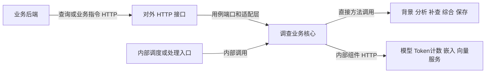

# 对外业务接口与内部调查调用

2026-11-13。本次代码分离已发布到本机和21的18024，53个业务操作合同保持；实际版本与读回见[当前进度](../../PROGRESS.md)。内部HTTP保留原归属。

## 按调用用途划分

| 类别 | 调用者与用途 | 例子 | 归属 |
| --- | --- | --- | --- |
| 对外查询 | 业务后端取页面/业务需要的数据 | 告警列表、事件详情、调查结论、任务记录 | 对外HTTP与业务Swagger |
| 对外操作 | 业务后端发出完整的业务指令 | 人工判定、管理、分析告警、诊断事件、创建/启动/关闭调查 | 对外HTTP与业务Swagger |
| 内部步骤 | 调查程序完成一次调查的各环节 | 背景查询、分析、补查、综合、保存 | 调查核心的直接方法调用 |
| 内部组件HTTP | 调查程序访问必要组件 | 模型请求、token计数、嵌入、向量查询 | 核心组件客户端及其配置 |
| 内部服务HTTP | 独立内部服务之间的协议 | 旧v2查询、Agents内部启动和结果读取 | 各内部应用、内部合同和配置 |

“对外”指供业务后端集成使用，不等于公网开放。分类不按GET/POST、是否调用模型或是否使用HTTP来决定。后端调用“启动调查”属于对外操作；启动之后逐步执行调查属于内部实现。

“显式发起”指后端发送一次启动请求，可以来自页面按钮，也可以来自后端业务逻辑，不表示调查的每一步都要人工操作。

这张图描述代码责任；不表示自动调度已经启用。当前业务后端显式启动后的调查由程序执行，自动分析消费者仍保持原状态。

## 代码边界

对外代码在 [`services/api/investigation_http/`](../../services/api/investigation_http/README.md)，独立入口 `investigation_http.main:app`，保留 `/api/v1/socai2` 的53个操作。

- `external_routes/`：HTTP参数、响应和状态码，只调用用例端口；不写SQL、模型编排或消费者逻辑。
- `ports.py`、`dependencies.py`：对外路由能调用哪些业务方法，以及怎样获得这些服务。
- `adapters/`：接现有调查核心、认证和运行配置；数据库Session不传给路由。A/I执行后的结果读取也在适配层完成。
- `contracts.py`：HTTP专用请求；共享业务DTO明确导出，保持单一字段定义，避免维护两份告警合同。

内部业务保留在 `app/socai2/`，既有处理服务直接调用这些业务方法，不导入对外HTTP包。旧 `app.socai2_main` 和7个 `socai2_*` 端点模块保留兼容转接，同一套实现，不复制逻辑。原主API挂载范围保持。

本批仍共享现有Python运行依赖和业务核心，构建上下文仍为 `services/api`。代码责任和应用入口已分开；没有把它描述成已拆成两个独立业务进程，也没有新增内部RPC层。

## 当前内部调用核对

| 能力 | 实际调用方式/代码依据 | 处理原则 |
| --- | --- | --- |
| A/I/Case主流程 | `StageResultService`、`CaseService`、`BaselineService`、`BaselineExecutor` | 直接调用业务方法，不要求经对外查询HTTP |
| 模型 | `baseline_analysis_model.TenantChatGateway` → 模型网关HTTP | 保留；从模型配置读取目标 |
| token计数 | `token_budget.BackendTokenMeter` → 配置中的tokenizer HTTP | 保留；不是给业务后端的接口 |
| 知识嵌入/向量 | `knowledge_vectors.Vectors` → embedding/Qdrant HTTP | 保留；不挂进对外路由 |
| 日志及部分背景来源 | `baseline_evidence_tools.LakeGateway` 调用ClickHouse；其他适配器查询PG | 保持原方式；不为了分层新增HTTP |
| 旧v2调查查询 | Agents `investigation_v2/activity_records.py` → `/api/v2/investigation/query`；独立 `query_api.create_app` 接收 | 保留原独立应用；不挂到18024 |
| 旧v2内部执行/结果 | API gateway → Agents `/internal/investigation-v2/...` 独立应用 | 保留原内部协议；未因本次代码检查宣称线上启用 |

旧v2源码存在不等于当前A/I/Case主流程正在使用。对外返回的材料URL只是给调用方的读取链接，不能据此认定调查内部通过该URL获取材料。

后续新增内部HTTP能力应进入内部应用并维护内部合同；不得直接挂到 `external_routes/` 或混入业务Swagger。新增对外功能在HTTP层接用例；内部规则与持久化归核心，调用共同能力不绕回对外列表接口。

## 兼容与验证

本次53操作的请求/响应、错误、operationId及完整OpenAPI与迁移前一致。两个获准的列表封套新字段由[列表查询change](../../openspec/changes/query-investigation-lists/design.md)另行实现，本次未增加。

34项定向检查和18个子检查通过；本机候选18026完成24次TCP请求、告警/事件/Case全部facts与SQL逐值读回、任务修订及未启动Run核对；A/I执行另用真实隔离PG及不可用模型替身验证两项。没有真实模型调用。详情见[本项验证](../../openspec/changes/archive/2026-11-13-separate-investigation-http/validation.md)。

发布后本机正式18024完成新Case/任务写读及SQL核对；21采用既有验收记录做12次GET与9对象只读SQL核验，没有在正式库新增测试数据。两端Swagger仍为合同一致的docs7。新列表字段尚未实施，不因本次代码分离发布而变为可用。
