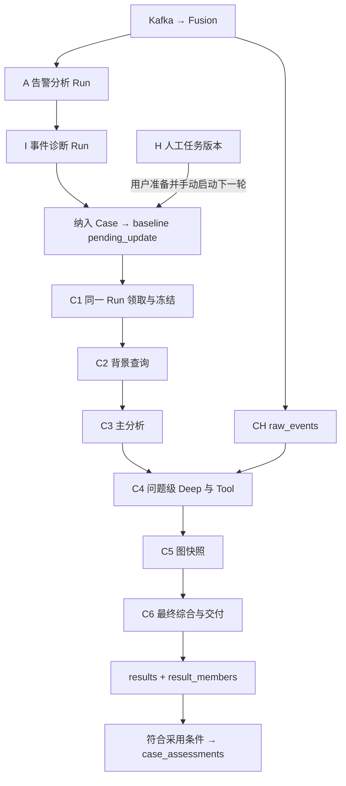

> 此文件保存 2026-11-10 整理前的过程快照，仅供追溯。当前说明见仓库入口。

# 当前调查执行账本

[审计与修复状态](../../investigation/current-investigation-audit-20261105.md)：输入新鲜度、明确错误终态、SHA256投影、C2来源选择已修复并验证。C6必需材料装配已修，但三份冻结样本计入先前用量后仍不足以派发最终请求，完整调查验收尚未通过。本文描述当前开发代码；常驻独立服务尚未同步本次修改。

本文只描述当前开发分支 `codex/case-baseline-history-20261103` 的实现。按执行顺序列出触发、输入、输出、Run/Step、数据库写入与事务边界。文中的 INSERT/UPDATE/DELETE 是代码实际执行的操作类型；没有把本次阅读代码当成一次业务执行。

## 1 数据具体在哪里

| 存储 | 当前调查使用的位置 | 存什么、如何变化 |
|---|---|---|
| PostgreSQL | 21，数据库 `socai2_next_20261104`，业务 schema `socai2` | 告警、事件、Case、Run、步骤、材料/模型/Tool 工件、结果、人工任务、操作活动 |
| PG 支撑数据 | 同一数据库的 `public` schema | 读取 users/connectors 做身份校验；读取 assets、threat_intel_iocs，以及启用后的 user_risk_profiles、aisoc_kb_documents；模型配置读取 tenant_llm_credentials 并与环境配置合成，凭据不进调查工件 |
| ClickHouse | 21，`socai2_next_validation.raw_events` | Fusion INSERT 原始事件；调查 Tool SELECT 进程、网络、认证上下文；调查查询本身不修改湖事件 |
| Redis | DB 13 | Fusion 的去重键、关联索引/事件缓存、实体风险聚合和 TTL；不是调查历史或正式结论的存储 |
| Kafka | 配置的 `alerts.raw`、`raw_events`、`alerts.fused` 主题及独立消费组 | 读原告警/事件，写 fused 信封，提交 offset；不是关系表。当前验证主题前缀为 `socai2.validation.<批次>.20261105`，没有配置常驻的 fused→A/I 调度器 |

下文未另写库名的表全部是 **`socai2_next_20261104.socai2.<表名>`**。JSON 正文一般存在 PG `artifacts.content_json`，Markdown 存 `artifacts.content_text`；当前执行器不把报告正文默认放到外部文件库。

## 2 Run、Step、Artifact、Result 分别是什么

| 记录 | 具体粒度 | 主要关联键 |
|---|---|---|
| `runs` | 一次 A 告警分析、一次 I 事件诊断，或一次完整 Case 基础调查 | `id, tenant_id, kind`；`alert_id/incident_id/case_id` 三选一 |
| `run_members` | 一次 Case Run 冻结的一条成员告警及它使用的材料/判断版本 | `run_id, case_id, alert_id, material_id, triage_id, feedback_id` |
| `run_steps` | Run 内的阶段、一次模型调用、一次 Tool 调用或一次图生成 | `run_id, seq, parent_step_id, kind, stage_code, question_id` |
| `artifacts` | 一份不可变输入、请求、响应、中间分析、图或报告正文 | `run_id, step_id`；步骤的 `input_artifact_id/output_artifact_id` 指向它 |
| `results` | 一次 Case 调查交付的正式结果或系统交接结果 | `case_id, source_run_id, input_artifact_id, report_artifact_id, graph_artifact_id` |
| `result_members` | 这份结果对每条冻结告警的分析/结论覆盖 | `result_id, run_id, alert_id` |
| `case_assessments` | 已被采用为 Case 当前判断的一个版本 | `case_id, revision`；`cases.current_assessment_id` 指向它 |
| `tasks/task_revisions` | 一项人工核实任务及每次保存的版本 | `task_id, current_revision_id, revision`；不创建人工调查 Run |

**一轮 C1—C6 共用一个 `runs.kind=baseline` 的 Run。Deep 的每一轮模型和查询也属于这个 Run，不另建 Deep Run。** A 使用 `alert_basic`，I 使用 `incident_diagnosis`，两者各自建 Run；Q 的 `ai_question` 是预留枚举，当前接口不生成记录。



A/I/Case 的箭头表示数据依赖；当前分别通过正式 HTTP/服务入口触发，不表示后台已经自动顺序调度。

## 3 Fusion 收到 Kafka 后

入口：`services/fusion/app/workers/consumer.py`。持久写入：[socai2_sink.py](/E:/aisoc/socai2/services/fusion/app/services/socai2_sink.py:92)，字段构造：[socai2_projection.py](/E:/aisoc/socai2/services/fusion/app/services/socai2_projection.py:74)。

| 步骤 | 输入 → 处理 → 输出 | Run/模型 | 数据库/队列变化 |
|---|---|---|---|
| F1 信封校验 | topic、schema_version、tenant_id、来源 event_id、原告警/OCSF → 检查身份与结构 | 无 | 无业务表写入；无效信封按消费者失败/DLQ 路径处理，不当有效告警继续 |
| F2 身份、去重、归并、评分 | RawAlert + 持久首份快照 + Redis 缓存 → canonical alert_id、incident_id、评分/依据、FusedAlert | 无调查 Run；无调查模型 | Redis 去重 SET+TTL；correlation index/incident cache SET+TTL；启用的实体风险使用 HASH/ZSET/TTL。持久首份结果可恢复时复用，不重新决定归属 |
| F3 告警事务 | FusedAlert + 收到的原材料 → 持久告警与不可变材料版本 | 无 | 同一 PG 事务执行下表所有写入，COMMIT 后才返回 durable |
| F4 fused 发布 | 持久确认的 FusedAlert/首份结果 → fused Kafka 消息 | 无 | producer ACK 后提交该告警消费进度；不在这里创建 A、I 或 Case Run |
| F5 原始事件入湖 | raw_events 信封中的 OCSF、原文、事件 ID、时间 → 扁平查询列 + 原 JSON | 无 | CH `INSERT ... raw_events`；可重投产生物理重复，查询按事件去重。计数/失败通过 writer 指标记录；已有 best-effort 边界保留 |

两种消息是分支，不是每条告警都会再执行F5：`alerts.raw`直接走F2—F4；`raw_events`先走F5，再由已启用的检测/提升规则决定是否生成RawAlert并走F2—F4。未提升的上下文日志仍可被C4查到。当前独立整链入口未装配原生/窗口检测、session、AI资产、UEBA及外部富化，提升关闭；这些可选分支不是这条链必经的写表步骤。Fusion还有首份结果恢复缓存：PG插入前用Redis SET NX+TTL保存完整结果，重投从可证明的首份结果恢复。

F3 的逐表变化：

| 表 | 操作/条件 | 写入内容 |
|---|---|---|
| `alerts` | INSERT，按 id 冲突不覆盖 | id、tenant_id、source_namespace、source_identity_key；source_alert_id、vendor_alert_id、connector_id/type、original_vendor；title、description、severity/raw、tags、event_time/source |
| `artifacts` | 首次告警 INSERT 1 份 | kind=source_snapshot，schema=fusion.first-result.v1；完整首份 Fusion 结果、hash、大小、retention；绑定 alert_id，此时 run_id 为空 |
| `alert_materials` | 收到内容对应 material_id 不存在时 INSERT | alert_id、revision=max+1、received_at、source_version；raw_text/raw_json/ocsf_json；detection、enrichment、source_scope、sha256、retention、material_state |
| `alert_source_refs` | 每个保留的来源引用 INSERT | alert_id、material_id、source_namespace、source_event_id、relation_kind、observed_at、source_path |
| `alert_objects` | 每个明确主机/用户/IP/IOC INSERT | alert_id、material_id、object_key/type/role、namespace、raw_value、normalized_value、source_type/path、attributes |
| `alerts` | 新材料保存后 UPDATE | latest_material_id、source_updated_at、business_updated_at、row_version+1；first_seen_at 取较早，last_seen_at 取较晚 |
| `incidents` | 该告警尚无事件成员关系时 INSERT，id 冲突保持已有事件 | id、tenant_id、source_namespace、source_incident_id、title |
| `incident_alerts` | 无成员关系时 INSERT | incident_id、alert_id、linked_at、membership_source=fusion、correlation_basis、basis_version、source_operation_id |
| `incidents` | 成员材料完成写入后 UPDATE | business_updated_at、row_version+1 |

相同 material_id 重投会提前返回，不再插入同份材料和关联记录。来源材料变化时追加 revision，不覆盖原版本；也不覆盖人工可编辑的告警标题/标签/等级。

CH实际INSERT列为下表；`ingest_time`由数据库默认值生成，不在writer传入列中。缺少可用事件ID时INSERT省略event_id，使用数据库默认值。网络收发字节和包数保存在 `ocsf_json.traffic`；当前投影选择六个明确计数值，不用缺失值推算0。

| 组 | writer实际传入的列 |
|---|---|
| 身份与分类 | event_id、tenant_id、event_time、class_uid、category_uid、severity_id、severity、activity_id |
| 端点与主体 | source_ip、dest_ip、src_port、dst_port、protocol、src_hostname、dst_hostname、user_name、process_name、file_path、hash_sha256 |
| 原材料与检测标签 | connector_type、raw_payload、ocsf_json、mitre_techniques、mitre_tactics、iocs |
| 活动 | actor_kind、actor_kind_source、actor_id、actor_on_behalf_of、action、resource_type、resource_id、resource_owner、outcome |
| 地理/客户端 | src_country_code、src_asn、src_as_org、src_reputation、src_reputation_known、client_family、client_version、client_category、client_raw |
| 会话 | session_id、session_key、session_key_kind、session_originating_human |

## 4 A 告警基本查询与分析

入口：`POST /api/v1/socai2/alerts/{alert_id}/analyze`，请求 `operation_key`，tenant/actor 来自认证。代码：[alert_basic_executor.py](/E:/aisoc/socai2/services/api/app/socai2/alert_basic_executor.py:63)、[stage_results.py](/E:/aisoc/socai2/services/api/app/socai2/stage_results.py:136)。

| 顺序 | 输入与处理 | 输出 | PG 变化 |
|---|---|---|---|
| A1 领取 | 锁目标 alerts；读取 alerts、latest alert_materials/objects、latest human_feedback；按 operation_key 检查幂等 | run_id、input_artifact_id | INSERT artifacts(input_snapshot)；INSERT runs(kind=alert_basic, alert_id, trigger=refresh, state=running, input_artifact_id, limits, operation_key/request_hash, requested/started_at/by, executor_version) |
| A2 阶段开始 | 验证冻结正文 hash/大小 | A 父步骤 ID | INSERT run_steps(kind=stage,stage_code=A,name=alert_basic_analysis,state=running) |
| A3 资产查询 | 冻结 host/IP → `public.assets` | 资产匹配记录或 empty/skipped/failed/unknown | 每个来源：INSERT tool Step 和 tool_request 工件；查询后 INSERT tool_response，UPDATE Step 的 state/ended_at/output_artifact_id/returned_rows/error |
| A4 历史查询 | 冻结带类型/命名空间对象；告警时间之前 24h，排除自身 → `alert_objects/alerts/alert_assessments` | 历史告警与同次分诊/人工反馈 | 同上；历史表只读 |
| A5 TI 查询 | 明确 IOC 类型和值 → `public.threat_intel_iocs` | 内部有效情报匹配或明确空/不可用 | 同上；情报表只读 |
| A6 模型请求 | 原材料投影、检测标签、人工反馈和 3 个来源结果 → 带 source_map 的有界消息 | 判定、置信度、理由、解释、decision_basis、建议、限制、引用 | **外呼前提交** INSERT model Step + model_request 工件，UPDATE Step.input_artifact_id/provider；外呼后 INSERT model_response，UPDATE state/ended_at/usage/output_artifact_id/error |
| A7 发布 | 检查 Schema、来源角色/成员、判定与依据；重读当前输入指纹判断是否还能采用 | assessment_id、explanation_id、adopted/reason | 成功按下表写入；不合格只记录失败，不生成有效 assessment |

A7 写入明细：

- INSERT `alert_assessments`：`kind=triage,input_material_id,source_run_id,verdict,rationale,confidence,score_state,recommendations,producer,actor,assessed_at,operation_key`。
- INSERT `artifacts(kind=alert_explanation)`：解释正文、生成方式/时间、source_refs、建议、限制。
- 输入仍一致且无更晚结果时 UPDATE `alerts.latest_triage_id/latest_explanation_id/business_updated_at/row_version`；UPDATE 对应 `incidents.business_updated_at/row_version`。
- INSERT 发布回执 `artifacts(kind=source_snapshot)`；UPDATE A 的 `runs.state=completed,ended_at,stop_reason=stage_output_saved,delivery_state=partial,row_version`；UPDATE A 父 Step 为 completed 并挂回执。
- A 不写 `results`，不改变告警人工处理状态，也不创建 Case。

## 5 I 事件诊断

入口：`POST /api/v1/socai2/incidents/{incident_id}/diagnose`。代码：[incident_diagnosis_executor.py](/E:/aisoc/socai2/services/api/app/socai2/incident_diagnosis_executor.py:63)。

| 顺序 | 输入与处理 | 输出 | PG 变化 |
|---|---|---|---|
| I1 领取/冻结 | 锁 incidents；一条 SQL 读取事件、incident_alerts、各成员 alert/material/objects、有效且同材料的 A 结果及人工反馈 | I 输入快照和 run_id | INSERT input_snapshot 工件；INSERT runs(kind=incident_diagnosis,incident_id,state=running,trigger=refresh...)；**同时 INSERT incident_diagnoses(state=running,revision=max+1,source_run_id,input_artifact_id,source_fingerprint,producer,requested_at)** |
| I2 模型执行 | 冻结成员及其来源编号 → 汇聚诊断；不重新执行 A 的查询 | summary、conclusion、members、findings、open_questions、limitations、引用 | INSERT I 父 Step；INSERT model Step/请求工件，提交后外呼；INSERT响应工件，UPDATE模型 Step 状态、usage、error、输出指针 |
| I3 发布 | 检查成员覆盖和引用；检查输入指纹和是否有更晚诊断 | diagnosis_id、adopted/reason | **UPDATE I1 已建的 incident_diagnoses**：state=completed、summary、diagnosis JSON、open_questions、generated_at；可采用时 UPDATE incidents.latest_diagnosis_id；INSERT发布回执；UPDATE Run/父 Step完成 |
| I4 失败/不确定 | 调用拒绝、解析/来源错误或执行不确定 | 原答/错误和原因 | UPDATE incident_diagnoses.state/error；UPDATE Run.state/stop_reason/ended_at；UPDATE相关运行中 Step。没有有效诊断时不移动最新诊断指针 |

I 当前发布只移动事件诊断指针，不刷新事件业务时钟；A 成员分析更新会刷新所属事件业务时钟。I 不写 Case `results`，不创建基础调查 Run。

## 6 Case 建立、成员更新、准备执行

入口代码：[case_service.py](/E:/aisoc/socai2/services/api/app/socai2/case_service.py:30)、[case_relations.py](/E:/aisoc/socai2/services/api/app/socai2/case_relations.py:60)、[baseline_store.py](/E:/aisoc/socai2/services/api/app/socai2/baseline_store.py:107)。

| 用户动作 | 输入 | 输出 | 同一 PG 事务内的变化 |
|---|---|---|---|
| 创建 Case | title/description/severity/tags、alert_ids/incident_ids、operation_key | case_id、scope_revision、pending_run_id、实际新增成员/事件关联 | INSERT cases；显式事件 INSERT case_incidents；通过成员变更逻辑写 case_alerts、pending Run/run_members；UPDATE该Run trigger=case_created,purpose=建立案件的初始分析；INSERT活动与目标 |
| 增删 Case 成员 | 完整目标 alert_ids、expected_scope_revision、operation_key | 新范围版本、pending_run_id、changed | DELETE移出的 case_alerts；INSERT加入的 case_alerts；UPDATE cases.scope_revision+1,row_version+1,business_updated_at；首次绑定 source_namespace；然后按下面规则写待更新 Run |
| 显式关联事件 | incident_ids、可选 alert_ids、范围版本 | 新增关联与新增成员分别返回 | INSERT case_incidents。成员集合确有变化才更新范围/待更新 Run；仅新增事件链接而没有增成员，只更新 Case业务时间/row_version和活动 |
| 两 Case 移动成员 | 源/目标 Case、选中成员、两端范围版本 | 两端成员与范围结果 | 按 Case ID 固定顺序锁两端，分别执行成员变更及 pending刷新；一个事务整体提交/回滚；不隐式复制 case_incidents 链接 |
| 材料/H变化后准备下一轮 | `POST .../baseline/prepare`，operation_key、expected_scope_revision | pending_run_id、created | 已有 pending则复用；没有则 INSERT runs(kind=baseline,state=pending_update,trigger=manual...) 和 run_members；INSERT baseline_prepared 活动。保持 Case scope_revision，不调用模型 |

待更新 Run 的具体规则：

1. 同 Case 有 pending：UPDATE 同一条 `runs.scope_revision/scope_updated_at/row_version`。
2. 没有 pending：INSERT 一条 `runs(kind=baseline,state=pending_update,scope_kind=whole_case,trigger=members_changed,requested_at/by,scope_revision)`。
3. 对这条 pending 的 `run_members` 先 DELETE 再 INSERT 当前成员，保存 `material_id/triage_id/feedback_id`、`read_state=not_read` 或 missing、omission_reason。
4. 已运行的 Run 和它的 run_members 不改。运行期间还可以存在下一条 pending；不会自动执行。
5. 每个操作另写 `activities` 和 `activity_targets`：操作人、action、operation_id、subject、请求摘要/结果、受影响对象及 before_value/after_value。

## 7 C1 手动启动与冻结

入口：`POST /api/v1/socai2/cases/{case_id}/runs/{run_id}/start`。输入 `operation_key,expected_scope_revision,window_start,window_end,comparison_result_id`；执行额度由服务端设置。

| 顺序 | 读什么/做什么 | 写什么 |
|---|---|---|
| C1.1 领取 | 锁 cases，再锁目标 runs；必须 pending、范围版本一致、Case非resolved；检查同Case没有running/unknown基础Run | 校验不通过则整个事务回滚，不派发 |
| C1.2 捕获上下文 | cases/case_alerts；当前 alert及材料引用、objects、source_refs、同次A/人工反馈；显式及成员相关事件、诊断/成员边；tasks当前revision；当前Case判断及其来源/成员；指定比较结果 | 在同一领取事务里 DELETE+INSERT目标 run_members，固定 material/triage/feedback版本；INSERT C1 source_snapshot 工件和 input_snapshot 清单工件 |
| C1.3 占位提交 | 固定完整Case范围、时间窗、六问题、来源角色/省略；上下文上限131072B | UPDATE runs：state=running、input_artifact_id、operation_key/request_hash、executor_version、limits、started_at/requested_by、window_start/end、comparison_result_id、row_version+1；INSERT baseline_started 活动/目标。**先COMMIT，后执行** |
| C1.4 执行计划 | 读刚冻结的 Run/输入；拒绝重复执行 | INSERT run_steps(stage,C1.executor)；INSERT execution_plan 的 source_snapshot 工件；UPDATE Step completed/output_artifact_id |

完整基础调查 HTTP 额度当前为 4 次模型、4 次 Tool、24000 tokens、120 秒；通用行限200，C4湖查询自身硬限50。没有轮询领取器；start 入口当前同步等待执行器完成后返回，执行不确定转 unknown。

## 8 C2 背景补充

输入：C1 冻结对象、成员和时间窗。输出：来源列表、每个来源的状态/记录/匹配依据/限制、是否截断和覆盖说明。

| 来源 | 实际读取 | 选择依据 |
|---|---|---|
| assets | PG public.assets | 明确host/name/fqdn或IP匹配 |
| history | PG socai2.alert_objects/alerts/alert_assessments | 对象类型+命名空间+值，窗口内，排除当前Case成员 |
| threat_intel | PG public.threat_intel_iocs | 明确IOC类型和值，仍有效/未过期/非误报 |
| ueba | 启用后读PG public.user_risk_profiles | 明确用户和身份命名空间 |
| knowledge | 启用后读PG public.aisoc_kb_documents | 冻结检测标题构成有界查询，不让文本变指令 |
| graph | 启用后只读身份图服务 | 冻结用户绑定，不是C5派生图的写入 |

具体写入顺序：INSERT `run_steps(kind=stage,stage_code=C2,state=running,input_artifact_id=C1)` → 每个来源 INSERT Tool Step 和 `tool_request`，提交后 SELECT/外部只读查询 → INSERT `tool_response` → UPDATE Tool Step `state,ended_at,output_artifact_id,returned_rows,error` → INSERT C2汇总 `source_snapshot` → UPDATE C2父Step完成。未配置、无对象、超预算也有 skipped/原因记录，不能按“没写Step”理解为成功。

完整执行器会为 C4 留 2 次 Tool 额度，因此 C2最多消耗2次实际调用。来源按冻结对象相关性选取：明确IOC优先情报、用户优先UEBA、主机优先资产；仅检测标题时优先知识；其余用历史作补充。未连接或无有效对象的来源不占执行额度。每个请求保存selection（优先级、依据、对象数、连接状态），C2汇总保存selection_plan；预算外来源仍有跳过回执。空查询也计一次，不隐增额度。C2不新建Run、不写正式判断、不改来源表。

## 9 C3 主分析

代码：[baseline_analysis.py](/E:/aisoc/socai2/services/api/app/socai2/baseline_analysis.py:96)。

| 顺序 | 输入/输出 | PG 变化 |
|---|---|---|
| C3.1 模型视图 | C1 + C2返回 + 冻结材料必要语义 → 有界messages、source_map、覆盖和省略清单 | INSERT `artifacts(source_snapshot)` 保存视图；可见原始材料映射到 `run_members.read_state=read`，该标记只代表选定字段已读 |
| C3.2 模型前 | 视图及服务端输出Schema → 精确模型请求 | INSERT C3父Step；INSERT C3模型Step；INSERT model_request；UPDATE模型Step.input_artifact_id。提交后外呼 |
| C3.3 模型后 | 原答/usage → Schema、来源、成员和语义边界检查 | INSERT model_response；UPDATE模型Step.state/ended_at/usage/output_artifact_id/error |
| C3.4 分析产品 | findings、六问题、四领域、members、followups、限制 | 接受时 INSERT 4份 `artifacts(kind=domain_analysis)`；UPDATE各 `run_members.analysis_state`；INSERT C3分析汇总 source_snapshot；UPDATE C3父Step输出/状态 |

四领域为 identity/cloud/phishing/insider，由一次模型共享分析形成，不是4个 Run或4次独立模型。六问题为 detection_facts、member_relationships、behavior_nature、authorization、impact、coverage。C3只产中间分析，不写 `results` 或 `cases.current_assessment_id`。

## 10 C4 材料、Deep、Tool、分派记录

| 顺序 | 输入 → 输出 | Step/工件及数据库修改 |
|---|---|---|
| C4.1 材料准备 | 按 run_members.material_id 读取固定 `alert_materials`，不追最新版本 → 进程/端点/认证等选定语义、来源路径、遗漏和服务端工具目录 | UPDATE成员 read_state；INSERT `run_steps(stage,C4.materials)` 和材料 source_snapshot；UPDATE Step completed/output_artifact_id |
| C4.2 决定路线 | C3 followup mode、question_id、成员/对象范围 | query/deep进入下面的问题级循环；human记录交接，不自动建Task；graph交给C5；相同问题只执行一次Deep |
| C4.3 Deep准备 | 冻结问题、C3、材料/既有查询 → 本问题输入、binding_map、source_map、预算 | INSERT `run_steps(stage,C4.deep,question_id)`；按需要 INSERT问题模型视图 source_snapshot；原Run保持running |
| C4.4 Deep模型 | 本问题视图 → query/回答/停止决策 | 每次INSERT model Step(C4.deep,parent=Deep父Step)、model_request；提交后调用；INSERT model_response并UPDATE模型Step状态/usage/error |
| C4.5 执行查询 | 仅接受服务端 binding_id，固定tenant、hostname、时间窗、类别、数据库、limit和query_id | INSERT Tool Step(C4.query,parent=Deep父Step,actual_args)和tool_request，提交后只读查询；INSERT原始tool_response及语义query_projection source_snapshot；UPDATE Tool Step state/returned_rows/output_artifact_id/error |
| C4.6 再判断/结束 | 查询原件→字段投影→本问题下一次模型视图；预算不足、无查询必要、模型回答或查询未完成时停止 | INSERT deep_analysis 与Deep汇总 source_snapshot；UPDATE Deep父Step。问题回答写在工件里，没有独立问题表；不发布Case结论 |
| C4.7 分派回执 | C3原计划工件+followup_index，与实际Deep/人工/图执行结果绑定 | C5结束后 INSERT `run_steps(stage,C4.routing)` + followup_dispatch source_snapshot；UPDATE Step完成 |

固定湖 Tool：process_activity→class_uid1007；network_connections→4001；authentication_activity→3002。查询 `socai2_next_validation.raw_events`，tenant+src_hostname+左闭右开窗口+class限制，按 tenant/event_time/class/event_id 去重，最多50行加1条截断探针。绑定相同的查询再次请求会读原回执，不再外呼。product_host_details要求明确产品连接器，走服务端只读产品接口。

网络输出含源/目的IP和端口、明确协议、action/outcome/session、原结构中的traffic计数、来源路径；文件指纹保留明确hash_sha256及file.hashes/file.fingerprints中声明SHA-256的64位十六进制原值。相同值仅大小写差异不算冲突，冲突值保留双方；非法/不明确算法留遗漏原因，不按长度猜算法。空查询不能写成不存在该行为。查询是SELECT，但**请求/响应/语义投影/状态仍会写PG**。

还有 `C3.reanalysis` 服务方法：已有证据下重新综合，仍在同一Run写一个父Step、模型Step/请求/响应、领域/分析工件。当前默认完整执行器不单独调用它；C6复用它的输入构造直接做最终综合，不凭此增加一轮必跑模型。

## 11 C5 Graph

输入：C1冻结成员/对象/来源关系 + C4已保存材料与查询投影。输出：节点、边、来源依据、范围和限制。代码：[baseline_graph.py](/E:/aisoc/socai2/services/api/app/socai2/baseline_graph.py:19)。

同一PG事务：INSERT `run_steps(kind=graph,stage_code=C5)` → INSERT `artifacts(kind=alert_graph)` → INSERT图汇总 `source_snapshot` → UPDATE Step `state=completed,ended_at,output_artifact_id`。相同证据集合复用已有图快照。

**C5图当前保存在PG artifacts，不写Neo4j，不调用模型。** 外部身份图是C2可选的只读来源，二者不同。图关系依据是共同对象、来源记录、观察关系；没有数据支持时不构造攻击因果。

## 12 C6 最终综合、发布和采用

代码：[baseline_delivery.py](/E:/aisoc/socai2/services/api/app/socai2/baseline_delivery.py:87)、[baseline_store.publish](/E:/aisoc/socai2/services/api/app/socai2/baseline_store.py:390)。

| 顺序 | 输入 → 输出 | PG 变化 |
|---|---|---|
| C6.1 组成最终输入 | 可接受C3/显式再分析、C4查询/Deep、原followup及执行状态、C5、人工版本、指定比较结果 → 最终消息及引用map | INSERT C6父Step；必要原计划/事实不能完整进入既有预算则停止模型派发 |
| C6.2 最终模型 | 上述视图 → 最终结论、发现/问题/建议、成员覆盖、四领域、变化/Case影响 | INSERT C6模型Step和model_request，提交后调用；INSERT model_response，UPDATE模型Step状态/usage/error |
| C6.3 生成交付 | 验证通过的Delivery，或明确的系统交接 → 报告结构、Markdown、覆盖 | 接受的四领域另存domain_analysis；INSERT交付详情source_snapshot、report_json、report_markdown、交付回执source_snapshot；UPDATE C6父Step状态和输出ID |
| C6.4 发布同一事务 | Publication含每个冻结成员、terminal_state、delivery_state和停止原因 | UPDATE run_members.read_state/analysis_state/omission_reason；UPDATE runs.state/ended_at/stop_reason/stop_detail/delivery_state/row_version；INSERT results和每成员result_members；INSERT baseline_published活动与目标 |
| C6.5 自动采用同一事务 | 调用 `socai2.auto_adopt_baseline_result(tenant,result_id)` | 符合下列条件时新增判断/来源/覆盖并移动当前指针；不符合返回原因，仍保留本轮结果 |

`results` 实际内容：title、purpose、conclusion/state/origin、validation_state、closing_note、findings/questions/recommendations JSON、comparison_result_id、change_kind/change_summary、case_impact、input/graph/report_artifact_id、delivery_state、created_at、operation_key等。

C6必带：所选原始事实、告警时间、适用人工反馈、实际执行原计划、选定可比结论。A/I历史分析为可选参考，按同一次判断整组保留或省略，不拆开判定/评分/理由；所有省略按原来源记账。原值guard、单项2048B、视图8192B、消息12288B保持。组成视图后还要按转换后的完整请求（含Schema）及此前实际usage核共享24000预算；视图ready不等于有足够剩余额度，超限时只交接，不伪造模型结论。

自动采用检查的实际条件：

1. result/run 都是baseline，Run completed，validation_state=accepted，结论来源model，conclusion非空且非unavailable。
2. Run的case_id/scope_revision与当前Case一致，run_members与当前case_alerts集合相同。
3. 没有 adopted_at 晚于或等于本Run.started_at的当前判断。
4. 每条冻结成员都有result_members交付，至少一条明确conclusion_covered且状态analyzed或unresolved。
5. `socai2.baseline_input_freshness`比较run_members的material/triage/feedback指针、C1冻结的相关事件诊断/成员集合、已完成人工反馈正文/范围/引用/完成者与时间。变化返回stale_input，只保留本轮结果；冻结上下文不可核验也不自动采用。

通过后数据库函数执行：

| 表 | 操作 | 内容 |
|---|---|---|
| `case_assessments` | INSERT | revision=max+1、conclusion、origin=model、validity=accepted、scope_revision、formed/adopted_at、actor、operation_key |
| `case_assessment_sources` | INSERT | assessment_id → 本轮result_id |
| `case_assessment_members` | INSERT SELECT | 结果中conclusion_covered的alert_id及coverage_note |
| `cases` | UPDATE | current_assessment_id、row_version+1、business_updated_at |
| `activities` | INSERT | action=case.assessment_adopted，主体Case，执行者服务快照 |
| `activity_targets` | INSERT 2条 | Case判断指针before/after；Result被哪个assessment采用 |

这里没有要求 `delivery_state=complete`：符合上述条件的partial也可采用。当前判断读取返回input_freshness.state及reasons；采用后材料/反馈再更新也会显示过期。人工任务仅改标题、负责人或期限不改变反馈签名。检查基于SQL语句可见的已提交数据，未给所有输入表增加跨服务锁；检查之后提交的新输入由读取端识别过期，不回写历史结果。自动采用不关闭Case或告警，不改成员告警分诊。125增量迁移仅新增/替换函数，29表459列不变。

报告、Result、成员交付、Run终态、当前判断和活动在一个事务提交。校验/SQL失败整体回滚；模型返回成功不等于这些表已提交成功。

## 13 H 人工任务和后续基础调查

入口：`POST/PUT /api/v1/socai2/cases/{case_id}/tasks[/{task_id}]`。

输入：标题/说明/状态/负责人/期限，result_text、result_scope、source_refs，expected_scope_revision、编辑时expected_row_version、operation_key；可绑定origin_result_id/finding_id。

创建时 INSERT `tasks`（Case、当前revision指针、创建人/时间、来源结果/发现），INSERT `task_revisions`（正文/状态/负责人/期限、结果/范围/引用、revision、changed_by/at、completed_by/at）。编辑时 INSERT一个revision，再 UPDATE `tasks.current_revision_id/updated_at/row_version`；UPDATE `cases.business_updated_at/row_version`；INSERT活动和目标。内容完全未变不增加revision，但保留该操作回执。

完成者和完成时间由服务器写；只改标题/负责人等元数据时保留原完成事实；改结果、范围、引用或重新完成时重新确认。被已有Run引用的revision不覆盖。

**保存H不创建Run，不写results，不更新当前Case判断。** 用户显式prepare再start，才新建/复用下一条baseline pending并执行C1—C6。

Q 当前三个预留接口返回501；没有AI消息/Run/结果写入，也没有模型/Tool外呼。

## 14 每次模型与Tool调用的提交顺序

模型只出现在A、I、C3、问题级Deep和C6；Fusion、C1/C2、C5及H没有调查模型调用。A/I各有自己的额度；C3/Deep/C6共享同一baseline Run的额度，不是每阶段各给4次。

调用统一经过 `TenantChatGateway`，读取租户模型配置和服务环境。`chat_completions`使用配置的兼容地址；`deepseek_responses`适配器固定deepseek-flash，构造Responses请求后直接HTTP调用DeepSeek。此适配器没有经过LiteLLM；兼容地址是否指向LiteLLM取决于实际配置。实际provider/model、协议转换后的body和Schema保存在model_request，不在正文中记录密钥。Schema转换发生在保存和预算核算前，保存的body就是发出的body。

```text
事务①：锁Case/Run或A/I主体 → 检查状态/额度
       INSERT run_steps(state=running)
       INSERT artifacts(kind=model_request 或 tool_request，完整实际参数)
       UPDATE run_steps.input_artifact_id
       COMMIT

事务外：模型HTTP / PG只读来源查询 / CH查询 / 产品只读调用

事务②：锁同一Run → INSERT response工件、原答、校验信息、usage/行数
       UPDATE run_steps.output_artifact_id/state/ended_at/error/usage或returned_rows
       COMMIT

发布事务：通过业务校验后才写正式assessment/diagnosis/results与采用指针
```

`run_steps.usage` 只记实际模型调用；父阶段不重复计费。`actual_args`记录Tool实际参数；`returned_rows=0`代表成功空结果，未知保持null。超预算未派发是skipped/明确原因，不虚构模型/Tool已执行。

确定的输出校验失败→failed；明确HTTP400/422 Schema拒绝→保存去凭据错误回执、raw=null、未知usage，模型Step与父流程失败收口并写ended_at；C流程发布系统交接并释放单活跃槽。超时、非明确协议错误或提交结果不明→unknown并继续占槽，不自动重试/接续。没有批量修改已保存unknown记录。独立小模型Compose显式绑定chat_completions/vllm_grammar_v1，DeepSeek覆盖为deepseek_responses/standard；启动验证和测试预检检查模型/协议/profile三者。

## 15 一个完整对象关系例子

以下A1/A2、RA1等是说明关系的示意ID，不是一次实际成功运行记录。

```text
Kafka告警A1 → alerts(A1) + material(M1) + incident_alerts(I1,A1)
Kafka告警A2 → alerts(A2) + material(M2) + incident_alerts(I1,A2)

A1分析 → runs(RA1,kind=alert_basic,alert_id=A1)
          → run_steps(RA1的父阶段/3个来源/1模型)
          → artifacts(输入/查询/模型/解释/回执)
          → alert_assessments(T1) → alerts(A1).latest_triage_id=T1
A2分析 → 同结构的RA2/T2

I1诊断 → runs(RI1,kind=incident_diagnosis,incident_id=I1)
          → incident_diagnoses(D1,running→completed)
          → incidents(I1).latest_diagnosis_id=D1

创建K1 → cases(K1) + case_alerts(K1,A1/A2) + case_incidents(K1,I1)
          → runs(RC1,baseline,pending_update)
          → run_members(RC1,A1,M1,T1)、(RC1,A2,M2,T2)
启动RC1 → 同一行pending_update→running
          → C1/C2/C3/C4/C5/C6的Steps和Artifacts均归RC1
发布RC1 → results(RS1,source_run_id=RC1) + result_members(RS1,A1/A2)
满足采用条件 → case_assessments(J1) + 来源/成员表
          → cases(K1).current_assessment_id=J1

补入A3 → Case范围版本+1，INSERT下一baseline Run RC2(pending_update)
          → RC1、M1/M2、RS1、J1和已冻结工件保持
```

## 16 怎样直接看到每一条记录

已保存的真实记录另按[每个Run、每个Step展开](/E:/aisoc/socai2/docs/investigation/current-execution-records.md)：26个Run、162个Step、361份工件的目录、状态、停止原因及原件位置。该索引是明确取数时点的实际记录，不是当前代码所有分支通过的证明；失败/unknown/pending均保留。

Case API：`GET .../cases/{case_id}` 看当前判断与启动条件；`GET .../history` 看每个基础调查Run/结果；`GET .../runs/{run_id}` 看步骤、工件目录和模型用量；`GET .../runs/{run_id}/artifacts/{artifact_id}` 看完整请求/原答/查询/报告；`GET .../runs/{run_id}/materials/{material_id}` 看该Run引用的材料。GET本身不改上述业务表。

数据库查询脚本：[current-execution-readback.sql](/E:/aisoc/socai2/docs/investigation/current-execution-readback.sql)。填写tenant/case/run三个ID后，按同一Run查到：输入→每个Step→请求/响应正文→成员版本→结果→采用→活动。脚本是只读事务。

当前调查服务、所选Fusion存储路径及数据库采用函数的写点，列于[数据库写点明细](/E:/aisoc/socai2/docs/investigation/current-database-write-catalog.md)；同名JSON保留完整写入表达式、条件、字段和值的代码及位置。它描述可执行写点，不声称每次Run都会走完每个分支；未装配的Fusion外围服务不计入这条链。

当前没有覆盖每条SQL的通用before/after镜像日志。`run_steps/artifacts`保存执行输入输出，`activities/activity_targets`保存业务动作及其声明的前后值，不能据此声称任意一行任意时刻的全部旧值都可恢复。
