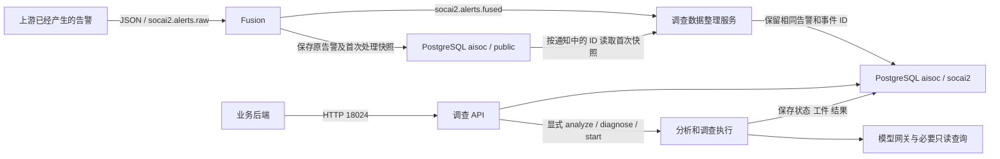

# 当前组件与 Kafka 对接指南

2026-11-12。与[HTTP 主交接](../../FRONTEND_BACKEND_HANDOFF.md)、[测试数据与操作](backend-test-guide.md)一起使用。本轮只读取 21 配置、Topic 和消费组元数据，没有发 Kafka 消息、提交 offset、启停服务或调用模型。[运行快照](../operations/evidence/backend-handoff-20261112-01/components.jsonl)、[Kafka 快照](../operations/evidence/backend-handoff-20261112-01/kafka.txt)。

## 1. 谁调用谁

“调查数据投影”就是图中的**调查数据整理服务**：把 Fusion 已保存的告警原文、来源、材料和事件关联整理到 `socai2` 表，供调查接口读取；不调用模型、不创建 Case、不启动调查。实际程序为 `production_projection.py`，不是另一套检测规则。

当前自动执行的是告警接收、Fusion、数据整理；A 告警分诊、I 事件诊断以及 Case 调查均需显式调用 HTTP。调用一次 Case start 后，内部背景查询、分析、必要补查、综合及保存自动执行，不需要人逐步调用模型。人工任务保存后仍需 prepare/start 才开始下一轮。关闭的是旧 Agents 自动分析消费者，不能写成所有 Kafka 消费者关闭；固定流程及模型质量尚未整体验收，自动分析调度也未完成当前交付。

## 2. Kafka 实际 Topic 与消费组

调查服务所在 Kafka：`192.168.1.21:19093`，`security.protocol=SSL`，使用项目 CA。旧 9092 是另一 listener，后端新接入沿当前 SSL 配置。服务端公证书位于 21 `/opt/sting-aisoc-socai2/certificates/socai2-ca.crt`，接入方配置的是**自己机器上证书的路径**。

| Topic | 生产者 → 消费者 | 消费组 / 当前状态 | 数据意义 |
| --- | --- | --- | --- |
| `socai2.alerts.raw` | 上游已有告警 → Fusion | `socai2-fusion-consumer`；本轮 Stable、1 成员 | 一条已有告警，不是调查结论 |
| `socai2.alerts.fused` | Fusion → 调查数据整理 | `socai2-investigation-projection-v1`；Stable、1 成员，当前三个分区均追到末尾 | 已持久告警/事件的交付通知；整理后从 18024 读取 |
| 同一 `socai2.alerts.fused` | Fusion → 旧 Agents 自动分诊 | `socai2-agents-v1-prod-20261022`；Empty、0 成员；`AISOC_AGENT_KAFKA_DISABLE=1` | 当前不自动执行分析；没有替代的新 A→I→Case 常驻调度器 |
| `socai2.alerts.fused.dlq` | 旧 Agents 处理失败 → 运维 | 旧消费者关闭；Topic 保留 | 不是 Fusion 的输入 DLQ，也不是结果队列 |
| `socai2.raw_events.v1` | 外部规范化事件 → Fusion 湖写入、UEBA | Fusion 组；`socai2.ueba.v1` 本轮 Stable、1 成员 | 历史日志与行为背景；不是告警信封 |
| `socai2.ueba.anomalies.v1` | UEBA → 可选 Fusion 信号 | Fusion 的 UEBA 加分开关为 false | 不因 Topic 存在就认为异常已参与告警加分 |

实查 raw/fused/raw_events/ueba.anomalies 各 3 分区，fused.dlq 1 分区；均副本 1、min ISR 1、保留 7 天。后端订阅使用自己的消费组，不能复用上述服务组抢分区。首次起点明确选择，不能重置既有组。**当前没有已交付的“调查完成结果 Topic”**；执行和结论从 HTTP Run/Result 接口读取。

### 告警输入格式

单条 UTF-8 JSON object，一消息一告警；字段全表及原始例子见[RawAlert 字段合同](v1/kafka.md#2-raw输入字段)，该文档的旧运行状态不作当前依据。新联调使用[三组样例及运行步骤](backend-test-guide.md)。核心字段：

| 字段 | 内容 |
| --- | --- |
| `schema_version` | `v1` |
| `identity_version` | 已有告警使用 `source-v1`，不要省略后落到旧 legacy 合同 |
| `tenant_id` | 真实接入租户 UUID，与后续 HTTP 身份一致 |
| `source_alert_id` | 稳定的上游告警 UUID；重投保持，不用新的 UUID 掩盖未知结果 |
| `id` | 输入建议等于 `source_alert_id`；最终 HTTP 使用 Fusion 返回的 canonical ID |
| `source/title` | 来源系统标识和告警标题；来源标识在同一告警重投时保持 |
| `severity` | `info/low/medium/high/critical`；原始评分缺失保持 null |
| `event_time/created_at` | 事件时间与上游创建时间分开，使用带时区时间 |
| `raw_event` | 原始告警正文；已有标准化事件可放 `raw_event.ocsf_event`，保留上游事实 |
| `source_event_ids` | 明确的原始事件引用；不代替告警 UUID |
| `hostname/username/src_ip/dst_ip/...` | 原资料有值才传，缺失不猜补 |
| `connector_id/external_id/rule_id/rule_name/tags` | 来源与规则标签；不把检测标签当成实际攻击结论 |

Kafka key 可按租户 UUID UTF-8 字节传；租户绑定实际读正文，不能把 key 当鉴权。source-v1 身份由 tenant/source/connector/source_alert_id 确定；同一身份重投恢复首次结果，不是更新原文的接口。跨语言 canonical 算法见旧合同第 3 节；对接方直接使用 fused 返回的 ID 即可。

### fused 返回、确认与失败

`id/alert_row_id/alert.id` 是最终 canonical 告警 UUID；`tenant_id` 保持租户；`incident_id` 是事件 UUID，**不是 Case ID**；`persist_outcome` 为 inserted/duplicate，`fusion_decision` 表示融合决定；`alert` 保留原告警，`alert.source_alert_id` 保留上游 ID。完整[输出示例](v1/examples/fused-alert.json)。数据整理还核对通知 ID 与原持久快照一致，并要求合法事件 ID。

Broker 返回 topic/partition/offset 只代表接收消息。Fusion 的顺序是保存告警 → 发布 fused 并取得确认 → 提交 raw 进度；重投可能重复出现 fused，后端按租户+canonical ID 幂等。调查数据整理从 PG 读取原快照，成功写入 `socai2` 后提交自己的 fused 进度；通知中的 JSON 不是可任意替代原快照的数据写入口。

Fusion 已解码但合同非法写 PG `aisoc_dead_letters`；无法确认持久/发布时保留分区位置。调查数据整理发现错误时保持原 offset 并报告 held，不自动清理数据。旧 Agents 的 DLQ 包含 original、失败阶段、重试次数等，详见旧合同第 5 节。不能把 Broker ACK、投影成功或 HTTP 200 当作 AI 判断成功。

### SpiritHub 的 Topic 是另一条链

21 上 SpiritHub 容器实际连接自己网络中的 `redpanda:9092`，不是上面的 `sting-infra21-kafka-1`。父项目配置的 Topic 为 `logs-raw`、`events-ocsf-v1`、旧 `events-normalized`、`logs-dead-letter`，负责日志接收/规范化/投送；运维控制台是 `http://192.168.1.21:8280`，调查 Kafka 控制台是 `http://192.168.1.21:8090`。

这两套 Topic 名字和消息结构不能互换。未核实到已交付的自动桥接合同，不能写成 SpiritHub 日志已自动变成调查告警。若后端提供告警，按 RawAlert 合同向 socai2 的 raw Topic 投递；若提供原始事件，按 `schema_version:v1/tenant_id/ocsf_event` 事件信封投递 `socai2.raw_events.v1`。这是后续接入点说明，本轮未增加桥接器或启动检测功能。

## 3. 其他组件

| 组件 | 当前地址/对象 | 调查中的用途与接入责任 |
| --- | --- | --- |
| HTTP API | `192.168.1.21:18024`，`/api/v1/socai2` | 业务后端的主要接入点；44 已实现+3预留501 |
| Swagger | `192.168.1.21:18080` | 参数、输入输出和错误说明；[本地 Docker 配置](../../deploy/api-docs/README.md) |
| PostgreSQL | `192.168.1.21:5432/aisoc`；当前调查 `socai2` 28表450列 | 调查状态、原件、Run/Step/Result、任务和历史；业务后端走 HTTP，不照搬 AiSOC 全表 |
| 资产/人员基础数据 | 当前适配器读同租户 `public.assets/public.users` | 由业务后端实现资产和目录维护；当前调查服务没有资产写接口。更换库存来源需明确适配，不是假设外部库存已自动同步 |
| ClickHouse | native `192.168.1.21:9000`；HTTP `:8123`；`aisoc.raw_events` | 有界进程、网络、认证日志查询；当前按租户/主机/时间读取，查询失败、未查、查空分别返回 |
| Redis | `192.168.1.21:6379`；API DB8、Fusion DB9、Agents DB10，TI/enrichment DB12 | 缓存/处理状态，不作调查持久结果合同；后端不依赖内部 key |
| 模型网关 | Docker 网络 `http://litellm:4000/v1`；21 回环 `127.0.0.1:14000` | 调查 API 使用 `aisoc-investigation` 别名；业务后端无需绕过 API 直接编排模型 |
| 知识向量 | Qdrant `http://192.168.1.21:6333`；`socai2_knowledge_qwen06b_1024` | 技术解释、取证指导、历史案例参考；原文在 `public.aisoc_kb_documents`，先索引再回读校验 |
| 嵌入 | Docker 网络 `http://ollama-embedding:11434/api/embed`；21 回环 `:11435` | `qwen3-embedding:0.6b`、1024维；不可混入 TI 的1536维集合 |
| UEBA | `http://ueba:8004`；21 回环 `:18006` | 既有行为服务；调查源开关 true，目前适配器读取 `public.user_risk_profiles`，不代表每次 Run 都查询到数据 |
| 情报/富化 | TI `http://threatintel:8005`、21回环`:18008`；enrichment `:8082`、回环`:18002` | 当前调查基本情报源读取 `public.threat_intel_iocs`；不因外围服务健康就宣称每轮均调用它们 |
| OpenSearch | `192.168.1.21:9200`，TI 使用 `spirithub-opensearch-1:9200` | TI 索引 `socai2-threatintel-iocs/actors`；不是调查结果库 |
| 图及产品主机工具 | 当前 `SOCAI2_SOURCE_GRAPH_ENABLED=false`、`SOCAI2_SOURCE_PRODUCT_HOST_ENABLED=false` | 外部来源未启用；Case 内部依据已保存材料整理关系图不等于调用 Neo4j/主机执行工具 |

知识维护的 `POST /api/v1/kb/ingest`、`/kb/index`、`GET /kb/documents/{id}` 在原主 API（21 回环18000）；**不属于18024的47项业务接口**，独立入口没有挂载 KB router。后端若接知识维护，使用已配置代理/转发及[知识接口交接](../investigation/case-knowledge-handoff.md)，不能对18024试出404后假定功能不存在。本文不新发布另一个维护入口。

所有地址是配置项。正式值以 [生产 profile](../../deploy/aisoc21/production-v1.2.toml)、[独立 API profile](../../deploy/http-service/aisoc21.json)、[知识 profile](../../deploy/local-investigation/knowledge-profile.json)及本轮运行快照为准；密码、token、私钥不写入文档。业务后端只需当前调用的 HTTP/Kafka 配置，不必复制所有内部组件。
