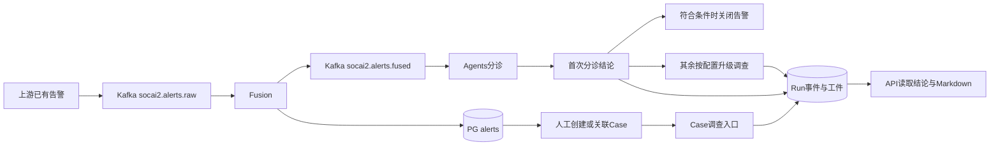

**2026-10-24迁移收尾说明：** 已选范围迁移基线按[收尾回执](../../operations/migration-closeout-20261024.md)交付；下文“完整迁移仍5/15”为10月22日发布时状态，最终责任核销以收尾回执为准。本次未变更服务或查询合同、未重新检查生产；已发布v1、partial/缺源和本地小修边界保持。背景事件入湖及调查优化由独立工作承接，不重复验证。页面/聚合后端与后续查询完善尚需各自实施。

# stingAISOC 后端对接指引 v1.0

文档发布版：2026-10-22，Asia/Shanghai。面向上游告警生产者、业务后端和部署人员。正式输入以 **Kafka 已有告警** 为准；HTTP 告警接口仅用于测试辅助。查询 API 用于读取业务结果，数据库章节用于解释落库和授权查询。

当前服务 v1.0.0 已在21发布：API `5a1e1fd8`、Agents `49643b84`，Fusion `c52b9aac` 保持。独立生产租户、新消费组及自动分诊/自动调查已开启，模型配置不变；一条全新Kafka合成告警已自动产生Run、链图工件和Markdown，结果为partial，内容质量未验收。完整迁移仍5/15。请先读[生产租户与实际读取样例](production.md)及[发布回执](../../operations/service-v1-release-20261022.md)。

[16:02发布前快照](runtime-snapshot.json)保留历史事实；[16:48发布后快照](service-runtime-snapshot.json)为当前脱敏容器配置，业务验证另见发布回执。

## 两份主要交接文档

| 阅读目的 | 文档 | 包含什么 |
| --- | --- | --- |
| **了解当前数据设计** | [当前数据库设计与字段字典](table-fields.md) | 25张已盘点表、428个字段；表职责、关系、每字段含义、SQL类型、空值、默认值、枚举层级、JSON结构及证据时点 |
| **了解页面展示建议** | [页面功能与展示要素建议](page-elements.md) | 四个页面、90项展示字段；核心/辅助/条件开放、状态和空态语义；这是建议，不是已实现清单 |

配套附件按需阅读：[页面取数映射、SQL与HTTP](page-data-mapping.md)连接展示字段与实际数据；[七张Mermaid功能示意](ui-wireframes/README.md)用于要素对照；[完整审计](ui-functional-data-audit.md)及[90项机器矩阵](ui-functional-data-audit.json)说明必要性和数据可得性。示意图不作为UI或交互设计稿，网页截图及截图对照已取消。

[原始数据库元数据](data-catalog.json)、[实际字段验证数据](ui-field-verification-20261023.json)和[落地盘点回执](page-data-mapping.md)保留为事实证据。原混合文档和重复盘点正文在内容迁入后删除，不保留旧版或跳转占位。

## 1. 先按角色选择对接点

| 接入方 | 输入点 | 输出/读取点 | 需要哪些配置 |
| --- | --- | --- | --- |
| 上游已有告警生产者 | Kafka `socai2.alerts.raw`，UTF-8 JSON | 消费 `socai2.alerts.fused`，按 canonical Alert ID 查询告警 | Kafka TLS/CA、固定 tenant/source/上游告警 ID；不直接写 PG |
| 业务后端 | API 查询；需要人工调查时创建/关联 Case 后启动 | Alert、Run 事件、工件内容、Markdown | API Bearer、租户及 scopes；通常不需直连全部存储 |
| 自有结果订阅服务 | 独立消费组订阅 `socai2.alerts.fused` | 融合结果及可查询告警 ID | 自己的 group/起点/幂等；fused 不代表最终调查完成 |
| 历史事件提供模块 | Kafka `socai2.raw_events.v1`，规范化事件合同 | ClickHouse 历史、UEBA 基线/异常 | 与已有告警不同的合同；[UEBA 输入说明](../../architecture/ueba.md) |
| 运维/数据管理员 | 已有部署配置、存储访问身份 | 状态、DLQ、授权只读查询 | [连接配置](configuration.md)、[表与关系](table-fields.md) |

正式主链：

## 2. 每一步的输入点与输出点

“输出点”列列的是实际 topic、表、状态或工件，不表示系统另外提供了每个内部步骤的独立 HTTP 接口。自动分诊/调查行为须在受控 worker 运行时才发生。

| 步骤 | 输入点与输入内容 | 处理者 | 输出点与主要内容 | 后端如何取得/确认 |
| --- | --- | --- | --- | --- |
| A1 告警接入 | `socai2.alerts.raw`；RawAlert/source-v1 JSON | 上游生产者、Kafka | 原 topic/partition/offset；broker ack | 保存发送坐标，ack 只表示 Kafka 受理 |
| A2 校验/稳定身份 | raw 消息正文；tenant/source/connector/source_alert_id | Fusion consumer | canonical Alert UUID、规范化告警；坏合同写 PG `aisoc_dead_letters` | [Kafka 合同](kafka.md)；DLQ 读原坐标，不把上游 UUID 当 PG 主键 |
| A3 融合与持久化 | 规范化告警、Redis 去重/关联、已有增强资料 | Fusion | PG `alerts`；有效来源引用时另写`alert_source_links`；`enrichment_data.socai2_fusion` 首次材料/身份/Incident | `GET /api/v1/alerts/{canonical_id}`；不是人工 Case |
| A4 交付融合结果 | 已确认持久的首次融合结果 | Fusion producer | `socai2.alerts.fused`；`alert_row_id/persist_outcome/incident_id/alert` | 独立 group 消费，按 tenant+canonical ID 幂等；随后查 Alert |
| A5 分诊认领/上下文 | fused；原业务规则、组织记忆/技能/KB/处置/身份 | Agents worker | `investigation_runs`；认领事件 `seq=-1`，采用资料及读取回执 | 通过 canonical 关联找 Run，再增量读 events；生产worker已开启 |
| A6 首次分诊结论 | 告警事实、按配置读到的上下文、规则或模型 | Agents | events `kind=triage_verdict`；`payload.verdict/confidence/rationale/findings/auto_closed`；告警 `disposition/ai_*` | `GET /investigations/{run_id}/events?since=-1`；以事件 payload 为首次结论 |
| A7 关闭或升级 | 首次分诊结果及原策略/预算/保护 | Agents | 合法关闭时 `alerts.status=resolved/resolved_at`；其余按配置走后续调查；可能保持待审 | 查 Alert + triage_verdict；未配置/hold 不等于调查完成 |
| A8 自动调查各节点 | 同 Run 告警与 ContextBundle；post-triage graph | Agents graph | `graph_step`、模型/工具调用材料；最终 `graph_result` 事件与同名 JSON 工件、`graph_usage`、`report_md` | [调查逐步输出](investigation.md)；后端读 events/artifacts，不等新 Kafka 完成消息 |
| A9 基本报告交付 | 已持久的 Run 及报告工件 | API / Agents 读取层 | Markdown 文本；独立状态/错误/partial 信息 | 无 Case：工件列表→选 `report_md`→详情 `content`；有 Case：Case/Run report.md |
| M1 人工 Case 入口 | `POST /api/v1/cases`，标题、canonical alert_ids | API | PG `aisoc_cases`、Case UUID | 201 后保存 Case ID；告警/自动调查不会自动保证建 Case |
| M2 启动人工调查 | `POST /api/v1/cases/{case_id}/investigate`，可传 alert_summary | API → Agents | `{run_id,case_id,status,message}`；Case/告警状态可能前进 | 以返回 Run ID 读事件/报告；发起本身会执行真实调查，本文未调用 |
| M3 人工默认四节点 | Case 服务端材料→Recon→Forensic→Responder→Report | Agents investigator | 节点审计事件、各阶段 state、`report_md`；结构输出的持久粒度见专篇 | 不假设每一步都有独立查询接口，也不把内存 state 当永久全量快照 |

A5 的“分诊前统一 PG→Neo4j 写图”、Case/Alert链图接口及摘要/工件已随本次API/Agents候选发布，并有新Run投影success和链图工件；见[版本边界](investigation.md#5-链图及版本边界)。

## 3. 结论读哪里

| 业务问题 | 稳定读取点 | 解读规则 |
| --- | --- | --- |
| 原告警是什么、是否落库 | Alert API 的 id/raw_event/source 信息；PG alerts | Kafka 上游 id 与 canonical 不同，首次持久材料不因同身份重投变成更新 |
| 首次分诊判了什么 | `triage_verdict.payload`，告警 disposition/ai_summary | 保留首次 TP/FP/BTP/needs_review 等原字符串与理由 |
| 后续调查判了什么 | 最新 `graph_result` 事件及 JSON 工件；report_md | 与首次分诊分开；读取 `completion`，不能只看 Run completed |
| 人工四节点结果 | Case Run 状态、节点事件、Markdown | forensic.root_cause_hypothesis 是假设；responder.dry_run/建议不是执行凭据 |
| 是否业务关闭 | Alert status/resolved_at；Case 状态另查 | Run completed、报告存在均不等于告警关闭或 Case 结案 |
| 是否完整且可信 | completion/error/预算与工具缺源、引用及人工复核 | 运行结束、取证充分、结论正确是不同事实；旧质量失败保持 |

## 4. 阅读与交付清单

1. [连接、认证、部署配置位置](configuration.md)：Kafka/Redis/PG/OpenSearch/ClickHouse/Neo4j/Qdrant及服务端口。
2. [Kafka 输入输出合同](kafka.md)：字段、source-v1、重投、fused、DLQ、事件支路。
3. [调查入口、每步输出、结论及读取样例](investigation.md)：自动/人工/Router三个入口的区别。
4. [数据库表、关联及只读查询](table-fields.md)：核心表字段、上下文表和其他存储。
5. [远端运行配置白名单快照](runtime-snapshot.json)：实际地址/库/开关/镜像，密码仅标有无。
6. `examples/`：[raw 输入](examples/raw-alert.json)、[fused 输出](examples/fused-alert.json)、[认领与结论事件](examples/result-events.json)、[Kafka配置模板](examples/kafka-client.env.example)、[只读SQL](examples/read-results.sql)。示例均未发送/执行，UUID和凭据需替换。

## 5. 对接顺序与本版未完成项

先发放接入网络/CA、真实 tenant/source/connector 映射和查询身份；再约定 raw payload 与稳定身份；联调时观察 raw→Fusion→PG→fused，再读取已授权 Run 事件/工件。需要开启自动分诊/调查时沿现有运行准入另行处理，不能因这份文档直接启动旧积压消费。

本版已同步v1.0.0服务实际发布，生产参数见[生产接入](production.md)。真实资料覆盖及调查质量限制继续保留；密码/token通过指定受控文件交接。文档阅读包不包含可直接source的私有配置。测试数据工具已进行后续真实联测，当前结果及限制见[最新执行回执](../../operations/testdata-migration-execution-20261023.md)。

本版各篇和examples可独立交接阅读；源代码、旧回执和部署文件的相对链接用于仓库内追溯。压缩阅读包保留`docs/integration/v1/`路径，放回本仓库根目录解压后这些引用完整可用；阅读包本身不包含私有env或整套源码。
