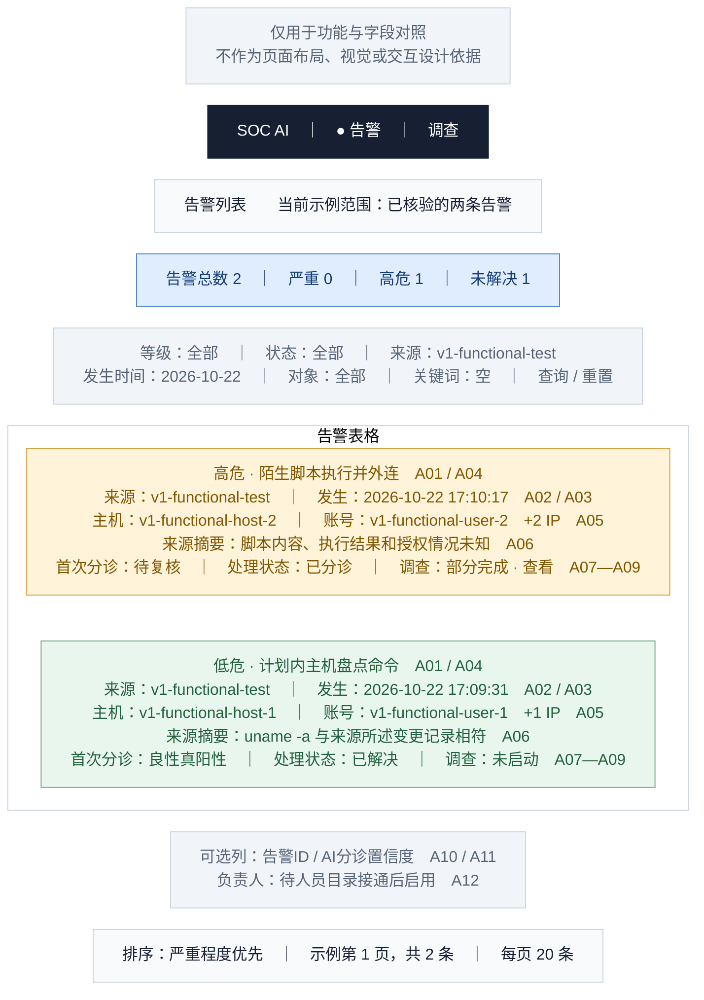

# 01 · 告警列表

[全部功能要素示意](README.md) · [页面展示建议](../page-elements.md) · [取数与接口](../page-data-mapping.md)

> **用途说明：这只是功能要素示意图，用于展示需要哪些功能、字段和数据，并与主文档对照；不是UI设计稿或交互原型。后续模块不得据此图确定页面布局、导航形式、组件样式、尺寸、配色或交互细节。功能与字段要求以主文档为准，实际界面由后续设计另行确定。**

对应主文档 **第1.2节 / A01—A12**。用两行告警对照“自动关闭”和“进入调查但部分完成”。列表先看来源事实，再看处理结果。

方框仅为方便阅读而对功能要素分组；上下、左右、分栏及文字中的位置/操作描述均用于解释功能，不是界面实现要求。字段编号用于需求核对，正式界面不展示编号。样例是已核验的合成告警，中文标题/说明为展示译写，原文可展开。所有时间为 **Asia/Shanghai（UTC+8）**。

## 字段与示例对照

| 字段编号 | 与主文档一致的字段 | 要素及示例说明（位置仅示意） |
| --- | --- | --- |
| A01 | 告警标题 | 两行中文展示标题；点击进入[告警详情](02-alert-detail.md)。源英文标题保留在展开区。 |
| A02 | 告警来源 | 两条均为 `v1-functional-test`，单独一列。 |
| A03 | 发生时间 | 例2 `2026-10-22 17:10:17`；例1 `2026-10-22 17:09:31`；列头注明 UTC+8，复制完整 ISO 原值。 |
| A04 | 严重程度 | 例2高危 `high`；例1低危 `low`。 |
| A05 | 关联对象 | 主机与账号各占一行；例2 `+2 IP` 展开为 `192.0.2.82`、`203.0.113.82`。这里账号是告警关联对象，不是处理负责人。 |
| A06 | 来源摘要 | 标题下两行来源摘要；展开看 `description` 全文。 |
| A07 | AI 分诊结论 | 例2待复核 `needs_review`；例1良性真阳性 `benign_true_positive`；点击查看首次分诊理由。 |
| A08 | 处理状态 | 例2已分诊 `triaged`；例1已解决 `resolved`。 |
| A09 | 调查状态/入口 | 例2“部分完成 · 查看”进入 Run `bdccd907…`；例1“未启动”，不会因分诊 Run 已结束而显示调查完成。 |
| A10 | 告警 ID | 列设置中可开启：例2 `e5f593f0…`，例1 `bc625c39…`；复制使用完整UUID。 |
| A11 | 分诊置信度 | 列设置中可开启：例2 `85%`，例1 `95%`，列名“AI分诊置信度”。 |
| A12 | 负责人 | 目前默认隐藏；启用后，两条样例均显示“未分配”，不填虚构姓名。 |

## 功能使用与空态说明（非交互定稿）

筛选栏两行：第一行为严重程度、处理状态、来源；第二行为发生时间起止、对象值、关键词和查询/重置。输入关键词匹配标题、来源摘要或ID。查询后保留条件；无匹配时显示“没有符合条件的告警”及重置入口。当前HTTP关键词检索未生效、缺部分过滤条件，接入方需按[取数附件第1.3节](../page-data-mapping.md)实现查询后再开放对应控件。

统计卡按**完整筛选范围**计算。图中2条仅是本文固定样例集合，既有生产读回实际总数为3，不能把样例统计当生产总量。排序选项为严重程度优先、入库时间倒序；改变筛选或每页条数回到第一页。小屏采用图中的分行卡片，保留标题、来源、发生时间、等级、状态。

标题打开告警详情，“查看调查”直达该Run；可选详情侧栏首版不作为必要步骤。认领、转派、关闭、暂缓未纳入此图的可用按钮，按主文档操作验收后开放。

数据依据：[字段验证 JSON](../ui-field-verification-20261023.json)，`online_samples.partial`；告警列表另使用 `online_samples.closed`。数值来自既有读回，本文没有重新运行调查或查询生产。
