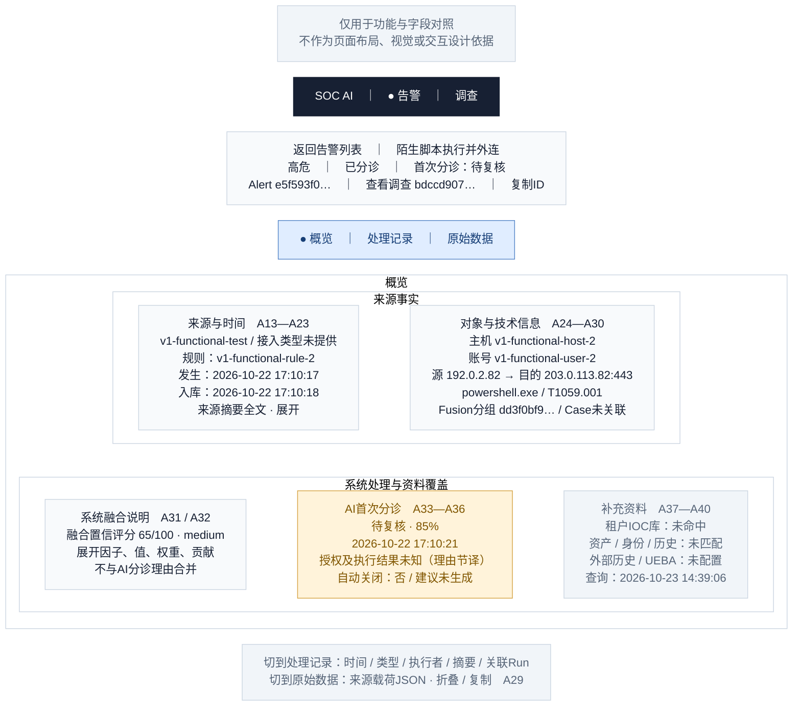

# 02 · 告警详情

[全部功能要素示意](README.md) · [页面展示建议](../page-elements.md) · [取数与接口](../page-data-mapping.md)

> **用途说明：这只是功能要素示意图，用于展示需要哪些功能、字段和数据，并与主文档对照；不是UI设计稿或交互原型。后续模块不得据此图确定页面布局、导航形式、组件样式、尺寸、配色或交互细节。功能与字段要求以主文档为准，实际界面由后续设计另行确定。**

对应主文档 **第1.3节 / 复用A01—A12，新增A13—A40**。以“陌生脚本执行并外连”告警展示概览；下方同时列出另外两个页签的内容位置，实际只显示当前选中的一个页签。

方框仅为方便阅读而对功能要素分组；上下、左右、分栏及文字中的位置/操作描述均用于解释功能，不是界面实现要求。字段编号用于需求核对，正式界面不展示编号。样例是已核验的合成告警，中文标题/说明为展示译写，原文可展开。所有时间为 **Asia/Shanghai（UTC+8）**。

## 字段与示例对照

| 字段编号 | 与主文档一致的字段 | 要素及示例说明（位置仅示意） |
| --- | --- | --- |
| A13 | 来源系统、接入类型 | 来源卡：`v1-functional-test`；接入类型“未提供”，不把 `source-v1` 身份版本当连接器类型。 |
| A14 | 上游告警 ID、连接器 ID | 来源卡展开：上游告警ID `ca8fdfeb-d19d-5c6b-a84b-60a5d6f83a07`；连接器ID“未提供”。 |
| A15 | 关联来源事件 ID | 来源卡展开：`v1-functional-event-2` 和上述上游UUID；外部引用“未提供”。仅为引用，不显示“发生2次”。 |
| A16 | 规则 ID / 规则名称 | 规则 `v1-functional-rule-2`；规则名称“未提供”。 |
| A17 | 发生时间 | 发生 `2026-10-22 17:10:17.571282 +08:00`。 |
| A18 | 本系统入库时间 | 入库 `2026-10-22 17:10:18.277942 +08:00`。 |
| A19 | 首次/最近见到时间 | 首次/最近见到均为 `2026-10-22 17:10:18.277942 +08:00`；不表示攻击持续时间。 |
| A20 | 最近更新时间 | 最近更新 `2026-10-22 17:10:21.583753 +08:00`。 |
| A21 | 解决时间 | 解决时间“—”，当前未解决。 |
| A22 | 原始摘要 | 来源摘要全文展开：终端上报陌生脚本与外连；脚本内容、执行结果、授权未知，仅此告警不足以确认失陷。此处为节译，保留来源英文原文。 |
| A23 | 分类/标签 | 分类“未提供”、当前标签空。原始快照中的 `synthetic` 不自动填入当前标签。 |
| A24 | 主机 / 用户 / IP | 主机 `v1-functional-host-2`；账号 `v1-functional-user-2`；IP分别列出。 |
| A25 | 源 IP / 目的 IP | 源 `192.0.2.82`；目的 `203.0.113.82`，按来源快照角色显示。 |
| A26 | 进程名 / 命令行 | 进程 `powershell.exe`；命令 `powershell.exe -NoProfile -File C:\ProgramData\unverified-v1.ps1`，折叠/复制。 |
| A27 | 目的端口、域名、URL、文件哈希 | 目的端口 `443`；域名、URL、文件哈希未提供，默认不占卡片，展开全部字段可见空态。 |
| A28 | MITRE 战术/技术 | 战术 `execution`，技术 `T1059.001`；不自行补充未映射名称。 |
| A29 | 来源完整载荷 | “原始数据”页签展示 `raw_event`，包括进程、命令、端口、`authorization_status=unknown`；明确不是整个Kafka信封。 |
| A30 | 融合分组 / 人工 Case | Fusion Incident `dd3f0bf9-d5e1-4b41-85df-4e16bc540578`；人工Case“未关联”。 |
| A31 | 融合说明 | “系统融合说明”独立卡片，可展开原 `narrative`；其中建议只是系统说明，不表示执行。 |
| A32 | 融合评分及因子 | `65/100 · medium`；因子展开例：`ml_priority`，值1.00，权重0.18，贡献1.0；其余因子逐行显示。 |
| A33 | AI 首次分诊 | “AI首次分诊”卡：待复核、85%、`2026-10-22 17:10:21.583753 +08:00`。 |
| A34 | AI 分诊理由 | 首次分诊理由全文展开；图上为理由节译，不改写成调查结论或人工确认。 |
| A35 | 分诊是否自动关闭 | 自动关闭“否”；当前业务状态“已分诊”，解决时间为空。 |
| A36 | 分诊发现/建议 | 分诊发现列表展开保留原文；结构化建议为空，显示“未生成建议”。 |
| A37 | IOC 检索状态 | IOC值/类型逐行：`192.0.2.82`、`203.0.113.82` / IP；租户PG IOC库 `no_match`、匹配项空，外部情报 `not_configured`；时间取该回执 `checked_at`。 |
| A38 | 资产/身份/漏洞/历史告警补充资料 | 资产/身份/历史告警 `no_match`；漏洞 `not_requested`，原因无匹配资产；各区可展开来源、明细与截断情况。 |
| A39 | 上下文查询范围与新鲜度 | 补充查询时间 `2026-10-23 14:39:06.721548 +08:00`，主机/账号/两IP；历史窗口为告警发生前7天，每维最多20条。该回执时点晚于调查，不混作当次调查材料。 |
| A40 | 外部历史 / UEBA | 外部历史与UEBA均为 `not_configured`，展示“未配置”，不用绿色“正常”。 |

## 功能使用与空态说明（非交互定稿）

头部复用 A01/A04/A07/A08/A10；查看调查复用A09，直达[调查概览](04-investigation-overview.md)。主机和账号仍为原告警对象。三个页签切换后保留头部：概览用于判断，处理记录用于追踪处理，原始数据用于核对来源。

“处理记录”按记录时间展示，同一时间可多行；字段为时间、事件类型、执行者、摘要和Run链接。样例包括 `17:10:18.418939` 分诊认领、`17:10:21.583753` 首次结论、`17:10:40.265643` 调查部分完成，日期均为2026-10-22 UTC+8。这些是处理记录，不能拼成攻击时间线；完整工具过程跳转调查过程页签。

原始数据页签提供格式化JSON、折叠层级、复制；查看首次来源快照时独立标注“首次交付快照”。长UUID、命令、JSON不在首屏铺满。“未关联Case”保持空态，查看既有自动调查无需先创建Case。

数据依据：[字段验证 JSON](../ui-field-verification-20261023.json)，`online_samples.partial`；告警列表另使用 `online_samples.closed`。数值来自既有读回，本文没有重新运行调查或查询生产。
