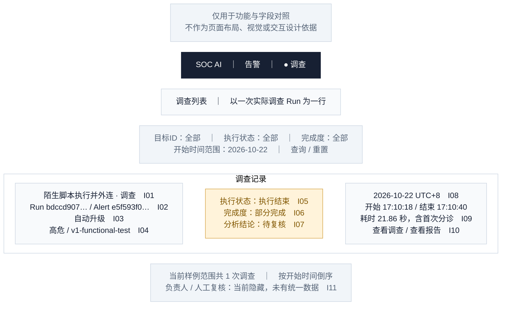

# 03 · 调查列表

[全部功能要素示意](README.md) · [页面展示建议](../page-elements.md) · [取数与接口](../page-data-mapping.md)

> **用途说明：这只是功能要素示意图，用于展示需要哪些功能、字段和数据，并与主文档对照；不是UI设计稿或交互原型。后续模块不得据此图确定页面布局、导航形式、组件样式、尺寸、配色或交互细节。功能与字段要求以主文档为准，实际界面由后续设计另行确定。**

对应主文档 **第1.4节 / I01—I11**。同一组样例中只有一条进入了调查，所以这里只显示一行；自动关闭例仍在告警处理记录中。

方框仅为方便阅读而对功能要素分组；上下、左右、分栏及文字中的位置/操作描述均用于解释功能，不是界面实现要求。字段编号用于需求核对，正式界面不展示编号。样例是已核验的合成告警，中文标题/说明为展示译写，原文可展开。所有时间为 **Asia/Shanghai（UTC+8）**。

## 字段与示例对照

| 字段编号 | 与主文档一致的字段 | 要素及示例说明（位置仅示意） |
| --- | --- | --- |
| I01 | 调查标题 | 目标告警中文展示标题加“· 调查”；原始标题可展开。 |
| I02 | Run ID / 关联目标 | Run `bdccd907-7f36-558f-8ed4-4be2e417b101`；目标Alert `e5f593f0-b328-59c3-8238-379db33d8bfe`；Case未关联。 |
| I03 | 触发方式 | 自动升级，由既有入口和首次分诊记录确认。 |
| I04 | 关联告警等级/来源 | 关联告警高危 / `v1-functional-test`。 |
| I05 | 执行状态 | 执行结束 `completed`，独立列。 |
| I06 | 调查完成度 | 部分完成 `partial`，橙色标签，独立列。 |
| I07 | 分析结论 | 待复核 `needs_review`，取调查结论，不沿用首次分诊的85%。 |
| I08 | 开始/结束时间 | 开始 `2026-10-22 17:10:18.418939 +08:00`；结束 `17:10:40.277839 +08:00`，同一天；完整时间可复制。 |
| I09 | 运行耗时 | 21.858900秒，列表显示21.86秒，包含首次分诊。 |
| I10 | 报告可用性 | 该Run的Markdown正文已有实读，显示“查看报告”。目录存在但正文失败时显示“读取失败”，无报告时显示“尚无报告”。 |
| I11 | 负责人/复核状态 | 默认不显示负责人、已复核标签或对应筛选项；目前无统一持久字段。 |

## 功能使用与空态说明（非交互定稿）

筛选项为目标ID、执行状态、完成度、开始时间范围。默认最新开始时间优先；一个目标的多次Run各占一行。实际已进入调查但尚无报告的Run仍显示，报告列写“尚无报告”。

标题/“查看调查”打开[调查概览](04-investigation-overview.md)；“查看报告”直接进入同一Run的[报告页签](07-investigation-report.md)；Alert链接返回[告警详情](02-alert-detail.md)。筛选Run时不能把通用目标字段 `case_id` 一律解释成人工Case。

当前HTTP仅提供最近N条、上限200，并非全量分页。若直接使用当前HTTP，底部应写“最近N条，当前返回M条”，不能伪造全库总数；接入方完成数据库分页/统计后再开放全量页码。图中“1次”仅为固定样例集合。

数据依据：[字段验证 JSON](../ui-field-verification-20261023.json)，`online_samples.partial`；告警列表另使用 `online_samples.closed`。数值来自既有读回，本文没有重新运行调查或查询生产。
