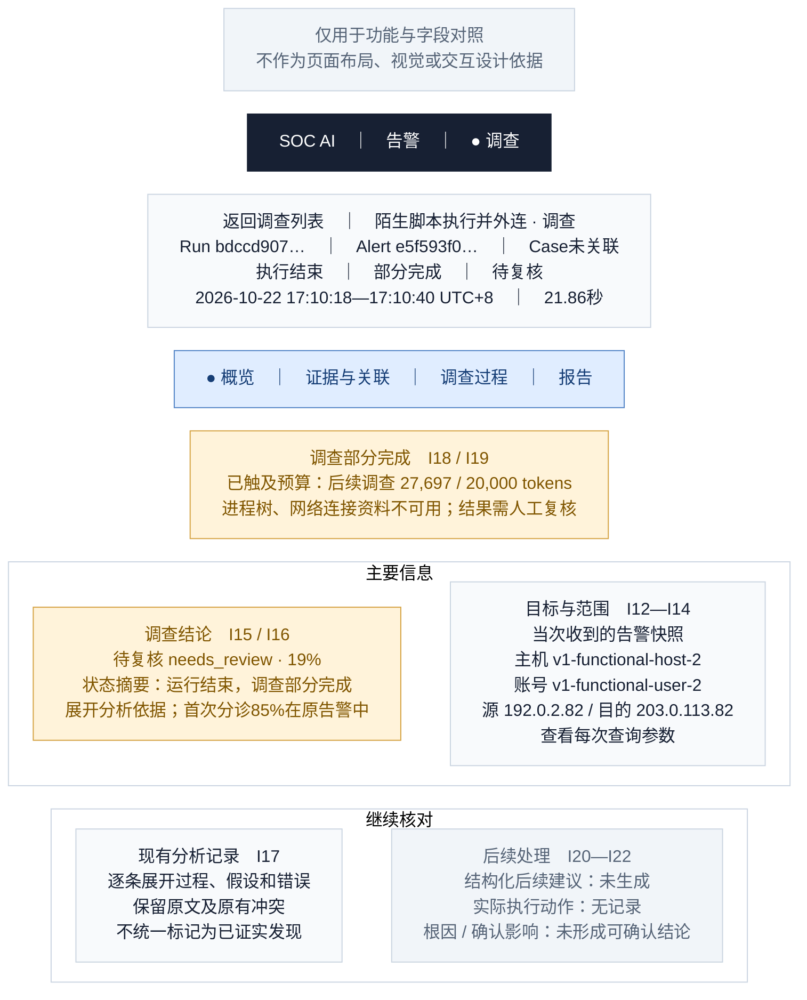

# 04 · 调查详情／概览

[全部功能要素示意](README.md) · [页面展示建议](../page-elements.md) · [取数与接口](../page-data-mapping.md)

> **用途说明：这只是功能要素示意图，用于展示需要哪些功能、字段和数据，并与主文档对照；不是UI设计稿或交互原型。后续模块不得据此图确定页面布局、导航形式、组件样式、尺寸、配色或交互细节。功能与字段要求以主文档为准，实际界面由后续设计另行确定。**

对应主文档 **第1.5.1节 / I12—I22，头部复用I01—I10**。这是调查详情默认页签。先让分析员看清当前结论与为什么停下，再看范围和已有记录。

方框仅为方便阅读而对功能要素分组；上下、左右、分栏及文字中的位置/操作描述均用于解释功能，不是界面实现要求。字段编号用于需求核对，正式界面不展示编号。样例是已核验的合成告警，中文标题/说明为展示译写，原文可展开。所有时间为 **Asia/Shanghai（UTC+8）**。

## 字段与示例对照

| 字段编号 | 与主文档一致的字段 | 要素及示例说明（位置仅示意） |
| --- | --- | --- |
| I12 | 调查目标与原告警快照 | 目标卡展示 `graph_result.raw_alert` 中本次调查收到的告警材料，来源描述与当前Alert独立读取；本例该对象没有status字段。若另展开 `source_snapshot`，标为“首次融合交付快照”，其 `status=new` 不覆盖当前告警状态。 |
| I13 | 调查对象范围 | 1个主机、1个账号、源/目的IP各1个；自动调查目标为该Alert，不称完整事件所有受害资产。 |
| I14 | 查询范围 | 点击“查看每次查询参数”：例 `process_activity` 的 `hostname=v1-functional-host-2,hours=24`；`technique_activity` 的 `days=24` 单独展示，不能统一改成24小时。缺统一绝对起止则写未记录。 |
| I15 | 调查结论与置信度 | `needs_review · 19%`，依据展开显示原 `confidence_basis`；依据文字是模型/程序记录，不因展示而成为已核实事实。 |
| I16 | 调查摘要 | 确定性状态摘要：“运行结束，调查部分完成，结论待复核”；这是已有状态字段组合，不伪装新模型总结。 |
| I17 | 现有分析记录 | 原 `findings` 逐条折叠，包含阶段判断、来源限制和错误；例如原有401归因失败仍保留。 |
| I18 | 完成度与停止原因 | `partial`；预算停止原文 `token budget exhausted (27697 of 20000)`。不能因Run为completed或error为空而隐藏。 |
| I19 | 缺失数据与覆盖限制 | 不可用资料 `process_tree`、`network_connections`；覆盖说明包含未接入SIEM/EDR/身份/云审计；达到六轮上限及截断信息可展开。 |
| I20 | 后续建议 | `proposed_actions=[]`，显示“未生成结构化后续建议”。“需人工复核”来自状态提示，不虚构模型行动列表。 |
| I21 | 实际执行动作 | `executed_actions=[]`，显示“无实际执行记录”，不显示已隔离/已封禁。 |
| I22 | 根因与影响结论 | 根因和确认影响“未形成可确认结论”；已有文本仅作为假设/分析记录查看，不用关系图节点数填影响人数。 |

## 功能使用与空态说明（非交互定稿）

示意中的四类内容依次为：[概览](04-investigation-overview.md)、[证据与关联](05-investigation-evidence.md)、[调查过程](06-investigation-process.md)、[报告](07-investigation-report.md)。切换时保持同一个Run，头部的执行状态、完成度、结论与时间不变。预算/部分完成提示在各页签持续可见。

结论卡的19%是本次调查分析置信度；告警首次分诊85%、融合评分65/100在各自区域展示。依据与分析记录展开后保留原文，即便其中有较早的 `likely_false_positive` 等过程判断，也不覆盖最终采用的 `needs_review`。

没有报告不阻止查看概览；没有图不隐藏已留存材料。人工路径按实际记录显示步骤，不强行补齐四个角色的结构卡。

数据依据：[字段验证 JSON](../ui-field-verification-20261023.json)，`online_samples.partial`；告警列表另使用 `online_samples.closed`。数值来自既有读回，本文没有重新运行调查或查询生产。
