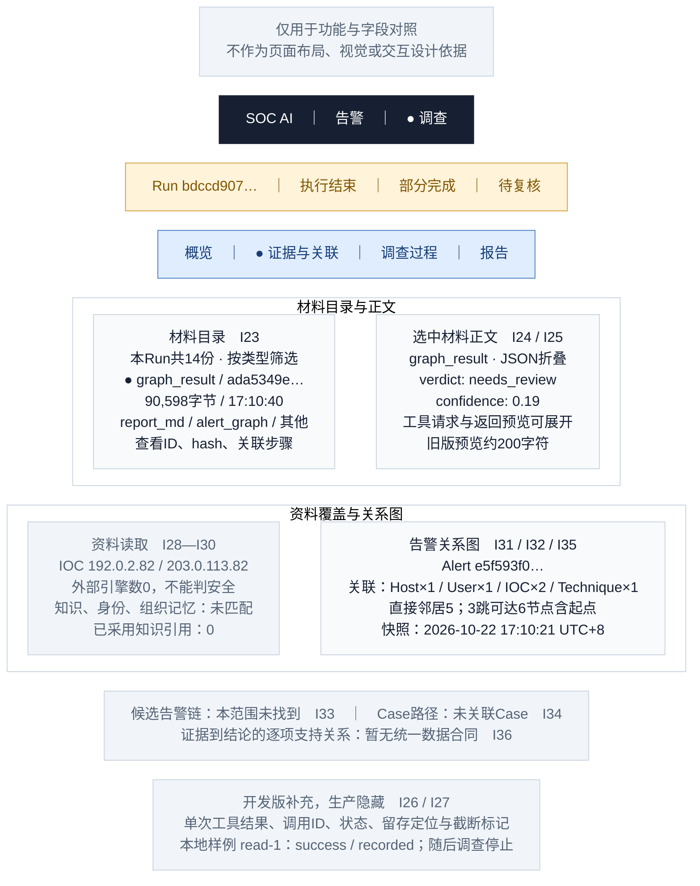

# 05 · 调查详情／证据与关联

[全部功能要素示意](README.md) · [页面展示建议](../page-elements.md) · [取数与接口](../page-data-mapping.md)

> **用途说明：这只是功能要素示意图，用于展示需要哪些功能、字段和数据，并与主文档对照；不是UI设计稿或交互原型。后续模块不得据此图确定页面布局、导航形式、组件样式、尺寸、配色或交互细节。功能与字段要求以主文档为准，实际界面由后续设计另行确定。**

对应主文档 **第1.5.2节 / I23—I36**。默认看本次Run的材料与图快照；页内使用两个分区，避免把图、工具返回和知识来源混成一种证据。

方框仅为方便阅读而对功能要素分组；上下、左右、分栏及文字中的位置/操作描述均用于解释功能，不是界面实现要求。字段编号用于需求核对，正式界面不展示编号。样例是已核验的合成告警，中文标题/说明为展示译写，原文可展开。所有时间为 **Asia/Shanghai（UTC+8）**。

## 字段与示例对照

| 字段编号 | 与主文档一致的字段 | 要素及示例说明（位置仅示意） |
| --- | --- | --- |
| I23 | 材料目录：类型、ID、时间、字节、hash、关联事件 | 目录列为类型、短ID、记录时间、字节数；展开SHA256和关联事件。示例 `graph_result / ada5349e… / 2026-10-22 17:10:40.265643 +08:00 / 90,598字节`。14份为材料数，不是14条证实发现。 |
| I24 | 工件正文 | 右侧按选中工件显示JSON/Markdown正文；固定artifact_id，不串读别的Run。无正文、读取失败、截断分别提示。 |
| I25 | 已查询工具、请求参数、返回预览 | 工具记录展开请求参数及旧返回预览。例 `process_activity(hostname=v1-functional-host-2,hours=24)`，返回预览含available=true、row_count=0；只能说此查询未返回行。 |
| I26 | 单次工具状态与保留内容 | 开发版才展示：本地样例 `read-1 / iteration=1 / status=success / available=true / result_truncated=false / 94字节`。这是独立本地夹具，不属于图中生产Run。 |
| I27 | 单次工具留存定位 | 同一本地夹具显示留存状态 `recorded`、实际event/artifact链接及缺口；仅生产旧Run无此字段时写“未提供”，不硬造定位。 |
| I28 | IOC 及情报覆盖 | 两IP增强结果的外部引擎数均0、来源空；实际返回score=0可在明细显示，但卡片写“缺外部判定依据”。 |
| I29 | 知识、身份、组织记忆等读取状态 | 知识、身份、组织记忆、近期处置、技能源五类读取回执；该例均 `no_match`。前四类 `adopted_count=0`；技能源无该键，展开 `selection.status/skills/valid_count` 等实际字段，采用数显示“未提供”，不能把valid_count当采用数。 |
| I30 | 已采用知识引用 | 知识引用空，采用数0；显示“未采用知识引用”，不展示虚构文档标题。 |
| I31 | 告警关系图 | 当次图快照：源Alert连接Host、User、两IOC和Technique；连接表示来源关联。下表列出实际边类型。 |
| I32 | 关联可达范围 | 直接邻居5；3跳可达6节点（含Alert起点），类型为Alert1/Host1/User1/IOC2/Technique1；不是6台受害主机。 |
| I33 | 候选告警链 | 候选链空；窗口24h，锚定告警时间前后；显示“此范围未找到候选链”。 |
| I34 | Case 路径 | `not_linked / no_linked_case`；“未关联Case”，不画空白攻击路径冒充已完成调查。 |
| I35 | 图的范围与时点 | 当次快照 `2026-10-22 17:10:21.916108 +08:00`；种子Alert为本例、投影上限50、truncated=false。当前图查询如另提供，需单独标注新查询时间。 |
| I36 | 证据—结论对应关系 | 不画“证据支持结论”连线。现有event_id只定位步骤，不能证明某份材料支持某条判断。 |

## 功能使用与空态说明（非交互定稿）

材料目录可按类型筛选，点击一行更新右侧正文；JSON折叠、复制、SHA256完整值位于详情抽屉。图和材料默认来自同一Run的历史快照。正式关系图的边与对象对应如下，图的布局可以调整，关系含义不能改写：

| 源 | 关系类型 | 目标 |
| --- | --- | --- |
| Alert e5f593f0… | OBSERVED_ON | Host v1-functional-host-2 |
| Alert e5f593f0… | INVOLVES_USER | User v1-functional-user-2 |
| Alert e5f593f0… | CONTAINS_IOC | IOC 192.0.2.82 |
| Alert e5f593f0… | CONTAINS_IOC | IOC 203.0.113.82 |
| Alert e5f593f0… | MAPS_TO | Technique T1059.001 |

页内可折叠“资料读取”“候选链/Case路径”，但空态仍有位置。I26/I27灰色区域只说明开发版替换旧工具预览的位置；生产默认隐藏，不混入生产14份材料。其样例来源为验证JSON的 `local_samples`，使用替身模型/工具及隔离PG，未部署。

数据依据：[字段验证 JSON](../ui-field-verification-20261023.json)，`online_samples.partial`；告警列表另使用 `online_samples.closed`。数值来自既有读回，本文没有重新运行调查或查询生产。
