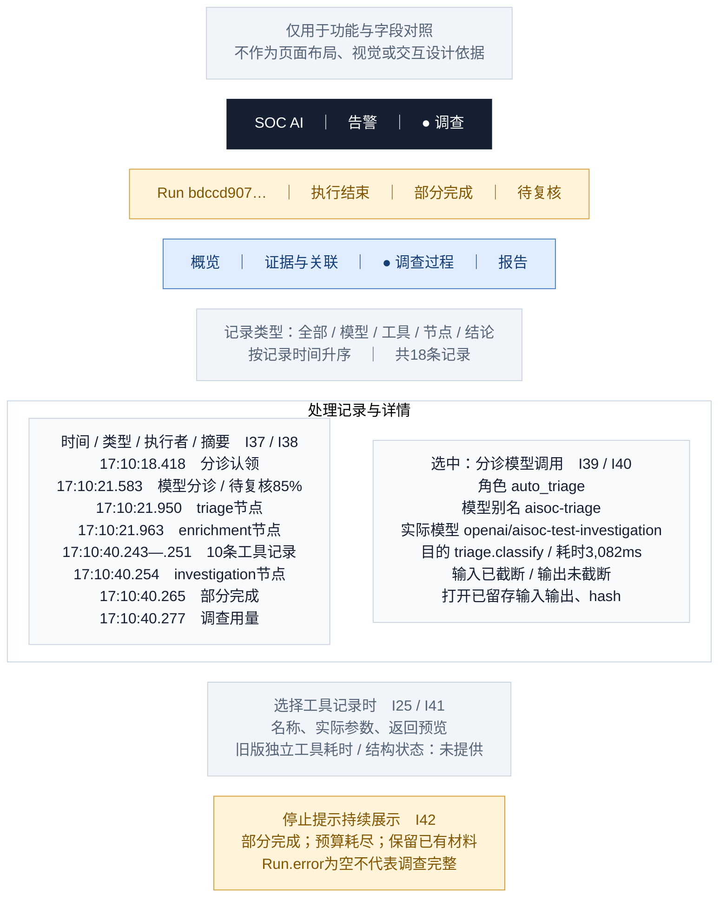

# 06 · 调查详情／调查过程

[全部功能要素示意](README.md) · [页面展示建议](../page-elements.md) · [取数与接口](../page-data-mapping.md)

> **用途说明：这只是功能要素示意图，用于展示需要哪些功能、字段和数据，并与主文档对照；不是UI设计稿或交互原型。后续模块不得据此图确定页面布局、导航形式、组件样式、尺寸、配色或交互细节。功能与字段要求以主文档为准，实际界面由后续设计另行确定。**

对应主文档 **第1.5.3节 / I37—I42**。左边是实际记录列表，右边是选中记录的详情。这里显示系统处理过程，来源事件发生时间仍在告警页。

方框仅为方便阅读而对功能要素分组；上下、左右、分栏及文字中的位置/操作描述均用于解释功能，不是界面实现要求。字段编号用于需求核对，正式界面不展示编号。样例是已核验的合成告警，中文标题/说明为展示译写，原文可展开。所有时间为 **Asia/Shanghai（UTC+8）**。

## 字段与示例对照

| 字段编号 | 与主文档一致的字段 | 要素及示例说明（位置仅示意） |
| --- | --- | --- |
| I37 | 处理步骤 | 每条展示记录时间、kind、agent、summary、seq，可展开完整ID。原样例18条记录；图中把10条工具记录压成一行示意，界面可展开全部。 |
| I38 | graph 节点 | 实际graph_step只有 `triage / enrichment / investigation` 三个节点；对应记录耗时3ms/12ms/18,292ms。节点完成不表示调查完整，也不等于三次模型调用。 |
| I39 | 模型调用 | 选中模型记录示例：auto_triage、aisoc-triage、triage.classify、3,082ms；实际模型从对应费用/模型记录关联。后续graph交换按已留存序列查看，不虚构每个节点独立模型交换。 |
| I40 | 输入/输出留存范围 | 该分诊prompt_truncated=true、response_truncated=false；输入/输出hash可展开。graph交换中的截断范围按各自元数据标注，不能由工件可读推断完整。 |
| I41 | 工具处理耗时/状态 | 旧生产工具记录只有名称、参数与预览，没有独立准确耗时/结构状态时显示“未提供”；不把缺省0ms当实测成功。新版字段按图05开发版区域处理。 |
| I42 | 运行失败/部分完成提示 | 持续显示partial和预算停止原文；读取失败与运行失败分开提示。该Run.error=null，但调查确实部分完成。 |

## 功能使用与空态说明（非交互定稿）

列表类型筛选只是筛选已读取事件，不代表新查询/重跑调查。按 `ts` 展示，相同时保留序号和ID作为定位；`seq=10000+` 工具记录在 `seq=5` 结果之前，不按序号伪造时间线。这里的时间是已记录/留存时间，不能当成每次工具实际执行起止时刻。

点击模型行打开右侧留存交换；点击工具行显示原请求与预览。例如 `historical_execution` 曾把主机/账号值传入 `process_name`、`days=24`，页面如实呈现，不替换成看起来合理的新参数。查询返回0行不能证明该主机没有活动。

此页不强制显示Recon/Forensic/Responder/Report四阶段模板；人工路径只展示真实持久步骤。展开模型输入输出须按主文档权限边界控制。

数据依据：[字段验证 JSON](../ui-field-verification-20261023.json)，`online_samples.partial`；告警列表另使用 `online_samples.closed`。数值来自既有读回，本文没有重新运行调查或查询生产。
