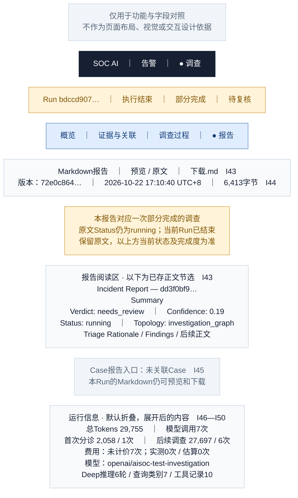

# 07 · 调查详情／报告与运行信息

[全部功能要素示意](README.md) · [页面展示建议](../page-elements.md) · [取数与接口](../page-data-mapping.md)

> **用途说明：这只是功能要素示意图，用于展示需要哪些功能、字段和数据，并与主文档对照；不是UI设计稿或交互原型。后续模块不得据此图确定页面布局、导航形式、组件样式、尺寸、配色或交互细节。功能与字段要求以主文档为准，实际界面由后续设计另行确定。**

对应主文档 **第1.5.4节 / I43—I50**。报告占主要阅读区，技术用量默认折叠在底部；既有报告保留原文，页面外层显示当前已持久状态。

方框仅为方便阅读而对功能要素分组；上下、左右、分栏及文字中的位置/操作描述均用于解释功能，不是界面实现要求。字段编号用于需求核对，正式界面不展示编号。样例是已核验的合成告警，中文标题/说明为展示译写，原文可展开。所有时间为 **Asia/Shanghai（UTC+8）**。



## 字段与示例对照

| 字段编号 | 与主文档一致的字段 | 要素及示例说明（位置仅示意） |
| --- | --- | --- |
| I43 | Markdown 报告预览/下载 | 预览/原文切换，下载同一工件的 `.md`。图中仅摘录已存报告的Summary，不重新生成报告；预览过滤危险HTML。 |
| I44 | 报告元信息 | 工件 `72e0c864-41a0-4096-bfa2-8aa0ebe3a641`；记录时间 `2026-10-22 17:10:40.265643 +08:00`；6,413字节；完整SHA256在下方。 |
| I45 | Case 报告入口 | 当前无Case，隐藏“打开Case报告”可点击入口，显示未关联；本Run报告不受影响。 |
| I46 | 总 Token / 模型调用数 | 总Tokens29,755，实际模型调用7次，分别命名。 |
| I47 | 首次分诊与后续调查用量 | 首次分诊2,058 tokens / 1次；后续调查27,697 tokens / 6次。不要拿总Tokens和后续调查预算混比。 |
| I48 | 费用及未计价情况 | 实测计价0次、估算计价0次、未计价7次；显示“未计价”，不显示“免费”或 `$0.00` 作为最终费用。 |
| I49 | 模型名称 | 别名 `aisoc-triage`、`aisoc-investigation` 分别对应实际模型 `openai/aisoc-test-investigation`；展开两行模型用量。 |
| I50 | 轮数与查询数 | Deep推理6轮、按运行记录统计的pivot类别7、工具留存记录10条；展示名为“查询类别（按distinct_pivots记录）”，不推断10条真实证据。Run.iterations=3不用于替代Deep轮数。 |

## 功能使用与空态说明（非交互定稿）

“预览/原文”只切换展示方式，“下载.md”读取当前artifact_id正文；没有report_md目录项时显示“尚无报告”；已有目录但正文缺失、外置内容未取到或请求失败时分别显示“正文不可用/读取失败”，不能当尚无报告。可重试读取，但不启动新调查。已有报告存在时保留部分完成提示。PDF不放本版主操作栏。

旧报告Summary的 `Status: running` 与当前Run已结束存在旧快照差异；外层明确解释，原文和下载内容保持一致。报告中的阶段性推断、来源判断或旧质量问题不因预览而被标记成已确认。

运行信息展开后按模型列出角色别名、实际模型、Token、调用数、计价状态，较长模型名允许换行。该报告SHA256：

```text
68a09887c164b35407beeb5ffcfeaa806db2e0e445d0c062cd697a361fcf5e8b
```

数据依据：[字段验证 JSON](../ui-field-verification-20261023.json)，`online_samples.partial`；告警列表另使用 `online_samples.closed`。数值来自既有读回，本文没有重新运行调查或查询生产。
