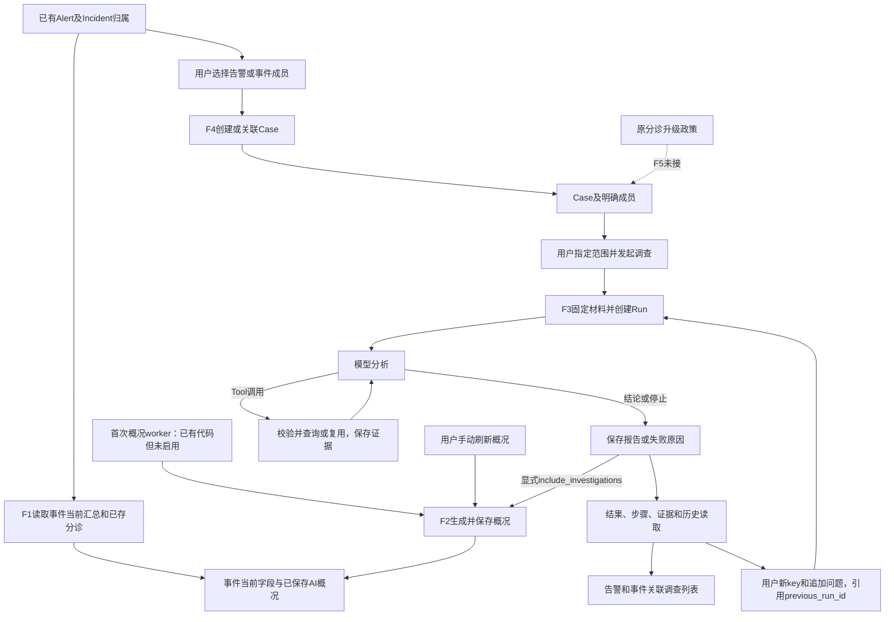

**2026-10-31后续执行：** 已完成审计问题A01/A02/D01的本地修复及31项直接验证，新增材料、H1模型省略及概况前置权限以[实施记录](audit-fixes-implementation-20261031.md)为准；职责和业务边界不变。真实版本/复验仍待。

# 调查模块当前设计对齐

2026-10-31按本地源码5b95138更新。文件名保留原入口；当前状态、证据和审计步骤见[最新指南](audit-guide-20261031.md)，请求字段及错误见[接口合同](interface-contracts-20261027.md)。最近真实四案例仍为512c004/r1，本地最新追加修复的常驻更新和真实复验待做。

## 1. 当前设计的核心

告警保存来源和分诊，事件提供汇总、AI概况及已有调查结果的关联展示，Case承载深入调查，Run记录一次调查。事件不另建深入分析循环。

| 对象 | 输入 | 职责 | 输出 |
| --- | --- | --- | --- |
| Alert | 产品来源告警、Fusion增强和已存分诊 | 保存canonical来源、历史判断与当前处置 | 告警材料、归属及调查上下文 |
| Fusion Incident | 当前成员、分诊和显式选择引用的已有Case报告 | 汇总成员/实体/时间/状态，生成概况，展示关联调查覆盖 | 结构化汇总、概况及来源/过期标记 |
| Case | 明确加入的Alert成员、问题和范围 | 组织深入调查、管理历史和后续显式调查 | Case归属、成员及Run列表 |
| InvestigationRun | 选定成员、绝对窗口、问题、材料及可选历史Run | 模型分析、必要Tool查询、再分析及结果保存 | 步骤、证据、反证、缺口、报告和停止原因 |

Incident ID、Case ID、Run ID各自独立。Incident新成员不自动加入已启动Run；Run结束不自动关闭Case、Incident或Alert。报告建议不直接执行处置。旧fixed/program路径和旧Agents Deep保留各自合同与证据，不视为当前Case内核已经复用的能力。

## 2. 业务流程与触发

实线表示已有代码连接，不表示每种部署配置都已启用；F5仍未接通，首次概况worker有代码但尚未启用。

上述报告到概况的连接只在手动刷新显式include_investigations=true时取材；新Run或普通GET不会自动重写AI正文。基础概况的not_linked表示该正文未引用Case结果，不表示没有调查。

| 动作 | 触发者 | 当前行为与边界 |
| --- | --- | --- |
| Fusion归组、告警分诊 | 原有链路 | 当前调查读取已有记录；最近四案例没有重新投递或验证自动摄取/分诊 |
| 事件汇总与关联调查读取 | 用户/调用方GET | F1及关联查询已有代码，所有已存成员分诊可汇读 |
| 首次生成概况 | 独立worker | 已有代码但未启用，每事件首次尝试一次 |
| 成员、分诊或已引用调查变化 | 数据变化后读取 | 当前字段更新，旧概况按来源变化标旧，不自动生成 |
| 概况手动刷新 | 用户POST | 可显式引用已有Case摘要；失败保旧正文，不启动新调查 |
| 成员转Case | 用户明确选择 | F4已实现并有真实PG/HTTP证据，建案本身不启动F3 |
| 主调查和追加问题 | 用户明确发起 | 系统在请求内运行模型/Tool循环；追加建新Run、保留旧报告 |
| 自动进入新版Case | F5拟定入口 | 未接通，自动目标政策不在当前目标 |

## 3. Case内部如何使用Tool

执行位置为API v2进程。服务读取Case和选定成员，固定材料与窗口，把材料和实际可用Tool定义交给模型；检查模型输出的名称和参数，补入服务端租户/窗口，查询或按适用条件复用结果，再通过对应tool_call_id回传模型并保存完整证据。

事件湖工具为process_activity和network_connections；符合来源连接器和主机绑定条件时，还可提供[product_host_details](product-host-tool-20261028.md)。产品Tool提供CrowdStrike当前主机快照，不能据此证明历史状态；真实厂商调用仍未验证。专项Deep、领域角色和动态MCP未全部接入Case。

5b95138新增required_tools用于要求指定Tool尝试；缺少该能力或模型未按要求调用时停止，具体错误见接口合同。它不保证查询成功；允许复用时，历史查询命中也算一次尝试。需要重新查询时另传refresh_queries=true。最近留存r1不含此字段，最新本地6项直接验证不能替代真实复验。

正常Tool轮次与最终结论schema阶段分开；结论格式/引用失败最多纠错一次，仍受原预算约束。模型视图增加query_status，区分有记录、成功空结果和不可用；保存的原始证据保持。报告格式、编号和覆盖校验不等于结论语义已确认。

## 4. 一个例子：从事件到追加调查

以下为设计说明，不是新增运行回执。

1. A1异常进程和A2外联已有分诊并属于I1，用户读取I1汇总与告警上下文。
2. 用户选择A1/A2调用F4创建或关联C1；回执给出Case及selected_member_ids。
3. 用户可预览C1材料，再显式传选定成员、09:00–10:00窗口、问题和新operation_key启动R1。
4. 模型按需调用进程/网络Tool，服务限定主机和窗口，保存结果及Tool交换。只有共同时间/实体时，报告应保留因果缺口。
5. 用户在C1/R1读报告、证据和来源行，也可从I1或A1的执行索引定位同一Run。
6. 用户手动刷新I1概况并选择include_investigations=true，可以引用已有R1摘要；后续新Run不会自动改写这份概况。
7. 用户有追加问题时，以新key和previous_run_id=R1在相同成员/窗口下启动R2，H1表示历史判断。最新本地合同可指定required_tools；旧R1报告不覆盖。
8. I1新增A3不会改变R1/R2；要变更调查范围应明确组织Case成员并发起独立新调查。

## 5. 当前验证与未完成范围

F4、事件报告关联、主调查、历史/证据导航已有真实联调记录；120/121已安装，最近保存的常驻服务为r1。四案例4次主调查均completed/partial，但整批只有2/4自动流程通过，且LSASS报告语义另有问题。

最新本地修复覆盖Office纠错输入、必需Tool和来源语义提示；6项受影响直接用例通过，Office额度重建改善不等于模型结果通过。下一步为修复版本更新后的针对性真实复验和内容审阅。F5、首次worker启用、真实厂商Tool、用户JWT专项、前端完整接入及旧OpenSpec整项完成均分别保留边界。

实施继续遵守[功能原则](../architecture/investigation-planning-design.md#implementation-principles)：逐功能必要直接验证；已通过且未变部分复用，不增加冗余、恢复或压力测试。完整资料及原失败见[证据目录](evidence-catalog-20261027.md)，早期实现差异仍可查[历史实现详解](current-implementation-reference-20261027.md#review-boundaries)。
