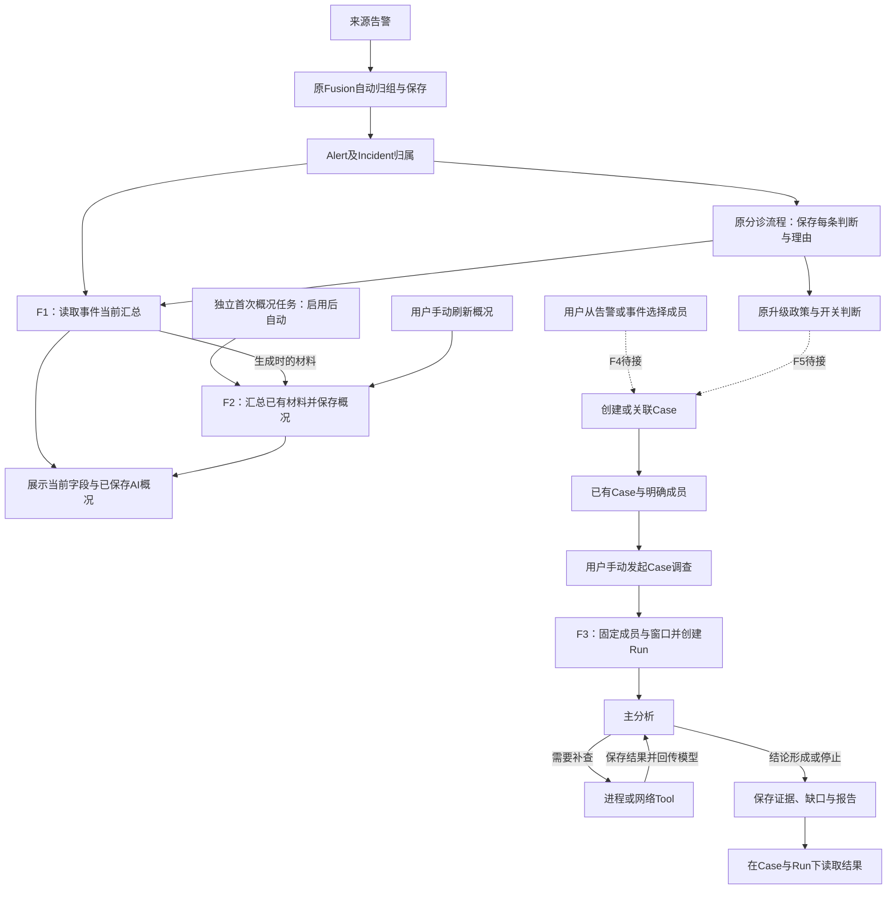

# 调查模块当前设计对齐

2026-10-27。本文按用户最后确认的要求整理当前设计，供先审设计、再对照实现使用；不新增功能范围。实现核对基线为`6044615`，详细字段见[当前实现详解](current-implementation-reference-20261027.md)，全部资料见[审计导航](audit-guide-20261027.md)。

接口层细化见[接口设计：请求、返回与流程衔接](interface-contracts-20261027.md)：已有接口按代码说明，F4/F5及读取补充标为拟新增，包含请求字段、JSON示例、错误含义和Tool/产品HTTP映射；本轮不实施。

## 1. 当前设计的核心

**告警保存来源和分诊，事件提供汇总与AI概况，Case承载深入调查，Run记录某一次调查。** 事件层不再建设单独的分析循环；单条告警需要深入分析时，也可以进入只含一条成员的Case。

| 对象 | 输入 | 负责的处理 | 输出 |
| --- | --- | --- | --- |
| Alert（告警） | 产品来源告警、Fusion增强信息 | 保存独立告警；分诊记录判断和理由，处置状态单独管理 | canonical Alert ID、来源材料、分诊及当前处置 |
| Fusion Incident（事件） | 同组Alert及其已保存的分诊 | 汇总成员、实体、时间、严重度和各成员情况；生成便于阅读的概况 | 当前结构化汇总、AI概况、来源范围与生成时间 |
| Case（案件） | 明确加入的Alert成员、调查问题和范围 | 组织深入调查；允许后续显式发起新的调查 | Case归属、成员清单、相关Run |
| InvestigationRun（一次调查） | Case内选定成员、绝对时间窗口、问题、已有材料 | 模型分析→必要Tool查询→再分析→结束 | 证据与反证、结论、缺口、建议、停止原因及报告 |

Incident ID、Case ID、Run ID各自独立。Incident的新成员不会自动加入已经开始的Run；Run结束也不自动关闭Case、Incident或Alert，报告中的建议不直接执行处置。

旧主设计中的“告警侦察＋Case调查”及fixed/program路径保留其历史含义，但不再把扩建一套独立告警深入调查作为当前F3/F4的前置工作。旧Deep、领域角色可以按实际缺口复用，不要求每次调查全部调用。

## 2. 业务流程与触发

图中实线表示已有代码路径，是否在运行环境启用须另看配置与部署；虚线标出尚未接通的新功能连接。

`I→S`仅表示生成时取材，不表示普通GET或数据变化会调用模型。独立首次任务目前有代码但未启用；Case结果回显事件也尚未接通，不能从图中推断F2已经读取Case报告。

| 动作 | 谁触发 | 当前设计与实现状态 |
| --- | --- | --- |
| Fusion归组、告警分诊 | 原有自动链路 | 沿用原路径；本次不改归组算法，也不据代码存在断言环境已启用 |
| 读取事件汇总 | 用户或调用方GET | F1已有；所有已保存的成员分诊都可汇读，不以是否升级为条件 |
| 首次生成概况 | 显式启用的独立任务 | F2已有；每个新事件首次尝试一次，失败后不自动反复调用 |
| 普通成员/分诊变化 | 数据更新 | 当前字段随读取更新；已保存AI文本只标旧，不自动重写 |
| 再次生成概况 | 用户手动刷新 | F2已有；失败保留旧文，概况生成不启动调查或查询工具 |
| 告警/事件转Case | 用户选择成员 | F4未实现；不把Incident ID直接作为Case ID |
| Case深入调查 | 当前为用户手动请求 | F3已有；启动后分析、查询、再分析和报告由系统执行，用户不用逐个点Tool |
| 分诊后自动进入新版Case调查 | 原升级政策允许且开关启用 | F5未实现；原worker的旧升级分支不能算作新版已接通 |
| 再调查 | 用户显式发起新Run | 重新指定范围；保留旧报告，并按适用条件复用材料 |

## 3. Case内部如何使用Tool

当前F3的执行位置是API v2进程。它读取真实Case和成员，保存本次范围，然后把材料及可用Tool定义一起交给模型。模型需要补查时输出工具名和参数；程序检查参数、补入服务端固定的租户与时间窗口，执行查询，保存结果，再以对应`tool_call_id`回传模型。模型据此继续分析或形成报告。

当前只有`process_activity`与`network_connections`两个事件湖查询工具；产品HTTP工具、动态客户工具/MCP、专项Deep和领域角色尚未全部接入。旧Agents注册了Tool，不等于新Case模型能看到它。

新增产品HTTP Tool仍按[接入与流程验证指南](tool-onboarding-and-flow-verification.md)处理：明确HTTP输入输出→参数和返回映射→接入当前Case工具定义与执行入口→确认模型收到定义、发出正确请求、收到对应结果并在报告中正确使用。模拟服务或模型脚本可验证调用协议，不能代替真实模型选择与解释的验证。

调查必须区分“成功但没有记录”“查询失败”“未查询/来源不可用”和“证据确认未发生”。当前报告引用校验只确认编号存在，不能证明模型结论受到证据支持；业务审计需要对照实际材料阅读结论。

## 4. 一个例子：按当前能力走到哪里

以下为说明设计的虚构例子，不是运行回执。

1. 主机`host-a`产生A1异常外联、A2可疑进程、A3同目标重复连接，按原Fusion条件归入I1。各告警仍保留独立ID。
2. 分诊保存三份判断及理由。I1汇总能分别展示待处理和已关闭成员；A3关闭不表示I1已解决。
3. 首次任务启用后，或用户手动刷新时，F2根据当前已接入材料生成概况。之后新增分诊，结构化字段更新，旧概况可以标旧。
4. 用户想调查A1/A2：目标流程是从I1选择两条成员并创建或关联C1。**这一步的新v2入口属于未完成的F4**；当前F3从已有C1及其成员开始。
5. 用户在C1指定A1/A2、09:00–10:00窗口及“外联是否与可疑进程有关”，发起R1。模型收到告警、已有分诊和可用Tool定义。
6. 模型按需调用网络及进程Tool；程序限定在该Case允许的主机和窗口，保存返回记录。若资料只支持同时间出现、无法证明因果，报告应保留这个缺口。
7. 结果和Markdown报告保存到C1/R1，可以读回。**当前I1概况不会自动读取这份报告**；需要后续明确接通引用，不能宣称已回显。
8. I1又增加A4，不改变R1范围；用户需要纳入A4时，先调整Case成员，再明确发起新的Run。

## 5. 本轮设计审查结论

当前业务职责可以按上述边界继续使用。审计重点是文档和功能连接的对应关系，不再扩建设计或新增层层验收门。

| 发现 | 本轮对齐结果 | 剩余功能范围 |
| --- | --- | --- |
| 旧主设计与最新Case边界并列，容易照旧方案扩建告警/事件分析 | 在主入口明确最新边界，保留旧路径记录用于解释历史实现 | 当前深入分析统一从Case发起 |
| 原流程图画出调查进展/结果汇入事件，容易当成已实现 | 明确这是未接通的结果关联；F2仍为`not_linked` | 若后续接入，只展示已有Case结果及覆盖范围，不新增事件分析循环 |
| F3验证项曾包含“事件可读结果”，与现状不符 | 改为“Case/Run可读结果”；事件回显单独列未完成 | 不将事件回显算作F3既有通过证据 |
| F4输出曾直接描述跨告警判断/报告，混淆入口与执行职责 | F4只负责成员转Case及跳转引用；分析报告归F3 | F4尚未实现 |
| 原自动升级政策存在，但新版自动创建/关联Case规则未落地 | 标清F5待接；不默认每条告警新建Case | 实施F5时需明确复用哪个Case或何时创建、无法满足时如何保留待处理 |

F1/F2与F3第一版已有代码和替身直接验证；未据此宣称真实模型业务质量、PG/CH整链或部署完成。F4/F5、事件结果回显、未接入的Tool/专项能力仍按各自范围保留，不因本文完成而核销。当前执行细节与历史主设计之间的差异见[实现详解第8节](current-implementation-reference-20261027.md#review-boundaries)。

实施继续遵守[功能原则](../architecture/investigation-planning-design.md#implementation-principles)：逐个功能实现和必要直接验证；已通过且未改部分不重复测试，不增加冗余/可用性/恢复测试工程。本文仅文档对齐，无业务代码、运行配置或权限专项变更。
