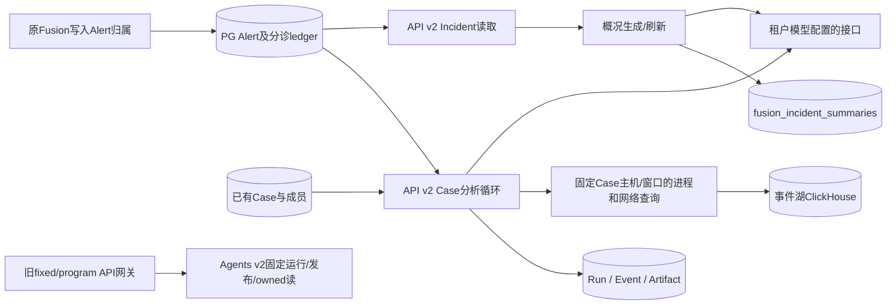

# 调查模块当前实现详解：入口、数据、模型和结果

2026-10-27，静态核对源码基线`6044615`。这是当前F1/F2/F3的实现参考，不替代[目标主设计](../architecture/investigation-planning-design.md)，不将替身用例扩大为真实环境/业务质量验收。完整历史链接见[证据目录](evidence-catalog-20261027.md)。

## 1. 职责与代码边界

| 对象 | 当前职责 | 明确边界 |
| --- | --- | --- |
| Alert | canonical告警、来源、融合字段、当前状态/处置和已存分析 | 不是Incident或Case；分诊判断不是独立来源事实 |
| Fusion Incident | 按已保存归属汇读成员/分诊，保存一段AI概况 | 不建立独立深入调查内核；不因成员关闭而自动关事件 |
| Case | 组织调查成员；F3的实际调查目标 | 必须是PG中存在的Case，Incident UUID不能代替Case UUID |
| InvestigationRun | 某次执行及固定范围、调用、证据和报告 | 执行结束不等于Case解决；同Case可有多个明确发起的Run |

F3循环在API服务的`app.investigation_v2.case_analysis`中执行，模型HTTP调用、Case查询和ledger持久化均在此进程。旧Agents `graph/Deep/run_with_tools`和新版固定运行器是另外的实现；源码存在或历史验证通过不代表F3已调用它们。

## 2. 应用入口和HTTP表

各factory均为独立v2应用，不是旧`app.main`自动注册。源码：[query factory](../../services/api/app/investigation_v2/query_api.py)、[兼容结果factory](../../services/api/app/investigation_v2/program_result_api.py)、[兼容启动factory](../../services/api/app/investigation_v2/program_start_api.py)。

| factory | 暴露能力/依赖 |
| --- | --- |
| `incident_api:create_app` | query + Incident读取/刷新；读取需迁移120的新表 |
| `case_analysis_api:create_app` | query + Case调查/读回；Case已有三表ledger，F3不新增表 |
| `program_result_api:create_app` | query + 旧fixed/program兼容结果 + Incident + Case；默认要配置兼容结果网关 |
| `program_start_api:create_app` | 上述能力 + 旧program单Alert start/operation-read；默认还需配置启动网关 |

| 当前F1–F3路由 | 输入 | 复用的权限 | 返回 |
| --- | --- | --- | --- |
| `GET /api/v2/investigation/incidents/{incident_id}` | 路径UUID；tenant来自当前身份 | 显式Bearer、`alerts:read` | 当前事件字段、成员、分诊、已存概况/元数据；不存在404 |
| `POST /api/v2/investigation/incidents/{incident_id}/overview/refresh` | 路径UUID，无业务请求体 | 显式Bearer、`alerts:write` + `alerts:read` | 生成尝试后的同一事件结构；概况失败也可HTTP 200 |
| `POST /api/v2/investigation/cases/{case_id}/investigate` | 下述CaseAnalysisRequest | 显式Bearer、`investigation:run` + `cases:read` + `alerts:read` | 首次请求内同步执行，返回Run/范围/结果；没有后台202任务 |
| `GET /api/v2/investigation/cases/{case_id}/investigations/{run_id}` | 两个路径UUID | 显式Bearer、`cases:read` + `alerts:read` | status、固定scope、progress及已有result；不存在404 |

所有路由使用当前tenant的`TenantDBSession`。权限实现继续使用已有deps；这只是源码调用关系，不是JWT/RBAC真实验证。Case内部工具直接调用查询代码，不经过另一次`lake:query`HTTP依赖；审计权限传播时应按这个实际边界检查。

新的Incident/Case路由没有复制旧program入口所有body/query覆盖拒绝合同；不能把旧入口的严格HTTP验证结果套到它们。Case请求体Pydantic明确禁止额外字段；GET未知query/body没有额外专门拒绝实现。

## 3. F1：事件及分诊读取

源码：[incident_reader](../../services/api/app/investigation_v2/incident_reader.py)、[incident_api](../../services/api/app/investigation_v2/incident_api.py)。

1. 按当前tenant和`Alert.enrichment_data.socai2_fusion.incident_id`读取PG Alert，按发生时间/UUID排序；不依赖会过期的Redis IncidentSummary。`Alert.id`是API的canonical成员ID。
2. 用这些成员ID匹配`InvestigationRun.raw_alert.id`，同时限定Run/Event tenant及`Event.kind=triage_verdict`；按事件时间/UUID倒序取每个成员最新一条。没有使用历史含义混杂的`Run.case_id`猜测归属。
3. 组装事件严重度（已知等级取最高）、实体去重、MITRE并集、时间范围、当前状态/处置分布及最新分诊分布。没有新风险模型。
4. F2之后的GET还会读取`fusion_incident_summaries`附加已存概况；该GET不调用模型或调查工具。

### 返回字段

| 层次 | 字段及含义 |
| --- | --- |
| 事件身份 | `incident_id`、`tenant_id`、`title`（最早成员标题前加Incident）、`severity`、`member_count` |
| 当前范围 | `first_seen`/`last_seen`取成员范围，`source_updated_at`取成员updated_at及所选分诊ts最大值 |
| 汇总 | `by_status`、`by_disposition`、`by_triage_verdict`、`members_without_saved_triage`、`entities`、`mitre_tactics`/`mitre_techniques` |
| 每个member | `alert_id/title/severity/status/disposition/event_time/updated_at/case_id/connector_id/source_alert_id/saved_analysis/recommendations/triage/alert_url` |
| 每个triage | `event_id/run_id/recorded_at/summary/verdict/rationale/auto_closed/findings/proposed_actions` |
| 事件人工状态 | `handling_status=null`；没有实现事件人工状态机，也不根据成员状态推导它 |
| 概况 | `ai_overview`正文或null、`ai_overview_metadata`对象或null |

没有明确ledger分诊记录时`triage=null`，普通`Alert.ai_summary`仅作为`saved_analysis`。当前人工处置可能与旧分诊不同，分别保留。成员`case_id`是已有数据引用；F1没有创建/关联Case，也没有读取Case报告填进事件概况。

## 4. F2：概况生成、保存与首次任务

源码：[incident_summary](../../services/api/app/investigation_v2/incident_summary.py)、[首次worker](../../services/api/app/investigation_v2/incident_summary_worker.py)、[120迁移](../../services/api/migrations/120_fusion_incident_summaries.sql)。

### 4.1 一次手动刷新

| 步骤 | 实际输入/处理 | 输出/副作用 |
| --- | --- | --- |
| 读当前数据 | 调用F1读取 | 成员与分诊材料 |
| 取得概况记录 | PG插入空行`ON CONFLICT DO NOTHING`，再按tenant/Incident行锁读取 | 同一记录承载概况和最后尝试信息 |
| 首次/手动分支 | 首次模式遇到已有`last_attempt_at`便返回；手动刷新继续 | 首次失败也不会自动补跑 |
| 解析模型配置 | 复用租户模型resolver、air-gap检查和安全HTTP包装 | 无可用模型记录`llm_unavailable`，不造AI文本 |
| 组织材料 | 当前字段和部分成员，限制16000字符；过长文本/成员省略做范围标记 | `source_refs`记录实际提供的成员/分诊Run及遗漏情况 |
| 一次模型调用 | 最多输出650 tokens，无Tool | 普通文本、已知usage或失败 |
| 保存 | 合法非空文本替换正文/生成时间/来源指纹；失败保留旧正文 | 刷新接口提交后返回事件结构 |

`source_fingerprint`是当前F1结构（排除AI正文/元数据）的序列化hash；GET将其与生成时hash比较来标记过期。它不检查模型版本、外部数据源版本或未读Case结果。

### 4.2 概况元数据与状态

`ai_overview_metadata`包含：`status`、`generated_at`、`source_updated_at`、`is_stale`、`source_refs`、`model`、`last_attempt_at`、`last_attempt_status`、`last_error`、`last_usage`。

- 尚无概况记录：正文/元数据均null。
- 已有正文：`status=ready`；当前材料变化时`is_stale=true`。
- 首次生成失败：正文null、`status=not_generated`、最后尝试failed。
- 旧概况刷新失败：正文/生成时间/原来源范围保留，最后尝试failed；status仍可为ready。不能只看HTTP 200或status判断刷新成功。
- `last_error`代码：`llm_unavailable`、`model_call_failed`、`invalid_summary_response`。
- `last_usage`记录模型、已知prompt/completion tokens及费用是否写入；未知token为null。它是最后一次尝试的用量，不一定属于仍保留的旧文本。

`source_refs`包含`member_ids`、`triage_run_ids`、`source_member_count`、`omitted_member_count`、`fields_truncated`、`investigation_results_status=not_linked`。当前没有接入Case结论，不能将not_linked解释成“从未调查”。

### 4.3 首次自动任务

这是独立v2进程，必须显式以`--tenant-id`启动；不由GET、旧Fusion或v2 factory自动启动。默认起点为任务启动时刻，每30秒查询一次，每批20个，按事件最早PG Alert.created_at判断形成时间。`--since`显式改变起点，`--once`只处理一批。

它查找没有概况记录的新Incident，随后读取F1并首次生成/提交。有首次尝试记录便不再自动生成；不自动重写普通数据变化，不自动补历史或失败。持续任务没有专门的逐项异常恢复/调度系统，未捕获的数据库等异常可终止任务。

## 5. F3：Case调查请求与逐步执行

源码：[Case核心](../../services/api/app/investigation_v2/case_analysis.py)、[路由](../../services/api/app/investigation_v2/case_analysis_api.py)。

### 5.1 请求合同

| 字段 | 当前约束 |
| --- | --- |
| `operation_key` | 非nil UUID，同tenant下派生固定Run ID |
| `start` / `end` | 必须带时区，转UTC；正窗口且最多7天，查询采用`[start,end)` |
| `question` | 字符串1–2000，默认核对成员告警行为证据、关联和影响、依据/反证/缺口 |
| `selected_member_ids` | 省略则启动时全部Case成员；显式列表必须非空且唯一，并是Case成员子集 |
| 其他字段 | 禁止额外字段；tenant/actor/Case来源由服务端确定 |

示例及实际调用方式见[Case接口说明](case-investigation.md)。已有v1 Case创建能力与本入口不同；F4从告警/Incident转Case尚未实现。

### 5.2 执行轨迹

| 步骤 | 输入与动作 | 保存/返回 |
| --- | --- | --- |
| 1. 操作身份 | `uuid5(NAMESPACE_URL, aisoc:case-analysis:{tenant}:{operation_key})`；同key比较Case/actor/请求 | 匹配则只读原Run，冲突409 |
| 2. 成员材料 | 按tenant读取Case并取共享行锁，读取所选canonical Alert；取每个成员最新分诊 | all/selected/read成员ID、来源Incident、主机、窗口、问题、A/T证据 |
| 3. 适用历史 | 查同tenant/Case/profile及`source_hash=digest(context)`的最近一份结果 | 只准备可用且同工具/同参数的历史查询复用 |
| 4. 准入落库 | 原Run表插入新行，raw_alert保存profile/intent/scope/limits/source_hash | 确认首次提交后才执行；重复请求不接管/重跑 |
| 5. 开始与配置 | 保存`case_analysis_started`和上下文工件，再解析当前模型配置 | 无模型则保存失败/partial结果 |
| 6. 模型前检查 | 检查剩余tokens及消息/工具schema的保守字节估算 | 达限制则停止；每次调用前保存可见消息/schema |
| 7. 模型返回 | 保存可见assistant content/tool_calls和usage，不保存供应商内部reasoning字段 | 已知用量累计；未知用量立即停止，不执行随后工具 |
| 8. 查询/复用 | 按模型工具名和参数执行当前两个工具，或复用同源可用历史结果 | 工具前后步骤、完整结果、模型视图；E编号及可选reused_from |
| 9. 回传 | 保留assistant tool_calls，将ToolMessage与原call_id一起送回模型 | 模型可再查或给出结论，不需要用户逐工具点击 |
| 10. 结论检查 | 解析JSON并检查findings引用的编号是否属于已提供A/T/E集合 | 错格式或未知引用不作为正常完成结论 |
| 11. 结束保存 | 合并程序发现的失败/截断/缺成员等缺口，生成Markdown和证据索引 | 原ledger两份结果工件，Run结束状态；不改变Case/Alert/Incident状态 |

`all_member_ids`来自Case数组，`selected_member_ids`来自本次选择，`read_member_ids`只表示PG实际读到的成员，不等于模型逐个完成调查。后续Case成员变化不修改该Run范围；不存在逐成员调查覆盖证明。

当前context只含Case ID/标题、all/selected/read成员、来源Incident引用、主机、窗口、问题及A/T材料。没有读取Case.description、任务/评论、Case.summary、KB、Neo4j或UEBA，也没有自动把这些旧能力接入本次模型。已有`saved_analysis`只是告警已存文本，前600字符之外有截断标记。

### 5.3 模型协议与两个工具

源码：[case_analysis_models](../../services/api/app/investigation_v2/case_analysis_models.py)、[case_analysis_tools](../../services/api/app/investigation_v2/case_analysis_tools.py)。

F3直接用`CaseTools.schemas()`把定义放入HTTP `tools`，不使用旧Agents ToolRegistry或scoped_customer_tools。内容校验复用现有validator，另显式保留assistant.tool_calls和ToolMessage.tool_call_id，因为原API单次摘要包装的规范化结果会丢这些字段。

| 工具 | 模型参数 | 服务端固定条件 | 实际返回字段 |
| --- | --- | --- | --- |
| `process_activity` | `hostname`（Case主机enum）、`limit`默认20，严格int 1–50 | tenant、主机、Case绝对窗口；process_name非空；按时间/event_id排序 | event_id、event_time、src_hostname、process_name、file_path、hash_sha256、user_name |
| `network_connections` | 同上 | tenant、主机、绝对窗口；class_uid=4001；没有固定443端口 | event_id、event_time、src_hostname、process_name、source_ip、dest_ip、dst_port、protocol |

没有主机、禁用ClickHouse或未配host时不提供这两个schema。非法工具/参数/越界主机返回available=false，工具不接受SQL或tenant/窗口覆盖。

查询通过原ClickHouse client发送参数化SQL，读取limit+1判断截断。结果包含available、query_id、query_scope、rows、returned_count、truncated及来源限制。空结果是available=true且rows为空；失败是available=false及`query_failed:<异常类>`。进程工具不含父进程链，也不是厂商HTTP工具。

模型视图最多约8000 UTF-8字节的记录部分，减少行时标记truncated和model_view_row_count；完整工具结果另存。具体逻辑是逐行加入后检查大小，不能据此推导完整来源正文/所有记录均经过模型语义分析。

### 5.4 结论与返回结构

模型JSON字段：summary（非空，最长5000）、findings（text非空最长3000、至少一个evidence_id）、counterevidence/gaps/recommendations（字符串数组）。没有真实性或攻击性质的程序语义裁决器。

首次POST返回`run_id/case_id/status/scope/result`。GET及同key重复POST额外返回`progress`（seq/kind/summary），`result`未生成时为null。result字段：

| 字段 | 含义 |
| --- | --- |
| profile | 固定`case_analysis.v1`，不同于旧fixed/program manifest |
| run_id / case_id | 实际Run和Case UUID |
| stop_reason | 见下表 |
| completion | 有程序/模型缺口则partial，否则conclusion_available；不是Case完成裁决 |
| scope | all/selected/read成员及start/end |
| report | summary、findings及引用、counterevidence、gaps、recommendations |
| evidence | A：告警；T：分诊；E：工具结果，含来源记录或失败/空结果、可选历史引用 |
| markdown | 报告正文、范围、停止原因、证据索引 |
| usage | model_calls、tool_calls、known_tokens、unknown_usage |

| stop_reason | 主要意义 |
| --- | --- |
| analysis_complete | 模型给出可解析且编号引用存在的结论 |
| model_unavailable | 没有可用模型配置 |
| model_call_limit / tool_call_limit | 达到相应循环次数上限 |
| input_or_token_limit | 保守输入/剩余额度检查不允许下一次调用 |
| usage_unknown_or_budget_exhausted | 用量未知或已知tokens达到额度 |
| invalid_model_content / invalid_tool_call_protocol | 非预期内容类型或工具协议 |
| model_response_truncated | 模型明确以length结束 |
| invalid_or_unreferenced_conclusion | 结论格式无效或引用不存在的编号 |
| duration_limit | 主循环120秒到期 |
| analysis_failed:异常类 | 主循环内其他异常，已有材料和缺口进入结束处理 |

只有analysis_complete令Run.status=completed；其他正常结束处理为failed。completed也可能有partial结果。数据库异常、外部取消等如果发生在未保护位置，可能留下running和部分步骤，不能保证总会生成终止报告。

## 6. 实际数据与持久化

模型：[Alert](../../services/api/app/models/alert.py)、[Case](../../services/api/app/models/case.py)、[ledger](../../services/api/app/models/investigation.py)。

| 数据表 | F1–F3使用方式 |
| --- | --- |
| alerts | canonical成员与融合归属；状态/处置、实体、已有分析；F1–F3不借此自动关闭告警 |
| aisoc_cases | 真实Case、UUID[]成员；F3读并固定本次成员，不自动新建Case/改状态 |
| fusion_incident_summaries | 迁移120新增，主键tenant_id+incident_id；正文、生成时间、来源时间/hash/引用、模型、最后尝试/错误/usage |
| investigation_runs | F3存真实Case ID于case_id（字符串列）；raw_alert包含analysis_profile、intent、scope、limits、source_incident_ids、source_hash |
| investigation_events | F3顺序事件：case_analysis_started、case_analysis_model、case_analysis_tool、case_analysis_finished；agent=case-analysis |
| investigation_artifacts | case_analysis_step保存上下文/可见模型交换/工具结果；case_analysis_result存JSON，case_analysis_markdown存MD；各自有UTF-8长度和sha256 |
| aisoc_run_costs | 概况归incident:UUID，Case调用归Run UUID；无实测价格时只写估计或unpriced，不将估计写成实测费用 |

F3逐步提交，并在每次commit后重新设置tenant RLS上下文。它不是旧M3的attempt/reserve/settle账本；启动唯一性靠Run ID冲突保护。新key可以启动同Case的另一Run，没有旧M8按目标active/unknown拒绝新key的同等接线。

F2的表行锁协调首次/手动写同一概况；F3在初次成员读取时共享锁定Case行，提交准入后释放。均未在本版用真实PG验证这些SQL/锁行为。

## 7. 验证与历史证据

| 集合 | 现有记录 | 能证明/不能证明 |
| --- | --- | --- |
| F1 | [4个用例](../../services/api/tests/test_investigation_incident_api.py) | 实际ASGI/SQL替身；成员/分诊、重读及404，不是PG SQL/权限实证 |
| F2 | [4个新增用例](../../services/api/tests/test_investigation_incident_summary.py)，与F1合跑8项 | 概况生成、读取/过期/刷新、失败保留、首次任务、材料范围；模型HTTP及DB替身 |
| F3 | [4个用例](../../services/api/tests/test_case_analysis_api.py) | 实际API、模型协议、SQL组装及替身ledger/CH；完整链路/重复只读、空/失败区分、历史复用、unknown停止 |
| 历史fixed/program | [完整目录](evidence-catalog-20261027.md)中的各阶段回执 | 只按各自baseline、真实/替身标记、原件和limits审计，不转移为F3验证 |

F3模型替身按脚本输出tool_calls，因此没有证明真实模型选择能力、真实来源解释或业务结论质量。F1–F3没有单独的不可变机器验收回执来替代上述源码/测试/提交记录；文档不能虚构一份“真实通过”证据。

## 8. 详细审计应重点分辨的实现边界

1. **当前设计与实现族不同。** F3没有接上旧Agents M3预算预留、closed版本manifest和CompatibleOwned结果读者。保守计数、代码中的LIMITS、普通ledger保存不能据名称相近视为这些合同均复用。
2. **时间/预算不是全部工作的统一硬上限。** 当前常量是4模型/4工具/24000 tokens；120秒包住主循环，不包括前置Case读取、历史查找、开始记录、模型配置解析及最终报告持久化。没有显式USD上限或租户累计额度准入。
3. **复用指纹的范围有限。** source_hash覆盖case_context中的问题、成员/所读告警分诊、主机和窗口等；不包含外部事件湖新增/更正、模型/工具版本或来源新鲜度。指纹相同不会主动重新探测这些变化，成功的空结果也可以复用。
4. **编号存在校验不等于语义采信校验。** A/T/E编号只检查集合包含关系；失败/空工具也有E编号，代码不逐项判断某条发现是否真能由引用内容支持。最终summary及反证等也没有逐句事实校验，需真实模型场景审计。
5. **读取材料不等于完成成员调查。** read_member_ids是PG读取清单；没有单独逐成员已调查/未调查状态，conclusion_available只代表有模型结论。Case共享行锁不等于跨Alert/分诊的一致快照，代码未显式请求跨表一致快照隔离；它固定的是实际读取并组装出来的材料，隔离行为还取决于数据库配置。
6. **报告存hash，不代表GET核hash。** F3读回对tenant/Case/Run/profile筛选后直接解析JSON工件，没有旧M7那套manifest与sha256整链重建检查。
7. **中止/异常路径尚有限。** 同key重读不续跑；没有取消/接管/恢复接口。CancelledError及发生在主循环try之外的配置/DB异常未统一封存，可能留下running。不要把旧版恢复/unknown证据套用到F3。
8. **Incident未集成Case结论。** F2始终标记not_linked；当前没有“Case报告一保存，事件AI自动采纳”的代码。保持事件简单是业务决定，是否附Case摘要引用是后续独立连接，不能当作已实现。
9. **配置与部署未验证。** migration120未执行、首次任务未启用、新factory未部署；原JWT/RBAC专项暂停。方法命令、源码存在和替身测试不证明环境中可用。

本节记录真实实现的约束和待审计点，不在文档中替程序修复或宣称已通过独立验收。后续如发现具体缺陷，再按功能需要修复和直接验证；不因此自动开启冗余、压力或恢复测试项目。
