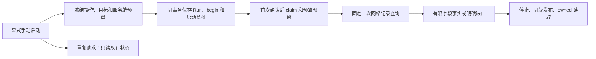

**调查 v2：设计、现有实现与实际证据对照（2026-10-25）**

审查基线：`codex/investigation-review-20261024` / `7908f73`。开始时工作区干净。按用户本轮要求暂停权限相关实施，改做设计与实现审查；M8a4.4b JWT/RBAC 不再按旧文档的“下一步”自动执行。本轮不修改业务源码，不访问真实数据库、查询服务或模型，不续跑任何历史 Run。

**审查后的收尾决定：** 用户再次要求以功能完成为准，不扩展可用性、恢复、故障注入或冗余测试。当前已实现范围结束本阶段；复用本报告已有124项合同结果及两侧独立审阅，不再复跑。下文恢复/运营等意见保留为已知限制和后续参考，不新增为功能交付前置门。本次只保存审查、证据及续接约定并提交推送；权限工作保持暂停。Case/Deep/自动政策等尚未实现的功能不因阶段收尾改记为完成，活动change的2.2、2.3保持未完成。

**结论：已形成一条有持久记录、重复保护和同版读取的有限来源核对路径；完整的统一调查产品仍未交付。** 最近工作的主要增量是启动、材料冻结、执行约束、存储、发布与读取的可靠性。对行为性质、业务授权、影响、攻击链和下一步补查的判断能力，没有随这些工程层的增加同步扩展。现有证据支持继续保留这套底座，不支持把它描述成“完整调查已完成，只剩权限”。

这里的“旧运行版”“v2 fixed 路径”“v2 program 路径”是三个不同概念。旧运行版保留原入口；fixed 是此前已做真实查询和发布的 v2 固定路径；program 是后来为完整告警材料与程序字段消费拆分出的新版本。fixed 的真实通过不能直接算作 program 手动启动链的真实通过。

**实际已经做了什么**

| 业务环节 | 主设计的目标 | 当前实现与可观察行为 | 当前证据及缺口 |
| --- | --- | --- | --- |
| 业务目标与范围 | 告警侦察、Case 调查共用内核，目标和完成政策分别固定 | `scope.py`、`business_profile.py` 能冻结目标、成员、来源、绝对窗口；Case 有纯结构绑定 | 实际 program runtime 只接受手动、一个完整 Alert；没有 Case 成员解析、继承或执行链 |
| 数据查询 | 根据问题选择可用来源，保留真实参数、来源和覆盖缺口 | `activity_records.py` 与 API `dispatch.py` / `query_api.py` 提供有界记录查询；来源 UUID/hash、窗口、数量和截断分别保留 | fixed 路径有真实 HTTP/ClickHouse 记录；当前场景限定 TCP 443，最多 10 条，无进程、登录、审批等新能力 |
| 完整告警材料 | 原件保全，程序字段消费与模型输入预算分开 | `program_alert_projection.py` 冻结完整 canonical Alert；`program_material.py` 处理结构材料 | 解决正常完整告警被旧模型视图大小门阻断的问题；全文只是保留，没有语义分析，`eligible_for_model=false` |
| 有限事实 | 程序处理可确定字段，模型处理需分析的问题 | `program_recon.py` 产来源观察、结果未知、UUID 声明关联、查询覆盖等事实 | 正常单记录样例有 4 条事实；性质 unresolved、业务授权 unknown、影响未评估 |
| 模型主分析 | 分问题或组合分析，程序校验后采用 | `execution_models.py`、`analysis_adoption.py` 已有模型执行与采用能力 | 历史 M4 有真实模型的有限 Q1/Q2/Q5 试验；当前 program 启动路径没有调用这些模型能力 |
| Deep 与统一循环 | 补查结果影响下一步查询，再分析、停止或交接 | `question_deep.py` 有纯任务/查询准入；当前 `ProgramReconRuntime` 只做一次固定查询后 finalize | 未交付根据结果选择下一查的循环，也未证明模型/Deep 的增量业务价值 |
| 原子启动 | 同一操作只创建一个 Run，身份/范围/预算一起固定 | `program_start_contract.py`、`program_start_store.py`、`program_start_coordinator.py` 已实现稳定操作身份、原子准入、首次确认后才执行 | 离线完整组合已测；真实 PG 已测锁竞争、全回滚和提交确认丢失，但该批工具/模型预算为零 |
| 持久执行与预算 | 调用前预留，回执与原件原子保存，未知不清零 | `execution_state/store/tools.py` 与 `program_runtime_state/store.py` 保留预算、owner、事件/工件及结束状态 | 这是本轮前主要工程成果；重复请求和未知提交不会自动重派，尚无面向业务的恢复流程 |
| 同版交付 | 结构结果、Markdown、执行状态、通知都来自同一版 | `program_recon_publication*.py`、`program_profile_restore.py`、`program_result_reader.py` 保存/恢复精确版本，兼容已知 fixed/program 两族 | fixed 有真实发布与冷读；program 有离线完整读回和真实 PG partial 发布；通知只是未投递描述 |
| HTTP 入口 | 新版可显式启动、读取，旧版保持 | API/Agents 各有独立 factory；已有 start、operation-read、Run GET | 新启动全链在 ASGI/Mock/双进程离线验证；没有同一次真实新运行串起用户启动→PG→HTTP/CH→报告；未接入旧 main |
| Case、自动政策、领域能力 | 全成员调查、跨 Run 引用、独立创建/启动政策、按需专家 | 设计和纯 profile 合同已有 | 实际 Case 继承/整体调查、自动创建/关联/启动、领域专家、响应规划均未交付 |

实际 program 调用链是：

图中的查询在正常离线样例实际使用 MockTransport；真实 PG 最新批预算为零，因此没有执行该查询。图示表达代码结构，不是整链真实上线证明。

**对照旧实现，改变在哪里**

旧运行路径保留 graph/Deep 及 Case/领域相关编排。本次 v2 的主要改变是把范围、来源、采用、额度和同版交付变成显式程序合同，并允许简单字段核对直接由程序完成。它没有在现有线上流程里悄悄替换模型，也没有把旧 Case/专家能力迁完。主设计第 12.7 节明确允许固定程序路径先走 M6→M7→M8a，因此这个实施选择本身符合设计；问题在于对外说明必须持续保留其有限目标。

| 环节 | 仓库中保留的旧路线 | 当前 v2 增量 | 尚待主设计落地 |
| --- | --- | --- | --- |
| 编排 | 四节点流水线、Router选择、旧Deep工具循环 | 固定单告警路径、一次查询、确定性停止 | 主分析与Deep/领域能力的共同调度 |
| 查询 | 既有多种工具，网络工具使用相对时间参数 | 绝对窗口、逐条来源身份/hash、覆盖回执 | 新真实入口整链及其他问题所需来源 |
| 判断 | findings、工具trace及有限依据检查 | 来源/查询/告警分类型，字段谓词和版本采用 | 性质、授权、影响、因果的有效业务判断 |
| 成本与重复 | 旧graph/Deep预算和账本 | 调用前原子预留、稳定操作身份、未知不重派 | 新Case/全部子任务接入及恢复政策 |
| 报告 | 原Markdown/HTML及报告出口 | manifest绑定结果/执行/Markdown、冻结冷读 | 正式消费侧、实际通知/流式交付 |
| Case和自动化 | 旧Case调查及自动处理路线 | 两profile纯合同、隔离手动Alert路径 | 新全成员继承、跨成员调查及自动政策 |

旧路线依据：[orchestrator](../../services/agents/app/investigator/orchestrator.py)第126—140行、[调查入口](../../services/agents/app/api/investigate.py)第146—163行、[旧Deep](../../services/agents/app/investigator/deep_investigation.py)第566—575行、[旧网络工具](../../services/agents/app/tools/investigation.py)第104—108及160—170行。本轮比较仓库中保留的旧实现，没有重新获取开源上游，也未重新探测线上部署。

源码依据：[主设计](../architecture/investigation-planning-design.md)第 138—149、768—785、872—888 行；[program runtime](../../services/agents/app/investigation_v2/program_recon_runtime.py)第 16—63 行；[版本计划](../../services/agents/app/investigation_v2/program_runtime_state.py)第 47—103 行。

**现有真实证据到底证明了多少**

| 证据 | 实际做过 | 不能据此宣称 |
| --- | --- | --- |
| [M4 历史模型回执](../operations/unified-investigation-m4-20261024.json) | 选定 8 个有限案例、8 次回复、23484 tokens；该开发批共 18 回复、52185 tokens，保留 5 个语义失败 | 完整恶意性/授权判断通过，或当前 program 启动已接模型；本轮没有重跑模型 |
| [fixed 真实 runtime](../operations/investigation-fixed-runtime-seam-20261024.json)＋[真实发布](../operations/investigation-publication-pg-seam-20261024.json) | 一个合成 Run 真正查询一次，5事件/10工件；随后仅追加发布成为6/14，报告3111字节，另一进程读同版 | 普通用户真实启动已通过，或具备动态 Deep、Case、业务裁决能力 |
| [program 双进程离线组合](../operations/investigation-program-start-offline-20261025.json) | 6个互相隔离的 SQLdouble 场景；80个API请求、44个Mock后端请求；normal 7事件/15工件、1次Mock工具 | 真实PG共享库并发、真实JWT/RBAC、真实业务查询；6场景也不是共享库中的6个独立Run |
| [program 真实PG准入](../operations/investigation-program-admission-pg-20261025.json) | normal 实际发布 partial 5/11；rollback 0；ACK 实际保留2/3且不续跑；工具0、模型0 | 整链业务成功或完成告警调查；ACK 的 phase=ready 只是尚待执行，不是结果 scope_readiness=ready |

可以直接看[真实保存的固定路径报告原件](examples/fixed-recon-published-20261024.md)。它回答的是：某时某主机有一条到目标 TCP443 的来源观察、连接结果仍未知、告警声明的事件 UUID 与记录匹配、查询范围有限。它没有回答“是否攻击、是否获批、是否成功、影响多大、该执行什么响应”。

**本轮最重要的评审意见**

1. **完成政策需要按业务目标解释。** `ready` 不等于告警已调查清楚，甚至不强制精确关联命中。`scope.py` 第224—227行把 Q2 设为非关键、非完成依赖；[现有测试](../../services/agents/tests/test_program_recon_contract.py)第66—71行明确验证：没有精确告警来源关联时，Q2 为 insufficient_evidence、有 `no_exact_alert_source_link`，结果仍可 ready。这与当前“来源记录核对”合同一致，不是新发现的代码缺陷。如果产品目标改成“核实这条告警”，应先重新审定关联和完成条件，不能沿用这个 ready 宣称告警结论成立。

2. **现在的 M6 是一个固定分支，完整循环仍空缺。** [runtime](../../services/agents/app/investigation_v2/program_recon_runtime.py)第53—63行是一次 gate 后 finalize；没有模型分析→关键缺口→选下一查→更新判断的循环。M4 组件存在和旧模型试验通过，都不能补上这一连接。Case 有结构合同，也不代表 Case 调查已经实现。这些是明确未完成项，不建议为凑模型流程把固定字段核对改成强制模型调用。

3. **防重复已经做了，可恢复运营还没有。** [协调器](../../services/agents/app/investigation_v2/program_start_coordinator.py)第106—140行只让 fresh admission 进入执行；重复/read 不续跑或补发布。[准入](../../services/agents/app/investigation_v2/program_start_store.py)第219—225行又阻止同 Alert 已有 active/unsettled/unknown 操作时另起新 key。结果是确认丢失或中断后可能长期有 Run、没有正式报告、也不能直接重新启动。这是当前明确取舍；后续若要真实使用，需定义可见状态和受控恢复处置，不能重置或补跑本次保留的 ACK Run。

4. **同版报告已做，产品交付渠道未完成。** [publication store](../../services/agents/app/investigation_v2/program_recon_publication_store.py)第219—239行只产生 `delivery_status=not_attempted` 描述，读取时 notification 为 null。旧 Run.status 仍可为 running，而新 execution_snapshot 已 finished；[owned reader](../../services/agents/app/investigation_v2/program_result_reader.py)第101—107行刻意同时暴露两者。只读旧字段的消费者不会自动获得新完成状态。本轮核对的两个旧 main 与原基线一致，没有新路由接入；正式运行、通知/流式交付和相关消费侧不能计已完成。

5. **完整材料保留是有效改进，语义能力边界也必须保留。** 新 ProgramMaterial 避免把程序字段消费绑定到模型视图门，解决正常长告警无法产有限事实的问题。[材料合同](../../services/agents/app/investigation_v2/program_material.py)第23—38行明确没有模型资格、未分析自由文本。全文 hash、完整存储、引用正确都不能代替全文含义分析；报告或进度中不应将这项写成“已经理解完整告警”。

6. **工程复杂度已经明显超过当前场景的业务宽度。** 当前两个 v2 包共50个Python文件、8707行，包含初始化文件、注释和空行，不含测试和探针；这是库存大小，不是完成率。fixed/program 两族保留有明确兼容理由；原子预留、未知保留、来源核验、同版发布也有实际价值。但在完成一个用户可判断价值的场景前继续增加版本/适配层，会扩大维护成本。多个入口持续累加历史“最新/下一步”段落，主设计第12.7节仍有“M6.2c下一步”等旧快照，已妨碍整体理解。建议后续采用一张当前能力表，历史回执只链接归档；本报告先提供这个视角，不重写历史。

上述1—5主要是已知政策取舍和未交付能力，6是设计维护意见。本轮抽查及独立审阅没有确认新的、必须立即修复的业务代码缺陷；这不等于对所有源码或完整系统作无缺陷认证。

**后续方向建议，本轮不实施**

保留现有来源/预算/原子持久/同版读取底座，先把产品目标说清并选一个最小可验收场景。若目标是有限来源核对，就以真实输入、明确关联标准和用户能读懂的结果验证它的实际用途；若目标是更完整的调查，就需要补一个来源足够、补查结果确会改变下一步判断的业务案例，再推进 Deep/主分析连接。Case 随后从完整成员继承和跨成员问题开始，自动政策放在人工路径之后。没有理由在这轮审查中继续加权限工程，也没有理由为了显得完整而把旧模型/专家全部串入。

**本轮核查记录**

- 主审复跑6组现有离线合同：ProgramMaterial 12、program recon 16、启动协调器23、program runtime 25、program publication store 29、compatible owned reader 19，共124项，11.057秒，exit 0。使用已有 `.venv/Scripts/python.exe`（实际Python 3.12.4）、`-B`；无真实DB/HTTP/模型。
- 最近两批回执的23条文件hash记录全部一致，去重18个文件；两份公开原始证据文件的完整字节hash一致。离线74＋真实PG冻结14，共88份工件的UTF-8长度/hash重新核对一致。这是本地冻结证据核查，不是再次连接PG验收。
- 抽查两个旧 main 和原认证依赖，相对`3fa4be3`无差异。没有据此声称本轮核验了全部旧源码或当前线上状态。
- 独立设计审阅和独立代码审阅分别复核业务目标/现有主链/已知缺口；没有要求或执行新的真实权限测试。结构化核查记录见[本轮证据](../operations/evidence/investigation-design-implementation-review-20261025.json)。历史测试数、独审数和本轮124项互有重叠，不能累加成总通过数，更不能当成业务完成率。

本轮仅保存审查与阅读入口，业务实现停在原基线。权限相关工作保持暂停，Case/Deep/自动政策以及活动change的2.2、2.3仍未完成。
