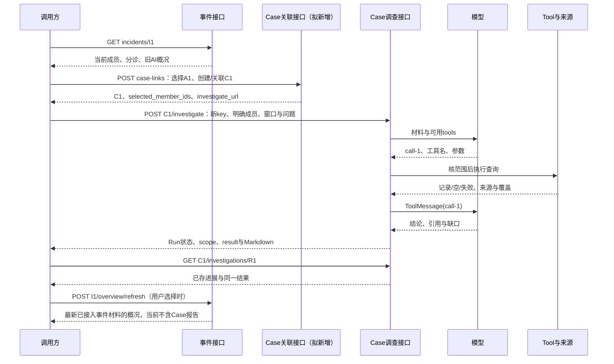

# 调查模块接口设计：请求、返回与流程衔接

2026-10-27，依据[当前设计对齐](current-design-alignment-20261027.md)细化到接口，源码核对基线`6044615`。本文只定义接口及业务语义，不编写路由、模型、迁移、模拟HTTP服务或测试程序。

**状态标识：已有＝当前代码行为；拟新增＝本次设计稿、尚不可调用；后置＝不作为当前功能前置条件。** 现有接口保持实际字段，不把拟新增字段写成已实现。实现与历史证据分别见[实现详解](current-implementation-reference-20261027.md)、[审计导航](audit-guide-20261027.md)。

## 1. 接口总表

公开调查接口统一前缀`/api/v2/investigation`。旧v1 Case接口继续管理案件；旧fixed/program调查入口保持原合同。

| 状态 | 方法与路径 | 用途 | 是否启动模型/查询 |
| --- | --- | --- | --- |
| 已有F1 | `GET /incidents/{incident_id}` | 当前成员/分诊汇总与已存AI概况 | 否 |
| 已有F2 | `POST /incidents/{incident_id}/overview/refresh` | 手动生成并保存概况 | 一次概况模型；无Tool、无Run |
| 拟新增F4 | `POST /case-links` | 所选告警创建或关联Case | 否 |
| 拟新增F4 | `GET /case-links?incident_id=…`或`?alert_id=…` | 返回已保存的转Case关联，供跳转 | 否 |
| 已有F3 | `POST /cases/{case_id}/investigate` | 对Case所选成员执行一次调查 | 是；同步执行 |
| 已有F3 | `GET /cases/{case_id}/investigations/{run_id}` | 读取已存范围、进展和结果 | 否 |
| 拟新增读取补充 | `GET /cases/{case_id}/investigations` | 列出该Case的新版调查历史 | 否 |
| 拟新增F5，内部接口 | `POST /internal/investigation/triage-escalations` | 原分诊worker按已有政策进入同一个Case内核 | 仅允许分支执行；同步衔接F4/F3 |
| 拟新增F5，内部接口 | `GET /internal/investigation/triage-escalations/{operation_key}` | 读取自动入口已保存的处理回执 | 否 |

内部接口路径为完整路径，不拼公开前缀。它用于独立Agents worker与API进程之间的调用，不向普通客户端开放自动触发参数。本轮不细化或恢复权限专项；沿用现有用户/服务身份机制，租户与执行主体由可信上下文确定。

旧`POST /api/v1/cases`、`POST /api/v1/cases/{case_id}/alerts`和`GET /api/v1/cases/{case_id}`可以复用案件业务能力；它们目前不是F4的等价实现，也不自动转入F3。

## 2. 公共约定

| 项目 | 约定 |
| --- | --- |
| ID | canonical Alert UUID、Fusion Incident UUID、真实Case UUID、Run UUID分开；外部产品告警ID仅是来源字段 |
| 租户/主体 | 不从业务JSON接收`tenant_id`、`actor_id`或厂商凭据；服务端从当前身份取得 |
| 时间 | ISO 8601带时区，调查窗口归一UTC，左闭右开`[start,end)`；当前F3要求正窗口且不超过7天 |
| 空值 | `null`表示没有对应值/尚未生成；`[]`表示本字段没有条目；查询成功为空与查询失败必须另外区分 |
| 请求重用 | `operation_key`为非零UUID。F3同租户同key且同Case/主体/请求只读原Run，改参数必须新key；F4/F5分别按自己的操作类型保存一次结果 |
| 请求字段 | 当前F3及拟新增写接口禁止未声明字段；不把此规则宣称为所有已有GET都已严格拒绝未知参数 |
| HTTP与业务状态 | HTTP 200表示成功返回接口结果，不保证模型生成成功、调查无缺口或Case已解决 |
| 错误体 | 已有业务错误采用`{"detail":"code"}`；参数校验422沿用框架`detail`数组。拟新增业务错误继续同样格式，不另建错误协议 |
| 跳转 | 文档返回的是API资源地址；界面如何路由不在本轮实现。原`alert_url`也为API地址 |

拟新增列表接口均用`limit`（默认20，1–50）及可选`cursor`（不透明字符串），返回`items`和`next_cursor`（无后续为null），按记录时间与ID倒序。游标只翻阅记录，不触发执行；不加入分页快照系统。

## 3. F1/F2：事件汇总与AI概况（已有）

### 3.1 GET事件汇总

`GET /api/v2/investigation/incidents/{incident_id}`无业务请求体。服务端按PG Alert中已保存的Incident归属读取成员，汇集每条最新分诊，不要求该告警触发过调查。

返回`IncidentOverview`，所有字段含义如下：

| 字段 | 类型 | 含义 |
| --- | --- | --- |
| `incident_id / tenant_id` | UUID字符串 | 当前事件和租户 |
| `title / severity` | string | 当前事件标题及成员严重度汇总 |
| `member_count` | integer | 当前成员总数 |
| `first_seen / last_seen` | datetime | 成员首次/最后出现范围 |
| `source_updated_at` | datetime或null | 当前成员及所选分诊的最新更新时间 |
| `by_status / by_disposition / by_triage_verdict` | object，值为integer | 当前状态、处置、已存分诊结论的计数，三者分别显示 |
| `members_without_saved_triage` | integer | 无明确分诊记录的成员数 |
| `entities` | `[{type:string,value:string}]` | 去重实体 |
| `mitre_tactics / mitre_techniques` | string数组 | 成员标签并集 |
| `members` | IncidentMember数组 | 见下表 |
| `handling_status` | string或null | 当前固定null；不由成员关闭数推导事件关闭 |
| `ai_overview` | string或null | 最近成功保存的概况 |
| `ai_overview_metadata` | object或null | 见3.2；没有记录时为null |

`IncidentMember`：`alert_id:UUID`、`title:string`、`severity:string`、`status:string|null`、`disposition:string|null`、`event_time:datetime`、`updated_at:datetime|null`、`case_id:UUID|null`、`connector_id:UUID|null`、`source_alert_id:string|null`、`saved_analysis:string|null`、`recommendations:array`、`triage:SavedTriage|null`、`alert_url:string`。其中`case_id`只是现有Alert字段，不是所有Case关联的完整列表。

`SavedTriage`：`event_id:UUID`、`run_id:UUID`、`recorded_at:datetime`、`summary:string`、`verdict:string|null`、`rationale:string|null`、`auto_closed:boolean|null`、`findings:array`、`proposed_actions:array`。这些是历史分诊判断；当前人工处置不同也不会覆盖这份判断。没有分诊就返回null，不用`saved_analysis`冒充。

未找到该租户的事件成员：404 `incident_not_found`；非法路径UUID：422。

### 3.2 手动刷新概况

`POST /api/v2/investigation/incidents/{incident_id}/overview/refresh`无业务请求体，返回完整`IncidentOverview`，HTTP 200。它读取最新成员/分诊、尝试一次概况模型并保存；不调用Tool，不创建Run。

`ai_overview_metadata`的合同：

| 字段 | 类型/取值 | 含义 |
| --- | --- | --- |
| `status` | `ready / not_generated` | 是否有可展示的旧文或新文 |
| `generated_at / source_updated_at` | datetime或null | 当前正文的生成时间及依据的材料时间 |
| `is_stale` | boolean或null | 当前材料与正文依据是否不同；无正文时null |
| `source_refs` | object | 当前正文采用的来源范围，见下文 |
| `model` | string或null | 当前正文使用的模型 |
| `last_attempt_at` | datetime或null | 最近一次生成尝试时间 |
| `last_attempt_status` | `succeeded / failed` | 最近尝试是否成功，不等同于正文status |
| `last_error` | string或null | `llm_unavailable / model_call_failed / invalid_summary_response` |
| `last_usage` | object或null | 最近尝试的`model`、`prompt_tokens`、`completion_tokens`及可选`cost_recorded`；未知用量为null |

`source_refs`字段：`member_ids:UUID[]`、`triage_run_ids:UUID[]`、`source_member_count:integer`、`omitted_member_count:integer`、`fields_truncated:boolean`、`investigation_results_status:"not_linked"`。尚未成功生成的空记录不保证这些来源字段齐全；只对已有正文解释其来源。当前`not_linked`表示未接入Case结果，不能理解为“没有调查”。

刷新失败仍可能返回HTTP 200且`status=ready`：旧正文、旧生成时间及旧来源继续保留，`last_attempt_status=failed`说明本次失败。普通GET或成员变化不重写AI文本。正文和元数据均为null则尚无概况记录。

### 3.3 首次概况的内部接口

已有`run_once(tenant_id, since) -> processed_count`发现尚无概况记录的新事件，调用`generate_summary(db, overview, initial=True)`并提交；手动刷新使用`initial=False`。`processed_count`为已尝试事件数，不是成功生成数。

现有独立任务参数：`--tenant-id`必填，`--since`可选带时区时间、默认进程启动时刻，`--interval`默认30秒，`--once`只处理一批最多20个。任务尚未启用；首次失败也留下尝试记录，后续由手动刷新处理。本轮不新增事件实时推送、复杂刷新政策或任务管理API。

## 4. F4：告警/事件转Case（拟新增）

### 4.1 POST /case-links

它只完成选定成员的Case组织，不执行调查。界面上的一次“转入并调查”动作可以明确地串行调用F4和F3；F4成功不代表F3成功，F3失败时仍保留已建Case。

事件来源创建Case的请求示例（全部ID均为说明用合成值）：

```json
{
  "operation_key": "44444444-4444-4444-8444-444444444444",
  "source": {
    "type": "incident",
    "incident_id": "11111111-1111-4111-8111-111111111111",
    "alert_ids": ["22222222-2222-4222-8222-222222222222"]
  },
  "target": {
    "mode": "create",
    "title": "host-a异常外联调查",
    "description": "核对选定告警涉及的外联进程。"
  }
}
```

| 字段 | 约束 |
| --- | --- |
| `operation_key` | 必填、非零UUID |
| `source.type` | `incident`或`alerts` |
| `source.alert_ids` | 两种来源均必填，至少一个、不重复的canonical UUID；明确提交用户选中的集合 |
| `source.incident_id` | `type=incident`时必填；`type=alerts`时禁止该字段 |
| `target.mode` | `create`或`attach` |
| `target.title` | create必填，3–200字符；attach禁止 |
| `target.description` | create可选string或null；attach禁止 |
| `target.case_id` | attach必填真实Case UUID；create禁止 |

attach示例为`"target":{"mode":"attach","case_id":"33333333-3333-4333-8333-333333333333"}`。告警详情来源为`"source":{"type":"alerts","alert_ids":["22222222-2222-4222-8222-222222222222"]}`。

业务处理约定：

1. 服务端校验所选Alert存在于当前租户；Incident来源还须全部属于请求中的事件。成员不匹配整体返回错误，不悄悄丢掉部分成员。
2. “选择全部”由调用方提交当前看到的完整ID集合。服务端只处理显式集合：新增告警不偷偷加入；与当前事件成员相等时返回`selection_kind=all_current`，否则为`subset`。来源为alerts时为`explicit_alerts`。
3. create创建状态为`new`的Case，严重度取所选成员最高已知等级；只设置请求中的标题/描述及成员，不自动推送ITSM。attach去重追加成员；已在Case内的成员计入`already_linked_member_ids`。
4. 本设计拟定attach不接受`resolved/closed` Case，返回409 `case_not_open`，由调用方走已有案件管理流程后重新决定；这是F4新增约束，不宣称旧v1接口已有相同检查。
5. Case成员以`Case.alert_ids`为准，不重写Alert的旧`case_id`来冒充完整关系。一个来源告警可能已存在于其他Case，本接口只处理明确指定的目标，不移动或删除其他Case成员。
6. 同一操作的Case变更和成功关联回执一并保存。相同key及同主体/规范化请求返回原回执、不新建Case；同key换目标、来源或正文返回409。UUID归一、成员按集合比较；正文保留原值。具体表与SQL在实施时确定。

首次成功201；相同操作重读200，返回同一业务结果：

```json
{
  "operation_key": "44444444-4444-4444-8444-444444444444",
  "link_id": "55555555-5555-4555-8555-555555555555",
  "case_id": "33333333-3333-4333-8333-333333333333",
  "case_action": "created",
  "source_type": "incident",
  "source_incident_ids": ["11111111-1111-4111-8111-111111111111"],
  "selected_member_ids": ["22222222-2222-4222-8222-222222222222"],
  "added_member_ids": ["22222222-2222-4222-8222-222222222222"],
  "already_linked_member_ids": [],
  "selection_kind": "all_current",
  "created_at": "2026-10-27T02:10:00Z",
  "case_url": "/api/v1/cases/33333333-3333-4333-8333-333333333333",
  "investigate_url": "/api/v2/investigation/cases/33333333-3333-4333-8333-333333333333/investigate"
}
```

`case_action`为`created/attached`；`source_incident_ids`由实际成员归属解析，不接受调用方伪造。响应不带Run ID或调查结论。它记录转入时的成员事实，之后Case修改不会改写这条历史回执。

### 4.2 GET /case-links

查询参数`incident_id`、`alert_id`必须恰有一个，另支持第2节的`limit/cursor`。Incident筛选按回执的`source_incident_ids`，Alert筛选按`selected_member_ids`，不靠旧Run.case_id猜测。仅返回当前租户的关联。

```json
{
  "items": [{
    "link_id": "55555555-5555-4555-8555-555555555555",
    "case_id": "33333333-3333-4333-8333-333333333333",
    "selected_member_ids": ["22222222-2222-4222-8222-222222222222"],
    "source_incident_ids": ["11111111-1111-4111-8111-111111111111"],
    "created_at": "2026-10-27T02:10:00Z",
    "case_url": "/api/v1/cases/33333333-3333-4333-8333-333333333333",
    "investigations_url": "/api/v2/investigation/cases/33333333-3333-4333-8333-333333333333/investigations"
  }],
  "next_cursor": null
}
```

这是转入操作历史，不是当前Case成员快照；当前成员从Case详情读取。列表可存在同一Case多次转入记录，调用方可按Case ID合并跳转入口。没有记录返回空数组，不能据此断言从未通过旧v1关联Case。事件保持F1/F2，新增链接查询不触发AI刷新，也不读取完整Case报告。

### 4.3 F4业务错误

| HTTP / detail | 含义 |
| --- | --- |
| 404 `incident_not_found / alert_not_found / case_not_found` | 相应资源在当前租户不可取得 |
| 409 `incident_membership_changed` | 提交的部分Alert已不属于该Incident；重新读取后选择 |
| 409 `case_not_open` | 目标Case已resolved/closed |
| 409 `case_link_operation_conflict` | 同key对应另一主体或另一请求 |
| 422 | 缺字段、非法ID、空/重复成员、create/attach字段组合错误、筛选参数错误 |

未声明的存储故障沿用应用错误处理；不能编造成功关联。读取关联不会补建Case或启动调查。

## 5. F3：Case调查与报告（已有接口＋一项读取设计）

### 5.1 启动请求

```http
POST /api/v2/investigation/cases/33333333-3333-4333-8333-333333333333/investigate
Content-Type: application/json
```

```json
{
  "operation_key": "66666666-6666-4666-8666-666666666666",
  "start": "2026-10-27T01:00:00Z",
  "end": "2026-10-27T02:00:00Z",
  "question": "核对异常外联是否与可疑进程有关，说明依据与缺口。",
  "selected_member_ids": ["22222222-2222-4222-8222-222222222222"]
}
```

`operation_key/start/end`必填；`question`可省略，默认核对行为证据、关联、影响、反证及缺口，长度1–2000；`selected_member_ids`省略或null时使用启动时全部Case成员，指定时须非空、不重复且是Case成员子集。**接F4时必须传F4返回的selected_member_ids，不能省略后把已有Case的其他成员也纳入。** F4/F3各有自己的操作key。

该POST当前在请求内执行，不返回202后台任务。当前首次成功返回字段为`run_id/case_id/status/scope/result`；重复相同请求进入只读路径，还会带`progress`。调用方不要假定首次POST必有progress，也不要把超时或断开理解为没有创建Run；相同key重读不重跑，当前没有续跑接口。

### 5.2 读取与输出DTO

`GET /api/v2/investigation/cases/{case_id}/investigations/{run_id}`返回：

| 字段 | 类型 | 含义 |
| --- | --- | --- |
| `run_id / case_id` | UUID | 实际执行与案件身份 |
| `status` | `running / completed / failed` | 当前F3执行状态，不能代替Case状态 |
| `scope` | object | 本次固定成员和窗口，见下文 |
| `progress` | `[{seq:integer,kind:string,summary:string}]` | 已保存步骤，按seq顺序；没有实时流 |
| `result` | object或null | 已保存最终结果；尚未生成时null |

`scope`固定含`all_member_ids / selected_member_ids / read_member_ids:UUID[]`及`start/end:datetime`。`all_member_ids`是启动时Case全成员，`selected_member_ids`是请求范围，`read_member_ids`是实际读取到的成员，**不是逐成员分析完成证明**。

`progress.kind`当前使用`case_analysis_started`、`case_analysis_model`、`case_analysis_tool`、`case_analysis_finished`。准备和返回可能是同kind的两个不同seq。公开GET返回简短步骤；完整可见模型消息和Tool结果保存在ledger，不提供模型内部推理。

`result`完整字段：

| 字段 | 类型/值 | 含义 |
| --- | --- | --- |
| `profile` | `case_analysis.v1` | 当前Case路径版本 |
| `run_id / case_id` | UUID | 与外层一致 |
| `stop_reason` | string | 实际停止原因，见5.3 |
| `completion` | `partial / conclusion_available` | 有缺口为partial；不是恶意判决或业务关闭 |
| `scope` | 同上 | 固定范围 |
| `report` | AnalysisConclusion | 模型结论合并程序发现的缺口 |
| `evidence` | A/T/E证据数组 | 来源告警、分诊判断、工具结果（也包括空结果/失败） |
| `markdown` | string | 可保存展示的完整报告正文；当前不另设下载接口 |
| `usage` | object | `model_calls/tool_calls/known_tokens:integer`、`unknown_usage:boolean` |

`AnalysisConclusion`的正常示例：

```json
{
  "summary": "查询记录显示外联与脚本进程同时出现，尚不能确认恶意控制。",
  "findings": [{"text": "该窗口内存在powershell.exe外联记录。", "evidence_ids": ["E1"]}],
  "counterevidence": [],
  "gaps": ["当前进程工具没有父进程链，无法确认启动来源。"],
  "recommendations": ["补充产品侧父进程记录并核对任务授权。"]
}
```

summary非空且≤5000字符；每个finding.text非空且≤3000字符、evidence_ids至少一个；其余为字符串数组。空counterevidence仅表示本次未列出反证，不代表已经排除反证。引用检查只验证编号存在，不验证结论语义。

A证据：`evidence_id/kind=alert/data`，data含`alert_id/title/event_time/severity/status/disposition/source_event_ids/saved_analysis/saved_analysis_truncated`。T证据：`evidence_id/kind=triage/event_id/data`，data含`verdict/rationale/auto_closed`。E证据：`evidence_id/kind=tool/tool/arguments`加第7节结果；复用时另带`reused_from:{run_id,evidence_id}`。A/T不能当作相互独立的事实印证。

### 5.3 状态、停止与错误

| 层次 | 取值与解释 |
| --- | --- |
| 正常停止 | `analysis_complete`：结论可解析且引用编号存在；Run为completed，仍可能completion=partial |
| 不能继续调用 | `model_unavailable / model_call_limit / tool_call_limit / input_or_token_limit / usage_unknown_or_budget_exhausted / duration_limit` |
| 内容或协议问题 | `invalid_model_content / invalid_tool_call_protocol / model_response_truncated / invalid_or_unreferenced_conclusion` |
| 执行异常 | `analysis_failed:<异常类型>`；上述非正常停止保存失败/partial结果（若收尾保存成功） |
| HTTP 404 | `case_not_found / case_analysis_not_found` |
| HTTP 400 | `case_requires_valid_selected_members`：Case没有可选成员或选择不属于Case |
| HTTP 409 | `operation_key_conflicts_with_existing_case_analysis` |
| HTTP 422 | 非法UUID、无时区/非法窗口、超长问题、空/重复成员或额外字段 |

当前上限：模型4次、工具4次、已知tokens 24000、主循环120秒；120秒不覆盖所有前置读库及最终保存。已有Run.status并非完整恢复状态机，部分中断可保留running且result=null；本文不新增取消、接管、恢复或异步执行接口。

### 5.4 Case历史列表（拟新增读取补充）

`GET /api/v2/investigation/cases/{case_id}/investigations?limit=20&cursor=…`只列当前租户、真实Case及`case_analysis.v1`的Run，返回`items/next_cursor`。每项字段：`run_id/case_id:UUID`、`started_at:datetime`、`completed_at:datetime|null`、`status:string`、`scope:object`、`stop_reason:string|null`、`completion:string|null`、`result_url:string`。没有最终工件时后两字段为null，不从Run.error猜业务结论。

不存在Case返回404 `case_not_found`；存在但没有新版Run返回空列表。旧fixed/program及v1 Run走各自旧入口，不混入本列表后用F3格式解释。列表不装载完整报告，需要时再调用已有详情GET。

## 6. F5：原分诊自动升级衔接（拟新增内部接口）

### 6.1 调用前提与请求

保留原worker语义：所有未自动关闭的告警（包括needs_review）进入升级判断；实际执行受原review-only、自动升级开关和writer许可控制。**不是AI概况发现可疑就触发，也不是只接受某个模型升级标签。** 本设计不启用任何开关。

原worker和API是不同进程，因此明确通过内部HTTP衔接；API内部复用F4成员组织及F3执行能力，不把新Case循环搬回旧graph。

`POST /internal/investigation/triage-escalations`的拟定请求：

```json
{
  "operation_key": "77777777-7777-4777-8777-777777777777",
  "triage_event_id": "88888888-8888-4888-8888-888888888888",
  "alert_id": "22222222-2222-4222-8222-222222222222",
  "policy_ref": "existing-escalation-policy-revision",
  "case_target": {"mode": "attach", "case_id": "33333333-3333-4333-8333-333333333333"},
  "start": "2026-10-27T01:00:00Z",
  "end": "2026-10-27T02:00:00Z",
  "question": "核对该告警行为证据、影响与缺口。"
}
```

`operation_key/triage_event_id/alert_id/policy_ref/start/end`必填；question沿用F3默认与长度。`case_target`使用F4的create/attach结构，或null表示尚未取得案件目标。policy_ref是已有服务端政策的可追溯引用，不是调用方自报allow=true。API按可信服务上下文重核有效政策并读取已保存的triage_event，确认该事件属于该Alert/租户；不接受客户端提交一段“分诊结论”直接开案。

本稿不发明自动Case匹配算法：目标必须来自已有明确政策。无有效目标返回pending_case，不按标题相似度、Incident UUID或一个Alert.case_id字段猜目标。create也必须有已有政策明确允许；未确定该政策时不能默认自动建Case。

### 6.2 返回及操作顺序

HTTP 200返回业务回执，字段固定如下：

```json
{
  "operation_key": "77777777-7777-4777-8777-777777777777",
  "triage_event_id": "88888888-8888-4888-8888-888888888888",
  "alert_id": "22222222-2222-4222-8222-222222222222",
  "decision": "investigated",
  "reason": null,
  "policy_ref": "existing-escalation-policy-revision",
  "case_id": "33333333-3333-4333-8333-333333333333",
  "run_id": "99999999-9999-4999-8999-999999999999",
  "run_status": "completed",
  "result_url": "/api/v2/investigation/cases/33333333-3333-4333-8333-333333333333/investigations/99999999-9999-4999-8999-999999999999"
}
```

| decision | 必要行为 |
| --- | --- |
| `skipped` | 原政策不允许本次执行；reason如`auto_closed/review_only/auto_disabled/writer_disallowed/policy_not_allowed`；无新Case/Run |
| `pending_case` | 没有有效目标或缺少允许创建的政策；reason如`case_target_required/case_target_unavailable`；无调查Run |
| `investigated` | 已有可归属的Run，run_status来自实际Run，可为running/completed/failed；不表示业务分析成功 |

无Run时run_id/run_status/result_url为null；目标尚未建立时case_id为null。分诊判断先保存，随后保存自动入口回执；未升级理由独立于原分诊结论，不反写其判断。F5回执由内部GET同key读取，worker可在已有处理记录中引用该回执；当前F1不因此自动新增自动入口状态字段。

允许执行时顺序为：重核原政策→取明确Case目标→F4只关联本条Alert→以`selected_member_ids=[alert_id]`调用F3→回填真实Run ID与状态。不能因Case另有成员而自动扩大范围。创建/关联成功、调查失败时保留Case及失败状态。

F5以租户和triage_event_id确定稳定操作身份；调用方重复发送同事件使用原key。内部F4/F3子操作key由F5操作身份分别稳定派生并保存，不每次生成随机值。同key同意图只读已保存回执/Run，不重新派发；同key改事件/目标/窗口返回409 `triage_escalation_operation_conflict`。具体UUID命名空间与存储实现待实施固定，本稿不把该重复规则扩成补偿/恢复调度器。

`pending_case`回执不随政策变化自动补跑；用户可以通过公开F4/F3明确发起手动调查。自动重新评估旧分诊事件的政策和入口不在首版范围。

非法或不匹配的分诊来源404 `triage_source_not_found`，参数错误422；内部GET未知操作404 `triage_escalation_not_found`。如果只有入口记录而Run尚未确认创建，GET保留未确认状态，不声称investigated或补跑。为表达该事实，回执decision还允许`pending_start`，reason为`run_not_confirmed`，已知Case可保留，其余Run字段null。

公开F3请求体不增加可由用户伪造的automatic/actor字段。自动来源的`triage_event_id/policy_ref/operation_key`由内部入口保存并关联到Run；当前F3尚无这项来源扩展。执行路由必须选旧或新中的一条，不能同一次升级同时运行两个内核。

## 7. 模型、Tool及产品HTTP之间的接口

### 7.1 当前模型协议与两个Tool

程序向配置的模型服务发送`model/messages/max_tokens`以及可用时的`tools`。messages包含system、当前Case材料和后续assistant/tool消息；每次最多输出1200 tokens。模型看见Tool名称、用途说明、参数schema；它不会自行发现产品URL。

现有两个工具均为`hostname:string`必填（当前Case主机枚举）、`limit:integer`可选（默认20，1–50），禁止额外参数。租户和绝对窗口由程序固定，不由模型覆盖。

| 工具名 | 返回记录字段 | 限制 |
| --- | --- | --- |
| `process_activity` | event_id、event_time、src_hostname、process_name、file_path、hash_sha256、user_name | 进程名非空的已入湖记录；无父进程链 |
| `network_connections` | event_id、event_time、src_hostname、process_name、source_ip、dest_ip、dst_port、protocol | 已入湖网络类记录；不是固定443查询 |

工具调用消息示例（arguments是JSON字符串）：

```json
{
  "role": "assistant",
  "content": "",
  "tool_calls": [{"id": "call-1", "type": "function", "function": {
    "name": "network_connections", "arguments": "{\"hostname\":\"host-a\",\"limit\":20}"
  }}]
}
```

程序调用现有逻辑接口`CaseTools.execute(name, arguments) -> result`，将E编号与结果保存后发送`{"role":"tool","tool_call_id":"call-1","content":"序列化的结果JSON"}`。必须保留同一个call_id；不能把Tool结果当新的用户指令。

成功结果字段：`available:true`、`query_id:string`、`query_scope:{hostname,start,end}`、`rows:object[]`、`returned_count:integer`、`truncated:boolean`、`limitation:string`。失败结果至少`available:false/reason:string/rows:[]`，query_id/query_scope可能缺省。reason包括`unknown_tool/invalid_or_out_of_scope_arguments/lake_not_configured/query_failed:<异常类型>`。

成功空结果必须仍为available=true、returned_count=0；不可伪造为失败，也不可写成“主机安全”。模型视图另有`model_view_row_count`、`untrusted_data_notice`；缩减行时标truncated，原结果另存。复用只检查同来源指纹、工具与参数，当前不主动探测事件湖补录或工具版本变化。

### 7.2 产品HTTP Tool的具体拟定合同

沿用[Tool接入指南](tool-onboarding-and-flow-verification.md)中的`query_host_processes`例子，增加父进程查询能力，**尚未接入F3**。不新建对普通用户开放的通用“任意URL查询”接口。

Tool参数为`hostname`、`start_time`、`end_time`必填，`limit`可选（默认50，1–100）。在Case场景中，主机必须属于本次成员，start/end必须等于Run固定窗口；schema给出该固定范围，适配器仍须实际检查。现有两个事件湖Tool不因此改变参数。

绑定上下文（服务端提供，不是模型参数）：`tenant_id/run_id/case_id`、所选成员对应的`connector_id`、产品类型、配置地址及凭据引用、已核主机与窗口。必须能确定具体来源实例；多实例且无法确定时返回`available=false, reason=source_ambiguous`，不随便挑一个。同租户有产品配置不证明它就是该告警来源。

模拟产品提供`POST /v1/process-events/search`，字段映射如下：

| 来自哪里 | 产品HTTP字段 | 规则 |
| --- | --- | --- |
| 已校验`hostname` | body.deviceName | 不改主机身份 |
| 已校验`start_time/end_time` | body.from/to | UTC，仍为左闭右开 |
| 已校验`limit` | body.pageSize | 不扩大请求上限 |
| 当前connector配置 | base URL与认证 | 不交给模型填写 |

```json
{
  "deviceName": "host-a",
  "from": "2026-10-27T01:00:00Z",
  "to": "2026-10-27T02:00:00Z",
  "pageSize": 50
}
```

```json
{
  "requestId": "demo-request-1",
  "code": "OK",
  "data": {
    "events": [{
      "eventId": "demo-event-1", "deviceName": "host-a", "eventTime": "2026-10-27T01:20:00Z",
      "process": {"pid": 4120, "image": "powershell.exe"},
      "parent": {"pid": 2080, "image": "WINWORD.EXE"}
    }],
    "total": 1, "nextCursor": null
  }
}
```

解析时`events`必须为数组，记录映射为`event_id/hostname/event_time/process_id/process_name/parent_process_id/parent_process_name`；原始产品ID和requestId保留。用统一Tool成功/失败含义回传，并拟新增`source:{connector_id,product,request_id}`及原始响应工件引用`raw_artifact_id`。这些新增字段是本产品Tool设计，现有CaseTools结果尚不包含。

HTTP成功且code=OK、events为空：available=true、rows=[]。HTTP/业务错误：available=false，reason分别为`http_error:<状态码>/vendor_error:<产品码>`；结构不符合合同为`invalid_response`，超时为`request_timeout`。错误返回不能伪造成“成功空结果”。记录中的主机或时间越界时返回`out_of_scope_response`，不采用为本次证据。

首版只取一次请求的返回页：nextCursor非null、total大于本次返回数或响应被本地截取，都标truncated并保留覆盖限制；不默认无限翻页。原始响应、规范化记录、实际HTTP请求参数和模型视图关联到同一Tool调用，凭据不写入材料。

### 7.3 最小直接验证约定（以后实施时执行）

只保留正常、成功空结果、查询失败三个业务场景。正常场景检查一条链：模型收到schema→发出正确Tool及参数→模拟HTTP服务记录实际请求→正确映射返回→原call_id回传→报告引用来源并保留缺口。空/失败场景检查不同结果没有被混成安全结论。

协议替身只能证明字段与接线；真实模型选工具和解释能力须用选定场景另行直接确认。本轮没有编写模拟服务或验证脚本，没有运行这些场景；不扩成压力、恢复、复杂并发或故障注入矩阵。

## 8. 一次完整调用顺序



自动入口使用第6节内部请求代替用户F4/F3调用，仍进入同一Case执行。事件Case结果回显、专项Deep、其他产品能力、自动重要节点刷新继续后置；本设计不新增Incident调查profile、事件报告或另一套分析循环。

## 9. 交接给后续实现的范围

本稿已明确现有四个公开接口、拟新增Case关联与历史列表、内部自动入口、模型/Tool消息和一个产品HTTP适配合同。F4/F5及拟新增字段都保持未实现；Case自动目标政策仍必须来自已确定的业务规则，本文没有代用户选定自动匹配算法。

实施时按功能逐项推进：先F4成员转Case及跳转，再按实际需要补新版Run列表和Tool，F5在Case目标政策明确后接线。只做相应功能的直接验证；既有且未变部分不重跑。权限专项、部署、远端推送与OpenSpec未完成项不因文档完成而恢复或核销。
