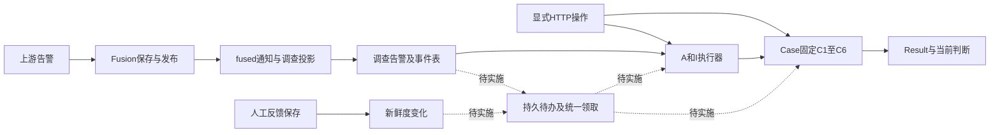

# 调查功能与整体流程当前评审

评审日期：2026-11-14。范围：告警分诊 A、事件诊断 I、Case C1–C6、人工反馈 H，以及入站、队列、更新、保存和读取。对应现有 [主调查 change](../../openspec/changes/complete-socai2-investigation-chain/tasks.md) 与 [流式更新 change](../../openspec/changes/schedule-streaming-investigation-updates/tasks.md)，本文件记录评审发现，不另建实施任务树。

**当前具备显式启动的固定调查和可追溯存取能力，但尚不能认定为结论稳定可用、会持续自动更新的调查系统。** 主要问题分为四类：

1. 固定步骤的结构交付仍会失败。最新三案中，一案得到并采用待复核结论，两案最终拒收；生成 Schema 与接收校验存在可离线复现的差异，C3 还有输出截断。
2. 部分步骤完成了分析或保存，但没有完成预期的取证或判断。当前样例的 Deep 没有执行补查；事件和最终结论仍扩大事实，知识的实际帮助尚未证明。
3. Kafka 入站投影已运行，投影之后的持久调度、变化传播、事件跟随和反馈重算尚未接通。现有 Case 单活跃及 pending 保护应复用；A/I 还缺同主体保护。
4. 4177 已确认把正常结束码 `stage_output_saved` 列入错误，告警/事件的交付节点也没有直接呈现业务结论。此外还需关注新材料入口、同步请求等待、失败停位及验收环境。它们不由“接口齐全”“容器健康”或“有 Result”自动解决。

本轮仅评审、只读核对和文档落地，未改业务代码、配置、数据库或消费者，未发消息、调用新模型、部署、提交或推送。既有正文质量后置决定、主调查 31/41 和 `NOT_PASSED` 保持。本文件不替代主 change 完成时的独立结束审计。

## 评审基线和直接证据

| 基线 | 本轮核到的内容 | 可支持的结论 |
| --- | --- | --- |
| 工作树 | `V1.1`，HEAD `a66602671`；评审开始时有 6,327 项文件变化，含既有证据、展示替换及源码 | 审查对象是当前工作树；不能用 HEAD 单独代表当前运行源码，也不能清理这些修改 |
| 4177 | 通过现有本机转发读取首页，活动记录正好为 C01/C02/C03；[当前模式](../../deploy/aisoc21/workbench-display-current.json)为已保存快照，在线读取关闭 | 可以评审本批原件；不能用三条静态记录推断正式库现状或队列进度 |
| 最新真实模型批次 | [三案记录](../operations/evidence/fixed-investigation-20261114-01/README.md)：4A、2I、3Case，9Run、19次真实生成，140,521 tokens | 是真实模型及隔离 PG 的固定流程证据；合成材料，无独立真值，不报准确率 |
| 保存和读取 | 既有批次20次ASGI读回与隔离库快照一致，实际请求及原答保留 | 证明该批存取；鉴权和依赖有覆盖，不能代替正式TCP验收 |
| 21运行 | 本轮只读见独立API `investigation-sync-20261113-r1`、Fusion、投影及工作台运行；Agents的 `AISOC_AGENT_KAFKA_DISABLE=1` | 旧自动分析仍关闭；容器存活不等于模型消费开启 |
| 21投影位点 | 分区0/1/2的 committed 与 end 分别为41/41、41/41、47/47 | 本次观察无投影积压；不证明后续 A/I/Case 自动执行 |
| 离线程序核对 | 三份已拒收原答均通过其实际请求携带的 JSON Schema；读取26份原证据并留SHA | 可确认生成与接收的合同差异，不修改旧答或旧拒收 |

本轮新增证据：[离线汇总](../operations/evidence/investigation-current-review-20261114-01/saved-evidence-review.json)、[复核脚本](../operations/evidence/investigation-current-review-20261114-01/inspect_saved_evidence.py)、[21只读回执](../operations/evidence/investigation-current-review-20261114-01/runtime-readback.json)、[4177读取回执](../operations/evidence/investigation-current-review-20261114-01/workbench-readback.json)、[4177结论展示复核](../operations/evidence/investigation-current-review-20261114-01/workbench-conclusion-review.json)。相关两个 OpenSpec change 的 strict 校验通过；它只验证文档结构。

## 各步骤是否达到功能预期

| 步骤及预期 | 当前实际表现 | 评审判断 |
| --- | --- | --- |
| A：基于单告警形成有据分诊 | 4A中3个保存完成；登录A两答重复引用，最终失败。后续仍保留登录原事实 | 分诊入口、失败保存和原事实传递已接通；结构交付和正文仍有问题，见RV01、RV03 |
| I：解释成员联系，区分观察和影响 | 2I均完成；仍把名称特征当自动化依据，把进程启动说成完成枚举，另有时间间隔错误 | 保存成功不代表事件关系判断可靠，见RV03 |
| C1：冻结本轮范围与材料 | 三案成员、A/I、C02限定H和实际请求可追溯 | 固定范围有证据；新增材料后的调度另见RV07–RV09 |
| C2：补背景和适用知识 | C01/C02的知识各返回2行；C03知识0行。资产、UEBA及其他来源分别保留查空或未查 | 状态和结果要逐来源判断；不能把全部来源一概说成已查，知识效果见RV05 |
| C3：形成初步解释和必要补查 | C01/C03接收；C02在4096输出tokens处截断，停在followups字段内 | C02缺有效C3及后续计划，属于交付失败，见RV02 |
| C4及Deep：围绕缺口获取证据或明确交接 | C01/C03共4次Deep：3次handoff、1次answer，全部unresolved；三案均无C4.query步骤 | 本批只验证已有材料分析/交接，未验证实际补查。测试关闭湖查询，见RV04 |
| C5：组织已有发现关系 | 三案均有已完成C5步骤 | 图工件是已有材料的表达，不能据此认定新增证据或攻击因果成立 |
| C6：形成可保存、可采用的综合结论 | C01 accepted/uncertain/partial并采用；C02/C03 rejected/unavailable/partial，conclusion为空 | 拒收和空态如实保存是已有能力；三案仅一份可采用结论，且正文仍未通过 |
| H：保留限定陈述并供调查使用 | C02原文与范围进入实际输入，但C3截断、C6拒收；该案是新Case、initial比较 | 不能把这次跨案演示算成“同Case反馈后自动重算”验收。此前手动后轮传递证据保持，见RV09 |

三案Case Run分别约177.3、245.4、224.9秒。这个耗时只描述当前小样例；不是吞吐、并发或容量基准。

## 固定调查中的问题

### RV01 生成约束与接收规则仍不一致

**优先级P1，程序合同问题，本轮新增直接复现。** 用实际发送的 Schema 对实际原答离线校验，三个例子均合法，但业务接收端拒绝：

| 原答 | Schema未阻止的内容 | 实际拒收 |
| --- | --- | --- |
| E01登录A第2答 | 同一引用数组重复来源 | `alert_answer_source_invalid` |
| C02 C6第2答 | `impact`问题写为`answered`，`evidence_ids=[]` | `answered_question_needs_sources` |
| C03 C6第2答 | 第2条建议中同一个来源重复32次 | `delivery_source_not_visible_or_duplicate` |

引用枚举、数组长度等已经生成约束化，但普通引用数组没有完整表达接收端唯一性；Case问题的“已回答必须有依据”仍由后验校验执行。这意味着格式受限生成也可以产出程序必拒的答案，一次纠正还会消耗新的请求和完整回答。不能把这些失败全部归入难以自动判断的正文语义质量。

证据：[离线三例](../operations/evidence/investigation-current-review-20261114-01/saved-evidence-review.json)；[Schema生成](../../services/api/app/socai2/structured_output.py)、[C6生成适配](../../services/api/app/socai2/case_followup_output.py)、[Case问题接收](../../services/api/app/socai2/baseline_analysis_contract.py)178–183行、[最终引用接收](../../services/api/app/socai2/baseline_delivery_contract.py)。

建议在主调查3.10/3.23/3.30内优先对齐可程序确定的约束。生成服务不支持的约束需明确适配办法，不能假定加一个Schema关键字就会生效；若考虑对纯重复做确定性规范化，应限定范围、保留原答，不能替模型补引用、改成员或追认旧结果。直接验收复用这三份原答及对应请求，检查真实生成合同和接收规则一致，再走一条受影响的保存读取路径。

### RV02 C3输出结构与本轮输出预算不匹配

**优先级P1，已观察到的结构交付问题。** C02只有3个成员及一份限定H，C3仍在4096输出tokens上限截断，JSON未闭合、followups未完成。C01同阶段为3272输出tokens，已经接近上限。C02未取得有效C3，后续直接进入C6；保留这种降级是合理的，但不能说初步分析和补查计划已交付。

证据：[C02原答末尾](../operations/evidence/fixed-investigation-20261114-01/flow/C02/review/call-01-C3-answer.txt)、[调用汇总](../operations/evidence/fixed-investigation-20261114-01/flow/C02/summary.json)、[现行输出预算](../../deploy/local-investigation/investigation-policy-case-v1.toml)。原答中还存在冗长重复引用及把缺授权解释为冲突，不能将截断简单归因于预算数值过小。

建议结合RV01评估C3必须交付的内容、重复字段和可由程序承担的部分，再决定结构及预算是否调整，不直接扩大所有环节预算。用现有失败样本离线核对结构负担；实施后的直接验收要求C3完整交付并能形成真实可执行或可交接的补查计划。旧截断不重派、不改成成功。

### RV03 事件解释和最终结论仍扩大证据

**质量影响高，按既有决定后置，未修复。** 当前原答中的具体问题包括：

- E01 I和C01 C6根据`flow-observer`、主机名等推定自动化账号或流程；最终结论进一步写成已执行本地用户枚举，原材料只能证明`powershell.exe ... Get-LocalUser`进程启动成功。
- E02 I将06:38:47的进程记录说成06:39:07连接前“2分钟”，实际相差20秒；把TCP目的端口443写为已观察到HTTPS，也超过原材料直接支持的范围。
- 已接受结果中的来源编号合法，不代表引用支持了正文的“自动化”“完成枚举”或因果判断。多层前序分析反复出现相同推断，不能算多份独立证据。

证据：[E01 I原答](../operations/evidence/fixed-investigation-20261114-01/flow/E01/I/review/call-01-answer.txt)、[E02 I原答](../operations/evidence/fixed-investigation-20261114-01/flow/E02/I/review/call-01-answer.txt)、[C01最终原答](../operations/evidence/fixed-investigation-20261114-01/flow/C01/review/call-04-C6-answer.txt)、[C01实际输入](../operations/evidence/fixed-investigation-20261114-01/flow/C01/review/call-04-C6-input.txt)。对应现有M01/M02，不重复建立质量任务。

后续质量验收应逐条对照“主张—原事实—前序判断—人工陈述”，分别核行为是否发生、结果是否发生、成员是否有关联和授权覆盖谁。时间计算等可确定事实由程序提供；不能用`uncertain`或末尾限制抵消前文的确定性误述。本轮不追加模型采样。

### RV04 Deep的目标选择和实际取证能力需要分开验收

**优先级P2，功能效果及验收边界。** 当前三案计划明确设置`AISOC_DISABLE_CLICKHOUSE=true`、产品主机源关闭；所有实际Deep输入均写“无可用查询候选”，没有C4.query。C01 C3仍选Deep来“查询授权文档”及“查询威胁情报/历史/资产”，后续两次Deep都handoff。其授权文档目标也不属于当前湖/产品主机候选目录。

这里存在两个不同问题：本批配置没有覆盖真实补查；计划选择的目标与当前可执行能力也没有充分对应。不能据此称生产工具故障，也不应把两次handoff描述为两次有效取证。

证据：[实际计划开关](../operations/evidence/fixed-investigation-20261114-01/flow/plan.json)、[C01补查计划](../operations/evidence/fixed-investigation-20261114-01/flow/C01/review/call-01-C3-answer.txt)、[Deep原答](../operations/evidence/fixed-investigation-20261114-01/flow/C01/review/call-03-C4-deep-answer.txt)、[候选筛选](../../services/api/app/socai2/case_followup_loader.py)、[工具目录与可用性](../../services/api/app/socai2/baseline_evidence_tools.py)。

建议明确每个Deep的新增价值：有工具且证据缺口可查才取证；已有证据需要专门判断时可分析；只能由人员提供的材料直接形成待核事项，仍按已确认D07由用户决定是否建任务。后续取证验收复用历史有效证据，并补一条确有数据源的“问题→查询→新事实→结论→保存读取”，不为本轮评审启动工具或增加权限。

### RV05 知识已传递但合理使用和独立性仍未证明

**优先级P2，既有F02及质量后置范围。** C01/C02的C2实际返回知识、输入也包含知识；这证明检索和传递，不证明知识改善了判断或推动了可执行取证。C01仍把关键缺口收束为授权，C02最终拒收；不能用知识命中数量替代效果验收。

历史参考和当前A/I都可能包含同样的旧推断。程序已有来源角色和范围标记，但模型正文仍沿用其中“自动化”等说法。旧测试案例反复被检索，还会使新批次受已保存分析影响。C01/C02虽共用事实和A/I，检索背景可能变化，属于功能对照，不是受控A/B。

证据：[三案知识及对照边界](../operations/evidence/fixed-investigation-20261114-01/README.md)、[C01输入](../operations/evidence/fixed-investigation-20261114-01/flow/C01/review/call-04-C6-input.txt)、[现有F02](current-issues.md)。后续只核适用性、实际用于哪个问题、是否引出有用证据；历史判断始终是参考，不变成授权或当前观察，也不新增多模型比较。

## 整体流程和流式更新问题

图中A/I到Case表示输入供给，不表示已实现自动触发；创建Case仍不自动启动首轮。

### RV06 A和I缺少同主体执行保护

**优先级P1，自动处理启用前处理。** `stage_results.begin`按operation key产生Run ID，锁主体后仅检查该Run是否存在；不同key可以为同一告警/事件分别插入running Run。事务行锁只串行化领取事务，不能覆盖模型执行期间。后续新鲜度及新旧结果保护不能消除重复执行和消耗。

Case则已经有同Case的running/unknown互斥、单pending及数据库唯一索引。不能把“全链没有保护”作为结论，也不能在新worker外再开一条绕过现有保护的执行路径。

证据：[A/I领取](../../services/api/app/socai2/stage_results.py)135–187行、[Case领取和pending](../../services/api/app/socai2/baseline_store.py)、[数据库约束](../../deploy/database/init_socai2_v1.sql)。这是代码路径确认，本轮没有向正式环境制造并发Run。

落实到流式2.1/2.3：显式入口和worker共用同主体保护；直接核同对象不同key也不能双跑，一轮运行期间的新变化只合并一份后继目标，unknown不自动重派。

### RV07 保存变化后尚无统一持久调度和自动接续

**优先级P1，当前主要流程缺口。** 投影已经把数据写入调查表；新材料、采用A、告警人工判定及H等变化尚未统一形成可领取待办。Case显式成员修改已有pending，但没有常驻worker自动消费。I和Case目前依赖明确调用，不能将Fusion/投影位点追平算成自动分析闭环。

证据：[21实际位点与开关](../operations/evidence/investigation-current-review-20261114-01/runtime-readback.json)、[投影处理](../../deploy/aisoc21/production_projection.py)34–38行、[A/I结果保存](../../services/api/app/socai2/stage_results.py)282–309行、[Case显式启动](../../services/api/app/socai2/case_service.py)102–115行。当前[流式任务](../../openspec/changes/schedule-streaming-investigation-updates/tasks.md)2.x均未完成。

按现有设计把业务变化和待办同事务保存，领取时冻结最新目标，执行中合并后继而不改原Run；收尾不能清掉更晚变化。I新诊断不自触发Case循环；但它仍可能影响严格新鲜度，造成“结果已保存但未采用”。这是现设计接受的情况，状态需明确，不能为让结果变current而放宽校验。直接验收一组变化的入站、合并、领取、保存及读回即可。

### RV08 Case关联事件仍是当时成员快照

**优先级P1，持续调查的范围缺口。** `incident_selection`读取关联时的成员，没有持续跟随状态；事件后续增加告警，不会自动进入已关联Case。当前没有面向未来跟随的人工排除记录，不能只补“有新成员就加入”而把用户移出的成员又加回。

证据：[事件选入及关联](../../services/api/app/socai2/case_relations.py)34–80行；[流式事件跟随规则](../../openspec/changes/schedule-streaming-investigation-updates/design.md)。按2.2实现整个事件跟随、单告警不隐式跟随、人工移出持续排除、旧关联不回填、已结束Case不自动重开。直接验收一组事件增员、Case排除及再次增员的范围读回。

### RV09 H保存已交付但仅反馈重算C6尚未实施

**优先级P2，已设计的功能缺口。** H版本、范围、原文、新鲜度及手动后轮传递已有交付。现在用户完成反馈后，当前判断可以变stale，但不会出现自动替代判断；再次显式启动仍走完整调查。

最新C02是独立新案，比较状态为initial，不是C01采用后同案追加H。它证明限定H送入模型，不能证明基于当前采用调查的复核、更不能证明只跑C6。

证据：[H写入](../../services/api/app/socai2/human_task_service.py)、[固定执行器](../../services/api/app/socai2/baseline_executor.py)、[C02汇总](../operations/evidence/fixed-investigation-20261114-01/flow/C02/summary.json)。落实流式2.4/2.5：领取时选当前采用调查及必要原证据，只有H变化走C6；混入新材料/有效告警反馈则full；无基线明确需完整调查。沿用人工采用保护，验证旧Run不覆盖更晚人工选择；不自动把每个未解决问题变任务。

### RV10 显式请求仍同步等待执行及知识维护

**优先级P2，与调度同批处理。** `start_case`等待完整执行器，本批小样例已耗时约3至4分钟。A结果提交后又`await after_triage`，继续等待知识保存和索引。业务判断已经保存、调用方还在等待，两者不是同一完成时点。调用方超时后若使用新key重试，结合RV06会增加重复运行风险；本轮未复现网关超时，不将其写成已发生故障。

证据：[Case同步等待](../../services/api/app/socai2/case_service.py)102–112行、[A提交后等待](../../services/api/app/socai2/stage_results.py)306–309行、[知识同步](../../services/api/app/socai2/knowledge_sync.py)53–118行。按流式2.6/2.7增加受理及状态读取、把知识维护移到低优先级待办；保持现有E13/E36/E37同步语义，不偷偷改成后台受理。验收分诊可完成读回时索引尚未结束，知识失败不改业务判断。

### RV11 同一告警新材料的正式入口还需明确

**优先级P2，本轮补充的设计衔接问题。** 流式设计把“同告警新实质材料”作为触发条件，但当前生产Kafka接入的同一身份重投恢复首次结果，投影也读取首次持久快照并核hash。不能让接入方通过同ID重投修改原文，再假设调度器会收到材料变化。

内部sink具有材料版本保存逻辑，不等于生产入口已经提供了版本更新合同。本轮确认的是当前正式入站与未来触发之间需要补说明，不是认定所有内部路径都不支持材料版本。

证据：[生产原件读取与hash检查](../../deploy/aisoc21/production_ingress.py)33–71行、[sink首结果及材料保存](../../services/fusion/app/services/socai2_sink.py)92–137行、[当前Kafka输入合同](../integration/component-handoff-current.md)。在流式2.2明确版本变化的合法来源、身份和幂等键；如首版只接新告警与现有写点，应明确限制。若需要改变告警交接字段或入站合同，按既有规则列影响并确认，不能靠测试脚本直接改表代替正式入口。

## 其他需要纳入评审的维度

### RV12 4177将正常结束码当成错误，交付节点未直接展示业务结论

**优先级P1，已确认的展示功能缺陷，尚未修复。** 负责人指出告警和事件结论位置显示“本轮停止原因 / `stage_output_saved`”。该码由保存逻辑在Run完成时填写，含义是本轮阶段结果已保存，不能代替分诊或诊断结论，也不表示失败。本轮读取当前4177的C01详情HTML，其内嵌详情脚本与本地源码完全一致；逐Run核对保存快照，确认业务输出存在。

| C01中的实际Run | 保存的业务结果 | 当前交付节点 |
| --- | --- | --- |
| 出站连接A：`66221b0f-72ad-5616-88ae-e2ca39a73fcf` | 分诊`923f2768-dfd2-5c96-b870-b7f41f03330a`，`verdict=needs_review`，有完整`rationale` | 指向`#run-1`，Run无`output_artifact_id`字段 |
| 进程A：`e4830bdc-81ff-5696-9606-ff8f1d9e1a18` | 分诊`b79ba899-3537-5133-9b05-4c5c95a9b4ad`，`verdict=needs_review`，有完整`rationale` | 指向`#run-3`，Run无`output_artifact_id`字段 |
| 事件I：`f25f2839-1627-58db-925f-f16b146a983a` | 诊断`0c16f87f-cffa-5f15-ac0c-08d8878edbe8`，有`summary`和`diagnosis.conclusion`，结论原文判为待复核 | 指向`#run-4`，Run无`output_artifact_id`字段 |

三条Run均为`completed/complete`、`stop_reason=stage_output_saved`，其发布工件与数据库结果正文逐值一致。另一个登录A Run实际失败且没有分诊结果，必须继续保留失败空态，不能借用其他轮次结论。

根因分为三处：

1. [详情脚本](../operations/processing_audit_inspector.py)的`modelErrors`把所有非空`run.stop_reason`放入错误列表，随后显示“存在错误或限制”，未区分正常结束与失败；默认打开的“概览与原因”只有运行元信息和原因，用户因此看到停止码。
2. [流程节点](../operations/processing_audit_flow.py)的“本轮执行”和“本轮交付”都指向Run。“输出”视图读取`row.output_artifact_id`、当前选中的输出工件及工具回执，没有从Run关联的发布工件解析`outcome.result_id`与业务`output`。本例发布工件虽已关联Run，仍未进入该视图的输出选择逻辑。
3. [原件区渲染](../operations/processing_audit_detail.py)已显示告警判断和理由；事件只单列摘要与状态，完整`diagnosis.conclusion`留在原始JSON。现有“保存分诊结果/保存诊断结果”工件入口也保留了正文，不能据此说结果丢失，但结论入口缺少直接可读的业务展示。

修正要求不是只翻译停止码：告警结论应首先展示分诊判断与理由；事件结论应展示事件摘要和诊断结论。执行状态、结束原因及原始码另列，正常保存不使用错误提示；真实校验失败继续显示原因和本轮无有效结果。结果必须按当前`source_run_id`及发布回执关联，不以主体的最新判断覆盖历史Run。原文照实显示，RV03的正文越界与模型质量`NOT_PASSED`仍保留。

直接验收复用上表两条成功A、一条成功I和失败登录A：核点击交付节点后正文与同Run保存结果一致、正常结束不报错、失败不补造结论、切换主体/Run不串记录。该展示修复可在主调查现有工作台范围内先处理，不依赖流式实施，不需要新模型调用。本轮仅完成HTTP源码及快照核对；浏览器控制宿主不可用，未声称完成实际点击或视觉验收，也未修改/发布页面。

状态合同仍需独立解释：三案Case Run均`completed`，但两案最终拒收、结论为空、未采用。运行结束、有效交付、结论接受/拒收、待复核/业务判定、采用、新鲜度与模型质量不能合并成一个“成功”。后续流式2.7再补正在调查哪一版、待更新内容及领取/失败状态，沿用已有Case状态和一份pending记录验收。

证据：[4177结论展示复核及来源SHA](../operations/evidence/investigation-current-review-20261114-01/workbench-conclusion-review.json)、[阶段保存逻辑](../../services/api/app/socai2/stage_results.py)、[三案状态汇总](../operations/evidence/investigation-current-review-20261114-01/saved-evidence-review.json)、[现行读取合同](../../FRONTEND_BACKEND_HANDOFF.md)、[流式状态合同](../../openspec/changes/schedule-streaming-investigation-updates/design.md)。

### RV13 投影停位策略和配置债务需要明确

**优先级P2，已确认代码行为，当前未观察到积压故障。** 投影单条处理异常时记录held并退出整个消费循环，不提交该消息位点；这保护了未确认数据，但单条坏通知或源快照不匹配可能持续阻塞该实例。当前位点追平，不能将这个风险写成当前Kafka堵塞。

另有局部配置债务：投影的Topic、group、状态路径及多处时限仍为代码常量，与仓库“可变运行配置走文件”的约定不完全一致。它不证明整个系统配置不合规，但调度实施触及这条路径时应一并清理对应配置及部署示例。

证据：[投影异常处理](../../deploy/aisoc21/production_projection.py)101–115行、同文件15–18及125–127行。建议保留“未知不跳过”的原则，至少能定位held的分区、offset及错误，说明人工处理后的接续边界；不擅自跳位、丢数据或建设恢复平台。本轮没有制造坏消息，也未验证恢复能力。

### 证据可复现性和发布来源

4177是三案快照，4173也是录制数据；20次ASGI读回有鉴权/依赖覆盖；本机使用隔离库，21正式库不同。三案中的C02也没有同Case前轮可比基线。这些都是验收范围，不能视为功能故障，却必须在对外结论中保留。

当前工作树已有大量未提交修改，且既有发布使用冻结源码。评审新增的报告、回执及链接应与这些修改分开核对；后续发布以实际源码/策略摘要为准，不凭分支名认定运行版本。本轮没有发现需要回滚数据库或清空测试数据的依据，也没有重新执行全仓回归。

## 建议处理顺序和直接验收

下面是现有change内的优先顺序建议，不改变已确认的质量后置决定，不构成新发布或模型采样授权。

| 顺序 | 处理内容 | 现有落点 | 最少直接验收 |
| --- | --- | --- | --- |
| 1 | RV01生成/接收一致性、RV02 C3完整交付、RV12当前结论展示；明确RV04本步有无可执行取证 | 主调查3.10/3.23/3.30及现有工作台范围 | 复用失败原答及完整请求做离线验证；核一条受影响的保存读取路径；用既有成功/失败A及I核4177结论，不反复采样旧质量问题 |
| 2 | RV06统一领取、RV07持久触发、RV08范围跟随，连同RV12后续调度状态；澄清RV11材料入口 | 流式2.1–2.3、2.7 | 一组新告警/采用A/成员变化合并，手动与worker同主体不双跑，原Run冻结不变，后继覆盖新目标 |
| 3 | RV09 H复核、RV10知识异步及受理交接 | 流式2.4–2.7 | 同案仅H走C6且引用原证据；混入材料走full；知识不阻塞分诊，保存及采用状态可读 |
| 4 | RV03正文、RV05知识效果；RV13触及路径的配置及必要停位说明 | 既有M01/M02/F01/F02及对应实施范围 | 保留NOT_PASSED和原失败；质量按后置决定另行处理，配置只核本次受影响路径 |

对已经具备的能力继续复用：固定范围冻结、原答/失败保存、Case单活跃及pending、H不可变版本、结果预览/人工采用/历史、普通管理与读接口，以及新鲜度和人工采用保护。当前不把AI对话、真实响应操作或产品页面完整接线加入调度前置，也不以这轮评审核销主调查剩余任务。
