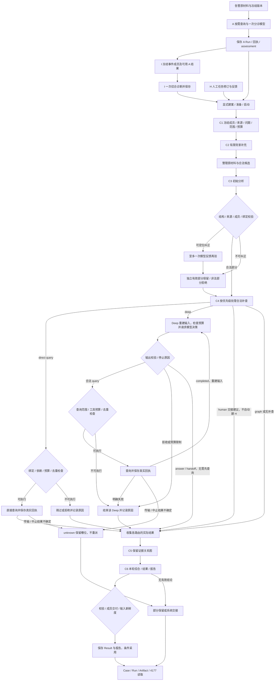

# 当前调查流程独立审查

审查日期：2026-11-11。对象：`socai2` 当前 A（告警分诊）/I（事件诊断）/C（Case）/H（人工反馈）主线；另核实保留的 Agents 人工调查、自动升级、Hunt、Swarm/Debate 的入口和边界。审查期间未修改业务实现、运行配置、数据库、模型原答或告警交接字段，未部署或推送。

## 1. 总体判断与适用范围

| 判断 | 结论 | 依据与限制 |
| --- | --- | --- |
| 流程完整性 | **受控按需处理已有保存、分析、交接和读取闭环；产品操作与自动流程尚未完整开放。** | C1–C6、H 修订进入下一轮的链路存在，历史真实运行可追溯。Case/H HTTP 写开关关闭、自动消费者暂停；问答为预留，真实响应执行不属于当前完成能力。不能把作业入口的验收当作页面操作已完成。 |
| 设计合理性 | **固定阶段加问题内有限循环适合当前范围；正文依据与补查收益仍有缺口。** | 程序冻结范围、保管身份、限制预算；模型作业务分析，分工合理。Deep 能消费新查询，但当前真实样本的两次 Deep 没有新增采集；需要改善是否值得补查的判断，尚无依据引入更多 Agent。 |
| 实现符合性 | **主要范围、引用、保存与停止约束有代码保证，但未全部满足。** | 本轮确认 C3 “最多两项补查”只有提示约束，Schema/接收允许 12 项，3 项可进入派发器。正文把缺失信息当反证的问题仍在。主线未发现本轮覆盖内的非法绑定自动补参、查空变安全或 unknown 自动重派。 |
| 实现真实性 | **主线有真实模型与数据库证据，未发现本轮覆盖内的模拟结果静默顶替；保留 Hunt 存在失败误报成功。** | Hunt 数据源超时可形成 `ok=true`、`completed`、零结果。Swarm/Debate 是确定性关键词评分/排序，未找到接入目标主线的调用点，不能声称已交付多模型调查，也不能据此判主线伪造。 |

**当前最重要的主线问题是“结论正文有据”，不是流程节点数量。** 真实样本仍为 `uncertain`、`partial`，没有证据证明系统已把它判为安全；但已采用的正文包含不成立的推理，模型质量维持 `NOT_PASSED`。

### 基线与证据等级

- 仓库：`/Users/lychee/Documents/project/socai2`；分支 `V1.1`；基线 commit `45063c97f81b4f2d6bf504a6261ee7087a2353ca`。基线已有文档归档修改及独立的未提交模型工具，均保留。
- [基线清单](../operations/evidence/investigation-audit-20261111-01/baseline.json)冻结 2,788 个已跟踪服务、部署、Schema、测试和工具文件；审查后逐项无差异，见[验证汇总](../operations/evidence/investigation-audit-20261111-01/verification.json)。本次新增的反例只在审计证据目录。
- **S：本次静态证据**，当前代码、注册路由、配置、调用关系。**I：本次隔离行为证据**，真实解析/组装/派发/ASGI/调度函数，指定外部依赖替换。**H：历史真实运行证据**，本次只读复查原件。**U：未验证**，不得转述为通过。严重程度与上述证据等级分开。
- 运行锚点为 2026-11-10 的 21 `v1.2-20261110-r6`、处理组件 `processing-20261110-r6`、4177 `workbench-20261110-r2`；**本轮未重新连接 21 观测**。六服务健康、29 表/462 列、Case HTTP 写关闭、消费者暂停均沿用该批回执。
- 配置入口：[production-v1.2.toml](../../deploy/aisoc21/production-v1.2.toml)、[调查策略](../../deploy/local-investigation/investigation-policy-case-v1.toml)。Case 单 Run 6 次模型、4 次工具、131,072 token、1,500 秒，C6 预留 300 秒；未提高预算。UEBA/knowledge 配置启用，graph/product-host 关闭；配置启用不证明取得有效数据。
- 证据选择以当前[交接指南](../../FRONTEND_BACKEND_HANDOFF.md)、[任务](../../openspec/changes/complete-socai2-investigation-chain/tasks.md)、[执行账本](current-execution-ledger.md)为准。主调查仍为 **31/41**，本次审计不核销未完功能。

## 2. 实际流程与入口

图中的 A→I→C 是数据依赖，**不是当前已开放的自动串联触发**。Deep 循环只在对应问题内；C3 不会每次工具返回后重新选择全部问题。C6 做最后综合，后续人工材料需显式准备和启动另一轮。

### 入口及持久化

| 路径 | 真实入口与调用 | 保存/消费 | 开关、失败与边界 |
| --- | --- | --- | --- |
| 当前 A/I | [processing_job.py](../../deploy/aisoc21/processing_job.py):238 `process` → [stage_results.py](../../services/api/app/socai2/stage_results.py):308/313 → `AlertBasicExecutor` / `IncidentDiagnosisExecutor` | `runs`、`run_steps`、`artifacts`、`alert_assessments` / `incident_diagnoses`；I 读取冻结成员及可用 A，不隐式启动 C | A 最多三项背景查询和一次模型，I 一次综合；无模型/明确拒收保留 failed，不确定传输保留 unknown。专用 `socai2_stage_execution` 路由未注册进生产主 router，不能用测试 app 的挂载代替产品入口已开放。 |
| 当前 C | [socai2_cases.py](../../services/api/app/api/v1/endpoints/socai2_cases.py):43、69 起的路由，或按需处理作业 → [case_service.py](../../services/api/app/socai2/case_service.py):97 `start_case` → `BaselineService.start_full` → [baseline_executor.py](../../services/api/app/socai2/baseline_executor.py):51 | Case/成员关联、冻结工件、执行步骤、工具与模型原件、Result/成员交付、assessment 采用关系；[baseline_store.py](../../services/api/app/socai2/baseline_store.py):400 `publish` | 当前生产 Case 写关闭，GET 接受独立读取开关。操作键/版本/claim 控制重复；预算、来源可用性、步骤是否结算控制执行与发布。 |
| 当前 H | [human_task_service.py](../../services/api/app/socai2/human_task_service.py):81 `write` → `tasks` / `task_revisions`；C1 `feedback_validity` 和快照读取 | 完成且范围有效的人工正文按 `human_statement` 进入下一轮，不提升成独立观察；原修订可追溯 | 不自动确认业务授权，不自动启动后轮；`prepare_baseline` + `start_case` 为显式操作。历史助手代拟材料核查只证明反馈传递。 |
| 查询与 Deep | [baseline_evidence.py](../../services/api/app/socai2/baseline_evidence.py):119 `query`，以及 [baseline_deep.py](../../services/api/app/socai2/baseline_deep.py):109 `execute` | 查询范围、query_id、实际行、截断及错误入工件；每轮 `input` 重建输入，结果可进入下一次模型和 C6 | 单 Run 同一绑定只派发一次，跨问题也不重复；同问题 Deep 不重复执行。超时无法确定底层结束则 unknown。完成查询零行与失败/未查有不同字段。 |
| 结论、报告、处置交接 | [baseline_delivery.py](../../services/api/app/socai2/baseline_delivery.py):87 → [baseline_delivery_projection.py](../../services/api/app/socai2/baseline_delivery_projection.py):84 | 分开保留终态、交付完整性、结论来源/状态、校验、采用；报告程序生成，不再让模型重写 | `completed` 只表示本轮执行终结，可同时 `partial/uncertain`；非法最终结论可只保存有效片段，系统交接有独立来源。响应为建议，不能视为动作已执行。 |

### 保留路径，分别评价

| 能力 | 可达性及实际实现 | 本轮评价 |
| --- | --- | --- |
| Agents 人工调查 | [main.py](../../services/agents/app/main.py):263 注册；[investigate.py](../../services/agents/app/api/investigate.py):138 `_investigate_stream` 默认 `InvestigatorOrchestrator`，`AISOC_INVESTIGATE_USE_ROUTER` 开启时用 `RouterOrchestrator` | 与 `socai2` 的 `CaseService` 不是同一链路。仅检查入口/分支及账本关系，未做其全部工具和模型深审；不将其能力计入当前主线。 |
| Agents 自动升级 | [fused_alert_consumer.py](../../services/agents/app/workers/fused_alert_consumer.py):1635 `_maybe_escalate` → `graph.runner.run_escalation`；受 worker、review-only、升级开关和 writer 条件控制 | 不等于当前 A/I/C 已自动贯通；生产消费者暂停。恢复后的实际消费与调查还需功能验收。 |
| Agents Hunt | [main.py](../../services/agents/app/main.py):269 注册 `/api/v1/hunts`；110 默认尝试启动 scheduler，`AISOC_HUNT_SCHEDULER_DISABLE` 可关闭。真实默认 provider 为 `lake` | 接口存在已复现缺陷 A03/A04。调度文件顶部“synthetic 默认”等注释过时，以 189–208 行实际分支为准。本轮未验证 21 对外暴露此 Agents 服务或实际调用。不要与 API 服务另一组 hunts 路由混淆。 |
| Swarm/Debate | [swarm.py](../../services/agents/app/swarm/swarm.py):40 关键词/MITRE 评分，73 并发执行确定性函数；[debate.py](../../services/agents/app/swarm/debate.py):39 加权排序 | 在 `services/agents/app` 检索仅找到模块内部定义/导出，未找到主线调用。`tokens_spent=min(budget,200)` 是计算值，不是真实模型 usage。属保留/评估模块，非已交付的多模型能力；未证明它进入目标结果，故不判主线真实性问题。 |

## 3. 需求—实现核对

| 约定/能力 | 实现位置与实际含义 | 验证与差异 |
| --- | --- | --- |
| V4 与输出合同 | [baseline_model_view.py](../../services/api/app/socai2/baseline_model_view.py):16 的 v4 是模型**输入视图**；当前 Case 用 `case-model-input.v1` / `case-followup-input.v1`；存储输出分别为 `baseline-analysis.v2`、`baseline-deep.v1`、`baseline-delivery.v1` | S。不能把审查模板里的单一“V4 输出”套到所有入口。六类冻结问题与最多两项 followup 也不等于“动态新增两个问题”。若未来要新增问题身份，应另列功能增量。 |
| 程序动态生成合法采集候选 | [baseline_evidence_tools.py](../../services/api/app/socai2/baseline_evidence_tools.py):26 `catalog` + [baseline_dispatch.py](../../services/api/app/socai2/baseline_dispatch.py):37 `offered_bindings` | I。无实体无候选；缺有效时间的事件查询不提供。目录中可保留不可执行绑定，但会记录排除原因，不是可执行候选。当前资产快照另有明确时间语义。 |
| 多候选不得暗取首项 | `ranked_bindings` 排序但全部提供；`parse_deep`、`baseline_analysis_contract.validate` 要求指定已提供绑定 | I。双主机均保留，空/伪造 binding 拒绝。只证明没有程序任取首项，不能证明模型每次选择有充分业务依据。 |
| 身份、时间、字段、租户范围 | `query_sql` 固定查询/字段/操作符，参数由冻结 scope 构造；`validate_rows` 复核返回范围；C3 只接收别名，不接收 SQL | S+I。主线没有模型补参扩大查询的已证实路径。外部文本能影响分析措辞的风险未做攻击验证，不能据合法绑定宣称防注入全面通过。 |
| 模型负责判断，程序强制合同 | [case_output_adapter.py](../../services/api/app/socai2/case_output_adapter.py):25/54；[baseline_analysis_contract.py](../../services/api/app/socai2/baseline_analysis_contract.py):184/230 | I。来源角色、成员、绑定等强制；数量上限存在 A02；语义真实性不能由这些检查证明，见 A01。 |
| 非法输出与有限纠正 | [baseline_reasoning.py](../../services/api/app/socai2/baseline_reasoning.py):258–307；`CaseReview` | S+I+H。当前已确认设计允许一次模型纠正及独立有效片段保留；原拒收与错误保留，不是程序改正文/补参数使任务合法。不要按更早“整份全部丢弃”的理解误报。 |
| 预算、依赖、去重 | [baseline_analysis.py](../../services/api/app/socai2/baseline_analysis.py):59 `budget_reason`；`baseline_evidence.query`:126–168；`BaselineService.start`:41 | I 覆盖预算函数与越界拒绝，S 覆盖事务派发门槛；未知 usage 阻断进一步模型调用，工具在 dispatch 前再次检查。没有以新 question ID 绕过同绑定去重。完整断电/恢复竞争未重测。 |
| 问题驱动与动态证据 | `baseline_deep.execute`:143 每轮重建输入；`case_followup_input.build` 纳入实际回执和前序来源；C6 后验综合 | S+I 证明证据进入输入且保留状态；H 的本次复核样本无 Deep query。尚未证明真实模型在同一告警、更换关键证据时正确改变决策，不能宣称全面动态调查质量通过。 |
| 事实、推断、冲突与 unknown | Finding 状态/角色/引用覆盖；查询 states/truncated；问题 unresolved；Publication 多个状态分别存储 | I 覆盖查空/未查/失败投影、跨成员来源和独立有效结果；A01 说明正文仍可偏离。未发现当前主线把工具失败自动记作有效零结果；Hunt 例外不混用。 |
| 人工、报告、响应 | `HumanTaskService.write`、`feedback_validity`、`make_publication`、报告 `markdown` | S+H。反馈修订和报告可保存读回；人工材料不证明授权；当前建议不会自动响应。任务建表/建议存在不代表产品操作已开放。 |

## 4. 发现与证据

严重程度：P1＝会影响核心调查判断，或在受影响服务开放时破坏数据边界/执行可信度；P2＝合同不一致、额外成本或可控功能偏差。P1 不表示已在生产造成同等损害。

### A01 — Deep/C6 正文仍包含缺乏依据的推理（主线，P1；H+S+I，高确定性）

**依据：** 事实、标签、历史分析和人工陈述不能相互充当独立证明；缺少资料不是反证；查询状态由程序掌握；[模型原则](../../AGENTS.md)第 6/7/10 条和 M01/M02。

**实际证据：** 本次重新检查了历史真实 Run `98dda2b8-5346-47d0-bbf0-d17857866cd6` 的 wire 输入、模型原答、数据库和采用关系；其冻结的 98 个源码/配置/材料文件与当前全部相符。证据汇总及原件 hash 见 [historical-model-review.json](../operations/evidence/investigation-audit-20261111-01/historical-model-review.json)，原件位于[真实模型批次](../operations/evidence/case-evidence-roles-20261110-01/real-model-01/)。

- `calls/call-3-receipt.json` → `raw.choices[0].message.content` 解码后的 `answer.text`：把“缺乏明确的演练计划文档、环境配置记录或审批证据”写为“支持非演练（恶意/误操作）”。缺少材料只能维持未知。
- 同一 `answer.text` 将 `N3_S4` 的“独立本地调查”解释为原事件非生产环境。原 `call-3-intent.json` 中该来源明确描述的是**本次复制原材料到本地验证身份**，并没有提供原业务环境的证明。
- `call-4-receipt.json` → `conclusion.limitations` 写“工具查询查空”；实际 `N4_S91/S92` 为 assets/knowledge `completed/empty`，`N4_S93–S96` 为其余四项 `skipped/not_queried`。同份正文别处有“查空或未执行”；问题是最终限制摘要不够区分，**不据这句推断模型声称全部查询都为空**。
- C6 `impact.summary` 的数据泄露/配置变更是带“若”的风险外推，并同时列出“连接成功不等于数据外传”等限制；**不是已确认发生的影响**，但仍缺本案直接支持，应放到待核假设，不能作为已证影响的证明。

**如何进入结果：** `baseline_analysis_contract.validate`:190 检查角色与成员；`case_followup_output` 恢复来源；`baseline_reasoning.ModelSteps.call`:257 接收合法结构；`baseline_delivery_projection.make_publication`:84 组装；`baseline_store.Store.publish`:435/450 保存和条件采用。数据库原件显示 `validation_state=accepted`、`conclusion_origin=model`、`conclusion_state=uncertain`、`delivery_state=partial`，当前 assessment 可回溯该 Result。

**复现与限制：** 读取上述原答对应 JSON 字段及 `[N3_S4]` / `[N4_S91]` 等输入行即可复核。另有隔离探针向合法 observation 引用附上无依据的“泄露全部数据库”文本，真实解析器接受，见 [semantic-boundary.json](../operations/evidence/investigation-audit-20261111-01/semantic-boundary.json)；这是**合成反例**，不代表真实模型说过该句，也不意味着程序应能解决任意自然语言真伪。

**影响与归因：** 模型正文质量问题为主；允许合同通过的 uncertain 结果进入业务当前判断，使其对使用者可见。不是数据库映射丢失，也未证明“误判安全”。`accepted` 的实际含义是合同接收，不是语义真值验证。

**最小修复与验收：** 下一功能 change 聚焦 Deep/C6 的主张和依据：区分未提供、查空、未执行；把未知保留为未知，把可能影响与已观察影响分开；运行状态/数量直接从程序回执提供。复用该批原输入作针对性反例，再做一条代表性真实正常链，逐项核正文和来源。保留原失败与原答，不引入通用真伪判定框架，不靠关键词改写输出追认通过。

### A02 — C3 补查数量约束只在提示词，接收和派发不一致（主线，P2；S+I，高确定性）

**定位：** [baseline_analysis_contract.py](../../services/api/app/socai2/baseline_analysis_contract.py):267 要求“2个必要followups”；81/90 的 `Analysis.followups` / `ExecutionAnalysis.followups` 都为 `max_length=12`；[case_model_boundary.py](../../services/api/app/socai2/case_model_boundary.py)沿用此提示；[baseline_dispatch.py](../../services/api/app/socai2/baseline_dispatch.py):64 遍历全部合法 followups。

**触发与实际：** 同一冻结上下文构造三项不同合法 query，真实生成 Schema、`case_output_adapter.parse` 均接受，`dispatch_followups` 调用三次 `query_evidence` spy。见 [followup-limit.json](../operations/evidence/investigation-audit-20261111-01/followup-limit.json)和 `probe_current.py::test_c3_three_followups_pass_contract_and_are_dispatched`。

**预期与影响：** 如果两项是当前执行上限，应在程序侧一致约束；若只是简洁输出目标，提示和合同应明确区分。现状会允许超出提示预期的后续工作，挤占有限资源。**没有绕过总工具预算的证据**：真实 `query_evidence` 仍逐次检查预算；此探针未执行三次外部查询。

**最小修复与验收：** 明确 C3 当前生成/接收上限并保持一致，不截断前三条或自动改写非法任务；历史存储读取兼容单列。直接验证两项接受、三项明确拒绝或按已确认策略处置，非法项零实际派发。该问题不同于“新增两个问题”，当前六个问题 ID 固定。

### A03 — Hunt 丢失认证租户，读取及执行落到默认租户（保留 Agents，P1；S+I，高确定性，生产暴露 U）

**定位与依据：** [api/hunts.py](../../services/agents/app/api/hunts.py):39 将 `require_console_or_service_auth` 作为 router dependency，但 78 `list_runs`、85 `list_findings`、116 `run_hunt` 不消费其 `TenantPrincipal`；[hunt/store.py](../../services/agents/app/hunt/store.py):279/308 默认为 `tenant_ref="default"`；[hunt/scheduler.py](../../services/agents/app/hunt/scheduler.py):61/294 构造默认租户单例。认证契约在 `tenant_scope.py`:145 明确其 tenant_ids 为权威范围。

**触发与实际：** 使用两个不同的已认证 principal 替身，通过真实 ASGI router 各请求 runs/findings/manual run。六次返回 200，四次读取传给 store 的租户均为 `default`，两次调度持久化也均为 `default`。见 [hunt-tenant.json](../operations/evidence/investigation-audit-20261111-01/hunt-tenant.json)。未测试真实 JWT/数据库，也未读取任何其他租户真实数据。

**影响：** 如果 default 租户有数据且该服务可达，可能向其他已认证租户返回其记录，或替错误租户执行；default 不存在时会表现为错误的空结果。单租户部署也有目标绑定含混。不是角色/RBAC 专项需求，而是现成认证范围未接入功能参数。

**最小修复与验收：** 从 principal 解析唯一目标租户，显式传入读取、同步和按需执行；scheduler 的后台租户与请求租户分别明确。目标缺失/歧义不得退回 default。两个 tenant 用例必须在调用 SQL/遥测前验证目标匹配；该模块启用前修复，不扩成本轮主线权限工程。

### A04 — Hunt 数据源失败被保存并返回为完成零结果（保留 Agents，P1；S+I，高确定性，生产观测 U）

**定位：** [hunt/scheduler.py](../../services/agents/app/hunt/scheduler.py):235–243 `_load_lake_events` 捕获异常后 `return []`；156 `run_one` 将其交给 [engine.py](../../services/agents/app/hunt/engine.py):181 `run`，得到 `error=None`；[store.py](../../services/agents/app/hunt/store.py):203 `status="error" if result.error else "completed"`；API 返回 `ok=true`。

**触发与实际：** 数据湖读取替身抛 `TimeoutError`，运行真实 loader→scheduler→engine→store，数据库连接仅记录 SQL 参数。API 层摘要为成功零行；实际 INSERT 参数为 `completed, 0, 0, error=None`。见 [hunt-failure.json](../operations/evidence/investigation-audit-20261111-01/hunt-failure.json)。这证明到持久化参数的误标，未宣称真实数据库已写入该记录。

**影响与分类：** 操作者不能从 Run/响应区分数据源不可用与有效零结果。日志 warning 不足以修复业务状态。没有静默回退 synthetic 的证据；此处真实性偏差是“失败执行显示成功”，不推断开发意图。

**最小修复与验收：** 保留结构化采集状态与错误，数据源失败时跳过 matcher 的成功归因，传递到 Run 与 API；有效零结果仍可 completed。只需一条正常零行和一条超时的定向验证，确保两者状态不同。与 A03 合并为该模块启用前的一项交付即可，不增加通用可用性框架。

### 已披露的功能边界与未证明能力

- **W01/O01/F01/F02：** Case/H HTTP 写未开放、自动消费者暂停、H 正确利用尚未验收、真实非空知识使用尚未证明。这些是产品闭环缺口/验收缺口，不能因代码有方法或服务健康而算完成，也没有证据将其认定为模拟冒充真实。
- **Q01/P05：** 问答返回预留错误，完整响应、评论附件等未全部接通；当前范围不把建议等同执行。沿用[问题清单](current-issues.md)，不重复建立任务树。
- **设计收益待核：** 真实四次模型调用中两次 Deep 都直接 answer/handoff，未查询新材料。它证明有限推理和人工交接，并不能证明减少未知。可优先让无可用采集手段的问题直接交接，是否节省调用且不损失结论需后续功能验收，当前不以一个样本推断总体成本/准确率。

## 5. 验证记录与未验证项

本轮 **56 项隔离检查通过**：40 项 Case（4 个新增审计反例及 36 个既有边界检查）、14 项 A/I 边界、2 项保留 Hunt。通过仅表示断言如实成立，**包含“确认缺陷存在”的断言**，不等于 56 项业务能力通过。命令、首次误配记录和 XML 见[证据入口](../operations/evidence/investigation-audit-20261111-01/README.md)。

| 场景 | 本轮方式/实际结果 | 覆盖限制 |
| --- | --- | --- |
| 合法正常链 | H：复查真实 C1–C6 输入、4 次模型原答、Run/Result/assessment 和读取快照；98 项冻结来源与当前一致。I：A/I 五字段/来源恢复、C3/Deep/C6 输入/输出对应 | 无本轮新 PG/模型调用；历史材料是演练输入，真实运行不等于真实攻击真值。 |
| 缺实体、缺时间、多候选 | I：删实体后无候选；去时间事件查询不提供；两主机均保留；空/未提供绑定拒绝 | 纯冻结上下文，无外部执行；不证明模型歧义判断正确。 |
| 非法输出、越界、不匹配 | I：额外 SQL、错 question、无效/跨范围引用、过期或不配对回执被拒；独立有效部分按合同保存映射 | 非法身份/结构的拒绝已测；正文语义见 A01，不能混同。 |
| 工具失败/超时/拒绝 | I：当前 Case 输入保留 failed/skipped/empty，不合并；Hunt 超时反例确认 A04。S：主线 SourceUnavailable→failed、传输不确定→unknown | 本轮未对真实主线工具注入超时、权限拒绝或中断；不声称这些集成场景通过。 |
| 零结果、部分及冲突证据 | I：查询状态和零行分别保留；跨成员/原角色、支持反证依赖、部分分析和当前 finding 反馈检查通过 | 未构造本轮真实对立证据让模型裁决，证据冲突的业务处理质量 U。 |
| 预算/停止 | I：unknown usage、次数耗尽、deadline、token 不足均返回对应阻断原因。S：C6 预留及工具派发再次检查 | 无“连续无进展”专项实测；真实样本无 Deep 查询循环。 |
| 重复提交/重试/恢复 | S：operation key、claim、绑定和问题去重，未知不重派；H：既有 PG 批次回执可追溯 | 不重跑断电/并发恢复矩阵；本次列入命令的 `test_socai2_stage_execution_api.py` 只有嵌套 `run_checks`，pytest **零项收集**，绝不计作本轮 HTTP/PG 覆盖。 |
| 新证据影响后续行为 | S+I：Deep 每轮重建输入，C6 获取实际查询及原始来源；替换/失配来源的边界测试有效 | 真实模型同告警、只换关键证据的受控比较 U；仅输入有变化不能证明模型正确使用。 |

未验证项目：本轮 21 当前运行状态；Agents/Hunt 实际暴露和多租户真实数据；厂商接口；当前完整 HTTP 写业务；自动消费；真实非空知识；真实模型冲突裁决/证据变化决策；全量提示注入与恢复竞争。它们按功能范围逐项后续处理，不以本轮扩大测试矩阵。

## 6. 修复优先级与最小推进方案

| 顺序 | 工作单元 | 直接验收 |
| --- | --- | --- |
| 当前主线下一项 | **Deep/C6 有据正文**，同时明确 C3 两项补查约束（A01/A02，沿用 M01/M02） | 原始观察/缺失/查空/未查逐项对应；不把验收环境当业务事实；条件性风险不冒充已证影响；上限明确且程序一致。旧原件不改，一条代表性真实闭环足够启动验收。 |
| 主线下一阶段 | Case/H 正常 HTTP 操作→人工反馈→显式后轮（W01/F01） | 从实际产品入口完成创建/启动/反馈/再次调查/读取；反馈改变需要改变的判断，未提供授权仍未知。普通读写接线随功能完成。 |
| 随后 | 真实非空知识使用→页面功能对应→自动处理（F02、P01–P05、O01） | 各自证明数据真实取得、被消费并改变相应输出；自动流程需有实际消费、Run 和结果，不能用健康检查代替。 |
| 保留模块启用前 | Hunt 租户传递与失败状态（A03/A04） | 两租户调用目标不串；超时与有效零行状态不同；真实调用范围按该模块的交付另核。若当前不启用，不阻断主线正文修复。 |
| 可选 | 评估无新增信息的 Deep 开销；澄清 Swarm/Debate 对外名称和模拟 usage | 只在接入或有实际收益证据时做，不以更多 Agent/循环为默认改进方向。 |

本轮只交付审查、证据和修复建议，不一边改业务一边宣称原实现合格。之后每个功能 change 仍按本地实现→直接完整流程→交接→独立结束审计→一次统一发布/推送执行；不因本报告新增发布或权限审批环节。

本审查已通过[独立结束复核](../operations/evidence/investigation-audit-20261111-01/independent-audit.md)，报告流程图修正后 ACCEPT；审查 change 的[归档与交付记录](../../openspec/changes/archive/2026-11-11-review-current-investigation-flow/audit.md)单列，不代表 A01–A04 已修复。
