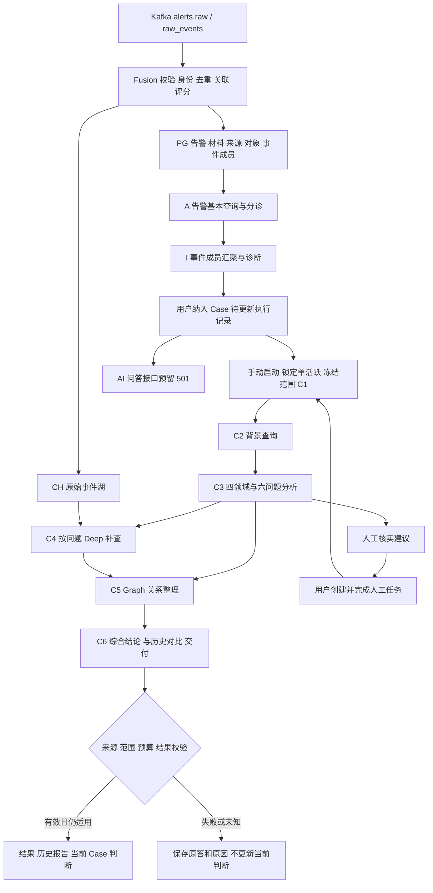

# 从 Kafka 到调查结论的流程与验证

截至 2026-11-05，真实 Kafka 消费、Fusion 告警落库、A 告警分析、I 事件诊断、Case 创建、人工反馈和真实湖查询已有本批证据；**完整 Case 结论验收未通过**。问题已经分出程序设计、部署兼容和模型语义三类，不能归结为小模型能力不足。

本轮复用项目 `tools/testdata` 的合成夹具约定，增加 40 条告警周边日志。18 次正式湖 Tool 查询全部匹配预期事件集合，96 个字节/包数值逐值一致。查询验证与前面的模型对照分批进行；新日志没有倒灌进已结束的模型 Run。

## 当前环境与入口

开发分支为 `codex/case-baseline-history-20261103`，主目录直接开发。独立 API 为 21 上 `socai2-next-api`，镜像 `socai2-next-api:20261104-n14`，端口 `127.0.0.1:18020`。对照后已恢复 `deepseek_responses / deepseek-flash`。没有替换原 API、Agents、Fusion 或 LiteLLM 配置。

| 对象 | 本轮位置 | 当前边界 |
|---|---|---|
| PostgreSQL | `socai2_next_20261104`，业务 schema `socai2`，29 表 459 列 | 另有 17 张 public 支撑表；不共用旧 alerts 表 |
| ClickHouse | `socai2_next_validation.raw_events` | 原始事件、网络/进程/认证上下文；不是 PG 告警表 |
| Kafka | `socai2.validation.k2.20261105.*`；修复核验 k3、补上下文 k4 各自独立主题 | 消费组分别独立，不切换原生产组 |
| Redis | DB 13 | 本批独立处理所需缓存，不是持久调查结论 |
| 模型 | DeepSeek Flash；LiteLLM `aisoc-investigation` → `aisoc-test-investigation` | 只读元数据确认本地后端根目录名为 `Qwen3.5-9B`，上下文 65536 |
| 本地候选修改 | Fusion 按配置选择湖；调查投影读取网络流量计数 | 已在真实独立诊断进程验证；**尚未打包进入常驻 n14，也未部署原 Fusion** |

当前新服务没有新增常驻的 fused→A/I 调度消费者。本批由测试驱动在确认 Kafka/Fusion 成功后调用正式 HTTP 接口；Case 仍由用户动作创建/启动。不能把测试驱动描述成生产自动流程。

## 完整处理流程

图中 H→C1 表示用户显式准备并启动下一轮；保存人工结果不会自动启动。基础调查不是简化分诊，它是 Case 必须具备的完整分析路径。

| 阶段 | 实际输入与处理 | 写入的表/产品 | 下游与模型职责 |
|---|---|---|---|
| Kafka 消费 | `alerts.raw` 已有告警信封；`raw_events` 规范化事件信封。校验版本/租户/ID；告警分支走持久结果恢复、去重、实体归并和评分 | Kafka offset；Redis 状态；fused 输出 | 本阶段不调用调查模型。原始事件提升/原生规则等可选分支本批关闭 |
| Fusion 告警落库 | 保留来源身份、原材料、对象、规则/标签、评分状态及归并依据 | `alerts`、`alert_materials`、`alert_source_refs`、`alert_objects`、`incidents`、`incident_alerts`；首次快照工件 | 持久告警确认后发布 fused，收到 ACK 后提交消费进度。精确重投复用已有材料，不多建告警 |
| Fusion 入湖 | 事件 ID、租户、事件时间、class、主机/用户/进程/端点/action/outcome；完整 OCSF 与原文 | CH `raw_events` | 按租户、主机、时间和事件类型查询；已有 best-effort 写湖边界不等于无丢失保证 |
| A 告警基本处理 | 一条告警的保留材料、检测标签、资产/历史/TI 基本查询结果；空/失败/未接通分别保存 | `runs(kind=alert_basic)`、`run_steps`、`artifacts`、`alert_assessments`；有效后更新告警分诊指针 | 一次模型请求生成判定、置信度、理由、解释、引用/缺口；它不是 Case 基础调查 |
| I 事件诊断 | 明确事件成员及各成员材料、同次有效 A 结果；归并依据只说明为何归组 | `runs(kind=incident_diagnosis)`、`incident_diagnoses`、步骤/工件与事件最新诊断指针 | 一次模型请求分析成员关系、事件级判断与不足；不能把归组直接写成因果链 |
| 纳入/更新 Case | 明确来源事件、成员集合、范围版本及操作人 | `cases`、`case_alerts`、`case_incidents`、`activities`/`activity_targets`、`runs`、`run_members` | 没有运行中的基础调查时仍只记录待更新；用户手动启动 |
| C1 冻结 | Case 行锁/Run 事务占位先提交，再调用执行器；冻结成员、材料版本、问题、时间窗、H、历史结果 | `runs.state=running`、冻结输入/上下文工件、成员读取状态 | 同 Case 一个基础调查活跃；运行后冻结。后续范围变化另建待更新记录；未知运行也占位 |
| C2 背景 | 资产、历史、情报、UEBA、知识等有界来源 | 步骤/请求/结果/来源状态工件 | 当前总工具额度 4，保留 2 给 C4；本批 C2 实际执行资产、历史，其余明确因预算跳过 |
| C3 主分析 | 冻结事实、背景、检测标签、既有判断及来源表 | 四领域分析、六问题状态、followup 路线、模型原请求/原答/usage 工件 | 四领域 identity/cloud/phishing/insider 在**同一次模型输出**中；不是四次独立调用 |
| C4 Deep | 用户没有指定 SQL；模型从服务端冻结问题和工具绑定中选择补查，再评价结果或停止 | Deep 步骤、Tool 请求/原始返回/语义投影、来源引用和明确省略 | 正式工具含 process_activity、network_connections、authentication_activity；产品主机等需明确配置。`query` 和 `deep` 路线均进入问题级执行原语 |
| C5 Graph | 冻结成员/对象关系与可用证据 | 图工件，含节点/边与依据 | 当前确定性派生，不增加一次模型调用；同主机、相邻时间、图可达不等于攻击因果 |
| C6 交付 | 本轮分析、原 followup 与执行收据、查询、H、历史比较对象 | `results`、`result_members`、报告/图工件；满足自动采用条件时写 `case_assessments`、`case_assessment_sources`、`case_assessment_members`，更新 Case 当前判断指针 | 最后一次模型综合结论及变化；Markdown 从保存的结构化结果渲染，不再调用模型。失败可保存系统交接结果，不能冒充模型结论 |
| H 人工调查 | 人工确认事实/附件/引用和明确适用成员范围 | `tasks`、`task_revisions`；下一轮冻结其确切版本 | 人工登录成功或批准脚本不能自动授权其他网络活动；不自动采纳、不自动续跑 |
| Q AI 对话 | 预留发送、保存和采用接口 | 当前无实际消息/模型业务 | 按要求返回 501，暂缓实现 |

模型总额度仍为每次基础调查最多 4 次模型、24000 tokens、4 次 Tool；至少预留最后一次模型机会。单字段 2048B、用户数据视图 8192B、总 messages 12288B、冻结上下文 131072B、单次输出上限 3000 tokens。保存的原材料与发送给模型的有界视图分开；来源路径、完整原答和省略原因保留。

## 一个具体例子

运维场景的第一条告警记录 `powershell.exe -File C:\Ops\inventory.ps1`，action 为 `process_start`、outcome 为 `success`；第二条记录同主机 TCP 443 连接。A 可以确认“进程启动成功”和“网络连接成功”，不能据此确认脚本执行完成、授权、HTTPS 或数据外传。

I 汇聚两条告警，但同主机/接近时间只支持相关性。纳入 Case 后，C1 冻结这两条材料和两分钟窗口；C3 决定哪些问题需要查证。C4 网络查询在本次补数后能返回原连接和 4 条上下文，其中包括另一个目的地址的 UDP 53、TCP 8443 流量，以及明确记录为 0 字节/0 包的一条观察。查询范围是主机+窗口+类别，因此不同目的地址仍应返回，不能沿用旧夹具的“目的地址不同即排除”判据。

其中一条 TCP 8443 流量为源→目的 750000 字节/500 包，目的→源 1500 字节/3 包。它证明来源记录了这些流量计数，不证明 750000 字节是敏感文件，也不是每个包的实际大小或内容。登录日志分别记录失败与成功，进程日志保留父 PID；这些都不能自动为原脚本或连接提供授权。

H 示例只对第一条进程告警填写授权确认，并将范围绑定到该成员。下一轮 Case 调查要保留这条人工陈述，同时继续交代第二条网络告警的未决问题。**本次真实模型运行未成功完成 C6，因此以上流程能力与查询结果不能写成已生成一个合格最终结论。**

## 本批真实结果与模型差异

对照输入为运维、凭据访问模拟、缺少湖记录三类场景，每类在两个后端各用两条语义相同的告警。主机、来源命名空间和窗口隔离，避免一侧的诊断污染另一侧。良恶相反才计误判；`needs_review` 可接受。引用错配、无据事实、接口拒绝单独计。

| 项目 | DeepSeek Flash | 本地 Qwen3.5 9B |
|---|---|---|
| A 6 次 | 6 次发布；原答均 needs_review | 5 次发布，1 次因判定与依据矛盾拒绝；6 原答均 needs_review |
| I 3 次 | 3 次发布 | 2 次发布，1 次引用了错误成员来源而拒绝 |
| 首轮 C3 | 运维领域引用超声明范围而拒绝；另两例主分析接受 | 3 次 HTTP 400，尚未得到可比较的 C3 原答 |
| Deep 实际查询 | 空数据例实际选择一次 process_activity，成功返回 0 行 | 本批没有进入可用 C4 |
| H 后第二轮 | 写入 H、准备和手动启动成功；最终输入预算阻断 | H/prepare 成功；已有 unknown 占位，start 返回 409，待更新 Run 保留 |
| C6/当前 Case 判断 | 3 轮因必要输入无法完整放入视图，发送最终模型前停止 | 3 个 unknown +1 个 pending_update；无最终结论 |
| 已知模型用量 | 14 请求，74546 tokens | 12 请求，32305 tokens；含 3 个无 usage 的 400，不能把未知用量计为 0 |

合计 26 次实际模型请求，23 个原答、3 个 HTTP 错误，无重试；已知 tokens 小计 106851，费用未定价。Schema-only m4 的 816 tokens 单列，不混入业务比较。k2 共 26 条 Run 记录，25 条实际进入执行、1 条 pending；4 个 `results` 均为系统交接，无有效 Case 当前判断写回。

12 个 A 原答未出现良恶反向分类，但不能据此宣称 100% 准确：全部弃答、样本小、Case 结论未完成。另有明确文字错误：DeepSeek 把 `process_start success` 扩写为导出内存执行成功；本地 I 把 TCP 443 写成 HTTPS。这些属于语义越界，即使判定为 needs_review 也应修。

### 已定位的问题

| 问题 | 证据与归因 | 处理状态 |
|---|---|---|
| 湖写入库名硬编码 | LakeWriter 的 SQL 固定 `aisoc.raw_events`，构造参数 database 仅改连接默认库。这是我们的路由缺陷 | 已修两个 INSERT 分支并校验标识符；26 个 writer 测试通过。k3/k4 真实独立 Kafka 进程验证新库写入；常驻服务待同步 |
| 本地模型 C3 400 | 返回 `Grammar error: Unimplemented keys: [uniqueItems]`；已有 `vllm_grammar_v1` 发送适配，但独立服务仍用 standard | 部署配置缺口；未证明参数规模导致。后续启用兼容配置，本地完整 Schema 校验仍保留 |
| C6 必要输入预算 | 原件重建确认 prior analysis 和事实/H/原计划一起强制完整进入 8192B 视图；三个 Case 存在必要项被挤出 | 输入设计缺口，不是数据库缺失或模型不愿回答。下一轮应减重复元数据/已消费判断的重复传递，保事实、H、原计划和引用，不提高额度掩盖问题 |
| 400 被保守记 unknown | 3 个确定的语法拒绝被上层归为执行不确定，占住基础调查槽位 | 待区分明确拒绝与传输结果不确定；不能粗暴清掉所有 unknown 或自动重跑 |
| 模型引用/活动语义 | 领域引用超成员、I 来源归错、进程成功扩大为业务成功 | 部分被校验拒绝；仍有文字越界未挡住。修后使用新样本批次验证，不重派旧批 |
| 网络流量字段未投影 | 原 OCSF 已可保留 traffic，调查白名单未读取 | 本轮补 6 个非负整数计数字段和来源路径；0 不当缺失；本地 6 用例及真实查询 96 值通过，常驻 API 待同步 |
| 自动接线 | 当前独立服务没有新常驻 fused→A/I 消费编排 | 本批 HTTP 驱动已明确，不算生产自动化验收 |

湖误写已精确回收：k1/k2 共 16 条合成事件先落入旧 `aisoc.raw_events`，独立读回才发现。清理前逐条确认租户、固定 UUID、完整 OCSF 与原计划相同，保存回收前材料；只删除这 16 条，随后旧库对应计数为 0。k3 将同一批事件经修复后 Kafka 路径写入新湖并逐 ID 确认一次，k4 的 40 条新日志旧库写入数同样为 0。不能用“旧服务配置未变”掩盖这次旧库曾被误写。

## 数据构造的复用与真实补查验收

保留 `services/demo-producer` 和上游生成器原件；本轮复用 `tools/testdata/investigation_fixture.py` 的稳定 UUID、时间参数检查，以及 `alert_scenarios.py` 的 JSON/hash 和答案字段检查。新增 `tools/testdata/context_fixture.py`，输入现有固定告警计划，输出 `events.json`、独立 `expected.json` 和 hash manifest。没有把答案、控制组角色或攻击解释写进日志。

既有 `lake_fixture_probe.py` 使用直接 writer 和目的地址过滤，不能证明现在的 Kafka 消费和主机范围 Tool；所以本轮复用其“固定事件→真实写入→独立读回→正反例”方法，投放沿新的独立 Kafka consumer，读取沿正式 `LakeGateway`。

网络计数使用 `traffic.bytes[_in/_out]`、`traffic.packets[_in/_out]`，in=目的到源，out=源到目的；符合 [OCSF network_traffic 字段定义](https://raw.githubusercontent.com/ocsf/ocsf-schema/main/objects/network_traffic.json)。保留源计数，不根据总量推断内容、授权或攻击性质；不声称完整 OCSF 标准认证。

| 核验项 | 实际结果 |
|---|---|
| 新日志组成 | 4 Case ×（4 网络 +1 进程 +2 认证 +3 控制）=40 条 |
| Kafka/Fusion/CH | 40 条实际消费并提交 offset；新湖各 ID 1 行；没有生成新告警/Case/Run或调用模型 |
| 正式 Tool | 6 Case ×3 类=18 次查询；4 非空 Case 各 2 进程/5 网络/2 认证，包含原来源事件 |
| 排除项 | 其他主机、窗口前 1 微秒、恰好窗口结束各 4 条，共 12 条全部排除；窗口语义为左闭右开 |
| 空查询 | 另两个 sparse Case 三类查询均 0，未补它们的数据 |
| 流量投影 | 16 条命中网络上下文 ×6 字段=96 值与来源路径全部一致，包含明确 0 |
| 影响与清理 | PG 告警/Case/Run/结果/判断计数保持；原服务配置指纹保持；本批临时 INSERT-only 角色已撤销 |

新计数投影仅在诊断解释器加载，湖查询函数为已部署的正式实现。尚未证明真实模型会选择这些补查，或全部返回行进入最终模型视图/被正确采用；下一批完整 C 才验这一点。

## 页面字段从哪里取

| 页面含义 | 持久字段/来源 | 本批状态 |
|---|---|---|
| 基础调查、执行状态 | `runs.kind/state`，待更新即 pending_update | 有；运行失败/未知不能显示已完成 |
| 完整/部分交付 | `runs.delivery_state`、`results.delivery_state` | 有；不能只看 HTTP 200 |
| 本轮保存结论 | `results.conclusion/conclusion_state/conclusion_origin/validation_state` | 本批只有系统交接，结论 unavailable/null |
| 建立案件初始分析/本轮变化 | `results.purpose/change_kind/change_summary` | 字段有；失败不能编造分析正文 |
| 与上轮结果对比 | `comparison_result_id` 指向明确历史结果，配合 change_kind/summary | 无可比有效结果时明确不可比 |
| 对案件的影响 | `results.case_impact` | 输出经校验后保存，不能从标题生成 |
| 发现、问题、建议 | `results.findings/questions/recommendations`；成员覆盖 `result_members` | 字段有；本批无合格模型交付 |
| 图、报告、原始输入 | `graph_artifact_id/report_artifact_id/input_artifact_id` → `artifacts` | 区分派生图、来源原件、系统说明和模型报告 |
| Case 当前判断 | `cases.current_assessment_id` → `case_assessments` 及来源/成员表 | 有效基础调查自动采用；本批未写入，旧判断不覆盖 |

## 覆盖与后续顺序

真实覆盖：Kafka 精确重投、A/I 发布和拒绝、Case 手动单活跃、C3 范围拒绝、Deep 空查询、Graph 派生、H 选定成员写入、下一轮 prepare/start、unknown 阻止第二次执行、失败不采用、真实三类湖 Tool 正反例。

确定性 PG 集成验证覆盖完整 C3→Deep→Deep→C6、无模型/拒绝交接、图/人工路线、总模型/工具预算预留、取消与并发范围变化、失败不采纳。14 个不同 executor 方法最新通过，分 5 份回执完成；模型和湖返回为替身，不能当成真实最终结论。共享工具额度测试初始预期仍写 3+1，已按现实现 2+2 修正后定向通过。

下一顺序：①同步湖路由与流量投影，启用独立小模型 schema 兼容配置；②修 C6 必要输入装配与明确 400 状态；③新固定批次复验双模型完整 C、H 后第二 C，并核 Tool 原答是否进入最终请求及结论；④达标后结束审计/归档。生产可选厂商接口、故障恢复/压力、Q 业务不在本批通过范围。没有增表、提高模型额度或修改页面。

OpenSpec `complete-socai2-investigation-chain` 仍为 13/16，3.7、4.1、4.2 不勾选。旧 r13 的报告问题和 5.3 不由本批核销。不提交/推送；k1—k4 均固定结束，不重派。

## 证据入口

- [双模型运行与表计数](../operations/evidence/socai2-kafka-chain-20261105/k2/20261105T001341-export/analysis.json)，同目录保留请求、原答、模型错误、步骤及数据库快照。
- [C6 原输入离线重建](../operations/evidence/socai2-kafka-chain-20261105/k2/20261105T001341-export/c6-input-diagnosis.json)。
- [旧湖精确回收](../operations/evidence/socai2-kafka-chain-20261105/lake-correction/cleanup-receipt.json)；[修复后 Kafka 写湖](../operations/evidence/socai2-kafka-chain-20261105/k3-lake/receipt.json)。
- [40 条上下文与 18 查询的验收摘要](../operations/socai2-context-k4-20261105.json)；完整新材料在 `.local/testdata/k4-context-20261105`，不把它们写成历史模型已见材料。
- [模型后端只读元数据](../operations/evidence/socai2-kafka-chain-20261105/models.json)；[m4 协议确认](../operations/socai2-schema-probe-m4-20261105.json)。
