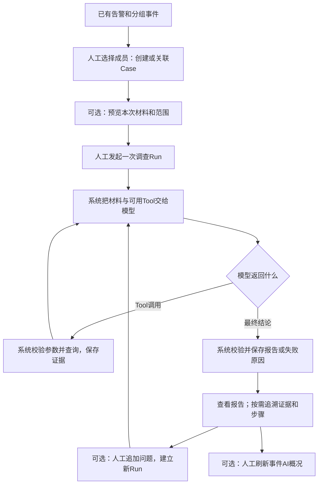

# 多案例逐步HTTP测试（2026-10-28）

**结果：4个案例已真实执行，4次主调查均完成；2个案例的自动流程检查通过，2个未全部通过，另发现一处自然语言结论偏差。** 用户确认先复用之前的模拟数据便于对照：数据是synthetic，实际执行使用常驻HTTP、PG、ClickHouse和原模型；不是已发生的真实业务事件。

批次`INVHTTP-20261028-01`，API代码基线`512c004`，实际镜像`2fde05d5`。全程正常API Key认证，没有覆盖CurrentUser或数据库依赖。

## 先按业务理解，再查看请求原件

阅读说明补于2026-10-29。下面仍解释10月28日这次实际执行，不把后续本地修复当成当时已通过。

**这份记录里的几十个编号是测试脚本的HTTP请求序号。** 一次“发起调查”会在服务内部完成模型分析、Tool查询、再分析及保存；后面的多数请求是在读取这次调查已经保存的内容。脚本按预定次序访问接口，案例页链接供审阅者核对材料；这些顺序不代表已经实现的前端页面跳转，也不是HTTP重定向。

告警说明“来源报告了什么”；事件汇集相关告警并展示概况；Case容纳需要深入调查的成员；Run记录一次具体问题、成员范围和时间窗的分析。一个Case可以有多次Run。



图中省略了预算停止和一次结论纠正等执行细节；各例保留实际走过的成功或失败分支。

| 业务动作 | 谁决定进入 | 输入 → 输出 | 为什么继续到下一步 |
|---|---|---|---|
| 看告警和事件 | 本轮由测试脚本代替用户读取 | 已有Alert/Incident ID → 告警内容、成员、分诊及已有概况 | 知道待查材料是什么，再选择调查成员；读取不会重新分组或分诊 |
| 创建/关联Case | 人工选择；脚本提供明确的成员列表 | 来源、成员、create/attach目标 → Case ID及关联回执 | 深入调查在Case内执行，后续接口需要这个Case ID；建案本身不启动分析 |
| 预览调查材料 | 可选，由用户/脚本请求 | Case ID、选定成员、窗口、问题 → context/tools/limits | 确认本次查谁、查哪段时间、能用什么Tool；预览不调用模型 |
| 发起主调查 | 人工请求一次investigate | 上述范围、问题、operation_key → 新Run、保存结果及各类读取链接 | 系统在这次执行内自动调用模型及Tool；用户不用手工触发每条内部步骤 |
| 看结论或追溯依据 | 用户按需查看；本轮脚本逐项读取 | Run返回的链接、报告中的证据编号 → 报告、证据、已保存的调用过程/来源行 | 为理解或核对结论而查看；这些GET不重新调查，也不再次查事件湖 |
| 追加问题 | 可选，用户提出新问题 | previous_run_id、原范围、新问题、新operation_key → 新Run及H1历史材料 | 原报告不足以回答新问题时才追加；不会覆盖旧报告，也不会因点击证据自动追加 |
| 刷新事件AI概况 | 可选，本轮明确手动请求 | Incident ID、include_investigations=true → 引用已有调查结果的概况 | 让事件层展示调查进展；这是另一次摘要模型调用，不是重新深入调查。新Run不会自动改写原概况 |

### 为什么会链接到这里

| 看到的入口/字段 | 链接目标及用途 | 查看后如何理解 |
|---|---|---|
| case-links回执的case_url | 查看刚创建或关联的Case | 回执提供Case ID；同一Case的investigate_url用于后续发起请求 |
| Run的result_url / report_url | 查看该次调查的结构化结果 / Markdown报告 | 同一份结果的不同表达，不是两次分析 |
| 报告中的A/T/E/H编号或evidence_url | A=告警材料，T=已有分诊，E=本次Tool结果，H=历史调查 | 因为某个判断引用了它，所以沿编号追溯；编号只在对应Run内有效 |
| Tool证据中的tool_trace | request_step_url查看实际参数，response_step_url查看实际返回 | 回看“怎么查到这个结果”；GET不会再发起Tool调用 |
| Tool证据中的rows链接 | 查看这次查询已保存的某一条来源记录及查询范围 | 只有返回了行才有记录可看；空结果仍可看查询参数和返回，不会凭空产生行 |
| executions三个筛选入口 | 从告警、事件或Case找到关联的同一个Run | 三种查找方式，不是顺序执行的三个调查阶段 |
| 本文的“请求/返回”文件链接 | 查看测试当时保存的请求与HTTP正文 | 本地证据文件，不是在线服务地址；无需凭据即可阅读已保存原件 |

**两个“步骤号”也要分开看：** Office例的HTTP第12步发起主调查；它内部生成10条账本步骤。HTTP第19步读取内部步骤4（准备进程查询），第20步读取内部步骤5（查询返回）。真正查询已发生在第12步执行期间，第19/20步只是回看。每个案例现已补充业务阶段、内部执行因果和每行请求的用途。

首次阅读可先看[Office完整业务主线](cases-20261028/office-powershell.md#本例为什么这样走)；再看[LSASS为什么只查一名成员](cases-20261028/lsass-smb-subset.md#本例为什么这样走)、[归档例为什么从告警建案](cases-20261028/archive-upload.md#本例为什么这样走)或[网络例为什么跳到某条来源行](cases-20261028/network-positive-reuse.md#本例为什么这样走)。

## 实际结果与逐步文档

| 案例 | 主调查 | 追加/特殊分支 | 流程检查 | 完整输入输出 |
|---|---|---|---|---|
| Office→PowerShell→外联 | completed/partial，2次模型、2次Tool | 追加首轮未知引用被拒，纠错预检超过剩余额度2119，停止input_or_token_limit | 未全部通过；报告/概况保存及旧概况标旧通过 | [逐步记录](cases-20261028/office-powershell.md) |
| LSASS读取→SMB | completed/partial，3次模型、2次Tool | 只调查第1条；第2条未被错误归入Run | 自动流程通过；内容审阅未通过，见下文 | [逐步记录](cases-20261028/lsass-smb-subset.md) |
| 归档→上传 | completed/partial，2次模型、2次Tool | 从告警创建Case，保留分诊差异和查询缺口 | 流程检查通过 | [逐步记录](cases-20261028/archive-upload.md) |
| 网络命中与查询复用 | completed/partial，2次模型、2次Tool，命中3条网络记录 | 追加分析完成，但模型没有发出要求的Tool调用，未覆盖复用命中 | 未全部通过；缓存实现本身未据此判错 | [逐步记录](cases-20261028/network-positive-reuse.md) |

每份逐步文档先解释业务阶段与内部执行，再列出全部请求的用途、实际HTTP正文、检查结论、Run及完整Markdown报告链接。本轮207个HTTP请求均返回2xx（202次200、5次201），但111项流程检查中仍有3项未通过，因此**HTTP成功不等于调查分支通过**。其中两项失败都来自Office追加未完成及其成员未评估后果。

实际新增4个Case、5条成员关联、6个Run（5 completed、1 failed）和4次概况刷新。16次模型调用、8次Tool调用，共63937已知tokens，所有Run的unknown_usage=false。所有报告为partial，原因是进程等证据仍不足；它不等同于执行失败。

## 流程覆盖对照

| 功能 | 对应案例 | 本轮结果 |
|---|---|---|
| 来源告警、分组事件、分诊与调查上下文 | 全部 | 正常API Key通过真实HTTP读取；来源关键字段前后相同 |
| 事件/告警转Case、追加成员、同key读取 | Office追加成员，归档从告警创建，其余从事件创建 | 4个Case、5条关联；回执读取通过 |
| Case成员与Run选定范围分离 | LSASS | Case两成员、Run只含第一条；第二条索引不误归属 |
| 原生Tool选择、参数与结果解析 | 全部主调查 | 8次真实Tool调用；主机正确；空结果/3条网络结果可读取 |
| 多成员覆盖、关联依据、时间线、未决问题 | 全部主调查 | 结构与引用通过，具体模型输出见分例报告；内容语义不由此保证 |
| 步骤/证据/Tool交换/原始行/Markdown | 全部 | 保存读回一致；正向网络例实际读取第一条来源行 |
| 告警/事件/Case三个执行索引与历史 | 全部 | 同Run与scope可定位，历史链接保留 |
| H1追加与旧报告保留 | Office、网络 | 旧报告与H1保留；Office未完成，网络追加完成 |
| 追加查询复用 | 网络 | 模型未调用Tool，分支未覆盖，检查未通过 |
| 事件概况引用报告、保存/普通GET、变化标旧 | 4例刷新，Office标旧 | 通过；标旧读取没有额外生成 |
| 有记录的进程证据、真实厂商Tool | 无可用规范化进程样例/厂商配置 | 未覆盖，不能称已验证 |
| 自动摄取/分组/分诊/建案/首次概况worker | 复用已有记录，未重跑 | 不属于本轮手动调查链的新增验证 |

### 本轮发现

1. **复杂历史追加仍会卡额度。** Office追加Run `5d6f28ea-d7f4-572e-b2e5-5c0013475396`在首轮出现unknown_evidence_reference，纠错预检需求19137、剩余17018，超出2119，第二次模型请求未发出。源材料比之前简例多了已有分诊和更长历史，前轮单例通过不能覆盖这一分支。[精确离线重建](../operations/investigation-multi-case-budget-diagnosis-20261028.json)。
2. **显式补查请求未被执行。** 网络案例追加Run `7b43c909-a450-55da-9a20-c6123dab7658`被要求再次调用相同network_connections参数，实际Tool调用数为0；模型直接作答，引用错误经一次纠正后报告完成。查询复用检查失败，准确含义是没有进入Tool/缓存分支，并非已证明缓存代码错误。
3. **内容语义校验有缺口。** LSASS例虽然字段/引用/范围及存取通过，摘要却把T1分诊编号称作成员，并把available=true、0条的进程查询说成“查询失败”；还把保存分析文本截断泛称为告警内容截断。[原文及Tool证据](cases-20261028/lsass-smb-subset.md)。网络追加还把3fcd开头的告警UUID称作主机。这些是可见输入输出矛盾，不能因为流程通过而写成分析质量通过。
4. **数据来源覆盖不足。** 三组showcase原始湖记录未填当前工具要求的规范化字段，确实查不到进程/网络记录。本轮保持原数据用于对照，未补造记录；后续若要评估真实行为关联，需要按来源字段接入规范化遥测。

本批没有自动重跑失败Run、提高预算、放宽引用或修改业务代码。后续5b95138已完成纠错输入精简、必需Tool及语义提示修复并做本地6项受影响直接验证；剩余为修复版本常驻更新和针对原失败步骤的真实复验、内容审阅。原批失败不会由本地修复记录改为通过，见[修复状态](../../openspec/changes/fix-case-followup-gaps/tasks.md)及[最新指南](audit-guide-20261031.md)。

## 案例与覆盖

| 案例 | 原事件/成员 | 本轮重点 |
|---|---|---|
| Office→PowerShell→外联 | `7bde0c0b-0d18-4abc-9382-9752f2ae5e98`，2条告警，DEMO-FIN-11 | 先创建1成员Case再补入第2条；主调查、仅使用H1的追加问题；新Run使原概况标旧但不自动改写 |
| LSASS读取→SMB | `ddd24cf9-f413-4de5-bea5-333f8c080187`，2条告警，DEMO-APP-12 | Case含2成员但只调查第1条；第2条不能被算作Run覆盖；事件概况保留未覆盖成员 |
| 归档→上传 | `8db5aafa-011a-47db-9beb-9b16a6f97a1d`，2条告警，DEMO-DATA-13 | 从告警直接创建Case，综合判断与来源缺口；不将告警标题当成已证实恶意行为 |
| 网络命中与查询复用 | `fbbe6415-3d73-5742-a91a-d1a9617d379d`，2条告警，investigation-ch-20261023-01-host | 3条网络记录命中、来源行跳转、进程结果为空；追加问题按前次相同参数调用，核对查询复用 |

前三组为租户`f6a5c700-69b8-44fc-8238-609362fb1a9f`已有showcase数据；第四组为`53824f24-d1d4-5820-8147-f6cfda8a1247`已有事件湖fixture。原告警ID、时间、主机和本次选定范围见[当批冻结输入](../operations/evidence/INVHTTP-20261028-01/cases.json)。

只读盘点发现前三组主机各有2条事件湖原始记录，但`process_name`为空，且不是当前网络工具查询的`class_uid=4001`记录；两个工具按现有合同应返回空。第四组有3条4001网络记录、无进程记录。此差异写入测试预期，不送给模型，不补造遥测来制造通过。空结果应明确为当前来源缺口，不能据此证明事件安全。

## 每个案例逐步记录

1. 读取核心API来源告警、事件概况、告警调查上下文，记录现有分组/分诊与来源。
2. 明确选择成员创建Case，必要时追加成员；同operation_key读取原回执。
3. 预览材料，核对Case全部成员、本次selected/read成员及时间窗。
4. 调用真实调查API，要求模型通过原生Tools查询进程和网络，记录实际参数/结果；检查成员覆盖、关联、时间线、未决问题。
5. 按返回链接读取结果、每个步骤、证据、Tool请求/返回关联、首条来源行和Markdown；核对下载与保存内容一致。
6. 从告警/事件/Case三个executions入口定位同一Run；子集案例核对未选成员不会归到该Run。
7. 按案例安排可选的追加问题与概况刷新：Office先刷新概况再追加，核对后续新Run使旧概况标旧；网络例先追加（尝试核对同参数查询复用）再刷新概况。两例均保留H1及旧报告。
8. 普通GET读取已保存概况及来源Run；Office的新Run之后只检查标旧，不再生成概况。其他两例在主调查后手动刷新概况。
9. 读取Case历史、事件关联，比较原告警关键字段，记录通过/失败/未执行步骤。

覆盖从已存在的告警/事件开始。原来源入库、Fusion分组和分诊只读取已有记录，未重新投递Kafka或开启worker。首次自动概况任务、自动建案政策、真实厂商HTTP和响应动作未纳入；它们不能因本表通过而标为已验证。显式查询复用分支本轮未真正进入，也保留为未通过。

## 运行与证据

[当批冻结的顺序执行脚本](../operations/evidence/INVHTTP-20261028-01/investigation_http_cases.py)复用已部署的`investigation_client.py`，所有业务操作通过18000/18010真实HTTP，不覆盖CurrentUser或数据库依赖。每个请求先落盘输入，再发出一次；保存HTTP状态、完整响应、SHA256和检查结论。POST不自动重试，已有批次目录拒绝覆盖；一个案例失败后保留原结果，继续独立案例。

批次`INVHTTP-20261028-01`实际新增4个标记Case、6次Run、4次手动概况刷新。每Run沿用4次模型/4次Tool/24000 tokens/120秒预算，模型仍为原`aisoc-investigation`。未因为失败增加预算或放宽校验。

用户明确授权后，在上述两个模拟租户各创建了一个2小时测试API Key，仅含`alerts:read`、`alerts:write`、`cases:read`、`cases:write`、`investigation:run`。未改用户/角色，raw key只临时保存于21的0600私有文件；批次结束时两个Key均已停用，私有Token文件已删除。[撤销回执](../operations/evidence/INVHTTP-20261028-01/credential-receipt.json)。这是正常API Key认证验证，不是普通用户JWT登录/RBAC专项。

历史批次使用上方冻结脚本和输入。当前[工作脚本](../../tools/testdata/investigation_http_cases.py)与[工作清单](../../tools/testdata/investigation-http-cases-20261028.json)已增加网络追加的followup_required_tools/required_tools，不能当作本批实际运行版本。实际冻结文件的SHA256见[执行观察](../operations/evidence/INVHTTP-20261028-01/execution-observation.json)。

后续在支持最新字段的服务版本上进行已明确安排的复验时，使用新的批次名、输出目录和经授权的租户Token映射文件；下面为工作脚本调用模板，不表示已执行：

```bash
python3 tools/testdata/investigation_http_cases.py \
  --manifest tools/testdata/investigation-http-cases-20261028.json \
  --tokens /secure/tenant-tokens.json \
  --batch NEW-BATCH-ID --output /secure/new-batch-results \
  --client scripts/investigation_client.py
```

替换示例受控路径。可加`--case office-powershell`选择个案；工具拒绝覆盖已有输出目录，不自动创建凭据。现有测试Key已停用，不能复用。本轮仅解析/CLI基本检查，未为此新增通用评测框架或跑全仓测试。

证据入口：[聚合结果](../operations/investigation-multi-case-summary-20261028.json)、[原始批次summary](../operations/evidence/INVHTTP-20261028-01/results/batch.json)、[来源及查询覆盖](../operations/investigation-multi-case-inputs-20261028.json)、[实际执行脚本与镜像观察](../operations/evidence/INVHTTP-20261028-01/execution-observation.json)。完整447个原始请求/响应/回执文件均保留在同名evidence目录。OpenSpec CLI不可用，未做严格CLI校验或归档。
