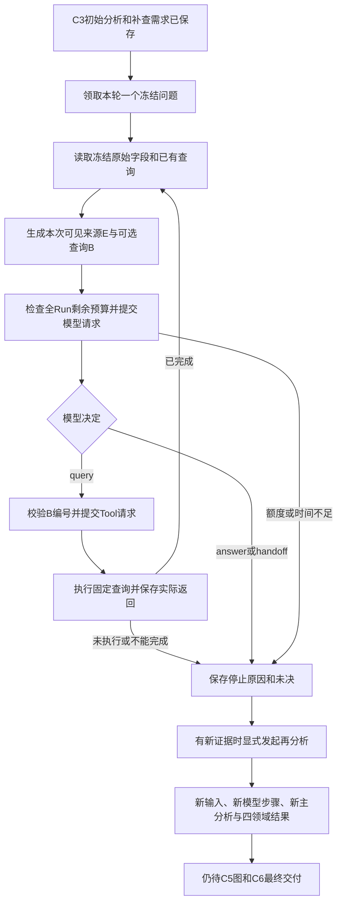

# 问题级Deep与补证后再分析

2026-11-03。新socai2后台现已接入`BaselineService.deepen`和`reanalyze`。前者围绕冻结问题，根据实际查询返回决定下一步；后者基于新增材料重新进行整案主分析和四领域分析。**它们都在原baseline Run内执行，使用原范围、材料版本、4次模型/4次Tool/24000 tokens及120秒限额，不新建Run或重置额度。** 页面、旧HTTP和生产服务未切换。

本批模型及湖响应全部为明确替身，真实PG只用于21原独立合成库的事务/约束验证。组件接通不等于真实模型质量、完整C1–C6编排或最终报告已经通过验收。

## 1. 完整执行流程

1. Deep只接受C1中已有的六项问题ID：检测事实、成员关系、行为性质、授权、影响、覆盖。当前问题范围是该Run冻结的Case范围；没有开放任意新增问题、任意SQL或自行扩大主机/时间窗的接口。
2. 已接受的C3初始分析必须存在。它对应的回答和补查需求作为prior_analysis传入；超2048字节或原值guard不通过则明确省略，不拼接残稿，也不把旧判断作为独立观察。
3. Case→Run锁内新增一个`C4.deep`阶段并提交running。阶段贯穿模型与Tool之间的间隔；其他Deep、直接新查询、C2/C3新步骤或再分析不能插入。已完成步骤的读取不受影响。
4. 每轮读取C4视图，并合并C1/C2已冻结的可见资料：原始观察、人工反馈、历史分析保留各自角色，人工陈述优先保留，避免漏看已有确认后重复交接。材料/查询按记录保留来源和分组，E编号只对应**本次实际可见**字段。members.included按本次留下的来源重新计数；继承的model_fields只是C4预备视图字段数，不作为本次实际覆盖证明。候选查询B由服务器冻结目录生成，包含工具名、主机及相关成员；完整binding映射保存在请求工件。曾执行或跳过的绑定不再提供。
5. 模型只能选一个B查询，或回答，或交接未决。程序校验完整输出和来源，再调用上一批确定查询；同Run步骤、序号、query_id和请求先提交，随后才进行I/O。
6. 查询完成后，以真实行、空结果、截断和限制生成下一次模型输入，同时明确工具名、主机、问题ID、相关成员和实际冻结窗口。不会只把“工具调用成功”或孤立的0行当作证据，也不会让模型虚构工具返回。查询不可执行时保存原因并停止该问题。
7. 回答、人工/外部来源交接、无剩余额度、无剩余时间、未配置模型或输出拒收都有独立停止原因。没有自动创建人工任务、自动重试、自动接续或额外预算。
8. `reanalyze`在显式调用时，合并C1/C2已可见资料、新原始语义/Tool字段、上轮分析和Deep回答；为全成员、六问题和四领域生成**另一份**C3结果。旧输入、答复、领域工件不变。

## 2. 模型决定的字段与枚举

运行时使用Pydantic严格结构与业务校验；[导出的JSON schema](../design/socai2-baseline-deep-v1.schema.json)与运行时结构一致。拒绝多余字段、重复JSON键、非有限数、未知问题和未提供的B/E编号。

| 字段 | 类型/枚举 | 规则 |
| --- | --- | --- |
| question_id | string | 必须等于当前冻结问题 |
| action | query / answer / handoff | 一轮只作一个决定；handoff是未决交接，不是新增人工任务 |
| binding_id | string或null | query必须选本次提供的B编号；其他动作必须null；没有SQL/filters参数 |
| reason | 非空string，最多1200字符 | 本次选择/停止依据，不作为工具实际执行事实 |
| answer | object或null | query必须null；answer/handoff必须提供 |
| answer.state | supported / unresolved | supported须有可见来源；handoff必须unresolved |
| answer.text | 非空string，最多1200字符 | 该问题的回答，不是案件最终判断 |
| support_ids / counter_ids | string数组，各最多32 | 只能引用本次可见E，去重；同一来源不可同时充当支持和反证；执行回执不能作事实 |
| alternatives | string数组，最多8项 | 替代解释，不靠来源数投票 |
| limitations | string数组，最多12项 | unresolved必须有明确限制 |

本批合同能检查结构、范围、来源身份和角色；不能证明模型的语义推理一定正确。空查询不构成反证、未提供授权不等于不存在等要求仍需真实输出验收，不把合成测试当成报告质量通过。

## 3. 数据保存位置

| 现有表/工件 | 新内容 | 不代表什么 |
| --- | --- | --- |
| run_steps，C4.deep/stage | question_id、running/终态、起止时间、初始分析输入、最终摘要输出 | 不新建调查Run；同问题同Run一次领取，重放只读 |
| run_steps，C4.deep/model | parent_step_id指向Deep阶段，每轮独立seq、请求/原答、usage/error | 中间过程不会覆盖为最后一次模型调用 |
| run_steps，C4.query/tool | parent_step_id指向已领取Deep阶段；query_id和原绑定保持 | 不赋予模型SQL或改范围能力 |
| artifacts.model_request | 精确body、实际source_map、binding_map、input_artifact_ids、输入hash、遗漏及Token预留 | 来源未展示就不能引用；不同轮E/B编号按各自请求解释 |
| artifacts.model_response | 完整原回复、validation_error、实际上报usage/request_id | 格式失败/拒绝/截断不作为分析；缺失usage不补0 |
| artifacts.deep_analysis | 复用analysis_block：问题、答案/未决、真实证据引用及限制 | Deep回答只可作为prior_analysis，不升级为observation |
| artifacts.source_snapshot，deep_summary | question_id、state、stop_reason、answer、source_map、iterations、deep_artifact_id、limitations | 迭代链保存每次模型响应ID及随后查询回执ID；不会自动采用 |
| run_steps，C3.reanalysis/stage | name为证据集hash；input_artifact_id为比较的已接受分析；新模型/领域结果 | 同证据集不会反复生成新轮；旧C3_initial仍可读取 |
| artifacts.source_snapshot，C3_reanalysis | 原Analysis合同，另存basis：evidence_set_key、comparison_analysis_artifact_id、input_artifact_ids | 这是本Run内再分析，不是跨Run最终结果比较或case_impact交付 |

业务29表458列、迁移123、ORM、枚举和原38通用合同均未改。新增的是专用Deep输出合同与既有JSON字段的实际消费，不需要第二套调查结果表。

## 4. 冻结、并发和重放

同一个Case仍只允许一个活跃基础Run；AI问答可并行的既定策略保持。本批互斥发生在这个基础Run内部：一个Deep阶段在等待模型、执行Tool和准备下一次输入时一直有明确所有者。子查询必须验证父阶段同Run、同问题、running且类型为C4.deep，不能借任意step_id绕过互斥。

Deep开始后，用户纳入第二个告警会更新另一条pending；当前Run/Deep仍使用原成员和material_id。执行请求提交失败时模型/Tool调用为0；取消或传输/提交不确定会将相关步骤及Run标unknown，继续占槽，不自动重试。

每个冻结问题在同Run内只启动一次Deep。已经结束的同问题请求返回原摘要；后续需要新证据时，可先走明确确定查询，再显式reanalyze。再分析以材料投影、查询投影、Deep摘要的不可变工件ID集作为版本键；视图文件或自身新输出不会制造“新证据”并触发无尽再分析。新证据集产生新步骤；同证据集的成功/失败/跳过均读原结果。

## 5. 来源强度和预算

- C4字段仍区分冻结材料来源与仅按主机/时间匹配的湖查询。后者标`query_binding_only`；再分析不能将其直接作为某条告警的observed发现，只能在保留限制的情况下推断关联。实际事件归属/因果仍需进一步证据。
- Deep答案进入再分析时标prior_analysis，并去掉上一轮局部E编号的展示，原引用映射保留在其工件中。模型只能引用本次提供的S编号。
- 同一原始事件、其材料字段、工具重读和Deep概括不能计为多份独立证据。关系、授权与影响的语义仍需真实验收。
- 全消息继续经过guard；8192字节数据、2048字节单项和12KiB消息上限保持。字段选取时同时测量正文和包含system提示、JSON转义的完整消息，超限整项省略；不等到派发时才被总消息上限拒绝。候选目录最多占1800字节，未提供数量明确记录，不允许选择被省略项。
- 每次模型请求按实际请求bytes＋3000输出上限＋256预留检查剩余额度。上报用量缺失/不一致阻止后续模型执行，费用未知为null。Tool和模型均沿用原Run计数和截止，不按问题或阶段重置。

## 6. 两个可核对的例子

**例一：一查、回答、再分析。** 初始C3使用第1次模型调用；Deep第1轮使用第2次模型调用选择冻结主机的进程查询，Tool返回一行。第3次模型调用读取该行字段和原材料，回答当前问题并保留归属/授权限制。显式reanalyze使用第4次模型调用，生成新的全成员/六问题/四领域结果。共4模型、1Tool，初始分析字节不变，没有Result、案件当前判断或自动结案写入。

**例二：查空后选择另一查询。** 初始C3一次；Deep选择进程查询，实际成功0行，下一次模型输入显示0行和覆盖未知。模型据此提出网络补查；网络返回一行后再回答。共4模型、2Tool。随后显式reanalyze时，程序记录model_call_budget_exhausted并停止，不偷偷给新阶段再加4次额度。查空本身不作为反证，也不自动导出案件安全结论。

上述均为合成测试路径，不是真实案件调查结果。夹具将C2来源适配器明确置为不可用并记录skipped，因此没有消耗背景Tool额度；实际运行中，C2已用次数会占据同一4次上限，Deep可用次数相应减少。

## 7. 验证与剩余工作

[本批明细回执](../operations/socai2-baseline-deep-20261103.json)逐项列出闭环、动态分支、全Run预算、并发/范围变更、未知执行、真实PG延期FK提交失败、来源角色、新证据版本和旧流程回归。模型和ClickHouse适配使用替身；没有创建新容器、调用真实模型/业务湖、修改页面或部署。

下一接C5有来源的图关系及C6完整交付，补产品主机/认证与UEBA/知识/Graph适配，再组织完整C1–C6执行器、HTTP/鉴权/DTO和新表writer。真实模型质量、湖适配和跨Run变化/案件影响仍待验；原r13问题及报告修复暂停状态保持，5.3未完成。
