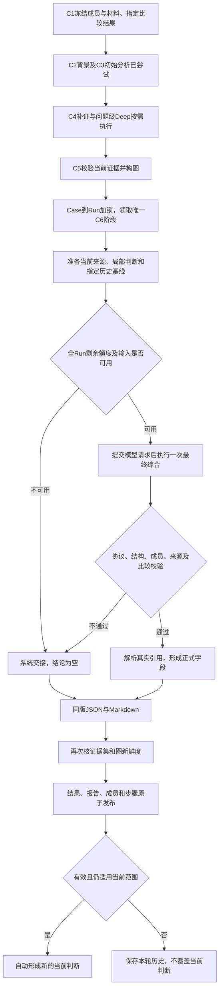

# C6最终交付、历史比较与结果发布

2026-11-03。新socai2后台已接`BaselineService.finalize`：**一次最后的模型调用同时完成整案再分析与交付字段，确定程序生成报告，并在一个事务中保存正式Result、成员覆盖、报告、C6结束记录和符合条件的当前判断。** 这是新服务组件，尚未接业务HTTP或完整自动编排；页面保持。模型和湖查询的验证均为替身，没有恢复旧r13报告批次。

## 1. 当前实际流程

C6必须在C2完成、C3已经尝试后启动。没有可用C3分析时仍可形成系统交接。C4必要字段和C5确定构图可在C6领取前准备，不耗用新的模型/Tool额度；已完成的图可复用，新查询完成后重建过期图。领取后其他模型/Tool/Deep新步骤不能插入；同一C6重复请求不会再调用模型。收到响应但发布不确定，或执行取消/超时时，保留unknown占用，不自动重试或假造交付。

本轮仍允许用户改Case范围，变化维护下一条pending。当前C6继续使用自己已冻结的旧范围；发布时的既有采用保护会返回`stale_scope`，不把旧范围结论覆盖到新范围。

## 2. 字段与存储逐项对应

没有增加业务表、列或迁移。原29表458列、36组枚举、38通用JSON合同及迁移123保持。新增专用[模型输出合同](../../services/api/app/socai2/baseline_delivery.schema.json)，运行时以`baseline_delivery_contract.py`的类型和交叉校验为准。

| 页面/结果语义 | 模型或程序如何产生 | 实际落库/读取位置 |
| --- | --- | --- |
| 调查类型及目的 | 沿冻结Run；本批不允许模型改类型或范围 | `runs.kind/purpose`、`results.kind/purpose` |
| 本轮保留结论 | 模型conclusion.text/state/alert_ids/support_ids/limitations；只接受明确来源覆盖的成员 | `results.conclusion/conclusion_state`；conclusion_origin、validation_state由程序设置；详细支持及限制在C6来源快照 |
| 建立/更新分析的交付说明 | 模型closing_note，系统交接时使用明确无结论说明 | `results.closing_note` |
| 领域分析与整案发现 | 最后一次综合仍覆盖六问题、全部成员和identity/cloud/phishing/insider四领域；共享模型视角 | `results.findings/questions`、四份`artifacts.kind=domain_analysis`、C6来源快照中的完整analysis |
| 建议 | investigate/contain/remediate/monitor，目标只能来自冻结object_keys；附引用和限制 | `results.recommendations`；approval_requirement固定unknown，未创建审批、任务或执行动作 |
| 执行完成/失败/停止 | 有效综合为Run completed；缺有效结论为failed，保留具体stop_reason；传输/提交不确定为unknown | `runs.state/stop_reason/ended_at`；C6步骤另有completed/failed/skipped/unknown |
| 完整交付/部分交付 | 程序核输入省略、C1/C2覆盖、成员/领域/问题/矛盾和图状态，不让模型自报完整 | `runs.delivery_state`、`results.delivery_state`；当前外部图和其他来源仍缺，验收样本均为partial |
| 与先前结果比较 | 只读启动时明确指定的comparison_result_id，读取其不可变输入快照核旧范围；保新增/移出/共同成员 | `results.comparison_result_id/change_kind/change_summary`；C6快照comparison含prior_scope及差集 |
| 对Case的影响 | impact.summary/supported_changes/cannot_generalize/alert_ids/next_steps和支持来源；确定影响须有对应成员观察/人工陈述，不能仅依图/查询绑定 | `results.case_impact`；逐项来源及原模型字段在C6快照 |
| 成员的读取/分析/结论覆盖 | 保留实际read_state；采用最终逐成员分析状态；conclusion_covered只覆盖模型明确列出的成员 | `run_members`与`result_members`；未知/未分析不能列为已覆盖 |
| 正式图 | 选覆盖当前C4证据集的最新C5；发布前再核同一证据集、图ID和内容摘要 | `results.graph_artifact_id` |
| 正式结构报告 | 按原`report_result`合同生成，预留同一个正式Result ID；不是另一份自由文本结论 | `results.report_artifact_id`→`artifacts.kind=report_json`，内含result_id和原合同字段 |
| Markdown报告 | 从同一份正式字段和关联快照确定渲染，转义来源文本，不调用第二个写作模型 | 同C6步骤的`report_markdown`，source_refs指向结构报告与详细快照；返回markdown_artifact_id |
| 来源/过程/用量 | 实际source_map、输入ID、引用/证据集、四领域工件、步骤ID、父子关系和实际用量 | 同C6步骤的`source_snapshot(type=delivery_report)`；返回detail_artifact_id；用量未知保持null，不补0 |
| 当前判断 | 复用既有有效性、范围、新鲜度和已有较新判断检查 | `case_assessments`及来源/覆盖表；有效基础结果自动采用，系统交接不采用 |

`report_json`继续符合既有通用`report_result`，没有把工件种类名相同但形状不同的内容交给读取端。额外来源与执行字段放在关联source_snapshot中；同一返回同时给出report_artifact_id、detail_artifact_id、markdown_artifact_id和正式result_id。新业务读取DTO仍待接线。

## 3. 输出合同及校验边界

模型必须返回analysis、conclusion、closing_note、comparison、impact、recommendations六部分，禁止额外字段。analysis复用已有全成员/六问题/四领域合同，保留支持、反证、替代解释、矛盾和后续证据需求。

- conclusion.state只允许supported/uncertain；supported必须有逐成员的原始观察或人工陈述。来源标签、旧判断、图及仅主机/窗口匹配的query_binding_only不能独立支撑确定结论。
- comparison.kind沿initial/unchanged/expanded/revised/withdrawn/not_comparable。首次且无历史时为initial、summary=null；已有历史但未指定比较对象时为not_comparable，不能假装首次。指定对象无有效结论、无可用范围交集或正文不可用时也不造比较。
- 可比时必须引用被选历史结果和当前来源；范围差集由程序生成，判断是否变化由模型明确解释。没有读取别的历史结果来替换用户指定基线。
- impact的确定影响须限定成员并提供直接依据；空查询、图可达或同主机不能提升为实际影响。没有确定影响时supported_changes为空，保留cannot_generalize和下一步。
- 来源编号只能来自本次实际可见输入；重复、缺成员、越界目标、空白正文、执行回执作事实、错误比较等均拒收。保留原响应，拒收后无自动修复调用、拼接残稿或增加额度。

`validation_state=accepted`表示协议、结构、范围和来源合同通过，**不表示程序已经证明模型自然语言的全部事实和因果正确**。实际模型语义质量仍须后续真实样本验收；旧r13问题没有因字段齐备而核销。

## 4. 四个完整例子

以下为明确的合成验证情景。

**A：第一次调查得到有限结论。** Case含A1。C3保留“授权待确认”的暂定认识；C4读取记录里的PID/父PID，C5保存有来源关系。C6最后一次模型综合给出uncertain结论、六个问题、四领域限制、人工核验建议和“实际影响未确认”。结果为completed/partial，change_kind=initial，change_summary=null；保存有效当前判断及其覆盖A1。Case业务状态仍由业务流程管理，不随结果自动解决。

**B：新增告警后比较两轮结果。** R1已经正式保存。加入A2生成R2的pending，用户手动启动R2并指定R1.result_id。R2读取R1不可变范围，程序保存added=[A2]、shared=[A1]、removed=[]。C6比较必须引用R1与当前来源，模型可以解释新增认识但不能把A1结论无依据推广到A2。R1结果、报告和原答复保持不变。若未明确指定比较结果，即使Case当前判断来自R1，也只写“未指定可比较基线”，不擅自选择。

**C：同一Run使用第四次模型完成交付。** 初始C3消耗1次；Deep选择查询并根据实际返回回答消耗2次；C5无模型调用；C6作为第4次模型，完成最终整案分析与交付。JSON和Markdown由程序生成，不再请求第5次写作。测试总计4次合成模型、1次合成Tool，原24000 tokens/120秒/3000输出上限不变。

**D：没有剩余额度或最终响应无效。** 已用完4次后不会额外执行C6模型；输出截断、用量未知、越界引用也不会当成有效结论。程序保存系统交接，conclusion=null、conclusion_origin=system、validation_state=system_only、conclusion_covered=false、delivery_state=partial。执行材料与先前分析仍可回查；不自动更新当前判断，不自动启动下一条pending。模型传输未确认结束的情况则保unknown，不提前发布交接。

## 5. 原子性与已有发布服务

同一事务预留Result ID，写入C6四领域结果、详细快照、原合同JSON报告、Markdown、最终步骤与正式Result，再由原函数判断是否自动采用。步骤终态只写一次，遵守终态不可修改约束。提交失败时所有正式交付和当前判断一起回滚；已单独记录的实际模型请求/响应仍保留。

发布服务只新增内部可选的预留Result ID参数，公开请求DTO没有新增可指定ID的字段。原发布入口仍可不传，保留原幂等及采用检查。报告正文、Result字段和正式result_id逐项验证一致；不是分别生成三份内容。

## 6. 验证及剩余工作

明细、原始失败和源码指纹见[本批回执](../operations/socai2-baseline-delivery-20261103.json)。验证使用21现有实例中的独立合成库，受限角色/隧道沿原流程清理；无新容器、业务数据库访问、真实模型/ClickHouse/厂商调用、页面改动或部署。第一批文本工件引用校验失败和后续修正记录保留；收尾已按原report_result合同复核正式报告。

14项本批检查＋7项受影响回归最新通过，包含10个输出合同反例、真实延期FK提交失败、取消/并发、4次模型额度、历史比较/过期范围不采用和未知用量。第一批3项因Markdown无content_json而失败，修复后定向3项及其余10项通过；报告合同复核后再定向5项，另补失败历史识别与成员影响范围各1项。原失败和各版本指纹保持，未反复重跑未变检查；10批角色/隧道均清理。

下一步是单个完整执行器：接手动启动、统一组织C1–C6，为最终综合预留模型额度，并按实际问题决定是否需要Deep/查询/再分析，不能每阶段机械加一次调用。C6已能承担最后一次再分析，不必在它之前再强制调用一次C3.reanalysis。然后接新表业务writer、HTTP/读取DTO，以及尚缺的产品主机/认证、UEBA/知识/外部Graph来源。AI对话及人工反馈继续按各自流程接入，不混作基础Run。

当前C6存储与合同通过不等于完整执行器、来源完整性、线上迁移或真实报告语义已验收；旧r13不重试，5.3保持未完成。

代码：[C6执行与发布](../../services/api/app/socai2/baseline_delivery.py)、[严格输出合同](../../services/api/app/socai2/baseline_delivery_contract.py)、[字段投影与报告](../../services/api/app/socai2/baseline_delivery_projection.py)、[针对性验证](../../services/api/tests/test_socai2_baseline_delivery.py)。
