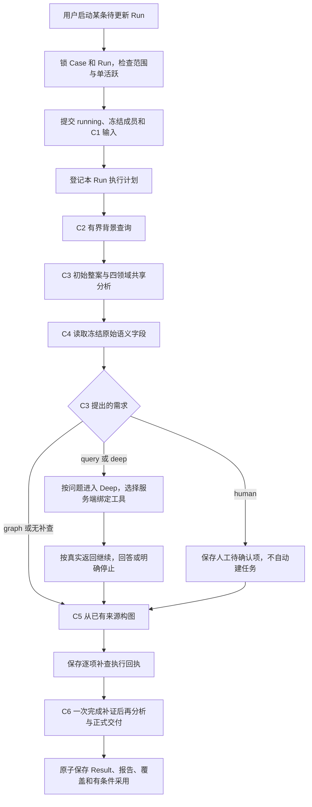

# 同一 Run 的完整基础调查执行器

2026-11-03。新增 `BaselineService.start_full`，将已实现的 C1–C6 接成一次手动启动的后台调用。页面、业务 HTTP 和 Fusion 新表 writer 尚未切换。本文记录本批实现；唯一设计正文仍在兄弟 functional-alignment 工作树。

## 1. 实际流程与职责

每阶段沿用同一 `runs.id`。执行计划和补查分配记录是已完成的决策步骤，不建立一个长期 running 的父步骤与各阶段争锁。模型/Tool 各自仍先提交 running 和精确请求，再派发外部调用。

C3 的 `followups` 仅说明问题、目的、所需证据和关联对象，没有可直接执行的 Tool 绑定。因此当前 `query` 与 `deep` 都交给受限 Deep 选择服务端生成的 B 绑定，不解析自由文本生成 SQL。按 C3 顺序处理，同问题只进入一个 Deep；同问题多个需求仍逐条保留并关联同一产物。后续具备明确结构化绑定时可以直接调用已有确定查询原语，不需要额外 Deep。

人工项保留原 C3 内容、来源和分配回执；当前不创建任务或审批。`graph` 需求使用 C5 有来源图，记录“仅已有材料构图”，不能声称已经查询外部拓扑。没有补查需求不消耗 Deep 调用。C6 同时承担最后的再分析，不再机械增加一次 C3.reanalysis。

## 2. 预算、失败与并发

| 条件 | 当前确定行为 |
| --- | --- |
| 总预算 | 手动完整入口只接受服务端已有上限内的预算：4 模型、4 Tool、24,000 tokens、120 秒、每查询最多 200 行；调用方可更低，不可提高 |
| 最终模型次数 | 已持久化 `executor_version=socai2.baseline-executor.v1` 的 Run，在每次非 C6 模型领取事务里至少保留最后 1 次；同样约束额外手动再分析，不能只靠编排器的循环次数 |
| 预留边界 | 本批预留的是调用次数，**没有另设 Token 或时间储备池**。所有步骤仍共享原总 Token 和截止时间；请求按原字节保守估算。剩余 Token/时间不够，C6 保存空结论系统交接，不保证任意案件都能产出有效结论 |
| C2 与 C4 | 共用 4 次 Tool，C2 已执行的资产、历史和 TI 查询也占次数；不会给 Deep 重新分配 4 次 |
| C3/最终模型无配置、协议拒收、截断、额度不足 | 保留原步骤及原答；无可接受初始分析则不进入 Deep。由 C6 形成系统交接，不自动采用、纠错或重试 |
| Deep 已补查但没有额度再次回答 | 查询材料保留，Deep 明确记录停止及没有答案，C6 读取实际查询并完成整案综合；“执行过 Deep”不等于问题已回答 |
| 传输、取消、提交不确定 | Run/相应活动步骤保留 unknown 占位，异常向上返回，不强行发布系统完成、不自动恢复 |
| 相同启动请求重发 | 返回原领取回执，不重派任何阶段；直接重复进入完整执行器也拒绝 |
| 当前 Run 执行中连续加告警 | 当前冻结范围保持；新增材料汇总到下一条 pending，启动它返回 active 冲突。当前结束后仍等待用户手动启动 |
| 旧范围结果完成 | 保存本轮 Result；范围已变化时不覆盖 Case 当前判断 |

`start_full` 同步等待本次后台执行结束，返回沿用的 Claim（领取时状态，不是新的结果 DTO）。没有增加定时领取、后台队列、自动接续或通用恢复服务。HTTP 接入时要读取已保存的当前 Run/Result，不能把 Claim 的初始 `running` 当作最新状态。

## 3. 字段保存位置与页面支撑

本批没有新增业务表、列、枚举或修改原 38 项通用 JSON 合同。原 29 表 458 列继续使用。

| 数据 | 保存与读取位置 | 含义 |
| --- | --- | --- |
| 完整执行器身份、冻结范围、总限额 | `runs.executor_version/limits/input_artifact_id/scope_revision` | 同一轮的确定执行策略和输入 |
| 执行计划 | `run_steps.stage_code=C1.executor` → `artifacts(source_snapshot,type=execution_plan)` | C1–C6 顺序、预算、最后一次调用预留及明确限制 |
| 原补查需求 | C3 `source_snapshot.analysis.followups` | 问题、关联成员、模式、目的、所需证据、来源及对象 |
| 逐项执行结果 | `C4.routing` → `source_snapshot(type=followup_dispatch).routes` | 原需求下标、问题、模式、状态、停止原因、Deep/图工件 ID、是否有答案 |
| C6 实际消费 | `model_request.payload.body` 与来源表、omissions | 分配状态是执行记录；可见原需求仍为 prior_analysis，不能变成观察证据。超限原需求明确省略，原件仍在 C3 |
| 完整报告中的执行明细 | C6 配套 `delivery_report.execution.followup_dispatch` | 无需靠页面从文案猜“为什么没查/为什么待人工确认” |
| 最终结论与字段 | 原 `results`、`result_members`、`report_json/report_markdown`、C6 详细快照 | 沿用上一批结论/来源/覆盖/比较/影响和原子发布合同 |

新计划与分配工件仅允许作为 `execution_receipt` 引用，不能当作 observation。原 C3/Deep 答复、查询返回、来源路径、用量及各阶段终态继续保存。

## 4. 具体例子

**例一：只需人工确认授权。** C3 保存四领域适用性、六问题、成员分析及一个 human 需求。C4 读取已有原始语义，C5 生成当前来源图，C6 进行最终综合。模型共 2 次，没有因“基础调查”名称机械触发额外补查；人工项留下待确认记录，没有后台替人完成任务。

**例二：进程查询为空，继续查网络。** C3 提出 query/deep 需求。第 2 次模型选择进程绑定，实际返回 0 行；第 3 次模型依据返回选择网络绑定，返回 1 行。此时不能再调用一次 Deep 模型挤掉 C6，记录 `final_model_call_reserved`，且 Deep 答案为空。第 4 次模型由 C6 读取两个实际查询进行综合。0 行不构成反证，网络行的主机/窗口匹配不直接证明属于某条告警。此示例的 C2 来源故意未接通，以隔离动态查询；不能据此宣称真实 C2 的查询不计预算。

**例三：执行中又加入两条告警。** Run R1 启动时只有 A；在模型请求已提交后先加入 B，再加入 C。A 仍是 R1 的唯一成员；B/C 连同 A 合并到下一条 R2 待更新记录。R1 完成后结果只覆盖 A，不自动覆盖已变为 A/B/C 的当前判断；R2 不自动启动。用户再次明确启动时才冻结 A/B/C 并重新完整执行。

**例四：模型未配置或答复无法接受。** 原因、阶段和收到的原答留存；C6 保存系统交接、空结论、未覆盖状态。不会为了出现“已完成结论”而把系统摘要冒充有效分析，也不会静默重试。

## 5. 验证与下一步

本批 **10 项新检查、6 项受影响回归最新均通过**，见 [执行器回执](../operations/socai2-baseline-executor-20261103.json)。首批 8 项通过；收尾隔离旧请求来源别名后，定向复核两项并补两项共享 Tool/最终 Token 边界，均通过。回归覆盖 C3 预算、Deep/再分析、C6 原合同报告/指定比较/原子回滚，以及领取提交失败不派发。6 个批次均已清理受限账号与隧道，未出现业务检查失败。静态阶段修正了测试未用导入及排序；一次文档补丁因标题不匹配未应用，读取后重新准确更新，不涉及业务行为。

沿用 21 上现有 `socai2_schema_review_20261103_a1` 独立合成库；模型、湖和本批 C2 三来源返回使用明确替身。共享 Tool 检查实际走C2步骤领取/记账及Deep查询：3次背景查询后只允许1次湖查询，合计4次；没有直接查询生产资产或情报。旧C2三类SQL的验证仍参考原批次，不把本批替身当真实来源验收。未知/缺源场景保持partial，验证范围是字段、事务与编排行为，不是实际推理质量或生产端到端验收。

下一批优先接新数据 writer、手动启动 HTTP、Run/Result/详细快照及当前判断读取 DTO，确保页面需要的数据能读到。之后补产品主机/认证、UEBA/知识/外部图、人工反馈及 AI 问答保存。旧历史迁移和生产切换另有工作；当前来源缺口仍然使交付为 partial，不能仅因 C1–C6 串起来就声称能力完全覆盖开源版本。页面不改；旧报告修复暂停、r13 不重试、5.3 未完成。
