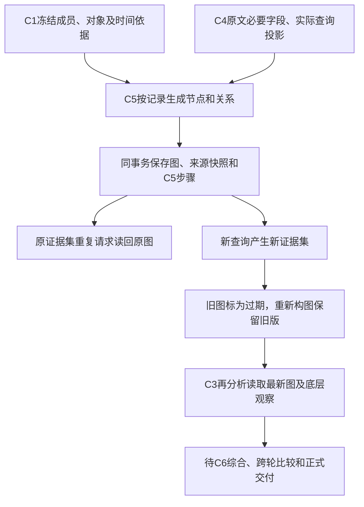

# C5有来源图与C6剩余字段核对

2026-11-03。本批在新socai2后台实现`BaselineService.build_graph`：使用同Run已冻结的C1和C4材料生成有来源的图快照，并接入C3再分析。**没有新增表、调用外部图服务或修改页面；没有把图生成完成当成整案调查完成。** 最新设计以当前目录的[主设计](../architecture/investigation-planning-design.md)为准。

## 1. 从材料到图、再到整案分析

Case→Run按既有顺序加锁。图构建不执行外部I/O，图、配套快照及完成步骤在一个事务内保存；失败全部回滚，不会留下“已完成但无图”的步骤。新构图遇到未结束的模型/Tool/Deep步骤会拒绝；已有相同证据集的图仍可读回，但该快照不包含未结束查询。

新查询完成后，新证据集生成另一份图，原图不覆盖。再分析只消费覆盖当前C4证据集的最新图；没有新构图时记录`graph_state=stale`，不把旧图当作当前材料的完整关系。相同证据集的再分析仍复用既有结果。没有定时领取、自动新Run或自动接续。

## 2. 哪些关系能够生成

| 收到的字段 | 图中的表示 | 强度和不能推出的结论 |
| --- | --- | --- |
| 冻结成员ID、标题、发生时间及时间来源 | 每个成员一个锚点；未知/被guard拦截的标题用明确ID标识 | 锚点仅表示成员，不能表示已完成分析 |
| C1对象类型、namespace、object_key、normalized_value | 告警→来源对象；只有完整的同类型、同命名空间、同键、同值才共享对象 | `candidate`；共同对象不证明攻击链。无namespace、进程、hash和other对象保来源局部身份 |
| `process.pid/uid`及嵌套父进程PID/UID | 父进程→进程，`reported_parent_process` | `observed`表示原记录明确报告父关系，不证明恶意或完整执行因果；不同记录的同PID不合并 |
| `actor.process.pid/parent_process.pid` | 单独的actor进程关系 | 不与`process`拼成一个进程 |
| 同一结构记录的源、目的端点及network/authentication事件类型 | 源→目的，`reported_network_activity`或`reported_authentication_activity` | 只表示记录了活动；方向按源/目的字段，不推定成功、授权、横向移动或实际受影响 |
| 端口、协议、动作、结果 | 边来源及配套记录属性；原始端口0保留 | 不用湖默认0补观察；未收到成功结果不能称成功连接 |
| process/actor/session的各自ID或key | 各原路径的记录内会话节点 | 不按同值跨来源合并，也不把不同session字段拼成一个全局会话 |
| 查询返回的事件ID、时间、行及主机窗口绑定 | 节点不自动赋予某条告警；配套快照保存相关成员、事件ID、查询工具和范围 | `query_binding_only`；主机/窗口相符不证明逐告警归属 |
| 成功0行、失败、跳过、截断 | 查询状态与省略数照实保存，来源原件可回查 | 空查询或缺边不构成反证 |

同一字段有冲突时不擅自选值建立关系；端点不跨湖平铺列和OCSF嵌套块拼接。纯分析文字不转为行为边。没有时间接近边、自动跨记录PID连接、传递性攻击路径或可达性影响结论。只有进程名称、单端点等不足字段时不强画行为边。

## 3. 字段落在哪里

原29表458列、36组枚举和38份通用JSON合同保持，迁移123指纹保持。共用现有graph合同，新增的只是程序生成的工件内容版本`socai2.baseline-graph.v1`。

| 数据 | 表/列或JSON路径 | 类型、语义及读取 |
| --- | --- | --- |
| 图执行记录 | `socai2.run_steps`，`kind=graph/stage_code=C5` | 既有状态枚举；name为证据集摘要，input/output连接冻结上下文及本次快照；不新增Run |
| 图主体 | `socai2.artifacts.kind=alert_graph/content_json` | `nodes[]/edges[]/layout/expanded_node_ids/selected_node_ids/limitations`符合原graph合同；初始布局null，展开/选中为空，供前端自行展示 |
| 节点 | `nodes[].id/type/label/object_key/alert_ids/source_refs` | ID为稳定摘要；对象类型沿原枚举；query节点的alert_ids为空，相关成员另存，避免误认为归属 |
| 边 | `edges[].from/to/relation/strength/source_refs/limitations` | strength沿`observed/inferred/candidate`；本批只生成有明确原字段的observed及来源对象candidate |
| 图的来源快照 | `artifacts.kind=source_snapshot/content_json.type=graph_snapshot` | `graph_artifact_id`、scope、evidence_set_key、input_artifact_ids、captured_at、coverage、records、queries、omissions、limits及limitations |
| 属性与时间 | `records[].fields/time_basis`及成员锚点 | 每字段保name/value/source_path/transform/conflict/ref；材料时间明确来自告警时间及其source_kind，查询时间来自查询行，不伪装成进程开始时间 |
| 查询身份与状态 | `queries[]` | tool_name、hostname、scope、related_alert_ids、binding_id、question_id、receipt_id/projection_id、state/reason、返回行数、截断、遗漏数；详细原件仍在C4 |
| 再分析实际输入 | C3再分析请求工件和`source_map` | 图边按`prior_analysis`消费，底层字段才是observation；保存实际可见别名/值摘要，遗漏仍明确 |

图节点最多200、边最多400，每工件沿用128KiB保留上限。必须保全每个成员锚点；无法容纳就拒绝，不静默少成员。可选关系按节点＋边＋属性整组加入，超限整组省略并计数，保证没有悬空边。模型仍使用8192字节正文、2048字节单项、12KiB完整消息及原guard，不扩大Run预算。

图在本批恒为局部交付：外部拓扑没有查询，未构造完整攻击链。步骤`completed`只表示这次确定构图已执行，不能写成Case“完整调查已完成”。

## 4. 具体例子

以下为合成示例，不是线上案件：

1. A1和A2同属Case，原厂命名空间都是`endpoint-a`，均报告主机`APP01`。图共享这一来源对象，A1/A2到APP01都是candidate；若A3来自`endpoint-b`，同名APP01另建节点。
2. A1原文写PID4209、父PID20，图保存20→4209的来源报告关系。A2也有PID4209，仍是另一记录的节点，不推定它与A1为同一进程。
3. 网络补查返回APP01窗口内一条`192.0.2.1:0 → 198.51.100.2:443`，结果为failure。图保留方向、原始端口0和失败字段；不写“已成功外联”，也不把这条查询行直接归属A1。
4. 构图后又完成一次0行查询。旧图保留；再分析把旧图标为过期。重新构图后，新图保存0行状态，原有父进程关系不删除，仍不能推论“无其他关系”。
5. C3读取图时将它标为派生分析，同时仍可引用原材料/查询字段。C5和C3都不发布Result、不更新Case当前判断；这部分由尚待接入的C6负责。

## 5. C6页面字段：有存储，哪些还缺实际产出

以下不是“缺表”的笼统结论。新表和发布服务能存这些字段，但完整执行器尚未生成正式交付，页面不能用中间步骤状态代填。

| 页面/交付字段 | 当前数据能力 | 确认还要做的工作 |
| --- | --- | --- |
| 调查类型、目的 | Run和Result已有kind/purpose；基础Run领取已写 | 正式结果沿冻结Run填写，不能从页面标题猜 |
| 本轮保留结论 | `results.conclusion/conclusion_state/conclusion_origin/validation_state`及Publication合同均有 | C6整案综合和引用校验产出；不能直接把C3 summary当最终结论 |
| 已完成/失败/取消及停止原因 | `runs.state/stop_reason/stop_detail`、步骤状态已有 | 完整执行器按实际阶段处理终态；C5完成不能带动Run完成 |
| 完整交付/部分交付 | Run/Result.delivery_state、result_members及约束已有 | C6依据成员分析覆盖、问题、来源缺口判断；不能按是否生成报告推断完整 |
| 建立初始分析的内容/本轮交付说明 | `results.closing_note`、findings/questions/recommendations已有合同 | 明确生成保留认识、限制和下一步。无模型结论时写系统交接，conclusion保持null，不写虚构结论 |
| 与先前结果对比 | 领取时冻结`runs.comparison_result_id`；Result有comparison_result_id/change_kind/change_summary | C6读取明确比较基线，区分新增事实/维持/改变判断/不可比较；同Run的C3再分析不是跨Run比较 |
| 对Case的影响 | `results.case_impact`含summary/supported_changes/cannot_generalize/affected_scope/next_steps | 生成有范围和依据的影响说明；图连通不能直接转为“受影响” |
| 每条成员覆盖 | `run_members`及`result_members`已有read/analysis/coverage/assessment/limitations/evidence_refs | 从各轮实际输入与有效分析计算，区分已读取、已分析、纳入最终结论 |
| 图与证据过程 | 本批C5工件已生成；`results.graph_artifact_id`可关联；steps/artifacts可回查 | C6选择覆盖最终证据集的图，再由读取DTO提供；不能发布过期图 |
| 正式报告 | Result.report_artifact_id和report_json/markdown工件类型已有 | 新C6同一版结构结果与报告渲染尚未接；旧r13语义问题没有因此解决，不恢复旧批次 |
| 当前判断的自动更新 | `auto_adopt_baseline_result`和发布事务已有有效/新鲜度/范围保护 | 把有效C6结果接入已有发布入口；AI保存继续要求明确采用 |
| 过程导航和用量 | 同Run步骤、父子关系、实际请求/返回及usage已有 | C6读取汇总并保持未知用量，不补0；业务HTTP/页面读DTO仍待接 |

下一顺序：先做C6严格交付合同与系统交接路径、跨Run比较和最终图新鲜度选择，再接单个完整执行器，沿原预算组织C1–C6，最后接业务writer/HTTP和实际来源验收。产品主机/认证、UEBA/知识/外部Graph仍是独立的适配缺口；本批派生图没有填补这些来源。

完整编排还须处理一个已知额度边界：初始C3一次＋Deep查询前后两次＋补证再分析一次，就用完当前4次模型上限，没有额外一次C6额度。应预留最终交付额度，或让最终一次综合同时承担再分析和交付职责；不能逐阶段机械追加调用。若实际额度已用尽，保留有效中间认识和明确系统交接，不伪造正式模型结论，也不提高现有预算来掩盖问题。

## 6. 验证和证据边界

固定明细见[本批回执](../operations/socai2-baseline-graph-20261103.json)，原始失败及修正后定向结果均保留。验证使用21现有PG的`socai2_schema_review_20261103_a1`独立合成库和受限角色，模型/湖返回均为替身。没有生产数据读写、新容器、真实模型/湖/厂商调用、部署、提交或推送。

10项新检查＋5项受影响回归的最新结果通过。首9项因夹具漏填event_time_source被真实约束拒绝，修夹具后8项揭示图键UUID未序列化；修正后这8项通过，已有通过项复用。再补“旧图过期/仅最新有效图进入再分析”及查询身份字段后，3项定向通过。另一次发布回归方法名未匹配，实际0测试，不计通过；已保留空批回执、补运行器未执行检查并执行正确的test_publish。所有9批受限角色/隧道已清理。

源码入口：[图服务](../../services/api/app/socai2/baseline_graph.py)、[确定投影规则](../../services/api/app/socai2/baseline_graph_projection.py)、[再分析](../../services/api/app/socai2/baseline_reanalysis.py)、[针对性测试](../../services/api/tests/test_socai2_baseline_graph.py)。
