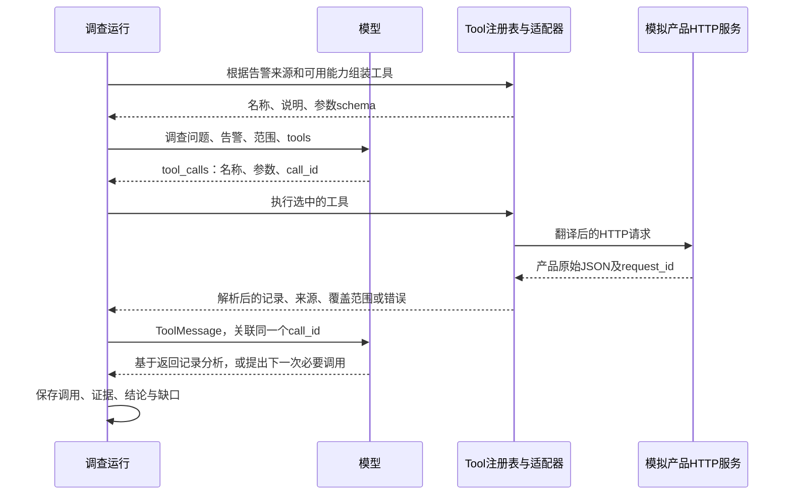

# 新增调查 Tool 的接入与流程验证指南

2026-10-25。用户要的是指导后续新增 Tool 并验证整条调查流程的方法。本轮只保存接入步骤、具体接口例子和验收办法，不编写模拟服务/测试程序、不运行模型或业务调用。权限专项、压力、恢复、故障注入矩阵均不在本指南范围。

## 1. HTTP 接口如何成为调查 Tool

HTTP API 是数据来源。Tool 是调查可调用的业务能力，包含：**名称、用途说明、输入参数、执行适配器、输出含义**。模型看到的是前面三项，程序负责后面的调用和解析，再把输出交给模型。

一个 Tool 可以使用一个或多个 HTTP 接口；新增一种产品不一定要新增模型工具名。若新产品只是实现现有“查主机/查告警/查指标”能力，优先添加产品适配器并复用现有 Tool。只有查询能力或输入语义确实不同，才新增 Tool。



模型不会因为某个 URL 存在就自动发现它，也不会自行读取 Python 函数。必须把 Tool 的说明和参数 schema 加入本次模型请求。模型输出调用意图，实际 HTTP 请求由程序发出。

## 2. 当前仓库怎么接

**2026-10-27路径说明：** 下表的ToolRegistry、scoped_customer_tools和run_with_tools属于原Agents实现。当前F3 Case在API v2中直接用[CaseTools.schemas/execute](../../services/api/app/investigation_v2/case_analysis_tools.py)、[模型协议包装](../../services/api/app/investigation_v2/case_analysis_models.py)和[Case循环](../../services/api/app/investigation_v2/case_analysis.py)组装/执行工具，目前只有进程和网络查询。新增能力必须进入目标路径实际提供的schema及执行分派；只在旧registry登记不会自动出现在F3。详细调用关系见[当前实现详解](current-implementation-reference-20261027.md)。

| 环节 | 当前代码 | 后续新增时检查什么 |
| --- | --- | --- |
| Tool 定义与执行 | [Tool / ToolRegistry](../../services/agents/app/tools/registry.py) | `name`、`description`、`parameters`、`fn`；`openai_schemas()`暴露定义，`execute()`执行函数 |
| 产品能力工具 | [customer_tools](../../services/agents/app/tools/customer_tools.py) | 当前已有 `edr_host_details`、`edr_host_detections`、`endpoint_telemetry_sightings` 等；先判断能否复用 |
| 可用能力与 HTTP 入口 | [agent_tools API](../../services/api/app/api/v1/endpoints/agent_tools.py)、[vendor_reads](../../services/api/app/services/agent_tools/vendor_reads.py) | `/backends`用于发现可用产品能力，`/vendor-read`经现有分派找到产品适配器；新增能力不能只注册模型工具而漏掉后端实现 |
| 加入本次调查 | [Deep 组装与运行](../../services/agents/app/investigator/deep_investigation.py) | `scoped_customer_tools()`返回工具后注册到本次 registry；只写定义文件不代表已加入本次模型请求 |
| 模型选择、执行、回传 | [run_with_tools](../../services/agents/app/llm/tool_loop.py) | `bind_tools(registry.openai_schemas())` → `response.tool_calls` → `registry.execute()` → `ToolMessage` → 下一次模型调用 |
| 模型实际看到的结果 | [render_tool_message](../../services/agents/app/prompting/tool_results.py) | 检查渲染后的正文是否保留关键记录及缺口，不只检查 adapter 内存中有数据 |
| 新 v2 的当前边界 | [ProgramReconRuntime](../../services/agents/app/investigation_v2/program_recon_runtime.py) | 当前是固定查询路径，没有因此自动获得上述通用工具循环；接入 v2 时要在实际调查入口连接工具选择和结果保存 |

内置新工具名如进入现有静态名称清单，要同步维护 `prompting/tool_results.py` 中的既有登记；这只是接线完整性，不另开安全专项。

`Tool.parameters` 负责告诉模型如何传参；当前 `ToolRegistry.execute()`直接调用函数，并不自动执行完整 JSON Schema 校验。因此，参数类型、时间范围、必要字段仍由适配器/现有 API 验证，不能仅凭“schema 写了”就认为请求一定正确。

## 3. 从零接入时，先准备一张 Tool 接入卡

新增者填写下面这些内容即可，不需要先建设通用插件平台。

| 项目 | 要写清什么 |
| --- | --- |
| 要回答的问题 | 这个能力解决什么调查缺口？现有工具是否已能解决？ |
| 来源绑定 | 哪个产品、哪个 connector 实例提供数据？从告警继承还是按调查显式选择？ |
| Tool 定义 | 名称、何时使用、参数类型/必填/单位/时间含义 |
| HTTP 契约 | method、path、query/body、认证配置来自哪里、产品的成功与错误格式 |
| 参数映射 | 每个模型参数如何变成 HTTP 参数；哪些值来自调查上下文 |
| 结果映射 | 原始字段如何变成调查记录；来源 ID、时间、计数、分页/覆盖如何表达 |
| 注册位置 | 后端产品能力、模型 Tool、调查运行入口分别注册在哪里 |
| 验收场景 | 一条告警、固定范围、产品数据、预期请求与应得到的证据/结论边界 |

产品地址、凭据、tenant、connector 实例由运行上下文/服务端配置提供，模型只填写查询业务参数。需要查“该告警来源产品”时，必须明确绑定其 connector；仅发现“该租户有某个 EDR”还不足以证明查的是同一个来源实例。现有选择路径是否携带这个绑定，需要在新增适配时核对。

## 4. 一个具体接入例子

假设新增能力为 **`query_host_processes`：查询指定主机在绝对时间窗口内的进程启动及父进程**。这是说明接入方法的拟新增能力名，并非当前已有接口。本例需要主机范围和绝对时间窗口，不能把现有指标查询工具的 `hours` 参数直接说成已经支持。

### 4.1 告警和本次调查范围

```json
{
  "alert_id": "11111111-1111-4111-8111-111111111111",
  "source": "demo_edr",
  "connector_id": "22222222-2222-4222-8222-222222222222",
  "source_alert_id": "EDR-A1001",
  "hostname": "finance-pc-01",
  "occurred_at": "2026-10-25T10:02:00Z",
  "title": "主机出现异常脚本进程行为"
}
```

本次调查已确定 `start_time=2026-10-25T10:00:00Z`、`end_time=2026-10-25T10:05:00Z`，窗口语义为 `[start, end)`。调查问题是“核对该时段进程及父进程，说明告警是否有行为证据支持，还有什么无法确定”。告警和提示中不放预期查询结果。

### 4.2 模拟 HTTP 服务应提供什么

模拟服务按产品接口契约提供真实可请求的本地 HTTP endpoint；用固定数据回答请求，不接真实厂商。它还记录收到的 method/path/body，供后续对照。

拟定接口：`POST /v1/process-events/search`。

```json
{
  "deviceName": "finance-pc-01",
  "from": "2026-10-25T10:00:00Z",
  "to": "2026-10-25T10:05:00Z",
  "pageSize": 50
}
```

正常产品返回示例：

```json
{
  "requestId": "req-demo-001",
  "code": "OK",
  "data": {
    "events": [{
      "eventId": "edr-event-7001",
      "deviceName": "finance-pc-01",
      "eventTime": "2026-10-25T10:01:12Z",
      "process": {"pid": 4120, "image": "powershell.exe"},
      "parent": {"pid": 2080, "image": "WINWORD.EXE"}
    }],
    "total": 1,
    "nextCursor": null
  }
}
```

固定数据集再放两条对照记录：同主机但在窗口之外、另一主机但在窗口以内。正确请求只命中 `edr-event-7001`。模拟服务应按实际参数筛选，不论收到什么参数都返回同一份成功结果的服务，无法检验查询范围是否正确。

预期请求和记录集合由接入卡事先给出，不能从适配器本次输出反推预期，否则相同映射错误可能被一起当作正确。

### 4.3 模型看到的 Tool

| 字段 | 本例定义 |
| --- | --- |
| name | `query_host_processes` |
| description | 查询主机在指定 UTC 时间范围内的进程启动和父进程。用于核实异常脚本/进程告警。只返回观察记录，不直接判定恶意；查不到记录不证明主机安全。 |
| hostname | string，必填，告警/调查中的目标主机名 |
| start_time / end_time | string，必填，带时区的时间；本例使用已确定的调查窗口 |
| limit | integer，1–100，省略时 50；不得把截断结果声称为完整覆盖 |

实际实现时把这张表写成当前 `Tool.parameters` 所需的 JSON Schema，并绑定执行函数。本例模型应产生类似如下的调用意图；`call_id`由模型协议提供：

```json
{
  "id": "call-001",
  "name": "query_host_processes",
  "args": {
    "hostname": "finance-pc-01",
    "start_time": "2026-10-25T10:00:00Z",
    "end_time": "2026-10-25T10:05:00Z",
    "limit": 50
  }
}
```

模型输出的是这段调用意图。它不会替程序拼 URL、读取厂商密钥或执行 HTTP。

### 4.4 请求和返回如何映射

| 输入或产品字段 | 程序要做的转换 | 对照内容 |
| --- | --- | --- |
| 告警 `connector_id` | 找到本例模拟产品的地址及连接配置 | 实际请求确实到该实例 |
| `hostname` | body.`deviceName` | 目标主机完全一致 |
| `start_time` / `end_time` | body.`from` / `to` | 时区、时间值与边界含义一致 |
| `limit`或默认值 | body.`pageSize` | 等于实际采用的参数值，不偷偷扩大 |
| `requestId` | 返回中的产品请求引用 | 能追到本次 HTTP 回包 |
| `data.events[].eventId` | 调查记录 `source_event_id` | 原来源 ID 保留 |
| `deviceName` / `eventTime` | `hostname` / `timestamp` | 主机和时间正确 |
| `process` / `parent` | 进程和父进程字段 | 不交换父子，不丢类型和关键字段 |
| `total` / `nextCursor` | 计数、是否仍有后续记录/覆盖限制 | 一页不冒充全部；无法确定完整性时明确未知 |

给模型的结果至少包含：执行是否成功、来源/请求引用、实际查询范围、上述记录以及覆盖限制。可沿现有 Tool 返回约定组织，不要求另造一套版本体系。示意：

```json
{
  "available": true,
  "outcome": "ok",
  "request_id": "req-demo-001",
  "rows": [{
    "source_event_id": "edr-event-7001",
    "hostname": "finance-pc-01",
    "timestamp": "2026-10-25T10:01:12Z",
    "process_name": "powershell.exe",
    "parent_process_name": "WINWORD.EXE"
  }],
  "returned_count": 1,
  "next_cursor": null,
  "coverage": "本次指定主机及窗口的模拟数据完整返回"
}
```

上例省略了进程 PID 和查询参数的重复展示，实际接入应按接入卡保留所需字段与范围。原始 HTTP 回包供调试/证据查阅，模型读取的是明确组织的 Tool 结果。至少保存模型实际收到的文本；不能只保存原始大回包就认定模型看到过所有记录。

正常空结果返回“查询成功、0 条、该窗口没有返回记录”；HTTP/产品错误或结构无法解析返回“未能查询/未能解析”，不能统一变成空列表。模型据此分别表示有限观察或资料缺口。

### 4.5 返回结果怎样进入下一轮分析

运行器把解析结果通过 `ToolMessage(tool_call_id="call-001")`交给模型，同时保留该次调用意图。模型的后续回答必须建立在实际收到的记录上。

本例可支持的结论是：“记录 `edr-event-7001`显示该主机在指定窗口内由 Word 启动 PowerShell，告警有相应进程行为证据；仅凭这些记录还不能确认恶意脚本内容、攻击成功或后续影响。”

不要求模型逐字输出预设句子。检查它是否正确使用主机、时间、父子进程和来源记录，是否保留材料不能证明的部分。保存结果时把结论与实际工具调用/证据引用关联；后续事件概况只汇总这些已保存发现。

## 5. 每一步怎样验证

正常场景沿**预定的实际调查入口**启动，保持注册、模型选择、执行适配器、HTTP、解析和回传路径真实，仅把产品服务换成本地模拟服务。

| 检查点 | 看什么实际材料 | 通过标准 |
| --- | --- | --- |
| 1. 告警进入调查 | 实际运行的目标及来源上下文 | 主机、窗口、来源实例与接入卡一致 |
| 2. Tool 被注册 | 发给模型的实际工具列表/schema | 新工具名称/说明/参数在其中，执行函数有后端实现；仅在 registry 文件中存在不算 |
| 3. 模型选对能力 | 真实模型返回的 `tool_calls` | 本场景使用进程查询能力；没有用主机基本信息代替进程证据 |
| 4. 模型参数正确 | `tool_calls.args`与运行目标 | 主机/窗口正确，参数满足类型及范围；省略可选参数时按已定义默认值执行 |
| 5. HTTP 请求正确 | 模拟服务收到的 request log | 方法、路径、实例、body 映射符合接入卡，而非只看 HTTP 200 |
| 6. 返回解析正确 | 原始 JSON 与解析后的记录 | 来源 ID、时间、进程/父进程、计数/覆盖与预期一致，对照记录不混入 |
| 7. 结果确实交给模型 | 实际发送的 ToolMessage | call_id 与调用一致，正文包含关键记录及限制；没有拿另一调用的结果回填 |
| 8. 模型正确使用结果 | 结果返回后的模型回答 | 关键事实来自回包，引用实际记录；不编造恶意性质或查证范围 |
| 9. 调查结果可查 | 运行中保存的调用/证据/报告 | 能从该次调查查到同一工具结果和引用；独立脚本打印成功不能代替这一项 |

第 3 步的验证中，提供真实可用的相关工具集合，例如进程查询、主机基本信息等，由模型根据业务问题和描述选择；不要在用户提示里直接写“调用 query_host_processes”，也不要强制该工具名。模型可以先做合理的其他查询，不按固定文字或固定调用顺序判错，但最终必须取得回答本问题所需的进程证据。

## 6. 最小测试范围：三个场景

| 场景 | 模拟服务怎么回答 | 验证什么 |
| --- | --- | --- |
| 正常 | 按主机和窗口过滤，返回上述 1 条命中；数据集中另有 2 条不应命中记录 | 一次覆盖上表 1–9：发现、选择、参数、请求、解析、回传、采用和保存 |
| 空结果 | 同一个合法查询成功，但没有匹配记录 | 返回“成功但无记录”；模型只说明该窗口未查到，不声称主机安全/告警误报 |
| 查询失败 | 服务明确返回 HTTP 500，或选定一种产品错误格式 | 返回“无法检查”；模型/报告保留资料缺口，不把失败当 0 条或已查证 |

验证模型选择和解释时保留真实模型。模拟产品服务收到真实 HTTP 请求即说明 HTTP 接线工作，但仍不能称为真实厂商接口验收。若只用写死的 `tool_calls`或模拟模型，这只能定位执行和解析是否正确，不能宣称模型已经会选用或理解结果。

每个场景保存一份简短流程记录即可：输入告警/范围、实际模型工具列表和调用、HTTP 请求/原始回包、解析结果、ToolMessage、最终结论与结果引用。可将这些放在同一份 JSON 中；仅记录可见调用和回答，不需要模型内部推理。不得把凭据写入记录。

三个场景是本次功能验证的最小集合，不扩展到大量模型重复采样或可靠性测试。它们只能证明选定模型/配置/场景中的功能正确，不能据一次成功宣称所有告警都会选对工具。未来新出现具体误选/映射问题，再增加相应定向用例。

若关键链路有失败，利用已保存材料定位：未出现在模型工具列表→注册；可见却不选→描述/问题上下文；选对但参数错→参数说明/范围组装；HTTP 错→适配映射；解析错→字段映射；ToolMessage 正确但结论错→模型使用结果。修具体问题，再重跑受影响场景即可。

## 7. 新 Tool 的交付标准

提交一张接入卡、一套告警/产品数据及预期请求、对应适配与注册实现，以及上述三个场景的流程记录。读记录能回答：**为什么这个工具适用、模型是否真的看到并选择了它、向哪里查了什么、产品返回了什么、程序如何解释、模型最终采用了哪些事实。**

指定目标如果是新 v2 调查，就必须从 v2 实际入口验到保存结果；只跑旧 Deep 或独立 `run_with_tools`只能证明相应路径。当前 v2 的通用 Tool 接线仍属于[实现规划 F3](incident-investigation-implementation-plan-20261025.md)，本指南没有把它标为已完成。
