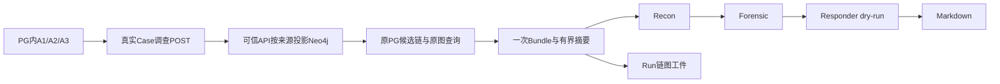

# 攻击链与图接入调查：本地实施与完整案例

2026-10-21。沿OpenSpec `restore-alert-investigation-integrity` 的2.1/3.1/3.4/4.1及B5实施。**链图接线已在本地实际走通，未发布21服务**；原攻击链算法、四Agent、Router与Graph/Deep流程保留。不是整体迁移、全入口或模型质量验收。使用方法见[模块说明](../architecture/attack-chain-path.md)，结构证据见[本批回执](../handoff/attack-chain-path-local-20261021.json)。

## 本次实际改动

1. API在可信Case调查入口准备PG告警事实图；新增受权限控制的prepare POST、只读context GET及Alert薄链入口。保留原PG链BFS/评分、Neo4j遍历及回退算法，不接raw采集。
2. 对齐多主机/用户、tenant实体ID、IOC新旧键和边端点；新IOC原值放`indicator_value`，不改旧约束或批量重写图。关系只表示来源告警报告的关联。
3. Bundle一次读取链/图，摘要进入原四Agent、Router领域Agent及Deep原调用。Graph末端优先复用本Run材料；无Case时保持Alert邻居/影响范围分型。
4. 沿原工件表持久保存`attack_chain`、`attack_path`、`alert_graph`和实际模型可见摘要；原事件、报告及用量出口保持。没有新表、新模型阶段或厂商处置。

API/Agents均需`AISOC_ATTACK_CONTEXT_ENABLED=true`。本次仅本地进程开启。Case由已授权API准备；Alert可配独立writer。永久七权限只读身份只GET，真实POST返回403。缺凭据/缺源/失败与成功空结果分开，不能当作安全结论。详细配置及请求模板见模块说明。

## 一个告警怎样走完整个流程

本例是**合成告警、真实执行**：源事件为测试构造，实际使用本地API/Agents、21已有PG/Neo4j/增强服务和模型网关；没有伪造模型或HTTP响应。起点是“已经受理并存入PG的告警”，本批没有重跑Fusion/Kafka，上游证据仍引用既有批次。

本次有效Case为`82b1246f-9f34-463c-8c2d-27d2b075c741`，Run为`e998308a-a353-4647-99f6-10f94ced0ecf`，tenant为既有隔离测试租户`5594ae90-f57c-50f5-8332-328b3cad1679`。主机`LAB-ATTACKCTX-20261021-6D0ADF`、账号`lab_attackctx_v2_6d0adf`。

| 告警 | 时间（UTC） | 已提供字段 |
| --- | --- | --- |
| A1 `a7f2d535-f009-462f-b52f-a8178c774c8b` | 11:30:04 | 异常登录报告；账号、主机、`192.0.2.50`；T1078 |
| A2 `8113e8fa-8fee-40a4-967f-80aa5987be50` | 11:38:04 | 同账号/主机PowerShell；命令为测试`Write-Output`；T1059.001 |
| A3 `b940b6ec-766f-4ab9-ade1-d6fa3767e6a5` | 11:46:04 | 同账号/主机外联`203.0.113.77:443`；T1071.001 |

这些地址是文档/测试用地址。MITRE来自告警标签，不是独立取证确认；本例没有真实进程树、原始认证日志、有效载荷或恶意信誉证据。

| 步骤与目的 | 本次实际输入 | 实际输出 | 在哪里读 |
| --- | --- | --- | --- |
| 1 创建Case并启动调查 | 已有三条Alert ID、真实tenant；`POST /cases`后`POST /cases/{id}/investigate` | Case HTTP201；启动HTTP200，返回真实Run。API读取Case资料，保留嵌套`raw_alert.alerts[]`与`case_id` | Case与启动响应；Run详情。启动请求不是让模型自行选择目标 |
| 2 准备来源事实图 | Case关联三条告警的主机、账号、两个IP和三项技术 | `projection.status=success`，3个source_alert_ids；11节点、15关系：Case1、Alert3、Host1、User1、IOC2、Technique3 | context的path；本Run工件prepare回执。投影不调用LLM |
| 3 原算法找候选 | A1为最早种子，`24h`即前后各24小时；同tenant共享实体BFS | 本Case A2分0.9083、A3分0.9067；另找出本租户其他Case的3条历史合成告警，共5候选 | `attack_chain.data.chain`，包含时间、distance、score、shared_entities |
| 4 读取Neo4j图与影响范围 | 真实Case及A1，原遍历/邻居/blast-radius查询 | CasePath `source=neo4j`、11节点15边；A1邻居5个、可达实体16个。所有边端点实际存在 | `attack_path`、`alert_graph`工件；不是PG两节点回退。可达范围也可含同tenant其他Case |
| 5 一次预取交模型 | PG链、Neo4j图、投影回执和来源缺口 | 3490字符`model_summary`，含5候选、分数、范围、部分边和unknown边界。4次真实模型输入均包含**同一完整摘要** | 三工件的`model_summary`；本地观察的4份`models/*request.json` |
| 6 Recon侦查 | 原告警正文＋同一Bundle摘要 | 模型提取2个IP IOC、2项技术及测试场景摘要；代码随后固定调用2次`POST /enrich`，均HTTP200。没有模型自主选日志工具 | 事件seq1—10；完整本地`nodes/01-recon-output.json`，增强请求/响应在`observation/http` |
| 7 Forensic取证分析 | 正文＋Recon结果/增强缓存＋同一摘要 | 3事件时间线、4个artefact假设、根因假设、范围限定；confidence0.10。说明是合成场景，不能确认真实入侵或外泄 | seq11—19，`decision_reason`及`forensic`；完整本地`nodes/02-forensic-output.json` |
| 8 Responder响应建议 | 前述取证分析＋同一摘要 | 3条建议：核实测试环境、核主机/账号元数据、建议按测试资料结案；`risk_level=low`、`dry_run=true`。没有真实关闭/隔离 | seq20—24；完整本地`nodes/03-responder-output.json` |
| 9 ReportWriter报告 | 前三步状态、同一摘要、来源和缺口 | 3549字符Markdown，含时间线、IOC、MITRE、取证边界与建议，附图查询成功及增强/KB限制 | seq25—28；`report_md`工件与Case/Run的`report.md`接口均200且内容一致 |

**为什么不只有两条候选：** 原算法搜索同租户全部告警，不限Case。两组测试都使用`192.0.2.50`，因此第一组资料被读为历史候选；没有重调这些告警或旧Run。第一组登录告警分0.9777甚至高于A2，因为原算法同时考虑技术/严重度重叠。另一条历史外联分0.631、distance2，`shared_entities=[]`表示不直接与种子相交，仍可经中间告警关联。保持这种原算法行为，不为了案例整齐过滤或重排。

Case图只投影本Case三告警，不把这5个候选全部强行加入Case。图可达与链候选范围不同。blast-radius沿原数值算法，本例score9.0不是恶意概率，不解释为90%或9%的入侵置信度。

## 模型每一步的实际调用

| 节点 | 逻辑模型 | 输入tokens | 输出tokens | 结束 |
| --- | --- | ---: | ---: | --- |
| Recon | aisoc-recon | 3400 | 289 | stop |
| Forensic | aisoc-investigation | 4080 | 570 | stop |
| Responder | aisoc-investigation | 2962 | 517 | stop |
| ReportWriter | aisoc-report | 5622 | 948 | stop |

实际均路由到既有`openai/aisoc-test-investigation`；合计18,388 tokens，PG/API用量一致。网关计费返回0美元，不代表所有部署都免费。本地观察过程每次SDK retry0、45秒、completion上限2048；没有为改写答案重试。此例保留原默认四步，因此没有额外LLM工具选择循环；Router/Deep的消费接缝以直接测试证明，本批不再跑真实模型矩阵。

收到材料不等于精确因果采用或质量已过：例如Recon把T1059.001泛化成T1059，未保留全部源技术；Responder/报告把测试场景称为FP，并提出关闭建议。这些保持原输出，仅作本次功能交接，未验自治分类、恶意案例推理或真实处置质量。报告没有逐一列全5候选及每条图边，完整结构和实际摘要以Run工件为准。

## 怎样从接口读取

设`CASE=82b1246f-9f34-463c-8c2d-27d2b075c741`、`RUN=e998308a-a353-4647-99f6-10f94ced0ecf`；以下都是`/api/v1`之后的路径，需当前租户读权限。

| 读取目标 | 路径及本次结果 |
| --- | --- |
| Run状态/用量 | `GET /investigations/$RUN`：completed、iterations4、29事件、4工件、18388tokens |
| 全部步骤 | `GET /investigations/$RUN/events?since=-1&limit=200`：29项，seq0—28；返回items/total/next_seq |
| 某步解释 | `GET /investigations/$RUN/explain?step=19`：原解释出口，按seq查看前后事件/工件；本批无需逐步重查一遍 |
| 工件目录 | `GET /investigations/$RUN/artifacts`：链`9ff9f357-be32-46af-a73e-67f80cc75e58`；图`2ebc5d27-121e-495f-8ec1-9d7de797c0a6`；Alert范围`2a4f7bc7-4d52-43a7-b0a9-94ad30f59c6a`；另有report_md |
| 工件内容 | `GET /investigations/$RUN/artifacts/{artifact_id}`：content为JSON字符串，解析后读取该子块、prepare及model_summary。三份摘要一致且与4次实际模型输入一致，内容hash校验通过 |
| Markdown | `GET /cases/$CASE/investigations/$RUN/report.md`：HTTP200，与持久report_md逐字一致 |
| 当前查询视图 | `GET /graph/investigation-context?case_id=$CASE`、`GET /alerts/{A1}/attack-chain?window=24h`；这是当前状态，不用于替代当时Run工件 |

Run详情不是四Agent全部结构JSON。原默认流程的冷存读取是事件、工件和Markdown；本批没有扩成全步骤状态仓库。本地观察额外留了每节点完整输入输出以便二开分析，路径为`.local/aisoc21/attack-context-20261021/case-v2/observation/nodes`。可直接查看[本例Markdown](../../.local/aisoc21/attack-context-20261021/case-v2/report.md)。

## 验证结果与首轮问题

API直接组109 passed、7个原有live-PG用例skipped；Agents必要兼容组120 passed，后补投影回执保真与正常链查询截止各1项通过；最后重跑受改动的context/orchestration合同22 passed（与前组重叠，不累加）。已有算法/测试保留，没有全仓或复杂可用性矩阵。

真实最少控制：只读服务凭据准备写图403；不同tenant读取本Case404；同tenant无关Alert返回`attack_chain=empty`、`attack_path=not_linked`、空Alert图。空结果没有新建Case或被写成安全结论。

第一条Case `75a43d25-97f3-4709-b48a-f21c8fbae56b` / Run `892ca814-efa8-448b-a7f0-b44769d4db7d`实际完成4回复/13941tokens，但链图预取被原Bundle3.5秒单源截止取消。模型和工件只有unavailable，**本次链图消费验收失败**，不以completed标签冒充成功。它的告警、Run及本地证据全部保留。

只对新增`attack_context`来源设置22秒总截止，覆盖适配器可选10秒prepare＋10秒GET；其余原数据源仍3.5秒。另补Case原payload内真实投影回执的同tenant/Case保真。修后采用全新三告警/Case完成上例，未重调或改写第一条Run；本批累计8模型请求、8回复、32,329tokens，无更多调用。

本地通用host图reader未配置、UEBA/TI批查询timeout、KB未配置均按原逻辑保留；两次单IOC增强200不等于有恶意信誉或数据覆盖通过。Realtime未接本地消费者，原best-effort推送失败未影响PG审计/报告；本轮不建设展示推送服务。问题沿[既有清单](upstream-issues.md)后续评估。

源码保留为本地版本；未发布、未重启21容器、未开启worker、未发正式Kafka消息、未操作旧unknown/积压、未执行厂商动作、未提交/推送Git。未参与实现者deep_functional_tests结束独审限定ACCEPT，无本批阻塞；独立复跑22项通过，与原组重叠不累加。原MERGE不清理解绑后的旧关系，持续同步未验；本批只验证新Case准备及消费，不扩历史同步结论。测试进程和专用隧道已停止。完整change仍5/15，不归档。

2026-10-22补齐本地保版定位：`.local/versions/attack-chain-path-20261022/manifest.json`及同目录源码归档，保存本批最终链图相关文件、直接测试和原回执；不含私有环境或HTTP观察凭据。它是Git基线上的选定文件快照，不是完整独立源码包、已审发布包或部署镜像；未终审的早前C2修改也不因同文件被保存而获得发布验收。阶段状态见[交接表](investigation-stage-handoff-20261022.md)，未新增业务验证或改写本批原结果。

API109项结果保留于实施工具回执，未另存日志；命令为`PYTHONPATH=services/api /tmp/sting-investigation-functional-20261021/bin/python -m pytest -q -rs services/api/tests/test_investigation_attack_context.py services/api/tests/test_attack_chain.py services/api/tests/test_graph_tenant_isolation.py services/api/tests/test_investigation_payload.py services/api/tests/test_inventory_route_permissions.py`。7个skip是既有test_investigation_payload集成项要求已迁移live PG，未改测试。Agents日志在`.local/aisoc21/investigation-functional-20261021/attack-context-compatibility-tests.txt`，最终合同在`.local/aisoc21/attack-context-20261021/agents-final-contract-tests.txt`。
