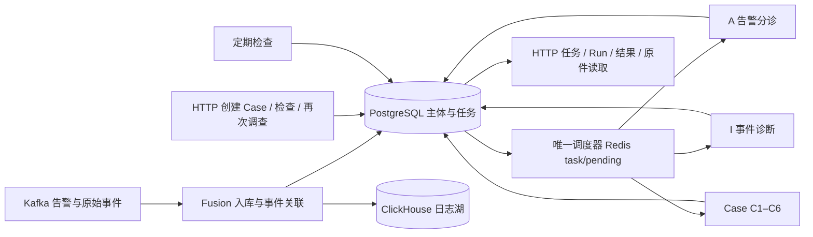

# 告警、事件、Case处理链部署与配置

填写方式沿[四类配置标记](../../deploy/README.md#配置分四类)：保留默认仍须保留严格配置中的字段；“启用时必填”只在使用该依赖时准备；只读核对不要求填写。

2026-11-15。本文是本轮第1–7步的目标配置说明，采用**一个A/I/Case联合调度器**。前序只接A或只接A/I的分步样例不作为当前部署入口；原记录保留供追溯。完整部署入口见[deploy/README.md](../../deploy/README.md)。

## 运行关系和加载入口

先保存告警、事件或Case及任务，再异步执行模型并回填分析结果。告警首次分诊不需要外部手动提交接口；事件诊断、建Case首轮、手动check/rerun均提交task。对外HTTP不启动调度循环。一个进程负责领取，可并行执行配置N个不同主体；同一Case或事件串行。

| 配置入口 | 负责内容 | 加载器/使用方 |
| --- | --- | --- |
| [analysis-aic-dispatch.example.json](../../deploy/local-investigation/analysis-aic-dispatch.example.json) | 唯一调度器、连接、N、轮询与状态目录 | `app.socai2.analysis_dispatch_runtime --profile <绝对路径>` |
| [analysis-aic-executors.example.json](../../deploy/local-investigation/analysis-aic-executors.example.json) | A/I/Case工厂、事件容量、扫描批量、Case补查 | `app.socai2.analysis_case_executor:executors` |
| [analysis-tasks.json](../../deploy/local-investigation/analysis-tasks.json) | 重试、自动活动窗口、I/Case检查间隔、任务查询分页 | `AnalysisTaskPolicy`；HTTP/入站通过`SOCAI2_ANALYSIS_TASKS_CONFIG_FILE`，调度通过`lifecycle_policy_file` |
| [case-allocation.json](../../deploy/local-investigation/case-allocation.json) | Case容量与来源分页 | Case分配用例，通过`SOCAI2_CASE_ALLOCATION_CONFIG_FILE` |
| [investigation-policy-case-v1.toml](../../deploy/local-investigation/investigation-policy-case-v1.toml) | 模型/工具/Token/时限、当前三份输入输出合同 | 工厂`investigation_policy_file`及运行环境`SOCAI2_INVESTIGATION_POLICY`；详见[模型表](deployment-models.md) |
| [analysis-projection.example.json](../../deploy/aisoc21/analysis-projection.example.json) | 需要投影桥接的现行入站部署的消费及回执 | `SOCAI2_PROJECTION_CONFIG_FILE`，由`projection_config.load_profile`读取 |
| [production-profile.example.toml](../../deploy/aisoc21/production-profile.example.toml) | 镜像、数据库/湖/模型、挂载及运行环境的显式装配 | `production_profile.load`；模板占位值必须替换 |
| [本批build](../../deploy/aisoc21/streaming-candidate-20261115-01/processing-build.toml)、[transport](../../deploy/aisoc21/streaming-candidate-20261115-01/transport.json)、[identity](../../deploy/aisoc21/streaming-candidate-20261115-01/identity.json) | 本批源码/镜像冻结、传输和隔离身份 | 既有处理包构建/传输器；identity是目标清单，不是完整可启动profile |

JSON中布尔值用`true/false`，秒/毫秒/条数用数字。以上配置文件除明确可选字段外须完整提供；未知字段、无效值、相对运行路径或缺少当前执行合同会报错，不自动用历史配置补齐。修改后按该模块正常重启加载；已冻结Run不换输入或策略。

## 生命周期配置：全部7项

| 字段 | 类型/当前值 | 作用及边界 | 填写方式 |
| --- | --- | --- | --- |
| `retry_limit` | 非负int，1 | 单task最多自动重试一次，原始尝试不算重试；等待不计次 | 保留默认 |
| `retry_delay_seconds` | 非负int，60秒 | 可重试失败后最早再领取的间隔，不阻塞其他任务 | 保留默认 |
| `automatic_window_seconds` | 正int，604800秒 | 自动检查活动窗口7天；基于本对象实际分析活动规则，扫描/排队/失败不无限续期 | 保留默认 |
| `incident_check_interval_seconds` | 正int，14400秒 | 事件第一次分析后的定期检查间隔，4小时；不是单次分析时限 | 保留默认 |
| `case_check_interval_seconds` | 正int，21600秒 | Case基础调查后的定期检查间隔，6小时；不是执行器轮询 | 保留默认 |
| `default_limit` | 正int，50 | 任务读取默认页大小 | 保留默认 |
| `max_limit` | 正int，100 | 任务读取最大页大小；必须不小于default_limit，不是总任务上限 | 保留默认 |

首次创建自动受理；后续定时检查先判断可用更新。窗口内已受理的一次初试排到超期后仍可执行，但不自动重试；已在等待重试的超期请求结束。关闭停止后续自动检查/重试，已运行按其实际结果结束。手动更新不受7天自动窗口限制，仍遵守对象资格及同主体串行。失败/超时如实结束本地尝试并释放槽，不要求人工解除队列。

## 调度配置：连接与执行容量

| 字段 | 类型/示例 | 含义与约束 | 填写方式 |
| --- | --- | --- | --- |
| `enabled` | bool，false | 示例默认不启动；实际启用必须具备完整A/I/Case工厂和所选运行资源 | 部署必填 |
| `tenant_id` | UUID字符串 | 本调度器处理租户；与入站和HTTP一致 | 部署必填 |
| `database_url_file` | 绝对私密路径 | 当前处理镜像选`postgresql+asyncpg://`普通账号URL；TLS单独由下一项传入，不将HTTP侧psycopg URL照搬，不在JSON写明文凭据 | 部署必填 |
| `database_connect_args` | object | 当前联合模板使用asyncpg参数：`ssl=require`、`timeout=5`，`server_settings.statement_timeout=10000`与`lock_timeout=5000`（毫秒）；不传libpq的sslmode/connect_timeout/options，不要求客户端证书。详见[数据库表](deployment-datastores.md) | 保留默认 |
| `database_pool_size` | 正int，5 | 数据库池大小，实现不追加overflow；与N分别设置 | 保留默认 |
| `redis_url_file` | 绝对私密路径 | Redis连接及逻辑DB；namespace另设 | 部署必填 |
| `redis_socket_timeout_seconds` | 正number，5秒 | 命令响应限时 | 保留默认 |
| `redis_connect_timeout_seconds` | 正number，5秒 | 建连限时 | 保留默认 |
| `lifecycle_policy_file` | 绝对路径 | 上节7项生命周期配置，必须与HTTP/入站使用同版文件 | 部署必填 |
| `executor_factory` | `模块:函数`字符串 | 当前固定选择`app.socai2.analysis_case_executor:executors`，一次提供三类实际执行器 | 保留默认 |
| `executor_config_file` | 绝对路径 | 联合执行器JSON；启动工厂时读取 | 部署必填 |
| `dispatch.namespace` | string，`socai2-analysis` | Redis键前缀，允许字母/数字/冒号/下划线/短横线；候选需独立 | 部署必填 |
| `dispatch.max_running_tasks` | 正int，1 | 三类任务共用总N，可配置1、3、5；不是每种各N | 保留默认 |
| `dispatch.poll_interval_seconds` | 正number，60秒 | 调度器循环检查间隔；与4小时/6小时更新检查分开 | 保留默认 |
| `dispatch.execution_timeout_seconds` | 正number，3600秒 | 本地尝试执行时限；需要覆盖Run模型/工具预算，不替代每次调用超时 | 保留默认 |
| `dispatch.replenish_limit` | 正int，100 | 每轮从持久任务表补入队列的批量；不是最多只看N个pending | 保留默认 |
| `dispatch.priorities` | 四项字符串数组 | 现值Case、A、I、knowledge_sync；代码要求完整且不重复。knowledge_sync槽位保留，步骤10尚未接入，不因此启后台知识任务 | 保留默认 |
| `dispatch.receipt_directory` | 绝对路径 | 完成回执目录，挂持久可写空间，不能放只读源码层 | 部署必填 |
| `dispatch.lock_file` | 绝对路径 | 单实例文件锁；同宿主各启动者必须共享该实际路径。不是跨宿主分布式锁 | 部署必填 |

pending先看，但一次最多检查本轮开始时的队列长度；同主体仍运行或未到重试时间的放回等待，之后继续普通task队列。task队列也按本轮长度有界检查，正在运行的同主体请求移入pending，不阻塞其他可执行主体。不同请求独立入队；同一个业务operation_key重放保持原task，**不跨task合并**。

可重试的已知暂时故障使用本task的新attempt；记录失败次数、时间、原因和下一次可尝试时间。模型正文/结构/引用问题不靠进入pending自动重跑；已发请求结果未知保留真实状态并释放本地占用，不盲目重复，不阻塞下一个主体。task_id贯穿请求，attempt记录次数，Run记录实际分析输入输出；没有变化的check可跳过且不创建Run。

## 联合执行器和Case容量：全部字段

| 文件/字段 | 类型/当前值 | 作用 | 填写方式 |
| --- | --- | --- | --- |
| 执行器`investigation_policy_file` | 绝对路径 | 当前case-v1策略，必须含A/I/Case合同；缺任一实际handler启动失败 | 部署必填 |
| `incident.max_alerts_per_diagnosis` | 正int，100 | I单轮按稳定规则选最近最多100条，完整事件仍保留；实际范围随结果传给Case，未选成员不冒称已分析 | 保留默认 |
| `incident.scan_batch_size` | 正int，100 | 一次周期扫描的事件数 | 保留默认 |
| `case.scan_batch_size` | 正int，100 | 一次周期扫描的Case数 | 保留默认 |
| `case.query_window.before_seconds` | 非负int，3600秒 | 补查窗口在选中告警最早时间之前扩展 | 保留默认 |
| `case.query_window.after_seconds` | 非负int，3600秒 | 补查窗口在选中告警最晚时间之后扩展 | 保留默认 |
| `case.log_query.max_rows_per_query` | 正int，50 | 每次补查日志最多返回条数；有限结果、截断、查空、失败单独记录 | 保留默认 |
| 分配`case.max_alerts` | 正int，100 | 每Case最多成员数，超出续建；不同于I单轮100 | 保留默认 |
| 分配`source_page_size` | 正int，200 | 从事件读取成员的分页大小，继续翻页到全部处理，不把200当成事件总上限 | 保留默认 |
| 分配`default_limit` / `max_limit` | 正int，50/100 | 关系/回执读取分页默认与上限 | 保留默认 |

同事件可与多个独立Case有历史关联，但最多一个活跃接收Case；新告警只跟随进入该接收目标。满100条续建时保存前后Case关系并转交仍指向旧Case的事件；旧Case不重复接收。单独选入的告警可属多个Case，无活跃映射，首次A晚到不直接触发Case自动调查，下轮读取即可。

Case自动更新比较明确整事件关联的可用I诊断业务结论、依据及实际覆盖，另纳入有效H；先由新告警/首次A推动事件诊断，再由可用I推动活跃Case。旧I变stale或失败不当成新结论触发。手动check检查全部适用关联事件，rerun明确要求重做。开始前取当前完整适用材料并写不可变范围，运行中新材料留下一轮；收尾只写结果，不把后来告警追加为本轮已处理。

## Fusion入站配置

源码为[Settings](../../services/fusion/app/core/config.py)、[入口](../../services/fusion/app/main.py)与相应服务。环境项由明确env文件注入，启动时生效；下表“源默认”只为解释未配置时的行为，部署必须覆盖地址、库、Topic及启用状态。当前目标选`AISOC_ALERT_STORE_SCHEMA=socai2`；投影桥接若用于既有来源迁接，由具体发布配置明确绑定，不能让两条写入同时处理同批数据。

| 字段 | 类型/源默认 | 含义 | 填写方式 |
| --- | --- | --- | --- |
| `service_name` | string，aisoc-fusion | 源码保留服务名；当前入口健康名称固定，修改本字段不改变该名称 | 保留默认（当前未接线） |
| `HTTP_PORT` | int，8003 | 容器内HTTP监听，不是宿主映射端口 | 保留默认（按本轮目标） |
| `LOG_LEVEL` | string，INFO | 日志等级 | 保留默认（按本轮目标） |
| `ENVIRONMENT` | string，development | 部署明确production；影响传输校验 | 保留默认（按本轮目标） |
| `KAFKA_BOOTSTRAP_SERVERS` | string | Broker，当前TLS及配套字段见[Kafka表](deployment-datastores.md) | 部署必填 |
| `KAFKA_TOPIC_ALERTS_RAW` | string | 输入告警Topic | 部署必填 |
| `KAFKA_TOPIC_ALERTS_FUSED` | string | 归并输出Topic | 部署必填 |
| `KAFKA_CONSUMER_GROUP` | string | 本次消费位点身份 | 部署必填 |
| `KAFKA_TOPIC_RAW_EVENTS` | string | 日志湖输入原始事件Topic | 部署必填 |
| `AISOC_EVENT_PROMOTION_ENABLED` | bool，true | 原始事件提升为告警；本期从告警源验证，不自动启原始检测，目标false | 保留默认（按本轮目标） |
| `AISOC_ALERT_SINK_ENABLED` | bool，true | 保存归并告警/事件；目标true | 保留默认（按本轮目标） |
| `AISOC_ALERT_STORE_SCHEMA` | enum，源public、目标socai2 | 明确入库目标；只有socai2目标接本轮入站/任务合同 | 保留默认（按本轮目标） |
| `AISOC_LAKE_WRITER_ENABLED` | bool，true | 归档原始事件，独立于是否提升告警 | 保留默认（按本轮目标） |
| `CLICKHOUSE_HOST` / `CLICKHOUSE_PORT` / `CLICKHOUSE_DATABASE` | string/int/string，源localhost/9000/aisoc | 明确湖地址、Native端口及库 | 部署必填 |
| `CLICKHOUSE_USER` / `CLICKHOUSE_PASSWORD` | string/私密值 | 湖写账号连接 | 部署必填 |
| `AISOC_LAKE_BATCH_SIZE` | int，100 | 湖批量写条数 | 保留默认（按本轮目标） |
| `AISOC_LAKE_BATCH_MAX_AGE_SECONDS` | float，2 | 湖未满批刷新间隔 | 保留默认（按本轮目标） |
| `AISOC_DETECTION_ENGINE_ENABLED` | bool，true | 内置规则检测；本期目标false | 保留默认（按本轮目标） |
| `AISOC_WINDOWED_DETECTION_ENABLED` | bool，true | Redis窗口检测；本期目标false | 保留默认（按本轮目标） |
| `AISOC_UEBA_FUSION_ENABLED` | bool，true | 在归并评分中合入UEBA，独立于调查读取UEBA上下文；当前目标false | 保留默认（按本轮目标） |
| `KAFKA_TOPIC_UEBA_ANOMALIES` | string，ueba.anomalies | UEBA输出Topic，仅启上项才使用 | 保留默认（按本轮目标） |
| `AISOC_UEBA_SIGNAL_TTL_SECONDS` | int，86400秒 | UEBA信号缓存有效时间 | 保留默认（按本轮目标） |
| `AISOC_ATTACK_CHAIN_GROUPING_ENABLED` | bool，true | 额外攻击链归并能力，不是基础告警到事件关联；本轮不额外启用 | 保留默认（按本轮目标） |
| `AISOC_ATTACK_CHAIN_WINDOW_SECONDS` | int，3600秒 | 攻击链关联窗口 | 保留默认（按本轮目标） |
| `REDIS_URL` | 私密URL | 去重/关联状态连接；与任务调度命名空间区分 | 部署必填 |
| `DEDUP_WINDOW_SECONDS` | int，300秒 | 告警去重窗口 | 保留默认（按本轮目标） |
| `CORRELATION_WINDOW_SECONDS` | int，3600秒 | 事件关联时间窗，不是I诊断检查间隔 | 保留默认（按本轮目标） |
| `DATABASE_URL` | 私密URL | 入站数据库连接；本轮目标库必须与调度、HTTP一致 | 部署必填 |
| `DEDUP_SIMILARITY_THRESHOLD` | float，0.85 | 去重相似度阈值 | 保留默认（按本轮目标） |
| `MAX_ALERTS_PER_INCIDENT` | int，500 | 基础correlator中，同关联键的事件达到此数后新建事件；重复已有成员仍可匹配。不替代I单轮选100或Case容量100 | 保留默认（按本轮目标） |
| `INCIDENT_AUTO_CLOSE_HOURS` | int，72小时 | 当前仅定义/加载，未发现Fusion执行处读取，不会据此自动关闭事件；不能作为已生效功能 | 保留默认（当前未接线） |
| `AISOC_FEATURE_RBA` | bool，true | 风险累计能力开关，保留已选部署值，不因文档启用 | 保留默认（按本轮目标） |
| `RBA_PROMOTION_THRESHOLD` | float，80 | 累积风险提升阈值 | 保留默认（按本轮目标） |
| `RBA_WINDOW_SECONDS` | int，86400秒 | 风险累计窗口 | 保留默认（按本轮目标） |
| `RBA_DECAY_HALF_LIFE_SECONDS` | int，14400秒 | 风险衰减半衰期 | 保留默认（按本轮目标） |
| `RBA_W_CRITICAL` / `RBA_W_HIGH` | float，40/20 | 严重/高等级信号权重 | 保留默认（按本轮目标） |
| `RBA_W_MEDIUM` / `RBA_W_LOW` / `RBA_W_INFO` | float，8/3/1 | 中/低/信息等级权重 | 保留默认（按本轮目标） |
| `RBA_MAX_TOP_ENTITIES` | int，100 | 风险排行最多实体数 | 保留默认（按本轮目标） |
| `AISOC_FEATURE_CONFIDENCE` | bool，true | 归并置信度及解释输出 | 保留默认（按本轮目标） |
| `AISOC_VULN_BOOST` | bool，true | 漏洞关联风险增强 | 保留默认（按本轮目标） |
| `ENRICHMENT_SERVICE_URL` | URL，源localhost:8082 | enrichment内部服务地址，须与实际容器网络一致 | 部署必填 |
| `AISOC_FUSE_ENRICHMENT` | bool，true | 归并时查询情报补充；无provider结果如实空，不造数据 | 保留默认（按本轮目标） |
| `AISOC_FUSE_ENRICHMENT_TIMEOUT` | float，3秒 | 归并补充请求限时 | 保留默认（按本轮目标） |
| `AISOC_FUSE_ENRICHMENT_RISK_FLOOR` | float，50 | 情报命中影响风险评分的下限 | 保留默认（按本轮目标） |
| `AISOC_FUSION_MEMORY_NUDGE` | bool字符串，源1、目标0 | 组织历史先验增强，当前保持关闭 | 保留默认（按本轮目标） |
| `AISOC_FUSION_MEMORY_REFRESH_SECONDS` | int，21600秒 | 启用先验时刷新周期，入口实际最少300秒 | 保留默认（按本轮目标） |
| `SOCAI2_ANALYSIS_TASKS_CONFIG_FILE` | 绝对路径 | socai2入站的生命周期配置，缺失时不能凭本地默认受理任务 | 部署必填 |

这些开关反映当前源码提供的参数，不表示各可选能力已通过本轮验收。可选支持模块的逐项配置见[支持服务](deployment-support-services.md)。本轮必须验证基础事件关联与上下文路由，不能用额外攻击链开关代替该验证。

## 投影桥接配置：全部18项

仅用于所选入站部署确实需要的桥接进程，不在原生socai2入站旁再启动同批写入者。示例通过严格字段校验；字符串非空、路径绝对、9项数字均正整数。

| 字段 | 示例/单位 | 含义 | 填写方式 |
| --- | --- | --- | --- |
| `topic` | socai2.alerts.fused | 输入归并Topic | 启用时必填 |
| `group` | socai2-investigation-projection-v1 | 投影专用消费位点 | 启用时必填 |
| `client_id` | 同示例group | 客户端观测身份，不能代替group隔离 | 启用时必填 |
| `bootstrap_servers` | 192.168.1.21:19093 | Broker地址，TLS配套从受控env文件加载 | 启用时必填 |
| `environment` | production | 传输策略环境 | 保留默认 |
| `activation_file` | `/var/lib/socai2-projection/activation.json` | 明确激活/起点记录，持久保存，不能靠删文件重派历史 | 启用时必填 |
| `ready_file` | `/tmp/production-projection-ready` | 就绪探针时间标记，不是业务成功回执 | 启用时必填 |
| `source_pythonpath` | `/opt/processor/smoke-fusion` | 包内来源读取代码路径 | 启用时必填 |
| `analysis_policy_file` | `/app/config/analysis-tasks.json` | 与联合调度同版生命周期策略 | 启用时必填 |
| `poll_timeout_ms` | 2500毫秒 | Kafka轮询等待 | 保留默认 |
| `max_records` | 1条 | 单次拉取上限 | 保留默认 |
| `request_timeout_ms` | 20000毫秒 | Kafka请求限时 | 保留默认 |
| `max_partition_fetch_bytes` | 2097152字节 | 单分区拉取数据预算 | 保留默认 |
| `connect_timeout_seconds` | 10秒 | 数据库连接等待 | 保留默认 |
| `command_timeout_seconds` | 60秒 | 投影命令处理限时 | 保留默认 |
| `lock_timeout_ms` | 15000毫秒 | 事务等锁时间 | 保留默认 |
| `source_prefetch` | 1条 | 源记录预取数量 | 保留默认 |
| `health_max_age_seconds` | 75秒 | 就绪标记最大年龄 | 保留默认 |

## 处理部署profile：全部运行分区

[production-profile.example.toml](../../deploy/aisoc21/production-profile.example.toml)经[production_profile.py](../../deploy/aisoc21/production_profile.py)严格加载，除`knowledge`外各节必填；不允许缺字段或任意加字段。文件挂载为宿主路径/容器路径成对配置；PG已移除CA文件字段；当前模板保留占位镜像，不能直接发布。

| 字段 | 类型/要求 | 含义 | 填写方式 |
| --- | --- | --- | --- |
| `version` | string，socai2.production-profile.v1.2 | 本加载格式版本，不表示额外业务版本 | 保留默认 |
| `default_tenant` | UUID | 所选运行租户 | 部署必填 |
| `paths.private_dir` | 绝对路径 | 运行私密文件目录 | 部署必填 |
| `paths.transport_env_file` | 绝对路径 | 既有传输连接来源文件；不输出内容 | 部署必填 |
| `paths.policy_file` / `paths.policy_mount` | 绝对路径 | 本次case-v1策略宿主与容器位置 | 部署必填 |
| `paths.projection_file` / `paths.projection_mount` | 绝对路径 | 投影JSON宿主与容器位置 | 部署必填 |
| `paths.analysis_tasks_file` / `paths.analysis_tasks_mount` | 绝对路径 | 生命周期JSON宿主与容器位置 | 部署必填 |
| `image.tag` / `image.id` | string / sha256摘要 | 本次镜像名字及核验后的不可变ID，二者对应 | 程序生成/只读核对 |
| `image.user` | 非root UID:GID，示例10001:10001 | 执行身份；挂载读写权限匹配 | 保留默认 |
| `postgres.container` / `admin_user` | string | 明确管理目标，仅安装装配使用 | 部署必填 |
| `postgres.database` / `host` / `port` | 标识符/string/int | 普通运行连接库、地址、1–65535端口 | 部署必填 |
| `postgres.processor_role` / `ingress_role` | 标识符 | 分析写角色与入站角色 | 部署必填 |
| `postgres.tls_mode` | require | 保留默认TLS，账号密码认证，无客户端CA/证书/私钥配置 | 保留默认 |
| `lake.container` / `database` / `host` / `port` / `reader_role` | string/标识符/string/int/标识符 | 湖管理目标和查询连接；见[数据湖](deployment-datastores.md) | 部署必填 |
| `model.base_url` | 无凭据HTTP(S) URL | LiteLLM访问入口，不附用户名/query/fragment | 部署必填 |
| `model.alias` / `protocol` / `schema_profile` | string | 必须与case-v1策略一致；当前aisoc-investigation/chat_completions/vllm_grammar_v1 | 部署必填 |
| `docker.network` | string | 服务连接网络 | 部署必填 |
| `docker.memory` | Docker大小字符串，示例2g | 处理容器内存上限，不是数据库卷大小 | 保留默认 |
| `docker.pids_limit` | 正int，128 | 容器进程数限制 | 保留默认 |
| `docker.tmpfs` | 挂载字符串，示例128m | 只供临时目录，不放业务数据和完成回执 | 保留默认 |
| `docker.api_pythonpath` / `fusion_pythonpath` | 路径 | 对应包导入路径，不混对外HTTP入口与核心执行 | 保留默认 |
| `runtime.ENVIRONMENT` / `runtime.ENV` | string，均production | 两处保持一致 | 保留默认 |
| `runtime.DEBUG` | 字符串false | 调试日志开关 | 保留默认 |
| `runtime.AISOC_DEV_AUTH_BYPASS` | 字符串false | 不使用开发态旁路；对外HTTP当前可信模式由独立配置负责 | 保留默认 |
| `runtime.AISOC_AIRGAPPED` | 字符串true | 本轮显式出网约束 | 保留默认 |
| `runtime.AISOC_AIRGAP_ALLOWLIST` | JSON数组字符串 | 至少包括网关与tokenizer主机；启知识时还需实际embedding/vector目标 | 保留默认 |
| `runtime.SOCAI2_SOURCE_UEBA_ENABLED` | bool字符串，true | 读取适用UEBA来源 | 保留默认 |
| `runtime.SOCAI2_SOURCE_KNOWLEDGE_ENABLED` | bool字符串，true | 读取知识上下文 | 保留默认 |
| `runtime.SOCAI2_SOURCE_GRAPH_ENABLED` | bool字符串，false | 图来源当前关闭 | 保留默认 |
| `runtime.SOCAI2_SOURCE_PRODUCT_HOST_ENABLED` | bool字符串，false | 产品主机来源当前关闭 | 保留默认 |
| `runtime.DATABASE_POOL_SIZE` / `DATABASE_MAX_OVERFLOW` | int字符串，2/1 | 处理连接池基础/额外额度 | 保留默认 |
| `knowledge.profile_file` / `profile_mount` | 可选节内必填绝对路径 | 知识JSON宿主与容器路径 | 启用时必填 |
| `knowledge.key_file` / `key_mount` | 可选节内必填绝对路径 | Qdrant私密key宿主与容器路径 | 启用时必填 |
| `runtime.SOCAI2_KNOWLEDGE_PROFILE` | knowledge启用时必填路径 | 必须等于knowledge.profile_mount | 启用时必填 |

发布装配程序由这些字段生成`PGSSLMODE`、`OPENAI_BASE_URL`、`OPENAI_MODEL`、`CLICKHOUSE_*`、`SOCAI2_SERVICE_DATABASE_NAME`、`SOCAI2_LAKE_DATABASE`、`SOCAI2_MODEL_PROTOCOL`、`SOCAI2_MODEL_SCHEMA_PROFILE`、`SOCAI2_INVESTIGATION_POLICY`、`SOCAI2_PROJECTION_CONFIG_FILE`和`SOCAI2_ANALYSIS_TASKS_CONFIG_FILE`。`SOCAI2_PROCESSING_*`、`PYTHONPATH`及policy/profile SHA256是装配输出，不另手工维护一份配置；摘要不匹配应重新冻结新发布，不能改旧Run凑一致。

## 构建与传输配置

构建器`prepare_processing_release.py --profile <TOML>`只打包、冻结，不启业务进程。候选本批文件已给出明确值。

| build字段 | 类型/本批值 | 含义 | 填写方式 |
| --- | --- | --- | --- |
| `version` | string，socai2.processing-build.v1.2 | 构建文件格式 | 保留默认 |
| `release` | string，processing-20261115-r2 | 新批发布目录，不复用结束批次 | 部署必填 |
| `output_dir` | path | 本地包输出目录，按profile规则解析相对路径 | 部署必填 |
| `policy_file` | path | 明确选择case-v1，连同输入profile冻结 | 部署必填 |
| `image.base_tag` / `image.base_id` | tag/sha256 | 已缓存基础镜像的名字与身份 | 程序生成/只读核对 |
| `image.tag` | tag | 候选目标镜像名字 | 部署必填 |
| `image.user` | UID:GID | 运行身份 | 保留默认 |
| `image.platform` | linux/amd64 | 21目标架构 | 保留默认 |
| `image.build_timeout_seconds` | int，300秒 | 镜像构建命令限时 | 保留默认 |
| `image.buildkit` | bool，false | 本次构建方式，保持与已验证构建器一致 | 保留默认 |

`rollout_transport.py --config <JSON> processing upload/build`使用以下字段。文件限制属于包传输，不是模型上下文额度。

| transport字段 | 类型/本批值 | 含义 | 填写方式 |
| --- | --- | --- | --- |
| `transport.ssh_binary` | string，ssh | SSH可执行程序 | 保留默认 |
| `transport.ssh_target` | string，sting-infra21 | 明确目标别名，沿已配置转发 | 部署必填 |
| `transport.remote_python` | string，python3 | 目标宿主解包/构建入口 | 保留默认 |
| `transport.connect_timeout_seconds` | int，10秒 | SSH建连限时 | 保留默认 |
| `local_processing` | 绝对路径 | 本地processing包目录 | 部署必填 |
| `processing_release` | string | 与build.release一致 | 部署必填 |
| `remote_root` | 绝对路径 | 本批candidate根目录，不能指向已结束批次覆盖 | 部署必填 |
| `archive_limits.files` | int，3000 | 包文件数上限 | 保留默认 |
| `archive_limits.compressed_bytes` | int，33554432 | 压缩包32MiB上限 | 保留默认 |
| `archive_limits.uncompressed_bytes` | int，134217728 | 解包128MiB上限 | 保留默认 |
| `command_timeout_seconds` | int，400秒 | 远端命令整体限时 | 保留默认 |
| `evidence` | 绝对路径 | 本批脱敏回执输出目录 | 部署必填 |

HTTP完整包使用[专用构建配置](../../deploy/http-service/README.md)，同时包括HTTP所需SQL查询资源；不能拿处理包的Python文件清单替代完整HTTP包。最终统一发布清单须由验收后的完整包生成，目前不把旧`current-rollout.json`当本轮现成发布命令。

## 测试参数、验证与当前状态

候选[identity.json](../../deploy/aisoc21/streaming-candidate-20261115-01/identity.json)逐项分工如下；它是清单，不会通过改`state`创建服务：

| 字段 | 含义 | 填写方式 |
| --- | --- | --- |
| `candidate_id`、`ssh_target`、`root`、`network`、`platform` | 本批身份、目标宿主、目录、网络及架构 | 部署必填 |
| `tenant_id`、`actor_id`、`actor_name` | 本批租户及记录操作人，必须实际存在并与HTTP/执行一致 | 部署必填 |
| `postgres.container`、`admin_role`、`database`、`host`、`port` | PG管理目标和普通连接目标 | 部署必填 |
| `postgres.owner`、`reader`、`writer` | 本批结构属主、读账号、写账号；清单不保存密码 | 部署必填 |
| `postgres.tls_mode` | 当前require，不再有ca_file/ca_mount字段 | 保留默认 |
| `http.container`、`project`、`host`、`port`、`swagger_port` | 候选HTTP与文档服务的身份及入口 | 部署必填 |
| `state`、`runtime_profile_ready`、`credentials_created` | 按实际供给记录状态，不凭手填为true解除未就绪 | 程序生成/只读核对 |

正式默认4小时/6小时/7天不变。测试模块可在独立profile把检查设20秒/30秒、调度1秒、重试5秒；正常真实模型批次自动窗口至少3600秒且不短于单Run预算。120秒窗口只用于生命周期边界；不把模型/工具超时同时压小。具体值随本批配置回执保存，尚未启用的短配置不写成已运行。

2026-11-15候选处理包已冻结735文件，733个镜像内运行文件核验及无网络工厂加载通过；随后新建21候选库/基础身份/普通密码连接，123–129及32表521列核对通过。[候选证据](evidence/streaming-candidate-20261115-01/README.md)按子步区分无网络包验证和真实数据库供给。HTTP实际接入验证继续，Kafka/Redis隔离运行配置及完整处理链仍待；9个旧业务容器按授权暂停，共享依赖保留。W1只读测试账本已完成，见[测试服务入口](../../deploy/investigation-test/README.md)。

本批数据库安装用[database-install.toml](../../deploy/aisoc21/streaming-candidate-20261115-01/database-install.toml)，字段含义沿[PG安装配置](deployment-datastores.md#安装profile逐项)。管理socket仅用于安装，应用普通reader/writer另用require密码连接；不要把管理连接核验当普通登录验证。[旧容器暂停配置](../../deploy/aisoc21/streaming-candidate-20261115-01/pause-old-services.json)的`ssh_target`、PG目标、`stop_groups`及`keep_running`为按环境确认的部署必填；`stop_timeout_seconds=30`和`command_timeout_seconds=55`保留默认，仅约束本次停止操作，不改变模型/任务超时。前后状态及恢复命令由程序生成，未删除容器或数据。

发布前先验证所选loader、文件/镜像hash和显式资源身份；业务验证从Kafka开始，核入库不等待模型、事件关联/上下文路由、A→I→Case、实际分析范围、下一轮比较及同批HTTP/查阅。现有直接程序证据复用，模型正文NOT_PASSED保持，不为文档重复跑模型。正式服务更新在整批交接与独立结束审计之后。

### 21流式候选入站配置

本批沿[ingress.json](../../deploy/aisoc21/streaming-candidate-20261115-01/ingress.json)选定资源，候选接线与正式发布分别记录。`fusion-support`安装方式见[数据库入口](../../deploy/database/CURRENT.md#原生fusion公共支撑)。以下为本批可变项，不能照抄候选身份去覆盖其他环境。

| 配置 | 分类及含义 |
| --- | --- |
| `candidate_id`、`ssh_target`、`root`、`identity_file`、`network` | 部署必填；候选身份、明确21目标/目录/已有Docker网络，与数据库/HTTP同租户 |
| `processing_image`、`fusion_container`、`fusion_workdir`、`fusion_http_port` | 部署必填；冻结r2镜像与其Fusion源码路径，独立容器、仅内部8003，无主机端口；不是另一个业务版本 |
| `postgres.*` | 部署必填；明确库、管理容器/安装账号、owner及普通reader/writer、受控双URL文件。管理账号只用于DDL，运行仍普通密码/require；锁3秒/语句30秒沿安装默认 |
| `kafka.container`、`metadata_bootstrap` | 部署必填；仅资源元数据管理使用，运行传输按下一项 |
| `kafka.bootstrap`、`security_protocol`、`ca_source`、`ca_target` | 部署必填；运行SSL及Kafka CA挂载。PG取消客户端证书不代表Kafka取消TLS |
| `kafka.topics`、`group` | 部署必填；四个新Topic及唯一Fusion group，不能混入旧Topic/group |
| `kafka.partitions`、`replication_factor`、`retention_ms` | 本候选为1/1/604800000；服务部署需按实际broker选择，不能用测试复制数当生产容量建议 |
| `kafka.offset_reset`、`start_requirement` | 本批记录现行consumer的latest；必须空Topic且实际分配完成后再发送。不是可动态覆盖consumer的开关 |
| `redis.container`、`image`、`port`、`data_directory`、`config_path` | 部署必填；独立实例及持久目录，内部6379，无主机公开端口，不借共享Redis固定键 |
| `redis.fusion_db`、`reserved_dispatch_db` | 本候选0/1；后者仅预留，本子步未启调度 |
| `redis.password_required`、`private_runtime`、`appendonly`、`host_ports` | 本候选密码必填、私密文件600、AOF开启、主机端口空；密码由准备程序生成，不进公开JSON |
| `clickhouse.*` | 部署必填；容器、地址、9000/8123、独立库表、现行schema来源及普通reader/writer。仅复制表结构，密码生成至`private_runtime`600文件 |
| `fusion_env.*` | 沿本章既有逐项Fusion配置说明；本候选归并及攻击链窗口86400秒、容量500，湖batch100/2秒。关闭原始检测/提升、UEBA订阅、历史memory及尚未准备的fuse enrichment，不能宣称验证这些功能 |
| `initial_task_policy` | 本测试retry_limit=1、retry_delay_seconds=5；受理快照即保存，不改正式默认60秒。没有启动调度，不因此产生模型请求 |
| `dispatcher_enabled`、`models_enabled` | 本子步均false的交付声明；真正保证来自未启动调度进程与实际0attempt/Run读回，不是Fusion读取的运行开关 |
| `timeout_seconds` | 操作命令45秒，仅候选资源准备/核对，不修改模型预算 |

### 21候选A/I及Case执行配置

入站通过后的本步选[analysis.json](../../deploy/aisoc21/streaming-candidate-20261115-01/analysis.json)及[dispatcher](../../deploy/aisoc21/streaming-candidate-20261115-01/analysis/dispatcher.json)、[executors](../../deploy/aisoc21/streaming-candidate-20261115-01/analysis/executors.json)、[lifecycle](../../deploy/aisoc21/streaming-candidate-20261115-01/analysis/lifecycle.json)。使用已冻结r3处理镜像，无新HTTP业务实现；来源、模型生成及最终读取的实际结果另见本批回执。旧ingress配置中的dispatcher/models=false保留入站时点，不代表后续调度的当前开关。

| 配置字段 | 分类及本步含义 |
| --- | --- |
| `candidate_id`、`batch_id`、`ssh_target`、`root`、`network`、`image`、`container` | 部署必填；明确本candidate/本次分析、目标主机、目录、网络和唯一调度容器及已验镜像，不继承正式目标 |
| `user`、`workdir`、`memory`、`pids_limit` | 显式部署值10001:10001、/app、2g、128；沿处理镜像运行约束，不作为模型Token容量 |
| `command_timeout_seconds`、`stop_timeout_seconds`、`probe_timeout_seconds` | 可保留默认55/30/40秒；分别约束部署命令、空闲后停容器和只读模型目录探针，不能代替Run预算 |
| `private_model_source`、`model_key_name` | 启用时必填；指定现有受控模型env及OPENAI_API_KEY字段。只选模型/必需应用秘密，不复制正式数据库连接，不向文档或日志输出值 |
| `private_http_source`、`private_redis_source`、`private_runtime_path` | 部署必填；读取本candidate普通writer与Redis私密连接，生成600权限的分析env及URL文件；只读挂载给指定运行用户 |
| `database_driver`、`database`、`writer` | 部署必填；本镜像实际安装postgresql+asyncpg，选本candidate库及普通writer。HTTP使用的psycopg不直接套给处理镜像，无自动驱动回退 |
| `model_base_url`、`model_alias`、`backend_base_url`、`backend_model` | 部署必填；当前LiteLLM调查别名及其实际43后端，分别核真实目录、resolver及tokenizer，不能从可达推断生成成功 |
| `redis_container`、`redis_port`、`redis_db` | 部署必填；独立候选Redis的6379/DB1，Fusion仍DB0；密码在受控文件，锁/回执目录持久化 |
| `runtime_env` | 部署必填；显式环境、普通数据库TLS、模型协议/Schema、策略/分配/生命周期路径和airgap允许地址。`AISOC_AGENTS_LLM_CONTRACT_MAX_CHARS`须与policy.model.max_prepared_bytes一致，当前1048576；改env后须重建容器，单纯restart不会装载新env。A/I子步关闭知识；当前Case子步启用知识profile及候选ClickHouse reader。UEBA/图/产品来源保持false，不能称已验 |
| `source_tables` | 本次准入的明确来源表；核普通身份可读assets/history/threat_intel及tenant模型配置，不是直接插入模型的整表输入 |
| `identity_map`、`no_kafka_send`、`no_case_creation` | 本步执行范围声明；A/I阶段不建Case，当前Case阶段允许HTTP按冻结请求建两案，仍不重投Kafka。实际行为仍需执行/读回证明 |
| `private_clickhouse_source`、`lake_reader` | Case启用时必填；从候选受控连接文件只取reader的user/password，生成CLICKHOUSE_USER/PASSWORD；地址、端口、CLICKHOUSE_DATABASE和SOCAI2_LAKE_DATABASE须明确指向同一候选湖 |
| `private_knowledge_source`、`knowledge_collection` | 知识启用时必填；受控Qdrant key只读挂载/run/knowledge/qdrant-key；当前独立集合socai2_streaming_20261115_knowledge，不复用正式集合。完整参数见[候选知识profile](../../deploy/aisoc21/streaming-candidate-20261115-01/analysis/knowledge-profile.json) |
| `previous_container` | 本次部署回执字段；保留已停止A/I容器的历史名字，不是并行执行路径。只有当前container允许启动 |
| dispatcher的`database_connect_args` | asyncpg显式ssl=require、timeout=5、command_timeout=30、server_settings语句30000ms/锁3000ms；密码连接且无客户端证书挂载。其余dispatcher字段含义沿上方统一调度表 |
| lifecycle测试值 | I20秒、Case30秒、活动86400秒、重试1次等5秒，轮询1秒/N1；原正式模板不变。HTTP读取资格摘要也须使用这份lifecycle，受理时已冻结的task重试值不回写 |

当前目标策略沿case-v1：A/I输出8192、Run300秒/131072 tokens/最多2次生成；背景查询A三类、I不新增工具。11-16[容量调整与实际加载](evidence/streaming-budget-20261116-01/README.md)修改policy，并补齐候选analysis.json/deployment.json与私密env的输入保护额度，原11-15回执中的3000/24000仍保留其历史值。计量预检不产生生成结果；实际任务全部终态且无在途后才停止调度，保留待办、Run和原答。

Case当前目标为1500秒/393216总tokens/最多6次生成、4次工具；C3/C6输出16384，Deep8192，输入准备1 MiB。服务窗口仍65536，计量包含输入/包络、1024余量及输出；C6两次完整窗口预留131072。原Case首轮使用131072总量及8192输出的历史回执不改写。补查前后3600秒和单次50条沿executors配置。来源准备回执见[Case预检](evidence/streaming-case-20261115-01/prepare-02.json)：普通writer/TLS1.3、知识表SELECT/INSERT、真实embedding目录/Qdrant候选空起点、候选湖正常LakeGateway已读取；这只是来源可用性，不是Case内已经执行C4。知识同期历史自动同步关闭，前两份夹具经正常导入/索引后才算供给，第三份历史叙述保持缺口。旧A/I配置保存在该批[原配置](evidence/streaming-case-20261115-01/previous-analysis.json)，当前analysis.json为唯一运行入口。

本批初次连接发现Redis保护模式拒绝容器间访问，保留失败后为该独立实例配置私密密码并复验；未停共享Redis或清数据。当前准备/启动脚本及输入摘要归[本批证据](../../docs/operations/evidence/streaming-ingress-20261115-01/README.md)，后续发送与业务断言由测试模块执行一次，HTTP复用其实际ID。
