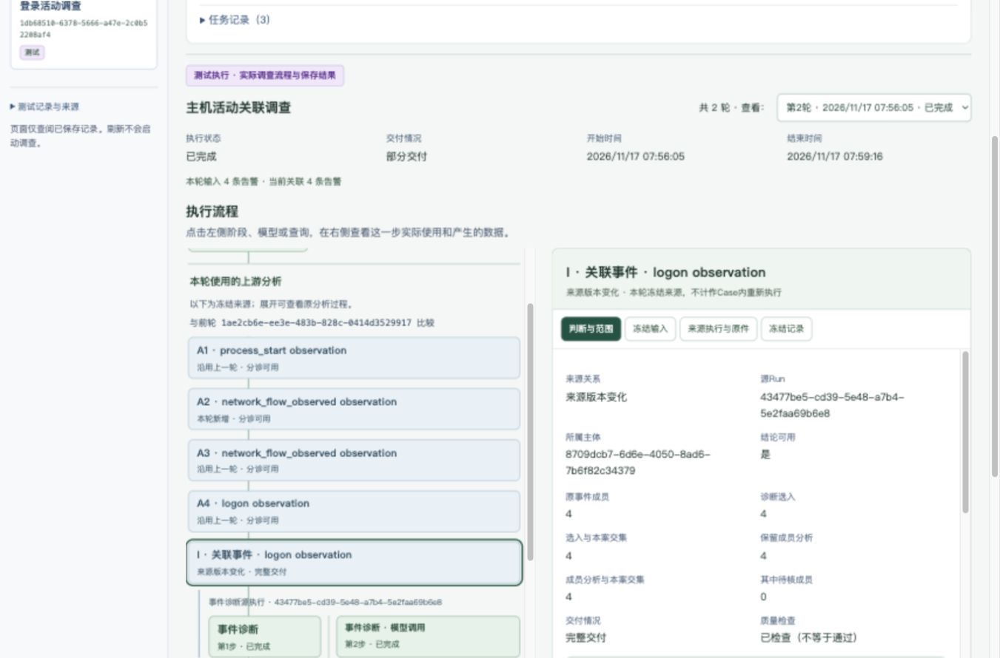

# 工作台任务2：本轮冻结A/I与Case流程

2026-11-17，本机功能验收通过；**未部署21、未提交推送，新增业务写入与模型调用均为0**。对应[统一设计§12.7](../../../../openspec/changes/schedule-streaming-investigation-updates/test-service-and-4177-http-20261115.md#127-任务2实施与直接验收安排2026-11-17)，任务3材料转换/Docker脚本尚未实施。原模型质量问题仍后置，不据页面读取成功改为质量通过。

选中Case轮次后，原HTTP接入/任务与C1–C6之间新增“本轮使用的上游分析”。每条来源先展示冻结判断、可用性、范围及沿用关系；可展开源Run真实步骤，查看提示词、输入、输出、模型原答与原件。来源过程不算Case重新执行A/I，切换源节点不改变当前Case轮次。原具体领域、结果及质量原记录保持可查。

| 实际核对 | 结果 |
| --- | --- |
| 整案R1 | 3份A、I1；切回首轮仍读取旧来源，真实建案POST/201绑定R1任务 |
| 整案R2 | 4份A，其中3份沿用、1份新增；I1→I2来源版本变化；真实更新POST/202绑定R2任务 |
| 单案R1 | 1份A、同一个I1；原事件选入/保留3条，本案交集1条；跨成员发现原范围不缩窄 |
| 来源与原答 | A原材料ID/摘要与C1相符；A、I及C6浏览器所见原答与本轮真实GET保存正文的SHA逐字相同 |
| 缺口 | D4b历史partial/none离线保留来源、回执、缺失内容和1/0成员单元；缺units时未知，空units才为0。缺A身份或前轮C1不猜沿用 |
| 来源失败 | 本机预览仅对一源Run返回受控503，显示局部错误；同Case的C6原答与具体云领域仍可查。不是21实际故障 |
| 布局 | 实测1366×900桌面及468×900窄屏，无横向溢出；已调用临时viewport reset，立即返回的尺寸原样记录 |

来源解析按Run输入manifest→所引用的唯一C1，不以role/数组顺序/step_id猜测；前轮沿冻结comparison_context，不查latest补缺。A比较材料/分诊/源Run/输入材料身份；I比较源Run与输入、响应、回执及原答工件身份/摘要。选入数量、保留成员单元、待核及本案交集分开呈现，原始unit范围/内容可展开。

证据分层：

- [validation.json](validation.json)：最终源码SHA、strict、语法、Ruff和定向diff检查；24项JS、6项页面挂载通过，末次空I来源保护另复验受影响14项。无全仓回归或新业务执行。
- [live-http-01/index.json](live-http-01/index.json)：182份真实GET原件，3个Case轮次、去重4个A/2个I源Run、7份原答；页大小2导致多页读取，不是182次业务执行。[capture-sources.mjs](capture-sources.mjs)通过显式profile读取，未将SQL快照重构成HTTP。
- [browser-review-01.json](browser-review-01.json)：本机候选浏览器原始观察；[browser-verification.json](browser-verification.json)的14条直接断言及原答SHA核对通过。保留一次选择器不匹配、I2原答项误采aria-label为round等采集说明，不改旧原件追认。
- [asset-readback.json](asset-readback.json)：最终4份页面资产实际HTTP摘要与源码相同，no-store头有效。初用58477同源预览时旧模块缓存仍在；切独立候选端口并调整静态资产缓存，最终重载观察到本轮代码。候选临时地址不是21发布入口。
- 测试模块[最终独立复核03](../test-workbench-frozen-flow-20261117-01/independent-review-03.json)已确认最终10份源码摘要、4份实际资产、182GET及来源映射，接收浏览器14条直接断言和3份所见原答摘要；无本步实质阻断。浏览器是接收主协调证据，不能称测试模块独立操作浏览器，也不代替整个change结束审计。

[窄屏完整截图](narrow-flow-01.jpg)保留全部主线与具体领域组件。正式21仍为原0.6.0布局，待既定交付范围收口统一发布；D5/D6、模型正文质量及未接来源不在本步核销。
