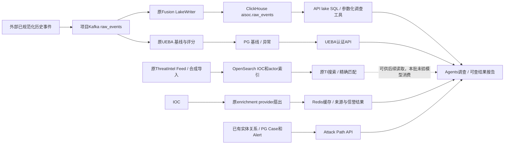

# 原版full配套迁移

**报告交付最新口径：** 用户确认当前只需Markdown能生成、持久保存并按Case/Run读取；PDF暂缓，HTML额外交付也不作本轮前置。复用已有Markdown主链证据，不重跑报告模型或增加格式专项；已有PDF源码/依赖/历史结果保留。

2026-10-21。按用户确认的范围，从固定上游`34ca18c57dd4175539e5c6dd3d04a72dc057306b`迁入历史事件补查、Attack Path、UEBA、事件检索、IOC信誉增强和OpenSearch原版索引/检索。沿原码设计补缺服务/直接资源及可运行必需接线，不新建上游缺失后端，不改算法，不以复杂可用性或模型质量复验阻塞。实施沿用现有OpenSpec `restore-alert-investigation-integrity` 的2.1/3.1/4.1，strict校验已通过；不是另建full项目。

## 标书与源码对应

| 能力 | 标书依据（阅读版） | 原版实现与边界 |
| --- | --- | --- |
| 历史事件补查 | 3.3.3告警前后日志、历史事件、同类告警/活动（[正文](../requirements/ai-soc2-requirements.md)） | Agents调查工具→API `/graph/investigate/query`→ClickHouse `aisoc.raw_events`；PG先前告警、历史报告另一路，不能冒充完整事件历史 |
| Attack Path | 3.3.3时间线、实体关系、ATT&CK、扩散路径（[正文](../requirements/ai-soc2-requirements.md)） | API `/graph/attack-path/{case_id}`，Neo4j关系查询及PG Case/Alert/Technique回退；没有关系写入来源时不能自动生成完整多跳图 |
| 事件检索 | 3.3.1日志检索/调用服务（[正文](../requirements/ai-soc2-requirements.md)） | `/lake/sql`、参数化调查工具及已迁外部SIEM查询；原API未提供OpenSearch原始事件写入链，TI索引不是事件全文索引 |
| UEBA | 行为异常风险、调查行为分析/账号核查（[正文](../requirements/ai-soc2-requirements.md)） | 标书未直接指定UEBA/行为画像/行为基线服务；用户另确认迁入原版事件基线、评分、异常与查询，不能把名称对应当全套画像验收 |
| IOC信誉增强 | 3.3.3 TI和IOC提取验证、4.2 IOC精确匹配（[正文](../requirements/ai-soc2-requirements.md)） | 原Go并发provider/合并/Redis缓存及TI服务；厂商key未配不代表已查询或安全，不要求新建信誉算法 |

用户同轮追加明确OpenSearch需要，复用21已有服务，相关原索引/写入/查询代码和直接资源同批核全；不把原版缺失的事件全文索引后端编造成已迁能力。

## 迁入与直接差异

[来源说明](../handoff/full-support-source-map.json)：新增`services/enrichment`19文件、`services/threatintel`45文件、`services/ueba`37文件，均来自固定版本tracked原件，含现有模块测试/锁/构建资源和UEBA自身4份迁移。补`schemas/graph-schema.yaml`声明资源；ClickHouse三资源、Neo4j运行迁移和上游Compose参考此前已迁，不覆盖现有API/Fusion/Agents适配或根配置。

必要适配限于现有路径接线：enrichment去掉Redis URL日志字段；Agents的UEBA请求补原服务token/tenant头、修8004端口并按原feature_stats/window字段保真投影，host/email查询分别映射device/user，缺deviation保持unknown；TI将原有OS索引设置用于全部写查，补Qdrant认证和项目集合配置，默认1536及算法保持。UEBA原Dockerfile/锁保留，部署配方仅为pip指定既有镜像源，继续原锁/hash安装。

API/Fusion保持原运行源码镜像，仅增加湖/通用Neo4j配置；Neo4j按上游full两项APOC配置启镜像自带5.15插件，原镜像/data/logs/端口保留，原infra Compose未改。Agents只在原candidate05上复制本次bundle文件，未带入此前未部署的graph/deep质量改动。原件复制和测试通过均不等于全部来源/整链已验证。

## 二开入口

| 接缝 | 当前源码 |
| --- | --- |
| 事件湖写入 | [Fusion LakeWriter](../../services/fusion/app/services/lake_writer.py)；消费入口[consumer](../../services/fusion/app/workers/consumer.py) |
| 历史补查/检索 | [参数化工具](../../services/api/app/services/investigation_tools.py)、[lake SQL](../../services/api/app/api/v1/endpoints/lake.py) |
| Attack Path | [API图入口](../../services/api/app/api/v1/endpoints/graph.py)、[图服务](../../services/api/app/services/graph_service.py) |
| UEBA | [特征提取](../../services/ueba/app/services/feature_extraction.py)、[评分](../../services/ueba/app/services/scoring.py)、[调查上下文](../../services/agents/app/context/bundle.py) |
| IOC增强 | [原Go服务](../../services/enrichment/README.md)及internal/enricher，各provider凭据按原config配置 |
| OpenSearch/TI | [索引/读写/搜索](../../services/threatintel/app/storage/opensearch.py)、[TI入口](../../services/threatintel/app/main.py)、[Qdrant存储](../../services/threatintel/app/storage/qdrant.py) |

## 数据流

下图表示原服务能力与调用接缝。本批实际证明事件湖、UEBA、IOC接口和OS/TI读写；未追加模型，不能据此宣称模型已经消费OpenSearch。当前ContextBundle的IOC增强仍走Go enrichment，OS/TI返回与其分开记录。

这里接收已提供的规范化事件，未建设设备采集/原始检测系统。已有告警输入依旧走原告警处理主链；只有一条告警，不能凭空补出该主机完整过程、登录或网络历史。UEBA保留原样本门槛，不降低阈值凑画像。

## 已有输入到实际结果的实例

本批合成事件`14c3af97-db31-4218-a885-b03c6d5dd20f`属于测试租户A，主机`SOC-FULL-MIG-01`、账号`full-migration-user`、进程`migration-check.exe`，发生于`2026-10-21T04:12:29.733Z`，bytes_sent=1024。它是原规范化事件合同的测试输入，不是来自厂商的真实攻击。

1. 原生产者经Kafka TLS发往`socai2.raw_events.v1`，partition2/offset0，仅发布一次。
2. 已有Fusion消费后用原LakeWriter写`aisoc.raw_events`。原告警提升/检测/窗口检测仍关闭，该事件未触发新告警或模型调查。
3. 真实`POST /lake/sql`按event_id查出1行，时间、主机、账号、进程一致；租户B同样查询返回0行。真实`POST /graph/investigate/query`的`process_activity`返回available=true/1行；`process_tree`则返回available=false及明确缺少父进程数据的原因。
4. 同一事件由新UEBA组消费一次，生成该账号的4项特征基线，各count1，其中bytes_sent.mean=1024。样本不足时不产生异常，未改原30样本门槛，不虚构偏离分或画像质量。
5. 既有1G测试Case`724a7d5d-77b4-5037-9bf2-c9a459d7f7d0`在正确租户下Attack Path返回200、2节点/1条INCLUDES；这是PG关系回退，未声称存在完整事件图。另一租户404保持。原driver未启/APOC缺失的两次503也保留。

## 上游缺口与后置

- 原`process_tree`、`mailbox_activity`、`oauth_grants`、`persistence`数据类明确返回不可用；没有数据采集/字段后端，本轮不补。
- OpenSearch由TI写IOC/actor索引；不把它宣称为已接通的原始事件全文检索。湖SQL/参数化事件查询与此分开。
- 原图写入主要在未纳入采集职责的ingest；源码有图读取不表示Case/Alert和所有事件已自动投影。PG回退仍是原合法能力，完整图须真实关系来源。
- enrichment的Shodan/URLScan/IPinfo有配置声明、没有provider客户端；保留原码不补。其他provider没有凭据时保持缺来源，零分不能解读成已核验安全。
- 真实事件量、真实Feed/厂商命中、长期UEBA基线/peer质量、图覆盖和模型/报告质量，均不能由本次基本运行验证外推。

## 运行与验证

本批基本功能实测及未参与实现者`api_auth_review`的唯一结束独审已通过（限定accept），无新增功能接通阻塞。复用21既有PG、Kafka、Redis、ClickHouse、OpenSearch、Neo4j和Qdrant，不启动另一套full基础设施；全局Agents worker仍OFF，不执行真实响应或重放旧unknown/积压。运行证据见[净化回执](full-support-migration.json)。

| 项目 | 实际验证与边界 |
| --- | --- |
| 事件历史/补查 | 1条合成Kafka事件→原Fusion→ClickHouse→SQL同租户1行/另一租户0行，原process_activity 1行；not_ingested工具保持不可用 |
| Attack Path | 补原Neo4j/APOC依赖后，已有Case实际200、PG2节点/1关系回退；不证明完整事件图 |
| UEBA | 原122项测试、7项必要接缝测试；原4迁移head0004，真实HTTP score→baseline、原Kafka consumer处理该唯一事件、常驻Agents实际认证读取4项统计均通过。1样本、30天窗、deviation=null，不作异常质量通过 |
| enrichment | 原3项merge测试、Go与amd64构建通过；项目Redis Ping、health及保留IP查询200。无provider、sources=null，不能据零分判安全 |
| OpenSearch | 复用21原2.15.0实例/原容器不改；项目`socai2-threatintel-iocs/actors`索引，原Store写1/搜1/精确匹配`192.0.2.88`，TI原HTTP200/total1。该IOC明确为合成来源，不是真实威胁命中 |
| ThreatIntel | 原选取3个测试文件共41项通过、原镜像构建成功；最终health/ready200、Redis实际连接、airgap开启/Feed0/Kafka关闭。Qdrant两项目集合原1536维，原浏览200/total0，无embedding或Feed调用 |
| API→TI | 单独TI service token/URL接线；原只读服务身份实际GET200，source=qdrant/degraded=false/total0，明确空集合；OS合成IOC与这个未写入向量集合的空结果分开 |
| 报告 | 复用已有Markdown生成、持久与读取证据；用户明确PDF后置，本批不追加模型、Markdown或PDF专项 |

当前API仍`1be37c38`、Fusion仍`c52b9aac`（同源码镜像、必要配置接线）；Agents为`full-ueba-context-20261021`/`aec3c54f`，仅从candidate05复制最终bundle。新增UEBA `8b04bc64`、enrichment `eb59af97`、TI `c15d75f4`；Actions和模型服务未改。Agents旧env/七只读挂载/60秒宽限及worker OFF保持，增加UEBA URL/token和图工具可用开关；未纳入此前未部署的graph/deep质量改动。

部署按[21说明](../../deploy/aisoc21/README.md)保留原29层，再叠full-support/ueba/enrichment/threatintel四个文件；共享Neo4j另用infra项目的APOC overlay。API当前仅涉及其31层子集，Agents涉及其30层子集，各新服务单独管理；日常完整命令要包括全部33个业务文件，不能用单增量文件重建旧服务。

凭据只保存在21`private/`：`full-support-20261021/{lake,graph}.env`、`ueba.env`、`ueba-migrate.env`、`agents-ueba.env`、`enrichment-full-20261021.env`、`threatintel-full-20261021.env`及`full-threatintel-20261021/api-threatintel.env`。owner迁移凭据不交UEBA常驻，TI使用独立token，不扩原API只读身份。

首轮ClickHouse绑定地址探针未连通、慢PyPI构建、TI探针导入路径、API图驱动/APOC缺失及Qdrant带key自动切HTTPS的失败均保留；按实际问题分别修地址/镜像源/探针路径/原依赖/HTTP参数，没有重复原事件、IOC写入或模型。复杂可用性与质量仍后置；本批限定运行通过不等于整体迁移或自治质量通过。

## 结束审计

未参与实现的`api_auth_review`复用已保存源码差异及运行材料，并读取最后API代理回执与当前交接后给出限定accept，无新增阻塞；没有追加请求、模型、测试矩阵或全量hash。本批按上述实录收束，不归档仍未完成的总change，不将冷基线、无来源信誉、PG回退或空向量集合写成完整质量通过。下一步按原总计划评估剩余迁移项，PDF和上游缺失后端仍后置，不为本批追加验证。
