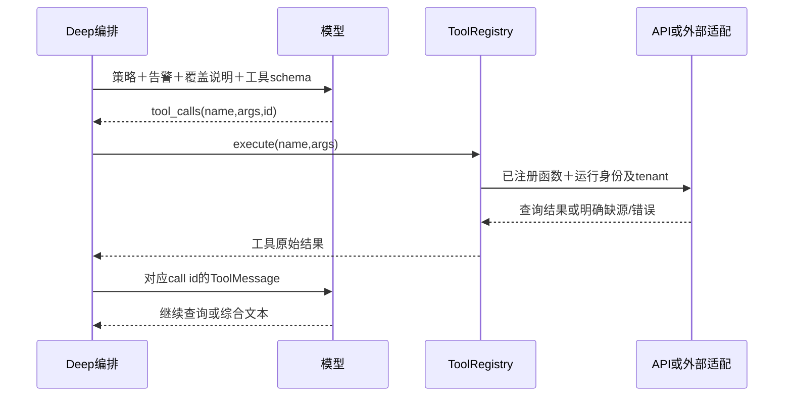

# 调查Tool使用说明：能力、执行、配置与测试

2026-10-21。面向当前告警调查二开，按工作区源码说明如何使用。用户目前没有待接的实际第三方SIEM；本文及[SIEM接入示例](siem-tool-integration.md)中的地址、凭据和数据都是占位。**本次只更新文档，没有连接SIEM、调用模型、修改配置或发布。** 本地尚未发布的代码不能由21现有服务的结果代证。

配套阅读：[精确工具目录](../architecture/investigation-tool-catalog.md)列参数、默认值、输出和源码；[逐模型输入输出](../architecture/investigation-preprocessing-tools.md)解释预处理；[已有实测](investigation-functional-20261021.md)保留原始结果；[攻击链/图实测](attack-chain-path-local-20261021.md)说明固定上下文接入。

后续设计：[外部HTTP接口与Tool执行验证](../architecture/third-party-search-contract.md)针对厂商已有GET/POST接口，说明请求/结果映射、新Tool注册和固定调用→脚本模型→实际模型的最少验证判据，仅设计未实施。

## 1. 先分清哪些流程会自主调用Tool

| 路径 | 谁决定查询 | 调用方式与效果 |
| --- | --- | --- |
| Kafka首次模型分诊 | 代码准备资料，模型给分类 | 模型输出分类/置信度/理由，没有Deep工具循环 |
| Case默认四节点 | 代码固定流程 | Recon后代码逐IOC增强；Forensic分析、Responder生成建议、ReportWriter写Markdown，没有自主工具循环 |
| Case Router | 代码选领域并准备资料 | 首次分诊＋选中的领域模型；没有绑定Deep工具。开启攻击上下文时可固定预取Bundle |
| 自动升级的Graph | 外层代码固定节点，Deep内部模型选工具 | triage→enrichment→investigation→attack_path；investigation可进入Deep多轮查询 |
| Deep | 模型输出结构化调用，应用执行 | 仅能调用该tenant这次注册的工具；结果交回下一轮模型 |

Graph、Router和Deep不是同一个开关。Case调查打开Router不会自动获得Deep工具循环；自动升级也不是再调用Case默认四节点。入口详见[调查说明](../architecture/investigation.md#1-先选对入口几套调查并非同一流程)。当前常驻worker仍OFF。

攻击链、Attack Path、图邻居、blast radius、UEBA基线和KB主要由代码预取/处理后交给模型。**当前默认16工具里没有图查询或攻击链查询工具**；接通图上下文不等于模型能任意遍历图。响应动作另走Actions/提案/审批，不包含在下表的默认只读Deep工具里。

## 2. 现在有哪些能力

| 分类 | 工具 / 能力 | 当前实际能力 |
| --- | --- | --- |
| 本地知识和提取（3） | `extract_iocs`、`map_to_mitre`、`lookup_technique` | 正则提取、关键词映射、ATT&CK知识；不查询现场 |
| 外部增强（2） | `enrich_ioc`、`lookup_file_hash` | IOC信誉查询、已有沙箱报告查询；没有provider/报告时不能视为安全，没有上传执行样本 |
| 事件湖查询（7） | `process_activity`、`historical_execution`、`network_connections`、`authentication_events`、`fleet_ioc_hunt`、`entity_timeline`、`technique_activity` | 固定参数查询ClickHouse；依赖上游已提供相应字段和数据 |
| 原版占位（4） | `process_tree`、`mailbox_activity`、`oauth_grants`、`persistence_mechanisms` | 当前直接返回not_ingested/available=false；不能靠配置SIEM自动实现 |
| 客户侧条件工具（最多6） | `siem_indicator_search`、`edr_host_details`、`edr_host_detections`、`identity_user_activity`、`cloud_audit_lookup`、`endpoint_telemetry_sightings` | 按tenant后端发现决定是否注册；SIEM经查询服务，其他能力经Actions只读适配 |
| MCP工具（动态） | `mcp__<server>__<tool>` | 按租户配置、发现schema与允许列表注册；数量和合同取决于实际MCP服务 |

默认16＝3＋2＋7＋4。customer/MCP不是无条件额外可用。`GET /api/v1/graph/investigate/tools`只列API的11个typed查询原语，**不是本次Deep完整目录**；完整目录应看该Run组装结果及coverage。

`authentication_events`当前查询按账号、时间和非空来源IP过滤，并没有严格的认证事件类别过滤；名称不代表每一行都是登录证据。各工具的原始查询和局限见[目录](../architecture/investigation-tool-catalog.md)。

## 3. 模型如何选择，程序如何执行

工具定义由`name/description/parameters/fn`组成。前三项作为function schema交给模型，`fn`留在服务端。策略/技能由代码选择，指导模型关注什么；它不是强制每步执行的清单。



例如下面是SDK规范化后的**示意调用**，不是本次实际回复：

```json
{"tool_calls":[{"name":"authentication_events","args":{"user_name":"demo.user","hours":24},"id":"call_demo_01"}]}
```

执行过程：

1. Deep构建本tenant的registry，`bind_tools`提供schema；Human消息包含有界告警投影，开启攻击上下文时另带有界摘要，并非整个数据库或整个state。
2. 模型输出`tool_calls`才触发执行；正文写“建议查询认证”不会执行。一次回复可包含多个调用，当前按顺序逐个执行。
3. registry查已注册名称，再调用`fn(**args)`。未知名称/函数异常形成错误返回。**registry没有通用JSON Schema运行时校验器**；具体函数和API负责类型、参数、范围检查。
4. typed事件工具发送固定API请求，例如下节的`graph/investigate/query`；模型不提供tenant、凭据或任意SQL。其他工具按自己的本地/增强/customer/MCP适配执行。
5. 工具结果序列化后作为匹配`tool_call_id`的ToolMessage，下一轮模型才可使用。本地循环通常最多保留约4000字符工具结果，后端返回全部行不等于模型看到了全部行。
6. 模型无tool_calls则以文本结束。轮次、时间或额度触顶可截断，保留已有结果；不会为凑结论额外发一轮。末尾ToolMessage不能当作最终报告。

实现入口：[registry](../../services/agents/app/tools/registry.py)、[Deep组装](../../services/agents/app/investigator/deep_investigation.py)、[逐轮执行](../../services/agents/app/llm/tool_loop.py)、[typed包装](../../services/agents/app/tools/investigation.py)、[API固定查询](../../services/api/app/services/investigation_tools.py)。

## 4. 配置时具体改哪里

### 4.1 已有事件湖工具

| 服务 / 配置 | 怎么用 |
| --- | --- |
| Agents `AISOC_API_URL`、`API_SERVICE_URL` | 都填API origin，例如`http://127.0.0.1:8000`，不带`/api/v1`；前者供typed/customer等工具，后者供Bundle等调用，保持指向同一测试API |
| Agents `AISOC_API_SERVICE_TOKEN` | API只读服务身份；兼容fallback为`AISOC_SERVICE_TOKEN`。API侧须配置匹配身份。工具闭包发送Run tenant header，不从模型取tenant |
| API只读权限 | 既有服务身份的七RO为`alerts:read,cases:read,connectors:read,actions:read,lake:query,hunts:read,threat_intel:read`；typed query要求`lake:query` |
| API ClickHouse | `CLICKHOUSE_HOST/PORT/DATABASE/USER/PASSWORD`连接既有事件湖；不是在Agents里给模型配置数据库密码 |
| Agents `ENRICHMENT_SERVICE_URL` | 显式填增强服务真实origin。原Go服务8082，而默认registry所用包装器默认8080，不能依赖默认值猜测端口 |
| 模型网关 | 沿[配置索引](configuration.md)与现有角色配置，Deep使用`investigation`角色；不在文档放真实密钥 |

仅用于**新本地测试进程**的环境示意，不能照此重建线上服务：

```sh
export AISOC_API_URL='http://127.0.0.1:8000'
export API_SERVICE_URL="$AISOC_API_URL"
export ENRICHMENT_SERVICE_URL='http://127.0.0.1:8082'
# 在本地私密环境另行注入 AISOC_API_SERVICE_TOKEN，不粘贴到文档/日志。
export AISOC_AGENT_KAFKA_DISABLE=true
```

服务token用于内部读工具，普通API key用于操作者API请求；两者不要混填。图读取另有tenant reader映射，不能假定所有Bundle图调用都自动回退为上述token，详见[图接入说明](../architecture/attack-chain-path.md)。

### 4.2 Deep和外层Graph限制

| 环境变量 | 源码默认 / 意义 |
| --- | --- |
| `AISOC_DEEP_INVESTIGATION` | true；调查节点可进入Deep |
| `AISOC_DEEP_INVESTIGATION_MAX_ITERS` | 6轮模型回复 |
| `AISOC_DEEP_INVESTIGATION_BUDGET_SECONDS` | 120秒 |
| `AISOC_DEEP_INVESTIGATION_MAX_TOKENS` / `AISOC_DEEP_INVESTIGATION_MAX_USD` | 60000 / 0.50；仍受外层更紧预算约束，价格未知时美元数不能视为硬保证 |
| `AISOC_INVESTIGATION_MAX_SECONDS` / `AISOC_MAX_TOKENS_PER_ALERT` | 外层Graph默认120秒 / 20000 tokens |
| `AISOC_INVESTIGATION_MAX_TOOL_CALLS` | 默认8；历史命名虽写tool，实际检查的是模型调用计数，不是最多执行8个工具 |
| `AISOC_INVESTIGATOR_MAX_COMPLETION_TOKENS` | 默认2048；单次回复长度，不是整次调查总预算 |

多个参数在模块导入时读取，改变本地配置后应使用新进程。工具返回/模型单次usage可能在回复后才计入，不能把这些默认值解释成任何情形都不会越过的预扣额度。

触发开关另看：`AISOC_AGENT_ESCALATE_TO_GRAPH`控制Kafka分诊后升级（默认true，仍受review_only/shadow等限制）；`AISOC_INVESTIGATE_USE_ROUTER`只选择Case编排（默认false）；`AISOC_ATTACK_CONTEXT_ENABLED`默认false，控制本批攻击上下文。Kafka没有配置bootstrap或`AISOC_AGENT_KAFKA_DISABLE=true`则不启动消费者。**配置Deep不代表启用常驻消费。**

### 4.3 第三方SIEM、其他厂商及MCP

SIEM完整操作见[第三方SIEM接入与测试](siem-tool-integration.md)。当前是tenant的PG connector实例＋API联邦查询＋独立connector查询服务；当前仓库未迁入该独立服务，不是填URL后立即能跑。支持的类型为Splunk/Sentinel/Elastic/QRadar，其他HTTP产品须补适配器、可查询类型允许列表及指标字段映射。

其余customer工具经后端发现和Actions只读能力开放；`mock/dry_run/executed=false`不代表真实厂商读取成功。MCP的registry token为`AISOC_AGENTS_SERVICE_TOKEN`或`AISOC_SERVICE_TOKEN`，与API工具读token不是同一配置名；配置传输、认证、允许工具及超时/返回大小后才可发现注册。stdio默认关闭。具体合同和限制见[目录](../architecture/investigation-tool-catalog.md)，本轮不连接MCP或执行厂商动作。

## 5. 怎么直接测试后端，不先花模型调用

以下命令是**待执行操作模板**，本次没有运行。先启动包含当前源码的本地API，复用项目环境；为测试准备一个授权tenant和已知数据样本。不要把这段指向部署版API来证明本地新代码生效。

```sh
export API_BASE='http://127.0.0.1:8000'
export TENANT_ID='<test-tenant-uuid>'
# READ_TOKEN 由本地私密环境提供，不在命令历史中写真实值。
curl --fail-with-body --silent --show-error \
  -H "Authorization: Bearer $READ_TOKEN" \
  -H "X-AiSOC-Tenant-ID: $TENANT_ID" \
  "$API_BASE/api/v1/graph/investigate/tools"

curl --fail-with-body --silent --show-error \
  -H "Authorization: Bearer $READ_TOKEN" \
  -H "X-AiSOC-Tenant-ID: $TENANT_ID" \
  -H 'Content-Type: application/json' \
  --data '{"tool":"authentication_events","args":{"user_name":"demo.user","hours":24}}' \
  "$API_BASE/api/v1/graph/investigate/query"
```

typed工具多数默认24小时；认证后端缺省168小时；历史执行/IOC默认30天、技术活动7天。上限90天，通常默认50行/最多200行；不是所有模型schema都开放`limit`。当前相对`now()`查询，不会自动围绕告警发生时间重建历史窗口。

验收要读JSON而不仅看HTTP200：

| 返回情况 | 正确解释 |
| --- | --- |
| available=true且命中已知记录 | 对该tenant、窗口、数据源的查询已取到记录；再核关键字段 |
| available=true且0条 | 本次范围内没有匹配，不能推论全局没有或安全 |
| available=false / not_ingested | 没有可用数据源或原版占位，不能当查询成功无风险 |
| error / 查询失败 | 查询没完成；保留错误原因，不能伪装成0条 |

SIEM则先GET`/api/v1/agent-tools/backends`看tenant配置发现，再POST`/api/v1/agent-tools/siem-search`。后者HTTP body使用`since_hours`，而模型工具参数叫`hours`，中间wrapper转换。发现非空只代表配置存在，不代表后端健康；示例请求和四层验证见[SIEM专篇](siem-tool-integration.md#5-最少测试顺序先接口最后再接模型)。

## 6. 本地功能测试顺序

只补当前接线所需最少验证，不做压力、重启恢复、故障注入或全入口模型矩阵。以下测试命令供后续执行，**本次未重新运行**。

1. **复用单元测试确认合同。** API和Agents都用顶层`app`包，分进程运行，不能把两个PYTHONPATH揉在一次pytest中。依赖须已安装到相应项目环境。

```sh
# 在仓库根目录，分别使用已安装对应服务依赖的 Python 环境。
PYTHONPATH=services/api python3 -m pytest -q services/api/tests/test_investigation_tools.py
PYTHONPATH=services/agents python3 -m pytest -q services/agents/tests/test_tool_calling.py services/agents/tests/test_tool_result_channel.py
PYTHONPATH=services/agents python3 -m pytest -q services/agents/tests/test_customer_tools.py
```

这些用替身查询/模型验证合同，不证明真实ClickHouse、SIEM或模型可用。只改某个adapter时选择相关原测试，不默认跑上面全部或新增矩阵。

2. **直接后端一次命中、一次空结果。** 用已知合成/授权数据，核返回来源、实体、时间和tenant；缺源要返回明确不可用。第三方新适配另核一次实际HTTP错误的映射，不扩复杂恢复。涉及tenant接线时复用原越权断言。
3. **不花模型的工具交接。** 复用`test_tool_calling.py`的脚本模型方式返回结构化tool_call，需要时显式截获下一轮messages，核名字/参数→包装函数→匹配call id的ToolMessage。原测试证明基本循环，不能直接声称已断言完整call id交接；`test_tool_result_channel.py`主要核唯一渲染和4000字符边界。需要验证新后端时把后端HTTP替身替成该测试服务；既有全替身测试不作真实接通证据。
4. **需要模型时才跑一个代表Deep例子。** 在已知可查数据上，给一条新告警及明确实体，沿原`run_deep_investigation`组件或Graph入口观察。Case默认四节点/Router不会因此自动进入Deep。复用[现有本地Deep观察脚本](../../deploy/aisoc21/probe_investigation_deep.py)时先核其网关、只读API、输出路径和预算，脚本含真实调用，不能当离线单测运行。

最低证据是：本轮schema中有该工具 → 实际模型发了tool_call → 包装器/后端收到参数 → 返回已知记录 → 下一模型输入包含匹配ToolMessage → 最后结果说明用了什么、没查到什么。模型未选某工具时，不能写该工具端到端通过，也不为凑结果反复重调；可以先用第3步证明接线。最终是否持久化，还须在真实Run事件/工件核对，本地组件文件不能代替API持久结果。

## 7. 每一步输出从哪里拿

| 输出 | 读取位置与边界 |
| --- | --- |
| 可用工具/coverage | Deep组装记录、结果中的customer/MCP/缺源覆盖；API tools路由只列11个typed工具 |
| 每次tool/args | Deep `tool_trace`及Run `tool_call`事件；ledger通常仅200字符result_preview，不是完整返回行 |
| 模型实际可见工具结果 | 已保存的model exchange中匹配call id的ToolMessage；已裁剪，不能据它恢复完整原始行 |
| 原始工具HTTP响应 | 本地观察文件或适配器明确保存的工件；默认ledger不保证全量保存，不能从preview假造原文 |
| Run事件 | API `GET /api/v1/investigations/{run_id}/events?since=-1&limit=200`，按next_seq继续；Deep事件可能从10000以上开始 |
| Run工件 | API `GET /api/v1/investigations/{run_id}/artifacts`，再按返回的artifact id读取 |
| Case Markdown | API `GET /api/v1/cases/{case_id}/investigations/{run_id}/report.md`；Alert自动调查未必有真实Case，先读其Run工件 |
| Deep完成情况 | `iterations/truncated/stop_reason/pivots/unavailable_data`等；Run completed不等于Deep覆盖完整或结论正确 |

读取接口的操作者仍须有相应业务权限和tenant，不把工具服务token当作所有读取权限。

## 8. 用已有真实测试理解效果

| 已有例子 | 实际发生的事 | 可证明 / 不能证明 |
| --- | --- | --- |
| Deep Run `9e0b1ae9-e0d1-4b9e-aeea-29d85c3f851e` | 本地组件、公开叙述派生的合成账号；6次真实模型、7次工具执行、21540 tokens。认证查询当时LakeQueryError；3次占位缺源；3次真实查询0条；最后请求network_connections因预算没有执行 | 证明真实模型选工具与逐轮ToolMessage交接；没有正样本命中、最终narrative为空且truncated，不是完整调查成功，也不是API持久Run |
| Case `82b1246f-9f34-463c-8c2d-27d2b075c741` / API Run `e998308a-a353-4647-99f6-10f94ced0ecf` | 默认四节点4次模型18388 tokens，共享3490字符摘要；PG候选链与Neo4j11节点15边上下文进入四prompt，MD及工件已读 | 证明固定图/链上下文交接，不证明Deep自主图查询；未证明模型深入利用了所有图关系，原报告表述问题保留 |

详见[调查原回执](investigation-functional-20261021.md)与[链/图原回执](attack-chain-path-local-20261021.md)。旧失败、未执行请求和来源为空保持；没有用本次说明追认其质量。

## 9. 后续新增能力最少改哪些地方

- 新的事件湖查询：API固定函数/dispatch＋Agents typed schema/包装器＋沿原测试的一个代表合同验证；保留tenant、参数绑定、来源和空/失败区别。
- 新的SIEM产品：先明确厂商HTTP合同；查询adapter、supported type及指标字段映射接线，复用原customer工具，不把任意SQL权限交给模型。具体见[SIEM示例](siem-tool-integration.md)。
- 已有MCP：先配允许的服务与工具，核发现schema和一次只读调用；不为此重构整个ToolRegistry。
- 四个占位工具：先落实实际数据源与必要字段，再实现查询；仅填connector配置不等于完成进程树/邮箱/OAuth/持久化功能。

以上是扩展位置和后续使用方法，不代表本轮已实施新adapter、引入新后端或启用自动调查。
