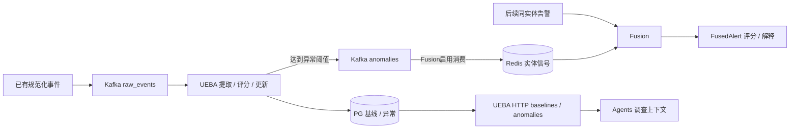

# 告警二次开发：逐模块分析与实施设计

**当前链/图模块工作卡：** [攻击链与Attack Path接入计划](attack-chain-path-integration-plan.md)已把已有开关/函数、缺数据投影、Case/tenant交接、三种编排实际消费及Run输出分开。先已有Case调查，原算法/编排保留、只补接线，未开始实现或启用；自动无Case沿原seed算法薄Alert入口和既有邻居/影响范围，Case专用路径not_linked，不隐式建Case。

**调查交接粒度进一步明确：** 用户要求每次模型调用均按目的→实际输入→输出格式→代码采用/下游交接说明，并展开预处理和工具是否/如何调用。[专篇](../architecture/investigation-preprocessing-tools.md)给Router/默认四节点/Deep逐模型表、schema与请求/结果示意，标明嵌套alerts不会自动flatten、Router无工具循环、Deep只响应结构化tool_calls、通用registry无完整schema运行时校验及各查询真实时间默认。当前仅源码/文档交接，未据此改造字段/校验框架或新增模型/复杂验证。

**Router讨论结论已交接：** [配置/流程对照](../architecture/investigation.md#5-router及full-graph的差异)明确Case `/investigate`的旧四节点/Router二选一，开关不控制Kafka graph/deep；专业分支各一次领域模型而非各走四节点，Router响应仅摘要、报告由代码渲染，功能/产物不能当等价替换。[设计评价](../architecture/investigation-design-review.md)同步“演进并存≠官方已确定淘汰旧链”和“graph外层固定、deep内部选择查询”。本次仅记录已解释事实，不据此启用、裁剪、合并或新增测试任务。

**调查设计先评清楚（用户最新强调）：** 在选择/修改编排前，先对比默认Case四节点与graph/deep的目的、输入输出、官方历史依据和四Agent实际价值/限制，见[设计评价](../architecture/investigation-design-review.md)。自动/人工触发和固定/工具循环是两个维度；按固定官方资料可证明多代实现并存，不足以证明必须串跑的互补双层架构。评价结合已有人工R01/自动C2质量失败，不新增模型比较，暂不裁剪/合并原编排。

**当前推进分诊，并细拆调查调用（2026-10-21）：** [分诊工作卡](../architecture/triage.md)先交接支持项/默认、字段与上下文、规则/模型、关闭/升级及真实C1/C2对比；用户进一步要求调查每一步、智能体每次调用都详细讲清。沿[调查说明](../architecture/investigation.md)逐层写触发→节点→模型轮次→工具/服务与参数→结果采用→分支/结束→审计/持久输出，分别说明自动graph、人工四节点及Router/full入口，不能只罗列Agent名。源码支持、当前配置、已实测与缺源/未验分别列；复用已有Run逐调用实例，不为讲解新发模型。先分析并讨论取舍，再做当前功能所需的最小修改/测试；本地先测、阶段发布和可用性专项后置保持。当前无业务代码/运行变更，原15项任务及5/15不变。

**Fusion阶段收口（2026-10-21）：** 已有告警主链的职责、默认规则、输入输出及UEBA真实联合结果已明确，当前可继续下游分诊；结论及限制见[Fusion小结](../architecture/fusion.md#六当前阶段小结可以转入下游分诊)。下一步先梳理fused字段/上下文、规则与模型、关闭/升级条件和逐步审计，再讨论取舍；本次没有开始分诊改造、模型测试或部署。原细化待办是导航，不以全部解决作为前置。

**raw事件支路最新取舍（2026-10-21）：** 规范化事件的生产/规范化、入湖、检测/提升及派生会话/AI资产交其他模块，本轮不展开；已有告警`RawAlert`/`alerts.raw`及其原正文继续作为Fusion输入。事件补查模块只负责查询其他模块提供的数据，UEBA结果消费仍保留，不承担上游事件供给。下文事件支路盘点和full实测作为参考保留，不据此继续安排该支路开发或专项测试；本次不改现有订阅/开关。

**最新简化口径：** 依赖项只交付原功能的使用说明：有哪些功能、必要配置和入口、怎样调用、输入输出是什么；保证基本可用，只补直接接线。UEBA已有说明复用，不再扩写原理或另做专项。下文完整分析卡用于Fusion/调查等后续业务模块，支撑依赖无需逐栏展开；深入改造和复杂测试留到二开，非阻塞问题仅登记，原源码/测试保留。

2026-10-21。按用户最新讨论，把工作粒度收敛到一个有明确业务边界的模块：查清源码职责、依赖、输入输出、配置启动和交接，再决定功能取舍、最小修改和验证。用户举的“UBI”在本文按UEBA理解。本文件细化[唯一总计划](completion-plan.md)及现有B1—B6，不是另一套迁移完成标准或产品任务树。

**最新顺序已明确：先共享支撑能力，UEBA → 威胁情报/IOC → 既有知识库，再进入Fusion → 分诊 → 调查/攻击路径 → Markdown交付。** 本轮先记录整条实施路线和讨论关键点；先前“第一个模块是Fusion”的安排已被本次讨论替代。支撑能力供多处复用，不按某个调用场景各造一份。

**后续执行已获授权：** 用户要求按OpenSpec继续逐模块推进，已有测试保留并按需复用，复杂可用性/冗余问题登记后置。UEBA首项按用户澄清沿上游投喂触发，先明确消息格式及入口，不新增实体名单/滑动窗口；详见[UEBA说明](../architecture/ueba.md)。下文“本次仅规划”为上一轮记录，当前增量以change执行记录为准。

**当前是设计和源码分析记录。** 本次没有修改业务代码、启动服务、启用worker、调用模型或执行功能测试。下文“建议”“待定”“要验证”均不是已交付事实；现有实际状态仍见[PROGRESS](../../PROGRESS.md)和原回执。迁移主链接通与标书功能完整是两个判定：前者有实证，后者仍有调查证据、攻击链和人工复核等差距。

## 共享支撑能力基础属性表

| 能力 | 基础性质 / 边界 | 输入 | 输出 | 配置与依赖 | 本轮关注点 |
| --- | --- | --- | --- | --- | --- |
| UEBA | 有状态的实体行为基线与偏离计算 | tenant、实体类型/ID、事件时间/类型、数值特征；或已有规范化事件 | 特征统计、可评分状态及偏离；达到阈值的异常记录/消息 | PG、Kafka；实体选择方式、特征、样本门槛、时间参数、异常阈值 | 先讲清针对谁开启、怎样配置基线及时间、输入输出、如何算偏离；原版没有的配置单列，不先扩成画像平台 |
| 威胁情报 / IOC查询 | 以指标为键的资料查询；本地历史IOC、TI存储查询和外部信誉增强是不同来源 | tenant、IOC类型和值及必要过滤条件 | 命中标志/记录、来源；查询成功无匹配返回空结果 | 现有PG/OS/Qdrant查询路径、原服务接口；外部provider有配置才查询 | 先固定查询合同并保证逻辑可用；不研究数据量、覆盖率、Feed扩容或补齐所有provider，不把未命中解释为安全 |
| 知识库 / 检索 | 可跨模块引用的既有知识资料检索，不等同本案证据 | tenant、查询词/问题、过滤/条数、需要时的时间限制 | 文档片段、来源/版本、分块引用、相关度；无匹配为空 | 优先复用20上前一版已采集资料；实际库表/索引待只读确认，当前项目已接PG全文，向量路径按实际需要 | 先明确资料位置、读取合同和引用；不重采集、不把旧目录存在等同21已可检索；历史经验相关后看 |

“没有数据”不阻碍接口与基本查询逻辑梳理：查询成功无匹配可以正常返回空；数据源未配置、服务失败与成功未命中分别表达。UEBA样本不足/零方差则为暂不可评分。沿用现有接口能表达的字段，不为这张表先新增统一包装服务或强制状态schema。PG、Redis、Kafka、OpenSearch、Qdrant等是底层依赖，按当前路径复用，不在各业务模块重复建设。

## 本次讨论关键点

1. **先规划并记录路线，再实施。** 当前完成路线和支撑能力属性整理；后续每次只展开一个模块，按OpenSpec确定实际变化后实施。
2. **UEBA是首项。** 配置是重点：针对哪些实体/类型开启，基线时间和样本如何设；再明确输入输出，并用简单例子解释基线偏离。用户随后明确本批沿原码，由上游投喂决定参与材料，学清触发格式即可；不新增实体名单和真正窗口功能。已完成的原输入合同见[UEBA说明](../architecture/ueba.md)。
3. **IOC先做到可查。** 命中/未命中合同清楚即可；暂不以情报数据量和覆盖率作为工作目标，未配置来源不能伪装成已查询。
4. **知识库用既有资料。** 以用户指出的20上前一版已采集资料为复用目标，实际存储/索引状态待核；本地旧目录及已存盘点作线索。历史经验整理、组织记忆扩建、经验提炼和反馈写回后看，既有源码/读者保留。
5. **后续围绕告警功能。** 支撑能力合同清楚后，继续Fusion、分诊、自动/人工调查、攻击路径、结果及审计；可用性、冗余和数据规模专项继续暂缓。报告只需Markdown。

## 工作单元与推进方式

模块以能说清“提供什么结果，交给谁”为边界，不机械地按目录或Docker服务拆分。Fusion中的去重、关联和评分可以先作为同一模块内部步骤；UEBA、事件补查、IOC信誉服务则可独立说明合同。同在full部署中不等于互为硬依赖。

每个模块依次完成以下工作，分析与取舍集中在当前模块，不预先设计全平台重构：

1. **读真实入口和调用链。** 从调用方追到返回值及实际写入位置，对照固定上游与本地适配，区分实现、未接、禁用、缺源、声明未实现及未验证。
2. **画直接依赖。** 判断是必需基础服务、当前启用的业务来源，还是随包保留但当前不用的能力。只把影响当前结果且交接不清的独立依赖拆出来；已验PG/Kafka等直接复用，不重做基础设施审查。
3. **先处理必要依赖。** 如当前Fusion要使用行为异常，则先核UEBA输入到异常输出，再回Fusion核消费；无需先完成UEBA所有画像、peer分支或长期效果测试。
4. **形成具体取舍。** 每个功能给出保留使用、保留源码暂不使用、必要适配、上游缺实现或另行二开建议，说明对标书及下游的影响。源码删除、合同改变和编排合并不能仅凭名称决定。
5. **按OpenSpec实施确定的差异。** 当前迁移接线沿用restore change；超出既有合同的二开行为在范围明确后形成对应spec-driven change，先有proposal/spec/design/tasks并strict校验。纯分析不编造业务规格，也不提前新增全部模块change。
6. **最小修改并验证交接。** 复用原测试和有效回执，只补变化所需的正常功能、结果语义及必要tenant边界。上游输出确实被下游采用，才算接缝完成；健康检查或返回200不足以代替。
7. **交接后进入下一个模块。** 留下下面的模块说明、一条输入到输出实例、直接证据和未解决项；实施批结束由未参与实现者做一次必要审计。原件、旧失败和unknown不改写。

## 每个模块固定回答的问题

| 项目 | 需要给出的具体内容 |
| --- | --- |
| 业务作用 | 解决哪个告警问题；对应哪些标书段落；原版做到了什么 |
| 代码范围 | 入口、核心函数、调用方、内部步骤、固定上游与本地差异；不能只列文件名 |
| 输入 | API/topic/调用参数，实际样例；tenant、来源ID、实体、发生时间、调查范围；必填、可选及缺失语义 |
| 依赖 | 服务/库/表/topic、调用方向、用途、是否必需、数据由谁提供、身份权限；不把所有full组件列成硬依赖 |
| 配置和启动 | 配置名与默认值、实际覆盖来源、凭据受控位置、迁移要求、启动命令/现有Compose入口、端口；不输出密钥 |
| 处理 | 顺序、分支、触发条件、评分/阈值含义；调用什么服务，得到什么，再如何采用 |
| 输出 | schema/样例、状态、PG/Redis/ClickHouse/topic/工件的实际落点；短期缓存与持久事实分开 |
| 下游交接 | 谁读取哪些字段、何时读取、如何关联Alert/Case/Run；返回空、缺源、错误分别意味着什么 |
| 审计 | 哪一步用了哪些输入/查询条件/资料、返回哪些来源、影响了哪个结果；查阅入口和证据引用。记录可核实的过程与依据，不索取隐藏推理 |
| 取舍与修改 | 当前保留/暂缓/缺实现/必要适配；理由、影响、具体文件与最小改法，待定方案不写成已决定 |
| 功能测试 | 当前改动所需的最少输入→中间结果→下游采用；复用的旧证据与新验证分开 |
| 交接结论 | 已实现、已配置、已运行、已验证各自边界；剩余问题及下一模块 |

不要求为这些栏目新建服务、通用框架或每模块多套文档。源码说明归架构/本说明，功能状态归[对照表](alert-function-alignment.md)，问题归[既有登记](upstream-issues.md)，实施与证据归当前change及原回执。

## 第一个模块：UEBA工作卡

### 职责、输入与处理

UEBA提供实体行为基线和偏离信号，供风险与调查参考；它不直接判定告警真假、不直接关闭告警，也不自动创建Case。

- 源码：`services/ueba`；HTTP入口[api/routes.py](../../services/ueba/app/api/routes.py)，计算[scoring.py](../../services/ueba/app/services/scoring.py)，事件提取[feature_extraction.py](../../services/ueba/app/services/feature_extraction.py)。
- 输入A：`socai2.raw_events.v1`中的原normalized `ocsf_event`信封。UEBA还兼容预提取`tenant_id/entity_type/entity_id/event_type/features/event_id`；其中event_id才映射内部source_event_id，纯预提取格式不满足共享topic中Fusion的ocsf_event要求。现normalized提取优先user，其次device、ip；不要假定同一事件自动给所有实体各算一份。
- 输入B：认证HTTP `POST /api/v1/ueba/score`，提交实体、数值特征、可选peer/source_event_id；必须绑定tenant。
- 实际步骤：提取实体/数值特征→按既有个人基线评分→更新基线→如有peer则计算并混合偏离→达到阈值才持久异常。默认最低30样本；方差不足时特征偏离为unknown。无异常可以只是样本不足，不能解释为正常。

**先要说清的配置能力：** 现Settings为进程级环境参数，没有按tenant或实体名单开启评测的原配置；收到合法输入便自动建立/更新基线。normalized Kafka固定user→device→ip选择一个实体，预提取Kafka或HTTP可由调用方明确实体；HTTP支持user/device/ip/service_account/ai_agent/mcp_server。这是原版能力边界，不把“接口能指定实体”写成“已有按实体启停策略”。需要何种启用范围，在UEBA模块展开时确定最小改法。

**时间参数与算法需要区分声明和实现：** `BASELINE_WINDOW_DAYS=30`当前仅在新建时填写`window_start=now−30天`；后续Welford累计统计并推进window_end，没有淘汰过期样本，不能称为“实际仅统计最近30天的滚动基线”。每特征累计次数/均值/标准差，新值先算`abs(新值−均值)/标准差`再更新；多项偏离平方和开根号、最高10，默认综合分≥3才产生异常。以均值100、标准差20、新值180为例，单项偏离为4；这是算法示意，不是新测试。是否需要真实滚动窗口属于UEBA后续取舍，当前只记录。

### 配置和启动交接

| 内容 | 原版合同 / 当前21接线 |
| --- | --- |
| 必需依赖 | Kafka及TLS、PG、UEBA原4份迁移；自身不依赖Redis、LLM或embedding |
| 数据库 | `DATABASE_URL`/`UEBA_DATABASE_URL`；常驻和迁移身份分开，不重新执行已完成迁移 |
| 输入/输出/group | `KAFKA_INPUT_TOPIC`、`KAFKA_OUTPUT_TOPIC`、`KAFKA_CONSUMER_GROUP`；当前分别`socai2.raw_events.v1`、`socai2.ueba.anomalies.v1`、`socai2.ueba.v1` |
| 算法参数 | `BASELINE_WINDOW_DAYS=30`、`MIN_BASELINE_SAMPLES=30`、`ANOMALY_THRESHOLD=3.0`、`PEER_GROUP_MIN_SIZE=3`为进程级源码默认；window_days目前仅初始化时间标签，非过期淘汰机制；实施时核有效值，不降低阈值凑异常 |
| HTTP身份 | 原`AISOC_UEBA_SERVICE_TOKEN`或共享token；Agents携Bearer和`X-AiSOC-Tenant-ID`，不把tenant正文当授权 |
| 启动 | [compose.ueba.yml](../../deploy/aisoc21/compose.ueba.yml)运行`uvicorn app.main:app --host 0.0.0.0 --port 8004`；容器8004，21仅loopback18006 |
| 管理入口 | 按[21说明](../../deploy/aisoc21/README.md)保留原29层，再带full-support/ueba/enrichment/threatintel共33个业务文件；只操作目标ueba，沿用`up -d --no-deps --pull never`。不能仅用增量overlay重建原API/Fusion/Agents。本设计未执行启动 |
| 受控配置位置 | 21 `private/ueba.env`、`ueba-migrate.env`、`agents-ueba.env`；只记录位置及配置名，不复制凭据 |

### 两种输出交接必须分开

1. **给Fusion的消息。** Kafka消费者输出`anomaly_id/tenant_id/entity_type/entity_id/event_type/anomaly_score/risk_level/features/detected_at`等；HTTP `/score`仅评分并持久，**不发布这条异常消息**。Fusion开启`AISOC_UEBA_FUSION_ENABLED`才订阅，消息只更新tenant/entity/type缓存，默认TTL86400秒；随后新告警处理时才查缓存并加分，不自动回算旧告警。
2. **给调查的HTTP材料。** PG `ueba_entity_baselines`、`ueba_anomalies`、`ueba_peer_groups`分别保存统计/异常/peer。`GET /api/v1/ueba/baselines`和`/anomalies`供Agents按tenant/实体读取；baseline为`feature_stats`及窗口，不保证带现成deviation。此路径已有基本读取证据。

**按源码计算的示例，非新实测：** tenant A的user `j.doe`已有可评分基线，产生high异常；该信号进入Fusion缓存后，再处理同tenant且`username=j.doe`的新告警。若原confidence为0.50、anomaly为0.30，则原算法将confidence加0.14至0.64，anomaly至少提高到0.75，并追加`ueba_anomaly`理由。priority、severity、告警身份不因此改变。另一tenant的同名用户不会命中该缓存。这个信号是支持材料，不证明该用户正在攻击。

**现有证据与下一步：** 原122项及7项接缝测试、真实Kafka一事件→四项基线count1→常驻Agents读取可以复用。没有产生真实异常，未证明异常发布→Fusion加分；仓内早期资源记录为`AISOC_UEBA_FUSION_ENABLED=false`，新overlay只设置topic，实际有效值仍须在该模块实施时只读确认。最少新增验证只围绕合法异常输出→原Fusion缓存→同实体新告警评分/理由，以及另一tenant/实体和无异常不加分。异常生成的阈值/先评分后更新复用原测试；需要验证发布接缝时用独立标记样例，不做长期画像或模型矩阵。

原Fusion缓存只保留实体及分数/等级，未保留anomaly_id/source_event_id；所以能解释“为何加分”，尚不能从fused结果精确追到唯一异常源事件。是否补这两个引用，应在本模块取舍时按标书证据追溯要求决定，不能宣称现有账本已自动具备。

## 支撑能力之后：Fusion的边界及实际依赖

### 一条已有告警如何通过Fusion

| 环节 | 当前源码行为 | 主要入口 |
| --- | --- | --- |
| 受理 | API `POST /api/v1/alert-ingress`验认证tenant并发布raw告警；202带canonical ID/result_url但`processing_confirmed=false`。Fusion `POST /process`进入共享worker | [API受理](../../services/api/app/api/v1/endpoints/alert_ingress.py)、[Fusion HTTP](../../services/fusion/app/api/router.py) |
| 身份 | source-v1用tenant/source/connector/source_alert_id确定canonical Alert；不同来源告警各存一行；legacy内容指纹语义保留 | [RawAlert/身份](../../services/fusion/app/models/alert.py)、[worker](../../services/fusion/app/workers/consumer.py) |
| 去重与关联 | 已有指纹复用首次结果；新输入关联到Redis incident组。基础correlation key为主实体加首个tactic，不能计作任意可配置/语义关联 | [FusionEngine](../../services/fusion/app/services/fusion_engine.py)、[correlator](../../services/fusion/app/services/correlator.py) |
| 增强与评分 | IOC增强→ML模型或启发式anomaly/priority→confidence及可选记忆prior→漏洞加分→UEBA加分→attack-chain分组→实体风险→确定性narrative；开关/缺源影响实际分支 | [真实处理顺序](../../services/fusion/app/services/fusion_engine.py) |
| 持久与交付 | PG `alerts`保存来源、正文、实体、评分和完整fused snapshot，初始状态new；fused Kafka交给Agents，外层增加`alert_row_id/persist_outcome` | [AlertSink](../../services/fusion/app/services/alert_sink.py)、[写入/发布](../../services/fusion/app/workers/consumer.py) |

Fusion不调用LLM做分诊，不负责完整调查。通用business context读取、策略抑制和模型分诊在后续Agents路径。`fused.id = alert.id = alerts.id`为canonical告警；`source_alert_id`保留来源身份；Fusion `incident_id`是关联组，**不是Case**。Redis `attack_chain.chain_id`又是另一对象，不能将输入MITRE tactic排序当已观察到的真实攻击时序。

| 依赖 | 用途及处理优先级 |
| --- | --- |
| Kafka、Redis、PG及已有租户/alerts schema | 当前告警主链基础依赖；HTTP也经过持久/消息交付，不是纯计算入口。复用已有证据，不重验基础设施 |
| PG `threat_intel_iocs` | Fusion本地租户IOC匹配。与TI服务的OpenSearch/Qdrant不是同一条存储链，不能用OS命中代证PG已消费 |
| UEBA异常topic→Redis cache | 可选行为信号来源；需要实际开启Fusion消费并核字段/实体匹配。适合先拆独立模块核交接 |
| enrichment HTTP / 漏洞资料 | 可选增强；当前Fusion Compose显式空`ENRICHMENT_SERVICE_URL`，Go服务健康也不等于Fusion已用到。无provider零分不证明安全 |
| ClickHouse LakeWriter | 独立的规范化事件归档分支，为后续调查提供历史数据；不是每条已有告警评分必须查询的库 |
| ML/confidence/RBA/chain/记忆prior | Fusion源内计算与本地状态，先读实现/开关和结果含义，不因名称先拆独立服务 |
| Neo4j、OpenSearch、Qdrant、LLM | 不作为Fusion直接硬依赖；在调查、知识或TI模块中按真实调用展开 |
| promotion、native/window detection、session、AI asset | 随包功能保留。部分会随raw_events分支被调用，不能一概写“禁用即绝不运行”；先厘清业务执行边界，不扩建原始检测平台 |

UEBA异常→Fusion采用已由本地原服务＋21真实基础设施联合证明，配置及5例结果见[UEBA第5节](../architecture/ueba.md#5-本地真实联合验证异常带来了什么改变)；21常驻融合仍关闭。Lake开启会订阅raw_events且分支无条件调用promoter，`event_promotion_enabled=false`不能据现有Medium样例证明关闭有效；这项上游静态问题保留在[问题登记](upstream-issues.md)，raw处理交其他模块，本轮不修或复现，不阻塞告警下游分析。

## 再进入调查：按步骤梳理，不预定合并编排

默认人工四节点、自动post-triage graph、full graph、router/deep是原版不同路径。先读当前选定路径及公共工具，保留各自状态模型；不预先把它们合并或相互替代。下面是告警自动链的分析清单，实际Run执行过哪些步骤以事件和工件为准。

| 步骤 | 输入与实际工作 | 要单独看清的依赖 | 每一步如何审计 / 要交给下一步什么 |
| --- | --- | --- | --- |
| 告警进入 | fused告警、tenant、canonical Alert构造state；保留源正文/发生时间 | Fusion DTO、worker `build_state` | 源Alert与Run映射、实际传入字段、输入材料；不把Fusion incident当Case |
| 策略与分诊 | 业务上下文/抑制、组织记忆/技能/KB/处置/身份等读者→一次模型分类→原关闭策略 | PG只读API、所选知识、网关与closure policy | 各来源read工件、实际提供文本/引用、`triage_verdict`、策略阈值及实际关闭状态；原分类与后续调查分开 |
| 自动升级 | 原worker `_maybe_escalate`进入post-triage graph，跳过已完成分类 | 当前profile/升级开关、writer许可、Run归属 | 实际graph开始与节点记录；不能只记录“建议调查”或Run创建 |
| 上下文 | 读取图邻居、资产/账号、历史告警、UEBA、IOC增强；现bundle并行查询 | 每个源的URL、tenant身份、数据与时间范围 | 请求目标/范围、来源/返回引用、success-empty-unavailable-error区分、实际被采用材料 |
| 调查规划/工具 | investigation/deep按策略或技能选择工具、收集证据并分析 | API typed调查工具、已配置SIEM/EDR/身份、知识 | `graph_step/tool_call`、工具参数/时间窗、返回行或材料引用、缺源、模型调用版本和结果；不把调用发生当证据正确 |
| 事件补查 | 查询进程、历史执行、网络、认证、跨资产IOC、实体时间线、technique活动 | API→ClickHouse；按需独立展开该模块 | 查询实体/tenant/UTC范围、原始event ID和返回字段；`fleet_ioc_hunt`是内部工具，不随独立Hunt暂缓而删除 |
| 攻击路径 | Case起点查询图及blast radius，加入finding/建议 | 真实Case链接、graph tenant reader、PG关系/Neo4j材料 | 节点/边的来源、时间与关系类型；区分观测到的传播与可能可达路径，tactic顺序不能充当事件因果 |
| 汇总与交付 | 原graph结果、状态/partial、来源工件与Markdown保存可读 | 原ledger、Run API/artifacts/report.md | 结论→证据引用、未证实项、未完成步骤；实际总量和首次分诊分别可读；报告生成不自动关闭Case |
| 人工复核 | 现有Case评论/改图/状态、Run close、处置意见各有用途 | 现Case/Run API；新复核合同待设计 | 当前缺逐结论/节点确认合同。若二开补，保存复核人/时间/依据并追加记录，保留原模型输出 |

代码入口：[worker](../../services/agents/app/workers/fused_alert_consumer.py)、[graph编排](../../services/agents/app/graph/workflow.py)、[ContextBundle](../../services/agents/app/context/bundle.py)、[调查工具](../../services/api/app/services/investigation_tools.py)、[AttackPath agent](../../services/agents/app/agents/attack_path_agent.py)、[ledger](../../services/agents/app/investigator/ledger.py)。人工默认链另见[orchestrator](../../services/agents/app/investigator/orchestrator.py)。

调查模块开工前，先处理或明确下面几项功能合同，不能仅开full开关：

- **调查目标与Case链接。** 自动Run历史`case_id`字段实际存canonical Alert ID；人工Run才用真实Case UUID。当前自动输入没有Case链接，AttackPath只认raw里的case_id/caseId或TI.case_id，可直接skip。后续有“自动建立/关联Case再传入”或“支持Alert起点”两个方案；先做调用/影响对比再选，不把旧字段批量改写。`/alerts/{id}/escalate`只升severity，不启动调查。
- **图身份与图材料。** AttackPath agent仍读旧`AGENTS_API_TOKEN`且未显式传tenant；显式图upsert API存在，但未查到Fusion/自动worker调用，不能从注释推断完整自动投影。现已验PG Case→Alert两节点一边，不证明完整事件图。复用当前tenant只读身份和最少真实证据关系，具体适配留到该模块。
- **调查范围与源字段。** 当前若干工具按`now()-hours/days`查最近数据，不能完整表达历史告警前后指定窗口；现调查请求也缺明确资产/账号/UTC起止合同。字段和窗口需要在事件补查模块先核清，避免历史告警查错时间。
- **缺源与证据。** process_tree/mailbox_activity/oauth_grants/persistence_mechanisms四工具原版明确not_ingested；知识定义、MITRE候选、risk prior、异常分均不是当前攻击事实。已有报告错误保留，按当前模块决定最小功能修正，不重跑旧失败输入。

审计尽量使用现有`investigation_events`/`investigation_artifacts`、来源read工件和Markdown，不先建新审计服务。需要新增字段时说明原记录缺什么；保管轨迹、工具执行记录与结论证据分别表达。

## 标书对照决定取舍

P为阅读版原文段落号，不是页码。需求见[正文](../requirements/ai-soc2-requirements.md)，已有完整功能状态见[对照表](alert-function-alignment.md)。

| 标书功能 | 当前判断 | 本轮逐模块关注点 |
| --- | --- | --- |
| 多源告警/去重关联/保留原件，P163、P175—180 | 基础具备，部分满足 | source-v1独立行及来源已有证据；指定厂商、可配置关联字段/规则和语义相似不以基础关联替代 |
| 研判、风险因素、自动调查，P181—191、P202 | 链路具备，功能质量部分满足 | 自动关闭与无需二次点击调查已有受控实证；常驻仍OFF。逐模块核实际材料/分数含义与结果，不加可用性门槛 |
| 告警前后日志/实体上下文/RAG，P210—219 | 部分满足 | 先核事件补查窗口、字段和实际来源；UEBA/TI/知识按被使用的合同展开 |
| 过程调查、证据关联、时间逻辑，P221—232 | 有工具及账本，关键差距仍在 | 进程/认证/网络资料、结论到原始证据、缺证待核实；不能把账本完整当结论正确 |
| 多实体攻击链/人工改链，P234—239 | 候选关联与基础图具备，未完整满足 | Case/Alert起点、真实节点边、事件时序、传播范围、观测与推断、人工确认 |
| 综合报告/人工复核，P242—250、P303/P308、4.4 | MD基本交付具备，内容和复核合同部分满足 | 保持Markdown，明确partial/未知与来源；Run close和Action approve不能代替逐结论复核 |

告警主链、调查内部事件查询（含`fleet_ioc_hunt`）、知识/IOC/UEBA所需读取、AttackPath、Case/Run/MD继续保留。独立Hunt假设管理/调度、Agents独立自然语言Hunt、通用周期报表、任意SQL工作台、全量采集/原始检测、通知展示及真实自动响应不因这次分析自动纳入；源码保留，暴露/执行状态逐项明确，不在本次直接关闭或删除。PDF/HTML、playbook/反馈额外工作、启动/退出/恢复/冗余/压力继续暂缓。

## 接下来如何收敛工作量

**本轮先完成整体路线，不进入功能实现。** 实施顺序见[总计划](completion-plan.md)中的最新顺序表，继续映射原B1—B6，不增加另一套阶段或checkbox。

先做UEBA的实体选择/配置、时间参数、输入输出及偏离机制；再做IOC命中/未命中查询合同；知识库只读确认20已有资料及检索合同，历史经验后看。每个支撑能力明确配置、原有接口、空结果/缺源含义和下游交接即可，不以数据量、全部Feed或长期画像质量为前置。

其后回Fusion核身份/关联/评分及支撑能力采用，再依次展开分诊、自动/人工调查和攻击路径、Markdown/证据交付。事件补查、资产/身份/漏洞/图关系等只在相应模块确需时展开。每次一个主模块；可并行做独立阅读和需求核对，共享文件修改与部署串行，不同时改全链或试跑多套模型。

最低测试围绕“改了什么、业务结果是否正确、下游是否实际采用”：Fusion身份/关联/评分解释，UEBA异常交接，工具实体/时间窗/缺源，Case/Alert/Run关系及AttackPath起点，结论证据与MD读取。旧B1、自动C1/C2、人工Run和full基础回执优先复用；部分失败不能复用为质量通过。未改模块不额外专项，当前不执行新测试或模型。

本次分析不把所有差距提升为迁移阻塞，不改变旧质量/unknown结论，不启常驻worker，不调整模型预算，也不先建全平台统一编排、事件图平台或人工运营工作台。

文档校验：未参与文档实现者api_auth_review独审ACCEPT；本change strict及本次本地引用检查通过。只确认设计与源码/证据边界相符，不是功能实施通过，记录见[execution](../../openspec/changes/restore-alert-investigation-integrity/execution.md)。

当前调查批次已完成[本地模型/工具实测](investigation-functional-20261021.md)，原四节点、Router、Deep按成功/兜底/部分结果分别交接；两处接口合同最小本地修正未发布，其余质量/可用性问题沿原登记后置，不预定合并编排。
