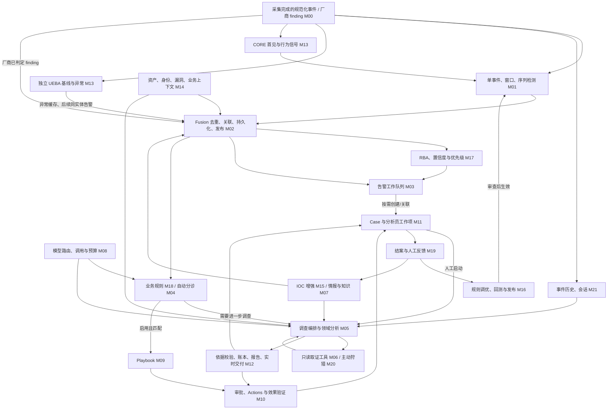

# 01 系统与模块地图

> 用途：固定上游源码与历史证据分析（2026-10-20对齐）。保留全量上游拓扑；当前负责模块以范围表为准，拓扑中的检测、采集及展示支路不代表本轮要建设。 当前职责见[范围](../../operations/alert-processing-scope.md)，阶段退出见[路线](../../operations/service-roadmap.md)，执行批次见[依赖计划](../../operations/dependency-migration-plan.md)。

返回[总入口](README.md)。本章描述参考 AiSOC 的源码结构；运行验证范围见 [07](07-data-tests-porting.md)。当前采用范围内逐批移植与测试，执行分期见[服务端路线](../../operations/service-roadmap.md)，不按旧建设进度安排。

## 1. 业务对象先分清

| 对象 | 参考实现中的角色 | 阅读与移植注意事项 |
| --- | --- | --- |
| Normalized Event | 接入层规范化后的事件，可能只是活动记录 | 不是每条事件都应提升为告警 |
| RawAlert | Fusion 的告警输入模型 | `raw` 表示融合前，不一定是未解析日志；包含来源连接器和事件标识 |
| FusedAlert | 去重/关联/评分后的消息对象 | 与数据库 Alert 字段不完全相同；还要看持久化结果 |
| IncidentSummary | 参考 Fusion 在 Redis 中维护的聚合摘要 | 不等同持久 Case；Redis TTL 的影响不能套用到 stingAISOC |
| Alert | API/PostgreSQL 中的告警工作对象 | 有负责人、状态、来源、AI 字段及可选 Case 关联 |
| Case | `aisoc_cases` 中的分析员工作项 | 关联告警、评论、任务、证据和调查；不是每个 Incident 自动变成 Case |
| Investigation Run | 一次调查/分诊执行及其事件、报告、调用记录 | 上游不同路径的目标字段和状态并不完全统一 |
| Approval / Action | 人工决策及实际执行请求 | 批准、请求被接受、执行成功、效果已确认要分别判断 |

数据模型入口：[Fusion 模型](https://github.com/beenuar/AiSOC/blob/34ca18c57dd4175539e5c6dd3d04a72dc057306b/services/fusion/app/models/alert.py)、[Alert ORM](https://github.com/beenuar/AiSOC/blob/34ca18c57dd4175539e5c6dd3d04a72dc057306b/services/api/app/models/alert.py)、[Case ORM](https://github.com/beenuar/AiSOC/blob/34ca18c57dd4175539e5c6dd3d04a72dc057306b/services/api/app/models/case.py)。

## 2. 全量上游拓扑（参考）

上游同时包含事件/行为支路、告警主流程和反馈改进回路；本服务只从已有告警进入，其他支路按范围表消费已有结果或排除。完整旅程和测试场景见 [12](12-end-to-end-scenarios.md)。

Fusion 也发布到独立 Realtime 消费者；图中的 M12 表示整个处理过程的交付面。建议→审批、批准→执行、执行→验证都存在条件，不能从箭头推断默认自动完成。

这是功能拓扑而非进程调用栈：M17 的 Fusion 评分/RBA 位于 Fusion 内部，工作台 priority 位于 API；M13 的 CORE 派生直接在检测路径调用，独立 UEBA 是并行服务。并非所有告警都会创建 Case，也不保证异步 UEBA 异常先于同实体告警到达。

### M00 输入边界

上游采集输出必须有 tenant、事件时间、来源连接器/事件或 finding ID，以及规范化字段/可回链材料。本文不扩写采集器安装；进入后续处理时要区分普通活动事件与已检测 finding，并保留原始出处。

## 3. 总览与专题的一一对应

**本表是模块编号总索引。** 专题使用相同 M 编号和固定锚点；模块可共享文档，但不能只在总览中出现而没有具体分析。M00 是范围边界，其余均有专题入口。

| ID | 模块 | 输入 → 核心处理 → 输出 | 具体分析与测试位置 | 当前服务端职责 |
| --- | --- | --- | --- | --- |
| M00 | 采集完成的输入边界 | 规范化事件/finding → 来源与租户识别 → 后续分析输入 | [本章 M00](#m00) | 告警输入边界 |
| M01 | 检测执行 | 事件/窗口/派生字段 → 条件、计数、序列 → 检测 finding/告警 | [11 · M01](11-detection-hunting-feedback.md#m01)；Fusion 对接见 02 | 范围外：告警生成 |
| M02 | Fusion | 告警 → 去重、主关联、增强评分、落库/发布 → Alert/融合消息 | [02 · M02](02-fusion.md#m02) | 负责：告警融合 |
| M03 | 告警运营 | Alert/用户/SLA → 筛选、排序、认领、分派 → 待办和运营状态 | [03 · M03](03-alert-case.md#m03) | 负责：服务端数据 |
| M04 | 自动分诊 | 融合告警/规则/历史 → 模型或确定性判定 → verdict、依据和升级 | [04 · M04](04-triage-investigation.md#m04) | 负责：自动分诊 |
| M05 | 调查编排与领域分析 | 目标/问题/材料 → 取证与多阶段分析 → 结论、未知、建议 | [04 · M05](04-triage-investigation.md#m05) | 负责：调查 |
| M06 | 工具与预取上下文 | 实体/窗口/授权 → 后端选择和受控查询 → 来源结果、coverage/错误 | [05 · M06](05-tools-knowledge-model.md#m06) | 负责：工具调用 |
| M07 | 情报、知识与记忆检索 | Feed/文档/经验/query → 存储与检索 → 候选、出处和引用 | [05 · M07](05-tools-knowledge-model.md#m07) | 负责：所需知识服务 |
| M08 | 模型与成本 | role/受控输入/预算 → 路由、调用、解析 → 输出、usage/provenance | [05 · M08](05-tools-knowledge-model.md#m08) | 负责：模型与成本 |
| M09 | Playbook | 触发/剧本/上下文 → 条件步骤、暂停恢复 → Run/动作或预览 | [06 · M09](06-playbook-actions.md#m09) | 负责：服务端剧本 |
| M10 | 审批、执行与验证 | 提案/目标/参数/身份 → 决策、执行、probe → 动作与效果事实 | [06 · M10](06-playbook-actions.md#m10) | 负责：审批响应 |
| M11 | Case 生命周期 | 关联告警/负责人/结果 → 协作、状态、结案/重开 → 工作项与闭环 | [03 · M11](03-alert-case.md#m11) | 负责：Case数据 |
| M12 | 账本、报告与实时交付 | Run/步骤/结果 → 持久、回放、导出、推送 → 可审阅证据与页面 | [03 · M12](03-alert-case.md#m12)；[07 数据/验收](07-data-tests-porting.md) | 负责：账本与数据交付 |
| M13 | UEBA 与 CORE 行为基线 | 行为事件/历史 → 特征、稀有度/偏离 → typed signal/anomaly | [09 · M13](09-ueba.md#m13)，区分两种实现 | 消费：已有行为信号 |
| M14 | 资产、身份、漏洞与业务背景 | 库存/组织/云数据 → 归一、关系、上下文 → 资产身份与暴露 | [10 · M14](10-context-enrichment-risk.md#m14) | 查询：已有上下文 |
| M15 | 多源 IOC 增强 | IOC/已配置渠道 → 缓存、并发、合并 → 信誉、风险和来源 | [10 · M15](10-context-enrichment-risk.md#m15) | 负责：所需增强 |
| M16 | 规则管理与发布 | 规则/候选/样本 → 编译、回测、审查、overlay → 生效版本 | [11 · M16](11-detection-hunting-feedback.md#m16) | 负责：处理策略/提案 |
| M17 | 风险与优先级 | 告警、实体信号、上下文 → 评分/衰减/累积 → 排序与解释 | [10 · M17](10-context-enrichment-risk.md#m17) | 负责：风险数据 |
| M18 | 业务规则与例外 | tenant 规则/告警 → 有序匹配与投影 → 路由、标签、抑制依据 | [10 · M18](10-context-enrichment-risk.md#m18) | 负责：业务规则 |
| M19 | 反馈与改进 | 人工结论/理由/closure → 经验、调优提案、评测 → 下一轮改进输入 | [11 · M19](11-detection-hunting-feedback.md#m19) | 负责：反馈 |
| M20 | 主动狩猎与补查 | 假设/技术/实体/范围 → 结构计划与真实查询 → 历史线索和报告 | [11 · M20](11-detection-hunting-feedback.md#m20) | 负责：当前告警只读补查 |
| M21 | 历史事件与会话 | 普通事件/来源 session → 归档、关联、查询 → 调查原件与关系 | [10 · M21](10-context-enrichment-risk.md#m21) | 查询：已有历史材料 |

本表保留上游模块位置和源码专题，当前职责列只作快速导航；详细边界以[范围表](../../operations/alert-processing-scope.md)为准。阶段退出见[服务端路线](../../operations/service-roadmap.md)，不要求全部上游模块迁入。

## 4. 相关基础设施的实际职责

| 组件 | 在参考代码中的用途 | 不能据此推断 |
| --- | --- | --- |
| PostgreSQL | Alert、Case、调查账本、审批、动作记录、知识元数据等 | 所有步骤都强制持久化；一些上游路径允许无库/失败降级 |
| Redis | Fusion 去重/关联状态、缓存、部分预算/信号 | 所有 Redis 数据都只是可随意丢弃的缓存 |
| Kafka | 接入、融合、情报等异步事件；不同消费者组分工 | 消息发送、业务落库、所有下游完成具备原子性 |
| Qdrant | ATT&CK、情报和语义记忆的向量投影 | 向量命中即事实成立；各集合采用相同模型 |
| ClickHouse / OpenSearch | 可选数据湖和搜索等路径 | CORE 已提供完整日志回溯；查询方言可互换 |
| Neo4j | 图关系、攻击路径及影响范围相关能力 | 没有图数据时也能生成有事实依据的攻击链 |
| LiteLLM / 模型 | 角色别名路由、对话调用；部分 embedding 路径独立 | 一个聊天 smoke 同时证明全部角色、embedding 和质量 |

Compose 入口：[docker-compose.yml](https://github.com/beenuar/AiSOC/blob/34ca18c57dd4175539e5c6dd3d04a72dc057306b/docker-compose.yml)。20 使用 CORE 加本地嵌入，未启用 full/extras/monitoring；enrichment、独立 UEBA 服务、图谱和数据湖等依赖的运行能力需另外核对。CORE 自带行为模块另见 M13，不应因独立 UEBA 未启就认定全部行为分析不存在。

## 5. 入口选择决定后续链路

| 入口 | 目标与实际流向 | 二次开发最容易误判之处 |
| --- | --- | --- |
| 融合 Kafka 消费 | `FusedAlertTriageWorker.triage`；可再升级 graph | 与 Case Investigator 不是同一状态对象 |
| Case `/investigate` | API 载入关联告警并代理 Agents；默认 Investigator，可开 Router | API 会裁剪告警材料；请求已接受不等于调查完成 |
| Case `/triage` | Agents Router 分诊入口，可选顺序或并行拓扑 | 与 Kafka 自动分诊不是相同入口 |
| `/agent-runs` | 手动完整 graph 入口 | 源码存在不等于当前 UI 主入口 |
| Playbook trigger | 按 `alert` 事件匹配剧本 | 触发、live allowlist、实际动作开关需分别核对 |
| API 审批决定 | 写审批决定并调用 Actions | 不带可执行动作的审批只代表人工步骤；动作失败另有结果 |

## 6. 本次分析边界

对主链路按“入口 → 调用 → 数据/副作用落点”检查；扩展模块只检查直接相关接口和配置。没有宣称完整厂商兼容、自动恢复、质量评测或全部 Web 交互通过。模块存在但依赖未配置，应列为待接通，而不是虚构可用数据。
