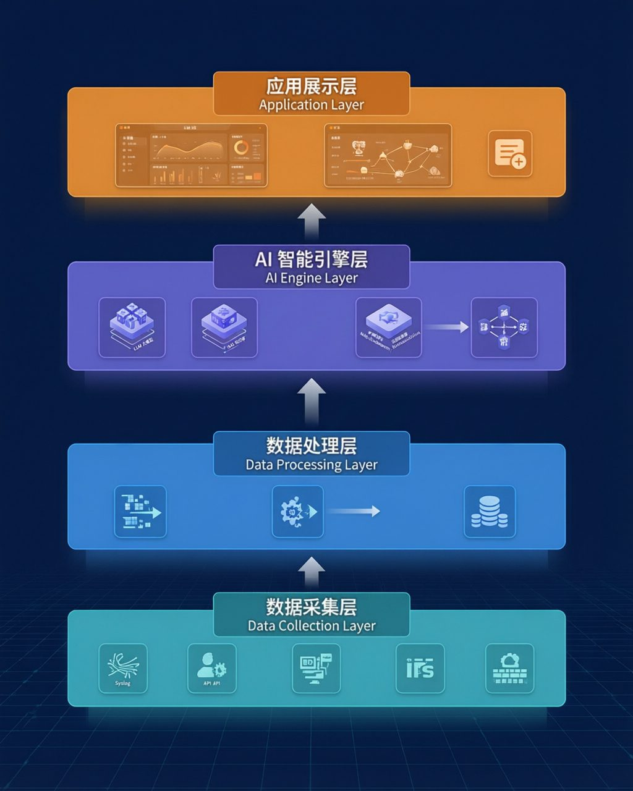
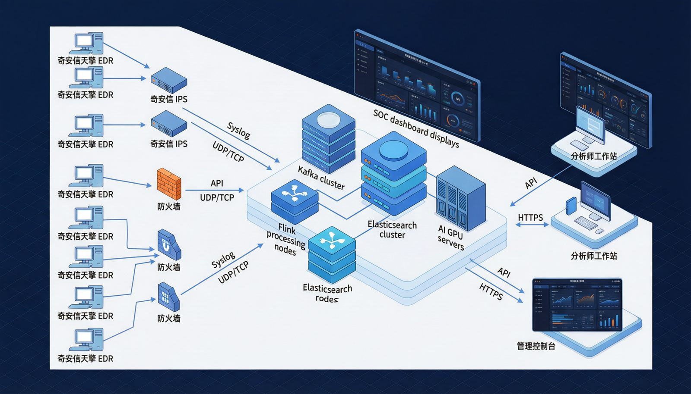
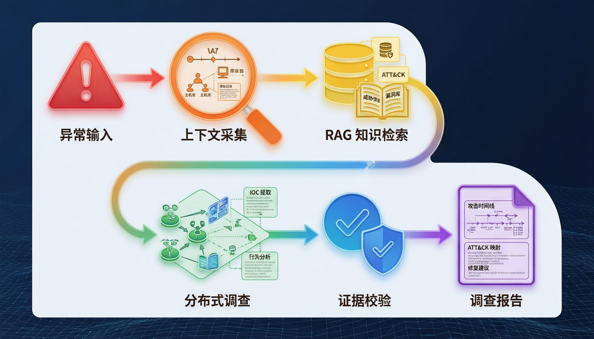

# stingAISOC 项目建设需求全文（Markdown 阅读版）

来源：[AI SOC2.docx](AI%20SOC2.docx)，原件 V1.1、2026 年 7 月。2026-10-20 从同一原件提取正文、表格和插图；没有重写需求或加入旧系统完成状态。原件仍为唯一权威来源，Word 目录页码及版式以原件为准。

DOCX SHA-256：`18880085144dbe2222a1eb8a17539b3bf1c7b452a23b1fa680d1a467869f2697`。

Pnnn 与既有 [需求覆盖对照](ai-soc2-requirements-coverage.md) 一致：按 word/document.xml 正文所有后代段落计数（含表格和空段），用于定位，不是页码。空白段不展示；原文插图按原字节导出。

项目建设要求

智能安全管理平台

项目建设要求

| 原文列 1 |
| --- |
| 文档定位： 本文件用于明确项目为什么建设、面向哪些用户、需要具备哪些能力以及建设边界。 |

| 原文列 1 | 原文列 2 |
| --- | --- |
| 项目 | 内容 |
| 文档类型 | 项目要求文档 |
| 版本 | V1.1 |
| 编制日期 | 2026年7月 |
| 适用范围 | 项目立项、需求评审及第一阶段建设范围确认 |

目录

1.	项目概述	3

1.1	项目背景	3

2.	项目目标	5

2.1	建设统一的安全数据汇聚与管理能力	5

2.2	建设平台自有安全检测能力	5

2.3	建设针对边界黑盒设备的感知能力	5

2.4	建设 AI 驱动的告警研判与降噪能力	6

2.5	建设基于 RAG 的安全知识服务能力	6

2.6	建设基于AI智能体的调查能力	6

2.7	建设智能响应决策能力	7

2.8	建设安全态势可视化平台	7

3.	总体方案与流程	8

3.1	总体分层架构	8

3.2	部署架构图	9

3.3	功能模块	10

3.3.1	日志采集与管理模块	10

3.3.2	智能检测与去噪模块	11

3.3.3	攻击链构建模块	12

3.3.4	处置方案与响应管理模块	14

3.3.5	安全态势可视化模块	15

3.3.6	系统管理模块	16

4.	相关技术	18

4.1	AI大模型安全微调技术	18

4.2	RAG检索增强生成技术	18

4.3	多智能体协同技术	19

4.4	证据链推理技术	19

4.5	边界设备数据采集技术	19

5.	项目实施计划（3个月）	21

5.1	预期成效	21

项目概述

项目背景

随着企业数字化转型的深入推进，网络安全威胁日趋复杂化和多样化。高级持续性威胁（APT）、勒索软件、供应链攻击等新型攻击手段不断涌现，传统的安全运营模式已难以应对当前严峻的安全形势。

当前，企业安全运营面临以下核心挑战：

第一，告警疲劳问题严重。企业部署了多种安全设备（入侵检测系统、防火墙、终端检测与响应系统等），每日产生海量安全日志和告警信息。安全运营人员需要从海量的告警中识别真正的威胁事件，大量误报和重复告警严重消耗了有限的人力资源。

第二，威胁研判效率低下。面对复杂的多阶段攻击行为，安全分析师需要手动关联来自不同设备的日志信息，还原攻击路径和攻击链。这一过程耗时耗力，且高度依赖分析师的个人经验，难以保证研判的一致性和及时性。

第三，应急响应速度不足。从威胁发现到处置响应之间存在较长的时间窗口，攻击者往往利用这一窗口完成数据窃取或横向移动。缺乏自动化的处置方案生成能力，使得安全团队在关键时刻难以快速做出正确决策。

第四，安全数据孤岛问题突出。终端安全数据、网络安全数据、应用安全数据分散在不同系统中，缺乏统一的汇聚和分析平台，无法形成完整的安全态势感知。

第五，已有的安全产品自身存在安全盲区。边界安全产品作为整体防御体系承担着安全检测响应任务的同时，因其本身权限高、数据敏感等特征也成为攻击者重点关注的对象。近年来，针对边界设备（如VPN、防火墙、邮件网关等）的漏洞层出不穷，而该类软件一般通过黑盒硬件部署的方式，这就在已有的安全体系下引入了新的盲区。

基于上述背景，本项目拟建设一套融合人工智能技术的智能安全管理平台（AI-SOC），通过AI智能体协同安全运营的创新模式，实现安全日志的智能汇聚、自动检测与去噪、攻击链构建以及处置方案快速生成，同时提供针对黑盒设备提供轻量级的定制化探针，从而将其纳入安全管控中，达到完善已有安全体系，提升企业安全运营效率和威胁应对能力的效果。

项目目标

本项目的总体目标是建设一套以AI智能体为核心驱动的智能安全管理平台，实现安全运营从”人驱动”向”AI驱动、人监督”的模式转变。具体目标如下：

 建设统一的安全数据汇聚与管理能力

统一接入奇安信天擎 EDR、IPS、防火墙等现有安全产品产生的告警、事件和日志数据，并关联资产、账号、终端、网络地址等上下文信息。通过统一解析、字段标准化和集中管理，为安全检测、事件调查及响应处置提供数据基础。 

Todo：确定终端审计日志的导出格式、方式

Todo：终端 资产信息的导出同步

Todo：syslog各个平台的日志格式

建设平台自有安全检测能力

平台除接收现有安全产品产生的告警外，还应具备自主发现安全风险的检测能力，结合项目数据条件和实施范围，建设以下能力：

基于资产指纹、开放端口、运行服务、软件版本及CVE特征的内网资产安全扫描； 

关联多个单独风险较低的行为，识别单一安全产品难以发现的复合攻击； 

支持扫描任务、检测规则、执行范围、运行周期及结果处置的配置管理。 

主动扫描应限定在授权资产范围内，降低对生产环境的影响。

建设针对边界黑盒设备的感知能力

针对现有防火墙、IPS等边界安全设备（指定厂商、版本，需要厂商支持），支持部署定制化轻量探针，将设备自身的运行状态和安全风险纳入统一管控。在不改变已有安全产品核心功能和业务逻辑的前提下，采集设备资产信息、运行状态、进程服务、网络连接等数据，实现对边界黑盒设备的持续感知、风险识别、异常告警和展示，提升对设备自身安全状况及运行风险的监测能力。

Todo：告警 数据的格式

建设 AI 驱动的告警研判与降噪能力

利用规则分析、关联分析和安全大模型，对多源告警与日志进行语义理解、标准化处理、去重归并、分类关联、风险评估和辅助研判。

安全大模型应能够结合告警内容、资产重要性、漏洞信息、威胁情报及历史处置记录，辅助分析告警真实性、潜在危害、影响范围和处置优先级，并给出相应的判断依据。

平台应支持分析人员对研判结果进行确认、修正和反馈，并根据实际运行数据持续优化检测规则、告警归并策略、知识内容和大模型分析提示。

建设基于 RAG 的安全知识服务能力

建设面向安全运营的安全知识库，汇聚以下内容：

CVE 漏洞及相关处置知识； 

ATT&CK 战术、技术和攻击行为知识； 

威胁情报及 IOC 信息； 

安全检测规则和分析方法； 

历史安全事件及处置案例； 

企业内部安全制度和操作流程。 

通过 RAG（检索增强生成）技术，为大模型提供与当前安全事件相关的专业知识、历史案例和内部经验，支持安全知识检索、历史案例参考、事件调查问答及处置方案生成。

大模型生成的内容应尽可能标明所引用的知识来源，便于安全人员核查和追溯。

建设基于AI智能体的调查能力

建设面向安全事件的调查智能体，利用大模型的任务理解、分析推理和工具调用能力，根据告警类型和调查目标自动拆解调查任务，并按需调用日志查询、告警查询、安全知识库等工具。 

调查智能体应能够汇总告警、日志、资产、账号、进程、文件、网络连接、漏洞和威胁情报等信息，辅助形成：

事件调查时间线； 

关键实体及其关联关系； 

可疑行为和可能的攻击入口； 

受影响资产及潜在影响范围； 

ATT&CK 战术、技术和攻击阶段映射； 

初步研判结论和风险等级； 

当前证据不足及需要进一步核实的事项； 

后续调查和响应建议。 

建设智能响应决策能力

利用安全大模型，结合事件类型、风险等级、资产重要性、影响范围、历史案例及响应预案，为已研判的安全事件生成结构化处置方案。平台应根据现有 EDR、防火墙及其他安全产品实际提供的接口能力，与相关系统进行联动，执行终端、网络、账号及任务流程等方面的响应操作。

所有响应操作均应记录触发原因、执行依据、审批过程、执行对象、操作人员及执行结果。

建设安全态势可视化平台

建设面向安全分析人员、响应人员和管理人员的统一工作台，集中展示：

现有安全产品告警； 

内网资产及漏洞风险； 

安全事件及调查进度； 

AI 研判结论及关联证据； 

自动化和半自动化响应任务。

平台提供安全态势、告警趋势、资产风险分布、攻击链展示等核心视图，支持安全运营人员高效开展日常工作。

总体方案与流程

总体分层架构

总体方案分为数据采集、数据处理、AI 智能引擎和应用展示四层。数据采集层负责连接既有安全产品;数据处理层完成解析、标准化、存储和基础关联；AI 智能引擎层面向调查、知识检索、证据整理和建议生成；应用展示层向分析人员和管理人员提供工作台、调查报告和运营视图。

图3.1 智能安全管理平台总体分层架构

数据采集层负责对接各类安全数据源。通过Syslog协议接收来自奇安信IPS、防火墙等网络安全设备推送的日志数据；通过API接口对接奇安信天擎EDR终端管理系统，获取终端安全事件、进程信息、文件操作等数据。该层支持多种日志格式的标准化解析，包括CEF、JSON及自定义格式。

数据处理层承担日志的标准化、存储和预处理工作。采用消息队列（Kafka）实现高吞吐的日志缓冲和流式处理；利用Elasticsearch集群实现海量日志的全文检索和时序存储；通过规则引擎和流处理框架（Flink）完成实时日志解析、字段标准化和初步关联分析。

AI智能引擎层是本平台的核心能力层，包含以下关键组件：安全微调大语言模型（基于开源基座模型，使用安全领域数据进行微调）、RAG知识检索引擎（对接威胁情报库、漏洞库、ATT&CK知识库、历史处置案例库）、AI智能体编排引擎（支持多Agent协同的分布式调查任务）、以及证据链推理引擎（确保每个研判结论都有可追溯的证据支撑）。

应用展示层提供面向安全运营人员的交互界面，包括安全态势大屏、告警工作台、攻击链可视化、事件调查报告、处置工单管理等核心功能模块，整体交互设计参照通用SOC平台标准。

 部署架构图

奇安信天擎 EDR、奇安信 IPS 和防火墙承担各自的终端检测、网络检测和边界控制职责。智能安全管理平台通过产品现有接口接收告警和必要上下文，在统一工作台中完成标准化、事件组织、关联调查和报告输出,并结合已有安全产品开放的响应能力进行后续响应。

图3-2 系统整体部署拓扑示意图

功能模块

日志采集与管理模块

该模块负责统一接入、处理和管理安全产品、网络设备、终端设备及业务系统产生的告警、日志和上下文数据，为智能检测、事件调查和响应处置提供数据基础。数据分为两类：

已有安全产品提供的日志、检测告警信息。

安全黑盒产品自身的态势信息。

主要功能包括：

多源数据接入 

支持通过 Syslog UDP/TCP 接收防火墙、IPS、网络设备及其他安全设备日志； 

支持通过 REST API 对接奇安信天擎 EDR 等终端安全产品； 

支持接入资产信息、漏洞信息、组织信息，支持配置资产重要等级等上下文数据； 

提供数据源配置、启停控制、连接测试和接入状态监控。 

边界设备探针采集的进程、网络、服务及敏感配置信息。

日志解析与标准化 

对不同厂商、不同类型日志进行字段提取、格式转换和标准化映射； 

统一时间、IP 地址、主机、账号、进程、文件、域名、URL 等关键字段； 

对无法自动识别的数据支持人工配置解析模板； 

对解析失败、字段缺失和数据异常情况进行记录和提示； 

保留原始日志，确保标准化数据能够追溯至原始记录。 

数据质量与上下文补充 

对重复、缺失、异常和格式错误的数据进行识别； 

根据 IP、主机名、设备标识等信息关联资产； 

展示数据来源、采集时间、解析状态情况。  

日志检索与调用服务 

支持按资产、账号、IP、域名、文件、进程和事件类型检索； 

支持查看原始日志、标准化字段及关联上下文； 

为检测规则、大模型研判和调查智能体提供统一日志查询能力； 

支持检索结果导出。

本模块重点解决多源安全数据分散、格式不统一、上下文不足及证据难以追溯的问题。

智能检测与去噪模块

该模块在统一接收现有安全产品告警的基础上，对原始告警和日志进行二次分析，实现告警去重、关联、风险评分和辅助研判，减少重复告警和低价值告警对安全人员的干扰。

主要功能包括：

多源告警统一管理 

统一接入 EDR、IPS、防火墙等安全产品产生的告警； 

接收平台根据原始日志、IOC 或攻击行为特征自主生成的告警； 

对不同来源告警进行标准化、分类和统一展示； 

支持按照等级、来源、资产、时间、状态和事件类型查询； 

平台检测能力 

支持基于资产指纹、开放端口、运行服务、软件版本及CVE特征的内网资产安全扫描； 

支持常见漏洞扫描、执行范围、运行周期及结果处置的配置管理； 

支持对多个单独风险较低的行为进行组合分析。

对黑盒设备日志的异常分析：网络外联、持久化等。

告警去重与聚合 

根据时间窗口、告警类型、资产、账号、IP 等信息识别重复告警； 

将短时间内大量相同或相似告警归并为一个告警组； 

对同一资产、同一账号或同一攻击行为相关的告警进行关联； 

支持配置聚合时间窗口、匹配字段和归并规则； 

保留归并前的原始告警，避免去噪造成证据丢失。 

AI 辅助研判 

利用安全微调模型理解告警名称、描述和上下文； 

提取 IP、域名、账号、文件、进程、哈希值等关键实体； 

辅助判断告警真实性、潜在危害和进一步调查价值； 

对单点告警进行可信度评分和误报可能性分析； 

输出研判结论、判断依据、风险等级和待核实事项；  

告警评分与优先级排序 

综合告警可信度、资产重要性、漏洞情况、威胁情报和行为异常程度进行风险评分； 

对告警进行高、中、低等级划分和优先级排序； 

展示影响评分的主要因素； 

支持将高风险告警升级为安全事件并启动调查流程。 

 攻击链构建模块

该模块通过调查智能体调用日志、资产、漏洞、威胁情报和知识库等能力，对分散的告警和安全数据进行关联分析，逐步还原攻击入口、攻击过程、影响范围及攻击阶段。

  图3-3 攻击链构建示意图

主要工作流程如下：

异常输入 → 调查任务生成 → 上下文采集 → RAG 知识检索 → 分布式调查 → 证据校验 → 攻击链构建 → 调查报告生成 → 人工复核

主要功能包括：

调查任务触发 

接收异常进程、可疑文件、恶意网络连接、单点告警和告警组等输入； 

支持由高风险告警自动触发或由安全人员手动发起调查； 

根据事件类型、风险等级和已有上下文生成调查目标； 

支持安全人员限定调查资产、账号和时间范围。 

调查任务规划与协同 

根据调查目标拆解日志检索、资产核查和行为分析等任务； 

根据不同任务调用相应的调查工具或专项智能体； 

支持任务执行状态、结果和异常情况记录； 

告警上下文采集 

自动收集告警发生前后的相关日志； 

获取涉及资产、账号、进程、文件和网络连接信息； 

查询资产标签、位置、相关漏洞及历史事件； 

检索同类告警和相关安全活动； 

形成可供后续分析的事件上下文集合。 

RAG 知识增强 

检索企业内部或已有的历史事件报告、处置记录和应急预案； 

检索 ATT&CK、CVE、威胁情报及安全分析知识； 

为攻击行为解释、调查步骤和响应建议提供参考； 

展示知识内容的来源、版本和关联程度；。 

分布式调查分析 

提取并验证事件中的 IOC； 

分析异常进程的父子关系、执行参数和关联文件； 

分析账号登录、权限使用和横向访问行为； 

分析源 IP、目标 IP、端口、域名及网络通信关系； 

关联相同资产、账号、文件或网络指标涉及的其他告警； 

分析可能的攻击入口、持续驻留、横向移动和数据外传行为； 

识别可能受到影响的其他资产和账号。 

证据校验与冲突处理 

校验关键实体之间是否存在实际关联； 

校验攻击行为的时间顺序和逻辑关系； 

将关键结论关联至原始告警或日志； 

对证据不足的结论标记为待核实，不直接纳入已确认攻击链。 

攻击链构建与展示 

根据时间顺序构建攻击活动时间线； 

展示资产、账号、进程、文件、IP 和域名之间的实体关系； 

映射 ATT&CK 战术、技术及相关攻击阶段； 

标记可能的初始访问入口和关键攻击节点； 

展示攻击扩散路径及潜在影响范围； 

支持对攻击链节点进行人工确认、修正和补充。 

综合调查报告生成

调查报告主要包括：

事件概述和风险等级； 

已确认的异常行为； 

关键实体和 IOC； 

攻击活动时间线； 

可能的攻击入口及传播路径； 

ATT&CK 战术和技术映射； 

受影响资产和潜在影响范围； 

关键证据及其来源； 

后续调查及处置建议。 

处置方案与响应管理模块

该模块根据事件调查结果、风险等级、资产重要性、响应预案和历史案例，生成结构化处置方案，并根据现有安全产品接口能力衔接人工、半自动化或自动化响应流程。

主要功能包括：

智能处置方案生成 

明确处置对象、执行动作、执行参数和操作顺序； 

分析可能产生的业务影响和操作风险； 

展示处置建议所依据的事件证据、知识内容和响应预案。 

处置方案审核与调整 

支持调整处置对象、范围、参数和执行顺序； 

支持处置方案保存、版本比较和审核确认； 

对证据不足、对象不明确或影响范围较大的操作强制进行人工审核。 

安全产品联动

根据现有 EDR、防火墙和其他系统实际提供的接口，可逐步支持：

隔离终端； 

终止恶意进程； 

隔离或处置恶意文件； 

封禁 IP 地址、域名和 URL； 

下发防火墙或网络访问控制策略； 

锁定、停用账号或发起凭据重置； 

创建漏洞修复、资产排查和补充取证任务； 

通知相关人员并派发处置任务。 

分级响应控制 

自动化响应：适用于对象明确、影响可控、证据充分且已有成熟预案的低风险操作； 

半自动化响应：由平台生成方案及执行参数，经安全人员审核后一键执行； 

人工响应：涉及核心业务系统、关键账号、大范围网络策略等高风险场景时，由人工决策和实施。 

响应预案与流程编排 

支持响应预案的创建、编辑、启用、停用和版本管理； 

支持配置事件类型、风险等级及触发条件； 

支持流程暂停、终止、重试和人工接管； 

安全态势可视化模块

该模块面向安全分析人员、响应人员和管理人员提供统一的安全运营界面，集中展示告警、资产、事件、调查、攻击链和响应任务。

主要功能包括：

全局安全态势大屏 

展示总体安全风险等级和实时告警情况； 

展示告警数量、等级分布和变化趋势； 

展示高风险资产、重点漏洞和主要威胁类型； 

展示威胁来源和攻击目标分布； 

展示重大事件、处置进展和待关注事项。 

告警运营工作台 

提供多源告警统一列表； 

支持按照时间、来源、等级、资产、类型和状态筛选； 

支持告警批量确认、分派和状态调整； 

展示 AI 研判结果、可信度和风险排序； 

展示归并关系、威胁情报和相关上下文； 

支持从告警进入事件调查流程。 

事件调查工作台 

展示事件基本信息、负责人、状态和处理时限； 

展示关联告警、资产、账号、漏洞和调查任务； 

展示智能体调查步骤、工具调用结果和当前进度； 

展示已确认事实、分析判断、模型推测和待核实事项； 

支持人工补充信息、调整调查范围和复核调查结论。 

攻击链可视化 

以时间轴展示攻击活动和关键行为； 

展示 ATT&CK 战术、技术和攻击阶段映射； 

以关系图展示资产、账号、进程、文件、IP 和域名之间的联系； 

标识已确认节点、推测节点和证据不足节点； 

响应任务与审批面板 

展示待审批、待执行、执行中、失败和已完成任务； 

展示处置对象、执行动作、风险提示和业务影响； 

支持查看方案依据、审批记录和执行结果； 

报告与运营分析 

生成事件调查报告和响应处置报告； 

生成安全运营日报、周报及阶段性分析报告； 

统计告警数量、归并比例、误报情况和风险分布； 

统计事件发现、研判、调查和处置时长； 

统计 MTTD、MTTR、任务成功率及自动化响应使用情况； 

支持报告模板配置、人工审核和导出； 

支持从报告结论追溯至对应事件和证据。 

AI 安全运营助手 

支持通过自然语言查询高风险告警和安全事件； 

查询指定资产或账号近期的安全活动； 

查询告警研判依据、攻击过程和影响范围； 

查询待审批、执行失败和超时任务； 

开展安全知识、历史案例和处置预案问答； 

辅助生成调查报告、处置报告和运营报告； 

涉及实际处置操作时执行权限校验和人工确认。 

系统管理模块

该模块为平台数据接入、模型运行、智能体调用、用户操作和响应执行提供统一的配置、权限、监控和审计能力。

主要功能包括：

用户、角色与权限管理 

支持用户、用户组和角色管理； 

支持基于角色的访问控制（RBAC）； 

支持账号状态和登录安全策略管理。 

数据源与接口管理 

配置 Syslog、API 和其他数据接入接口； 

管理外部安全产品和调查工具的连接信息； 

监控数据接入状态、同步时间、异常和中断情况； 

支持接口调用频率、超时和失败重试配置； 

对接口调用和数据访问行为进行审计。 

AI 模型管理 

统计模型调用量、响应时间、失败情况和使用场景； 

通过人工复核结果评估研判准确性和报告可用性； 

支持提示词模板的版本管理和效果比较； 

知识库与智能体配置 

管理知识来源、分类、权限、版本和更新时间； 

支持知识内容更新、失效和人工审核； 

配置智能体可调用的工具、权限和适用场景； 

限制单次调查范围、调用次数和资源使用； 

保存智能体任务规划、工具调用和结果生成记录。 

系统监控与运维 

监控平台服务、接口、任务、存储和模型运行状态； 

展示系统容量、资源使用和异常情况； 

支持任务失败、接口异常、数据中断等运行告警； 

提供必要的参数配置、日志查询和运维管理能力。 

安全审计 

记录用户登录、查询、导出和配置修改行为； 

记录 AI 模型调用、智能体工具调用和生成结果； 

记录处置方案生成、人工修正和审批过程； 

记录响应动作、执行参数、操作人员和执行结果； 

支持按照用户、事件、时间和操作类型查询审计记录； 

确保关键操作全过程可追溯。 

相关技术

AI大模型安全微调技术

采用具备中文理解、指令遵循和工具调用能力的开源大语言模型作为底座，利用安全问答、检测规则、告警分析、威胁报告、历史事件和处置案例等专业数据进行监督微调（SFT），增强模型在以下方面的能力：

告警语义理解和关键实体提取； 

威胁行为分析及ATT&CK映射； 

调查结果归纳和风险判断； 

处置建议及结构化报告生成； 

证据不足、信息冲突和待核实事项识别。 

针对不同复杂度的安全任务，采用长短样本相结合的训练方式。

RAG检索增强生成技术

建设包括威胁情报、CVE/CNVD漏洞信息、ATT&CK知识、检测规则、历史事件报告、处置手册和应急预案等内容的安全知识库。

通过关键词检索、向量检索、IOC精确匹配、条件过滤和结果重排序等方式，在告警研判和事件调查过程中检索相关知识，为行为解释、相似案例匹配、调查步骤制定和处置建议生成提供参考。

平台记录知识来源、版本、更新时间和访问权限，并在生成结果中展示引用依据。知识库内容仅作为分析参考，不能替代当前事件的原始告警、日志及工具查询结果等事实证据。

多智能体协同技术

采用多智能体协同架构，将复杂事件调查拆分为任务规划、上下文采集、IOC验证、终端分析、网络分析、攻击阶段判断、证据校验和报告生成等子任务，由统一的调查编排组件协调执行。

各智能体通过结构化消息交换任务信息、工具结果、证据引用和处理状态，并通过标准化API或MCP等方式调用日志、告警、资产、漏洞和知识库等工具。

平台对智能体的数据范围、工具权限、调查时间范围和调用次数进行限制，支持任务监控、失败重试、人工补充条件等。

证据链推理技术

以证据链为核心关联原始告警、日志记录、工具查询结果、情报命中、知识引用、模型判断、人工复核和响应结果，保证调查结论可追溯、可验证和可审计。

模型形成的关键结论应关联相应证据，并区分以下状态：

已确认事实； 

基于证据形成的分析判断； 

证据不足的模型推测； 

需要补充调查的待核实事项； 

不同数据源之间存在的冲突。 

证据链用于还原攻击时间线，包含ATT&CK映射、调查报告引用和处置方案审核。涉及终端隔离、账号停用、网络封禁等高风险操作时，AI只能提出建议，必须经过权限校验和人工审批后执行。

边界设备数据采集技术

针对边界设备的探针植入（指定厂商、版本，需厂商配合）后，监控设备的网络连接信息、持久化操作，将其纳入整体的安全管控之中等：

网络的主动外联监控，结合黑白名单进行监控

文件实体的检测能力。可以配置文件路径、文件名、hash等指标

进行调查取证。如环境变量、进程列表等

对系统关键目录的监控：针对指定目录建立基线，定期比对文件更改

项目实施计划（3个月）

项目预计工作周期为 3 个月。首先完成场景和数据确认，第二个月形成核心功能，第三个月通过真实数据开展 POC 调试、试运行和验收准备。具体起止时间可根据数据、接口及部署环境到位情况确定。

| 原文列 1 | 原文列 2 |
| --- | --- |
| 阶段 | 主要建设要求 |
| 第1个月：需求与数据准备 | 确认 2—3 个试点场景、用户角色和人工研判流程；完成数据源、接口、样例日志、字段字典、历史案例和测试数据梳理；明确部署条件、权限边界、验收口径并完成关键技术验证。 |
| 第2个月：核心功能开发 | 完成指定数据源接入、字段标准化、告警管理、基础去重聚合、事件管理、上下文查询、智能辅助调查、证据引用、调查报告、处置建议及基础工作台的核心开发与联调。 |
| 第3个月：POC调试与验收 | 基于真实或脱敏数据开展场景联调和效果验证；优化告警聚合、知识检索和调查输出；完成问题修复、权限审计、用户试用、操作培训、试运行记录及验收材料准备。 |

预期成效

本项目建成后，预期实现以下成效：安全告警处理效率提升5倍以上，有效告警识别准确率达到90%以上；攻击链自动构建时间从人工数小时缩短至分钟级；处置方案自动生成覆盖率达到80%以上的常见威胁场景；安全运营人员工作负荷降低60%以上；整体安全事件平均响应时间（MTTR）缩短70%以上。
