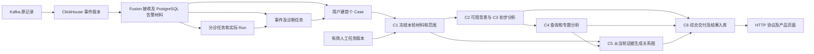

# C173 后续流程与接口设计

2026-11-21 · 评审稿 v1。本文记录各环节的数据结构、关联键、执行步骤、保存时点和读取出口。正式基线为 `c173-release-20261121-04`。表中的「现行」以该版 OpenAPI 为准，「联验」是现有接口还需走通的真实业务场景，「草案」供讨论。所有调查 HTTP 路径相对于 `/api/v1/socai2`，第 6 节业务后端入口单列。[正式合同](../../../deploy/aisoc21/c173-release-20261121-04/contract/openapi.json) · [正式读回](../../../docs/operations/evidence/c173-escalation-release-20261121-04/README.md) · [后端交接](../../../docs/integration/c173-backend-handoff-20261121.md) · [前端页面设计稿](../../../docs/integration/c173-backend-handoff-20261121.md#前端页面设计稿)

外部 HTTP 的路由、返回 DTO 和适配器在 `services/api/investigation_http/`，调查用例仍在 `services/api/app/socai2/`。部署地址、数据库、模型、时限和开关使用当前或相应的隔离 profile。业务方式及字段表下面列出，连接凭据留在运行环境。 [配置索引](../../../docs/operations/configuration.md)

## 全流程及数据关联



图中每条箭头表示可核对的数据交接。C4 及 C5 的可用结果和缺口均进入 C6，模型环节按职责取得相应业务事实。事件与 Case 的更新按第 4 节的触发条件处理。常用身份和键如下，公开接口使用同版 OpenAPI 定义。

| 对象 | 身份及数据类型 | 保存、关联与读取 |
| --- | --- | --- |
| 来源记录 | `metadata.uid` 为源端字符串，`source_version` 为内容版本字符串，`event_id` 为日志湖 UUID | 使用完整 `LakeRecordRef` 读原文。来源身份与版本用于重发对账，分区和 offset 用于定位一次传输 |
| 告警和材料 | `alert_id/material_id` 均为 UUID，材料版本 `revision` 为整数 | 告警当前材料沿 `latest_material_id`。指定轮次沿当时材料、分诊和人工判定的 ID |
| 事件和 Case 范围 | `incident_id/case_id` 为 UUID，`scope_revision` 为 Case 范围版本整数 | `incident_alerts`、`case_incidents` 和 `case_alerts` 记录关系。Case 修改范围的请求带期望版本 |
| 请求和执行 | `task_id/run_id/step_id` 均为 UUID，`attempt_no` 为整数，业务请求带 `operation_key` | task 可有多次 attempt，attempt 可在准备阶段结束并且 `run_id=null`。Run 产生后，沿各自 URL 读步骤、输入和结果 |
| 版本化证据 | `material_id/artifact_id/revision_id/result_id` 为 UUID | 模型和页面跨步骤引用保存的同范围原件。引用本身、执行回执及模型判断分别落在其原对象 |

HTTP 时间字段用带时区的时间表示。原始事件时间、入湖时间、受理时间、执行时间和读回观察时间各按定义保存。字段未知时依既有合同使用 `null` 或明确状态。成功且查无结果用 `[]` 或计数 `0`。会产生副作用的写操作以原幂等键核对结果，记录不确定时先读回原请求或回执。

现有 `EvidenceRef` 的字段为 `type`（`alert_material`、`artifact`、`task_revision`、`result`）、`id`（UUID）、`external`（`null`）、`source_path`（字符串或 `null`）、`row_keys`（字符串数组）和 `role`。角色包括 `observation`（观察）、`source_label`（来源标签）、`prior_analysis`（前序分析）、`human_statement`（人工陈述）和 `execution_receipt`（执行回执）。外部原文先保存对应的内部来源工件，再由引用指向真实记录和字段路径。[核心证据合同](../../../services/api/app/socai2/baseline_contracts.py)

## 工作顺序与完成条件

| 顺序 | 计划实现或验收的功能 | 依赖 | 该步的通过证据 |
| --- | --- | --- | --- |
| 1 · 取证工具 5b | 用一套按类别配置的解析和描述逻辑完善现有 `4001` 网络审计查询 | 21 历史湖已核实的原件、现有湖查询 profile | 一条真实记录的控制动作、处置、策略和可回查原文逐项一致 |
| 2 · Case 取证 5c | 把 5b 的结构化事实接到 C4，保存查询回执、证据投影和原文引用 | 5b 的真实读回通过，隔离调查库及现有执行 profile | 用同一条记录完成 C4 保存和真实 HTTP 读回。成功有结果、查空、失败或未知保持各自状态 |
| 3 · 关系图与后续轮次 | 用 C4 证据建图并回查指定 Run。新增成员或有效人工事实进入下一轮 | 5c 有可引用的证据，同版 C173 API 和产品调用方 | 同一案例现场核对底图、原件跳转、任务回执及新旧两轮的输入范围和结果 |
| 并行 · 上游与产品后端 | 确认 Kafka 直写及切换分界，确认人员和资产接口及字段映射 | SpiritHub 发送方和业务后端提供环境、样例及源端约定 | 独立 Topic 投递、落湖和初次分诊回执一致。产品端用真实 ID 调用列表、详情、指定轮次和跳转 |
| 后续专项 | 确认 Neo4j 身份数据的业务用途并联验。保留 AI 对话的启动设计 | 外部身份图来源及刷新约定。AI 对话按已有排期暂缓，恢复时确认首版接口增量 | 查询结果能定位来源和适用范围。助手问答另以同案范围、历史恢复及显式保存验收 |

先完成一个能直接验收的步骤，再进入依赖步骤。5b 可复用历史湖样本。新数据可进入 C173 正式链路后，再联验实际自动接收和产品操作。人工定向分析、手动全案综合、知识后台异步维护和真实响应审批执行沿各自排期。现阶段已有知识检索和分诊后同步，后续确认真实材料是否用于相关判断，以及同步结果如何影响后续轮。模型正文质量按已有后置范围保留。 [取证原计划](lake-evidence-tools-design-20261119.md#目标范围和分步出口) · [流式后置范围](../schedule-streaming-investigation-updates/deferred-scope.md) · [问题清单](../../../docs/investigation/current-issues.md)

## 1 告警入站和取数

### 业务和环境

- **输入**。SpiritHub 每条 Kafka 消息提供一个 OCSF 1.9.0 JSON 对象。源端需确认事件时间的路径及单位、`class_uid` 的整数值、`is_alert` 的布尔值、全局唯一的 `metadata.uid` 字符串及 Kafka Key 规则。同一逻辑记录重试沿用原 ID 和 Key。来源扩展和 `partial` 字段以已配置的路径与类型识别。先用脱敏样例核对合同。
- **输出**。落湖后保存原文、事件时间、入湖时间、来源和内容版本。告警选择按现有类别及规则产生接收或待核决定。符合接收规则时，Fusion 在调查库保存告警、材料、湖引用和首次分诊登记。符合原有规则的相关事件登记首轮诊断。非告警日志在湖中可供查询和取证。
- **依赖**。发送方的测试和正式环境、同机 Kafka 接入约定、ClickHouse 原生接入及查询 profile、Fusion 接收配置、PostgreSQL 调查库、Redis 调度和项目模型。21 同机发送使用交接文档的 `kafka:29092`、`PLAINTEXT` 和接收 Topic。隔离联验使用独立 Topic 和消费范围，按 profile 绑定库、租户、来源、映射版本和业务读取端。
- **直写切换**。先确认源端分界及各分区的投递位置，用独立 Topic 核对身份、Key、正文版本及接收回执。正式切换时确认 Vector 已交付分界前记录，再由上游从分界后直写。窗口对账使用共同的源端身份和正文版本，源、目标各保留自己的分区和 offset。

### 入站数据结构

| 保存位置 | 关键字段和类型 | 版本及读回条件 |
| --- | --- | --- |
| Kafka 记录 | Key 及一个 OCSF JSON 对象。主体依赖 `metadata.version`、`metadata.uid`、`class_uid`、时间和告警声明 | Key 规则与时间单位由上游给定。保留目的 `topic`、`partition: int`、`offset: int64` 与原件的关联 |
| `ClickHouse aisoc.raw_events` | `tenant_id/event_id` 为 UUID，`source_namespace/mapping_version/source_event_id/source_version` 为字符串，`class_uid` 为无符号整数。保存 `event_time/ingest_time`、`event_time_source`、`parse_status`、`ocsf_json/raw_payload` | 取湖记录时带 `event_id, source_namespace, mapping_version, source_version, event_time, class_uid`。所选来源、映射和版本固定。在湖适配的布尔列中，`is_alert` 可投影为 0、1 或 `null`。正式告警选择仍按已定来源规则校验原始告警声明。 |
| `socai2.lake_alert_deliveries` | `id/tenant_id` 为 UUID，`lake_database/source_namespace/mapping_version/binding_digest` 为字符串，`lake_ref` 和 `decision` 为 JSON 对象。另有 `state`、`attempt_count: int` 及可空的 `source_subject_id/alert_id/material_id` | 交付状态为 `pending/receiving/failed/unknown/held/delivered/lake_only/review`。只有 `delivered` 保存确认时点及实际告警、材料 ID |
| `socai2.lake_alert_delivery_attempts` | 由 `delivery_id: UUID` 与 `attempt_no: int` 唯一定位。记录 `started_at/ended_at`、`outcome`、原因和可空的 `receipt` | 尝试 `outcome` 为 `receiving/created/duplicate/recovered/failed/unknown/held`。读同一交付的尝试历史可区分首次接收、重复投递与不确定后的确认 |
| `socai2.lake_alert_receipts` | `source_subject_id: UUID` 作为键，保存 `source_event_id/source_version`、租户/来源和实际 `alert_id/material_id`、`lake_ref`、`received_at` | 告警选择使用已确认全局 `metadata.uid` 生成来源告警身份。同一业务主体的重发以原回执确认。正常完成的交付必须能对上这份事务实存回执 |
| `socai2.alerts/alert_materials/alert_source_refs` | 告警、当次接收材料、原来源告警及材料关联。初始分析登记在 `analysis_tasks` | 页面读取已生成的告警、材料和任务身份。后续从当时的材料 ID 复现，湖原文继续用原 `record_ref` |

### 接收、去重和读回流程

1. 上游投递后，我方按配置绑定来源并保存原文及投递位置。写入成功才提交该 Kafka 消费位置。解析问题保留原文与实际质量状态。
2. 湖交付侧按已选来源和窗口检查告警声明、支持的类别及原身份。合格且首次出现登记 `pending`。普通日志标记 `lake_only`，规则不确定或同 ID 异文记 `review`。
3. 领取时记录尝试并变为 `receiving`。Fusion 先核同身份与版本，再在事务内保存实际入站结果。已有相同回执直接确认，同 ID 异文走待核。
4. 交付侧读回提交的 `lake_alert_receipts`，匹配同租户、版本、告警和材料后才记录 `delivered`。失败、挂起或结果未知保留本次回执及后续检查位置。重启先读取原接收回执，以实际证据决定能否补成功确认。
5. 从正式返回的 `alert_id/material_id/task_id` 查询告警、材料和分诊状态。事件任务根据实际关联规则查看。Kafka 传输、湖交付和分析各用本层对应的身份。

### 接口与实现

| 接口 | 入参和出参 | 处理、持久化与失败 |
| --- | --- | --- |
| Kafka 上游指向接收 Topic · 联验 | 一条 OCSF 记录及 Key。回执用目的 Topic、分区、offset 和来源标识核对 | 复用裸 OCSF 适配器，保留完整源记录和规范化版本。成功落库后再推进消费位置。同 `metadata.uid` 同版本重发只认一次业务接收。同 ID 异文在湖中保留，接收进入待核。提交结果未知时先按身份与版本读回确认 |
| 湖告警交付 → Fusion · 内部 | 确切 `record_ref`、规则判定、完整 OCSF。返回持久交付和接收回执及已实际生成的主体身份 | 用现有选择和持久交付 worker 调用 Fusion 接收。事务保存主体、材料、来源引用和初始任务。已提交但结果未知时按接收台账恢复，交付处于失败或未知时保留检查点。Kafka 直写环节通过后，用一条新告警核对这条正式业务链 |
| `POST /lake/events/search` · 现行 | `LakeSearch` 含 `source_namespace`、`mapping_version`、`time_basis`、带时区的 `start/end`。可按 `selector {role, kind, value}`、`class_uids`、`limit/cursor` 筛选。返回 `LakeSearchHttpResult`、`record_ref`、`material_url` 和分页字段 | `external_routes/lake.py` 经 `adapters/lake.py` 调湖读取用例。按明确来源、时间基准和对象角色执行受限查询，先按现有版本规则去重再分页。合法查空为 200 与 `items: []`。非法范围或游标为 422，来源及依赖错误沿正式合同行为 |
| `GET /lake/events/{event_id}/material` · 现行 | 沿 `material_url`，带 `source_namespace`、`mapping_version`、`source_version`、`event_time` 和 `class_uid`。返回 `LakeMaterial` 的原文、类型编码及 `completeness` | 按已选版本精确读回，缺版本或来源不可用用正式错误合同。旧预览及未验证完整性沿原状态显示。事件时间与入湖时间各用自己的字段 |
| `GET /alerts/{alert_id}/materials/{material_id}` · 现行 / 联验 | 路径携带正式告警及该告警的材料 UUID，输出 `ContentView` | 从告警与版本归属关系查调查库。页面用返回的材料 ID 读取。湖的原文路径使用对应 `material_url` |

Kafka 消费位置对应已落湖的消息，湖告警交付另有自身的持久检查点和接收回执。产品沿已生成的告警与任务 ID 读 PostgreSQL，联调时用这两级回执定位落湖、选择、接收或分诊的实际状态。

直接验收选正常日志和可接收告警各一条。核对落湖、原件、告警及首次任务的身份。告警同版本重发核一次，确认目标身份和任务仍对应同一接收。产品侧的事件、Case 任务与轮次按第 4 节继续。 [入站身份及交付设计](lake-alert-selection-20261119.md) · [同版接入依赖](../../../docs/integration/c173-backend-handoff-20261121.md#kafka-日志接入)

## 2 工具查询及结果解析

### 业务和环境

- **输入**。C4 使用 C1 冻结的告警材料和角色对象、受控窗口以及 C3 提出并经程序校验的补查目标，对 `process_activity`（1007）、`network_connections`（4001）、`authentication_activity`（3002）做已有固定查询。首个解析配置以 `4001` 网络审计和访问控制记录为准。
- **输出**。对每条选中的原文返回结构化事实、由事实生成的描述和来源引用。首项字段包括观察时间、端点角色及源和目的、端口及协议、控制动作 `action_id`、处置 `disposition_id`、可用的 `policy.uid/name`。动作和处置分别解码，未知枚举带原编号，字段缺失、冲突及不适用显式保留。观察到了阻断时描述阻断。连接建立、传输字节、权限影响等各由相应独立证据支持。
- **依赖**。明确的 `SOCAI2_LAKE_QUERY_PROFILE_FILE`、既有工具目录和执行限制、ClickHouse 日志湖与稳定原件引用、PostgreSQL Run 存储。5b 用隔离读取与已有真实日志验字段。5c 用同版 Case 执行与 HTTP 读取验证，项目模型只消费适合本轮问题的结构化业务事实及合法引用。

### 实现顺序

1. 复用 `baseline_evidence_tools` 的工具名及既有查询执行。通过 `lake_evidence_v2` 的绑定确定来源、版本、角色、对象、窗口及预算。由程序生成固定查询。对外日志浏览和对内调查调用共用取数能力，调查范围随 Run 冻结。
2. 在 `baseline_semantics.project` 对应的投影位置接入一套共用解析逻辑。配置按 OCSF 版本、`class_uid` 和有确认规则的来源扩展匹配。逐字段定义标准路径、允许的来源别名、角色、类型、单位、枚举和冲突处理。同数组元素内组装字段，`0`、`false`、有效空数组按原类型保留。
3. 配置模板从已校验的事实组生成描述，省略没有依据的句子。保留原字段路径、记录版本和投影配置版本，旧轮次继续读取当时保存的投影。频次、时序和不同处置的统计可复用结构化事实，按明确问题另接算子。
4. 沿 `BaselineEvidence` 保存 `tool_request` 和实际收到的 `tool_response`，原回执先提交，再保存派生 `query_projection` 和原文引用。投影出错时仍可读原查询回执，执行、查询结果及投影可用性分别显示。可靠的局部结果可以保留，查空、未查、失败或结果未知分别传递。原件和内部执行账本留后台，C3、Deep、C6 只读取相应阶段实际需要的事实或缺口。

### 查询绑定、回执和事实记录

| 对象 | 现有结构与读写时点 |
| --- | --- |
| 查询绑定 | 目录以 `binding_id` 标识。保留 `tool_name/contract_version`、Case/租户、实际 `alert_ids` 与对象引用、`selector`、窗口、来源、映射、`query_profile_digest` 和行数上限。查询窗口为左闭右开。服务在执行时复核已冻结的绑定和 profile |
| `run_steps` 及 `tool_request` | 以 `run_id`、`step_id` 和实际问题关联请求。dispatch 前保存固定查询名、参数和范围，便于按该次执行追溯 |
| `tool_response` | 原回执保留 `state`、`rows`、`returned_rows`、`query_id`、捕获时间、截断和错误。提交成功后步骤的 `output_artifact_id` 可定位它 |
| `query_projection` | 保存 `receipt_id`、`binding_id`、实际 `alert_ids`、范围状态和 `rows[]`。单条沿既有零起始的 `receipt_row` 找到原回执同索引，`semantics.fields[]` 给出选中事实及源码路径 |

5b 草案在选定的 `4001` 投影行增加确切 `record_ref`（现有 `LakeRecordRef` 结构）、`description`（字符串或 `null`）及 `projection_version`（版本字符串）。原始行存在于原回执，本字段只保留定位和投影结果。旧轮所选内容沿已保存的投影读回。类别配置以 `ocsf_version/class_uid` 选标准规则，明确的来源扩展可以再细分。每项规则定义 `name`、原路径、类型和适用条件，并可指定同角色内的别名、枚举映射、单位。模板各段声明需要哪些事实，满足条件才输出该段。

下例为合成单行的投影片段。动作确实缺失时，只描述记录中实际提供的策略。

```json
{
  "receipt_row": 0,
  "record_ref": {
    "event_id": "00000000-0000-4000-8000-000000000003",
    "source_namespace": "review-fixture",
    "mapping_version": "fixture-map-v1",
    "source_version": "fixture-source-v1",
    "event_time": "2026-01-01T00:00:00Z",
    "class_uid": 4001
  },
  "projection_version": "4001-v1",
  "description": "记录引用了该访问控制策略。",
  "semantics": {
    "fields": [
      {
        "name": "policy_name",
        "value": "review-fixture",
        "source_path": "$.ocsf_json.policy.name",
        "transform": "identity",
        "conflict": false
      }
    ],
    "omissions": [
      {"source_path": "$.ocsf_json.action_id", "reason": "not_provided"}
    ]
  }
}
```

| 执行情形 | 保存与读回要求 |
| --- | --- |
| 未查询或跳过 | 使用实际未发起状态。保存跳过原因时，查询 ID 和返回条数为空 |
| 成功且查空 | `state=completed`、`rows=[]`、`returned_rows=0` |
| 成功且有结果 | 保存实际返回数、原始行和投影。存在截断时保留限制，计数只陈述本次查得范围 |
| 已知失败或未知 | 用 `failed` 或 `unknown` 表达执行结果，保留错误、已收到回执及可核的局部内容 |
| 查询已保存而投影失败 | 保留原回执可读，显示投影异常。正文使用已有可核事实和清楚的证据缺口 |

### 首个投影的字段合同

以现有 `baseline_semantics.project` 输出的 `fields[]`、`omissions[]`、`source_sha256` 和 `schema_version` 为基础。每个已取事实至少保留 `name/value/source_path/transform/conflict`。下表字段只属于 5b 内部投影，取值随真实原件核验后再定稿。

| 事实 | 首个类别的路径及类型 | 转换及缺值 |
| --- | --- | --- |
| 记录身份与时间 | 使用湖的 `record_ref` 及 `event_time_source`。原件指定确切的事件身份、版本和带时区的时间 | 每条事实仍可回查该原件。时间缺失或来源不明保留实际限制 |
| 两端及协议 | 分开源、目的 IP 和整数端口，协议用有依据的协议名。标准路径从 `src_endpoint`、`dst_endpoint`、`connection_info.protocol_name` 取 | IP 先校验类型，端口合法范围为 0–65535。只合并声明在同一角色下的别名。冲突保留两处原路径 |
| 控制动作与处置 | 根字段 `action_id` 和 `disposition_id` 分别投影为 `control_action_id: int` 和 `control_disposition_id: int` | 保留原编号，按对应字段的枚举配置生成说明。缺失进 `omissions`，0 和未知枚举均保留原值，可读描述只使用有证据的结果 |
| 策略 | `policy.uid` 映射为 `policy_uid: string`，`policy.name` 映射为 `policy_name: string`，分别引用来源路径 | 实际出现时加入事实和描述。仅有其中一个时按实际值展示。整个策略都缺失时省略该句 |
| 可选计量 | 原始 `traffic` 中实际提供的包数／字节数及单位 | 只有已识别的类型和方向才用于汇总，计数 0 保留。缺失时按未知展示 |

单条描述按端点、控制动作、处置、策略的实际可用字段装配。后续需要统计重复尝试时，由程序按观察范围、端点、协议和处置分组，再保留支持该计数的原件引用。

### 接口与实现

| 接口 | 入参和出参 | 处理、快照与失败 |
| --- | --- | --- |
| C4 固定工具调用 · 内部增量 | Run、已校验的工具绑定、冻结成员及查询窗口。输出查询状态、可用事实、描述和确切原文引用 | 复用 `BaselineEvidence` 和现有网关。5b 先验查询与投影，5c 再接 Run 保存。投影变更用内部版本，公共 DTO 和已有告警字段沿现行合同 |
| `GET /analysis-runs/{run_id}/steps` 及 `GET /analysis-runs/{run_id}/steps/{step_id}` · 现行 / 联验 | Run、可选类别、分页或明确步骤。输出 `RunStepPage` 或 `RunStepView` | 读同 Run 的 `run_steps` 和实际工件引用。没有调用在执行记录中保留其真实状态，成功零记录在对应实际回执显示 |
| `GET /analysis-runs/{run_id}/artifacts` · 现行 / 联验 | Run、可选 `step_id`、分页。输出 `RunArtifactPage` 含可读取工件的 `content_url` | 按 Run 归属读取 `artifacts`。目录只列已保存项，用返回链接读取对应原件 |
| `GET /cases/{case_id}/runs/{run_id}/artifacts/{artifact_id}` · 现行 / 联验 | Case、Run、工件 UUID，返回 `ArtifactContent` | 一并核对三个身份，读回该次保存的请求、响应、投影或原件元数据。按工件状态显示可用性 |
| `GET /lake/events/{event_id}/material` · 现行 / 联验 | 从证据保留的确切引用构造现行原文请求，参数见第 1 节 | 核对原文版本和角色字段。证据查到而原件已不可用时保留回执、原引用和错误状态 |

5b 的通过条件是一条真实 `4001` 的动作、处置、策略和可回查原文一致。补一个缺策略或未知枚举的对照，核模板省略和原值保留。5c 的通过条件是同一条事实进入本轮的 C4 回执、业务投影及 HTTP 步骤/工件读回，且本轮消费范围正确。 [字段及模板设计](lake-evidence-tools-design-20261119.md#当前实施方向共用解析模块与类别模板) · [运行原件接口](../../../docs/integration/run-records-http.md)

## 3 关系图及 Neo4j 身份查询

### 业务和环境

| 功能 | 输入 | 预期输出 | 依赖 |
| --- | --- | --- | --- |
| C5 关系图和历史读回 · 联验 | 同一 Case 和 Run 的冻结告警、材料对象、可引用的 C4 事实 | 带有时间、角色及来源引用的节点和边，保存对应图工件及缺口。旧 Run 固定其原图和材料 | 已有 Case 执行器、PostgreSQL `runs`、`run_members`、`results`、`artifacts`，以及可用的 C4 输入 |
| 关联候选、保存探索和加入成员 · 联验 | 当前成员或已选的底图 Run，合法对象、窗口、已选候选和快照版本 | 一层候选、逐条匹配根据、可恢复的探索视图。明确加入时另返回成员分配结果 | 现有对象存储、同来源匹配规则、产品调用和 Case 版本 |
| C2 外部身份图 · 后续 | 冻结输入中本租户的账号及来源映射。确认图中身份主键、关系语义、更新时间与有效时点 | 身份、组织或权限关系的只读背景和命中依据。查空、歧义、不可用及过期分别说明 | 21 的 Neo4j 已运行，调查外部身份图开关关闭。恢复需确认图的数据供应方、身份命名空间和查询账户、部署连接及刷新口径 |

### 图、候选与探索快照的数据结构

| 对象 | 现有字段与作用 |
| --- | --- |
| C5 图工件 | `alert_graph` 的内容含 `schema_version/nodes/edges/layout/expanded_node_ids/selected_node_ids/limitations`。工件由 Case 与 Run 归属约束，结果用 `graph_artifact_id` 指到所属 Run 的图 |
| 节点 | `id/type/label` 为字符串，`object_key` 为字符串或 `null`，`alert_ids` 为 UUID 数组，`source_refs` 为 `EvidenceRef[]`。节点 ID 由输入身份确定。每个成员优先保留告警锚点，观测中的进程、会话与端点按来源记录生成身份 |
| 边 | `id/from/to/relation/strength` 为字符串，`from/to` 对应本图节点 ID。`source_refs: EvidenceRef[]` 与 `limitations: string[]` 保留根据及限制。同一记录的关系可沿引用定位到原字段 |
| 建图回执 | `graph_snapshot` 记录 `run_id/scope/evidence_set_key/input_artifact_ids/graph_artifact_id/state/delivery_state` 及来源范围。C6 读到缺少本轮输入的图时判为 `stale`。超容量时可保留失败回执和实际原因 |
| 候选对象和匹配 | 对象含告警、材料、对象 UUID、类型、命名空间、规范值、原值和 `source_path`。匹配有两端对象及 `basis`。同值关系保留为候选观察 |
| 已存探索 | Case 归属的 `source_snapshot`，包含 `base`、`expanded_links`、`expanded_sources` 及 `view_state`。布局、缩放和隐藏属于视图。业务 Case 成员沿独立的关联接口改变 |
| C2 身份查询 | 现有请求带租户、`limit`、`selectors[]`（`object_key/namespace/value`）。命中记录返回 `object_key/namespace/record_id/match_basis/record`。现有 `match_basis` 只有账号规范化匹配，来源与有效时间拟随适配一并验证 |

### 建图和探索流程

1. C5 读取本轮冻结材料与实际 C4 投影。优先保留成员锚点，按同记录、同角色和有来源的字段补节点、边。进程名、PID、时间相近等属性保留在各自记录的作用域内。
2. 保存图与建图回执。C6 只使用对应本轮证据集合的可用图。当前缺图用已保存的材料继续并保留缺口，指定历史轮次按该轮图工件和材料读回。
3. 页面先读已存探索。无探索时读底图。用户展开对象时按同案来源范围查候选并保留匹配证据。保存时提交底图指纹、期望快照 ID 和所选展开链。成功后记录可恢复的快照。
4. Neo4j 恢复时另对齐来源身份及有效时间。首版适配输出建议带 `identity_id`、来源命名空间、账号匹配根据、来源关系和更新时间。查询失败或歧义时保留原可用材料及对应限制。身份查询作为 C2 背景，其回执与 C5 的本轮事实图分别定位。

### 接口与实现

| 接口 | 入参和出参 | 处理、存取和边界 |
| --- | --- | --- |
| C5 建图 · 内部 | Case、Run、C1/C4 证据工件。输出图工件或缺口回执 | 复用 `BaselineGraph` 和 `baseline_graph_projection`，以冻结输入的真实关系构造边并保留来源。同一输入的重试可复用保存结果。容量或材料限制时保存实际结果或缺口，C6 沿本轮可用证据继续 |
| `GET /cases/{case_id}/exploration-base` · 现行 | Case、可选 `run_id`。输出 `run_id/result_id/graph_artifact_id`、`graph_state`、`graph`、`sources`、`fingerprint` | `ExplorationStateService.read_base` 查本案所选已完成基线 Run，默认最近一次完成。已选轮次缺图显示 `unavailable`。尚无基线轮次时以当前成员作为 `kind=members` 的底图。错误或不属于本案的轮次明确返回 404 |
| `GET /cases/{case_id}/exploration-candidates` · 现行 | Case、可选 `alert_id` 或 `object_id`、时间范围和分页。输出 `ExplorationPage` 与实际匹配项、来源和排除信息 | 复用现有候选对象匹配，按 Case 合同约束租户、来源、对象命名空间、类型和值。展示同值观察关系，提示原材料路径。合法查询无候选时返回空列表 |
| `GET /cases/{case_id}/exploration` · 现行 | Case，输出 `snapshot` 或 `null` | 读取当前保存的不可变探索快照。以快照中的 `base`、`expanded_links`、`expanded_sources`、`view_state` 还原原选择 |
| `PUT /cases/{case_id}/exploration` · 现行 | `operation_key`、`expected_snapshot_id`、`expanded_links`、`view_state`。首次使用 `base_run_id/base_fingerprint`，继续保存使用 `base_snapshot_id` | 先验本案和来源，再验底图指纹、期望版本及逐步扩展链。事务保存新 `ExplorationSnapshot`。版本冲突走 409。同一幂等键同请求返回原快照。正式纳入成员沿第 4 节关联入口 |
| C2 身份图查询 · 内部后续 | 以原 `graph_query` 的选择器、来源和限额为起点。返回来源身份、关系和更新时间 | 经 `baseline_optional_sources.graph_query` 接现有只读适配。当前账号归一匹配的来源限制如实保留。只有证实命名空间适配且通过同账号跨来源对照后，才使用更强的身份关系。C5 仍从本轮已保存证据生成图 |

直接验收用一次有证据的真实 Case 查询。核图边可回查同一轮来源，保存探索后刷新能恢复，切到其他轮次时读其各自底图。另核一个缺图 Run 或无已完成轮次的空态。Neo4j 专项以有匹配、同名歧义和不可用为代表。 [图与探索产品设计](../../../docs/design/alert-incident-case-product-requirements.md#11-关系图与关联探索) · [探索接口](../../../docs/integration/case-exploration-save-http.md) · [身份图适配](../../../services/api/app/socai2/baseline_optional_sources.py)

## 4 Case 调度、人工反馈和产品联调

### 业务和环境

- **输入**。当前告警、事件、Case 及成员的真实 ID，明确关联类型和版本。建首个 Case 由用户操作。后续事件成员或诊断变化、人工有效结果，以及手动 `check/rerun` 沿现有规则登记或检查更新。
- **输出**。真实受理回执、任务与尝试状态、冻结 Run 和材料、保存的结果与比较来源。整事件关联与单告警固定范围各有明确覆盖。有效人工事实带原版本、适用范围和来源，能追到实际使用它的后续 Run。
- **依赖**。C173 对外 API、PostgreSQL、现有 Redis 和唯一调度器、分析/分配 policy、项目模型，以及产品通过返回链接调用。调度的周期、窗口、容量和并发读实际 profile。

### 任务、Run 和人工版本的数据结构

| 记录 | 类型化数据 | 关联及状态 |
| --- | --- | --- |
| `analysis_tasks` | `id/subject_id/operation_key` 为 UUID。保存 `subject_type/kind/intent/source/state`、请求摘要和受理时间 | 对外 `status` 有 `accepted/running/completed/failed/skipped`。等待重试通过原因码和 `next_retry_at` 表达 |
| `analysis_attempts` | `task_id` UUID、`attempt_no` 整数、可空 `run_id/input_artifact_id`、`local_state/outcome` 和实际时间 | 准备阶段可有 attempt 并且暂时没有 Run。确认未知的执行按原尝试和 Run 保留状态及观察时间 |
| `runs/run_members` | Run 有父告警、事件或 Case 身份和 `input_artifact_id`。Case Run 记录 `scope_revision/scope_kind`，其每条告警对应一条成员记录，含 `alert_id/material_id/triage_id/feedback_id/read_state/analysis_state` | 材料、分诊和告警人工判定都用当时的可空 UUID。Case 内人工任务使用独立的 `task_revision` 引用。旧 Run 仍用其自身成员、输入工件与结果 |
| `task_revisions` | `id/task_id/case_id` 为 UUID，`revision` 为整数，保存业务状态、适用的 `result_text/result_scope/source_refs` 及提交时间 | 有效人工事实为已完成、正文非空且范围可用于当前案件的版本。检查所用业务内容包括正文、范围和引用。仅变更标题等备忘字段时按现有输入比较口径处理 |
| `results` | `id/case_id/source_run_id/input_artifact_id` 为 UUID，`comparison_result_id` 可空。保存结论、依据、未决项、建议、交付状态及可用报告和图工件 | 基线结果、执行和采用各有身份。历史比较沿当时保存的 Run 和结果。使用显式采用接口保存当前判断的版本关系 |

### 首轮、后轮和失败读回流程

1. 建案提交成员和操作键。分配和首轮任务在同一事务受理，按 `allocations[].initial_task.status_url` 读取实际任务。已有主体主动检查或重跑沿现行 202 回执。
2. 调度器领取已落库的任务，在实际范围、可用材料和人工版本上冻结输入。整事件、单告警和人工有效变化遵循现有规则，各自保留触发来源。`check` 比较业务输入，无变化时结束为 `skipped/no_changes`，保留准备尝试及其空 Run。明确的 `rerun` 单开一轮。
3. 执行依次形成材料快照、分析步骤、实际工具回执和结果。实际尝试的终态和交付状态分别保存。确定或不确定的结论沿自己的字段读取。部分可用的独立内容可读，超时结果未知保留原 Run 状态和已有工件。
4. 产品沿任务回执查状态，从 `attempts[].run_url`、`results[].url` 打开真实轮次及结果。原来的 Run 与本次新的 Run 分别显示各自成员、材料、人工版本、比较来源和交付情况。

统一运行目录从同一个读快照计算筛选范围内的运行数和 `not_escalated_count`，再返回本页卡片。计数只纳入 `escalation_decision=not_escalated` 的 Run。卡片直接读该字段，空值表示本轮没有该决定。[运行目录合同](../../../docs/integration/run-directory-http.md#未升级调查)

### 接口与实现

| 接口 | 入参和出参 | 处理、存取和失败 |
| --- | --- | --- |
| `POST /cases` · 现行 / 联验 | `CaseCreate` 的操作键、标题、所选告警和／或事件及业务字段。201 返回 `CaseAllocationReceipt.allocations[]`，含 `case_url`、范围版本和 `initial_task` | 复用 Case 分配用例，在同一事务内保存 Case、实际范围和首轮任务。按分配项查对应对象和进度 |
| `POST /cases/{case_id}/associations` · 现行 / 联验 | `operation_key`、`expected_scope_revision`、所选 `alert_ids/incident_ids`，返回实际分配 | 校验目标和版本，按既有范围、续案及接收 Case 规则处理。关联整事件与单告警分别保留来源，关系改变后的读取以返回的案件身份为准 |
| `PUT /cases/{case_id}/members`、`POST /cases/{case_id}/members/move` · 现行 | 精确的新成员范围或移动清单、操作键。移动带源和目标的期望版本。返回实际范围和影响 | 复用原分配/范围用例原子修改成员，版本冲突 409。保留历史 Run 的冻结成员与材料。若后续任务被受理，使用该任务返回的身份 |
| `POST /incidents/{incident_id}/diagnose`、`POST /cases/{case_id}/investigations` · 现行 / 联验 | `operation_key` 和 `mode`（`check` 或 `rerun`），持久受理后返回 202、`task_id/status_url` | 用 `AnalysisTaskService.submit` 持久登记，由调度器执行。相同键及请求归还原任务，变更内容冲突。`check` 在实际准备阶段核业务变化。无变化保留 `skipped/no_changes`，可没有 Run。`rerun` 根据已受理任务执行独立一轮 |
| `POST /cases/{case_id}/tasks`、`PUT /cases/{case_id}/tasks/{task_id}` · 现行 / 联验 | 业务内容、操作键、期望范围版本，编辑带 `expected_row_version`。有效完成意见可含 `result_text/result_scope/source_refs`，输出 `TaskMutation` 与当前版本 | 复用人工任务用例，保存新版本与仍可定位的历史。将实际有效的完成正文、范围、引用变化或撤回交给 Case 检查，任务自身的展示修改按已确认的业务输入规则处理 |
| `GET /cases/{case_id}/tasks`、`GET /cases/{case_id}/tasks/{task_id}` · 现行 / 联验 | Case、分页或明确任务。返回 `TaskPage/TaskView` | 读本案任务与当前版本。任务列表沿 `limit/offset` 分页，详情返回 `current_revision_id` |
| `GET /cases/{case_id}/tasks/{task_id}/revisions`、`GET /cases/{case_id}/tasks/{task_id}/revisions/{revision_id}` · 现行 / 联验 | Case、任务、分页或明确人工版本。返回 `TaskRevisionPage/TaskRevisionView` | 按 Case、任务和版本归属查询。旧 Run 或证据链接沿当时的版本参数取得原文 |
| `GET /{subject}/{subject_id}/analysis-tasks`、`GET /{subject}/{subject_id}/analysis-tasks/{task_id}` · 现行 / 联验 | `subject` 为 `alerts/incidents/cases`，以受理回执的 `status_url` 为准。输出任务、时间、当前步骤、尝试和结果链接 | 从任务库及保存的尝试关联 Run。排队、执行、跳过和失败分别读取。未知结果沿原尝试和 Run 的状态显示，后续跟随已有链接与既定重试规则 |
| `GET /alerts/{alert_id}/analysis`、`GET /incidents/{incident_id}/analysis` · 现行 / 联验 | 主体、可选 `limit/before_run_id`。返回实际分诊或诊断目录 | 走 Stage 读取用例，分开当前采用、历史和失败轮次。告警由入站登记初次分诊。整事件的适用业务诊断变化驱动其关联活跃 Case 检查。单告警范围按已确认方式固定 |
| `GET /alerts/{alert_id}/analysis/runs/{run_id}`、`GET /incidents/{incident_id}/analysis/runs/{run_id}` · 现行 / 联验 | 主体与准确 Run UUID。沿 `detail_url`，返回该次分诊或诊断、材料和回执 | 校验 Run 属于路径中主体，从保存记录读取该次执行及结果。失败轮次保留实际状态、缺口和可用材料 |
| `GET /analysis-runs`、`GET /cases/{case_id}/history`、`GET /cases/{case_id}/runs/{run_id}`、`GET /cases/{case_id}/results/{result_id}` · 现行 / 联验 | 统一目录按已有主体、状态、时间等过滤。后续沿 `detail_url`、`run_url`、`results[].url`。显示保存的范围、结果和比较来源 | 目录按同范围计算 `statistics.not_escalated_count`，卡片用 `items[].escalation_decision`。具体轮次、材料和比较对象按已有冻结身份读取。结果采用沿 `adoption-preview` 和 `adopt` 的独立流程 |
| `GET /cases/{case_id}/results/{result_id}/adoption-preview`、`POST /cases/{case_id}/results/{result_id}/adopt` · 现行 | 以同案结果取得采用资格、覆盖与 `review_token`。确认提交带 `operation_key/expected_review_token/reason`，预览要求时带 `acknowledge_pending_work` | 复用已有采用用例。提交时重验资格、预览和未完成事项，再保存采用版本与理由。过期预览或冲突按 409 返回，页面随后用实际采用来源读回 |

直接验收用一个真实 Case 走建案、首轮、补充一项有效人工事实、检查、再读回两轮。核对旧轮材料和引用保持当时的范围，新轮明确显示实际采用的人工版本。再做一次无业务变化的检查，确认它正常跳过。程序接线与模型论证质量分别记结论。 [任务与状态合同](../../../docs/integration/analysis-tasks-http.md) · [异步提交](../../../docs/integration/analysis-submission-http.md) · [后续接续规则](../schedule-streaming-investigation-updates/design.md)

## 5 AI 对话恢复设计

### 当前合同与预期能力

现有 E19 提问和 E20 保存分别收到 `AskCaseAI` 与 `SaveCaseAIAnswer`，有效请求返回 501 和 `case_ai_not_implemented`。恢复后，Case 内各入口共享同案对话。首版以当前 Case、明确告警、指定 Run、对象或人工版本为范围，依据已保存材料回答，给出引用、未解决事项和状态。问答留在对话记录中。用户另行保存时进入调查历史，当前采用判断继续走显式采用流程。 [产品设计](../../../docs/design/alert-incident-case-product-requirements.md#10-案件-ai-助手) · [现行预留规格](specs/socai2-case-ai-reservation/spec.md)

| `scope.kind` 草案 | 该类型的参数 | 服务冻结的数据 |
| --- | --- | --- |
| `case` · 整案 | 省略 `scope` 或明确 `kind=case` | 当时成员、可用调查结果和适用人工版本 |
| `alert` · 告警 | `alert_id: UUID` | 本案该告警的关联、分诊和对应材料 |
| `run` · 指定轮次 | `run_id: UUID` | 当轮冻结成员、结果和证据工件。能查到的较新结论也以用户选中的轮次为界 |
| `object` · 对象 | `object_id: UUID`，或 `run_id: UUID` 加 `node_id: string` | 从对象详情提交 `alert_objects` 原对象 ID。从保存的关系图点击则提交图所属 Run 和节点字符串 ID。两种入参分别校验同案对象或同轮节点的归属，冻结实际来源引用和有关告警 |
| `human_revision` · 人工事实 | `task_id: UUID`、`revision_id: UUID` | 指定人工版本正文、范围、时间及原引用 |

提问沿用 `operation_key: UUID`、`question: string`（1–4000 字符）和可选的 `conversation_id: UUID`。下例是沿用路径时拟新增的局部问题入参，ID 与正文均为合成示意。

```json
{
  "operation_key": "00000000-0000-4000-8000-000000000001",
  "question": "这条告警有哪些可引用的证据？",
  "scope": {"kind": "alert", "alert_id": "00000000-0000-4000-8000-000000000002"}
}
```

### 持久化记录草案

依赖调查 PostgreSQL、现有调度设施和项目模型。问答启用开关、领取限额、超时、上下文及输出预算由 profile 提供。首版复用现有表。问答消息与工件的写法为本次提案。[V1 建表与约束](../../../deploy/database/init_socai2_v1.sql)

| 对象 | 关键字段及拟用方式 |
| --- | --- |
| `conversations` | `id/tenant_id/case_id/created_by` 为 UUID，另有可空 `title`、时间及 `row_version`。省略会话时，写入时锁定 Case 后选默认会话或建立。若有多条既有记录，默认选最早的 `(created_at, id)`。显式会话按同 Case 校验 |
| `messages` | 两行共享 `tenant_id/case_id/conversation_id`。`user` 行存问题且为 `completed`，`assistant` 行的 `in_reply_to` 指该问题，初始为 `accepted`。`sequence` 是正整数且同会话唯一，持会话锁分配。提问 `client_request_key` 用请求 UUID 加前缀，答复键由问题 ID 派生 |
| 受理快照 | 用 Case 下的 `source_snapshot` 保存 `schema_version/request_hash/scope/scope_revision`、入选的材料、人工版本、结果及同案已完成前文的引用。问题行的 `input_artifact_id` 指这里。保存可用的版本引用与覆盖缺口 |
| 问答 Run | 后台实际领取时生成 `runs.kind=ai_question`、`trigger=question`，用答复 UUID 派生 Run 请求键。保存 Run 级 `input_snapshot` 和对应 `run_members`。Run 与答复的 `input_artifact_id` 指本次执行输入 |
| 结构化答复 | `conclusion: string`、`conclusion_state`（`supported` 或 `uncertain`）、`findings[]`（各条含正文与 `EvidenceRef[]`）、`case_impact: string` 或 `null`、`unresolved: string[]` 和总体 `source_refs: EvidenceRef[]`。`coverage` 由程序记录 `scope_alert_ids/covered_alert_ids`（UUID 数组）以及 `limitations: string[]`。该结构存入同 Run 的 `report_json`，消息存正文和引用 |
| 显式保存结果 | `results.kind=ai_saved` 的 `source_answer_id` 指向已完成的答复，`source_run_id/input_artifact_id` 与答复相同，`report_artifact_id` 指向同 Run 的结构化答复。用既有 `results_answer_root` 约束同一答复的首个保存结果唯一，`business_verdict` 依现有约束留空 |

### 从提问到读回

1. **受理**。以同案持久数据校验范围，在一次事务里锁定 Case 和会话、查原幂等键、冻结业务范围及材料版本、存问题与 `accepted` 答复占位。提交后才回 202。`question_id` 指问题，`message_id` 指答复占位，状态查询和保存一直用同一个答复 ID。相同会话中的同键同请求归还原受理身份，同键改变问题或范围返回 409。
2. **领取**。复用现有调度设施，按会话 `sequence` 从已持久保存的 `accepted` 答复领取，调度重启后继续扫描该状态。每个会话同一时刻最多一条 `running`，问答使用自己的执行额度。先预分配 Run ID，再按 V1 的冻结成员约束在同一事务插入成员、输入快照和 Run，更新答复为 `running`。整案映射为 `whole_case`，单告警映射为 `selected_alerts`，对象或人工事实映射为 `explicit_objects`。指定轮次用原轮次的保存范围及对应 `scope_kind`。
3. **生成**。程序以问题、适用范围和选取的业务事实生成输入。采用前文时，经其已保存的答复工件作为 `prior_analysis` 引用。首版问答读取已保存证据，工具回执与原文留后台。保存模型请求、收到的响应及结果工件。实际范围由程序从本次输入确定，答复所列的覆盖及证据引用须在该范围内。材料不足时，回答说明已有依据和待核事项。
4. **答复**。完成时同一事务落规范化答复、Run 终态及消息的 `content/source_refs/answered_at/state=completed`。前端显示「已回答」。已知失败记 `failed`，超过执行时限且结果未确认记 `unknown`。保留对应 Run、已收到工件和受控错误。恢复或迟到结果按原 Run 和答复身份核实，符合状态条件才写入。同键重放仍归还原答复。
5. **保存**。只对同案 `role=assistant` 且 `state=completed` 的答复进行。事务锁定原答复，核对可引用的实际 Run 和输入，并保存一次 `ai_saved`。若用户编辑结论，写入 `conclusion_origin=human` 与 `edited_fields`，原答复继续可查。沿现有结果详情读回，局部答复仍标注其局部范围。保存自身只增加调查记录。需要采用时沿独立的资格与预览流程。

### 接口实现草案

由 `external_routes/case_ai.py` 接收路径和 DTO，经调查用例端口处理同案校验、受理事务、消息查询和答复保存。状态读取以消息表为准，完整答复和真实 Run 沿工件读取。保存结果复用既有 Case 历史与详情路径。

| 接口 | 输入与响应建议 | 核心处理和失败分支 |
| --- | --- | --- |
| `POST /cases/{case_id}/ai/messages` · 现行 501，沿用路径 | `operation_key/question/conversation_id`，新增草案 `scope`。202 返回 `conversation_id/question_id/message_id/state/status_url` | 写入问答对及受理快照，返回已存身份。请求结构非法 422，同案范围不存在 404，幂等冲突 409。原答复进度由状态链接读取 |
| `GET /cases/{case_id}/ai/messages` · 新草案 | Case、可选同案 `conversation_id` 及 `limit/cursor`。200 返回 `conversation_id/items/next_cursor` | 按会话消息 `sequence` 从新到旧分页，游标绑定会话，前端按序恢复。无历史 200、`items=[]`，没有会话时 `conversation_id=null` |
| `GET /cases/{case_id}/ai/messages/{message_id}` · 新草案 | Case 与消息。从回执的 `status_url` 读取。200 返回身份、`sequence/role/state/scope`、正文与结构化答复、`source_refs/run_url/result_url/error` | 读同案消息，答复包含 `question_id`。答复还未形成、Run 尚未建立或未保存成结果时，对应字段为 `null`。缺记录或归属不符返回 404。状态沿消息表的 `accepted/running/completed/failed/cancelled/unknown` |
| `POST /cases/{case_id}/ai/messages/{message_id}/save` · 现行 501，沿用路径 | `operation_key: UUID`、`title: string`（1–200 字符）、`conclusion: string`（1–20000 字符）。拟返回 201、`result_id/result_url` | 用原答复及其冻结范围装配。同键同请求或对同一答复重复提交相同标题、结论时，归还原结果。未完成或保存内容冲突走 409。从结果可回查问题与原答复 |

首步联验整案和局部提问各一次，核受理后能刷新、范围可追到原快照、引用不越界。再检查材料不足和同一答复重复保存，明确失败或未知时的读回内容。落地时先定 profile 的预算和分页上限，核现有约束及历史读回对 `ai_question/ai_saved` 的实际兼容。

## 6 业务后端依赖及联调接口

| 依赖及已有入口 | 请求及需确认的输出 | 接入及验收 |
| --- | --- | --- |
| 人员 `GET /api/v1/admin/users`、`GET /api/v1/admin/users/{user_id}` | 列表搜索与分页规则、人员 UUID、显示名及可分配状态。确认 ID 能直接用于 `owner_id` 或给出明确映射 | 由业务后端确认实际接口和租户或组织。产品按返回的 ID 搜索及回读，调查写入和管理接口沿现有 `owner_id`。验可分配、无匹配、负责人详情跳转 |
| 资产 `GET /api/v1/assets`、`GET /api/v1/assets/{asset_id}` | 资产主键、主机名/FQDN、IP、标签和页面详情字段。确认同名、同 IP 多资产和无匹配的语义 | 由业务后端提供数据源、匹配和详情入口。调查侧按明确产品数据源将本轮观察与资产匹配，保留来源及歧义。验一条命中和一条可说明的非唯一或查空记录 |
| Kafka 发送方 | 测试与正式发送环境、记录标识、Key、时间字段、脱敏样例及切换分界 | 双方先按第 1 节试发、对账和确认范围，生产实际切换按单独联验回执 |

这里列出联调时的字段映射草案。第 6 节表里的外部路径需要业务后端确认，实际响应按对方合同映射。

| 用途 | 拟归一后的字段 | 保存和读取 |
| --- | --- | --- |
| 人员候选及详情 | `person_id: UUID`、`display_name: string`、`assignable: boolean` 或 `null`（源端未说明）。外部主键与调查 UUID 不同的场景需有确定映射 | 以 ID 查询后把同一 UUID 用作 `owner_id`。若人工任务复用该人员目录，用作 `assignee_id`。调查详情读回已保存的 ID，显示名从同一目录按 ID 查。目录查询不可用时仍能读回已经保存的人员关联 |
| 资产查询及详情 | `asset_id` 为外部稳定主键，传输类型由对方确认。主机名/FQDN 和 `ips: string[]` 分开，标签与详情字段按源合同映射。有更新时间时保留带时区的 `as_of` | 将来源、输入匹配字段及实际匹配结果一并返回。关联到本轮调查时记录观测原件、资产来源及其时间。无匹配、多匹配与目录不可用分别处理。页面用已确认的 `asset_id` 跳详情 |

产品联调按「查列表或目录 → 取真实主键 → 提交调查操作或打开详情 → 用响应中的身份读回」走一轮。人员核可分配与无匹配，资产核唯一命中与空结果或多匹配。业务后端若以表或视图供数，交接写明地址、库、schema、表或视图及字段映射。原件及逐值回执保存在受控环境。[业务后端交接](../../../docs/integration/c173-backend-handoff-20261121.md#请业务后端提供)

## 本版拟讨论的设计选择

1. **工具事实的保存粒度**。每个投影行保留当时的解析版本、原回执行号和确切日志湖引用，描述由已核字段生成。首版先用 `4001` 联验动作、处置、策略和原文跳转。
2. **关系图的来源**。C5 从本轮实际材料和 C4 工件生成及保存。Neo4j 在来源、账号命名空间和时间口径确认后作为 C2 的可选身份背景。
3. **AI 对话的记录及范围**。同案共享默认会话，提问时冻结选择的范围与已完成前文，问答分别保存。轮询和保存用同一个答复 ID。用户可显式将回答保存到调查历史，采用时另校验覆盖与资格。
