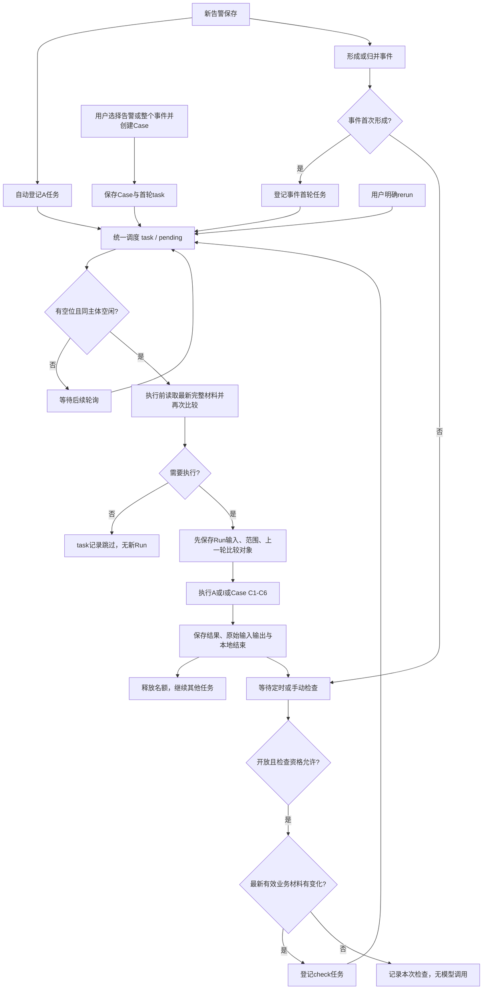

# 阶段二至五业务流程

2026-11-14业务讨论已完成，最新规则见[已确认设计和阶段安排](stage-2-5-design-review-20261114.md)；本轮整理并与HTTP对齐，不实施。技术细节见[design](design.md)、[存储](storage-and-runtime-design-20261114.md)及[队列](queue-dispatch-design-20261114.md)，现行服务见[PROGRESS](../../../PROGRESS.md)。本页不再保留相互冲突的旧方案作为开发依据。

## 1. 首版边界

- 告警自动分诊，事件自动首轮诊断；首个Case由用户创建并自动首轮。Case默认最多100条，满后确有新告警才自动续建关联Case并登记首轮；自动/手工新增进入同串当前接收Case。
- 后续事件每4小时、Case每6小时检查；默认自动窗口7天，从最近正常完成分析算，首次之前用创建时间，全部可配置。
- 开放对象期限内外均可手动check或rerun。check无变化跳过；rerun明确重做。关闭须先重开。
- Case自动/完整调查每轮C1–C6；人工定向先独立交付，仅用户手动触发后续综合；完整调查比较上一轮实际完整调查，不以当前采用判断替代。人工结论只作为有范围的输入，不自动成为事实、采用或结案。
- 不要求人为逐条批准调度，不新增unknown人工解除。前后端只关心主体、task和Run，不操作队列。

## 2. 主业务流程图

图中“检查”不是一次模型分析。任务从队列弹出后由运行索引表示执行中，完成不需要再从原队列删除；忙/等待重试才进入pending。周期检查不会修改当前正在执行的输入。

## 3. 如何判断有更新

### 3.1 比较范围

按告警ID集合和本环节实际使用的上游结果比较：I按最近归并最多100条的当前选择看成员及可用A/反馈，Case看成员、可用A分诊及其作为事件活跃接收者时可用I诊断结论/依据/范围；历史关联事件的新I不自动广播到各Case；有效告警人工判定、Case已完成H正文/范围/引用与撤回仍按原规则比较。仅数量、时间、Run ID、标题/标签/负责人不能代替业务变化。负责人明确不需要同告警新原材料版本判断/提交或据此重新分诊，原入站与历史原件保持。

例：R1使用A/B/C，Case后来有D；执行R2前实际读取A/B/C/D并先保存，这轮可以覆盖D。若D在R2输入保存后才到，就留给下次检查，不改R2范围。告警集合不变但A3首次分诊后来才完成，也算I/Case输入变化；用户手动诊断关联事件或事件因告警更新而产生新可用结论，也算Case输入变化，不要求A/B/C重新分诊。

### 3.2 首轮与后续

首轮保存后直接提交task；后续检查只投主体和意图，不指示执行固定的旧告警列表。调度器拿到任务时再取最新材料；两个重复check都排队也可接受，后一个执行前发现已覆盖就跳过，不消耗模型。

### 3.3 执行前记录材料，执行后只更新结果

先保存本轮范围/材料版本及完整原件引用，再执行，再保存结果和结束状态。完成时不能重新取最新列表写成已处理。模块输入输出、模型原答、补答、工具结果及引用诊断按原始/派生分别保留。I默认只选择最近归并100条，事件保留全部；本轮选入范围、总数/未选数量与实际输出覆盖分别记录。部分事件范围正常交付不冒充全事件覆盖，Case从完整事件成员关联，不被I范围限制。I/Case步骤实际输入仍超限时保留已完成结果、如实失败收尾、不自动重试，其他任务继续。

### 3.4 Case范围

一个事件可以关联多个独立Case，但只有一个可空活跃接收目标。明确新建/关联整个事件时指定本次实际接收者，后续成员和I更新仅自动驱动该Case；只选告警不扩大范围或切换事件目标。告警本身可加入多个独立Case，不设活跃Case。单Case关联上限默认100，满后将剩余及后续新增分配给自动续建的关联Case，自动/手工入口共用当前接收指针；转交明确事件跟随，旧Case保留原成员/事件参考。case_incidents保留事件全部关联，incidents.active_case_id唯一指定自动接收者；root/previous/receiving只用于容量续建。续建只转交仍指向旧Case的活跃事件，不抢回已转到独立Case的事件；旧案不因新事件材料全部重跑。显式移出保留排除，同串后续不能加回，明确重新添加才取消并进入当前接收Case。按上线后新建对象进入流程，不另做上线前旧关联启用；自动新增遵守当前接收者的关闭/期限规则，不能用续建绕过停止条件。

## 4. 统一调度

N为可配置总并发，首版默认1；单一调度器每60秒轮询，独立配置。pending优先但最多检查本轮开始P条；再按Case > A > I > 知识维护处理普通task，各类同样按开始长度，直到N满。等待同主体的请求回队尾，不挡其他可执行主体。

例如N=2，A已运行且pending10条全是A，最多逐条看完这10条就转普通队列，B仍能使用第二个名额。没有把P误当成2，也没有批量取出整个队列。普通通知优先归入可见待办，异步重复允许存在；运行输入不合并，失败重试时间不被后来的通知刷新。

## 5. 阶段目标

| 阶段 | 完成后的能力 | 原任务 |
| --- | --- | --- |
| 2 统一调度与可追溯读取 | 通用task/attempt、N/串行/重试；完整Run及步骤/工件目录 | 2.1、2.3共同保护、2.7通用读取 |
| 3 告警与事件自动分析 | A/I自动首轮、I4小时更新、晚到A、有效反馈及异步诊断 | 2.2/2.3的A/I分支、2.7对应接口 |
| 4 Case首轮与后续调查 | 自动首轮、6小时检查、跟随/排除、有效H及上一轮比较；定向独立交付、手动触发后续综合 | 2.2/2.3的Case分支、2.4/2.5、2.7对应接口 |
| 5 知识维护与整体交接 | A不等待索引，已有各阶段输入输出串联，配置/Swagger/4177及独审交付 | 2.6、2.7交接余项、3.x、4.1 |

不分阶段反复推送/部署。阶段一仍为本地验收完成待统一发布，阶段六模型质量后置；不能以本次设计替代其验收。

## 6. 问题覆盖

RV06同主体保护由阶段2解决；RV07持续调度由2–5解决；RV08事件跟随由4解决；RV09人工输入进入后续调查由4解决（按本轮确认完整调查，不再C6-only）；RV10由3/4的异步受理和5的知识维护解决；RV12本轮任务状态由2/5解决；RV13只随受影响入站路径处理配置/held接续。RV11新增同告警材料入口按负责人明确范围不纳入本期，原现状观察保留，不写成已实现。

验证只补本次输入→处理→保存→读取；队列用可控执行器和隔离PG，必要真实模型集中一批新业务闭环。引用/正文后置问题保留原答和NOT_PASSED，不反复采样追求通过。

## 7. 实践取舍

PG保存事实和查询状态，Redis只作队列/索引；不承诺恰好一次、不做跨库事务。单一领取者与多个追加者职责明确，不依赖GIL保护多条异步操作。具体基础命令、重试分类及依据见[队列设计](queue-dispatch-design-20261114.md)。

严格优先级接受低优先级等待，不增加权重、公平调度或实时唤醒。普通请求最多等下一调度tick才开始，60秒只是轮询周期；检查周期和失败等待分别配置。

## 8. 上一轮比较与页面

原型已有“相对已有结果”和“对案件的影响”，服务页有change_summary；原启动请求comparison_result_id为null，不代表自动逐轮比较已接通。代码来源：[原型](../../../prototypes/security-pages-v2/investigation-workspace.js)、[服务页](../../../prototypes/security-pages-v2/service-workspace.js)、[比较实现](../../../services/api/app/socai2/baseline_delivery.py)、[输出投影](../../../services/api/app/socai2/baseline_delivery_projection.py)。这是源码核对，不是本轮浏览器验收，未发现独立双栏差异页。

目标由程序取同Case上一轮实际执行且本地已结束的完整调查，冻结Run及可用Result；没有结论就显示上一轮无可比结论，不回退到当前采用判断或更早轮次。程序算新增/移出范围，C6用原综合调用给变化摘要，不另加比较模型。用于查有无新输入的覆盖基线仍取最近正常完成输入，两者不能混用。跨案C01/C02不作为同案比较证据。

## 9. 生命周期与范围边界

### 9.1 一份有效待办

同主体普通通知优先归入未运行待办，但不是数据库零重复保证。原task_id保留可读，根任务重试次数/时间不重置。显式rerun、定向和综合各保留明确意图，不与普通initial/check相互归并；仅同operation_key重放。

### 9.2 更新输入

确认告警范围、晚到可用A、Case实际相关的可用I诊断及有效人工结论/理由和撤回变化。A分诊供I/Case；I可经既定手动接口或告警更新诊断，其可用新结论只自动更新事件当前活跃Case，不能据自身结果再次触发I/A或全部历史关联Case。仅执行ID/时间、知识完成或采用变化不触发；Case输出不反向触发。人工定向是一次针对问题/工具的分析，可给建议或结论；先独立交付，用户手动触发后续综合时异步提交新task、执行时新建Run，复用适用材料并保留原答，见Q1。定向结果及其建议不自行触发续接，不预设长期方向字段，不把description/评论改义。模型读取附件正文非本期要求，原上传下载/关联保持。

### 9.3 关闭、期限和结果未知

| 情况 | 目标行为 |
| --- | --- |
| 尚未开始就关闭 | task跳过closed_before_start；关闭后新手动请求409，先重开 |
| 自动请求排队时超过7天 | 窗口内已受理的一轮仍可执行，失败不自动重试；超期停止新自动任务，关闭检查保持；正常完成按实际时间续期 |
| 运行中达到期限/事件被关闭 | 让本轮正常收尾，保留本轮真实结果，释放名额；不因此重开或继续自动重试 |
| Case运行中请求结案 | 沿现有规则阻止实际running；历史已结束unknown不再阻止 |
| 等待故障重试时关闭/超期 | 保留原失败，将任务结束为failed并说明停止原因，不再新Run |
| 配置时限内本地仍在执行 | 占用名额，其他主体仍可使用余下N |
| 本地已经返回/异常/超时收尾，结果未知 | task失败，Run unknown原样留存，本地结束另记；释放名额、不自动重试、不新增人工解除 |
| 同材料再次自动检查 | 已覆盖则no_changes；终止失败则automatic_attempts_stopped，不变相重试 |
| 新的真实材料或明确rerun | 正常受理，不因历史unknown阻塞 |
| 重开 | 不直接执行/续期；窗口内恢复检查，过期需手动执行后正常完成才续期 |

### 9.4 已确认范围与保留边界

Q1人工定向及手动后续综合流程已确认，输入/结果字段与HTTP合同统一；Q2已确认相关告警时间前后各扩展1小时、缺时记补查缺口且保留其他分析，日志单次默认50条配置化并保留超量限制，不自动翻页；不另加跨度裁剪或自动分窗，查询沿配置超时执行、失败保留缺口。Q3按负责人明确范围撤回新材料版本入口/重新分诊，改为告警范围及上游A/I结果单向更新下游。Q4已确认Case100条续建、事件最近归并100条限量诊断及实际输入超限收尾。Q5不建设上线前旧对象启用，Q6已受理的一轮跨期继续执行但不重试。R1/R3/R4完整目录属于已确定待提供；P6模型读取附件非本期要求，P5自选执行窗口为范围外扩展。本轮不实施。历史重投保持重放语义，不能用直接改表冒充正式入口。

## 10. 对外HTTP影响评估

最终路线见接口侧维护的[目标合同](http-workflow-contract-20261114.md)及[影响评估](../../../docs/integration/investigation-api-impact-20261114.md)。Case创建返回首轮task；再次调查/事件诊断异步202；A没有外部手动启动。查询analysis-tasks，公共状态accepted/running/completed/failed/skipped，Run可空；队列透明。

新增analysis_tasks/attempts/subject_state提供查询来源，采用预览包含尚未有Run的unfinished_analysis_tasks。旧E11/E13/E36不进入目标版本，不做同步兼容，不单独新增update-state GET；现有发布在正式切换前保持原行为。旧执行约束逐项处理见[存储设计](storage-and-runtime-design-20261114.md)，不能只改Swagger而遗漏数据库unknown唯一限制或提前创建pending的入口。
