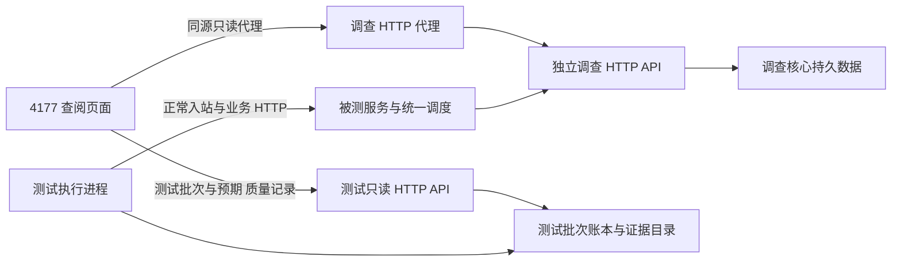

# 独立测试服务与4177 HTTP取数设计

更新于2026-11-17。**本轮先统一测试模块与调查工作台需求，目标和分步验收以§12为准；设计/规格通过strict后，任务1/2已完成本机功能验收；当前3a材料入口直接验证及独立复核通过，尚未发布。** 21的0.6.0已提供只读账本、业务GET代理及执行流程页面；[新02正常整链](../../../docs/operations/evidence/streaming-fullflow-20261116-02/delivery-receipt.json)和浏览器已通过，模型质量及D5/D6整体未核销。21现有页面仍以账本发现业务对象，本机任务1/2已改直接业务HTTP导航及每轮冻结来源流程；执行仍由Codex分阶段调用脚本，不能称通用一键测试。以下W1–W3和早期批次入口设计保留原时点；最新要求改为Case/事件/告警直接HTTP导航，测试账本不再是业务查阅前置。§11异常展示保持独立未完边界。

## 1. 服务边界与数据来源

独立测试服务负责场景生成、准备、分步执行、HTTP核对、证据及质量记录；4177作为其只读查阅端一起打包、配置和发布。调查核心、业务HTTP和依赖基础设施仍独立运行；测试服务不得复制C阶段逻辑、绕过正常入站/调度或伪造结果。



测试执行进程与查阅HTTP可使用同一发布包的不同进程模式；HTTP读取不持有执行控制权，刷新/启动查阅端不自动投放、清理或续跑。执行仍从明确profile、batch和步骤的受控运行入口发起，本期不增加网页清库/启动生产消费者等管理功能。

| 数据 | 权威来源 | 4177取得方式 |
| --- | --- | --- |
| 测试批次、场景、预期、操作顺序、准备/清理回执、验证结果、质量问题 | 测试服务批次账本和证据 | 测试专属只读API |
| 告警/事件/Case、分析任务、attempt、Run、Result、H、采用/历史 | 调查服务持久业务记录 | 现有/目标调查HTTP API，沿真实身份与返回链接 |
| 模型提示/Schema/可见原答、工具回执、步骤、补答/合并及跨Run来源 | 调查步骤与原件 | 完整步骤/原件分页及content_url，不从测试摘要重造正文 |
| 投递ACK、准备过程、发送前失败、测试脚本错误等未进入调查库的证据 | 测试执行记录 | 测试evidence API，明确来源为测试执行器 |
| 已结束批次的冻结回看 | 原已保存导出/HTTP快照及hash | 明确选择archive模式，由测试API读取，不偷偷替代live结果 |

现有[工作台来源代码](../../../docs/operations/processing_workbench_source.py)含直连SQL/SSH查询，[服务器](../../../docs/operations/serve_processing_workbench.py)可据此生成页面；这是旧静态取数路径。当前0.6.0的live模式已通过HTTP读取，旧工具仅作离线归档，不用于日常SQL/SSH取数或“先生成整页再打开”。测试预检/必要数据库核对仍可由执行进程完成，不能成为4177常态取数旁路。

## 2. 最小独立服务组成

| 组成 | 设计 |
| --- | --- |
| 场景与驱动 | 复用tools/testdata的生成/投递/核对能力，按已定T步骤扩展；运行前检查依赖，逐步落意图及回执 |
| 批次账本 | 持久保存batch、scenario/use_case、执行阶段、配置/来源摘要、真实身份映射及证据索引；首版可采用原子写入JSON和独占批次目录，不新建调查业务表或通用测试平台 |
| 测试只读API | 分页读取账本、预期/实际检查、准备、质量和测试证据；版本化DTO，与调查业务Schema分开 |
| 调查只读代理 | 上游地址/环境/租户绑定profile，仅转发明确允许的业务GET路径及必要参数，保留上游状态与来源；不接受客户端任意URL或SQL |
| 4177页面 | 请求JSON并渲染批次→场景→操作/任务→Run→步骤/原件；读取当前状态，分开显示模型质量问题 |
| 打包与运行 | 单独test-service版本、启动配置/部署清单；包含API、驱动、4177资源和场景规格；配置与证据卷独立，安装/升级不清数据 |

地址、端口、环境映射、poll_interval、分页/并发/超时、证据目录及显示模式都走配置。4177是默认查阅端口，可以配置；本机已有4177转发/服务时，候选用单独配置端口验证，最终切换只处理明确目标，不能抢占其他服务。

模型和数据库秘密只由实际需要的执行/被测服务加载，浏览器不获得DSN、凭据或任意源地址。沿现有内部可信接入，不增加独立登录/角色设计。非敏感环境标签和观察时间供用户识别数据来源。

## 3. 测试专属HTTP草案

以下路径已由W1实现为独立只读API，不注册到调查业务Swagger，不计入当前80/71操作。实际schema_version=1及字段见[W1设计](w1-test-ledger-design-20261115.md)与[验证所得OpenAPI](../../../docs/operations/evidence/test-ledger-w1-20261115-01/tcp-01/openapi.json)。下表保留完整目标用途：依赖/业务链接、attempt及实时取数由后续W2接入；W1只保存主体/task/Run/Result身份与提供方证据，viewer_version为空，准备记录不代表执行工具已实现。批次执行入口不由GET触发。

| 方法/路径 | 参数 | 最小结果 |
| --- | --- | --- |
| `GET /test-api/v1/capabilities` | 无 | 服务/前端版本、配置环境标签、支持schema、只读模式及已保存的依赖就绪检查时间；不调用模型探活 |
| `GET /test-api/v1/batches` | environment、status、limit/cursor | BatchPage：items、total、next_cursor、observed_at；稳定按started_at/batch_id排序 |
| `GET /test-api/v1/batches/{batch_id}` | batch_id | BatchView：场景版本、目标环境、阶段/状态、用例汇总、准备与证据链接、live/archive模式及更新时间 |
| `GET /test-api/v1/batches/{batch_id}/cases` | scenario_id、status、limit/cursor | TestCasePage：use_case_id、scenario_id、依赖/执行类别、预期/实际断言摘要、结果与主体/任务链接；此cases是测试用例，不是业务Case |
| `GET /test-api/v1/batches/{batch_id}/operations` | use_case_id、limit/cursor | OperationPage：operation_id、意图/实际时刻、受理/结果未知状态、request/receipt证据、subject/task/attempt/Run/Result映射与对应业务链接 |
| `GET /test-api/v1/batches/{batch_id}/preparation` | 无 | 目标资源清单、结构/就绪检查、清理plan/是否执行/阶段结果、上下文导入读回及保留核对；备份仅给受控引用 |
| `GET /test-api/v1/batches/{batch_id}/quality-issues` | use_case_id、run_id、limit/cursor | 问题ID、scope、stage、类型、原答引用、描述、后置状态及是否影响流程；无记录时与未检查区分 |
| `GET /test-api/v1/batches/{batch_id}/evidence/{evidence_id}` | 已登记evidence_id；format按实际文本/JSON/原文件合同 | 已登记的脱敏/可查阅证据正文及mime/size/hash；不接受任意文件路径，不把内部备份和秘密文件暴露出来 |

BatchView将测试执行状态与测试结论分开：执行`planned/preparing/running/finished/blocked/failed/interrupted`，W1用例结果为`not_run/blocked/passed/failed/deferred/not_covered`；依赖阻断使用blocked并在实际说明及证据中写明原因。这些不是调查task/Run枚举。质量单列，不汇入流程通过率制造“质量通过”。

分页参数走配置，cursor绑定路径、过滤条件、limit及修订；合法空列表200，批次/证据不存在404，非法参数/游标422，修订变化409 cursor_stale，账本不可读503。错误带可读code/message，不泄漏内部连接。每页返回observed_at，修订变化后须重新读取，不宣称跨业务服务事务快照。

W1操作可无mappings；有映射时`subject_type/subject_id`必填，`task_id/run_id/result_type/result_id`按实际回执可空，result需对应Run。未受理、排队无Run、check跳过均有合法空态。一个操作产生多主体/task/Run时保留数组，不能只留最新一项；attempt及业务链接沿后续实际HTTP合同接入。测试operation_id和analysis_task_id不能混用。

## 4. 4177通过调查HTTP取数

建议以4177同源路由代理已配置调查API：浏览器对`/api/v1/socai2/...`的只读请求转发至绑定环境；`/test-api/v1/...`由测试服务自身回答。避免浏览器跨域配置和私密连接；代理保持业务DTO/错误，不新增一套Result或阶段API。多环境按批次的配置环境映射确定，不允许客户端任意指定上游。

| 页面内容 | 数据请求与关联 |
| --- | --- |
| 批次/用例列表 | 测试batches/cases；包括尚无业务主体、准备失败及未来能力阻断，不能只列成功Case |
| 受理/排队 | operations提供真实主体与task→`/{alerts或incidents或cases}/{id}/analysis-tasks/{task_id}`；run_id=null时正常显示等待，不查询伪造Run |
| 自动产生的任务 | 通过已映射主体的analysis-tasks列表发现并保存真实关联，标自动来源；不能把同环境所有Run自动归为本批 |
| A/I结果 | 原告警/事件详情、analysis目录及指定Run入口；assessment/diagnosis不拼接Case Result路径 |
| Case结果/当前判断 | 原Case详情、指定Run/Result、采用历史；指定轮次和当前采用分别请求，不用全局最新替换选中轮次 |
| 统一Run目录 | 已有`/analysis-runs`及筛选/统计；全局目录与本批范围分别显示。batch范围由真实映射限定，不能假造调查API不支持的batch_id参数 |
| 步骤/工具 | `/analysis-runs/{run_id}/steps`分页及单步定位，tool筛选用于查询记录；不中途截成旧1000条 |
| 原件及原答 | `/analysis-runs/{run_id}/artifacts`分页→返回content_url；按需请求正文，保留mime/size/hash/可用性及跨Run来源；不截成旧200项或拒读大原件 |
| C3初答/补答/合并 | 读取真实工件及field_origins/关联，分开显示，合并不冒充一次模型原答 |
| 质量问题 | 测试quality-issues按相同Run/步骤/工件关联；程序引用诊断仍从业务原件读取，人工测试记录不覆盖它 |

运行中按profile间隔轮询**当前可见**的批次、任务和Run；终态停止自动轮询，保留手动刷新。原件正文按需加载，可使用真实ETag/Last-Modified等上游能力，但不能凭空假设其存在；首版不要求SSE/WebSocket。GET不触发清理、模型、工具或采用。

错误与空态明确区分：API不可用显示不可用及最后成功观察时间；尚未产生结果显示未产生；目录已存但正文缺失按availability显示；质量未评估与无问题不同。读取失败时可保留已显示内容并标旧观察时间，不能静默回落静态旧批次并显示为实时。

## 5. 历史快照与现有4177迁移

日常默认live HTTP。已结束批次可由执行器自动保存已读HTTP/数据库必要快照，作为证据和归档；不再要求人工调用导出脚本才能在页面看到新Run。现有[导入工具](../../../docs/operations/update_processing_audit.py)继续用于历史批次/静态归档兼容，不能宣称其就是新HTTP模式。

原三案和其他历史快照原样保留。页面明确标live或archive、环境、batch及captured_at/observed_at；archive由测试API读取已保存内容，不能伪造当前业务状态。缺少新API的旧批次保持归档查看，不迁入业务表、不补造analysis_task关联。

新模式先在独立候选端口用真实数据验证，版本/合同/页面均通过后再切换明确的4177目标。失败可切回先前查阅版本，不能为了回退重放模型、删除批次或回退数据库业务记录。当前生产online=false配置不在本轮修改。

## 6. 实施步骤、验证和发布

| 步骤 | 交付 | 必要直接验收 |
| --- | --- | --- |
| W1 批次账本与只读API | 最小batch/cases/operations/quality/evidence DTO，持久来源、分页/空态/错误 | 一批无Run受理、一个已保存真实Run、一条失败/质量记录均可读取；GET无执行副作用、重启只读不续跑 |
| W2 调查HTTP读取适配 | 复用已就绪任务/Run/步骤/原件API，同源配置代理和实际身份映射 | 通过真实TCP读取A/I/Case及跨Run原件；业务源失败与合法空结果区分；不走SQL生成旁路 |
| W3 4177页面接线 | 批次→任务→Run→步骤/原件及质量，运行中轮询/终态停止 | 新批次无需人工生成HTML即可出现；排队无Run、失败/unknown、分页、大原件、补答/合并和archive来源可见 |
| W4 测试服务打包 | 独立版本、API/页面/驱动、配置示例、启动部署清单、证据卷、OpenAPI及兼容能力声明 | 21明确隔离范围的候选服务启动与重启保留账本/证据，实际服务/页面版本与包一致；升级不会自动执行测试 |
| W5 发布与21联验 | 将4177随测试服务发布，选定目标调查API及依赖版本 | 发布后实际GET与页面读回；明确批次、源环境、版本和未就绪能力；保留旧证据，不能清库换取发布成功 |

W1–W4属于测试配套步骤，随主计划T1–T11逐步交付；无需等待所有Case未来功能才先提供已就绪A/I的HTTP查阅。W5在相应验收/独审和当时获准发布范围内执行；服务包可独立发布，但不意味着自动部署调查核心、迁移、重启生产消费者或向21投放数据。整个流式change是否完成仍按原任务/验收，测试服务发布不核销未完业务。

具体衔接：T1先只读预检并保存就绪回执；之后以独立一步交付W1的账本/API，再进入T2/T3数据准备。W2可用既有真实Run只读验证，在T4真实A/I执行前接好；T4结束后用该批验证W3实时展示，再进入后续Case步骤。W4在T11整体交接前完成，W5与获准的T12/测试服务发布衔接。F00的准备事实先保存到受控账本，4177展示部分随后独立验证；不能因页面未实现跳过环境检查或把文件回执冒充HTTP查阅已通过。

发布清单至少包含test_service_version、viewer_version、test_api_schema、generator/scenario版本、配置hash、实际依赖API/OpenAPI/数据库增量要求、证据卷位置和切换/回退方式。不能用旧71操作的正式API给需要新目录的页面提供假空列表；依赖未就绪时给出明确blocked项并保留可读部分。

## 7. W1及W2早期阶段边界

以下保留原阶段范围；当前非空真实来源及本步验收以第9节为准，不沿用早期“仍待S01”的状态。

T1的[21只读预检](../../../docs/operations/evidence/investigation-test-preflight-20261115-01/README.md)保持历史时点，不改写为新候选已就绪。F1–F5程序修复交接后，按负责人既有授权完成[W1回执](../../../docs/operations/evidence/test-ledger-w1-20261115-01/README.md)：16项组件测试、3份明确来源的archive账本、34次带断言GET及3次启动探测、重启和证据摘要核对通过。测试服务只在本机临时回环端口运行验证并已停止；未连接业务数据库、模型、Kafka或调查HTTP，现行4177保持。

T2离线最小材料已通过。HTTP提供方已交付[r2候选运行回执](../../../docs/operations/evidence/streaming-http-runtime-20261115-01/final-readback-01.json)：18424业务API、18480 Swagger，同库普通双池require/TLS1.3及三类GET空态通过；写池验证为零行UPDATE后ROLLBACK，0业务提交，不能作为成功建案。下一独立子步按设计/strict→W2只读代理→真实TCP空态/错误→S01同批非空补验推进；当前W2只读代理已实现，24项组件和真实候选TCP空态/错误检查通过；非空读取仍待S01。W3页面、W4发布包和W5部署仍未完成，8个测试GET不等于业务实时HTTP或4177已验收。

W2合同取自[本次实际18424读取的80操作OpenAPI](../../../docs/operations/evidence/test-http-proxy-w2-20261115-01/live-openapi.json)，其中55个业务GET包含任务/统一Run目录。旧`http-handoff/openapi.json`为71操作/44业务GET且缺统一Run目录，只能保留原适用范围；不能据旧文件生成当前代理路径。代理继续要求配置绑定候选环境、只转发已确认GET并保留分页/错误/原件，不能凭空构造业务身份；非空Case/跨Run原件须等S01真实Kafka→A/I后的同批资料。

## 8. W2已验子步：单环境只读代理与空态

该已验子步只实施代理接线及空候选的真实TCP读取，没有实施页面、21测试服务部署或业务执行。保留W1账本的9字段配置；`serve --upstream-config`显式启用独立上游JSON，不传时仅运行账本。代理配置必须明确环境标签、tenant、候选base URL、当前OpenAPI文件及摘要、连接/读取超时、连接数与流块大小；启动不猜环境或调用上游，配置标签须与测试服务一致。只绑定一个实际租户环境，页面后续必须核批次环境；tenant只标实际服务绑定身份，不伪造调用方租户头。

1. 从摘要一致的当前OpenAPI读取`/api/v1/socai2/`下GET路径与允许查询参数，固定只读范围，不接受调用方URL、SQL或连接凭据。无合法GET路径返回404，非GET返回405；参数名称/重复参数非法返回422，业务参数值交上游合同校验。W1与业务代理前缀分开。
2. 原样保留业务状态码、JSON/文本字节及必要Content-Type/Content-Length/Content-Disposition/ETag/Last-Modified/内容摘要头，追加来源环境标签；不改写分页游标、DTO、身份或跨Run链接。逐块转发大原件，不套用W1测试证据大小上限，不自动跟随重定向、不重试、不转发浏览器鉴权/租户/Cookie头。
3. 连接/协议失败返回502，超时返回504，重定向拒绝为502；这些是代理错误并明确来源，不伪装为空列表。开始传输后网络失败必须中断流，不能补成功正文或回落静态快照。断连/关闭释放上游响应与连接。
4. capabilities声明当前代理环境、租户、合同摘要与GET数，不把来源可达或业务验收写成启动自动发现。W1真实映射继续来自明确发布回执；本步不生成业务ID或后台自动绑定批次。
5. 直接验证仅覆盖本步：组件受控上游检查查询/分页、状态与空态、超过旧1MiB原件原字节、拒绝写入/任意目标/重定向及网络错误；这些标明测试替身。实际TCP用本机临时服务与临时SSH转发读取21候选A/I/Case、任务/Run空列表及真实不存在对象，保存实际响应；核账本未变，结束关闭本次服务/隧道，不改21容器。

先strict再代码；该步实现后复跑直接受影响的W1/W2组件，保存`test-http-proxy-w2-20261115-01`新证据。出口只标“代理组件及真实TCP空态通过”；非空A/I/Case、真实任务/Run/跨Run原件及4177页面仍待S01同批，W2总体保持部分完成。下一步按实际来源供给进入S01，再补非空读取，W3/W4分别验证。

本子步已完成[W2组件及TCP回执](../../../docs/operations/evidence/test-http-proxy-w2-20261115-01/README.md)：版本0.2.0、55个业务GET合同、24项组件通过，真实代理8项GET和2组直接错误对照通过，临时代理/隧道已停止。非空及跨Run仍待，W2总体保持部分完成；无业务提交/Kafka/模型或21容器变更。

## 9. W2当前子步：真实非空账本与跨Run来源读取

S01 A/I、两Case首轮及S04失败分支已有真实21结果。本步沿0.2.0既有publish/serve和只读代理，把真实身份发布到新的本机查阅账本，再通过临时回环代理→临时SSH转发→21当前18424读取。当前镜像、8份配置和停止状态以[根侧只读核对](../../../docs/operations/evidence/streaming-w2-readonly-20261115-01/runtime-01.json)为准；上游仍80操作/55 GET，启动后只取一次实际OpenAPI核摘要。当前4177入口保留，W3页面/W4包另行分步，不扩展业务DTO或提前增加网页功能。

账本ID为`w2-live-s01-s04-20261115-01`，环境`streaming-20261115-01`，mode=live、provenance=live_execution；表示业务读取来自真实候选，不表示重新执行S01/S04。原S04失败、两案partial、模型质量NOT_PASSED及实际发生时间保留。映射来自两Case实际task/Run/Result和S04完成A04、失败I、三个skipped检查，不能给跳过任务补Run。attempt沿实际任务详情读取，现有BusinessMapping足够，不扩DTO。新本地账本发布是测试材料准备，GET不改变账本或业务状态。

分步安排与必要证据：

1. **冻结输入。** 核两Case及S04唯一最终快照、实际map、失败保存和HTTP回执hash；发布当前真实映射、用例状态、准备说明及质量引用。保留原账本，不更新已结束批次。本步不直连业务数据库。
2. **读取非空。** 从测试批次/operations取得真实主体/任务；代理核A04 completed、I failed/model_response_not_complete和三个skipped无attempt/Run，读取两Case原Run/Result的partial/initial/null比较及实际3/1成员。每个必要链接只读一次，不重跑旧44/58 GET清单；任务/Run的动态状态与新鲜度保留上游值。
3. **分页与原答。** I失败Run步骤用小页读取全部真实步骤，直接传递cursor；按返回工件目录的content_url读取失败原答，核JSON正文、hash/size及length/output3000来自原件，不以摘要替代。旧空态/错误/超过1MiB受控流测试复用，不重新造矩阵或调用模型。
4. **跨Run来源。** HTTP离线确认最窄链：整事件Case C1工件`bf3a8ed9-eedf-4bae-8f50-ebbf51eeba53`的`incidents[I01].diagnosis_scope`给出原I Run `b5410c29-8134-544d-94e0-f8d59ee82958`、输入工件`1b43bb64-f8cb-473f-b57c-21e0995bec7b`及source_fingerprint。使用实际source_run_id读取既有统一工件目录，再沿其返回content_url取得I原输入，核与C1指向、原3成员范围和冻结摘要一致，不改写为Case工件路径。I→A01查询原件是可选延伸，本步不额外读取。现有批次无直接跨Run artifact_refs复用，也没有同Case新后轮，不伪造这些链接或上一轮比较。本步验证跨Run业务来源追溯，不冒称直接reused引用和正向比较已覆盖。
5. **保存及停止。** 保存每次实际HTTP状态/来源头/原响应hash、账本前后摘要及实际请求数；本步0业务写/模型/Kafka/调度/数据库连接。finally正常停止本次服务与隧道，失败保留原回执，不静默回落archive。只有新接线或具体失败需要直接检查；不复跑旧24组件与空态矩阵。

本步先设计及OpenSpec strict，按上述最小取数实施；若现有代码足够，仅新增当前配置/账本及直接验证证据，不为测试改业务程序。证据放`test-http-proxy-w2-live-20261115-01`；验收只对应W2非空与来源读取，S04正向更新缺口、W3/W4、独审和统一发布状态保持。

本子步已完成[统一回执](../../../docs/operations/evidence/test-http-proxy-w2-live-20261115-01/acceptance-01.json)：9账本+24代理业务+1当前合同GET共34次全部200，107项检查通过。3用例/7真实操作/4质量记录、两页operations和I两页步骤完整；失败原答、C1及跨Run原I输入size/hash保持，原I输入仍3成员。账本GET前后逐文件摘要不变；临时服务日志正常shutdown、SSH退出0、临时端口均关闭，0业务写/数据库/模型/Kafka/调度/4177变更。源码与原W2逐文件一致，版本保持0.2.0，旧24组件/空态测试按对应范围复用。

首次临时隧道误用远端回环地址时只有1次本机capabilities成功，直接合同请求连接拒绝；原失败保留，改为当前`192.168.1.21:18424`后34项读取一次通过。合计35次成功GET及1次无HTTP响应的传输失败，不隐藏先前错误。当前真实样本未覆盖步骤直接reused跨Run、unknown和超过1MiB原件，也没有Case新轮/比较；不为补这些分支触发业务。本步跨Run来源查阅通过不核销S04正向链或W3–W5。

## 10. W3页面HTTP取数：本轮实施与验收设计

本轮按根侧[整体安排](stage11-candidate-design-20261115.md#w3本轮设计分工与直接验收)只推进页面取数及本机临时服务验证，不切换4177或发布21。复用W2已结束live账本及当前r2候选HTTP，业务状态、原件和模型质量全部保持；不执行模型、Kafka或调度。不重跑W2的24项组件/34次GET矩阵。HTTP模块[离线字段映射](../../../docs/operations/evidence/streaming-w3-http-cooperation-20261115-01/field-map.json)为页面读取依据，业务实现及DTO不改。

页面属于独立测试服务，静态HTML/CSS/ES模块随包保存，无CDN或构建依赖。版本统一为0.3.0；只有显式`serve --viewer-config`才挂载`/viewer/`、静态资源和`/viewer/config.json`，capabilities才声明viewer_version。原9字段账本、10字段上游配置保持，独立viewer profile明确poll_interval_seconds、request_timeout_seconds、page_size；均为有限正值，页大小1–100且不得大于账本max_limit，非法组合启动报错。公共配置仅这三项和版本，不暴露上游连接。

业务效果与分步验证：

1. **接线。** 保留原8个账本GET与只读代理，页面不混入业务Swagger；验证未启用页面404、显式启用资源/配置/版本及无上游启动请求，非法配置明确失败。只跑新增和受影响的直接测试。
2. **导航与状态。** 批次→用例/操作→实际task→attempt→Run/结果；准备、清理说明、质量问题和测试证据分栏。保留中文栏目与状态原值，结果先给业务摘要，原JSON另可展开。live先核批次与代理环境，错配禁止业务请求；archive仅查账本/登记原件，不能静默查当前业务。mapping.run_id固定本操作记录，task.latest_run_id不覆盖已选轮次；结果按source_run_id绑定。无task不造task；有真实Run可直接打开并标未关联任务。accepted无Run表示等待，skipped/failed/null结果分别展示；unknown只按attempt/Run原值显示。
3. **读取生命周期。** 仅当前可见的active task/Run或未结束账本自动刷新；终态、页面隐藏、切换对象时取消定时/请求，丢弃过期返回，手动刷新仍可用。错误保留上次成功观察及时间并标过期，不置成空态。受控组件明确标测试替身，用于当前21没有的pending/unknown、环境错配、断网/超时和迟到响应，不冒称真实整链。
4. **完整目录与来源。** A/I通过同Run trace取得目录链接，Case通过Run返回目录链接；步骤/工件独立分页，处理next_cursor且保留parent/retry/reused来源。正文只在点击返回content_url后完整读取，availability与HTTP200分开；文本安全显示，不渲染模型HTML。C1 diagnosis_scope沿原source_run_id目录寻找input_artifact_id，显示原主体/Run/指纹/冻结范围，不伪装成Case工件或上一轮比较。previous_run_url/comparison_result_url只用真实返回，initial明示首轮，context=null表示未记录。
5. **唯一真实浏览器联验。** 测试方准备新临时profile/端口/SSH（目的192.168.1.21:18424），启动前交根侧记录；复用W2只读账本。按页面实际操作保存截图、同组HTTP响应/访问日志和前后账本摘要，覆盖completed/partial与当前stale并列、I失败原答、skipped无Run、目录分页、C1跨Run来源及质量分栏。HTTP离线核同一组响应，根侧独立审代码/截图/证据；不重复造业务。结束关闭临时服务/隧道，证据目录`test-viewer-w3-20261115-01`。尚无真实Case后轮比较、直接reused和大原件样本，标未覆盖而不触发补跑。

通过只意味着W3查阅功能通过；S04正向更新/比较仍NOT_PASSED，质量后置、W4打包/发布和整个change独审保持各自边界。

本子步实现和唯一真实浏览器读取已完成，详见[W3回执](../../../docs/operations/evidence/test-viewer-w3-20261115-01/README.md)。服务/页面0.3.0、8项Python和8项受控JS直接检查通过；51次实际GET包含26业务/14账本/11页面资源，业务均200，113项保存响应核对通过。首个用例操作筛选发现F05两个TestCase共用use_case_id，已修每页按具体case_id匹配并真实复验；原发现保留。Case工件按20/20/8完整读取48条，I失败原答length/3000和C1→原I3成员/hash正确，三skip不造Run，两案partial/initial与当前stale分别显示。终态可见30.94秒无新增请求。

浏览器结束后增加终态重新可见不刷新、活动/被中断读取恢复及目录/原件查阅暂停父Run轮询，按受控JS检查验证；C1摘要补原事件与本案交集，按同组真实响应离线核。未为这两处重开浏览器或新业务GET，主流程截图保留其观察时版本。>1MiB及初答/补答/合并/field_origins只是明确受控读取检查，不算21真实样本。

临时58808/58809进程已正常停止、端口关闭，W2账本前后摘要一致；0新模型/业务写/数据库/Kafka/调度/部署，4177保持原入口。HTTP和根方只复核相同截图/响应及源码；当前S04成功链、Case真实后轮/比较、直接reused仍未覆盖，W4/W5及整体独审另行推进。

## 11. 异常继续后的读取与页面验收（已设计）

本轮接[总计划§7](full-flow-test-plan-20261115.md#7-当前增量输入边界与异常后继续2026-11-16已设计待实现)及TC-N08/09/10/11，不另起W阶段或新增执行API。核心拟沿现有`source_snapshot`工件保存内部`stage_delivery`，字段/版本以调查最终合同交接为准；优先复用步骤/工件目录和返回content_url，不要求C1–C6都提供新HTTP路由，不改告警业务DTO。

| 读取点 | 必须看到的内容 | 直接验收 |
| --- | --- | --- |
| 本Run执行主线 | 实际步骤、领域、顺序/父子/重试、执行状态和真实跳过原因 | 原有流程仍可读；一个节点失败不抹去成功节点，不按缺失工件推断没执行 |
| 阶段交付 | 可用部分、缺失/拒绝原因、质量问题、调用完成状态、交付及采用/比较资格 | 程序回执完整与模型分析完整分开；partial/unavailable原值保存→HTTP→页面一致，不全标“成功” |
| 原始与派生内容 | 原始raw choices、提供端finish_reason、错误原件；恢复/补答/装配单列且带来源 | 原答字节hash不变；完整程序回执、拼接结果不能显示为模型原答。不可用原件明确原因，不显示伪造正文 |
| 局部读取失败 | 单条步骤/原件的503/超时、上次成功观察及时间 | 红色错误留在对应节点，可重读；已读主线/其他领域/任务仍能操作。确实缺数据、未执行、模型不可用和HTTP错误分别显示，不用空对象吞异常 |
| 多轮与任务 | 当前选中Run的真实HTTP受理/task/attempt；前序来源及比较资格 | 切轮后不串task、成员、原答/错误，迟到响应不能覆盖当前选择；真实跨Run来源沿返回URL并注明来源Run，不伪装本轮生成 |
| 测试与质量 | 紫色测试标识、独立质量记录/NOT_PASSED及原件链接 | 真实质量问题不因流程继续消失，测试预期/控制metadata不写进调查模型输入；GET/刷新不触发模型或修改业务记录 |

先复用已有`execution_flow.mjs`/`viewer_state.mjs`受控测试，补单节点读取失败而其他节点保留的直接断言；这些测试通过后，用核心/HTTP的同一新批保存结果核实际浏览器。受控错误仅对指定请求返回，记录为页面测试依赖，不修改业务库制造坏数据。正常21页面读取使用真实HTTP；不能把受控响应页称21异常路径已真实执行。

HTTP供给必须明确stage_delivery的真实目录/版本/链接，及未生成业务Result时如何读取阶段回执。若现有GET可以原样返回保存工件，只需要增加真实样本和读回证据；字段合同确需变化再由核心/HTTP在原change处理。测试侧不先造新URL或把期望字典当真实DTO。后轮可用背景与不可比较原因沿核心冻结值显示，页面不自算或回退旧采用结果。

当前状态：页面增量**已设计，未实现交接、未测试**；0.6.0已有正常切轮/原答/领域证据只用于相同边界，不证明本轮兜底已实现。业务版本/HTTP未就绪时先做离线组件，21验证等对应交接和发布；最终独立包随实际页面改动再冻结，不在本设计轮发布。

## 12. 测试模块与调查工作台统一需求（2026-11-17）

### 12.1 本轮目标、现状及职责

负责人要求先对齐两块：4177调查工作台展示，以及用一套材料验证完整流程、可在部署后使用的交互式验收脚本；验收脚本按Docker镜像交付，减少宿主机环境依赖。业务本体仍是告警分诊、事件诊断和Case调查；测试仅是输入来源及执行用途，不建立另一套业务流程。本文收敛两部分的用户效果、依赖与直接验收，不新增change或平行任务树。先做需求/合同核对，再按负责人最新指令task by task实施。当前只实施§12.8任务3a离线材料入口，不发新业务数据或模型、不发布；D5a本机已有修改与收尾证据保留，不展开D5b/c。

| 组成 | 当前事实 | 本次目标与责任 |
| --- | --- | --- |
| 调查业务服务 | r4已完成新02真实正常链；程序排队并调用模型，持久保存task/attempt/Run/步骤/原件/结果 | 继续负责业务分析与事实存储；不承担测试批次编排，不为页面复制调查逻辑 |
| 测试执行模块 | 3a已有统一离线转换/检查/计划入口，实际执行仍使用原分阶段发送/核对脚本；通用等待、追加和实际报告未交付 | 测试模块提供Docker中的交互式验收脚本，解析统一材料并分段执行，自动记录状态、真实身份、检查及证据；换数据包无需修改执行源码或手写账本 |
| 调查工作台 | 任务1/2本机已按Case/事件/告警直接导航、分轮及冻结来源展示；21仍是0.6.0原布局 | 页面模块负责Case/事件/告警三类导航、Case及事件的多轮执行与每轮流程，复用现有属性/组件/详情；本期以查阅为主，网页运行/追加按钮不列为首版必做 |
| HTTP供给 | 三类列表、统一Run目录、任务、步骤/工件/结果及冻结C1来源已有合同 | HTTP模块只读核对现有合同及代表结果；本需求不新增业务路由、告警DTO或SQL取数旁路 |

业务模型仅完成A/I/C3/实际Deep/C6业务判断；测试计数、身份映射、等待条件、分页、hash与逐值比较由程序执行。模型正文真伪仍需独立复核，程序引用诊断、accepted和HTTP200均不证明正文正确。Codex负责开发、维护计划和解释发现，目标运行过程不依赖Codex逐批临时编排；当前尚未达到这个目标。

### 12.2 数据包与小段执行

沿[测试规划§9](full-flow-test-plan-20261115.md#9-数据驱动复用要求2026-11-17负责人确认当前02完成后分步实施)和[数据设计§17](test-data-design-20261115.md)收敛：

```text
dataset/
  scenario.json
  part1/alerts/001.json ...
  part1/context/001.json ...
  part2/alerts/001.json ...
  part2/context/001.json ...
```

`scenario.json`保存格式版本、段顺序、是否/如何建Case与追加、需要验证的流程和关系；环境profile由脚本明确选择，地址、间隔、等待时限、预算及凭据仍在受控配置，预期与测试控制数据不进入业务材料。告警和上下文保留现有消息合同、原始事实/事件时间及来源关系；后台tenant和中性来源继续用于关联，模型视图过滤后台及测试字段。材料目录挂载给验收容器，脚本显示容器内实际路径与目标环境，不把本机或浏览器路径直接当21路径。

| 材料 | 必须/可选 | 格式与用途 |
| --- | --- | --- |
| `scenario.json` | 必须 | 一个JSON对象，声明场景、part顺序、告警/事件/Case验证层级、建案范围或后段关联目标，以及结构性核对项；不含密码或模型标准答案 |
| `partN/alerts/001.json` | 本期每个投递段至少一条 | 每文件一个现有入站告警JSON；检测事实、时间、来源、对象和关联字段沿当前合同，文件名按数字排序，不增加另一套业务DTO |
| `partN/context/001.json` | 按场景需要 | 每文件一个现有入湖上下文事件JSON；需要验证日志查询时必须提供或明确绑定已存在且可读的来源。没有上下文可跑告警/事件基本链，但日志查询覆盖须记未覆盖，不能把嵌入遥测当独立查询结果 |
| 环境profile | 每次执行必须明确选择，可在材料目录外复用 | 目标环境、服务/库/Topic、租户和中性来源、发送间隔及等待时限；凭据从受控文件引用，脚本展示环境后再开始，不静默换环境 |
| 资产/账号事实、知识材料、人工补充 | 可选且需已有接入路径 | 单独提供并声明来源；未导入、未索引或尚无接入能力就列缺项，不能因为有文件就算模型已使用，不把这类材料整包塞进提示词 |
| 扩展预期/人工质量说明 | 可选 | 仅供程序核对或人工复核；一般流程判据由脚本提供，场景只补数量/关联/应新增或不新增轮次等目标，不强制每份数据手写答案 |

旧数据转换作为同一配套的一次离线整理：将当前v2的`S01/alerts.jsonl`、`context-events.jsonl`逐条转成part1文件，S04对应part2；55模板先经既有v2业务投影再选择少量数据转换。旧输入文件及历史回执保持，输出到新目录并生成数量、字段/关联校验及来源清单。作者答案、测试标签、历史模型结论和执行台账不能混入发送材料；不能生成缺失的独立上下文或把旧Result当输入。新执行生成独立身份映射，所有part共用该映射，追加继续引用同一业务对象；旧已结束执行不重派。需要调整时间时须显式配置、一致保持相对时间并留转换记录，不静默改业务事实。标准转换后，新增材料直接按上述目录与既有消息格式构造。

现有可复用材料分清：55个v2模板告警含98条内嵌telemetry，不能据此声称已有55套独立入湖上下文；已验完整代表包为首批3告警/12上下文、追加1告警/1上下文。资产/账号事实与技术指导目前有准备文件，不等于已导入或已被模型查询。旧200条/分类评估等历史语料不整包直接投放；已结束批次不重派，新执行使用独立身份。

脚本的交互流程固定为：

1. 指定材料目录和环境profile，校验格式、必要字段、引用关系、重复身份及本段所需依赖，列出有几个part、每段告警/上下文数量和要验的流程；有part1默认选它，没有则提示选择，不静默发送别的段。开始前给出本次实际发送计划。
2. 所选段有独立上下文时，先发送并等待ACK，再只读核湖中实际记录；随后按数字文件顺序和配置间隔投少量告警，保留每条真实ACK或未知状态。
3. 只读核PG中的告警/归并关系及所需A/I处理；场景需要Case才沿现有业务HTTP创建首案/提交对应更新，跟踪真实task/attempt/Run，不直接往调查结果表写入。
4. 等待本段所需A/I/Case终态，核保存结果或问题，再由业务HTTP读回并提供工作台入口。等待时限到达只记本段未完成/真实状态；不当已完成，不换key自动重派。
5. 汇总本段结果，交互选择“追加指定未执行part / 查看结果 / 结束”。追加须前段所需任务终态、结果或问题已保存并读回；执行对应新I/同Case更新并比较真实前轮。不同part不保证一一对应业务轮次，无变化时核无新Run。
6. 结束时自动给出整轮验收报告，列每步通过/失败/未覆盖、实际业务身份、保存/读回及数量/关联核对、模型质量问题和证据/工作台链接。

首版由一个交互脚本完成运行/追加/汇总，工作台负责查阅；未来若增加网页操作，复用同一执行核心，不建两套编排。不默认发送全部目录或55模板，不自动追加所有后段。N=1限制分析并发，Kafka ACK和固定间隔不能替代分析完成条件；同组事件/Case仍可能累计多条告警，不能把串行当单次输入容量保证。

继续条件依据真实执行/材料合同，质量诊断不要求通过、不因此重新采样。没有业务Result、失败或unknown保持原状态和已保存内容；未知发送/POST须先读回原意图，不换key盲重投。无Case场景照常完成事件诊断或告警分诊，不为展示强制建案。具体输入Schema及脚本参数在执行模块实施小步先冻结；本轮不实现网页控制API。

Docker镜像固定脚本、依赖和版本，沿现有独立测试配套打包，不把PG/湖/Kafka/模型等被测服务装进验收容器。通过显式profile连接目标环境；材料与配置目录只读挂载，结果目录可写持久挂载，密码不写入镜像、样例或报告。交互启动只检查并列计划，不自动清理、启动消费者或投放；退出后报告与回执保留，重启先读已有执行状态，不自动恢复未知操作。实现时直接验证容器内材料读取、目标连接、脚本交互及退出后证据仍可读，宿主机只需相应Docker运行环境。

测试执行会话与每段回执分别记录：已完成段不可重派，仍有可手动追加段的会话显示“等待追加”，不把它当正在占分析槽的任务。整体执行一旦终结，账本仍遵守不可变规则；后续独立执行另建关联记录，不能将finished改回running或覆盖原件。等待追加与终结的具体存储字段随执行入口合同冻结，不直接修改旧0.6.0状态枚举。

### 12.3 工作台按业务主体、轮次和来源展示

1. 左侧提供**Case（默认）/事件/告警**三个简单按钮，切换后显示对应业务对象列表。按当前环境/租户/类型/主体ID识别对象；同Case在原账本和补证里出现仍只列一条。主体列表直接读取业务HTTP，不要求先有批次或Operation映射。测试批次、准备/核对与补证仍可在辅助测试记录中追溯，不作为主导航。
2. 选中Case先看到共执行几轮，再分开第1轮、第2轮等实际Run，展示当轮冻结告警数、起止时间、状态、结果及前轮比较；每轮自己的告警分诊、事件诊断和Case步骤放在该轮内。事件同样显示多轮诊断，各轮自己的选入告警、输入、流程及结论不能被当前事件最新状态覆盖。告警主视图保持简单，展示原告警、分诊过程与判断，实际失败/重试原件仍可查。测试part数量与业务Run轮数分别计数。任务尚无Run、同task多次attempt及no_changes分别呈现，不能用空Run目录推断无任务或将一次重试当另一个Case。
3. 本轮A/I来源从选中Run的manifest/C1冻结材料读取，不用当前latest或当前成员替换。整案R1为3成员、R2为4成员；单案1成员1轮。比较同Case前后轮的真实alert/material/triage/source_run_id和事件源Run/工件，来源相同才显示“沿用”，新增alert显示“本轮新增”；来源变化只说明新来源版本，不推断结论变化。来源缺失不凭两个null判断沿用。实际02的R2沿用3份A，新增第四条A，选入新I；不能把全部上游显示为本轮又执行一次。沿用身份也不等于可用：A保留triage_usable，I分别读交付状态、结论可用性、units范围与缺失/非法单元，选入数不能冒充已分析覆盖数。
4. 复用现有属性、流程组件和详情，不重新堆一套测试属性。布局按“主体概要→轮次→本轮流程→选中步骤详情”组织，流程仍显示真实接入/触发、任务、模型/查询/具体领域、保存结果及原件。节点可查看输入、输出、提示词、模型原答和错误；跳过直接说明实际原因，原答、恢复/补答、装配结果保持区别。已保存HTTP exchange才显示真实POST与201/202回执；只有task.source/intent时显示真实触发来源及任务，完整请求原件写“未记录”，不从Swagger或空task.request拼造原请求，也不为此要求测试账本。
5. 测试只加紫色来源标识；红色表达真实错误。测试来源由后台中性来源/真实身份映射识别，不能从标题猜测或写入模型。测试记录不可用不影响业务列表与执行读取；无法确认来源时不伪造标识。执行状态、交付完整性、待复核、采用和质量分别显示，原NOT_PASSED保留。

### 12.4 已核HTTP依赖与边界

HTTP模块已只读核当前r4合同与02保存包，本需求所需读取已有，无新增路由/公共字段：

| 读取目的 | 现有入口及注意事项 |
| --- | --- |
| 三类主体 | `GET /cases`的`items[].case`；`GET /incidents`、`/alerts`的`items[].facts`及`derived`；完整前缀`/api/v1/socai2`，不能假设三类列表同形。Case沿next_cursor；告警/事件显式sort_by与sort_order使用next_cursor，旧默认模式可能仅next_before_id；所有列表读完整分页，切换主体/类型/筛选清空旧cursor |
| 指定主体的轮次 | `GET /analysis-runs?subject_type=...&subject_id=...`成对筛选并完整分页；固定选择`run_id`，沿返回`detail_url`读取 |
| 未开始/无变化任务 | `GET /{cases或incidents或alerts}/{id}/analysis-tasks`，next_cursor→cursor完整分页；保留accepted无Run、skipped/no_changes和同task多attempt。task.request不保证保存原HTTP交换，完整请求回执按实际可用性显示 |
| 执行与原件 | Case详情给目录链接；A/I通过对应trace给目录；读全steps/artifacts分页，正文沿`content_url`按需读取 |
| 本轮冻结A/I | Case `run.input_artifact_id`→manifest→`source_materials`中的本Run`socai2.baseline-context.v1`；读取alerts的material/triage身份与triage_usable，以及incidents的analysis_material。input_selection/case_selected_alert_ids表达选入范围；receipt.delivery.state、use.conclusion_available、units[].scope、missing_units/invalid_units表达实际交付与缺口，保留原Run/工件来源 |
| 前轮及原答 | 沿manifest/run真实comparison_context指向前轮，不回退当前采用；C6原答沿本Run模型response的raw，`Result.source_answer`不是模型原答 |

日常页面保持HTTP读取；验收脚本按明确profile只读连接PG/湖核必要落库事实，再经业务HTTP读回，不把数据库快照变成页面SQL旁路。现有55GET代理覆盖上述读取；运行/追加归Docker交互脚本，不新增调查业务Swagger操作或扩大业务GET代理。页面打开、刷新和查阅服务重启不得启动测试。现有合同充分不等于新页面已接线通过。

### 12.5 统一实施顺序与直接验收

沿原2.7/3.1/3.2/4.1落实，不增加另一套完成计数。每次只实施表内一个小步，完成直接验证并回报后再推进；设计完成且strict通过后，已完成任务1及任务2下述本机功能验收；任务3a已完成下述离线验收，任务3整体及任务4保持未完成。

| 顺序 | 本步完成效果 | 必要验证/证据 |
| --- | --- | --- |
| 1 主体与轮次导航 | 直接HTTP发现Case/事件/告警，默认Case；Case和事件各自分轮，告警保持简单；选主体再看其Run与未开始/跳过任务，移除批次主导航和顶部混排 | 复用02真实保存/只读接口，无账本仍可列主体；同主体两账本只显示一次；三类列表、任务和Run分页，Case两轮及事件两轮不混用、切换隔离、合法空态/错误；本机浏览器，0新业务/模型 |
| 2 本轮关联流程 | 选中Case轮次后装配冻结A/I及Case流程，标明沿用/新增及前轮，保留具体领域/原答 | 整案3→4、单案1不串案；R2沿用3A、新增1A并选新I；缺来源不猜，HTTP201/202与本轮task绑定；复用同一批，不重跑模型 |
| 3 数据转换与Docker交互脚本 | 冻结目录/必选可选材料合同，转换现有材料；一个脚本在容器内列part、选首段、发送/等待/核保存读回、手动追加并自动汇总 | 两份不同小数据包只改材料/配置即可由同源码解析执行；直接检查context先入湖、组间完成门控、重复段不再发送、quality不阻断；镜像包含依赖、挂载和配置有效，退出后回执保留。用已有必要组件证据和最小受控依赖，不建故障/压力矩阵 |
| 4 部署后验收闭环 | 使用Docker脚本完成一个新小场景及一段追加，自动报告每步结果并给工作台对象/轮次入口，页面只负责查阅 | 从材料→真实A/I/Case→保存→HTTP→工作台，分别核告警入库、事件关联、所需Run/Result、同案后轮及冻结前轮；异常/质量单列，未走分支未覆盖。无需本批专用脚本/手写账本，不额外用模型做统计或判通过，不默认发全库数据 |

各步交付后同步当前进度与交接，模型质量/缺数据/未覆盖分别记录。最后做既定范围结束审计并按当时授权统一发布/读回；本次需求对齐不触发21替换、重新清库、Git提交推送。原D5a本机验证已收尾：[实际回执](../../../docs/operations/evidence/deep-unit-continuation-d5a-20261117-01/README.md)只证明实际收到的无可用Deep答案前缀仍继续C6；有效Deep答案传到C6的真实PG联验及独立存取复核未完成，不计D5a通过。D5b/c及D6全异常覆盖不作为当前导航实现的前置，也不据正常链勾完成。

本轮不做通用编排器、可视化配置编辑器、自动全量压力投放、权限角色专项或新调查模型策略。准确率评测、全量模板配上下文、真实4/6小时周期等待和未接厂商来源继续分别列未覆盖，不包装进本次最小开发目标。

### 12.6 任务1本机结果（2026-11-17）

三类主体/轮次导航已完成本机功能验收：[本步回执](../../../docs/operations/evidence/workbench-subject-navigation-20261117-01/README.md)。主体列表直接取业务HTTP，Case默认，事件可分轮，告警简单分诊；同一主体的原批/补证不重复列项。任务目录与Run目录分别完整分页，无变化任务不造新Run。原属性/流程/步骤详情复用；无账本可查，原HTTP交换缺失如实显示。

16项JS、6项页面挂载检查通过；额外19份真实GET列表原件与02原身份一致：7主体/9Run/10task、0在途。实际窄屏浏览器已核整案3→4、单案1轮、事件两轮、告警分页以及无账本读取；合法空列表/503为明确受控依赖。测试模块[独立只读复核](../../../docs/operations/evidence/test-workbench-navigation-20261117-01/independent-review-01.json)记录自己的源码/目录审阅范围，不冒称独立浏览器验证。

本轮实际浏览器宽度453px，桌面宽度覆盖未生效，已重置，不报告宽屏实测通过。21仍0.6.0旧布局，本步没有发布、新业务写入或模型调用。下一task只组合本轮冻结A/I与Case流程并核沿用/新增及布局；材料转换、Docker脚本和新批验收保持后续顺序。局部通过不新增整体复选完成数或替代change结束审计。

### 12.7 任务2实施与直接验收安排（2026-11-17）

本步只补齐所选Case轮次的上游来源流程：在原HTTP接入、任务和C1–C6主线之间，展示“本轮使用的告警分诊 / 事件诊断”。这些是本轮冻结采用的材料，不能显示成Case内重新执行了A/I。点击来源先读其冻结判断、可用性和范围，再可展开该源Run的真实步骤、输入、模型原答及保存原件。Case轮次选择保持不变，来源Run身份清楚分开。三类主体、辅助测试记录及现有组件继续复用。

实现先按身份解析冻结来源，再接入现有流程组件，随后一次直接验收：

1. `run.input_artifact_id`匹配本Run完整工件目录中的manifest，校验原件身份/可用性。manifest的`source_materials`只取`type=artifact`，与本Run目录相交后找唯一`socai2.baseline-context.v1`；不按数组顺序、role或step_id猜C1。读取的C1也校验Case和Run身份。缺失、歧义或读取失败显示局部原因，Case自身流程仍可查。
2. 前轮只沿Run的`comparison_context.previous_run_id`及返回`previous_run_url`读取同Case冻结C1；校验manifest/C1记录的比较身份一致，不回落latest。A比较alert/material/triage/source_run/input_material身份；I比较source_run及input/response/receipt_source/originals身份与摘要。前轮缺失或身份不完整显示无法比较；两个空来源不算沿用。首轮、沿用、新增、来源版本变化分别显示，变化不推断业务结论变化。
3. A保留`triage_usable`及原材料/分诊身份。I即使`diagnosis=null`或`diagnosis_usable=false`，仍展示`analysis_material`及其receipt/units；选入范围、原事件范围、本案交集和有效成员单元范围分别显示，不把任意finding引用范围当完整覆盖。保留原unit的完整scope/内容与missing/invalid，不缩窄跨成员发现。来源工件按冻结ID匹配源Run目录并核摘要，原材料走materials路径；不发latest查询补造缺口。
4. 接入复用当前阶段与右侧详情组件。上游过程按需只读获取，错误局限于对应来源；切换轮次或主体取消旧读取。源A/I不借用Case的步骤、工件、task或HTTP交换。已保存的201/202回执仍按真实task/Run关联。原答只取保存的raw choices，程序装配与完整结论缺失不能替代原答。

直接验收复用02批已保存318份GET及必要当前只读HTTP：整案R1=3A+I1，R2=4A+I2且3A沿用/1A新增；单案=1A+I1，I1原事件3条、本案交集1条。用已有D4b partial/none冻结组件原件检查没有完整diagnosis仍保留来源和缺口；它们是历史受控PG组件证据，不冒称02整链或本轮模型执行。只补必要的缺来源/身份冲突/读取失败直接检查，不建设故障矩阵。

保存本步源码摘要、解析/关系核对、真实GET与浏览器观察到`docs/operations/evidence/workbench-frozen-flow-20261117-01/`。本机浏览器核来源及轮次切换、原答/领域、源失败后Case仍可查；桌面若未实际生效继续标未验。测试模块独立读源码/证据核本步判据，之后同步PROGRESS、交接及本节结果。本步无新业务写入/模型调用、不改公共合同或数据库、不部署21、不启动材料转换与Docker脚本任务3。局部验证不代替整体change结束审计。

本步结果：任务2本机功能验收通过，见[完整回执](../../../docs/operations/evidence/workbench-frozen-flow-20261117-01/README.md)。24项JS、6项挂载及末次空I来源保护14项复验通过；182份真实GET覆盖3Case轮次/6个去重上游Run/7份原答。浏览器已核1366px桌面、468px窄屏、3→4来源、单案3/1交集、原HTTP201/202及同源原答；受控源503不挡C6/领域查阅。测试模块独立核来源映射、工件原值和源码，浏览器只接收实施方证据。本轮0新业务/模型、不发布21、不勾整体change；任务3/4尚未实施。

### 12.8 任务3整体实施顺序与3a材料入口（2026-11-17）

任务3要把当前逐批编写的发送/核对操作变成可换材料的Docker交互验收脚本。完成后，使用者选择材料与环境profile，先看计划，再明确启动一段；程序保存回执、等待处理与读回，结束后由使用者选择追加或结束。现有4177只读服务继续负责查看，不接Kafka/数据库写入。沿用任务3，不增加另一棵任务树。

| 小步及依赖 | 范围与业务效果 | 本步必要验证与出口 |
| --- | --- | --- |
| 3a：材料合同、转换、检查与计划（本机已通过） | 固定scenario/profile/转换recipe；旧v2业务输入拆为单记录JSON；同一CLI检查材料并列出每段数量、关联、Case计划和未覆盖分支 | 两个不同小包离线转换→校验→保存→重新读取，核原值/hash、关系、数值顺序、默认选择与已存在输出保护；0网络/业务/模型。源包和历史回执不修改 |
| 3b：依赖3a，单段正常执行 | 冻结实际连接配置及新执行身份/时间策略；统一映射跨part身份；context ACK及湖读回后发送告警，等待本段A/I和所需Case终态及保存读回 | 先核输入映射与实际消息封包，再用一个独立小段验入站→保存→HTTP同源。使用当前串行任务上限，不整包突发；失败/unknown保存，不盲重发 |
| 3c：依赖3b，交互追加与程序报告 | 显式选择下一段；以原执行状态继续，保持整事件Case追加和固定告警Case不变的不同判据；汇总事实、步骤、原件和质量诊断 | 同一小场景手动追加一次，核前后身份/范围/轮次及未选段；退出后从保存回执读取，不自动重派。质量诊断继续登记后置 |
| 3d：依赖3c，Docker封装与入口交接（本机限定验收已通过） | 固定依赖镜像、配置/材料只读与结果可写挂载；同一转换/检查/交互入口；不启动另一套被测服务 | 实际容器运行入口、结果持久读回与必要依赖，使用不同材料无需改源码；完成后任务4才做新小场景的完整验收 |

#### 3a固定合同

- 单一入口为`tools/testdata/acceptance.py`的`convert`与`inspect`；以后同入口增加执行。本步不提供发送命令，不读取连接文件/凭据、不连接服务。转换只接受`socai2-streaming-s01-s04/v2`和已由中性投影生成的`socai2-existing-alert-fixtures/v2`；原始55模板先显式选少量并经已有生成器投影。其他格式明确拒绝，不自动猜测。
- `scenario.json`版本`socai2.acceptance-scenario.v1`：`scenario_id`、`title`、有序`parts`与`cases`。part字段为`id`（part加正整数、无前导零）、`check_level`（alert/incident/case）、`context_required`（是否要求独立上下文来源）。执行顺序以列表为准；`alerts`必有至少一条，`context`可缺。每个文件名为正整数`.json`，按数字排序；1与01视为重复。未声明part目录报错，不静默遗漏。
- `cases`以`key`作为本场景别名：`title`、`create_after_part`、`scope`（incident或alerts）、`alert_refs`（如part1/alerts/001.json）及`check_after_parts`。incident恰有一个锚点告警，实际事件ID留到运行后读取；alerts是固定选定告警。引用只能来自当前或更早段，后续检查必须晚于创建段；每个case级part必须有对应创建/检查计划。可以同时声明整事件与固定告警两案，不预填未来Case/task/Run ID。`cases: []`明确不建案。扩展预期可另放`expected.json`，本步仅标为程序旁路、未执行核对，不冒充已支持全部关系断言。
- 显式profile版本`socai2.acceptance-profile.v1`：`profile_id`、`environment_label`、`tenant_id`、`connection_files`（http/kafka/postgres/lake绝对路径）、`limits`（每段告警/上下文最大数）、`timing`（发送间隔、轮询间隔、每段等待时限）。3a只校结构/tenant/数量并列配置绑定，连接文件内容、连通、凭据、预算和运行就绪均标`not_checked`；3b再冻结并核实际连接内容，不从旧candidate推断当前环境。上限/地址/时限不写死代码。
- 告警用现有RawAlert/source-v1，材料明确提供id、tenant_id、source、title、severity、event_time、created_at、source_event_ids数组和raw_event；时间带时区，不靠默认随机ID或当前时间补事实。复用`source_wire`仅补identity_version/source_alert_id，并记录补充字段；用实际模型校验与计算身份碰撞，但预测不当保存结果。未知业务字段、0/false/[]与正文原值保持，不用`model_dump`白名单重写。
- context复用实际`event_schema.validate_raw_event`/来源解析：v1信封、tenant_id、ocsf_event及可解析来源身份，要求明确OCSF time（带时区字符串或数值时间）/class_uid。业务允许opaque来源ID，不能继承旧发送器UUID-only限制；已声明的嵌套uid/tenant_uid不能与外层冲突。后台tenant与关联保留；模型视图过滤仍由业务程序负责。
- 全包身份不重复。告警source_event_ids可关联当前/前序part的独立context；提供的未来段来源不得提前引用。`context_required=true`要求当前/前序已有独立context且非空来源引用均可解析；非required的未提供来源明确`not_provided`，不算查空或已入湖。额外context不必都被告警引用；内嵌telemetry不拆成湖context。对已知答案/批次控制字段沿用现有递归拦截（含JSON字符串），不按普通正文关键词清洗或声称完成秘密内容检测。
- 转换recipe版本`socai2.acceptance-conversion.v1`，含`source_format`、目标`scenario`和`parts`来源映射（每段id、alerts/context相对文件列表）。streaming文件从旧manifest.inputs核原字节SHA，再拆JSONL；模板只从manifest.records选择明确payload，核原SHA及身份，不打开expected答案。旧源码SHA/candidate不须等于当前源码/环境；转换不调用旧`load_inputs`重建recipe。旧expected/actions/ACK/Run不导入发送体或新执行结果。可选资产/知识等只列原侧文件及未导入状态，不宣称生效。
- 转换保留原身份和事件时间。`conversion.json`记录源manifest/各文件hash、行号、目标hash及仅身份封装字段；计划明确`requires_new_execution_identity`，尚未形成可发送的新批次，不用旧UUID重派。3b才实例化新投放身份；如支持合成时间平移，另按显式策略统一所有相关字段并核相对间隔，本步不改时间。
- 所有记录校验后才写新输出目录，已有目录拒绝覆写；检查报告也使用新文件。保存后重新读取目标材料/hash与计划。默认只选择存在的part1，无part1则列可选段并标`selection_required`，不擅选第一段；所有段均`not_executed`。计划/计数/关联由程序生成，没有新增模型。

#### 3a直接验收及证据

包A复用已冻结干净v2的3A/12context与1A/1context，保留17条业务记录、来源关系及整案/单案计划；包B显式选`phishing-macro-email`与`webapp-sqli-ssrf-exploit`两个中性模板，2A/0独立context，5条内嵌telemetry仍只在告警内。两包运行同一convert/inspect入口，数量由材料/profile驱动。核旧目录前后hash、逐字段值、context引用、输出再读与计划相等；只补直接相关的数值顺序/重复身份/缺项/未来引用/旁路控制字段及默认选择检查。0网络以离线调用边界验证，不做压力/异常恢复矩阵。

证据保存到`docs/operations/evidence/acceptance-materials-20261117-01/`，包含来源索引、两包转换与读回、直接检查和源码摘要。测试模块未参与实现，独立复核材料/来源/判据；完成后原位更新进度和交接。3a通过只完成任务3的材料入口，不勾任务3整体，不替代Docker、实际发送、完整业务验收或change结束审计，不发布21/推送。

本步结果：3a离线材料入口通过[直接验收](../../../docs/operations/evidence/acceptance-materials-20261117-01/README.md)及[测试模块独立复核](../../../docs/operations/evidence/test-acceptance-materials-20261117-01/independent-review-01.json)。两种v2通过同一convert/inspect入口生成part材料、计划与来源清单，17+2条业务记录原值及关联保持，源目录hash不变；默认只选part1，无part1不自动选段。16项材料检查及4项临时源码包检查通过，源码树外的打包CLI可运行转换/读回。独立复核另外核19条原值/来源、两Case计划及选择边界，未发生网络/连接文件或旧答案读取。0业务连接/投放/模型，不构建Docker镜像或发布21；下一步仅3b新执行身份与单段实际链，任务3整体/任务4及change保持未完。

### 12.9 任务3b：新执行身份与单段实际链（2026-11-17）

本步依赖已验3a，目标是同一CLI明确准备一个新执行，再启动首段，由程序完成上下文→告警→A/I→场景所需Case→保存/HTTP读回，不再临时编排本批业务步骤。只做一个新小段；手动追加、退出后的恢复/未知结果处理、完整会话报告在3c，正式Docker镜像/交互封装在3d。本步不清历史、不改服务/公共DTO或数据库合同、不发布21，不扩大模型能力或追求正文质量通过。

#### 输入、身份和连接

1. 新增`prepare`和`run`。prepare仍离线：使用已验证scenario/profile及独立execution配置，冻结全包各part的wire/原hash/身份映射，写到新结果目录；不发送、不探活。run必须显式启动首段；无part1时需显式选择，不能自动追加或重发已创建的段执行目录。本步其他part仅准备，全部标未执行。
2. execution配置版本`socai2.acceptance-execution.v1`：`execution_id`、`time_policy=preserve`。按tenant+execution_id稳定派生本次namespace，分别映射告警source-v1 ID和所有来源事件ID，跨part共用；未知/opaque事件ID也映射为UUID，适配实际湖event_id。同步告警source_event_ids、信封event_id/id、OCSF顶层uid/metadata.uid及已识别raw_event.ocsf_event/raw_data中的同一来源字段；只改这些关联位置，保留其他原值与时间，逐位置记录old→new。不能全局替换正文字符串或把进程/账号id当事件id。tenant/source/connector及实体不隐式改写；原tenant须与目标profile一致。
3. 本步不支持时间平移。需要当前活动时间的合成材料在准备材料时明确给定时间、主体和来源，再由prepare保持；旧材料不静默改成现在。新UUID不改变按tenant+实体+首tactic的事件归并，也不隔离同主机湖查询，因此本次使用独立合成实体，并在发送前按本场景correlation_key及主机读取已有相关记录；发现同范围历史则报需要更换材料，不清库或改既有关系。该约束只用于本次新首段，后续同执行追加另沿3c语义。
4. 连接文件显式冻结为JSON合同：HTTP（base_url、tenant_id、timeout_seconds、page_size、fusion_ready_url），Kafka（producer_env_file、expected_bootstrap_servers、security_protocol、topics.alert/context、timeout_seconds、request_timeout_ms），PG（database_url_file、expected_database、expected_user、schema_name、ssl、connect_timeout_seconds、query_timeout_seconds），湖（host、port、database、table、user、password_file、connect/read/query时限）。地址、表/schema、账号、端口及所有时限均从文件读取；凭据只读受控文件，不写入回执。3a的kafka.env占位不是3b执行配置，不静默兼容或回落。
5. run只读核实际PG库/角色及tenant、现有connector、必要表/湖、Fusion ready和HTTP列表可用；不存在本次新canonical/事件ID，且独立实体不撞历史。PG事务readonly并带tenant；湖查询带tenant及本场景ID/主机。不得套用02的全库空态、清库或admin注册来源前提。实际单段验证明确绑定21 r4/aisoc/正式tenant，准备前读回实际容器/配置路径；不使用旧current-rollout或候选配置猜测环境。

#### 本段顺序、保存与判据

1. 先记录执行开始和输入/config摘要，再逐条发送本段context，复用send_records的持久意图、ACK及unknown保护；每条按profile间隔，不批量突发。ACK后按本段实际新事件ID轮询湖，核租户、来源身份、时间、类型及OCSF原值；成功读回记录先保存，才进入告警发送。
2. 告警按文件数字顺序逐条发送；每条等待其实际PG告警/材料/来源/事件归并及自动initial A任务终态，再继续下条。这样不借N=1调度槽声称消息已分析，也不一次投完整目录。材料/身份读取失败或投递unknown保留状态并停止依赖动作，不重派；模型正文质量问题不成为脚本门控。
3. 本段全部告警处理后，按实际incident_alerts关联读取各事件的自动initial I任务；需要incident/case层级时等待已有任务终态，并仅显式提交一次`diagnose(mode=check)`核当前成员材料是否已覆盖。no_changes保留真实skipped任务，不造新Run；变化时沿真实task→attempt→Run读取。告警与事件的失败/partial/none保存为其自身结果，不能仅凭HTTP200或有原件判正常；依当前核心接收语义尝试合法下游，不增加质量重试。
4. 场景声明Case时，用材料路径映射到实际canonical/事件ID，调用现有`POST /cases`。incident按锚点实际事件，alerts按固定选定告警；读取全部allocations和各initial_task。201只代表受理，等待实际任务终态；不另调旧start/investigate制造第二任务。不能预造Case ID、缩窄成员或把固定告警案自动扩成整事件案。
5. 各任务终态后，沿真实attempt及subject限定的Run目录读取每次Run详情、完整分页steps/artifacts及其可用content_url/实际结果。PG仅查询本段主体及真实Run的必要告警材料/来源、任务/attempt、步骤/工件/结果，核HTTP身份和原值相同；缺原件/问题回执明确列出，旧Run不替本轮。Case冻结C1成员须与本案实际范围一致，事件诊断输入须属于实际关联事件。原始HTTP请求/响应和Kafka回执随段持久保存。
6. `state.json`与本段结果逐步写出真实阶段、发送数量、actual主体/task/Run、检查通过/问题/未执行，程序异常也保留已完成步骤与错误类型，不回显凭据。执行目录独占创建，重复run拒绝；副作用发生前意图已存，网络未知不自动换key重试。现有completed/failed/skipped及Run unknown/交付状态分别保存，质量诊断另列；本步不是通用恢复框架，3c才做读取原状态后的交互追加。

#### 验证顺序与本轮边界

先对新身份映射和正常单段流程做必要本机检查：未知业务值/0/false/[]不变，跨part来源及序列化OCSF中的身份一致，prepare保存再读一致；受控传输验证context读回先于告警、逐告警等待、Case受理后等待、同源分页读回，以及重复执行/未知发送不会重派。保留原3a检查，不扩展故障/压力矩阵。

随后只在21跑一个新首段：1告警、2独立上下文、1按事件Case；另一个part只准备不投递。合成时间/实体明确、新canonical和context不存在，既有r4服务与原数据保持。可在现有处理镜像的临时验证容器运行此CLI并只读挂载代码/配置/材料、写独立结果目录；这只解决本步客户端依赖，不算3d专用Docker镜像交付。等待实际A/I/Case和PG/湖/HTTP读回；原答质量仍登记，不为修正文重复调用。结果和必要原件自动保存至独立证据目录，独立测试模块复核实现/记录，HTTP模块核合同；本步实际结束后才更新任务状态和下一步，整体任务3不勾完成。

#### 3b 实际阻断修正：多事件下 C1 读取（2026-11-17）

本轮02的A/I完成，但Case初始任务在input阶段失败，未创建Case Run。只读复现为SQLSTATE 21000：`case_incident_material.source_sql`将`:id`替换为`i.id`，嵌入的事件父记录查询也使用局部别名`i`，使限制退化为`i.id=i.id`；同租户存在两个事件时返回多行。此前单事件批次未覆盖该条件。本步只修这一正常流程阻断，不清空旧事件来绕过。

修正采用明确且不与嵌入查询冲突的外层任务别名，关联当前事件ID；持久化、告警交接、模型输入/输出合同不变。先核旧SQL在同一失败Case报错，再以修正SQL在独立只读进程重读两个事件下的新/旧Case，核各自父事件、成员与I来源无交叉，保留失败任务。必要定向检查及测试模块独立复核完成后记录本机修正；21活动服务仍用既定版本，按整change统一发布，不以临时替换工作进程或重投已完成A/I冒充实际Case恢复通过。真实Case Run/Result缺失保持3b未完成边界；后续须在包含修正的完整验证环境完成同案续验。

### 12.10 3b 阻断后的本机 Case 完整验收（2026-11-17）

本步只补C1修正后的Case执行、保存与HTTP读取。已有两案只读取数证明不替代本步；不推进3c/3d、不更新21活动服务、不重发Kafka或再次生成A/I。最终结果必须区分本机验证成功和21原失败尚未恢复。

使用现有本机PG容器中的**新独立数据库**，经当前123–129新装入口初始化，不清空或复用旧测试库。显式配置库名、角色、连接、当前模型/tokenizer/只读湖转发、时限、独立Redis namespace与锁/回执目录；容量沿现有policy，联合调度槽仍为1。运行当前本地核心及对外HTTP适配，不通过热替换21进程验证。

步骤及判据：

1. 从21只读导出单段02实际Case及其必要A/I、告警材料/对象/来源、关联、task/attempt/subject状态、步骤/工件。相同表的已保存业务原值和工件摘要须与02原件一致；动态调度状态按本次实际观察另存，不覆盖旧快照。导出只含合成业务范围，公开用户/来源只在新库按显式中性配置建立身份依赖，不复制生产凭据。
2. 在新库保留业务UUID和tenant，原值导入已终结来源及原失败Case task/attempt，不把复制的A/I标为本轮模型生成。另建一个无关联的中性事件作多事件条件；不让它进入本案成员/C1。导入前必须为空且核目标库名，导入后逐值/摘要读回，外键/冻结原件有效，原Case仍失败且无调查Run。
3. 经当前ASGI业务HTTP为该Case显式提交一次`rerun`，使用新operation_key；旧失败任务保持原终态。唯一该库/namespace调度器消费并等待新task→attempt→Case Run实际终结。模型为当前真实服务，按其计划执行C3、必要Deep、C6；不注入/改答、不为正文质量重复采样。湖只读查询目标21已有上下文，不重投数据；未选择/未配置来源按实际回执说明。
4. 验证C1成员及I来源精确、无控制事件；新Run/Result真实保存、旧失败未改；沿任务及Run目录、完整步骤/工件分页与content_url读取，逐值对PG原件与结果。保存模型输入/原答、usage、诊断及未执行范围。新库读前后记录不变、调度槽释放，专用转发关闭；保留库与证据，不清历史。
5. 用既有静态导入器增加本机验证记录；测试模块独立复核。证据保存`acceptance-case-continuation-20261117-01`。只有实际Case执行/保存/读回均完成才核销本机阻断验证；21失败的恢复与TCP/4177新版本读取仍随统一发布验收，不能因本机成功改写02失败或称3b的21整链通过。

§12.10实施补记：本地驱动首个受理任务在只读轮询误用`task(lock=True)`后，任务为failed、执行尝试为unknown；已读回确认0 Case Run、0模型请求、槽0。仅改驱动为`lock=False`，原任务和回执保留在本批根目录；使用新operation_key在同一隔离库提交一次补验，证据写`execution-02/`，不重建/清空库、不重投A/I，也不把unknown改成成功。

§12.10环境补记：execution-02已真实完成C1/C3/查询/C6，但新库初始化遗漏`auto_adopt_baseline_result`执行授权，保存事务回滚、Run为unknown、Result为0；读取驱动另漏接既有RunDirectoryBackend，目录GET为503。先补新库处理角色函数授权及驱动依赖，定向核权限和同Run只读接口；旧unknown/原答保持。随后仅为验证保存功能再用新operation_key执行一次Case，写`execution-03/`，不因模型质量重采样、不重投A/I、不改21。

§12.10本机直接结果：execution-03 task/Run均completed，实际保存Result accepted/uncertain/partial；17步骤50工件，168GET+1POST202与26表只读摘要通过，原21失败及本机01/02失败逐值保持。冻结前轮为02 unknown Run，未伪造Result或比较基线。新增4次真实模型合计39598tokens均stop（02两次16059、03两次23539），成功Run5项C6引用诊断和1项历史未查误写查空后置，未追加质量采样。静态50→51、原50条及页面保持；N1峰1末槽0，专用隧道关闭、21服务未改。见[完整回执](../../../docs/operations/evidence/acceptance-case-continuation-20261117-01/README.md)。HTTP模块只读复核通过，[测试模块独立复核](../../../docs/operations/evidence/test-acceptance-case-continuation-20261117-01/independent-review-01.json)通过；本机成功不等于21原批成功，不核销3c/3d/任务4及change。

### 12.11 3c：会话读回、显式追加与报告（2026-11-17）

负责人明确继续3c。沿任务3实现，依赖3b现有prepare/run、每段保存回执及§12.10已验的本机Case保存读取，不把21原失败改成成功。完成后使用者能打开同一执行，读到各段已完成/未完成/未发送及真实主体，明确选择下一段；程序串行执行追加、核两种Case范围和前轮、保存报告，退出重开不重发旧段。无新业务HTTP、数据库迁移、模型预算变化或网页执行按钮；不开发通用恢复/压力框架，不因本步发布21、清数据或推送。

#### 步骤与依赖

| 子步骤 | 本步业务效果 | 直接验证和完成边界 |
| --- | --- | --- |
| 3c.1：会话状态与下一段准入（已通过） | `status --prepared --report`只读冻结材料、段回执，写一个新状态报告。实际身份与计划身份分开；按声明顺序列下一可选段及阻断原因，绝不调用run/发送/连接文件。 | 复用3b准备和包检查；核无段、已结束含问题、执行中/未完成、缺回执/绑定不符及乱序的必要分支；以已存21单段01/02原件副本复验报告，核输入目录前后hash及报告重新读回。只证明本地已存状态，不能冒称实时PG/模型状态或追加已执行。 |
| 3c.2：依赖3c.1，显式追加一段（已通过） | 在同一冻结执行、原Case关系下追加未发送段；context先ACK/入湖，逐告警等A终态，再I check与Case check；整案按真实事件成员扩展，固定告警案保持范围。每次只消费所选一段。 | 最小两段材料直接核新旧告警/事件/Case、前后Run/Result和冻结前轮；已运行段拒绝重派，任务/原件异常如实保存。连接前及写入前重新核当前任务终态和原回执；本地状态报告不是租约或实时许可。只补受影响的真实保存/HTTP读取，21恢复仍随统一发布。 |
| 3c.3：依赖3c.2，交互与会话报告（本机已完成） | 统一CLI先显示计划/现状，再让用户选择启动/追加/结束；程序按所有已存段汇总步骤、身份、原件、问题及未覆盖，结束回执单独保存，旧段不改回running。 | 同一小场景手动追加一次后退出/重开读原状态；无输入或只查看不得发送，未知操作不能自动继续；终结/未发送段与质量问题分列。复用已有模型原件，不为统计另调模型。 |

3c.1完成后先记录并独立复核，后续子步骤不得在同一轮铺开。3d镜像与任务4完整部署后验收仍各有边界。

#### 3c.1 本地状态报告合同

1. 新增只读`status`子命令，必须提供`--prepared`和一个不存在的外部`--report`文件。复用`load_execution`校验session与全包wire/身份，不读取profile所指连接文件，不联网、不创建runs目录、不改`session.json`或旧段。输出`socai2.acceptance-session-status.v1`的派生观察，包含观察时间、session SHA、明确环境/tenant、按声明顺序的段状态、必要原件路径/SHA和下一段准入；不新增测试账本或修改0.6.0状态枚举。
2. `prepared_not_executed`只描述准备工件，不作当前执行结论。只有不存在`runs/<part>`才可显示未启动；存在空目录、丢失/损坏state、未知状态或execution_id/part/session SHA不匹配时显示需核对，不视为可重发。报告保留读取到的原状态与观察边界，不把旧记录的running断言为当前进程或模型仍在运行，不以本机报告计算实时运行槽。
3. 段的completed/completed_with_issues必须有ended_at及保存/读回完成回执，state内readback与本地readback.json一致，快照task/Run/Result身份集合对应读回。已保存快照若仍有accepted/waiting/running任务、running尝试或未结束的Run，不给下一段准入。task failed和attempt unknown分开；Run unknown若对应已结束/中断尝试，且问题已保存读回，可以继续一个新的合法段，不能重发未知旧操作。
4. 严格按scenario.parts顺序；任一前段未确认结束，后段不准入；已存在执行目录永不成为重发候选。检测到跳段记录时列需核对。全部段闭环显示all_parts_completed，未新增“结束会话”副作用；未执行第一段显示ready，已完成前缀且有下一段显示waiting_append，存有进行中状态显示recorded_in_progress，其余阻断显示needs_review。这里只给已存事实的下一候选，追加动作本身留3c.2。
5. 报告的实际alert/incident/Case/task/attempt/Run/Result身份只取已保存state/快照，未保存时空并标未观察；不得把prepare预测UUID填成实际落库。质量评估保持原`not_fully_evaluated`及原件链接，终态失败/无Result/引用诊断作为问题单列；completed_with_issues不被重标成功，也不因模型质量阻断已保存读回的合法下一段。后台tenant关联保留，但报告及控制信息不进入模型。
6. 缺/坏段回执以固定诊断代码和原件路径兜底，不回显不受控异常内容或凭据；材料/session本身校验不通过则拒绝可信状态与追加建议。读取期间回执变更视为观察不一致，需重新查看；不自动重读/恢复。报告来源注明saved_local_receipts，命令新增业务连接/投递/模型均0；完整会话质量汇总和交互结束在3c.3实现。

测试模块对齐补充：首次没有默认part1时保持selection_required及首次显式选择，不凭目录名称选中后段；本地HTTP写意图必须有同请求的已返回回执，Kafka投递必须有本段对应wire摘要的确定ACK，未决意图不能被终态state掩盖。报告不得写回整个prepared目录或原source_directory（含wire/runs），只写外部新文件。

独立复核S1/S2补充：合法JSON中的嵌套结构损坏（如steps非对象、HTTP response非对象）也必须给固定诊断/needs_review，不能抛原始异常或丢失报告。闭环核对包含本步最小关联：任务主体属于快照A/I/Case；attempt的task_id存在且主体一致，有run_id时必须对应同主体Run；Run主体存在且有相应执行尝试；Result的Case及source_run_id在本快照且同案。这里只核段内必要执行关联，不扩为全表/全接口审计；保留初审失败回执，修正后定向重验。

#### 3c.1 必要验收与证据

- 当前材料/prepare功能沿已有测试；本次补状态报告的完成门控及实际/计划分离，复用离线socket阻断证明无连接。状态与报告再读一致、旧目录hash不变；现有源码包带入新模块并在源码树外运行status。
- 取[21单段01/02](../../../docs/operations/evidence/acceptance-singlepart-20261117-02/README.md)已保存原件，在新临时目录恢复`prepared/runs`的CLI目录关系，仅复制字节：01未完成需核对；02 completed_with_issues保留Case失败/无Run/无Result，允许按已存终态选择part2，不将§12.10本机成功回灌21原记录。不向原目录补写报告或运行日志。
- 回执保存`docs/operations/evidence/acceptance-session-status-20261117-01/`，记录源码、必要检查、实际原件来源hash、生成报告及读回。测试模块独立核对。通过只关闭3c.1，3c.2/.3、3d、任务4及统一发布仍待。

#### 3c.1 验收结果

[本机直接验收](../../../docs/operations/evidence/acceptance-session-status-20261117-01/README.md)与[测试模块第二轮独立复核](../../../docs/operations/evidence/test-acceptance-session-status-20261117-01/independent-review-02.json)已通过：32项相关检查、源码包内status在仓库外执行、实际01/02原字节复制与报告读回、输入原件SHA保留；0业务连接、0投递、0模型。01仍incomplete/no candidate；02仍completed_with_issues、Case failed/0Case Run/0Result，候选part2仅为已存事实。没有将本机03的Result回填21会话。

初审S1坏嵌套抛异常、S2孤立attempt.task_id错误准入均已定向修正，原失败变体同SHA复验正常保存needs_review/固定诊断且无next_part。第一轮changes_requested原回执保留；独审仅关闭3c.1，下一步3c.2仍必须在实际追加前重查远端任务与本段身份，不使用状态报告代替实时核对。3c.2/.3、3d、任务4和整个change未核销，也未因本步部署21或推送。

#### 3c.2 实施与直接验收安排（2026-11-17）

本轮完成一个边界：`append --prepared <同一执行> --part <明确下一段>`，从已有首轮继续一段到保存/HTTP读取，不实现菜单、结束会话、Docker交付或21发布。后台字段、业务HTTP/模型协议及预算不变。原21单段02与本机续验03不能拼成可续执行；实际验证另建独立本地批次和数据库，保留所有旧数据。

1. **选择及连接前核对。** 复用3c.1状态门控，只有全部前段保存闭环、严格下一未发送段才允许append；参数必须显式提供，首段仍用run。原session/wire不重映射，旧段不改写；独占创建新段目录避免重复执行。新段记录累计实际主体/Case映射与本段发送数，并链接前段原件/SHA。未知投递/HTTP操作不重试，错误仍保存incomplete。
2. **实时预检。** 沿冻结profile核真实环境和tenant，四份连接JSON摘要与前段真实preflight对照，路径未变而目标/Topic/库表配置变化也在发送前拒绝；前段preflight一并冻结复验。重新读取前段A/I/Case、任务/尝试/Run/Result及必要原件；前段未结束、必要身份/关联改变、未来段身份已存在时不投递。新材料来源须已登记；允许本执行前段的相关实体及上下文，拒绝同范围外部历史混入。各次发送/HTTP写入前复核冻结材料与旧回执，等待本执行已知任务结束；真实并发限制仍由现有联合调度N=1保证，CLI状态不是运行锁。
3. **追加处理。** 复用首段的context ACK→湖原值/来源→逐告警ACK/PG材料/自动A终态流程。累计A/I身份用于读回，I check只针对本段实际影响事件。原Case按scenario.check_after_parts提交check，沿原Case ID等待真实任务；不重新建案、不换rerun制造后轮。若本段声明新建案，沿现有create_after_part创建并记录实际分配。
4. **范围及前后轮。** 整案沿原事件关系扩展到实际成员；固定告警案成员保持已选材料范围。是否产生后轮由实际业务输入及当前合同决定，不能把固定成员直接等同必无Run。自动任务已有后轮时显式check可no_changes，关联该真实后轮。核新Run/Result只来自本次新增执行；成员变化却没有冻结覆盖当前成员的新Run时明确记no_new_case_run_for_current_scope，新Run无Result另记no_new_case_result，读回为passed_with_issues且进入段execution_issues。保留失败/unknown/无Result，不能拿首轮结果冒充后轮成功。
5. **保存读回。** 保存追加前基线与新段累计快照、步骤/发送/HTTP回执及差异报告。修正verify_readback的首轮假设：每个Run只与自己的manifest/C1/run_members核对，当前Case成员单独核；比较上下文及前轮/Result链接与该轮冻结原件一致。旧Run/Result/步骤/工件和前段目录必须保持，非终态或结构/身份错误阻断可信闭环，终态执行/质量问题单列后继续合法流程。status应能读新段并给下一候选或all_parts_completed。

实施顺序为CLI/编排及必要只读适配→受影响直接检查→最小真实两段流程→测试模块独立复核与交接。直接测试仅补严格选择/不重发/实时阻断、context先于A、原Case check、两类范围及多轮冻结读取；复用3b/3c.1及源码包测试，不增加通用恢复/压力矩阵。

实际验证使用本地新PG库、独立Kafka/ClickHouse及Redis隔离范围；现有镜像已在本机，配置显式保存，结束仅停止本批启动的服务而保留数据。当前源码Fusion/业务HTTP/联合调度完成每段1告警（首段必要上下文、后段增量上下文）、两类Case首轮与同案后轮，N=1串行；模型沿已确认路由与单Run预算，正文质量后置不为质量重采样。记录真实与离线/替身边界，保存/HTTP逐值读取、前轮摘要和实际模型调用量；没有实时条件时不得用替身或历史结果冒充这项实际验收。证据归`docs/operations/evidence/acceptance-append-20261117-01/`，必要私密配置在同名.local目录；测试模块按§9.11 / AP01–07跟进独立复核。通过只关闭3c.2，3c.3、3d和任务4仍待。

#### 3c.2 本机直接验收结果（2026-11-17）

[02独立新批](../../../docs/operations/evidence/acceptance-append-20261117-02/README.md)完成正常Kafka/Fusion/HTTP/联合调度/真实模型两段链：首段2ctx+1A，追加1ctx+1A；1事件两轮I，两类原Case各两轮，整案1→2成员、固定案1成员。9task/8attempt/8Run、83步骤245工件、4Results保存/HTTP读回；后轮比较各自首轮Result。两段completed，status为all_parts_completed；首段1037文件及旧冻结行不变，当前PG重读与保存快照相同。实际并发峰值1、结束0，未重建Case或使用rerun。

48项定向检查/Ruff/strict通过。独立预审AP-R1（无后轮被旧Result掩盖）与AP-R2（同路径改变连接目标未阻断）已修正并独立复验，第一轮失败和受控输入保留。实际运行freeze02；AP-R2完成于运行期间，最终当前Connections/guard只读实测前后配置一致，0新投放/写入/模型，不改写运行版本。[最终源码及补验](../../../docs/operations/evidence/acceptance-append-20261117-02/source-freeze-final.json)单列。[测试模块§9.11独立结束复核](../../../docs/operations/evidence/test-acceptance-append-20261117-01/independent-review-04.json)已通过，仅关闭3c.2。

13模型均stop/109995tokens，包括正常Deep一次；四Results均accepted/uncertain/partial。C6九项引用问题明确记录后置：已答问题缺来源2、成员来源范围不符3、比较依据不足1、重复来源3，保留原答和判断，不为质量重采样；正文未全面验收，D5/D6不核销。[01](../../../docs/operations/evidence/acceptance-append-20261117-01/README.md)因本地HTTP未开分析记录读取在发送2ctx/1A后503，原incomplete保留，A/I两任务已结束；02新库/Topic/湖/Redis范围独立重跑，没有拼接。01另2次4013tokens，本轮两批共15次114008tokens。

本机静态通过既有导入器51→53，旧记录/旧页面不变；未验新浏览器、未发布21/4177。两批数据/原件保留，本轮专用进程/模型转发/依赖已停止。以上记录3c.2当时交付；3c.3本轮交付见下节，3d与任务4、统一发布及整个change仍待。

#### 3c.3 实施与直接验收安排（2026-11-17）

本轮只完成已冻结执行的交互入口及程序汇总。新增`session --prepared <目录> --output <新外部目录>`和只读`report --prepared <目录> --output <新外部目录>`；材料接入沿已有convert/inspect/prepare，不在交互中静默创建新身份、选择profile或修补旧状态。接口、数据库、模型预算、调度及3c.2执行器不变；不做Docker镜像、网页执行按钮、后台进程控制、故障恢复或21发布。

**完成效果：** 操作者先看到环境、材料计划、每段进度及可以明确执行的下一段；运行/追加每次仅调现有run/append一次。查看或离开不发送。程序生成中文Markdown、机器可读JSON和可见模型输入/原答索引，列每段实际检查、主体/任务/Run/Result、各轮成员与比较来源、执行问题、质量诊断、用量和未覆盖，不由模型代写结论或统计。

实施分为两个依赖步骤，第一步直接验证后再写第二步：

1. **只读报告。** 复用session_status的绑定、闭环与未知状态判断，读取同一session已保存快照与回执；写新report.json/report.md、模型可见输入/输出文件及manifest，逐文件SHA并读回。按记录ID聚合同一会话累计快照，原件索引保留各来源；不把part1与part2累计总数相加。每段保留计划/记录发送数、完成步骤、阻断/执行问题、实际主体映射；Case/事件Run按真实时间排序，各自步骤/结果/冻结Case成员及比较关联沿保存字段，不编造未产生的Run。只读模式不读取连接文件、不联网、不调用执行器。
2. **交互入口。** 先显示上述计划及已存状态；提供查看、生成报告、明确运行首段/追加下一段、结束并报告、退出。菜单动作绑定当前显示的part；执行前重读状态，变化则重新选择，不把原选择挪到下一段。无默认part1时要求完整`run <声明首段>`，不自动代选。空输入只重显；无效命令不执行、不记录原始自由文本。动作意图先存外部目录，再调用既有run/append；返回后重读真实保存状态，不自动继续下一段，也不创建第二套队列/租约。未知或未完成时仅能查看/报告/离开，旧执行目录不重派。

**退出合同：** `quit`、EOF或中断只离开本次交互，写独立end.json观察回执；不生成业务取消、永久关闭session或改变旧段状态。`finish`先保存一份最终报告再离开。两种离开都可之后用新外部output重开同一prepared；已执行段仍由原门控禁止重派，未发段保持未发。end.json区分退出原因、观察到的执行状态、未发/需核对段和报告路径，不把“人结束操作”写成“全流程完成”。执行中中断沿既有执行器保存不完整/未知事实，不能宣称远端任务已取消。

**统计与问题合同：**

- 主体、task、attempt、Run、Result、步骤、工件按各自ID去重；可变主体取后段已存观察，旧终态执行或原件冲突另列报告问题，不静默用新值抹掉冲突。每段新增可见ID与累计观察分开。未保存快照的已启动段标统计不全/实际总量未知，不能以0补全，也不搜索prepared之外的后续快照补旧批。
- 模型按model_request artifact ID计“记录中的请求”；以request_artifact_id关联原答，不按step或vendor响应ID合并补答/纠正。prompt/completion/total token逐请求校验；缺usage保留unknown，有未知时整体总量null，同时给已知小计及未知请求数。费用未记录即unknown，不为零。命令新增调用为0；报告不自行宣称回放原件属于新增真实生成。
- 输入导出只取保存request body的messages与Schema，原答只取收到响应的可见message.content，保持原字节文本含空白；不把装配/补答合并结果当初答，不复制隐藏推理或HTTP认证字段。完整后台原件通过相对prepared的路径、JSON pointer及SHA追溯；报告不复制整包原始告警或凭据到摘要。
- 各阶段范围分别取证：A沿Run.alert_id，I沿本Run的输入工件input_selection.selected_alert_ids及selected_count/total_member_count，Case沿run_members；缺失范围显示未知，不能统一套Case表得到假0。attempt明确local_state/outcome/local_ended_at与interruption_observed_at。
- 任务/尝试/Run终态与Result的validation/conclusion/delivery分别展示。引用/验证诊断取规范阶段回执，按Run+原回执类型+问题路径去重，避免报告正文和交付快照重复计数；C2跳过/来源缺失与模型质量单列。九项历史C6问题继续后置，不能因report生成成功或所有part闭环而变为质量通过。
- 输出只在prepared及原source_directory之外的全新目录，已有输出拒绝覆盖。保存后核JSON/manifest/文件SHA；读取到坏嵌套、缺原件或读取期间变化时保留固定诊断及可读事实，不泄露原异常内容。JSON保留来源与观察时间，Markdown突出通过/未完成/未覆盖及原因、原件入口，不把全部技术ID堆在首屏。

**必要验收与证据：** 第一段复用3c.2真实02原件，预期2A/1I/2Case、9task/8attempt/8Run、83步骤245工件、4Result，记录模型请求13/109995tokens，C6诊断9；原首轮/后轮及quality不变。01仅依据其prepared，缺快照时统计不全，不从stopped-batch-records补成成功，也不与02相加为15次。必要受控变体只核缺usage/缺原答/坏局部和未执行材料。第二段用少量受控执行回调验证显式首段→人工追加→退出/重开，不声称重新跑真实业务；另用真实完成/失败prepared运行菜单查看、报告、EOF/退出，禁止socket外连及连接文件读取，核0业务/模型、原目录SHA不变。源码包在仓库外运行两入口，复用既有打包验证。

本轮证据归`docs/operations/evidence/acceptance-session-console-20261117-01/`；测试模块按§9.12 / IR01–IR07独立核对。同一阶段第一步通过再进第二步，逐步回报；全部直接验证、保存读回、交接及独立结束复核后仅关闭3c.3。3d、任务4、自然周期、21恢复、新浏览器、D5/D6和整个change不随本步核销。

#### 3c.3 实际交付与限定收口（2026-11-17）

只读报告先完成并获[独立复核](../../../docs/operations/evidence/acceptance-session-console-20261117-01/independent-report-review-02.json)通过，随后实施菜单；[限定结束审计](../../../docs/operations/evidence/acceptance-session-console-20261117-01/independent-console-review-01.json)通过，无未关闭发现。首版独审RP-R1范围取法、RP-R2坏消息嵌套、RP-R3尝试终态遗漏均保留失败并按相同原件复验关闭。22项报告/菜单/独立包检查、Ruff和strict通过。真实02/01离线查看、报告、finish/quit/EOF/中断以及受控回调首段→退出→重开→显式追加分别记录；禁止网络/连接文件访问，0新业务/投递/模型，原2750+19文件及受控首段1037文件保持。

[交付记录](../../../docs/operations/evidence/acceptance-session-console-20261117-01/README.md)与[操作说明](../../../tools/testdata/ACCEPTANCE.md)已同步。报告去重13请求/109995Token；Case两轮、I范围1→2、attempt状态和原答逐值核对；C6 9项之外的C3 6/I 2项按原阶段独立列出，共17诊断，步骤问题另16，不追认质量。01缺prepared内快照仍为未知。仅关闭3c.3；下一步3d专用Docker封装，任务4、21恢复/发布、新浏览器、自然周期、D5/D6及整个change未核销，未提交推送或归档。

### 12.12 3d Docker封装：整体设计与分步实施（2026-11-17）

**目标和边界。** 将已通过3a–3c的八个验收命令封装为专用镜像，操作者只需Docker、显式配置、材料及持久目录即可转换/准备、查看或明确执行一段；不依赖宿主Python、源码挂载或临时安装驱动。保持4177服务入口、业务HTTP、告警/数据库合同及模型预算。仅本机封装与直接验收，不替换21服务、不运行任务4新场景、不启另一套被测业务服务、不清数据或做质量采样。

现有build.py继续生成同一来源清单、版本/合同及源码归档，原Dockerfile仍服务只读查阅。构建profile新增可选acceptance_image配置引用，另生成Dockerfile.acceptance及验收镜像元数据；验收镜像固定acceptance.py为入口，默认仅--help，不启动serve或自动选目标。配置明确基础不可变引用和实际ID、目标tag、linux/amd64平台、Python版本、工作目录、非root用户、依赖锁文件、依赖下载源及构建时限。基础选本机已有Python 3.11.17镜像，目标平台对应21；本机arm64上的amd64执行单独注明。只复制既有包清单中的源码/无凭据示例，不COPY宿主工作树、.local、历史回执或凭据。运行所需pydantic/httpx及aiokafka/asyncpg/clickhouse-driver/python-dotenv与传递依赖按实际可取得wheel固定版本及SHA；镜像内导入、pip check并记录实际版本，不能以宿主已有驱动推定镜像可用。构建下载与业务网络分开记录。

**步骤与直接出口。**

1. **镜像和依赖（先做）。** 扩展现有打包器生成专用Dockerfile与依赖/入口元数据；补显式构建配置、锁文件和必要源码清单。保留原查阅Dockerfile语义。先验证包来源、无私密文件、固定基础/依赖和参数，再实际构建amd64镜像；在禁网、只读临时容器内导入验收入口及run/append所有延迟依赖、加载RawAlert/OCSF身份解析，核Python/平台/用户、全部命令解析及默认不执行。保存源码包/manifest、基础与目标image ID、实际依赖版本、命令退出码和日志，经测试模块定向独审后再进入挂载步骤。镜像构建或真实容器未通过时，不用源码包检查代替。
2. **挂载、命令链和持久读回（依赖步骤1）。** 提供专用Compose入口及无凭据运行环境示例，材料和配置只读，prepared/每次console output/报告分开写入持久结果目录；显式network默认none，实际连接网络由使用者的配置选择，不猜宿主或21地址。固定容器内路径，profile.connection_files及嵌套密码/CA文件都位于受控只读配置挂载，后续容器保持路径一致。用3a两份小包在同一镜像内convert→inspect→prepare，转换结果下一次作为只读材料挂载；保存真实新身份/计划，未发送。用3c.2完成02、未完成01原字节只读挂载运行status/report/session及原run/append拒绝门控，核13保存请求/109995tokens、17质量诊断/16步骤问题和01统计未知不变。容器退出移除后，新容器按同一路径读同一prepared并以新output重开；宿主核JSON、导出SHA及全部材料/旧回执不变。一次实际只读写入拒绝、输出已有/内部路径拒绝和非root写持久目录足够，不建故障/压力矩阵。若验证分发仅使用明确标注的受控回调，不冒称新业务执行。

**路径与配置合同。** 原材料只读挂在声明材料根下；convert输出、prepare输出和report/console输出分别使用结果根的不同目录。prepare在容器内冻结的source_directory、connection_files和嵌套文件路径在后续同一执行中不变；换材料时另建新execution和输出，不重写旧session以适配路径。历史01/02保持字节原样，仅查看，不读取其宿主私密配置或补造连接。报告可见输入/输出与manifest持久保存；原件不位于同一宿主挂载树时，沿JSON的prepared相对来源路径/SHA定位，不冒称容器路径是宿主路径。默认启动、查看、退出、重开均不会发送；显式run/append仍沿原实时预检、独占执行目录和逐段门控。没有Docker socket、业务服务生命周期或自动恢复权限进入容器。

**验收界限与证据。** 复用§9.13 DK01–07，只补本次包装和保存/读取链；本步可证明必要驱动和容器入口存在、文件配置可用，不宣称PG/Kafka/湖/业务HTTP在目标环境已实际连通。真实发送及完整业务链留给任务4，不重跑历史模型。证据保存docs/operations/evidence/acceptance-docker-20261117-01/，每步先直接验后报告并独审，最后同步操作指南、配置/部署清单、PROGRESS和交接。仅3d限定结束审计与交接完成后关闭3d；统一change、任务4、21发布、D5/D6及Git同步不随本步完成。


#### 3d 分步实际结果（2026-11-17）

第一步[独立镜像复核](../../../docs/operations/evidence/acceptance-docker-20261117-01/independent-image-review-01.json)通过后才进入第二步：Python3.11.17/linux-amd64、19锁定依赖、非root、12模块/RawAlert/OCSF及默认帮助，原serve与3a–3c代码保持。构建依赖来自公开索引，运行禁网，不称21原生验证。

第二步[完整41条容器命令](../../../docs/operations/evidence/acceptance-docker-20261117-01/mounted-direct-02/validation.json)通过，两包17+2条convert→inspect→prepare、材料/配置RO/结果RW、UID501按显式配置写持久目录、不同容器重开同执行、输出保护及旧02/01 run/append拒绝均已核。11+5原材料、2750+19旧文件及新config/converted/prepared前后SHA不变；02报告除观察时间外与3c.3逐值一致，13请求/109995tokens、17质量诊断/16步骤问题保持，01仍503/incomplete和总量未知。

最终交付`test-service-0.6.0-20261117-3d04`修正说明首段过期状态，运行代码、Compose及依赖锁与03逐字相同；[包/镜像/操作交接](../../../docs/operations/evidence/acceptance-docker-20261117-01/README.md)保留全部中间包与失败。最终04镜像109文件及19版本已实际核对，[最终Compose必要读回](../../../docs/operations/evidence/acceptance-docker-20261117-01/delivery-direct-01/validation.json)通过默认帮助、02报告及另容器EOF。10项包检查/Ruff/strict通过。第二步直接证据已获测试模块独立核对，[最终镜像限定结束独审](../../../docs/operations/evidence/acceptance-docker-20261117-01/independent-runtime-review-01.json)已通过，无未关闭发现。测试侧在最终04独立复验12模块/19依赖、2记录prepare后容器退出重开、旧01未知报告与协调方02逐值/原答读回；仅关闭3d，下一步为任务4。

本步未调用业务/模型，未发Kafka、未改HTTP/DTO/数据库/预算，未部署21；目标服务真实连通与新场景属于任务4。操作说明明确固定容器路径、配置与秘密外置、转换后只读重挂和独立结果目录；不以目录输出或镜像可用替代业务及质量验收。

### 12.13 任务4整体安排与4a材料、环境核对（2026-11-17）

**目标。** 使用已交付Docker验收入口运行一个新小场景，首段完成后明确追加一段；从报告进入工作台的实际Case/事件/告警及指定轮次，保留紫色测试来源、原件与未通过质量诊断。统计/校验由程序完成，业务仍调用真实模型。不重派旧批，不清历史，不扩大模型并发/预算，不为正文质量重复采样。

**依赖与本轮落点。** 3a–3d已通过各自直接验收和限定独审。目标继续为21正式`aisoc.socai2`及其明确租户；本机准备不冒充21执行。当前21仍r4处理/HTTP及r6旧页面，未包含本机已验C1修正与新布局。测试侧还确认报告缺具体工作台轮次入口、验收结果尚未自动形成紫色辅助来源映射；先补齐这条使用链，再按既定统一交付规则核目标版本，不能以旧服务ready代替新版本可运行。

| 顺序 | 业务效果及边界 | 必要验收与出口 |
| --- | --- | --- |
| 4a：新材料与实际环境核对（本轮） | 冻结新批次、目标、少量材料及同一Case两段计划；用3d04镜像离线inspect/prepare/status/report，真实只读核21版本、来源登记和新身份是否已存在。形成明确差异及后续接入配置。 | 每段1告警，首段2条父子进程上下文、后段1条网络上下文；共5条业务记录。新身份、来源/上下文关系、原值与SHA、退出重开及未发送读回。真实21只做健康/SELECT/文件摘要，不启动、替换业务服务，不发送、建案或调用模型。存在版本差异时明确`ready_to_execute=false`，本步准备完成不表示业务准入通过。 |
| 4b：报告到工作台的最小接线 | 配置化工作台地址，报告链接定位实际主体和所选Run；工作台找不到指定Run时显示缺失，不能回落latest。由实际会话结果生成既有publish所需辅助来源映射，保留紫色测试标识，不要求手写账本。 | 复用已验02/01原件，核链接主体/Run、缺失空态和映射只指实际对象；打开页面只读。业务HTTP/告警DTO不变，批次/颜色/控制信息不进模型。只补直接受影响的配置/报告/页面验证，0新模型。 |
| 4c：统一目标版本与运行准入 | 对齐已验C1、HTTP/处理及新工作台、验收镜像和显式配置。沿一个change的统一交付规则完成发布前审计与获准切换，不逐小修替换21；不清数据。 | 核实际加载源码/配置、单任务并发和原预算；从验收容器所选网络核HTTP、PG、湖和Kafka advertised broker及必要只读查询。模型GET元数据不算生成能力验收。未满足版本/配置条件不投递。 |
| 4d：新场景真实执行与报告/页面 | 先明确`run part1`，等待上下文ACK/湖读回、A/I/Case任务及保存/HTTP读取；核首段后才明确`append part2`。同一整事件Case扩为2成员，后轮引用本案前轮。结束后读报告与页面。 | 首段和追加分两个直接检查点，上一检查通过才进入下一段；保存实际请求/原答、上下文、任务/Run/Result、用量、质量/执行问题。真实点击报告链接核具体轮次和紫色来源；最后独立结束审计。固定告警Case沿3c.2证据复用，不为重复覆盖额外建案/调用模型。 |

**4a输入与目标。** 新批`acceptance-fullflow-20261117-01`使用原生`scenario.json + partN/alerts/数字.json + partN/context/数字.json`合同。本轮新作者配置通过既有v2生成函数得到业务观察，只选进程启动告警与后续网络告警；首段取父/子进程两条上下文，后段取网络原观察。选择位置、作者配置、新来源登记绑定和摘要仅存控制旁路；不复制旧业务ID/模型答案，不把全量17条母本或expected发给执行器。只声明一个整事件Case，首段创建、后段check，预期范围1→2；不预填实际事件/Case/Run/Result。

复用目标已登记的中性来源，不另建来源或改告警合同。租户/connector/source_event关系保留在后台业务材料与wire；测试名称、批次、期望答案、配置及时间策略不进入业务观察。新作者材料的中性字段和控制字段分离作离线检查；A/I/C3/Deep/C6实际模型输入是否满足过滤，留4d按实际保存请求核对，不用材料检查冒称已验模型输入。

profile明确目标租户、每段上限、轮询/等待及固定容器连接文件路径。4a离线容器network=none，只挂材料和profile/execution，不提供业务秘密；结果在独立持久目录。连接profile与Docker业务网络在4c从同一目标配置实例化并实测，缺项保持未验；不将容器localhost替代21，不用`run`试探连接或写出失败段后重派。

**4a完成判据。** 5条输入原值与关系、prepare后的新命名空间与父子/告警来源映射、同execution读回和原目录SHA通过；21现网版本/健康/已登记来源及新ID未存在有只读证据；配置差异、未验证网络和必要后续接线明确列出。准备过程0投递/建案/模型，保留已结束批次及服务状态。证据位于`docs/operations/evidence/acceptance-fullflow-20261117-01/`，私密配置仅在`.local`或目标受控目录；测试模块沿§9.14跟进，每步独立核后更新PROGRESS和交接。本轮仅完成4a，4b–4d、21新版本和整体change不提前核销。

#### 4a直接结果与实际差异

[本批材料与准备](../../../docs/operations/evidence/acceptance-fullflow-20261117-01/README.md)已通过3d04镜像5条禁网命令：inspect、prepare、status、session EOF和report。5条业务观察、2段各1告警、1整事件Case创建/后轮计划；材料与wire仅按原合同映射身份，时间/业务值、来源和父子关系保持。容器退出后同一execution读回，两个part均not_started、无Run或Result，报告原件及摘要通过。`status.state=ready`只表示保存材料满足首段候选条件，`connections_checked=false`和`live_state_verified=false`保持；不等于目标准入。

[21当前只读观察](../../../docs/operations/evidence/acceptance-fullflow-20261117-01/current-environment-03.json)核到aisoc/处理角色/租户匹配、来源已登记且类型匹配、新身份与关联范围未占用、观察时无在途、调度上限1及原预算保留；HTTP/Fusion/页面健康200，服务生命周期前后不变。驱动01用错任务列名、02额外要求采集连接器启用，失败原件保留；03暴露is_enabled=false，按现有直接材料入口的来源合同并不构成缺登记，未更改开关或数据。具体解释见[环境评估](../../../docs/operations/evidence/acceptance-fullflow-20261117-01/preparation-assessment.json)。

处理/HTTP r4、页面r6的C1和viewer.js摘要与本机候选不同；实际验收容器连接、报告精确轮次和自动紫色映射仍待4b/4c。因此`ready_to_execute=false`，本轮0投递/建案/模型/部署/重启，未清数据，32份3d最终冻结文件未变。[测试模块限定独审](../../../docs/operations/evidence/test-acceptance-task4-preparation-20261117-01/independent-4a-review-01.json)12组通过，无未关闭范围内发现；44份本轮冻结文件及32份既有交付文件不变，独立重算材料/wire/status/report一致。仅关闭4a准备步骤，不关闭4b–4d或整个change。

### 12.14 负责人明确要求先发布21、清历史、再测试（2026-11-17）

**本轮授权及顺序。** 负责人在4a结束后明确要求“先部署到21 清除历史数据 然后再测试数据”。该指令覆盖本轮分阶段发布和21调查历史数据清理，替代§12.13中先实现4b再发布的顺序；4b精确报告链接及自动紫色来源映射仍保留未完成，不为发布临时扩做。沿同一change记录，不提交推送、归档或追认D5/D6完成。

**目标及范围。** 将已直接验收的C1修正、工作台主体/轮次及冻结流程布局、3a–3d验收命令与Docker入口部署到21正式aisoc；发布包、实际源码/配置及服务读回一致。先比对已验冻结来源与当前未提交改动，D5a未完内容不能未经核对混入已验发布结论。保留工作树及所有历史离线原答、证据。HTTP80操作、告警DTO、数据库结构、N=1及既有模型/时间预算保持。清理仅按本批显式调查业务表、湖表、缓存前缀、Kafka主题及4177活动账本清单，保留账号/租户/来源配置、规则、迁移和其他项目；不清全库或卷。

**依赖步骤和验收。**

1. 冻结可发布包和新配置，复用既有直接证据并做必要同包核心/HTTP/查阅检查；实际21只读确认版本、在途任务、清理对象及关联。构建/上传期间旧服务保持，不能用未验证的工作树整体替换运行包。
2. 新包就绪后停旧写入及周期消费，保存本轮受控备份；按明确清单清理并核零，保留未选对象。启用唯一新版HTTP/处理/查阅服务，核实际源码/配置、健康、空列表及N=1。停写和清理是发布切换的一部分，避免旧历史在新版周期调度中被再次分析。
3. 用最终验收容器及显式配置只读核HTTP/PG/湖/Kafka advertised broker和模型配置，之后才允许真实首段。复用4a未发送的两段材料和固定容器路径；若需改变身份或执行profile则保留旧prepare，另建execution，不覆盖已有执行记录。不得以run试探连通后删除失败段重派。
4. 唯一测试执行者明确发送首段，完成上下文ACK/读回→A→I→1个整事件Case→保存/HTTP核对；通过检查点后再显式append，核同Case两轮、成员1→2及前轮Result比较。模型引用/正文质量问题记录后置并继续合法流程，程序阻断定向修复；执行未知先读原回执，不盲目重发。最后生成报告、发布本批已有展示辅助信息并核4177实际读取；4b能力未实现处如实注明，不手改模型原答。

每一步保存本批回执并简要汇报通过项和未验项，前一步直接核验后才进入后一步。证据使用新目录`docs/operations/evidence/acceptance-release-20261117-01/`，运行配置位于`deploy/aisoc21/acceptance-release-20261117-01/`，私密配置与备份不入Git。测试模块跟进限定验证，发布/清理/业务链分别出结论；本次完成不等于4b或整个change完成。
**本轮实际出口（2026-11-17）。** [发布/核零](../../../docs/operations/evidence/acceptance-release-20261117-01/README.md)与[最终两段回执](../../../docs/operations/evidence/acceptance-fullflow-21-20261117-01/README.md)已完成。最终3d04容器准入通过，协调方确认未发送后保存唯一执行接管，按首段检查→TTL只读→显式append完成同事件/同Case两轮1→2；5条材料各ACK一次，7task/6Run/2Result/48步骤/142工件，477份HTTP成功，实际并发峰值1且结束无在途。8次模型均stop、45207tokens，8份实际输入无控制身份，后台tenant/来源关联保持。

测试模块10组及HTTP模块11组限定独审通过；4177已验证三类主体、两轮真实201/202、冻结来源、具体领域、模型原答与5项后置质量问题，本机静态53→54且原53条保持。4c发布/准入和4d本次真实两段及限定复核完成；本次展示使用既有辅助账本发布，4b报告深链/自动来源仍未实现。两轮accepted/uncertain/partial，4项自动引用诊断及1项人工比较类型/正文不一致原样保留；正文未全面评估，无质量重采样。本批没有Deep模型调用，不覆盖自然4h/6h等待或D5/D6异常，不勾整个change完成。

### 12.15 4b当前子步：按lyc来源直接识别测试材料（2026-11-17）

负责人明确以后新测试数据源统一以`lyc`开头，标识不进入模型。复核现行HTTP确认：告警facts及A/I输入工件、Case冻结C1均已有connector_type，足以直接判来源。此决定以最小接线替代“必须先生成批次映射才显示紫色”的依赖；测试账本仍保留批次/断言/HTTP交换等辅助证据，但不作为新测试标识的前置。

**目标/边界。** 当前只完成来源命名配置、HTTP来源识别及逐轮标识。新生成材料的source/connector_type采用配置中的lyc前缀，业务观察及产品名称不带该标识；已有冻结批次/来源/模型原答不迁移或改写。工作台通过现有GET读取告警和所选Run原件，按冻结成员判定“测试数据”“含测试数据”或“来源未确认”，不能由同Case其他轮次推断。无新业务DTO、迁移、POST、模型采样、21部署或Git同步。4b报告精确跳转保持下一独立步骤；本次不宣称测试辅助账本已自动发布。

**实现及依赖。**

1. 在既有来源配置和viewer配置声明前缀；新材料生成使用lyc命名，配置公开部分不含凭据。不将lyc写入主机/账号/命令/OCSF产品名等模型业务事实。保持旧材料inspect/report和历史原件可读。
2. 页面优先从所选Run冻结来源识别：Case复用已验证的manifest/C1，A/I通过input_artifact_id及真实content_url读取members[].alert；与所选主体/Run核身份。全部已确认成员命中为测试数据，部分命中为含测试数据，缺来源或读取失败明确未确认；不退回latest或其他轮次。列表中的历史批次关系写“关联测试记录”，执行横幅只有精确Run登记才能作为旧批补充，不从主体登记传播到其他Run。
3. 必要验证：复用已存真实HTTP验证A/I/Case两轮逐轮来源与0新业务调用；受控lyc/普通/混合/缺失/换轮/读取失败直接检查；无测试账本的浏览器验证。独立按当前构造器生成A/I/C3/Deep/C6模型请求，放入lyc后台字段（含结构化及JSON嵌套），核模型消息不含这些值、后台原件与0/false/有效空列表不变。测试模块跟进限定复核，发现实际过滤遗漏只修直接受影响路径。

证据目录`docs/operations/evidence/workbench-test-source-20261117-01/`。通过本步后更新当前进展，4b报告跳转及D5/D6保持原未完边界；按照既定change收口节奏，不为本小修单独更新21。

**本步结果。** [本机回执](../../../docs/operations/evidence/workbench-test-source-20261117-01/README.md)已通过5组来源检查（复用6个已存真实HTTP Run）、7项挂载配置、19项/17子项材料检查及无账本浏览器。Case和事件首轮1条/后轮2条分别识别，告警直接显示来源；混合、缺失、错误原件和取消读取保持逐轮隔离及已读流程。浏览器只为读取旧批显式增加旧来源前缀，新示例仍只有lyc，未改旧来源或投放新数据。

[独立模型输入检查](../../../docs/operations/evidence/test-lyc-source-20261117-01/input-boundary-review.json)20项通过，覆盖A/I/C3/Deep/C6及四种后台字段承载形式，注入的lyc控制值未进入实际prepare_request消息，原件、业务同名字段及0/false/有效空列表保留；Deep仅构造请求，不核销D5。测试模块另作[来源实现限定只读复核](../../../docs/operations/evidence/test-lyc-source-20261117-01/viewer-source-review.json)，无本范围发现。本步0新业务写/模型/部署，预览已关闭；仅完成4b来源识别，报告精确跳转为下一子步，21和验收镜像保持上批发布版本。

### 12.16 4b报告直接打开指定主体与轮次（2026-11-17）

**目标和边界。** 负责人要求完成报告直接打开指定Case、指定轮次，测试模块逐步跟进。本步复用本批21已存两段会话，报告按真实subject_id/run_id生成链接，页面用既有业务GET打开该Run，不按“第几轮”数字猜测。沿现有报告所列三类主体统一生成，Case首轮/后轮是直接验收重点。未开始或没有实际Run的记录不造链接，指定Run缺失、不属于该主体或环境不一致时明确提示，不自动回到latest。无新API/告警字段/迁移、业务写入、模型调用、21部署、Docker镜像重建或Git同步；§12.15的紫色来源识别继续按所选冻结轮次生效。

**配置和链接合同。** 独立可选`--report-config`文件用于report/session两个既有入口，不修改已冻结prepared/profile。文件声明`socai2.acceptance-report-config.v1`、`source_environment_label`、`workbench_environment_label`及`workbench_url`。源标签须与已存会话一致；工作台标签来自现有服务capabilities，两个标签允许部署时使用不同显示名称，但须显式绑定。地址只允许无凭据、无查询或片段的HTTP(S)页面地址；报告JSON和manifest保存所用公开展示配置，不能进入模型或执行参数。未配置时保持旧报告可生成并说明无页面链接。

页面URL参数为`subject_type`、`subject_id`、`run_id`、`environment`，四项齐全且身份为规范UUID；环境须匹配当前业务HTTP能力声明。页面从目标主体详情和完整执行目录选精确Run，即使该主体不在当前列表首页也可打开。目录中的真实Run归属与随后读取的详情/trace均须核对；链接不是读取其他主机的自由URL。无参数保留原默认Case列表；错误链接显示目标及错误，不启动默认首条执行。刷新所选记录、页面重载及隐藏后恢复仍保留精确目标，用户另选主体/轮次才改变选择。

**步骤与直接验收。**

1. 报告出口：增加公开报告配置、可选CLI及菜单接线，报告每个真实轮次写`viewer_url`和可点击入口；只读重生成新目录，核同Case两轮各指实际Run、6个已存Run不串、无Run不造链接、未配置兼容和源环境不符拒绝。原会话/原报告/输入输出SHA保持。通过后汇报，再做页面入口。
2. 页面入口：解析并验证参数，按指定主体和Run读取，保留现有完整流程及逐轮紫色识别；缺失/错误归属/读取失败不选择其他轮次，刷新保持选择。直接测试解析、选择与失败行为，然后在只读本机预览点击新报告中的首轮/后轮链接，核轮次、冻结成员1→2、比较身份和实际流程；用不存在Run及错误环境检查明确空态，0业务写/模型。
3. 测试模块复用已存HTTP/会话独立检查上述合同和真实链接，限定结束审计后记录结果与未验边界。示例、Schema和现有打包文件入口同步，复用当前打包规则核包含新增模块/配置，不以本步驱动重建或发布21。证据保存`docs/operations/evidence/workbench-deeplink-20261117-01/`，本步完成只收口4b本机功能，D5/D6和change整体保持待办。

**直接结果。** [本机报告/页面验收](../../../docs/operations/evidence/workbench-deeplink-20261117-01/README.md)已完成。报告/菜单原24项及IPv6修正后7项定向检查通过，10组Node（含既有来源5组）、7项挂载及8项真实浏览器通过。6个实际Run各有独立链接；Case首轮/后轮点击后分别冻结1/2成员，后轮比较实际首轮，刷新/重载保持。缺Run和错环境不显示latest。新增模块、Schema和示例纳入既有包清单，但未重建或发布21。独立报告复核已关闭IPv6问题；实际viewer.js最小DOM/已存HTTP离线回放覆盖首页之外主体、目录第二页Run和隐藏恢复等5组，独立范围见本步回执。0新投递/业务写/模型，旧会话和报告不改；4b本机功能完成不等于21新入口已发布或整个change完成。

[最终限定独审](../../../docs/operations/evidence/test-workbench-deeplink-20261117-01/independent-review-01.json)通过，未关闭发现0；1036份原件和24份模型导出字节保持，当前已审源码及打包/指南核对通过。真实浏览器由协调方完成，测试模块核保存回执；其他直接回放范围如实保留。仅收口4b本机功能，不勾整个任务4或change结束。

### 12.17 4b明确分阶段发布到21及读回（2026-11-17）

**授权、范围和结果。** 负责人明确要求“把4b这一版部署到21”，验证报告打开指定Case/轮次和紫色来源，由测试模块跟进。本轮只发布§12.15/12.16已验测试工具/工作台及其显式配置：新独立包、验收镜像和4177容器。版本升为0.6.1、容器r8，以实际源码/镜像/配置摘要辨认；正式业务HTTP、Swagger、Fusion、调度、数据库和现有账本保持，不清数据、不重新投递、不触发分析或改模型预算。此次发布不要求Git提交推送，不核销D5/D6或整个change。

**配置与兼容。** 保持业务环境标签`acceptance-release-20261117-01`及正式HTTP18024，避免把同环境旧账本变成跨环境数据；新release名称仅区分软件发布。4177继续只绑定21回环，经既有SSH转发访问。新来源示例保持lyc；此次实际viewer配置显式包含lyc及既有`telemetry-channel-02`前缀，用原批两轮验证自动来源标识，不重写旧来源或声称新lyc已投放。报告配置指向浏览器可访问的4177，源会话标签与目标工作台标签继续显式对应；旧报告/会话不覆盖，新报告在新目录生成。

**依赖步骤及直接验收。**

1. 核当前分支/脏工作树、已审4b文件摘要、21当前r7及核心容器身份/启动状态、现有账本和目标读取；按新配置冻结0.6.1独立包，复用已通过验收，仅对版本、独立包、新配置和4b入口作必要直接检查。镜像先构建/验证，未通过不切换。
2. 上传并核摘要，在21保留旧r7及其配置和账本；只切换4177到r8，配置/账本只读挂载。验收工具镜像默认禁网并挂已存会话，只执行report，不挂连接秘密、不执行run/append。核运行模块、配置、80操作合同及读回版本一致；启动失败停止新容器并恢复旧r7，不删除原状态。
3. 用发布后的验收镜像生成指向4177的新报告，验证6个真实Run链接及原件字节不变；通过实际4177点击同Case首轮/后轮，核冻结1→2、比较身份、刷新/重载、紫色来源逐轮及缺目标不回latest。核核心服务身份/启动状态、既有账本与目标记录保持；测试模块独立核包/运行/报告/浏览器保存回执，记录本轮通过与边界。实际发布/读回完成后关闭已替代的本机58482临时预览。

证据目录`docs/operations/evidence/workbench-4b-release-20261117-01/`，显式发布配置`deploy/investigation-test/releases/workbench-4b-20261117-01/`。每一步通过后简要汇报再进入下一步；网络中断时先读实际状态，不盲目重做切换。实际新lyc投放、模型质量、D5/D6及change整体不在本次验收范围。

**构建接续记录。** 21验收镜像两次下载同一锁定wheel超时，原失败日志保留。使用本机已有固定依赖构建缓存，以同一冻结包、Dockerfile、linux/amd64平台及基础引用完成镜像，导出后在21加载前核归档SHA、加载后核镜像ID及包内全部文件；不改配方或依赖，不将两次失败记通过。工作台镜像仍在21构建。

**本轮发布与直接结果。** [发布回执](../../../docs/operations/evidence/workbench-4b-release-20261117-01/README.md)记录0.6.1/r8及同包验收工具已在21就绪，两个镜像各119文件/manifest匹配，19依赖和pipcheck通过；核心四服务、8账本、982份prepared保持。最终禁网report-02生成6个精确链接并修正归档布局下6个原件相对链接，原01保留；32本地链接均可查。实际4177点击Case两轮、冻结1/2、紫色标识、刷新/重载、前轮比较和缺目标/错环境均通过；26GET核6Run、8模型原答、4份冻结副本及两C1逐值一致。来源显式兼容旧telemetry-channel-02，新默认lyc未新投放；58482/58483预览关闭。0新业务写/模型/清理，原模型质量和D5/D6保持，测试模块限定复核单列于发布回执，不归档整个change。

[本次发布最终限定独审](../../../docs/operations/evidence/test-workbench-4b-release-20261117-01/independent-release-review-01.json)7组通过、未关闭发现0。测试模块独立核26GET/14工件、报告与浏览器、镜像/依赖及数据保持，关闭报告相对路径发现；只收口§12.17，不核销完整change。
